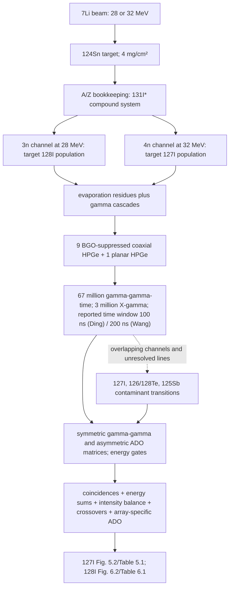

# University of Tsukuba $^{124}\text{Sn}({}^7\text{Li}, x\text{n})^{127, 128}\text{I}$ 在束 $\gamma$ 谱学实验

## Identity

丁兵 2012 年博士学位论文中的在束 $\gamma$ 谱学实验。实验在日本筑波大学串列加速器上进行，通过重离子熔合蒸发反应研究过渡区奇 $A$ 核 $^{127}\text{I}$ 和双奇核 $^{128}\text{I}$ 的高自旋态能级结构。

## Beam, Target and Reaction

- **加速器与束流**：日本筑波大学串列加速器提供的 $^7\text{Li}$ 离子束；28 MeV 用于布居 $^{128}\text{I}$ 的 3n 道，32 MeV 用于布居 $^{127}\text{I}$ 的 4n 道。
- **靶材料**：富集 $^{124}\text{Sn}$ 同位素靶。
- **反应道**：
  - $^{124}\text{Sn}({}^7\text{Li}, 4\text{n})^{127}\text{I}$（32 MeV）
  - $^{124}\text{Sn}({}^7\text{Li}, 3\text{n})^{128}\text{I}$（28 MeV）

## Detector Configuration

- 阵列由 9 套带有 BGO 反康普顿屏蔽的同轴 HPGe 探测器和 1 套小平面 HPGe 探测器（灵敏区薄，专门用于测量低能 $\gamma$ 和 X 射线）组成。
- 5 套 HPGe 探测器位于相对束流约 $37^\circ$ 或 $143^\circ$，其余探测器位于约 $90^\circ$，用于提取 ADO 系数并进行符合测量。
- 使用 $^{152}\text{Eu}$ 和 $^{133}\text{Ba}$ 标准源进行能量与相对效率刻度；$^{60}\text{Co}$ 的 1332 keV 线用于检查探测器能量分辨率。

## Multipolarity Analysis

- 论文第四章介绍 DCO 与 ADO 两种符合分析方法；本论文对 $^{127}\text{I}$ 和 $^{128}\text{I}$ 的实际多极性指认采用 ADO 系数。
- 实验中纯四极跃迁的 ADO 系数约为 $1.29$，纯偶极跃迁约为 $0.64$，混合跃迁位于两者之间；表 5.1 和表 6.1 的实验列标记为 $R_{\text{ADO}}$。

## Known Limitations

- 实验未测量跃迁寿命（未开展 DSAM 或 RDDS 线形分析），也未配备康普顿散射线偏振计；
- 宇称与组态的确定结合了 ADO 多极性、带间/带内强度比、内转换系数、系统学演化规律以及理论 PES/NPA 计算。

## Day 11 reaction-to-level-scheme evidence chain

### Channel bookkeeping and beam-energy exercise

按质量数与电荷守恒，熔合入口可写成 `7Li + 124Sn → 131I*`；这里的 `131I*` 是复合系统的反应记账推断，不是探测器直接测得的状态。蒸发中子后，`3n → 128I`、`4n → 127I`。Ding 论文的 CASCADE/PACE 图给出的是反应道截面随束流能量变化的计算趋势：主要为 3n、4n、5n 道，计算峰值约在 `128I: 26 MeV` 与 `127I: 32 MeV`；作者明说这类程序结果只给趋势。实际实验选了 28 和 32 MeV，并在两个能量点比较 γ 谱，而非把单一能量视为纯反应道（[D12-12](../sources/ding-2012-phd-thesis-127-128i-high-spin.md)，[D12-13](../sources/ding-2012-phd-thesis-127-128i-high-spin.md)，[D12-14](../sources/ding-2012-phd-thesis-127-128i-high-spin.md)）。

用质量数近似束靶质量、靶静止且非相对论的二体运动学：

$$E_{cm} \simeq E_{lab}\frac{A_t}{A_t+A_p}$$

| 束流能量 | 近似 `E_cm` | 目标蒸发道 | 反应残核 |
|---:|---:|---|---|
| 28 MeV | 26.50 MeV | 3n | `128I` |
| 32 MeV | 30.26 MeV | 4n | `127I` |

此处未加入熔合 `Q` 值，故 `E_cm` 不是复合核激发能；也没有 transmission coefficients 或粒子角动量数据，不能由这一步计算自旋布居分布。作为能级图的算术核对，`285.2−167.4=117.8 keV`、`285.2−183.0=102.2 keV` 与论文 `128I` 纲图的两条候选跃迁能量相符；这只是同一纲图的能量闭合，不构成独立赋值（[D12-7](../sources/ding-2012-phd-thesis-127-128i-high-spin.md)，[D12-17](../sources/ding-2012-phd-thesis-127-128i-high-spin.md)）。

### Population, detection, gating and scheme reconstruction

实验事实：阵列的 5 个 HPGe 探测器约位于 `37°/143°`，其余约 `90°`；离线建立 4 个 `4096×4096` 矩阵。ADO 以开窗谱峰面积和对应角组效率构成比值；本实验纯四极/纯偶极参考约为 `1.29/0.64`，只能用于本阵列条件。Ding 论文以 `167.4-keV (6−)` 同质异能态为锚建立 `128I` 高自旋纲图，但现有页内的 `20级/31跃迁` 总数缺少可复核的章节表述；Table 6.1 的 61 个跃迁条目与 Wang 论文报告的 `48级/72跃迁` 口径尚未对齐。两本论文对事件数、反应条件和探测阵列相符，但报告的时间窗分别为 100 ns 与 200 ns，需保留为未解的方法记录差异（[D12-7](../sources/ding-2012-phd-thesis-127-128i-high-spin.md)，[D12-20](../sources/ding-2012-phd-thesis-127-128i-high-spin.md)，[D12-21](../sources/ding-2012-phd-thesis-127-128i-high-spin.md)，[WHX12-5](../sources/wang-haixia-2012-173w-128i-high-spin-thesis.md)，[WHX12-7](../sources/wang-haixia-2012-173w-128i-high-spin-thesis.md)）。

按原文 efficiency correction，若 `A_S`、`A_L` 是同一符合门下待测线在小角组和大角组的峰面积，`ε_S`、`ε_L` 是对应效率，则

$$R_{ADO}(\gamma_x)=\frac{A_S(\gamma_x|\gamma_0)/\epsilon_S}{A_L(\gamma_x|\gamma_0)/\epsilon_L}$$

其中共同的门线效率在比值中消去。此有限角比依赖阵列几何和本实验参考线标定，不能作为跨阵列阈值（[D12-18](../sources/ding-2012-phd-thesis-127-128i-high-spin.md)）。

### Channel and angular-distribution boundaries

- 28/32 MeV 总投影谱对比、已知 127I 线与候选 128I 线的强度变化，以及 γγ 关系构成同位素指认链；碘 K x 射线只说明事件来自碘元素，不能单独分开 `127I` 和 `128I`。
- 论文明确报告谱线双线和其他蒸发残核污染，包括 `127I`、`126,128Te`、`125Sb`；故 beam-energy selection 是目标道选择条件，不保证样本纯净（[D12-14](../sources/ding-2012-phd-thesis-127-128i-high-spin.md)，[D12-15](../sources/ding-2012-phd-thesis-127-128i-high-spin.md)）。
- `R_ADO` 是对同一符合门下不同角组强度的实验判别量；`58.5-keV` 线的 `R_ADO=1.66(60)` 仍不能区分 `ΔI=0` 与 `ΔI=2`，须依赖其它级联/能级信息（[D12-17](../sources/ding-2012-phd-thesis-127-128i-high-spin.md)）。
- Ding 论文未报告 lifetime fit 或 side-feeding 参数，因此不能把观察到的 γ 强度直接变成绝对布居、`B(Eλ)` 或通用 alignment 宽度。Draper 1970 的 stretched-E2 推导显示 cascade feeding 与 side feeding 可混成非单一 Gaussian 的磁次态分布（[DR70-3](../sources/draper-1970-gaussian-substate-side-feeding.md)）；Ekstrom 1979 则警告忽略较高激发能态的 γ feeding 会使 direct-population alignment 预测偏低（[EK79-7](../sources/ekstrom-1979-spin-alignment-attenuation-a61-a67.md)）。两者是方法边界，不是对本实验的拟合。
- 跨质量区对照：Herzáň 2015 的 `193Bi` 使用 `165Ho(32S,4n)`、JUROGAM II–RITU–GREAT、recoil gating 和 isomer tagging；该独立实验的 916-keV gate 谱仍标出 `165Ho` 峰，说明门与 recoil/isomer tag 能加强归属但须逐门检查污染。它不是 `127/128I` 的重复测量（[HE15-1](../sources/herzan-2015-193bi-spectroscopy.md)）。
- Wang thesis 追溯到 Zheng 等 2009 `High-spin states in 128I`（Crossref DOI [`10.1088/1674-1137/33/S1/057`](https://doi.org/10.1088/1674-1137/33/S1/057)），并说该报告未给能级激发能、自旋宇称和组态；该项 publisher access probe 也返回 restricted。2010 Wang et al. 与 2011 Ding et al. DOI 元数据均含这两篇 thesis 的作者及共同团队，但期刊全文/逐事件 acquisition comparison 当前不可得。Ding 与 Wang 两本论文所报的 67M γγt、3M Xγ、28/32-MeV束流及阵列指纹完全吻合，故目前按高度可能共享的 Tsukuba acquisition lineage、不得重复计独立实验；100/200-ns 时间窗和方案总数差异继续标为未决，不能据此断言方法修订或独立重复（[WHX12-8](../sources/wang-haixia-2012-173w-128i-high-spin-thesis.md)，[D12-16](../sources/ding-2012-phd-thesis-127-128i-high-spin.md)，[D12-19](../sources/ding-2012-phd-thesis-127-128i-high-spin.md)）。

## Sources

- [[ding-2012-phd-thesis-127-128i-high-spin]]：D12-1 至 D12-21，第 3-6 章；实验装置与 ADO 方法见 PDF pp.54-57、75-79。
- [[wang-haixia-2012-173w-128i-high-spin-thesis]]：WHX12-5、WHX12-7、WHX12-8；同一反应实验指纹、符合窗差异与 2009 先行报告边界。
- [[draper-1970-gaussian-substate-side-feeding]]：DR70-1、DR70-3、DR70-7；population/feeding 的方法边界。
- [[ekstrom-1979-spin-alignment-attenuation-a61-a67]]：EK79-2、EK79-5、EK79-7；CNR alignment 预测不确定度与 feeding 边界。
- [[herzan-2015-193bi-spectroscopy]]：HE15-1；跨质量区 RDT/isomer-tagging 门控对照，不与 I 数据合并。
