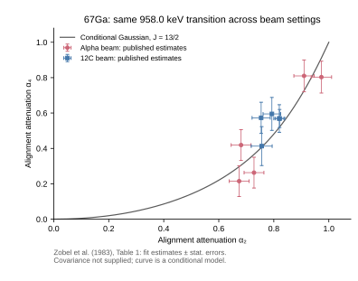
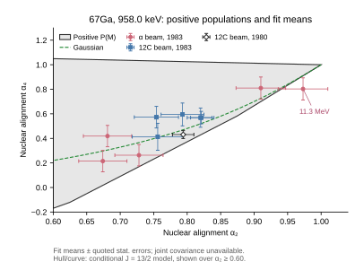

# γ 射线角分布分析（Gamma-Ray Angular Distribution）

## Purpose

角分布分析利用不同探测角度的 γ 射线强度来约束 transition multipolarity、mixing ratio 和 emitting level orientation/alignment。

## Inputs and Assumptions

- 探测器角度与效率归一化；
- transition spin sequence、multipolarity 和可能的 mixing ratio；
- emitting level 的 magnetic-substate population 或等效 attenuation/alignment 描述；
- feeding path、side feeding、寿命和 Doppler broadening 等系统项。

## Source-Level Foundation

[[draper-1970-gaussian-substate-side-feeding]] 对 stretched E2 transitions 给出 `A2/A4` 与 Gaussian side-feeding substate population 的 exact treatment。[[zobel-1980-magnetic-substate-distributions]] 明确指出若 alignment 已知，角分布可用于 multipolarity and mixing-ratio determination；但只有两个 angular-distribution coefficients 时，同时确定 `α2`、`α4` 和 `δ` 会有歧义。

### Ionescu 1981: `167Tm` feeding-aware angular-distribution test

Ionescu et al. measured pure-E2 angular distributions in `165Ho(α,2n)167Tm`. Their pure-E2 test found that one global Gaussian magnetic-substate distribution failed for the studied `167Tm` data. The proposed fit keeps Gaussian side feeding but adds discrete direct-feeding components, `D_T(m)=D_s(m)+Σ_jD_j(m)`; pure-E2 transitions constrain the population model before mixed `M1+E2` transitions are fitted for `δ` (IO81-4/5/6/8/9). This is a reaction-specific counterexample and analysis workflow, not direct evidence about Ding's `127/128I` spectrum and not a universal rejection of Gaussian models.

## Relation to Other Methods

Angular distribution 可与 [[multipole-mixing-ratio]]、[[dco-ratio]] 和线偏振共同约束 `δ`。不同实验几何、beam energy、projectile 或 target condition 下得到的角分布参数不能无条件混用。

ADO（angular distribution from oriented states）ratio 是有限角组实现：在相同 gate 下比较不同探测器角组的归一化强度，并用本实验已知 multipolarities 标定 dipole/quadrupole 区域。[[liu-2016-octupole-correlations-multiple-chiral-doublet-bands-78br]] 的 AFRODITE 几何给出 stretched quadrupole 约 1.1、pure stretched dipole 约 0.7；这些阈值不得跨阵列复用。

[[zheng-2002-ado-coincidence-angular-anisotropy]] 给出符合模式下 ADO 的显式效率修正：`R_ADO(γ1)=[I^S/I^L]/[ε_S(γ1)/ε_L(γ1)]`，并将其写为待测 γ 的角分布比乘以门控 γ 和探测器响应共同决定的 `f_ADO`。在 `145Tb` 的 12 套 BGO-HPGe、约 `±32°/±58°/90°` 三角度组中，门控能量 `100–1500 keV` 的 `f_ADO` 最大偏差约为四极门 `5.2%`、偶极门 `3.2%`；该来源报告的纯四极约 `R_ADO=1.25`、纯偶极约 `0.75` 只能作为本阵列的局部标定，不能替代新阵列的参考线验证。

## Tracking-Array Formalism

[[lauritsen-2025-gamma-angular-formalism-tracking-arrays]] gives a modern tracking-array notation for in-beam angular distributions: `omega(theta)=A0+alpha2 A2 P2(cos theta)+alpha4 A4 P4(cos theta)+...`. In that local formula, `Amax_k` contains the spin sequence, multipolarities and mixing ratio `delta`, while `alpha_k(J)` is the nuclear alignment/deorientation attenuation calculated from magnetic-substate population `Pm(J)`. The same source usually parameterizes `Pm(J)` as a Gaussian with normalized width `sigma/J`.

This `alpha_k` must not be merged with detector solid-angle attenuation. Lauritsen 2025 uses detector attenuation in the source-correlation formalism and nuclear alignment attenuation in the in-beam angular-distribution formalism; the local definition controls the meaning.

## What It Can Establish

在 alignment 或 population model 足够受控时，角分布可约束 transition multipolarity、mixing ratio 和 attenuation/alignment 参数。

[[rose-brink-1967-phase-defined-angular-distributions]] 给出 phase-consistent 基础：一般分布使用布居/取向张量 `B_K`、几何/多极系数 `R_K` 和约化 interaction-multipole matrix elements。轴对称条件使表达式成为 Legendre 展开；初末态宇称确定且不测 γ 偏振、对 helicity 求和时，只含偶 `K`，即使初态有 polarization 也成立。另一项充分条件是 `w(−M)=w(M)`，它使奇 `B_K` 消失；不能仅凭“初态 polarized”就声称出现奇 `K`（RB67-4，printed p.320 / PDF p.15，Eq.3.40/3.41）。

[[der-mateosian-sunyar-1974-angular-coefficients]] supplies practical `A_2/A_4` tables through `J=26` (integer) and `51/2` (half-integer). The worked example solves `σ/J` and δ jointly, and explicitly warns that angular-distribution and γγ-correlation δ signs may differ under their respective conventions.

[[yamazaki-1967-aligned-angular-coefficients]] is the earlier coefficient-table backbone: it defines complete-alignment `B_k`, `F_k` and cascade `U_k` tensors for integral and half-integral spins, then applies Gaussian magnetic-substate attenuation. Its explicit angular-distribution/γγ-correlation δ-sign warning is retained as a convention boundary, not merged into a detector calibration.

## What It Cannot Establish Alone

仅凭两个角分布系数通常不能同时唯一确定 `α2`、`α4` 与 `δ`；弱峰、短寿命、Doppler broadening 和 feeding ambiguity 会增加多解风险。

## Practice-Level Boundary

[[chiara-2012-cu65-cu67-core-coupled-protons]] adds a practical spectroscopy example: the angular-distribution calculation for `65Cu` used an assumed `sigma/I = 0.5` because it reproduced known transitions, and the fitted `delta` of one `1115 keV` line changed when the assumed alignment width changed.

[[summary-2013-bases-spin-parity-assignments]] adds reference-guide background that high-spin assignment heuristics are often quoted with a typical orientation parameter, here `σ/I = 0.3`, but that guide-level value is not by itself a demonstrated universal Gaussian prior.

Angular-distribution evidence is one of the standard inputs collected on [[spin-parity-assignment]] pages.

Liu 2016 将 ADO 与 linear polarization 联合用于 `78Br` linking transitions，并由 404.3 keV line 的 `R_ADO=0.79` 与负 polarization 支持 `M1/E2` 及相对 spin revision。

## ADO计算单：额外输入、self-exclusion与误差

以下是 Day14 运行中恰好下一张 Day15 的无学分预习。原文定义来自 [[zheng-2002-ado-coincidence-angular-anisotropy]] Z02-1/6/7/8；数值、效率、布居和 covariance 均为本任务自设练习，不是 `145Tb` 或 `193Bi` 的实验重分析。

### 原式的方向与组效率

令 `γ1` 为待测线、`γ2` 为门控线，`S/M/L` 为三个角组。Zheng PDF p.2 式1/3/4/5给

\[
R_{\mathrm{ADO}}=\frac{I_S/I_L}{\varepsilon_S(\gamma_1)/\varepsilon_L(\gamma_1)}
=\frac{\omega_1(\theta_S)}{\omega_1(\theta_L)}f_{\mathrm{ADO}},\qquad
f_{\mathrm{ADO}}=\frac{C-\omega_2(\theta_S)\varepsilon_S(\gamma_2)/N_S}
{C-\omega_2(\theta_L)\varepsilon_L(\gamma_2)/N_L},
\]

\[
C=\sum_{g=S,M,L}\omega_2(\theta_g)\varepsilon_g(\gamma_2).
\]

`εg` 是该组效率之和，`1/Ng` 修正不能用同一探测器形成 self-coincidence；不能再把待测线组效率多除一次。若输入只有两个角组计数和 target-energy 效率比，只能求 `R_ADO`；求 `f_ADO` 还需独立的本征角分布比或 Eq4/5 的 gate/geometry 输入。用同一个 `R_ADO` 当本征参考会把 `f=1` 变成恒等式，不能验证修正。

### 单探测器展开及失败控制

在原式所用 `ω1ω2` 分离模型内，定义 `ai=ω1(θi)εi(γ1)`、`bi=ω2(θi)εi(γ2)`、`C=Σj bj`。显式 ordered detector-pair 求和给

\[
I_g=K\sum_{i\in g}a_i(C-b_i)=K A_g(C-\bar b_g),\qquad
A_g=\sum_{i\in g}a_i,\quad
\bar b_g=\frac{\sum_{i\in g}a_i b_i}{A_g}.
\]

组内角响应相同时，`Ag=ω1(θg)εg(γ1)`；组公式进一步以 `ω2(θg)εg(γ2)/Ng` 近似 `b̄g`。同样的组效率总和不保证这一替换成立，因为 self-exclusion 还含两个能量的逐探测器效率乘积。自设 `32°/58°/90°`、每组4台、target组效率 `.04/.06/.05`、gate组效率 `.04/.04/.04`、target/gate `(A2,A4)=(.24,−.07)/(.30,.08)` 时，均匀组内响应给 `f=.974006`；只把S组两个能量的效率各改成 `.002/.002/.002/.034`、保持组总和，则显式 pair 结果为 `.772081`。这是近似失败例，不是原阵列的校准误差。

若 `bi≥0`，令 `η=max_i bi/C<1`，则 `1−η≤f≤1/(1−η)`，其中还假设上述组内角响应相同且效率修正方向一致。每组4台且组内 gate response 均匀时，`η≤1/4`，必要范围为 `.75≤f≤4/3`；探测器数量增加只在 response 不集中到少数台的条件下使 self-exclusion 变小。论文的38个 unordered hardware pairs 与自设 energy-labelled ordered assignments 的44项是不同计数对象，不能从 `38/16` 直接推标准误差或独立样本数。

### 误差传播与可识别性

自设 `NS=5000`、`NL=4800`、效率比 `e=.80±.016`，另给独立本征参考 `r=1.34±.04`。此处 `NS/NL` 表示计数，勿与上文探测器数量 `N_S/N_L` 混用。得到 `R_ADO=1.302083`、`f=R_ADO/r=.971704`。在两个计数为独立 Poisson、其它输入独立的练习条件下，`σf=.040057`。一般应计算

\[
\sigma_f^2=\nabla f^\mathsf T\Sigma\nabla f,\qquad
\nabla f=f(1/N_S,-1/N_L,-1/e,-1/r).
\]

仅改变自设效率比与参考比相关系数 `ρ=−.8/0/+.8`，`σf` 分别为 `.026508/.040057/.050065`。共享 events、峰拟合/背景、效率与参考共用的校准数据会破坏独立假设；原文 Fig1 的最大计算偏离 `5.2%/3.2%` 不是完整实验 uncertainty 或本练习的 `σf`（Z02-7）。

### 角度采样与Day14的条件桥

等权 `32°/58°/90°` 的 `ΣP2=0`、`ΣP4≈−.01712974`。本任务推得 `31.7175°/58.2825°/90°` 可使两者同时为零；这依赖等权及只考虑K2/K4，作者未声明该阵列据此设计。实际 gate 效率不等、角相关、finite acceptance 或 higher ranks 均需另核。

[[linear-polarization-asymmetry]]“未分峰偏振的联合命题与选择条件”的 common-selection point-response 模型，若只用乘法几何 `f` 把其必要域接到 [[herzan-2015-193bi-spectroscopy]] HE15-9 的 shared mean，至少需 `f≈1.488716`，对应 self-exclusion bound 的必要 `η≥.32828`。这只是跨两项条件模型的任务推导；`145Tb` 的均匀4台组上界不足，不构成 JUROGAM 的实际排除，因为没有其 matched gates、逐台响应、完整 γγ correlation、polarization weighting 或 joint covariance。

复算入口：`system/scripts/day15_ado_preview_worksheet.py`；结果和图位于 `outputs/learning-daily/20261014-DAY14-week-two-spectrum-to-level-scheme-exam-run-02/day15-ado-preview-worksheet.json`、`day15-ado-input-uncertainty.svg`。28项 pair-sum/limits/gradient/PSD/不可识别性检查通过；图经PNG视觉核验。这里保存定义、推导、数值和边界，使可复用知识不只留在 outputs。

### 来源谱系与下一项可检验问题

Z02-8明确2002方法文用 Ref3 的 `145Tb` 实验数据，DOI `10.1007/s100500170001` 只核到metadata；不能把方法文与对应实验引用计成独立采集。当前最高信息问题是：原式的 `ω1ω2` 分离响应在什么 gate/acceptance 条件下逼近完整 joint γγ response，怎样用同阵列参考线与换门检验。需要实际 detector-pair acceptance、alignment/feeding、净计数及 covariance；这些输入缺失时保持条件推导与实验事实分层。

### 分离式与完整符合响应的补充

[[angular-correlation]]“条件γγ响应：各向同性marginal仍可有角关联”在RB67-3与Z02-9基础上给出35-check独立toy：pure E2的两个singleγ均isotropic，但自设12方向pair响应给R=.729470，Eq4分离组公式给1。无self-exclusion的ring gate也产生非1条件比，因此self-exclusion与角关联是两项不同的依赖。只平衡ΣP2/P4的极角不保证消去q=±4方位项；真实response须有逐pair acceptance。

[[rose-brink-1967-phase-defined-angular-distributions]] RB67-3对应printed326/PDF21 Eq3.73；[[zheng-2002-ado-coincidence-angular-anisotropy]] Z02-9对应printed910/PDF2 Eq2。这个结果限定公式迁移，并不重估Zheng或Herzáň的实验误差。共同energy gate仍可能因same-detector/pair/Compton cut而给target-dependent gate effect；原point outer set的common-selection条件应通过实际响应核验。

## Zobel1983：同parent反应条件与Gaussian诊断

[[zobel-1983-energy-projectile-alignment]] Z83-11/12/13/14补充了published-data层的约束。原六页mainline已视觉复核；以下十行来自printed392/PDF4 Table1的958.0-keV列，Fig1给 `3031.7(13/2+)→2073.7(9/2+)`，Table1将level能量取整。所有非空同parent行均保留；alpha9MeV原表空白，未补零。

| projectile / lab E(MeV) | alpha2±quotedstaterror | alpha4±quotedstaterror |
| --- | --- | --- |
| alpha / 11.3 | .973±.037 | .803±.090 |
| alpha / 12 | .910±.037 | .810±.090 |
| alpha / 15 | .681±.036 | .419±.087 |
| alpha / 18 | .728±.036 | .263±.087 |
| alpha / 22 | .674±.036 | .215±.087 |
| 12C / 32 | .793±.032 | .595±.093 |
| 12C / 36 | .821±.016 | .569±.051 |
| 12C / 40 | .820±.020 | .569±.078 |
| 12C / 44 | .754±.033 | .573±.088 |
| 12C / 48 | .756±.038 | .413±.110 |

### 事实、解释、共同输入

这些是corrected angular intensities的least-squares fit outputs，quotederrors为statistical，不是rawcounts或完整systematic误差。原Fig2/3直接显示条件变化；heavy-ion变化与precedingγ multiplicity的联系、light-projectile变化与direct/cascade feeding的联系，是作者解释（Z83-4/5/6）。作者对quantitative feeding分析明确保留误差较大限制（p393）。

把两端quotederrors当std且各能区独立时，alpha22−11.3MeV的差为 `Δalpha2=−.299±.051624`、`Δalpha4=−.588±.125176`；12C48−32MeV为 `−.037±.049679`、`−.182±.144045`。这些误差仅是明示的独立stat近似，不给实验显著性或消除共用efficiency/calibration。

Z83-12是重要counter-boundary：作者p393明确讨论alpha2/alpha4统计dependence、error ellipse与errorbar rectangles，Table1却没有数值Cov。原caption采用delta=0，纯E2依据来自Ref4此前angular/polarization；Ref5是cascade/cov method（Z83-13），不能把输入与当前拟合再算成独立采集。它与Herzáň193Bi是不同data context，但不能认证本源每一点与所有前文都采集独立。

### 自定义Gaussian标准差的条件计算

为数值练习定义 `w_s(M)∝exp[−M²/(2s²)]`，s为本任务standard deviation。将half-integer complete-alignment参考设为 `|M|=1/2`；不把s/J称作原文实测sigma/I，也不直接映射用户实现。令 `S=J(J+1)`，rank2/4 diagonal tensor可按比例写成

\[
T_2(M)=3M^2-S,\qquad
T_4(M)=35M^4-(30S-25)M^2+3S^2-6S.
\]

本模型 `alpha_k(s)=ΣM w_s(M)T_k(M)/T_k(1/2)`。独立 `J⊗J→k` CG构造与这两个Stevens polynomials对J=7/2、9/2、13/2、17/2一致；isotropic tensors为0、窄s极限为1、alpha2单调。这里T是population tensor，不是实验transition strength B(EL)或detector Q。

只用958-keV alpha2中央值求条件s/J，alpha11.3与22MeV分别为 `.127046/.365043`。这不是jointfit；对应model alpha4为 `.911361/.296712`，与published alpha4还需比较且必须有Cov/response。11.3MeV的alpha2中央值加quotederror跨过模型1端点，线性化也不能代替有边界的完整posterior。

若残差 `r=alpha4−g(alpha2)`，delta-method variance为 `Var(r)=sigma4²+[g′ sigma2]²−2g′Cov(alpha2,alpha4)`。对11.3MeV点，单独选择rho=−.8/0/+.8给sigma_r `.197717/.148564/.071067`；这些是chosen covariance sensitivity，不是作者矩阵、jointCI或Gaussian排除概率。原文没有提供的raw spectra、fitCov、efficiency/solid-angle response不能由误差条补出，actual L4 replay保持not-ready。

### Feeding mixture与坐标核算

作者Z83-8/Fig5指出不同variance的feeding components可产生非单Gaussian。自设s/J=.12与.38、first-weight=.45，同一J=13/2的convex population mixture给 `(alpha2,alpha4)=(.797082,.564819)`；相同alpha2的singleGaussian给alpha4低 `.089121`。这不是Fig3 feedingfraction的拟合。统计张量的线性期望使mixture在alpha-plane中连线；population的log是两个指数的log-sum，若至少三个不同|M|、两width不同且两weight非零，严格曲率阻止其变为一个单Gaussian。观测到Gaussian-consistent两个moments也不能独自证明完整population family。

Fig3的above-threshold六ticks还能做一个坐标cross-check：用mass-number CM近似 `(64/68)Ealpha_lab−4−3.0317 MeV`，重构六值与printedticks最大差 `.004182 MeV`。4MeV按caption阈值幅度扣除；这是任务推导，不认证作者精确mass recipe、有效束流能量/targetloss，也不将其写成正的反应Q。



图保留该958列全部10个published fit estimates，误差条为quotedstat marginals；灰线为本任务模型。C点相近重叠按原位置保留。图与CSV/fixture、code、PDF/PNG和QA位于同run，复算入口 [day14_zobel83_alignment_worksheet.py](../../system/scripts/day14_zobel83_alignment_worksheet.py)，38项数值核验通过；singlepanel alignment为not applicable，PDFminfont8pt/collision0fail0warn及PNG视觉核验通过。源码3个export/width warnings按140×110mm Wiki图、400dpi preview、vector正文合同逐项复核。

### 认识修正与边界

决定 `supports` reaction/beam/feeding-aware reference transfer，`limits` 将local alignment或Gaussian-consistent pair移植成统一sigma/I，以及按两条误差直接作joint检验。Z83-9对同energy/同target的要求还涉及有效束流能量与targetloss，不能只说同一acquisition即可。本案例只给方法证据，不改变193Bi/A≈130模式排序，不给Day15学分；原人审仅覆盖继承内容，本run新增是Codex自审。

## 角采样与归一化下的Cov可识别性

[[zobel-1983-energy-projectile-alignment]] Z83-12要求处理alpha2/alpha4统计dependence；Z83-15给实际angles与两run normalization。以下是knowngeometry上的chosen design，sourceGF/rawintensities/efficiency/monitor/fitCov未提供，不是其重拟合。

### 先规定fitted-normalization的模型

取三parameter prototype `y=Xβ`、`X=(1,P2,P4)`、`β=(F,F A2exp,F A4exp)`，point detector、delta=0及pureE2 13/2→9/2作为声明输入。任务CG kernel/独立Legendre积分给complete-alignment max coefficients `c2=40/91`、`c4=−216/1001`。这里用原alpha11.3 fit point `(alpha2,alpha4)=(.973,.803)`作为local Jacobian点、F=1；C geometry也保持此点以隔离geometry effect，不称C组实测中心。

\[
\alpha_k=\frac{\beta_k}{F c_k},\qquad
J_\alpha=\begin{pmatrix}-\alpha_2/F&1/(F c_2)&0\\-\alpha_4/F&0&1/(F c_4)\end{pmatrix},
\qquad C_\beta=(X^\mathsf TV^{-1}X)^{-1},\quad
C_\alpha=J_\alpha C_\beta J_\alpha^\mathsf T.
\]

同一结果由whitened/QR路线、直接 `(F,alpha2,alpha4)` Fisher parameterization及profile-out F的Schur complement核验。把F当已知是另一个variance问题，不能删掉其Jacobian/cross terms再称同一normalized fit。

### 已知angle不代表已知rho

同fit点、chosen equal absolute intensity variance，C的0/57/90/158度设计给rho `+.504879`；alpha两run的61/105/146.5、43/87/128.5度给 `−.631222`。这些是prototype结果，不是Zobel真实rho；实际权重与normalization未知。

对同一alpha六角、同一local point，在chosen log-variance bounds内找到两组positive diagonal V，经scale保持marginal sigmas `.037/.090`：

| chosen example | Var(alpha2) | Cov(alpha2,alpha4) | Var(alpha4) | rho |
| --- | --- | --- | --- | --- |
| A | .001369 | −.00321010 | .008100 | −.963993 |
| B | .001369 | −.000474668 | .008100 | −.142543 |

两组mean/marginals/geometry相同而Cov不同，说明这些输入不足以选定joint判断。它们是可行variance样例，optimization未认证global rho bounds，更未恢复实际GF。按angles `(61,105,146.5,43,87,128.5)`，chosen diagonal V 的六个variance为：

```text
A = 5.59601616291e-05, 1.80167500475e-05, 0.000413492773582, 7.57338432404e-06, 7.57338432404e-06, 0.000413492773582
B = 0.000118505201881, 0.000875641584711, 0.000104813215223, 0.000875641584711, 0.00024144976543, 1.60379350615e-05
```

这些归一intensity variance不是source的新观测量或误差预算；代码中的log-shape bounds为[-2,2]、首项log-shape固定0，最后统一scale以匹配目标marginals。

### 全局mode与分run mode的区别

同一个multiplicative mode沿 `δβ∝β`，满足 `Jαβ=0`，因此在本linearized normalized model中一阶取消；data covariance加 `tau² yyᵀ` 给beta covariance加 `tau² ββᵀ`，normalized alpha不变。它不使所有角度/不同run的normalization误差消失。

以example B为基准，仅第一组三angles加入chosen relative monitor sigma `.02` 的common mode，alpha covariance变为 `(.00170730,−.00168633;−.00168633,.01243972)`。这是source两run结构所启发的控制，不是作者monitor error。需要真实producer/raw count IDs、angular-fit weights、efficiency/normalization及Sigma，才能判断dataset中的mode与geometry。

复算 [day14_angular_fit_covariance_design.py](../../system/scripts/day14_angular_fit_covariance_design.py)；完整输入/variance/examples在 `outputs/learning-daily/20261014-DAY14-week-two-spectrum-to-level-scheme-exam-run-02/angular-fit-covariance-design.json`，26项coef/jacobian/rank/PSD/QR/Fisher/Schur/scale/mode控制通过。决定 `limits` 从两个errors+knownangles反推Cov，`supports`保存fitted-normalization和shared-monitor结构；无actual GF/事件重放、实验significance或新sigma/I/line assignment。Day15仍仅无学分preview。

## Sources

[[twin-1970-polarization-angular-correlation-40k]] combines near-threshold `a2/a4` angular distributions, γγ correlations and Compton polarization; it shows that joint fits can resolve δ branches that a single angular distribution cannot.

- [[draper-1970-gaussian-substate-side-feeding]]
- [[zobel-1980-magnetic-substate-distributions]]
- [[ionescu-1981-improved-angular-distribution-analysis-particle-xn]]
- [[zobel-1983-energy-projectile-alignment]]
- [[lauritsen-2025-gamma-angular-formalism-tracking-arrays]]
- [[chiara-2012-cu65-cu67-core-coupled-protons]]
- [[summary-2013-bases-spin-parity-assignments]]
- [[liu-2016-octupole-correlations-multiple-chiral-doublet-bands-78br]]
- [[zheng-2002-ado-coincidence-angular-anisotropy]]
- [[taras-1971-phase-defined-polarization-formulas]]
- [[taras-1970-particle-gamma-angular-correlations]]

## Evolution Log

- 2026-07-13：加入 Liu 2016 的 AFRODITE ADO calibration 与 ADO+polarization assignment 案例。
- 2026-10-15：Day14内无学分Day15预习，固化Zheng原式、组/单探测器self-exclusion、额外输入与误差练习，并修正RB偶K适用条件；不改review状态或给予Day15学分。


## Zobel1980附录：字面公式与联合覆盖

[[zobel-1980-magnetic-substate-distributions]] Z80-14–19补充原9页扫描的公式、表与依赖边界。本文“Cov必须保留”的Z80-12一般结论仍成立；以下将扫描转录和本任务独立代数分开，不认证officialerratum，也不重算实验ALY检验。

### 归一误差不能照抄省略项

原A1定义角fit的未归一b0/b2/b4；A2后rho为Cov/(sigma0 sigmak)。扫描的A2字面只写 `a_k²[σ_b0²/b0²+σ_bk²/bk²−2ρ]`。从a_k=b_k/b0的Jacobian应得：

\[
\operatorname{Var}(a_k)=\frac{C_{kk}}{b_0^2}
+\frac{b_k^2C_{00}}{b_0^4}
-\frac{2b_kC_{0k}}{b_0^3},\qquad
C_a=J C_b J^{\mathsf T}.
\]

b_k非零时可写相对误差形式，其相关项需额外乘 `σ_b0 σ_bk/(b0 bk)`；b_k=0仍应用有限Jacobian，不用发散的相对误差表达。选择b=(1000,300,−100)、positive-definite Cb=(100,30,−10;30,25,2;−10,2,16)，正确Var(a2)=.000016，扫描A2字面给−.107966。该负数是公式控制，不是实验负variance。

A3的扫描标准差除Amax未印abs；固定非零c时应有sigma_alpha=sigma_a/|c|。原Table1 958行同时列a=(.349,−.093)、quotederrors=(.007,.007)及alpha=(.794,.431)、errors=(.016,.032)，与任务c=(40/91,−216/1001)在打印舍入内一致。它核验变量约定，不提供source实际Cov或新independent events。

### 椭圆半径、交叉项与覆盖

p231 A4的Gaussian density定义Q=rᵀΣ⁻¹r，cross term为负；A6的a,c=(D/2)乘相应variance，所以一致的polynomial是Q/2，b应为−D Cov。扫描却印+b=+D Cov，并在polynomial用+b cross；同Cov时会翻转ellipse方向。A5的r²=ln[1/(1−x)]须与Q/2约定配对，不能单独判为遗漏2。

在声明的二维Gaussian模型下：

\[
P(Q\le t)=1-e^{-t/2},\qquad
Q_{68\%}=-2\ln(1-.68)=2.278868566.
\]

对应半径平方1.139434283；若错将其作为完整Q阈值，覆盖仅.434314575。Q=1覆盖.393469340；独立两维±1sigma rectangle覆盖.466064943，均非joint68%。给区域前应先说明维数、probability与quadratic convention。

自选sigma=(.03,.06)、rho=+.6和one-sigma同向残差时，A4给Q=1.25，一致Q/2=.625；扫描A6字面polynomial=2.5。512/1024-node polar积分核验，该wrong-cross-sign ellipse在真实chosen positive-rho density下覆盖.520066461，而非.68。这里的“真实”仅指声明控制的生成Cov，绝非source实测rho。68%ellipse的area不必大于errorbar rectangle；它与rectangle也不存在通用包含关系，不能把源文“enlarged”的说明当集合定理。

### 源输入与适用条件

Z80-17的958行来自reactionA=57Fe+12C/40MeV，Z80-18的Ref9与[[zobel-1983-energy-projectile-alignment]] Z83-13中的Ref4同为Zobel1979 NPA316,165。方法/编译与后续扫描的引用链不能认证采集独立；本任务没有cross-dataset covariance或原producer事件。原p227的pure-E2/error-readable/weak-line筛选及ALY前提保留，非Gaussian布居仍可能给相同两个moments。

Z80-19：当前九页scan没有找到p229所指Table3，GNOMON代码又被原Ref14列为unpublished，故不补出Fig5的数值loss表或实际代码重放。必要companion是对应角度的完整peak-profile/面积校正、匹配spin/δ/feeding和完整fitCov；missing inputs维持实验L4 not-ready。

复算：[day14_zobel80_appendix_audit.py](../../system/scripts/day14_zobel80_appendix_audit.py)，source-derived single-row fixture和所有chosen矩阵见Day14 run的zobel80-appendix-analysis.json。23项检查包括ratio/zero-coefficient、positive-Cov、A2/A3/A6字面失败控制、Gaussian内容与极坐标积分收敛、打印舍入和面积边界。决定revises精确公式执行，supports保留Cov的一般方法，limits从两条marginalerrors或文献引用推真实joint检验；原source人审范围与false标记保留，新14–19 true。Day15仍为无学分partial preview。


## 正布居矩可行域与源表中央值

输入来自[[zobel-1983-energy-projectile-alignment]] Z83-11的十个同parent表行、[[zobel-1980-magnetic-substate-distributions]] Z80-17的一行及Z80-1的核张量定义。源表采用δ=0；以下假设J=13/2、diagonal且P(M)=P(−M)、complete-alignment参考为|M|=1/2，并假设α已由正确响应还原。这些是条件运动学检查，不等于该反应的布居先验或实验重拟合。

令七个正|M|的pair概率 q_M=P(M)+P(−M)≥0、Σq=1。以S=J(J+1)、x=M²定义T2=3x−S、T4=35x²−(30S−25)x+3S²−6S，各除以|M|=1/2参考值。它们与此前CG张量构造核验一致。于是α=Σq_M v_M，完整允许域是下表七个点的凸包：

| M的绝对值 | α2纯pair值 | α4纯pair值 |
| --- | --- | --- |
| 1/2 | 1 | 1 |
| 3/2 | 7/8 | 7/12 |
| 5/2 | 5/8 | −13/108 |
| 7/2 | 1/4 | −23/27 |
| 9/2 | −1/4 | −11/9 |
| 11/2 | −7/8 | −77/108 |
| 13/2 | −13/8 | 143/108 |

表头中的|M|表示M的绝对值。Gaussian一参数曲线和ALY的feeding条件是额外限制；它们不等于一般正布居凸包。该凸包也不证明每个允许布居都能由选定reaction实际实现。先前[[rose-brink-1967-phase-defined-angular-distributions]] RB67-26已经给出pure-E2高阶布居盲区，本节增量是对真实原表中央值的完整可行性检查。

### 精确证书与全部输入覆盖

对任何表中顶点，都有 α4−(10/3)α2+7/3≥0；七列的精确值依次为0、0、7/54、35/54、35/18、245/54、245/27。α2在7/8至1之间时，该面就是lower hull：α4≥1+(10/3)(α2−1)。

源alpha11.3-MeV中央值(.973,.803)给线性泛函−107/1000，而凸包在α2=.973要求α4≥.910。故该打印中央值不能作为声明条件下正布居的精确两个矩；三位小数舍入的最大修正也只给−629/6000，仍负。这是Farkas不可行证书，不是实验被排除、作者代码出错或测量错误的证据。实际joint Cov、有限样本likelihood、δ/geometry/area校正与feeding约定仍缺。

| 来源 / projectile / lab E(MeV) | 中央值(α2,α4) | 条件可行性 |
| --- | --- | --- |
| Z83 / alpha / 11.3 | (.973,.803) | exact-moment条件下不可行 |
| Z83 / alpha / 12 | (.910,.810) | 可行 |
| Z83 / alpha / 15 | (.681,.419) | 可行 |
| Z83 / alpha / 18 | (.728,.263) | 可行 |
| Z83 / alpha / 22 | (.674,.215) | 可行 |
| Z83 / 12C / 32 | (.793,.595) | 可行 |
| Z83 / 12C / 36 | (.821,.569) | 可行 |
| Z83 / 12C / 40 | (.820,.569) | 可行 |
| Z83 / 12C / 44 | (.754,.573) | 可行 |
| Z83 / 12C / 48 | (.756,.413) | 可行 |
| Z80 / 12C / 40 | (.794,.431) | 可行 |

十条扫描行和一条必要companion都使用同一criterion，没有删掉不适配的点或补alpha9空白。每个可行点均保存LP求得的严格正、归一、匹配两矩的witness，最低pair概率为.005751至.029013。它们是数学见证，不是实测P(M)；三个线性约束对七个pair量仍留四个局部自由方向。来源之间的采集独立性仍由Z80-18/Z83-13边界限制。

### 误差区域相交仍需真实Cov

只把原quotederrors(.037,.090)作为std并另选ρ，以二维Gaussian作敏感性控制。最近凸包点逐一遍历七条边，再独立用该active面投影核验。Q68%=2.278868566，ρ=−.8/0/+.8/+.95分别给最近距离平方.278760/.491139/2.062470/5.154627；前三个chosen椭圆相交，最后不相交。临界ρ=.823744449仅属于这个chosen Gaussian/quoted-marginals/固定模型，不是实测ρ界。

因此中央值不可行与实验排除是不同命题；真实Cov/响应未知时不给显著性或任意实验判别。也不能把有正witness的两个矩当作完整布居或Gaussian模型的唯一验证。必要companion是完整角fit与面积/效率/monitor Cov、独立的multipolarity/purity误差和匹配feeding条件；1979 Ref4/9的原研究是正在核查的输入路线。



图中数据是11个published fit means与quoted marginal errors，灰域和绿色曲线是本任务条件模型；只显示α2≥.60的视野，完整七顶点与全域证书保存在上表/计算。图不画source joint CI、实验拒绝率或Gaussian拟合。数据未jitter/删除，1980/1983图标不代表独立采集。

复算：[day14_positive_population_hull.py](../../system/scripts/day14_positive_population_hull.py)；完整source rows、rational halfspaces、LP状态/witness、chosenΣ与最近点在本run positive-population-hull.json。40项检查均通过。决定revises“先从alpha2反演Gaussian宽度而不审两矩可行性”的分析顺序，supports先保存核态正性/响应/未知Cov边界；无实验重拟合或新σ/I/结构模式赋值，Day15仍无学分。


### 67Ga reference-purity与DCO的实际字段补核

[[nndc-2005-67ga-selected-level-gamma-records]] N67-2/3将reference958标E2(+M3)、δ=−0.00(1)，给出有限quoted .01及alpha1978AL32的依赖；Fe对象再用adopted不计独立δ。这支持nominalpureE2条件练习而不把δ=0当精确实验事实。此前正布居Farkas证书仍明确限固定δ0/reference/响应；它不排除实验或解决actualCov/GF缺口。

N67-7的同DCO1.45(7)对应958E2与554E1，reference/gate/geometry没有提供，不能以通用ratio阈值省略spinsequence/conditioning。完整parent/RI/时间/Γ→B38-check契约在[[level-scheme-reconstruction]]“67Ga：跨对象的parent与强度输入核验”，避免把已编译输入、另reaction的alignment和原实验独立性混为一谈。

## Feeding校准的原表检验与外部自旋材料

[[ionescu-1981-improved-angular-distribution-analysis-particle-xn]] IO81-11–20的Day14补读把论文摘要的“unambiguous”还原到实际流程。pureE2用于约束population，但mixed-line的Table2/Fig6仍有不同spin/root的小χ²，作者明确再用excitation functions选择。已知同初态pureE2是校准条件，不能不检查feeding就从任一angular ratio唯一推δ/spin。

其Eq11按total/angle-averaged且含conversion的强度权重混合sidefeeding Gaussian与parenttensor×U；σ只表征localsidefeeding。Table3的143.46-keV Is=0例子，在固定parenttensor/U/强度后对localσ导数为零，无须假造该σ测量。wholeband输入与共享parent误差不能按单行独立对角化（IO81-12/17/20）。

Table1十行exp/calculated不是20个观测；本轮按Eq7从印刷A2/A4重算χ²，仅通过必要舍入相容检查，没有得到actualΣ或完整模型拟合。Q/D/T、尤其432triplet questionable保持。Table2的arctanδ[deg]要转换为amp δ；如−7.5°→−.131652，属于已指定假设的结果而非唯一选解（IO81-14–16）。

作者弱line的δ0-U、parenttensor插值和12%强度近似，以及40cm条件下忽略Ω的处理均属该实验，不能作为现代ADO一般校正。正式Day15仍需自己的来源前回忆、f_ADO计算单和convention审计；本轮仅partial preview。

## 未观测feeding的U传播与α归一

[[yamazaki-1967-aligned-angular-coefficients]] YA67-4–6与[[ionescu-1981-improved-angular-distribution-analysis-particle-xn]] IO81-21将两本符号映射为：normalized p/ρ承接parent→child的U；α=p/B，故α_child=U(B_parent/B_child)α_parent。YA的B是completealignmenttensor，IO的B是radiation coefficient；不可用同字母直接互换。低spin不存在rank/零B不除，混合比完整phase convention仍保留。

未观测precedingγ的Eq13只有δ²强度加权，源photon angular coefficient则含线性干涉；方向/偏振tag和有限gate需要conditional response。独立CG² stochastic kernel的正、列归一与tensor-eigenvalue检查复核14个原表行；2→2 E2的负U2=−3/14仍给正daughter概率，不把负α当负population或强迫同一Gaussian。

须区别radiation rank和daughter tensor rank：2→0 E2的daughter只剩scalar，photon仍W=1+5P2/7−12P4/7。IO81 Eq4后的2Jf字面cap保留为source范围边界，不作一般singleγ上限，也不由此推翻该文高spin的k≤4 fits（YA67-8、IO81-23）。

271.12-keV 17/2→13/2支的U2/U4（.952936638/.847443971）只给该支单独条件态的ρ。总child还需各I0/IT与sidefeeding；parentρ本就来自同angular data，其Cov会经U传播，不能把derived child与parent当独立新观测。没有恢复actualΣ或新的σ/δ/Pr136结果（YA67-9、IO81-22）。

## 已知馈入分量份额的正布居界

[[ionescu-1981-improved-angular-distribution-analysis-particle-xn]] IO81-24–26与[[yamazaki-1967-aligned-angular-coefficients]] YA67-9/10给一个可以在完整feeding输入缺失时做的**条件L2问题**。w是目标总布居来自已知支的权重，不是parent branching ratio。固定physical states、pureE2、未观测γ/U定义与normalized tensor，写`r_T=w f+(1−w)s`，`f=U r_parent`。

对固定target J，每个|m|单独占据给一个(ρ2,ρ4)点，所有正归一布居的投影为其凸包P。设P的每个face为`a_i·s≤b_i`，则`N_i−wD_i≥0`，其中`N_i=b_i−a_i·r_T`、`D_i=b_i−a_i·f`。先检查r_T、f在P内；对D_i>0，w≤N_i/D_i，另有0≤w≤1。D_i=0不作除法；固定中心不物理时先留边界，不能强拟一个w。未知s放宽为任意正population，故这不是源实验或微观Hamiltonian已识别的feeding模型。

167Tm的271.12→184.33两个Table1 tensor输入使中心问题的上界为.596940102，激活face连接|m|=5/2与7/2。高精度构造的parent/余下/total positivepopulation重现两个moment，略超上界会违反该face；只说明此放宽问题的几何尖界。sourceD复合峰/实际response未复核，不把约40.3%余下份额当实验事实。

以原报误差半宽作无概率box时，又有w1正population例子：parentρ≈(−.680026313,.371352995)，targetρ≈(−.648021988,.314700857)。所以固定中心界不能替代joint confidence limit；fullCov、peak decomposition与I0/IT/转换/sidefeeding是最高信息伴随输入。parent与target来自同采集，derivedρ与原A亦不是重复独立数据。该结论不重提取σ/δ或移给Pr/193Bi。

[可复算图](../../outputs/learning-daily/20261014-DAY14-week-two-spectrum-to-level-scheme-exam-run-02/tm167-feeding-fraction-figure.md)仅展示中心geometry与marginalbox反例；两面板不是数据拟合/置信域。canonical输入、条件和判断已在上述source页保存，原raw/review状态不变。

适用范围补充：IO81-27指出目标另有218.90-keV馈入；上述w1例子只适用于所选tensor的放宽，不是全scheme或强度联合拟合。真实已知边、I_T列语义/转换及完整Cov会进一步限制权重，不能将它们当不存在。

## 跃迁强度与node布居：两条已知馈入的输入合同

[[ionescu-1981-improved-angular-distribution-analysis-particle-xn]] IO81-28–32在原表头/I_T和Fig5上作field audit。同parent993.72的371.52/304.41行报27.3/12.3，不能将每一格不带单位/转换/归一就直接代入共同node分母。source Eq10的I0j为含conversion的角平均transition intensity；node IT=Is+ΣI0j。先分开node、transition、photon/total字段，再作数值closure。

若表格已是common convertedtotal（未核实合同A），则218/271比可作为两incoming权重比；target已知outgoing之和只给分母下界，除非完整branch/window/normalizer支持closure。若是photon-only（合同B），必须逐支用I0=Iγ(1+αeff)；[[kibedi-2008-evaluation-theoretical-conversion-coefficients-bricc]] KB08-2的E1/M2混合α式含δγ²，不能重复转换、补α0或当δ符号测量。

在合同A及显式pureE1参考下，增加已见218支使中心正布居问题为`N_i−wA D_iA−wB D_iB≥0`、wA+wB≤1；取r=13.8/101后得到wA≤.523624507。它是fixed-center/positive-rest模型控制，不是实验上限。[[yamazaki-1967-aligned-angular-coefficients]] YA67-11/12提供U基准及radiative small-M2敏感性，未认证mixed converted-total核。

仅把已知184/99出射和161当闭合参考时，wA≈.627329、wB≈.085714；它与experimental中心face不闭合，却可用源calculated targetρ=(−.624,.309)及正余下population给marginal半宽内witness。模型点不是新观测，也不能因可行就反推合同A正确、发现未见branch或重放原fit。D/Q multiplets、weak537.39/其它directfeeding、完整转换、absolute-normalization/window与Cov仍需真实输入；保持L2/实验L4 not-ready。

## 有限几何：共同响应、正布居与可行域

本节是2026-10-16 DAY14内的Day15无学分预习/L2推导。来源背景为[[ionescu-1981-improved-angular-distribution-analysis-particle-xn]] IO81-33（printed20/PDF2的182Ta isotropy与40cm控制）及[[yamazaki-1967-aligned-angular-coefficients]] YA67-4/5（printed3 Eqs12/13的normalized tensor与未观测preceding emission）。下面的圆锥、布居和权重是本任务自选；未读取Krane1972/1973几何论文正文，不把推导归给它们或填入实际IO81/JUROGAM响应。

### 标量效率、核对齐与几何角平均

对正、归一、绕detector pointing axis轴对称的single-gamma角响应`h_E(beta)`，定义`Q_k(E)=<P_k(cos beta)>_h`，故Q0=1。若各测量角只是共同角核的旋转，且aligned q0分布与能量/选择条件相同，则

`W_obs(theta)=1+sum_k Q_k(E) A_k^nuc P_k(cos theta)`。

总效率epsilon控制0阶归一，核alpha_k=p_k/B_k控制population，Q_k控制几何角平均，ICC的alpha_conv控制photon/total-rate转换；它们需要分别定义。对isotropic reference，所有k>0项原本为0，所以即使总效率/相对isotropy校准完全相同，不同角核仍可给不同Q2/Q4。该校准可以检验角间吸收/归一，不由它单独认证higher-rank响应。IO81原文将182Ta测试和有限几何忽略分别陈述，本节没有否定其原分析。

选择uniform solid-angle cone，c=cos(beta_max)，x在[c,1]均匀：

`Q0=1; Q2=c(1+c)/2; Q4=c(1+c)(7c^2−3)/8`。

这是直接Legendre积分，不含晶体相互作用概率。自选c=4/5时Q2=18/25、Q4=333/1250；c→1为point limit，c=0使所选even ranks2/4均为0而失去信息。原2.2/50 cm³和40cm距离没有给本任务所需形状、半径、衰减/全能峰能量响应，禁止据此给actualQ。

### 旋转平均的正性与feeding协变

对角且P(m)=P(−m)的核布居，可用数学等效的旋转平均表示上述角卷积：

`R_J[m',m]=<abs(d^J_m'm(beta))^2>_h; p_eff=R_J p`。

矩阵非负、每列和1；方位角平均清除非对角相干。rank-k张量满足`r_k(p_eff)=Q_k r_k(p)`。这是探测角平均的等效表示，不是探测器使真实核态随时间演化。YA67的未观测radiative channel K在旋转下协变；因此同一个核h作用于parent/child时`R_f K=K R_i`，也保持target的正混合和归一。这条关系不适用于已选择preceding gamma方向/偏振的conditional gate。

代码用2J个对称spin-1/2的Schwinger表示独立展开d振幅、平方后对半角单项式作有理数积分；不是抄写Qk构造R。另以spin1/2的closed matrix与spin1的<cos² beta>核验，再逐列检查spin2、13/2、17/2的正性/归一/张量特征值及17/2→13/2 pureE2的完整矩阵协变。

### sharp界要求同步变换整个允许域

令P为前述正布居在(r2,r4)的投影，D=diag(Q2,Q4)。源定义下的selected-tensor混合为`t=w f+(1−w)s`，s∈P。若D已知且两项非零，正确fold后为`Dt=w Df+(1−w)Ds`，余项域是DP。D可逆使两问题一一等价，故同一个sharp界保持；仅把数据/f改成Dt/Df而余项仍放在原P，放宽了问题。正旋转平均保证DP⊆P，但不要求二者相等。若Q某项为0，投影会丢信息，不能通过除零恢复原界。

自选parent为17/2的abs(m)=1/2对称布居，经未观测pureE2到13/2；自选余项为13/2的abs(m)=13/2布居，并取w=3/5。以下全是数学设计，非IO81权重或实验CL：

| 使用的矩与余项域 | 精确selected-tensor界 | 含义 |
| --- | --- | --- |
| 原t、f与P | 3/5=0.6 | 自选边界余项取到的sharp值 |
| 同一cone卷积Dt、Df与DP | 3/5=0.6 | 可逆且同时变换域，保持原问题 |
| 同一cone卷积Dt、Df但仍用P | 110669/178385≈0.620394091 | 仅在较宽放宽中sharp；对已知共同cone模型不是原sharp值 |
| parent点响应、child上述cone；错误按共同point响应处理 | 247687/388750≈0.637136977 | 正确不同响应模型中真实自选w=1，错误模型却排除w=1 |

最后一行给必要反证：不同能量/探测器/选择可以有不同核，不能从一个共同标量效率归一推得parent/child具有同Qk。它没有证明原IO81实验实际存在该差别，也不改先前.596940/.523624的明示输入边界。

### 复算、伴随观测与判断

[精确脚本](../../system/scripts/day14_finite_geometry_feeding.py)和[自选输入](../../outputs/learning-daily/20261014-DAY14-week-two-spectrum-to-level-scheme-exam-run-02/finite-geometry-design-input.json)可复算；[68-check结果](../../outputs/learning-daily/20261014-DAY14-week-two-spectrum-to-level-scheme-exam-run-02/finite-geometry-feeding-audit.json)保存矩阵控制、确切分数、代码依赖哈希和null实际输入。source pages只是定义/实验控制的证据，上述数学定理与反例单列为本任务推导，非新增独立实验。

必要companion是detector/源位置、晶体形状和逐能量角接受度/全能峰效率、已知multipolarity且匹配alignment/feeding的参考角分布，以及实际角fit/normalization Cov。非轴对称接受度、角间不同核、moving-frame Doppler选择、finite gamma-gamma gate须回到完整响应，不能强塞进共同标量Qk。没有这些输入时不提取真实核alpha、sigma、delta或feeding CL。

Decision: **supports** 正响应下的正布居检查和未观测feeding协变；**revises** “共同卷积自动保持数值sharp界”的无条件表述，须同时fold允许域；**limits** 用isotropy代higher-rank响应、不同kernel共用校正。source/review状态和正式Day14 21/24不变，Day15仅partial，无新experimental L4。

## Tracking响应：源到在束的measure、能量与Cov合同

[[lauritsen-2025-gamma-angular-formalism-tracking-arrays]] L25-17–23在24页publisher与25页旧稿之间给出明确版本映射；EPJ A61的article为76，原raw/review保持。本节是DAY14内Day15无学分预习；一般推导和自选统计例子单列，不将它们归给作者程序。

### 近unity几何与source response不是同一对象

L25-18说明first-interaction方向高精度使常规solid-angle attenuation可近1，同时还可能有energy-dependent halo。L25-19的Fig6/7是`R0(E,theta)`：按已知源线放入的归一polar-angle counts及能量插值/外推。它校准baseline接受度，但不是已给出的完整angular/energy migration kernel。即使K作用于isotropic源得到相同R0，也可以对各向异性项给不同Q2/Q4；前节exactcone反例说明，除以isotropic response本身不反卷积角迁移。

作者说源谱误差需construction-specific调整，并非缩放sqrt(counts)，不能反过来假定作者只作了简单variance插值。源码、bin级输入和完整Cov未公开在本文，actual error algorithm保持待核。

### 固定collinear速度下的measure与能量输入

令`x=cos(theta_lab)`、`u=cos(theta_CM)=(x−beta)/(1−beta*x)`。对光子数的每solid-angle分布，独立微分和四矢量给

`J=du/dx=(1−beta²)/(1−beta*x)²=(1+beta*u)²/(1−beta²)`，

`E_lab=E0 sqrt(1−beta²)/(1−beta*x)`，`W_lab(x)=J(x) W_CM(u(x))`。

在额外声明无角迁移、固定collinear beta的乘法响应极限，bin期望为`mu_i=C integral_bin epsilon(E_lab(x),x) J(x) W_CM(u(x)) dx`；若用theta measure则还含sin(theta)。静止各向同性源为`mu_src,i(E)=Csrc integral_bin epsilon(E,x) dx`。只有measure、support、energy/selection传递一致时，比值才可解释；有限bin的比是带响应权的平均，不自动等于bin中心值。真实tracking halo需完整核而非强加这项diagonal极限。

采用source AppB1的beta=.027、Fig8的E0=991keV，并另声明固定沿beam速度；下表角度是覆盖内自选检查点，不是已恢复的原bin中心/实际实测能量：

| theta_lab | 条件E_lab (keV) | 条件J |
| ---: | ---: | ---: |
| 70° | 999.872077 | 1.017985452 |
| 90° | 990.638715 | .999271000 |
| 120° | 977.443231 | .972827363 |
| 150° | 968.004177 | .954129127 |
| 175° | 964.691169 | .947609261 |

因此若response的energy轴指lab energy，应沿各angle对应E_lab取值；若代码已定义为Doppler-corrected energy或已做相应重映射，合同不同。本文只说取sameenergy的response，未给本任务可重放的sorter/axis约定，不指控其漏做，也不由色彩图补出actualresponse。

L25-22的Eq18定义thetaCM，Eq19字面却没有lab上标。PDF/HTML原式保留。把Eq19中的theta理解为lab变量可与上述J相容；若严格按前式CM变量代入，sourcebeta下isotropic全lab域归一为.9990281417，最大点相对差约.00145747（.146%）。这是frame标记的条件检查，不是官方erratum、实际sourcefit偏差或原systematic波动的原因；作者code仍缺。

### 归一与插值后的Cov合同

以下是明确自选模型：两组独立Poisson源bin均值各为n，T=sum(n)，归一p_i=n_i/T。delta-method Jacobian为`d p_i/d n_j=(delta_ij−p_i)/T`，故一阶

`V_ij=(p_i delta_ij−p_i p_j)/T`。

固定总量T的multinomial条件模型也给这个精确Cov；随机Poisson总量下它不是有限样本ratio的exact Cov或coverage保证。归一使offdiagonal通常为负、每行和0。若定义插值`r(E)=(1−t)pA+t pB`，则

`Cov[r(E),r(E')]=(1−t)(1−t') V_A + t t' V_B`。

这份公式属于声明的线性估计器；不将它当作论文未公开的construction。自选两源counts=(1000,2000,1000)/(2000,1000,1000)、能量800/1200、t=1/2时，Var(r0)=7/256000；简单线性插variance给7/128000，两倍差别不证明作者如此处理。不同targetenergy共享原源谱，也共享Cov。

对`y_i=N_i/r_i`，应由N/r的联合Jacobian传播`C_NN/C_RR/C_NR`；独立源/beam的自选例才可令C_NR=0。取另选beamcounts=(4500,3375,2625)，保留源归一Cov时contrast y0−y1的一阶variance为123750，只留diagonal得99750。它是信息缺失的反例，非真实152Dy误差重标。

### 原始反证、必要companion与复算

L25-20的Figs8/9/10给χ²35/21/142，正文明确A2/A4 fiterrors未完全包含systematic fluctuations；没有ndf/χ²定义/残差模型时不自动乘sqrt(χ²)或生成jointCI。L25-21的432附近stoppedline、角mask与额外coincidence所改变的population需逐线保留，不能只按一个Q或总源归一抹去。L25-23的2022 isomertrigger、源/beam不同配置、data/code reasonable-request边界也属于输入合同。

[29-check代码](../../system/scripts/day14_tracking_response_contract.py)、[声明输入](../../outputs/learning-daily/20261014-DAY14-week-two-spectrum-to-level-scheme-exam-run-02/tracking-response-contract-input.json)与[结果](../../outputs/learning-daily/20261014-DAY14-week-two-spectrum-to-level-scheme-exam-run-02/tracking-response-contract-audit.json)核sourcehash、光子boost/导数/measure/归一与自选Cov。真实校正还需lab/rest axes、PSA/tracking cuts与multiplicity、source位置/阵列配置、原谱归一/插值/外推算法、共同Cov和angle migration；无输入时不恢复σ/δ/actualQ或宣称experimental L4。

Decision: **revises** “source比值就是完整响应”的读法；**supports** 将定义、measure、能量、selection与Cov一起记录；**limits** 以旧人审、nearunity或小括号误差替代实际source-to-beam核验。FormalDay14 21/24、completed14/partial15和review状态不变。

## Finite-J张量权重与Gaussian参数：先做极限再转移

[[lauritsen-2025-gamma-angular-formalism-tracking-arrays]] L25-24–28记录publisher PDF6/HTML的Eq13/14字面。其Ref39是Morinaga/Yamazaki1976专著，当前对应段未读；[[yamazaki-1967-aligned-angular-coefficients]] YA67-13则是1967表的精确CG/complete-alignment与Gaussian定义。这是DAY14内Day15无学分的L2一致性审计，不是原作者code/实际σ或δ重放。

### 精确权重、参考与字面多项式

沿本页正布居矩域的定义，S=J(J+1)、h=0（整数）或1/2（半整数），`T2=3m²−S`，`T4=35m4−(30S−25)m²+3S²−6S`。对存在的rank且T_k(h)非零，精确normalized权重为`a_k(m)=T_k(m)/T_k(h)`；uniform m布居给a2/a4平均0。58-check中的多个整数/半整数spin逐m与独立CG有限和相等；rank不存在时不作除法。alpha是相对参考张量，不是概率，不能先强制0–1。

L25 Eq14字面写`q2=1−3m²/S`、`q4=1−10m²/S+35m4/(3S²)`。本任务精确代数给

`q2=[(S−3h²)/S] a2`，

`q4=[T4(h)/(3S²)] a4 + [25(S−3h²)/(9S²)] a2 − 7/(9S)`。

所以q4在finiteJ含rank0/2成分，若按该source的exact α=p/B解释，不是纯rank4。uniform平均为−7/(9S)，不是0。若在近似或其它定义中使用，需要显式换基/适用条件；原书近似背景与actualcode尚未知。

| J / 参考 | uniform字面q4 | exact uniform a4 | 字面参考(q2,q4) |
| --- | --- | --- | --- |
| 2 / m0 | −7/54 | 0 | (1,1) |
| 5/2 / abs(m)=1/2 | −4/45 | 0 | (32/35,76/105) |
| 13/2 / abs(m)=1/2 | −28/1755 | 0 | (64/65,21652/22815) |
| 23 / m0 | −7/4968 | 0 | (1,1) |

### 转移与large-J边界

真正的未观测feeding对tensor各rank用U_k，对normalized alpha再含B_parent/B_child。自选同spin2→2 pureE2使B比为1，U4=2/7；uniform state经正kernel仍uniform。其字面q4原/child均−7/54，直接乘pureU4却为−1/27。这个反例要求按上式连同a2/constant换基传播，不意味着物理channel混合了不可约rank，也不表明作者实际程序做了该错用。

对整数J≥2，`a4−q4=35m²(2m²−S)/[3S²(S−2)]`，绝对值统一不超过`35/[3(S−2)]`。因此q4是large-J主项；uniform残差很小也不自动表示任意population/混合比拟合影响很小。J23的最大逐m差为161/8640≈.01863，大于uniform残差约.001409；需要实际布居/辐射系数/响应及likelihood才能传到实际σ/δ误差。

### Gaussian的width和variance合同

YA67 Eq11明确`P_W(m)∝exp[−m²/(2s²)]`；L25 Eq13字面对应`P_V(m)∝exp[−m²/(2v)]`。若v=s²，两者是同一分布的重参数化；如果把同样的数值sigma/J直接传给两式，则是不同模型。参数width/J不等于有限m截断后的实测RMS/J，也不能由名词variance倒推作者code。

自选标签.3（数值取自caption但用法未从code恢复）得到以下精确张量的条件比较：

| J | width合同s/J=.3的(a2,a4) | literal variance合同v/J=.3的(a2,a4) | 后者等效width参数/J |
| --- | --- | --- | --- |
| 13/2 | (.778939752,.444095877) | (.893751079,.684153476) | .214834462 |
| 23 | (.743364756,.393629974) | (.962500000,.880223485) | .114208048 |

表中都是声明Gaussian的计算，不是152Dy或67Ga测得的alpha/σ，也没有用publishedfit errors选模型或生成CI。Gaussian单参先验本身的适用性、反应/feeding与source表列定义仍须各自核验；不能据相近数字将不同来源参数或Zobel正布居边界重新解释。

### 可复算判断与缺失输入

[58-check程序](../../system/scripts/day14_alignment_formula_contract.py)、[冻结输入](../../outputs/learning-daily/20261014-DAY14-week-two-spectrum-to-level-scheme-exam-run-02/alignment-formula-contract-input.json)和[审计](../../outputs/learning-daily/20261014-DAY14-week-two-spectrum-to-level-scheme-exam-run-02/alignment-formula-contract-audit.json)保存source/helper哈希、逐spin残差/参考/换基、正feeding反例、large-J一致界及两种Gaussian参数。所有原PDF/HTML字面保留；Ref39对应书段与作者implementation未得。

Decision: **revises** 将打印多项式或同名sigma直接当exacttensor/相同prior的读法；**supports** 先做uniform/参考/absentrank/large-J极限，再用同一规范传播；**limits** 由这些控制判定作者code、解释其真实systematics或重拟实验。Formal14 21/24和completed14/partial15保持，新claims needs_review，旧review事件不扩展。
