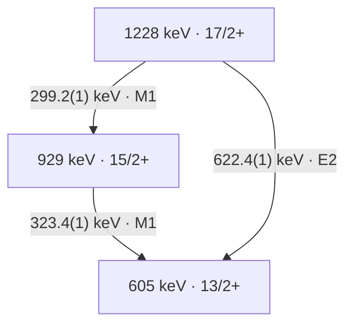
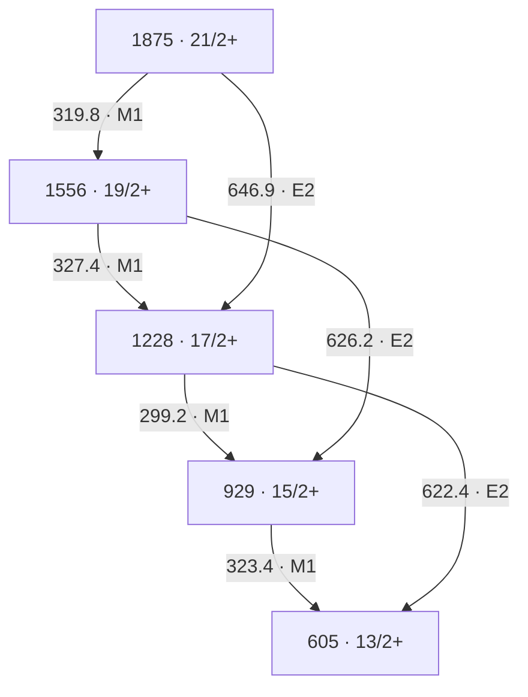
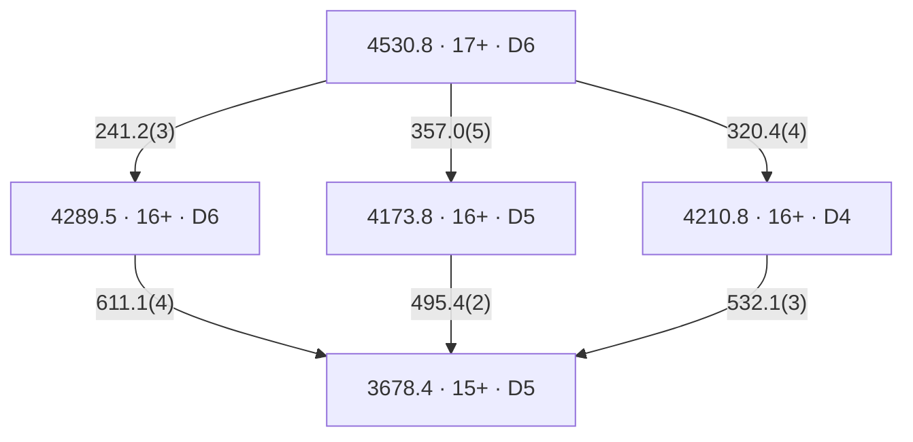
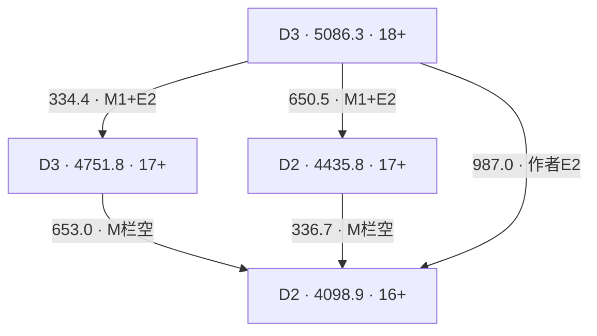

# 从 γ 谱重建能级纲图

## Purpose

把谱峰身份、跃迁放置、multipolarity、自旋宇称与结构解释分层审计，使每一步回到原图/表、门条件和精确来源。

## Inputs and Assumptions

输入包括校准能量及协方差、γγ/γγγ 门与背景、emitter identity、探测效率/响应、角度/偏振标定和可信 spin anchor。下方练习使用作者的打印图表与明确写出的误差假设，没有原始事件；先保留 rounding、feeding、复合峰和未确认 linking 的边界。

## What It Can Establish

可复核已报告子级联的 energy closure、source-level coincidence/assignment chain，建立最低伴随观测和可证伪的重排条件。

## What It Cannot Establish Alone

单一谱峰、共同下方门或能量闭合不能独自确定唯一 Jπ、configuration、形变或 absolute B 值；本方法也不把 source 图表的重算当作新独立实验。

## 证据层与最小审计矩阵

能量、符合关系和 multipolarity 分别回答不同问题。下表是基于 [[herzan-2015-193bi-spectroscopy]] 的方法综合，不能将作者的最终纲图当作本任务已重新拟合的数据。

| 步骤 | 可建立的约束 | 原文例子 | 最小伴随观测与边界 |
|---|---|---|---|
| emitter identity | 谱线可属于某残核/衰变链。 | 165Ho(32S,4n)193Bi、RITU/GREAT recoil/RDT/isomer tagging；HE15-1，PDF pp.1–2。 | α/recoil correlation、random rate、timing/particle PID；元素 x ray 或相近能量不能单独识别 isotope。 |
| line identity | 同一观测峰可能含多个跃迁。 | Fig.5(a) 的约323-keV peak 是315/320/323/327-keV quadruplet；HE15-5。 | matched gates、response-aware multi-line fitting、污染和逐角度检查；峰宽不是一条跃迁的身份。 |
| coincidence and ordering | γγ/γγγ 和 energy sums 支持 cascade/branch placement。 | Fig.2 / Table I 的 Band1 三层；HE15-4。 | 一张共用下方门通常同时选中该带多条线；能量闭合不是独立符合证据。 |
| multipolarity | 角度强度比和偏振支持 dipole/quadrupole 与电/磁 character。 | 299.2、323.4 列 M1，622.4 列 E2；HE15-4。 | 保留同门、效率、alignment、响应和 a(Eγ)/Q(Eγ)；不能把列 M1 当作已测 δ=0。 |
| spin/parity | multipolarity 和可信 anchor 可沿级联传播约束。 | 17/2+→15/2+→13/2+ 的作者赋值；HE15-4。 | 绝对 spin anchor 与混合/非 stretched 可能性；作者 label 不自动成为独立新测量。 |
| lifetime/absolute strength | 时间或 Doppler-history 与分支/δ 可转换到绝对 B 值。 | 13/2+ bandhead 的153(10) ns来自先前 Ref.[7]；PDF p.10。 | 对本三条线没有新 τ/δ 包；箭头、相对 Iγ、能量和不提供 absolute B。 |
| configuration/shape | systematics 与模型约束解释。 | SD Table II 保留 X 和括号 spins；1836-keV candidate link 未确认；HE15-6。 | 无 confirmed link 和绝对 strengths 时不能固定 X 或把相似带能量当成直接形变测量。 |

## 193Bi Band 1 三层实例

下面是原作者 Figure 2 / Table I 的一个子图。level energies 为论文打印的整数近似；不要要求其逐差等于带小数的 γ energy。

| γ energy (keV) | 作者母态→子态 | R_exp | Δ_IPDCO | 作者 multipolarity | 证据等级 |
|---:|---|---:|---:|---|---|
| 299.2(1) | 17/2+→15/2+ | 0.68(2) | −0.032(1) | M1 | 能量与比值/偏振为直接报告；placement/Jπ 为联合赋值。 |
| 323.4(1) | 15/2+→13/2+ | 0.74(4) | −0.012(1) | M1 | 同上；真实 gate 中还须保留邻线/复合峰边界。 |
| 622.4(1) | 17/2+→13/2+ | 1.30(16) | +0.086(10) | E2 | 同上；直接分支与299.2+323.4级联为不同衰变路径。 |

此处 Table I 的三个 R_exp 来自作者的 `Iγ(157.6°)/Iγ(75.5°)`，每个 angle-vs-all-angles matrix 在 all-angles 轴上使用相同 energy gate，并修正效率（PDF p.2）。作者称其为 RDCO；其0.8/1.3参考值属于该阵列/程序，不能替代其它 DCO/reference-gate 定义。偏振同样依赖 clover a(Eγ) 和 Q(Eγ)；跨阵列不得照搬阈值。

### 能量和练习与误差边界

中心值闭合残差为 `299.2+323.4−622.4=+0.2 keV`。只把三个打印拟合误差0.1 keV视为独立，σ为 `sqrt(3)×0.1=0.1732 keV`。Table I caption 另要求对多数 γ energy 加约0.3 keV statistical error；若自设这项与拟合误差及各线均独立，则每条 σ为0.3162 keV，闭合 σ为0.5477 keV。论文没有为这三条提供 joint covariance，此合成仅为带假设的练习，不能写成作者报告的 closure uncertainty。

一般地，令 `a=(1,1,−1)`，则 `σ_closure²=aᵀΣa`。共同能量 offset、gain 和峰拟合相关性不应都当作三份独立误差。中心值闭合支持放置但不能唯一确定 ordering、Jπ 或 configuration，也不是与 Fig.2 独立的第二实验。

### 门条件、反证与可以重排纲图的观察

- 299.2与323.4是同一路径的连续 γ，适当的prompt coincidence可以支持级联；622.4是同母态直接分支，不要求它在同一单核衰变事件中与前两条同时出现。看到三者强互符合时，应先检查feeding、多核事件、random或能量重叠，而非直接把互斥分支改成连续三级联。
- Table I 另列299.8(1) keV、41/2+→39/2+ 的Band1 line，离299.2仅0.6 keV；共用323.4下方门可能仍接受两个band内事件种类，不能靠一张gate自动拆峰。可设计622.4直接分支门与323.4级联门的比较，并控制上方feeding和污染；本文未提供本任务可复算的逐门计数/协方差。
- 若响应/背景控制后的候选299-keV component在互斥直接分支门中占主导，且对应上方feeding而非17/2+母态，当前单峰归属应拆分；若可靠energy sums或独立spin/parity anchor冲突，相关放置/赋值应重审。一个弱线不出现仅在给出灵敏度、gate acceptance和预期强度后才是反证。
- Fig.5(a) 的 quadruplet 是实测多线峰的直接反例；[[doppler-correction]] 中Klemme shifted/unshifted双分量是同一跃迁的另一类反例。两者是独立实验、不同机制，不能互相移植仪器响应或数据。
- 另一种 negative-evidence 边界是SD带底部约87/46-keV候选线未观察到。作者讨论87.4-keV Bi x ray重叠及强内转换，并假设强度经这些线流走（HE15-7，PDF p.19）。观察缺失是报告事实，原因与intensity flow为作者解释；没有detection/ICC/branching closure时，不能由缺失峰单独否定该级联，也不能把未见的线补写成已测跃迁。

## 独立性与知识判断

Herzáň Figure 2、Table I、Figure 5 是同一 acquisition 的图/表/投影（`multiple-dependent`），不是三个独立实验。DCO、偏振和符合是互补约束，仍共享事件、标定及门；bandhead的先前寿命是外部依赖，不能当作本次新τ测量。Mavela与Klemme是独立方法对照，并非193Bi的复测。

Self-audit结果：`supports` level/transition identity与联合assignment；`limits` 单峰、单门、closure或relative Iγ的结构解释。SD序列的X、括号spins和tentative linking是另一种必要保留的不确定性。原始事件、response和covariance不足，当前只有L2/L3方法审计，不是新实验L4。

## Day14 五能级七跃迁逐边审计

原作者 Figure2 的五个 level label 为605、929、1228、1556、1875 keV，Jπ依次为13/2+、15/2+、17/2+、19/2+、21/2+。本次逐边重建只复核已发表的子图，未发现或重新测量“新线”。其中319.8-keV行在 Table I 的 Other transitions（PDF p.7），不能因为它未列在第一页Band1小标题下就漏掉。

下表将能量、符合、multipolarity 和 Jπ 的证据等级分开。E 表示原表直接给出的峰能量；C 表示作者通过γγ/γγγ与能量和联合放置；M 表示报告的R/A支持作者电磁赋值；J 表示依赖已知spin/parity锚点、stretched/混合条件和全图的赋值。C/M/J不等于本任务有事件级数据独立复现。`0.1 keV` 是打印拟合误差，caption 的额外约0.3 keV仍须另计。

| Eγ(keV) / 母→子 | Iγ（原表标度） | Rexp | ΔIPDCO | multipolarity / 分级 | 符合与Jπ边界 | source locator |
| --- | ---: | --- | --- | --- | --- | --- |
| 323.4(1) / 15/2+→13/2+ | 1000(57) | 0.74(4) | −0.012(1) | M1；E直接、M联合赋值 | Figure5(a)祖先154-keV门的约323峰含四线；Figure5(b)此门选多条feeding，不能独立给出全部相邻线顺序；C/J为source-level联合赋值。 | HE15-4、HE15-5；PDF p.3 Table I / p.8 Fig.2 / p.10 Fig.5 |
| 299.2(1) / 17/2+→15/2+ | 258(8) | 0.68(2) | −0.032(1) | M1；E直接、M联合赋值 | 上游门能支持归带，仍需区分同带299.8-keV高spin线；C/J不是新独立测量。 | HE15-4、HE15-5；PDF p.3 / p.8 / p.10 |
| 327.4(1) / 19/2+→17/2+ | 196(6) | 0.68(2) | −0.004(1) | M1；E直接、M联合赋值 | 本身也是Figure5(a)复合峰成员；较小的A不能替代δ测量或独立spin锚点。 | HE15-8、HE15-5；PDF p.3 / p.8 / p.10 |
| 319.8(1) / 21/2+→19/2+ | 125(4) | 0.60(2) | −0.039(2) | M1；E直接、M联合赋值 | 表尾Other transitions；Figure2圆整为320，仍须保留共用门的混合分量。 | HE15-8；PDF p.7 / p.8 |
| 622.4(1) / 17/2+→13/2+ | 121(5) | 1.30(16) | +0.086(10) | E2；E直接、M联合赋值 | 与299.2→323.4是互斥的同母态直接/级联路径；三者不应被要求同一单核衰变中强互符合。 | HE15-4；PDF p.3 / p.8 |
| 626.2(1) / 19/2+→15/2+ | 102(4) | 1.48(6) | +0.094(9) | E2；E直接、M联合赋值 | 与327.4→299.2构成两路闭合；Figure5(a)标622&626，公开门谱未独立提供逐对净面积/协方差。 | HE15-8；PDF p.3 / p.8 / p.10 |
| 646.9(1) / 21/2+→17/2+ | 108(4) | 1.47(6) | +0.091(4) | E2；E直接、M联合赋值 | 与319.8→327.4构成两路闭合；仍共享γγ/γγγ事件与标定，J沿图有条件传播。 | HE15-8；PDF p.3 / p.8 |

M1/E2 label不表示已测δ=0；绝对spin锚点也不是从这些比值单独求得。作者的Rexp是同门、效率校正的157.6°/75.5°角度强度比（HE15-4，PDF p.2），不是可以不加说明搬用的“已知纯E2参考门DCO”。这些互补观测共享一个JYFL acquisition，并非七条独立实验。

## 能量图的闭合、标定与拓扑边界

令D的每行在母态列取+1、子态列取−1，则本图有5个nodes、7条edges，rank(D)=4。`D·1=0`：没有绝对锚点时，整体能量平移不可测。取能量向量顺序为 `(323.4,299.2,327.4,319.8,622.4,626.2,646.9)`，三个独立闭合残差为：

1. `323.4+299.2−622.4=0.2 keV`；
2. `299.2+327.4−626.2=0.4 keV`；
3. `327.4+319.8−646.9=0.3 keV`。

闭合矩阵C满足`CD=0`，但统计上三个残差不独立。若仅作练习，把每条0.1-keV拟合误差与caption约0.3 keV按平方和相加并假定各线独立，则`Σ=0.1 I keV²`，`CΣCᵀ=0.1×(3,1,0; 1,3,1; 0,1,3) keV²`。相邻闭合共享一条边，相关系数为1/3。用同一Σ的GLS与cycle-space检验均得`χ²=0.666667`、3 degrees of freedom；若只用打印拟合误差则为`6.666667`。两者都是声明误差模型下的练习，不能挑一项充当作者的最终显著性；论文未给完整Σ。

GLS相对最低node的结果是`0,323.366667,622.433333,949.666667,1269.4 keV`，仅用于检验七条测量方程的相容性，不替换Figure2圆整level label，也不提供新的绝对能级。把浮动node差、固定打印能级和独立绝对anchor混入同一fit会改变问题定义。

标定敏感性具有不同物理含义。共同加性offset在“二光子减一光子”闭合中保留：`C·1_edges=(1,1,1)`；同一gain作用于真实闭合的gap向量时被C消掉。自设offset σ=0.2 keV或gain σ=0.001分别作为counterfactual，不是本实验校准误差。若将offset完全浮动，模型多一个parameter，余2 degrees of freedom；条件解offset=0.28±0.374 keV、χ²=0.106667也不能据此宣布原来源有offset问题。故“闭合良好”不能独自认证能量scale、emitter身份、图拓扑或Jπ。

**真实来源的顺序反例：** HE15-9（Table I footnote f）明确说393.4/394.0-keV双线顺序未定，所列R/A是共享值。以打印1258.1-keV下方能级作为演示锚点，两种顺序都给upper=2045.5 keV，intermediate分别为1651.5或1652.1 keV；交换顺序仍满足能量和以及假设的两个ΔI=2。它们是条件替代放置，不是两套已测纲图。需要能够分别限制一条线母/子态的branch、时间顺序或独立tag，而非再次重复求和。

SD的13-edge/14-node浮动链同样rank=13、存在整体平移nullspace。Table II的X不会因为十三条γ能量都可加起来而变成已知；1836-keV候选link无确定endpoint且未confirmed，不能用其能量先固定X再反向宣称link正确（HE15-6）。

可复算脚本：[day14_level_scheme_audit.py](../../system/scripts/day14_level_scheme_audit.py)，输入转录：[level-scheme-fixture.json](../../outputs/learning-daily/20261014-DAY14-week-two-spectrum-to-level-scheme-exam-run-02/level-scheme-fixture.json)。35项检查包括rank/nullspace、CD=0、GLS–cycle χ²、独立whitened least squares、换行顺序不变、标定模式、刻意错移一条crossover、双线换序和SD nullspace。数值输出：[level-scheme-analysis.json](../../outputs/learning-daily/20261014-DAY14-week-two-spectrum-to-level-scheme-exam-run-02/level-scheme-analysis.json)。科学公式、结果、条件与反证均在本知识页；outputs只是转录/重算回执。

## 标定、寿命与伴随观测的逐项契约

由HE15-10的实际标定，`a(323.4)=1.0955364`；报告`A=−0.012`对应条件计数比`N⊥/N∥=(1+A)/(a(1−A))=0.8911476`。若对相同比值错误地令a=1，会得到`A=−0.0575589`。这是原公式的反事实重算，没有原始counts；不是测到的新A，也不重估作者的误差。`a(E)`修正几何非对称，`Q(E)`才把A接到P，不能合并两者或忽略fit coefficient covariance。

同母态两条已报告γ的条件强度比分别为`258/121=2.132231`、`196/102=1.921569`、`125/108=1.157407`。它们不等于总branch、寿命或absolute B；要得到M1/E2的radiative components，还需δ、ICC、未观测branches、gate acceptance及source correction。HE15-12的153(10)-ns是13/2+ bandhead的先前半衰期，不能赋给17/2+、19/2+、21/2+这些parent。

| 会改变纲图/赋值的观测 | 最小可信输入 | 判别与停止边界 |
| --- | --- | --- |
| 干净622.4-keV直接分支门内出现强299-keV分量，而323.4级联门的component比例不同 | 确认622/626门纯度，逐门response、多核/random控制、上方feeding | 先拆299.2/299.8或污染component；不把branch互斥关系违背自动写成新cascade。 |
| 393/394双线的一条存在独立定位的旁路或延迟顺序 | 净γγ/γγγ或electron/γ时间关联、背景/接受度 | 可能裁决中间level；仅一张共同下方门或两条共同R/A不足。 |
| SD candidate link与确定Band6 endpoint形成可信多重符合，能量和/电磁性质闭合 | endpoint identity、逐门净计数、false-link对照、response/效率 | 才可能固定X与相关spin；当前仍expected-but-not-established。 |
| 46/87-keV弱γ未见但conversion electron与下游flow闭合 | 低能响应/阈值、x-ray分量、ICC与branching | HE15-13的α=261/12.82会强抑制γ，未见峰不能单独反驳路径；需校准上限。 |
| 从isomer的84-keV decay推Jπ时发现Band1 anchor或parallel path失效 | independent spin/parity anchor、84/137/455转换与条件路径 | HE15-11明确依赖Band1；有条件赋值应随锚点重审，不能把内转换当新absolute spin测量。 |

## 第二周证据链的可复用认识修正

从布居、门控、响应到能级与结构结论，应为每个层级补相称信息，而非将同一事件的多个投影累加成多个独立实验。本周的三个判断在HE15-4/8–12的source-to-method审计中具体落地：

- **supports：** 校准能量、互补角度/偏振和branch/cube支持原作者的source-level子图；一图一表及各续页必须联查，页内分组不是物理band成员的完整边界。
- **limits：** 多条闭合共享边并相关；更好χ²不验证拓扑；一峰共享DCO/IPDCO不识别每条component；relative Iγ和bandhead半衰期不能跳接到其它母态absolute B。
- **revises：** 最有信息的下一项测量应针对尚未识别的自由度。393/394问题要独立endpoint/time/branch，SD X要confirmed link，电磁strength要逐母态τ/branch/δ；重复同一能量和或祖先门不足以解除这些边界。

这是跨层级方法综合，不改变193Bi或A≈130集体模式的排序。P0科学措辞已self-audit：保留shared measurements、未知X、括号Jπ与原source review flags；没有技术hard P0。P1保留事件级response/calibration/feeding缺口。普通发表的图表重算属L2，actual event-level L4重分析仍not-ready。

## 互斥分支门、复合峰与shared-event计数

这是HE15-4/5所启发的L2设计模型，未使用193Bi原始事件，未拟合Table I强度。模型只有一个核和两条完整photon路径：17/2+以概率b走299.2→323.4，或以1−b走622.4；比例h的事件先在上方发射299.8。先取无IC、无额外feeding、纯门、无angular correlations/summing/random、独立photon detection的极限，所有效率和b/h均是自设数值。实际 JUROGAM 不能直接套用这些假设。

以A=622.4直接分支门、B=323.4级联门，令L、H分别为无门的low/high299-keV photon yields（已含相应photon效率），则合并峰总面积满足

`(Y_A,Y_B)ᵀ = Q(L,H)ᵀ`，`Q = ((0,(1−b)ε_A); (ε_B,b ε_B))`。

**已知conditional系数的判别力：** 若0<b<1且ε_A/ε_B非零，det(Q)=−(1−b)ε_Aε_B不为零；即使两条energy response完全相同，两种已知gate signature仍能解除两强度参数的线性退化。一张合并谱只有rank1。b→1、A门效率→0，或门污染使两列gate signature成比例时，rank又降为1。这是已知模型下的rank结果，不是证明实际双峰已经分开。

**未知branch或压缩数据的边界：** 若两条线不可分，或者分析只保留两张谱的total peak area，未知b会留下连续物理解。自设b=.60、h=.20、parent Poisson mean10⁶、ε_A=.05、ε_B=.07、两个299效率均.10，得到A高线400、B低线4200、B高线840。只保留(A总400，B总5040)，另一组b=.50/h=.125/N=1.28×10⁶和b=.70/h=.35/N≈761905给同样的两个总面积。已校准的pure gate singles在这个闭合两路径模型中可以补足b；若能量分量本就可识别，完整joint spectra也含更多信息，不能把“两总面积”的退化泛化为所有数据都不可识别。IC、额外feeding、unknown acceptance或相关背景存在时，必须重新写模型，不能借该toy恢复实际branching。

**shared-event计数：** 上方299.8与下方299.2可在同一B门事件中出现。令每个parent事件的计数向量为y；Poisson parent flow的`Cov(Σy)=λ E(yyᵀ)`，固定N的`Cov(Σy)=N(E(yyᵀ)−E(y)E(y)ᵀ)`。前述自设模型中B低/高线的compound-Poisson covariance为84 counts²，而不是零；A/B两支路在Poisson flow中交叉covariance为零、固定N则为负。gate与其subset photon count也相关。不能把边/门计数都当独立Poisson再相乘似然；实际还需counting convention、角关联和summing/多核事件的forward response。

代码用64个event state精确枚举，并独立生成5×10⁶个事件（seed20261014）。37项检查通过，包括均值、二阶矩、PSD、parent flow区别、门rank/污染极限、unknown-b等价族。Monte Carlo均值和二阶矩最大偏离均约2.18个声明的sampling σ。对自设σ=1 keV、ΔE=.6 keV的bin-integrated Gaussian模板，归一列几何condition number从单谱4.718变为两门3.231；这不是likelihood/power，也不预测真实JUROGAM能否拆峰。

**低能γ非观测的条件功效：** HE15-13的E2 αtot=261/12.82分别给46/87-keV photon fraction约0.003817/0.07236。在自设N=5000、每条εγ=.01、branch flow=1的固定N模型下，平均探测数为0.191/3.618，看到零计数的概率为0.826/0.0268。使P(0)=.05所需的条件parent数量分别约78487/4139。实际flow、α模型/误差、阈值、x-ray背景和效率未给，因此这些不是论文upper limit；它们说明只说“未见峰”缺少功效定义，conversion-electron与下游branch closure可能比重复γ门更有信息。

可复算：[day14_conditional_gate_design.py](../../system/scripts/day14_conditional_gate_design.py)，[条件模型回执](../../outputs/learning-daily/20261014-DAY14-week-two-spectrum-to-level-scheme-exam-run-02/conditional-gate-design.json)。模型条件、公式和可复用认识均在本知识页。Self-audit：`supports`纯分支tag的互补判别力，`limits`未知branch/response和独立Poisson简化；不认证actual line identity、branch、τ或结构模式。

## 原图、评价精度与赋值冲突的crosswalk

[[nndc-2017-193bi-level-scheme-evaluation]]实际取得NNDC193Bi的ADOPTED和165Ho(32S,4nγ)两个201709对象，前者含2019半衰期修订。它采用Herzáň2015He27，并将其当作superseding set；网站和两个对象都不增加一个independent acquisition。N193-3明确评价者以quadrature加入0.3-keV统计误差、用全γ网络least-squares且固定305-keVlevel；这核实了评价者的合成规则，仍未给本图完整jointΣ。它不能反向证明原作者逐线/标定误差彼此独立。

| 原Figure2整数label keV | evaluatedlevel keV | Jπ（评价记录） | 如何使用 |
|---|---|---|---|
|605|605.53(18)|13/2+|153(10)-ns是此level半衰期，来自2004Ni06。|
|929|928.93(21)|15/2+|由γ网络调整，不作为原γ独立新增data point。|
|1228|1228.13(21)|17/2+|母态299.2/622.4两branch的parent identity。|
|1556|1555.30(25)|19/2+|原图数字与调整结果不同，应区分版本/fit，而非固定整数重拟合。|
|1875|1875.1(3)|21/2+|母态319.8/646.9；γcentroids保留原表，误差按评价规则列。|

N193-4/10及79-check固定列crosswalk核对七条γ的中心值、mother、γ误差和RI标度。reaction RI均为原Table I的0.1倍；ADOPTED selected母态blocks又以强线100重标。比值的微小差异可由打印圆整产生，不能从不同normalization拼接population/feeding或当作独立实测。

**352.3-keV判例：** 原Table I为(13/2−)→(11/2−)、M1；Figure2 continued在1610keV标15/2−。一般single-photon triangle要求`|Ji−Jf|≤L`，因此若取Figure2的ΔI=2，M1(L=1)严格不允许；若取Table I的ΔI=1，M1允许。这是有条件的选律检查，不选择哪一个spin是真值。N193-6留空multipolarity并公开记录该冲突；negativePOL不能独自确定absolute J或替代independent anchor。需要分别固定该level的spin/branch/line identity，再讨论character。

**393/394判例：** 原tentative(E2)由placement/相对spin提出；N193-5只保留Q，并明确shared negativePOL与(E2)不一致、order未established。Q是quadrupole级别，尚未指定electric或magnetic。没有逐component偏振或另一个independent约束时，不能用共同R/A修复每条线的电磁性质，也不能凭“两行都Q”把两条各自当E2。

**输入缺口的更新：** 现在有N193-7的BrIcc v2.3a/Frozen-Orbitals CC计算，不能继续笼统说完全没有ICC数值；它们仍没有测δ、全branches或higher-parent τ。N193-8只把bandhead153-ns归到604.7γ(t)/2004Ni06，并提供compiler关于prompt/约1μs separatorflight的说明；原Ni04完整方法尚未核验。若设计只把1μs当固定lab等待且忽略feeding/time dilation，153-ns半衰期的存活率约`2^(−1000/153)=0.0108`；这个尺度例不是对实际RITU时间分布的测量。

## 从条件ICC到photon fraction的最小练习

只考虑一母态的两条已报告line，并自设pure M1/E2、采用BrIcc CC、没有其它decaychannel时，设`S=I_M1(1+α_M1)+I_E2(1+α_E2)`。则`pγ,M1=I_M1/S`，`pγ,E2=I_E2/S`，conversion fractions分别为`α_j I_j/S`。分母是这个两channel模型的totaldecay，而非“只在γ中归一”的分母。绝对rate还需该parent的总meanτ，并满足完整分支/δ前提。

| parent keV | M1/E2 keV | BrIcc αM1/αE2 | 仅γ归一的M1比例 | M1 photon fraction | 含conversion的conditional M1 branch |
|---|---|---|---:|---:|---:|
|1228.13|299.2/622.4|0.467/0.0186|0.680735|0.514212|0.754349|
|1555.30|327.4/626.2|0.366/0.0183|0.657895|0.527561|0.720648|
|1875.1|319.8/646.9|0.390/0.01706|0.537634|0.441565|0.613776|

此表是N193-7/10输入下的任务推导。M1/E2 admixture会改变effective CC和component fractions，未观测branch改变S；parentτ仍为空，所以没有给absolute B，也不把conditional branch填回source当“已测值”。自设gate toy的b=.6/h=.2不是以上数值的拟合。

代码：[day14_ensdf_crosswalk.py](../../system/scripts/day14_ensdf_crosswalk.py)；[79-check回执](../../outputs/learning-daily/20261014-DAY14-week-two-spectrum-to-level-scheme-exam-run-02/ensdf-crosswalk.json)。Checks是身份/列/标度/边界的验证，不是79条独立实验。Self-audit的决定为`revises`精度/数据版本和weak-line工作标签，`limits`独立性、completebranch与strength充分性；不改变原作者图表或任何review flags。

## Shared POL 对joint命题的条件约束

[[linear-polarization-asymmetry]]的“未分峰偏振的联合命题与选择条件”承接HE15-9/10与N193-5，并以[[rose-brink-1967-phase-defined-angular-distributions]] RB67-11/2的helicity/population基础完成70-check重构。共同negative A可限制“两条在同一条件下都非负”的joint命题，却不能决定哪条线为磁性。0.6-keV之间a(E)的差也不能在这个固定calibration/count模型中独自解释−.076。

对pureE2/轴对称、incoherent multipole-projection权重、common selection、point angles与fixed positive Q_sens的松弛outer set，固定R=1.26时A为+.03325到+.09507，mean−.076在其外；这是有假设的模型约束，非实验排除概率。合法初态布居可让pureE2得到negative P，但那个例子的R≈.2704；同时看R/A才收紧。不同effective gating/population和finite response可改变判据；hypothetical M2还要求opposite endpoint parities，不能从Q标签直接给每条M2。

下一必要输入为matched-gate counts、detector angular/Compton response、a/Q/observables covariance、背景与独立spin/parity/转换约束。现有资料不足以对实际193Bi完成这套forward replay；任何point-model通过/失败都不替代原experiment或解除source review flags。

[[angular-correlation]]“条件γγ响应：各向同性marginal仍可有角关联”补充35-check source-grounded toy，明确单γ边界不等于joint factorization：同名energy gate因self-detector/pair/time/Compton选取可有不同target-dependent effect。它解释为何需要实际matched-pair response，未将.729470等toy结果当193Bi重测，未撤销原共同条件下的pureE2必要域或给weak lines新的赋值。

## 近邻双线排序的角关联可识别性

HE15-9的393/394order未定仍是实际来源结论。[[angular-correlation]]“双γ排序的交换对称性”以RB67-3/11为formalism前提，给出51-check条件证明：随机初态的γγ intensity在两方向交换下不变；更强的是两个同rank/同E-M类型的pure stretched downward跃迁，maximal-CG product消去middle系数并对两photon modes交换对称，任意同一initialρ也不能靠角度/偏振数据解除能量标签的先后。

这是declared static angular model的可识别性边界，未证明实际weak doublet满足pure/stretched、共同instrument或无中间演化条件。增加resolution、重复closure或提高同类型角数据统计，不能在exact-equivalent angular hypotheses之间创造信息。优先独立middle branch/level、可分辨delay/time或能验证模型条件失效的观测；若有非stretched/混合、不同multipoles或intermediate dynamics，须重建前向模型。

自设19/2→15/2→11/2的binomial/total-J²-ladder与full amplitudes相同；自设19/2→17/2→13/2控制在chosen alignment下可不对称。两者均非193Bi新spin/parity或line placement；shared R/A不分配逐线，原Q/(E2)/π和review状态保留。脚本/结果/完整proof见上述canonical方法页，不报告actual order fit或significance。

## Sources

- [[herzan-2015-193bi-spectroscopy]] HE15-4：PDF p.3 Table I / p.8 Fig.2 / p.2 setup-specific ratios。
- [[herzan-2015-193bi-spectroscopy]] HE15-5：PDF p.10 Fig.5(a) quadruplet and gated-spectrum boundary。
- [[herzan-2015-193bi-spectroscopy]] HE15-6：PDF p.15 Table II / Fig.13, tentative linking and X。
- [[herzan-2015-193bi-spectroscopy]] HE15-7：PDF p.19 Sec.IV.D, low-energy non-observation and conversion/x-ray explanation。
- [[klemme-1999-lifetimes-134nd-neighbors]] KL99-18：同一跃迁的距离相关双分量。
- [[gamma-gamma-coincidence]]、[[spin-parity-assignment]]、[[doppler-correction]]：配套方法入口。
- [[nndc-2017-193bi-level-scheme-evaluation]]：N193-1–10，versioned evaluated records、weak-line limits、conditional BrIcc CC；不是独立实验。

## Level gap and gamma-energy precision

[[tunl-2017-12c-level-widths]] T12C-1/4与[[doppler-correction]]的free-two-bodyexercise强调：energy-levelgap与emitting-parent-restγenergy存在photonrecoil差，精确schemeenergyclosure需声明mass/frame/rounding。A12/gap15.110MeV的mass-numbertoy差约10.20keV，不能把高能levelgap直接当exactγcalibrationline；A130/1MeV差约.00413keV。此为尺度设计，不重新测原表能级，也不替换真实实验已处理的recoilcorrection。

## 67Ga：跨对象的parent与强度输入核验

[[nndc-2005-67ga-selected-level-gamma-records]] N67-1–8提供actual公开object输入；不同数据对象复用的出处须按字段追踪，不能按对象数计独立实验。这里是Day14中的bounded数据/方法延伸，Day15仍无学分。

| 所需输入 | source record与条件 | 对应边界 |
| --- | --- | --- |
| parent/daughter/line | 3031.77(6),13/2+→2073.755(25),9/2+；958.01(5)keV | level energies为γ数据LS fit，中央closure .005keV不代表独立高精度validation |
| M/δ | E2(+M3)，−0.00(1)；adopted D/alpha A→1978AL32 | finite quoted .01，不给exactpureE2或硬CI；Fe取回adopted不是另一测量 |
| parent时间 | T1/2=4.5(4)ps，C/R→alpha/16O RDM | meanτ=6.492±.577ps；不同feederτ不能借给该line |
| photon RI | same-parent100(9)、weak168.8:.2(1)，O/Q→1999DA10 | Fe58.2(.9)的globalnormalizer359+1202=100不同；不是absolute total-decay branch |
| 转换/库存 | 958CC空，weak M/CC空；未提供unseen ledger | 空白不补零，小photonbranch不认证小totalwidth |
| 原评价B | BE2W=9.6(9) | 同输入派生quantity，非独立measurement或simple shapes标签 |

### 半衰期、平均寿命与条件rate

两个feeding levels另有T1/2(3578)=.16(4)ns、T1/2(3856)=11(2)ps；mean230.831/15.870ps与Zobel1980的230/16.4ps量级相容，却不是3032parent的6.492ps。先按核态身份取时间，再转换，不能按band或选中γ共用一条τ。

采用[[lange-kumar-hamilton-1982-multipole-admixtures]] LKH82-1 / p121 Eqs2.1–2.6的rate与B定义、[[high-spin-lifetime-strength-deformation]]现代SI转换，E2率为k Eγ⁵ B(E2)，本单位k=1.2251867220×10⁹ s⁻¹ MeV⁻⁵(e²fm⁴)⁻¹。率已按B的初态统计平均定义，不能再除2Ji+1。

令r=I168/I958=.002、α_s/α_w为各线all-shell **IC** coefficient（不是核alignment α2/4）。声明只两条γ、无extra、E2/M3截断时：

\[
\lambda_\mathrm{tot}=\frac{\ln2}{T_{1/2}},\quad
\lambda_{958,\gamma}=\frac{\lambda_\mathrm{tot}}
{1+\alpha_s+r(1+\alpha_w)},\quad
B(E2)=\frac{\lambda_{958,\gamma}}{(1+\delta^2)kE_\gamma^5}.
\]

zeroIC/δ0只是控制假设，给B(E2)=155.4865e²fm⁴=9.61853WU（WU conventional radius1.2A^(1/3)）；若忽略weak branch，9.63777WU。与reported9.6(9)printing相容，不重测B或验证complete inventory。把T1/2当meanτ则得13.87661WU，错误倍率1/ln2。独立quoted-marginals近似给σB=.85504WU；source真实Cov/完整systematics仍未知。

原δerror规模.01作敏感性点时，E2/M3 gamma truncation的M3 ratefraction=.00009999；取.02给.00039984。它们不是概率界或可信区间；δ sign/phase与angular interference需自身source mapping，不能把小ratefraction直接当同阶小shape误差。

### 弱支路、DCO与身份反证

只选择α_w=0/1/100作数学控制，会改变总rate分母；α_w约55.67使上述conditional B下降10%。这些不是weak168实测或BrIcc lookup；实际数据CC missing，脚本用actual missing值时拒绝无条件absolute B。验证小photons是否意味着小total decay，下一需要独立multipolarity/atomic-response与complete branch条件。

N67-7的真实NORDBALL对象给958与554.4同样DCO1.45(7)，adopted却分别E2(+M3)/E1(+M2)；same2073parent的871.3给.77(3)。已知spinsequence不同，但objects没有exact gate/reference/response，不能单独以ratio赋E2，不能将这组差异因果全归给ΔJ。N67-8又保留alpha2862的11/2−与adopted11/2+冲突及1343/1353未分峰的“可能解释”；其他反应的正确标注不修复原peak污染。

代码：[day14_ensdf67_strength_crosswalk.py](../../system/scripts/day14_ensdf67_strength_crosswalk.py)。38项object/hash/column/units/来源/half-to-mean/RI/missingCC/finiteMR/rate/反事实与DCO checks通过；source records、quoted inputs、chosen controls及未知Cov在本run nndc67-strength-crosswalk.json。决定revises exactδ0/RI58.2当branch/共用feederτ，supports先回源和逐field lineage，limits DCO数值与conditional B作模式裁决。无原实验fit重放，L4 not-ready。

## 67Ga：FO理论输入补全的条件强度范围

[[kibedi-2008-evaluation-theoretical-conversion-coefficients-bricc]] KB08-D14-1–6保存4个actualofficial Z31/FO/v2.3(2011) theoryinputs、失败编码与responsehash。全部是原子模型计算；[[nndc-2005-67ga-selected-level-gamma-records]]原CC空白保持，不能将模型值写回为评价实测。

| physicalmodel input | all-shell program α±provider error | 核假设 |
| --- | --- | --- |
| E168.8(4)keV | .0175 ± .0003 | weakpureM1 |
| E168.8(4)keV | .0976 ± .0017 | weakpureE2 |
| E958.01(5)keV | .000358 ± .000005 | strongpureE2 |
| E958.01(5)keV | .001513 ± .000022 | strongM3component |

在先前complete2γ/无extra模型内，weakM1/E2与strongδ0给B_E2 9.614759/9.613223WU；zeroIC为9.618530WU。IC名义效应−.0392%/−.0552%小于quotedtime约9%，但只在这些假设内。用alpha_eff=(alphaE2+δs²alphaM3)/(1+δs²)接Γ，选δs0/.01/.02各两weakmodes，rateledger均闭合；不是source hardδbounds或新experimentaltau/B。

FO弱线M1/E2给alpha endpoint包络，不能认证全部allowedhigher multipoles/penetration/额外nonγ通道。Programquoted uncertainty有共同energy/model输入；不将其当独立实验σ或额外再叠已含interp。A67finite-size、默认radius/datafilehash没验证，真实producer corrections、gates、Σ仍缺。

若另假设weak也pureE2，同parent强度比r(E958/E168)^5=11.776548：共同τ/ledger消掉，低E相空间抑制使小photonratio可对应大B。weak实际M未测，这个反事实用于说明箭头粗细/RI不等于约化强度。最低补测仍是weakmultipolarity与matched-gate intensity/完整库存，不按theory预设结果。

32项captured-response和32项offline replay通过；脚本[day14_bricc67_forward.py](../../system/scripts/day14_bricc67_forward.py)。决定supports显式低rank模型内的IC输入量级与量义，limits无条件strength/独立sigma与NDS原算法归因，不改变模式排序或Day15学分。

## 近邻双线的能量—时间可识别性与响应混淆

[[herzan-2015-193bi-spectroscopy]] HE15-9（PDF p.7 Table I footnote f）的实际输入只有393.4(1)/394.0(1)keV双线、共享R/A及顺序未定；名义间距0.6keV不是detector分辨率。HE15-12的153(10)ns属于另一bandhead，不能借给这个未知中间态。以下为本任务推导的**声明设计模型**，不是193Bi时间数据、已测寿命或顺序拟合，不能补实际L4缺口。

### 前向模型和可见信息

令任意两个探测器的energy contrast为 `X=(E1−E2)/(√2 σE)`，时间差为 `Y=(t2−t1)/σt`。这里每个energy noise独立Gaussian、SD为σE；σt专指**差值**噪声的SD，不能再默认等于单探测器SD。假设两种标签接受度相同、energy/time噪声互相独立、时间接受度完整；intrinsic linewidth、飞行/位置、random、背景、响应尾和中间态演化均须另行建模。

取latent label `Z=±1` 等概率，`X=Za+Nx`，`Y=Z(w+sU+Ny)`；Nx/Ny为标准正态，U为mean r的独立指数变量。`a=ΔE/(√2σE)`，`r=τmiddle/σt`，s为两种order的±1，w为能量相关的时间差offset（单位σt）。于是：

\[
p_s(x,y;w)=\tfrac12\phi(x-a)h_r(s(y-w))+
             \tfrac12\phi(x+a)h_r(s(-y-w)),
\]

其中h是N(0,1)+Exp(mean r)的exGaussian密度；r=0回到正态。已知prompt标定时比较p+(w0)与p−(w0)。两者的energy-only和time-only marginals各自完全相同，但joint可不同：`E[XY]=±ar`。因此单变量投影相同不等于整份事件没有信息。a0或r0时，此**已知对称响应模型**的两个order恰好等价，增加相同事件统计不能解除。

### 未知offset与小寿命极限

若H−允许w=2r，则与H+(w0)的conditional mean和variance相同：label+的mean r、variance1+r²。此选择只匹配前两阶矩，**不是**对w求最优profile，也不保证完整分布相同。两者的`E[XY³]`分别为a(3r+6r³)/a(3r+2r³)，time-only fourth moment也相差16r⁴。

定义自然对数下半Jeffreys `J=(KL(p||q)+KL(q||p))/2`（nats），不是p-value、检出功效或最少实验事件数。设 `g(x)=(φ(x−a)+φ(x+a))/2`，`T(x)=tanh(ax)`，`I(a)=E_g[T²]`。固定a>0、r→0时：

- 已知offset：`p−q=2r T(x)y g(x)φ(y)+O(r³)`，故 `J≈2r²I(a)`。
- 前两矩匹配：`p−q=(2/3)r³ T(x)H3(y)g(x)φ(y)+O(r⁴)`，其中H3=y³−3y、EφH3²=6，故 `J≈(4/3)r⁶I(a)`。

后一式的a0 leading项为零，并不表示这对**不同offset**的分布完全相同：time-only fourth-moment差可留下 `J≈(16/3)r⁸`。r=.03数值/leading比为.992824。此例阻止把“未知offset只改变均值”或a0的known-prompt退化任意推广。

自选σE=.8keV、名义gap=.6keV给a=.530330086、I=.224774106；τ和σt均不指定实值：

| chosen r=τmiddle/σt | J，known offset0 | J，H− offset2r前两矩匹配 |
| ---: | ---: | ---: |
| .03 | .000404027353 | 2.19823744e−10 |
| .05 | .00111951613 | 4.76144742e−9 |
| .10 | .00442677081 | 3.18285269e−7 |
| .30 | .0355596704 | .000256084927 |
| 1 | .189739104 | .0521278735 |

r=.01时直接积分J为4.49478225e−5/2.99905257e−13，分别接近leading4.49548213e−5/2.99698809e−13。这是声明响应族下的信息尺度，不预测JUROGAM真实可检出性。不同nuisance family、背景、接受度或δ/中间演化会改变模型。

### 允许未知响应尾时的精确反例

保留同一个核delay U∼Exp(mean r)，另取独立instrument delay V∼Exp(mean r)，二者都非负。H+为高能先发：高能prompt加仪器V，低能加核U、仪器无尾；H−为低能先发：高能加核U、仪器无尾，低能prompt加仪器V。两hypothesis的能量标记到达时刻都成为两个iid Exp(r)再加相同独立Gaussian noise；即使有独立绝对start，这个声明反例的完整arrival joint也完全相同。其特征函数均为 `G(kH,kL)/[(1−ir kH)(1−ir kL)]`。所以不只是一阶offset，未约束的energy-specific response可把核等待与仪器等待交换。

这是两个order使用**不同未校准nuisance response**的可识别性反例，不能推成已知fixed response时的no-go，更不是实际0.6-keV邻线响应真有这么大变化。独立prompt数据、逐能量/逐detector timewalk和响应尾约束、已验证的energy-smoothness bound或独立中间态branch可排除该族。只增加time标签或同target样本不能认证这些输入。

### 独立prompt标定能补哪一行信息

在signed核平均延迟μ和offset w都趋零的局部极限，两参数的score都是T(x)y。N个target事件的一阶Fisher矩阵是 `NI(a)×(1,1;1,1)`，rank1；只有μ+w可见。若另有M个独立、同选择/同响应的已知prompt样本，其offset信息为MIcal，则profile μ后的Schur信息为：

\[
F_{\mu\mid w}=\frac{NI(a)\,MI_{\rm cal}}{NI(a)+MI_{\rm cal}}.
\]

这是为何独立calibration kernelrow有价值，而重复target样本不能在这个一阶近似下代替它。自选N=10⁵、Ical=I(a)时，M=10³、10⁵、10⁷分别保留known-offset信息的1/101、1/2、100/101；无prompt时为0。M固定、N→∞的一阶信息趋向MIcal。**这不是有限r完整likelihood的信息上限**：已知Gaussian-offset族的高阶shape项仍可随足够N恢复信息，正如r⁶练习；也不表示校准一个均值就已约束上面的未知tail族。真实prompt的能量、detector、selection、flight/timewalk和背景须匹配或给出可检验迁移，不以同target拟合w代替独立输入。

### 验证、反证和使用边界

91项检查覆盖稳定erfc/erfcx与SciPy独立density、全域归一、time/energy边际、标签/时间反转、r0/a0极限、两阶矩/三四阶反证、Hermite leading、响应尾特征函数、局部signed-delay/offset score退化与独立prompt的Schur/PSD/rank控制。二维Gauss-Legendre分别100×600和140×900并扩大tail；独立全域Gauss-Hermite×Gauss-Laguerre用42/68节点，两条积分路线对表中J一致至声明容差（最坏差约1.1e−13），而非只看一张有限grid。有限box、节点和浮点数仍是数值误差，非实验系统误差。

代码：[day14_doublet_time_identifiability.py](../../system/scripts/day14_doublet_time_identifiability.py)；参数/归一/各check在[本次模型回执](../../outputs/learning-daily/20261014-DAY14-week-two-spectrum-to-level-scheme-exam-run-02/doublet-time-identifiability.json)。实际events、middleτ、energy/time joint response、逐能量prompt/timewalk、背景/接受度和joint covariance仍未提供。

决定supports能量—时间联合分析在已知响应下可能补静态角交换对称性，limits将时间标签自动视为定序证据，revises只匹配均值/方差就判完整等价的想法。新结论是本任务的条件方法推导，非HE15作者结论或新独立实验；shared R/A、tentativeJπ/Q/(E2)和所有review flags保持。

## 136Pr：双门重排、共享门峰与模型分带

[[lv-2025-136pr-tac-covariant-density-functional]]接受稿的LV25-16–25把Day14判据迁回A≈130。以下E/I/R为TableI报告，placement/Jπ依作者联合赋值；source自审、模型分组与本任务重算分开。PDF1为cover，关键图表采用该17页copy的精确页码，未声称已核publisher排版。

### Q1的876-keV连接：什么观测会真的重排图

作者用546/876-keV double gate仍看见Q2的661/689-keV线（PDF3 SecII、PDF4 Fig2），将876 link从先前14+ endpoint改接18+。TableI（PDF8）给Q2：4472.2-keV18+→3783.2-keV16+为689.0(7)，再→3122.0-keV14+为661.2(4)。Q1带头5347.8(11)经875.6(4)到4472.2，R_DCO=.47(8)，使用脚注e的quadrupole gates（Q1列表689/850）。在作者stretched-dipole和已知Q2锚点下，Q1带头从先前15提到19，整带+4ℏ。

这是能够改变endpoint及绝对spin标签的source-level联合证据，不是“加了两条图线”的装饰。原子量核对为`689.0+661.2=1350.2keV`；若在本表相同14+锚下另放875.6，parent会是3997.6而非5347.8，差也是1350.2。这是本任务反事实，**不**声称1996原文曾印3997.6。原始逐门净计数、污染和Cov未给，未做事件级重拟合。

Q1的π仍未由弱且污染的875.6偏振确定（LV25-3/12/16）；table写19(+)→18+、(M1+E2)，不能去掉括号。L=1的dipole性质本身不在无锚点时唯一给J/π；作者的stretched/全图条件须随结论保留。最有信息的反证是独立干净门不能重现661/689的目标path，或link的identity/multipolarity/anchor发生变化；一张污染门谱不足以独自裁决。

### 同一17+母态的三路分支

TableI D4/D5/D6（PDF7–8）给出以下子图；不同band名称不是不同实验或不同emitter。Figure1与表的整数/小数及弱线不精确closure须按误差/调整网络处理。

| edge keV / parent→daughter keV | Iγ±error，原标度 | R_DCO±error | table M / 证据边界 |
| --- | ---: | ---: | --- |
| 241.2(3) / 4530.8→4289.5 | 3.6±.5 | 1.29±.26 | M1+E2，d类门；没有测得δ=0。 |
| 611.1(4) / 4289.5→3678.4 | 5.4±.4 | 1.51±.36 | M1+E2，d类门。 |
| 357.0(5) / 4530.8→4173.8 | 6.1±.4 | 1.04±.17 | M1+E2，d类门。 |
| 495.4(2) / 4173.8→3678.4 | 8.3±.4 | .81±.12 | M1+E2，d类门。 |
| 320.4(4) / 4530.8→4210.8 | .2±.1 | 空 | table M也空；不从ΔJ或邻线给实测pureM1。 |
| 532.1(3) / 4210.8→3678.4 | .6±.1 | 空 | table M也空；同上。 |

脚注d中D5用263门，D6用231/354门；R≈1在这里对应dipole reference条件。脚注e的Q-gate下dipole≈.46、quadrupole≈1，而D-gate下quadrupole≈2.1；不能把Q1 .47与D6 1.04用同一数值阈值比较。逐target到底用了哪些gate sums及self-exclusion没有完整ledger，已列gate列表也不等于原事件response可重放（LV25-17）。

图有5nodes、6edges、rank4，两条cycle按上表顺序可写`(1,1,−1,−1,0,0)`和`(1,1,0,0,−1,−1)`。打印能量残差−.1/−.2keV。只作控制，取逐线quotedσ独立，cycle Cov为`(.54,.25;.25,.50)keV²`，共享241+611路径令两闭合相关；GLS与cycle projection给同一conditionalχ²=.08、df2，**不是**实验拟合p-value或唯一拓扑证明。source中Ei是网络调整值，不与这些Eγ当独立data再重复拟合；其逐边差与Eγ可差.4keV。

### 真实shared-gate反例与模型分带边界

- LV25-21：Fig4的D3合并谱里263/405峰实际属于同核素D5，因为230/334门也接收D5。打印同为334.4的两条表行不能凭中心值判物理精确简并；同门峰也不全是D3的新line。
- LV25-22：Fig5(a)星号来自co-produced136Nd，另一类是719门混入强722线使265峰出现。同核支路重叠、其它残核污染和random分别需要不同control，不能只用“有共同峰”归带。
- LV25-19：旧band3拆为D5/D6在原文明确借助不同configuration（转SecIII）。新544-keV E2和下游branch改善D5π锚点，但“不同configuration分组”仍为作者/model判断；不能把band标签当唯一model-free观测。
- LV25-23：Fig10(c) D6的向上箭头式点与TableI中缺inbandE2应按单侧/限值边界保留。来源未给D6逐点CL/limit构造/δ/Σ，不把它们变成对称误差ratio点或拟合残差；D3的lower limits则在正文另有明确说明。
- LV25-24：接受稿Fig10caption与TableII ConfigD6的gd及neutronhole列示不同，publisher403未核正式版本；保留配置identity缺口，不根据caption独自重建实际计算。TableII β/γ和tilt仍是模型，D4/D6的magnetic rotation/shape coexistence竞争不由此裁决。

### 独立性和可复算入口

LV25-20明示与Refs16/31共享acquisition，Ref16就是[[lv-2019-chirality-135nd-reexamined]]。2025是论文年，不能把相邻核素selection当新一份独立beamrun。5.1×10^10为整个fold≥3 pool；约10% crosssection也不等selectedevent分母。不同paper可能有不同calibration/gates，sharedpool不证明完全同events/Cov，更不能移植135Nd的偏振或τ。

[day14_pr136_scheme_crosswalk.py](../../system/scripts/day14_pr136_scheme_crosswalk.py)与[37-check回执](../../outputs/learning-daily/20261014-DAY14-week-two-spectrum-to-level-scheme-exam-run-02/pr136-scheme-crosswalk.json)核rawSHA/实际表行、空栏、图rank、fraction精确closure、两种χ算法和Q1endpoint。方法判断supports定位新endpoint的净符合证据，limits共同门/模型标签/one-sided点的升级；没有新level、absoluteB或模式结论，L4原始重分析not-ready。

## 136Pr：2018评价与2025接受稿的顺序冲突

[[nndc-2018-136pr-selected-level-gamma-records]] N136-1–8只保存201810/cut2018数据对象。旧reaction401行已读，adopted仅global/selected，不宣称核全质量链论文。[[lv-2025-136pr-tac-covariant-density-functional]] LV25-26为当前接受稿直接表行。以下是截止前已检查记录的整理，没有新物理计算。

| 层级/跃迁身份 | 2018 reaction / adopted | 2025接受稿 | 使用边界 |
| --- | --- | --- | --- |
| Q1旧/新bandhead link | reaction3998.8 J15→876.1 D→3122.7 14+；adopted3998.7(15)→3122.6(14+) | 5347.8 19(+)→875.6→4472.2 18+，doublegate见下方689/661 | N136-3与LV25-16版本化；2018cut早于新数据，不作为反驳新endpoint的独立观测。此前3997.6是用新14+anchor的反事实，不能替旧实字段3998.8。 |
| 旧H与新D5的263/405顺序 | 3677.7 15(-)→262.9→3414.8 14(-)→404.9→3009.9 13(-)；adopted同order但π留空 | 3678.4 15+→405.1→3273.3 14+→263.1→3010.2 13+ | 次序和中间level不同；仅sum或共同祖先门不能定次序。原因未核，不称任一方错误或已知重排历史。 |
| 旧π/电磁label | reaction11(-)等proposal；adopted(11)/(12)/(13)等无π；DCO D/Q及部分assumedE2 | 新544E2与连接支持作者positiveπ，但若干弱行仍空 | 不用reaction理论π覆盖adopted，也不把D/Q自动补成无条件M1/E2。 |
| 相对I标度 | reactionG876.1 RI3.3(6)，adopted RI100为母态归一 | TableI保持自身标度 | 不是两次测量或countledger，不能跨表拼绝对flow。 |

N136-5的754.4 DCO异常是compiler“perhaps typo”，保留原ratio与措辞；N136-7首条unplacedG和原图/表差异不自动修复。N136-6的91ns是6+bandhead评价半衰期，不借给高能母态。缺1996primary、逐门/response、背景和Σ，无法选择新旧顺序或做actualL4；最小有价值续路为原图/表/新gate净计数的identity和旁路复核，而非再次计算相同闭合。

Petrache1996 exactDOI10.1016/0375-9474(96)00107-8 metadata已核，公开OA/provider/Padua均未给全文，获取停止；downloader将TDMlicense误标confirmedOA的label不采信，实际download0。反应对象记载旧125-MeV30Si/GASP入口，和新40Ar/JUROGAM不同，但source对象内也含其它反应，不把评价重复计采集。判断revises版本/π和顺序identity边界；未改变模式排序、未造旧primary结论。

## 近邻双线的反冲能量—张角信息与静态排序边界

[[herzan-2015-193bi-spectroscopy]] HE15-9只给393.4/394.0keV名义centroids和顺序未定，不提供本双线中间寿命、stopping、实际qualitycuts/energy-angle response或独立质量输入。以下是本任务的**条件推导**：它检验静态angular-swap定理没包含的energy kernel，不裁决实际order，也不是完整covariant angular-amplitude分布。

### 共同endpoint下的精确四动量

选initial核静止、孤立自由两步辐射，无靶/环境相互作用，c=cosψ为两photon在该初始静止系的opening cosine。将核质量写为energy equivalent，取光速1。以c0=0处的h=394、l=393.4keV定义两hypothesis的共同anchor，并使两者有**同一个M和Mf**：

\[
M_f^2=M^2-2M(h+l)+2hl,\qquad m_i^2=M^2-2ME_1.
\]

由末态on-shell四动量守恒：

\[
E_2(c)=\frac{m_i^2-M_f^2}{2[M-E_1(1-c)]}.
\]

因此high-first的second-low为`l+dl(c)`，low-first的second-high为`h+dh(c)`，其中

`dl=−hl c/[M−h(1−c)]`，`dh=−hl c/[M−l(1−c)]`。

它们并非独立任取的两套不共享末态cascade。领先尺度K=hl/M；它把−Kc shift放到**后发**photon。静态角/偏振振幅交换对称并不自动保证这两个energy-dependent响应相同。

### 未分峰energy contrast保留哪部分信息

另声明两个detector energy noises独立同Gaussian SDσE、label接受度相等，且条件于选定c；不把该接受度模型当真实JUROGAM。令X=(E1−E2)/(√2σE)、S=[E1+E2−(h+l)]/(√2σE)。两hypothesis的X都是等权±a高斯混合g_a，

`a+=(h−l−dl)/(√2σE)`、`a−=(h−l+dh)/(√2σE)`；S是mean dl/(√2σE)或dh/(√2σE)、variance1的Gaussian，与X在此模型中独立。

自然对数下半Jeffreys J=(KLpq+KLqp)/2可相加为contrast J与sum J。共同mode的order差为：

\[
dl-dh=-\frac{hl\,c(h-l)(1-c)}{[M-h(1-c)][M-l(1-c)]},
\]

仅O(M⁻²)，不能把totalenergy近似同就推成全部energy data无信息。令a0=(h−l)/(√2σE)，`F(a)=E_g[−a+X tanh(aX)]²`，已知响应且大M时contrast的leading `J≈F(a0)K²c²/σE²`。该F是separation参数的Fisher信息，不是前一time模型的I=E[tanh²]，不能混用。

自选M=193×931494.10242keV（mass-number proxy，非实测193Bi质量）、σE=.8keV，得到K=.000862170500keV≈.862eV、F=.372364211：

| chosen cosψ | 后发low shift keV | 后发high shift keV | Jcontrast，nats | Jsum，nats |
| ---: | ---: | ---: | ---: | ---: |
| −1/√2 | +.000609648888 | +.000609648884 | 2.16245687e−7 | 4.71272274e−24 |
| 0 | 0 | 0 | 0 | 0 |
| +1/√2 | −.000609646998 | −.000609646998 | 2.16244347e−7 | 1.38727886e−25 |

这些是所声明conditional response的每事件信息尺度，**不是**真实power、p-value或最少所需count。M加倍时leading shift减半、J约除4。h=l时未标记的±a mixture完全同，有限recoil也不创造能量标签；c0处同样精确退化。实际intrinsiclinewidth、initialrecoil/Doppler校正、未知angleacceptance、background和measurementerror需另建模型。

### stopping和标定会改变什么

若中间核完全停止，环境带走动量/动能，不能继续把free-final四动量当closed system。保持上面的共同Mf和free c0 anchors时，second photon rest energy为 `E*2=Eanchor(M−E1)/sqrt(M²−2ME1)`，所以主要O(M⁻¹) opening-angle项消失，仍留O(M⁻²)常数。声明A193例的low/high常数shift约9.44765e−10/9.43326e−10keV；不能把它说成exactzero。部分stopping取决于真实τ/速度/介质，不由本练习得到。

能量校准也必须独立约束。若另许一个pair-specific residual energy-contrast slope b·c，其局部score与order的leading recoil slope共线，两个c bin只给rank1；独立responsecalibration才补方向。更自由的逐component、依openingangle的pair-response mean可以精确对齐两hypothesis的conditional spectra，但这**不是**声称单探测器gain误差必有此形式。它界定允许的nuisance family；真实响应校准/中间态定位旁路可排除该反例，不能靠目标数据倒推校准后宣称已定序。

### 验证与判决

[day14_doublet_recoil_energy_angle.py](../../system/scripts/day14_doublet_recoil_energy_angle.py)完成66项：5个rationalcos×两order的精确Fraction四动量不变量/共同Mf/positive masses、Lorentz往返、稳定subtractedshift、96/160节点contrast积分与独立二维J、moments/标签/zero gap/c0、M尺度、70位Decimal stopped常数和nuisance rank。可选sympy probe因未安装失败，未安装新依赖或采用该probe；正式Fraction控制独立完成。参数/各check见[66-check回执](../../outputs/learning-daily/20261014-DAY14-week-two-spectrum-to-level-scheme-exam-run-02/doublet-recoil-energy-angle.json)。

决定supports已知energy-angle kernel可能补静态angular交换对称性，revises“完全stopping必无任何recoil差”的过强推论，limits从该sub-eV设计尺度外推真实可检出性/次序。实际mass、τ/stopping、逐pair response/校准Σ/events仍缺，L4actualorder重分析not-ready；所有source review与HE15-9未定结论保持。

## 136Pr：相对强度、缺失分支与独立母态标签

前一节263/405顺序冲突不能只凭表中Iγ“下方应更强”解决。[[lv-2025-136pr-tac-covariant-density-functional]] LV25-27给新I263=18.8(.7)、I405=14.9(.7)；[[nndc-2018-136pr-selected-level-gamma-records]] N136-9给旧reaction I263=25.7(.5)、I405=27.6(.3)。两套是不同采集/标度和placement，**不**拼接为同一个flow数据包；ADOPTED每母态RI100更不能拿来跨母态比较。

### ZeroIC控制下的流量账本

先声明Iγ可作为所选子网络的效率校正photon flow，zeroIC、忽略未建模接受度，且只计两条目标γ。真实旧RI的完整efficiency/gate ledger并未提供，因此连这个起点也不是已验证的实验流。一般total-transition flow应写`F_j=Iγ,j(1+α_j)`；mixed M1/E2的δ、ICC与未见分支未知，α不能自动补零。

对任一候选次序，以T为上方目标line的totalflow、B为下方目标line的totalflow，F/L为中间态的额外feeding/未计出口：

`T+F=B+L`，`F≥0,L≥0`。

所有可行解包含 `F=max(B−T,0)+t`、`L=max(T−B,0)+t`，t≥0。只有额外施加L=0，才可由B≥T选一边。最小loss fraction为 `max(T−B,0)/max(T,B)`，但这是该模型的条件数学量，不是实测branching limit。

| source RI，自身标度 | 无额外出口时可行次序 | 其最小feeding（相同RI单位） | 逆序的最小loss fraction，zeroIC控制 |
| --- | --- | ---: | ---: |
| 新18.8/14.9 | 405在上、263在下 | 3.9 | 39/188≈.207447 |
| 旧25.7/27.6 | 263在上、405在下 | 1.9 | 19/276≈.068841 |

两个source在此控制下各自更符合其自身reportedorder，并不从冲突中选出哪次实验正确。未观测branch的灵敏度上限/完整库存缺失，就不能排除逆序的正流量族；feeding越多所需loss也可越多。Quoted单线errors不等于已知Cov，差值variance为`s263²+s405²−2Cov263,405`，本练习不计算实验显著性。

### 整份两线事件投影也可以完全相同

以新RI为例。405-first模型可有14.9单位事件发射两γ，再有3.9单位事件直接feeding中间态、只贡献263；263-first模型可有14.9单位双γ事件，再有3.9单位上方263事件从中间态流向未计出口。两者在**所选263/405 photon集合**上都只有“pair14.9”和“263-only3.9”。用相同独立探测响应，它们所有检测格点（两线是否出现）、singles、coincidence和任意只依两线的energy gate函数都相同，非仅一阶mean相同。旧RI也有对应的精确构造。

这个等价只针对已定义的两线投影；feeding/未计出口的其它γ可能被独立门或其它观测看见，**不是**声称整篇paper的全部data都不可识别。若还声明pure stretched同rank/type、无中间演化，先前staticangular-swap定理也不会自动补该次序；真实M1+E2标签并不保证δ0，不能把这个极限强套原实验。

### 独立母态入口标签能补什么

LV25-27的495.4-keV 16+→15+入口是实际candidate tag，不是未见的新线。若额外声明目标15+母态都由此入口选择，tag检测效率已知且匹配，则“3.9单位263-only来自绕过母态的中间feeding”与“来自母态后丢失出口”的两个构造不同。代码以自选ε263=.10、ε405=.08、εtag=.07精确枚举所有二值检测格点，untagged distributions全同；tagged distributions的TV distance为新273/18800≈.0145213、旧133/27600≈.00481884。TV是该声明分类分布距离，不是检出功效、实际gate计数或p-value。

这表明独立parent-entry selection能增加一行信息，**不**证明任意未知feeding/branch/calibration族下只加这一个tag就全局唯一。真实tag purity、feedpath、背景、响应、shared-event Cov和分支上限仍要取得；仅更多263+405共同门或重复能量闭合不能替代。为隔离顺序效应，代码还固定新top3678.4/end3010.2、同一组263.1/405.1：两counterfactual middle为3273.3/3415.3。3415.3是用新锚的控制值，**不是**旧评价literal3414.8。

### 可复算范围与判决

[day14_pr136_flow_identifiability.py](../../system/scripts/day14_pr136_flow_identifiability.py)的有限通用ENSDF reader只读取primaryL/G列并保留raw continuation/未知项，不解释全部ENSDF语义。44checks包含两个actualobject SHA、2018cut、首311.7 unplaced、LT qualifier、adoptedπ/归一、空CC/MR、compiler754comment、新PDF literal I/R/M/parent、精确当前锚点、positiveledger连续族及Fraction全cell等价/parenttag控制。[44-check回执](../../outputs/learning-daily/20261014-DAY14-week-two-spectrum-to-level-scheme-exam-run-02/pr136-flow-identifiability.json)保存源行与完整分布。

决定supports把强度balance写成显式输入契约，limits从relativeI/未见线/共同门自动决定顺序，revises“no-loss或completeinventory是默认已知”的假设。未改变旧/新原文、未给实测hiddenbranch或模式，actualL4仍not-ready；最有信息的下一输入是独立入口/中间态路径的净门谱与branch sensitivity，而不是新增同一projection统计。

## 136Pr：逐线候选图与energy-nearest的失败

[[lv-2025-136pr-tac-covariant-density-functional]] LV25-28与[[nndc-2018-136pr-selected-level-gamma-records]] N136-1/4/7提供不同版本、不同覆盖的输入。实际acceptedPDF TableI四页提取156行（D1=20、D2=25、D3=11、D4=29、D5=8、D5bottom=18、D6=10、Q1=7、Q2=15、Q3=5、Q4=8），旧reaction primaryG=136，其中135有parent、首311.7 unplaced。它们是**提取范围计数**，不能相减称发现21条新线，不能与paper完整scheme数量混同。

### 解析范围与可复核性

Eγ/Ei以printeddecimal/uncertainty literal读取，RI/R/M/Jπ余列原样保留，不在缺栏处填值或无门条件提取一个DCO数字。旧stricttoken将`1552.2 (3)`拆开，漏掉D1 366.7(2)行；允许parent与括号间空格后155→156，逐行numericstart无reject。237-keV的`<0.1`作为原文限值保留，320.4的M空栏不补。所有record带PDFpage/textline或旧ENSDFline，以及原文行和SHA。

[day14_pr136_transition_candidates.py](../../system/scripts/day14_pr136_transition_candidates.py)不运行“自动定真”的nearest/assignment。它对**自选**|ΔEγ|≤window列候选，另给自选|Δparent|≤2keV的控制；这些是discovery filters，不是jointΣ下的置信区间、σ门或实验新线标签。

| 自选energy window keV | E-only：0 / 1 / 多候选新表行 | 再加parent≤2keV：0 / 1 / 多候选 |
| ---: | --- | --- |
| .5 | 45 / 91 / 20 | 67 / 89 / 0 |
| 1 | 33 / 90 / 33 | 54 / 102 / 0 |
| 1.5 | 27 / 80 / 49 | 52 / 104 / 0 |
| 2 | 23 / 73 / 60 | 49 / 107 / 0 |

Parent窗减少歧义，也可能把真实的source-described reanchoring拒掉；“全unique”不等匹配正确。R_DCO还随门类型/阵列变，不能当跨版本通用数值key；π和spin可能本来就在新数据中修订，不宜先硬要求相同。

### 唯一energy候选仍会配错

- 新D3的334.4(2)来自5086.3，而新D5的334.4(3)来自2779.4；energy-only两者都只有同一旧334.2/parent2779.3（旧line208）候选。它对D5是可继续核的candidate，对D3却把两个不同母态的线错合。加parent窗能在这个控制中拒D3，但不能由此证明剩下D5是无条件同identity。
- 新D6 611.0来自7632.5，611.1来自4289.5，energy-only都只有旧611.3/parent4289.1（line296）。不能把一条旧记录自动分配给两条新线或任选距离更近者就称确认。
- 源图旁证/endpoint/independentgate仍是决定性的kernelrow，printedE相近只是候选发现。新的band D3也可包含旧已见但未正确归带的line；“新band”不等所有membergamma都首次出现。

### Parent窗也会错拒Q1和次序变化

作者LV25-16明确Q1 endpoint重排。用该source锚点和旧bandA标记引导的五组**待核候选**如下，不是blind算法发现：

| newγ / oldγ keV | newparent / oldparent keV | parent shift keV |
| --- | --- | ---: |
| 875.6 / 876.1 | 5347.8 / 3998.8 | 1349.0 |
| 546.0 / 545.3 | 5893.8 / 4544.1 | 1349.7 |
| 850.4 / 850.4 | 6744.2 / 5394.5 | 1349.7 |
| 1075.4 / 1075.1 | 7819.6 / 6469.6 | 1350.0 |
| 1283.1 / 1282.0 | 9102.7 / 7751.7 | 1351.0 |

固定2keV parent窗会拒掉五组。Shift不完全相同，需按不同版本Eγ、networkadjustment、rounding与实际Σ保留，不能把一个共同offset硬拟所有表行。D5的263/405在energy窗中有候选，但parent变化同样过窗；这指向需要回图/表/branch的identity问题，不是自动“新线”或否定已报告次序重排。

### 输出与边界

[44-check候选图](../../outputs/learning-daily/20261014-DAY14-week-two-spectrum-to-level-scheme-exam-run-02/pr136-transition-candidates.json)保存全部156表行、1.5keV候选边、旧节点degree、四组窗口、spaced-parent修正和Q1source-guided候选。Checks覆盖hash、全row/reject/limit、scope守恒、parentfilter子集、unique-energy错配、旧unplaced排除、Q1 bandA标记与parent变化。没有将某个maximum matching当真实对照，也不以候选数作为论文新线数量或独立实验数。

决定supports先建立带source locator的候选图再定向核identity，limits energynearest/固定parent窗/算法唯一性升级为物理唯一性。未改任何旧/新γ、Jπ、配置或模式，1996primary与实际逐门data仍缺；最高信息续路是所列具体冲突的图/表/旁路，而非再调窗口求出“好看”的匹配数。

## 136Pr D3：新带、旧态候选与宇称handle

[[nndc-2018-136pr-selected-level-gamma-records]] N136-10实际保存5085.7(6)(18)、650.1(2) D到4435.6；adopted5085.6(6)(18)同γ、每parentRI100，无bandflag。[[lv-2025-136pr-tac-covariant-density-functional]] LV25-29给新D3的5086.3(9)18+、650.5(5)到D2 4435.8 17+。近parent/γ和相近下端提供**源引导候选关联**；在旧primary/新门数据不足时不自动认证同一physicalstate。但“新D3band”一词也不能直接推出每条γ、每个level都首次发现，novelty必须说明是line、placement、band归类还是新性质。

### 新分支补上哪些证据

新source的相关子图如下；整数/小数节点与γ差不要求精确相等，均为作者的联合放置，不是本任务新测量。

打印数值有`334.4+653.0−987.0=.4keV`、`650.5+336.7−987.0=.2keV`的闭合控制；源逐线误差/共享Σ仍须保留，未再将其算成独立实验或新χ²判决。334.4在别的D5母态也存在，不能把新D3这条与旧2779-keV母态334.2混成同identity。上述987 link接已知D2锚点，是比再算一遍相同能量sum更有信息的电磁/π handle。

### R_DCO、E2与π不压成一个无条件事实

LV25-29的987.0 R_DCO=2.07(14)、d类dipolegate，符合该程序的stretchedquadrupole参考；**electric E2 label**与D3 positiveπ是作者全图赋值。SecII明确在带内dipole/quadrupole和若干竞争link中采用M1+E2/E2假设。TableI未列该987独立POL结果，因此按“实报角比→quadrupole handle→作者E2策略/已知D2π锚→source-level jointπ assignment”保存，不能把R裸数升格为单独electric character测量，也不凭本审计宣称作者assignment错误。

这与Q1的875.6弱link完全缺定性π证据不是同一个具体case：它们有不同锚/分支/假设链，不能一律强度化或一律否定。以后若需要独立electric/magnetic裁决，仍回到逐线POL/转换/寿命与完整选择规则输入；本任务未提供这些新数据。

LV25-30的660.4对应15+→15+、M1+E2、R=.82(24)，并非默认purestretchedΔJ1。前述同rank/type **pure stretched** angular-order no-go的premise不能自动移给所有D3 transitions；653的M/R空栏也不能因同band填满。旧R6501.37(23)和新R650.97(26)来自不同array/门合同，不计算一个无条件“两个实验不相容”σ数。

### 验证与认识修订

[13项source审计](../../outputs/learning-daily/20261014-DAY14-week-two-spectrum-to-level-scheme-exam-run-02/pr136-d3-source-audit.json)复用actualPDF/对象SHA和已提取行，核两版本literalparent/γ/M、旧空bandflag/无π、新987门label与SecII假设、653空栏/660ΔJ0、精确Fraction闭合。它是范围明确的证据审计，不是独立fit、全局identity证明或新的实验。

决定revises“newband=allnewlevels”和“DCO的Q数字=直接电性”的捷径，supports明确中间placement/π锚与source假设。原reportedlabels、全部needs_review和模式竞争保持；实际events/response/Σ、旧primary与必要逐线POL仍缺，不升级为L4或人审事实。
