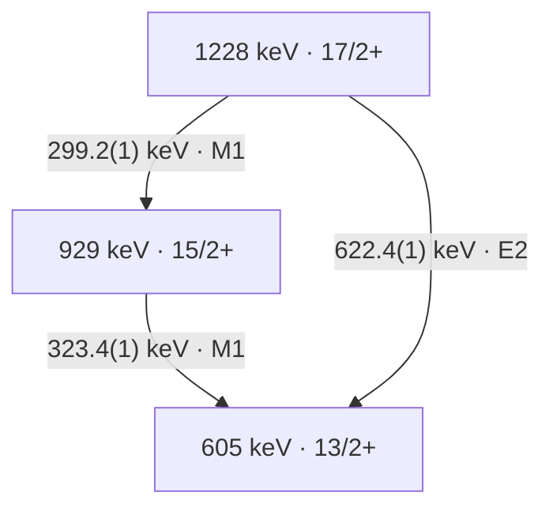
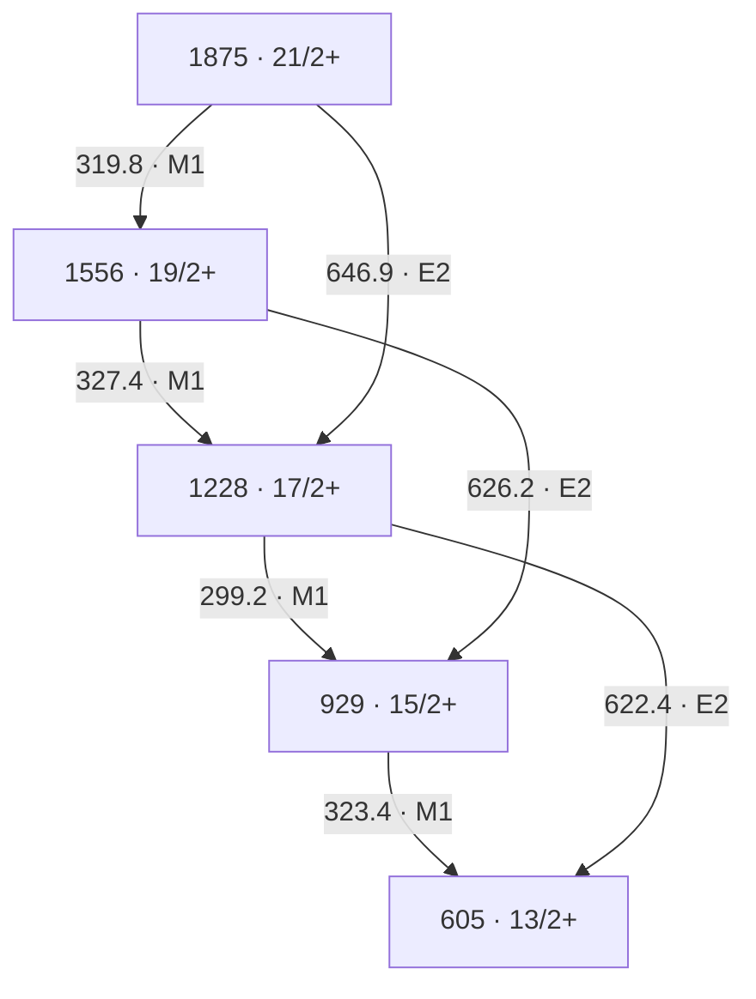

# 从 γ 谱重建能级纲图

## Purpose

把谱峰身份、跃迁放置、multipolarity、自旋宇称与结构解释分层审计，使每一步回到原图/表、门条件和精确来源。

## Inputs and Assumptions

输入包括校准能量及协方差、γγ/γγγ 门与背景、emitter identity、探测效率/响应、角度/偏振标定和可信 spin anchor。下方练习使用作者的打印图表与明确写出的误差假设，没有原始事件；先保留 rounding、feeding、复合峰和未确认 linking 的边界。

## What It Can Establish

可复核已报告子级联的 energy closure、source-level coincidence/assignment chain，建立最低伴随观测和可证伪的重排条件。

## What It Cannot Establish Alone

单一谱峰、共同下方门或能量闭合不能独自确定唯一 Jπ、configuration、形变或 absolute B 值；本方法也不把 source 图表的重算当作新独立实验。

## 证据层与最小审计矩阵

能量、符合关系和 multipolarity 分别回答不同问题。下表是基于 [[herzan-2015-193bi-spectroscopy]] 的方法综合，不能将作者的最终纲图当作本任务已重新拟合的数据。

| 步骤 | 可建立的约束 | 原文例子 | 最小伴随观测与边界 |
|---|---|---|---|
| emitter identity | 谱线可属于某残核/衰变链。 | 165Ho(32S,4n)193Bi、RITU/GREAT recoil/RDT/isomer tagging；HE15-1，PDF pp.1–2。 | α/recoil correlation、random rate、timing/particle PID；元素 x ray 或相近能量不能单独识别 isotope。 |
| line identity | 同一观测峰可能含多个跃迁。 | Fig.5(a) 的约323-keV peak 是315/320/323/327-keV quadruplet；HE15-5。 | matched gates、response-aware multi-line fitting、污染和逐角度检查；峰宽不是一条跃迁的身份。 |
| coincidence and ordering | γγ/γγγ 和 energy sums 支持 cascade/branch placement。 | Fig.2 / Table I 的 Band1 三层；HE15-4。 | 一张共用下方门通常同时选中该带多条线；能量闭合不是独立符合证据。 |
| multipolarity | 角度强度比和偏振支持 dipole/quadrupole 与电/磁 character。 | 299.2、323.4 列 M1，622.4 列 E2；HE15-4。 | 保留同门、效率、alignment、响应和 a(Eγ)/Q(Eγ)；不能把列 M1 当作已测 δ=0。 |
| spin/parity | multipolarity 和可信 anchor 可沿级联传播约束。 | 17/2+→15/2+→13/2+ 的作者赋值；HE15-4。 | 绝对 spin anchor 与混合/非 stretched 可能性；作者 label 不自动成为独立新测量。 |
| lifetime/absolute strength | 时间或 Doppler-history 与分支/δ 可转换到绝对 B 值。 | 13/2+ bandhead 的153(10) ns来自先前 Ref.[7]；PDF p.10。 | 对本三条线没有新 τ/δ 包；箭头、相对 Iγ、能量和不提供 absolute B。 |
| configuration/shape | systematics 与模型约束解释。 | SD Table II 保留 X 和括号 spins；1836-keV candidate link 未确认；HE15-6。 | 无 confirmed link 和绝对 strengths 时不能固定 X 或把相似带能量当成直接形变测量。 |

## 193Bi Band 1 三层实例

下面是原作者 Figure 2 / Table I 的一个子图。level energies 为论文打印的整数近似；不要要求其逐差等于带小数的 γ energy。

| γ energy (keV) | 作者母态→子态 | R_exp | Δ_IPDCO | 作者 multipolarity | 证据等级 |
|---:|---|---:|---:|---|---|
| 299.2(1) | 17/2+→15/2+ | 0.68(2) | −0.032(1) | M1 | 能量与比值/偏振为直接报告；placement/Jπ 为联合赋值。 |
| 323.4(1) | 15/2+→13/2+ | 0.74(4) | −0.012(1) | M1 | 同上；真实 gate 中还须保留邻线/复合峰边界。 |
| 622.4(1) | 17/2+→13/2+ | 1.30(16) | +0.086(10) | E2 | 同上；直接分支与299.2+323.4级联为不同衰变路径。 |

此处 Table I 的三个 R_exp 来自作者的 `Iγ(157.6°)/Iγ(75.5°)`，每个 angle-vs-all-angles matrix 在 all-angles 轴上使用相同 energy gate，并修正效率（PDF p.2）。作者称其为 RDCO；其0.8/1.3参考值属于该阵列/程序，不能替代其它 DCO/reference-gate 定义。偏振同样依赖 clover a(Eγ) 和 Q(Eγ)；跨阵列不得照搬阈值。

### 能量和练习与误差边界

中心值闭合残差为 `299.2+323.4−622.4=+0.2 keV`。只把三个打印拟合误差0.1 keV视为独立，σ为 `sqrt(3)×0.1=0.1732 keV`。Table I caption 另要求对多数 γ energy 加约0.3 keV statistical error；若自设这项与拟合误差及各线均独立，则每条 σ为0.3162 keV，闭合 σ为0.5477 keV。论文没有为这三条提供 joint covariance，此合成仅为带假设的练习，不能写成作者报告的 closure uncertainty。

一般地，令 `a=(1,1,−1)`，则 `σ_closure²=aᵀΣa`。共同能量 offset、gain 和峰拟合相关性不应都当作三份独立误差。中心值闭合支持放置但不能唯一确定 ordering、Jπ 或 configuration，也不是与 Fig.2 独立的第二实验。

### 门条件、反证与可以重排纲图的观察

- 299.2与323.4是同一路径的连续 γ，适当的prompt coincidence可以支持级联；622.4是同母态直接分支，不要求它在同一单核衰变事件中与前两条同时出现。看到三者强互符合时，应先检查feeding、多核事件、random或能量重叠，而非直接把互斥分支改成连续三级联。
- Table I 另列299.8(1) keV、41/2+→39/2+ 的Band1 line，离299.2仅0.6 keV；共用323.4下方门可能仍接受两个band内事件种类，不能靠一张gate自动拆峰。可设计622.4直接分支门与323.4级联门的比较，并控制上方feeding和污染；本文未提供本任务可复算的逐门计数/协方差。
- 若响应/背景控制后的候选299-keV component在互斥直接分支门中占主导，且对应上方feeding而非17/2+母态，当前单峰归属应拆分；若可靠energy sums或独立spin/parity anchor冲突，相关放置/赋值应重审。一个弱线不出现仅在给出灵敏度、gate acceptance和预期强度后才是反证。
- Fig.5(a) 的 quadruplet 是实测多线峰的直接反例；[[doppler-correction]] 中Klemme shifted/unshifted双分量是同一跃迁的另一类反例。两者是独立实验、不同机制，不能互相移植仪器响应或数据。
- 另一种 negative-evidence 边界是SD带底部约87/46-keV候选线未观察到。作者讨论87.4-keV Bi x ray重叠及强内转换，并假设强度经这些线流走（HE15-7，PDF p.19）。观察缺失是报告事实，原因与intensity flow为作者解释；没有detection/ICC/branching closure时，不能由缺失峰单独否定该级联，也不能把未见的线补写成已测跃迁。

## 独立性与知识判断

Herzáň Figure 2、Table I、Figure 5 是同一 acquisition 的图/表/投影（`multiple-dependent`），不是三个独立实验。DCO、偏振和符合是互补约束，仍共享事件、标定及门；bandhead的先前寿命是外部依赖，不能当作本次新τ测量。Mavela与Klemme是独立方法对照，并非193Bi的复测。

Self-audit结果：`supports` level/transition identity与联合assignment；`limits` 单峰、单门、closure或relative Iγ的结构解释。SD序列的X、括号spins和tentative linking是另一种必要保留的不确定性。原始事件、response和covariance不足，当前只有L2/L3方法审计，不是新实验L4。

## Day14 五能级七跃迁逐边审计

原作者 Figure2 的五个 level label 为605、929、1228、1556、1875 keV，Jπ依次为13/2+、15/2+、17/2+、19/2+、21/2+。本次逐边重建只复核已发表的子图，未发现或重新测量“新线”。其中319.8-keV行在 Table I 的 Other transitions（PDF p.7），不能因为它未列在第一页Band1小标题下就漏掉。

下表将能量、符合、multipolarity 和 Jπ 的证据等级分开。E 表示原表直接给出的峰能量；C 表示作者通过γγ/γγγ与能量和联合放置；M 表示报告的R/A支持作者电磁赋值；J 表示依赖已知spin/parity锚点、stretched/混合条件和全图的赋值。C/M/J不等于本任务有事件级数据独立复现。`0.1 keV` 是打印拟合误差，caption 的额外约0.3 keV仍须另计。

| Eγ(keV) / 母→子 | Iγ（原表标度） | Rexp | ΔIPDCO | multipolarity / 分级 | 符合与Jπ边界 | source locator |
| --- | ---: | --- | --- | --- | --- | --- |
| 323.4(1) / 15/2+→13/2+ | 1000(57) | 0.74(4) | −0.012(1) | M1；E直接、M联合赋值 | Figure5(a)祖先154-keV门的约323峰含四线；Figure5(b)此门选多条feeding，不能独立给出全部相邻线顺序；C/J为source-level联合赋值。 | HE15-4、HE15-5；PDF p.3 Table I / p.8 Fig.2 / p.10 Fig.5 |
| 299.2(1) / 17/2+→15/2+ | 258(8) | 0.68(2) | −0.032(1) | M1；E直接、M联合赋值 | 上游门能支持归带，仍需区分同带299.8-keV高spin线；C/J不是新独立测量。 | HE15-4、HE15-5；PDF p.3 / p.8 / p.10 |
| 327.4(1) / 19/2+→17/2+ | 196(6) | 0.68(2) | −0.004(1) | M1；E直接、M联合赋值 | 本身也是Figure5(a)复合峰成员；较小的A不能替代δ测量或独立spin锚点。 | HE15-8、HE15-5；PDF p.3 / p.8 / p.10 |
| 319.8(1) / 21/2+→19/2+ | 125(4) | 0.60(2) | −0.039(2) | M1；E直接、M联合赋值 | 表尾Other transitions；Figure2圆整为320，仍须保留共用门的混合分量。 | HE15-8；PDF p.7 / p.8 |
| 622.4(1) / 17/2+→13/2+ | 121(5) | 1.30(16) | +0.086(10) | E2；E直接、M联合赋值 | 与299.2→323.4是互斥的同母态直接/级联路径；三者不应被要求同一单核衰变中强互符合。 | HE15-4；PDF p.3 / p.8 |
| 626.2(1) / 19/2+→15/2+ | 102(4) | 1.48(6) | +0.094(9) | E2；E直接、M联合赋值 | 与327.4→299.2构成两路闭合；Figure5(a)标622&626，公开门谱未独立提供逐对净面积/协方差。 | HE15-8；PDF p.3 / p.8 / p.10 |
| 646.9(1) / 21/2+→17/2+ | 108(4) | 1.47(6) | +0.091(4) | E2；E直接、M联合赋值 | 与319.8→327.4构成两路闭合；仍共享γγ/γγγ事件与标定，J沿图有条件传播。 | HE15-8；PDF p.3 / p.8 |

M1/E2 label不表示已测δ=0；绝对spin锚点也不是从这些比值单独求得。作者的Rexp是同门、效率校正的157.6°/75.5°角度强度比（HE15-4，PDF p.2），不是可以不加说明搬用的“已知纯E2参考门DCO”。这些互补观测共享一个JYFL acquisition，并非七条独立实验。

## 能量图的闭合、标定与拓扑边界

令D的每行在母态列取+1、子态列取−1，则本图有5个nodes、7条edges，rank(D)=4。`D·1=0`：没有绝对锚点时，整体能量平移不可测。取能量向量顺序为 `(323.4,299.2,327.4,319.8,622.4,626.2,646.9)`，三个独立闭合残差为：

1. `323.4+299.2−622.4=0.2 keV`；
2. `299.2+327.4−626.2=0.4 keV`；
3. `327.4+319.8−646.9=0.3 keV`。

闭合矩阵C满足`CD=0`，但统计上三个残差不独立。若仅作练习，把每条0.1-keV拟合误差与caption约0.3 keV按平方和相加并假定各线独立，则`Σ=0.1 I keV²`，`CΣCᵀ=0.1×(3,1,0; 1,3,1; 0,1,3) keV²`。相邻闭合共享一条边，相关系数为1/3。用同一Σ的GLS与cycle-space检验均得`χ²=0.666667`、3 degrees of freedom；若只用打印拟合误差则为`6.666667`。两者都是声明误差模型下的练习，不能挑一项充当作者的最终显著性；论文未给完整Σ。

GLS相对最低node的结果是`0,323.366667,622.433333,949.666667,1269.4 keV`，仅用于检验七条测量方程的相容性，不替换Figure2圆整level label，也不提供新的绝对能级。把浮动node差、固定打印能级和独立绝对anchor混入同一fit会改变问题定义。

标定敏感性具有不同物理含义。共同加性offset在“二光子减一光子”闭合中保留：`C·1_edges=(1,1,1)`；同一gain作用于真实闭合的gap向量时被C消掉。自设offset σ=0.2 keV或gain σ=0.001分别作为counterfactual，不是本实验校准误差。若将offset完全浮动，模型多一个parameter，余2 degrees of freedom；条件解offset=0.28±0.374 keV、χ²=0.106667也不能据此宣布原来源有offset问题。故“闭合良好”不能独自认证能量scale、emitter身份、图拓扑或Jπ。

**真实来源的顺序反例：** HE15-9（Table I footnote f）明确说393.4/394.0-keV双线顺序未定，所列R/A是共享值。以打印1258.1-keV下方能级作为演示锚点，两种顺序都给upper=2045.5 keV，intermediate分别为1651.5或1652.1 keV；交换顺序仍满足能量和以及假设的两个ΔI=2。它们是条件替代放置，不是两套已测纲图。需要能够分别限制一条线母/子态的branch、时间顺序或独立tag，而非再次重复求和。

SD的13-edge/14-node浮动链同样rank=13、存在整体平移nullspace。Table II的X不会因为十三条γ能量都可加起来而变成已知；1836-keV候选link无确定endpoint且未confirmed，不能用其能量先固定X再反向宣称link正确（HE15-6）。

可复算脚本：[day14_level_scheme_audit.py](../../system/scripts/day14_level_scheme_audit.py)，输入转录：[level-scheme-fixture.json](../../outputs/learning-daily/20261014-DAY14-week-two-spectrum-to-level-scheme-exam-run-02/level-scheme-fixture.json)。35项检查包括rank/nullspace、CD=0、GLS–cycle χ²、独立whitened least squares、换行顺序不变、标定模式、刻意错移一条crossover、双线换序和SD nullspace。数值输出：[level-scheme-analysis.json](../../outputs/learning-daily/20261014-DAY14-week-two-spectrum-to-level-scheme-exam-run-02/level-scheme-analysis.json)。科学公式、结果、条件与反证均在本知识页；outputs只是转录/重算回执。

## 标定、寿命与伴随观测的逐项契约

由HE15-10的实际标定，`a(323.4)=1.0955364`；报告`A=−0.012`对应条件计数比`N⊥/N∥=(1+A)/(a(1−A))=0.8911476`。若对相同比值错误地令a=1，会得到`A=−0.0575589`。这是原公式的反事实重算，没有原始counts；不是测到的新A，也不重估作者的误差。`a(E)`修正几何非对称，`Q(E)`才把A接到P，不能合并两者或忽略fit coefficient covariance。

同母态两条已报告γ的条件强度比分别为`258/121=2.132231`、`196/102=1.921569`、`125/108=1.157407`。它们不等于总branch、寿命或absolute B；要得到M1/E2的radiative components，还需δ、ICC、未观测branches、gate acceptance及source correction。HE15-12的153(10)-ns是13/2+ bandhead的先前半衰期，不能赋给17/2+、19/2+、21/2+这些parent。

| 会改变纲图/赋值的观测 | 最小可信输入 | 判别与停止边界 |
| --- | --- | --- |
| 干净622.4-keV直接分支门内出现强299-keV分量，而323.4级联门的component比例不同 | 确认622/626门纯度，逐门response、多核/random控制、上方feeding | 先拆299.2/299.8或污染component；不把branch互斥关系违背自动写成新cascade。 |
| 393/394双线的一条存在独立定位的旁路或延迟顺序 | 净γγ/γγγ或electron/γ时间关联、背景/接受度 | 可能裁决中间level；仅一张共同下方门或两条共同R/A不足。 |
| SD candidate link与确定Band6 endpoint形成可信多重符合，能量和/电磁性质闭合 | endpoint identity、逐门净计数、false-link对照、response/效率 | 才可能固定X与相关spin；当前仍expected-but-not-established。 |
| 46/87-keV弱γ未见但conversion electron与下游flow闭合 | 低能响应/阈值、x-ray分量、ICC与branching | HE15-13的α=261/12.82会强抑制γ，未见峰不能单独反驳路径；需校准上限。 |
| 从isomer的84-keV decay推Jπ时发现Band1 anchor或parallel path失效 | independent spin/parity anchor、84/137/455转换与条件路径 | HE15-11明确依赖Band1；有条件赋值应随锚点重审，不能把内转换当新absolute spin测量。 |

## 第二周证据链的可复用认识修正

从布居、门控、响应到能级与结构结论，应为每个层级补相称信息，而非将同一事件的多个投影累加成多个独立实验。本周的三个判断在HE15-4/8–12的source-to-method审计中具体落地：

- **supports：** 校准能量、互补角度/偏振和branch/cube支持原作者的source-level子图；一图一表及各续页必须联查，页内分组不是物理band成员的完整边界。
- **limits：** 多条闭合共享边并相关；更好χ²不验证拓扑；一峰共享DCO/IPDCO不识别每条component；relative Iγ和bandhead半衰期不能跳接到其它母态absolute B。
- **revises：** 最有信息的下一项测量应针对尚未识别的自由度。393/394问题要独立endpoint/time/branch，SD X要confirmed link，电磁strength要逐母态τ/branch/δ；重复同一能量和或祖先门不足以解除这些边界。

这是跨层级方法综合，不改变193Bi或A≈130集体模式的排序。P0科学措辞已self-audit：保留shared measurements、未知X、括号Jπ与原source review flags；没有技术hard P0。P1保留事件级response/calibration/feeding缺口。普通发表的图表重算属L2，actual event-level L4重分析仍not-ready。

## 互斥分支门、复合峰与shared-event计数

这是HE15-4/5所启发的L2设计模型，未使用193Bi原始事件，未拟合Table I强度。模型只有一个核和两条完整photon路径：17/2+以概率b走299.2→323.4，或以1−b走622.4；比例h的事件先在上方发射299.8。先取无IC、无额外feeding、纯门、无angular correlations/summing/random、独立photon detection的极限，所有效率和b/h均是自设数值。实际 JUROGAM 不能直接套用这些假设。

以A=622.4直接分支门、B=323.4级联门，令L、H分别为无门的low/high299-keV photon yields（已含相应photon效率），则合并峰总面积满足

`(Y_A,Y_B)ᵀ = Q(L,H)ᵀ`，`Q = ((0,(1−b)ε_A); (ε_B,b ε_B))`。

**已知conditional系数的判别力：** 若0<b<1且ε_A/ε_B非零，det(Q)=−(1−b)ε_Aε_B不为零；即使两条energy response完全相同，两种已知gate signature仍能解除两强度参数的线性退化。一张合并谱只有rank1。b→1、A门效率→0，或门污染使两列gate signature成比例时，rank又降为1。这是已知模型下的rank结果，不是证明实际双峰已经分开。

**未知branch或压缩数据的边界：** 若两条线不可分，或者分析只保留两张谱的total peak area，未知b会留下连续物理解。自设b=.60、h=.20、parent Poisson mean10⁶、ε_A=.05、ε_B=.07、两个299效率均.10，得到A高线400、B低线4200、B高线840。只保留(A总400，B总5040)，另一组b=.50/h=.125/N=1.28×10⁶和b=.70/h=.35/N≈761905给同样的两个总面积。已校准的pure gate singles在这个闭合两路径模型中可以补足b；若能量分量本就可识别，完整joint spectra也含更多信息，不能把“两总面积”的退化泛化为所有数据都不可识别。IC、额外feeding、unknown acceptance或相关背景存在时，必须重新写模型，不能借该toy恢复实际branching。

**shared-event计数：** 上方299.8与下方299.2可在同一B门事件中出现。令每个parent事件的计数向量为y；Poisson parent flow的`Cov(Σy)=λ E(yyᵀ)`，固定N的`Cov(Σy)=N(E(yyᵀ)−E(y)E(y)ᵀ)`。前述自设模型中B低/高线的compound-Poisson covariance为84 counts²，而不是零；A/B两支路在Poisson flow中交叉covariance为零、固定N则为负。gate与其subset photon count也相关。不能把边/门计数都当独立Poisson再相乘似然；实际还需counting convention、角关联和summing/多核事件的forward response。

代码用64个event state精确枚举，并独立生成5×10⁶个事件（seed20261014）。37项检查通过，包括均值、二阶矩、PSD、parent flow区别、门rank/污染极限、unknown-b等价族。Monte Carlo均值和二阶矩最大偏离均约2.18个声明的sampling σ。对自设σ=1 keV、ΔE=.6 keV的bin-integrated Gaussian模板，归一列几何condition number从单谱4.718变为两门3.231；这不是likelihood/power，也不预测真实JUROGAM能否拆峰。

**低能γ非观测的条件功效：** HE15-13的E2 αtot=261/12.82分别给46/87-keV photon fraction约0.003817/0.07236。在自设N=5000、每条εγ=.01、branch flow=1的固定N模型下，平均探测数为0.191/3.618，看到零计数的概率为0.826/0.0268。使P(0)=.05所需的条件parent数量分别约78487/4139。实际flow、α模型/误差、阈值、x-ray背景和效率未给，因此这些不是论文upper limit；它们说明只说“未见峰”缺少功效定义，conversion-electron与下游branch closure可能比重复γ门更有信息。

可复算：[day14_conditional_gate_design.py](../../system/scripts/day14_conditional_gate_design.py)，[条件模型回执](../../outputs/learning-daily/20261014-DAY14-week-two-spectrum-to-level-scheme-exam-run-02/conditional-gate-design.json)。模型条件、公式和可复用认识均在本知识页。Self-audit：`supports`纯分支tag的互补判别力，`limits`未知branch/response和独立Poisson简化；不认证actual line identity、branch、τ或结构模式。

## 原图、评价精度与赋值冲突的crosswalk

[[nndc-2017-193bi-level-scheme-evaluation]]实际取得NNDC193Bi的ADOPTED和165Ho(32S,4nγ)两个201709对象，前者含2019半衰期修订。它采用Herzáň2015He27，并将其当作superseding set；网站和两个对象都不增加一个independent acquisition。N193-3明确评价者以quadrature加入0.3-keV统计误差、用全γ网络least-squares且固定305-keVlevel；这核实了评价者的合成规则，仍未给本图完整jointΣ。它不能反向证明原作者逐线/标定误差彼此独立。

| 原Figure2整数label keV | evaluatedlevel keV | Jπ（评价记录） | 如何使用 |
|---|---|---|---|
|605|605.53(18)|13/2+|153(10)-ns是此level半衰期，来自2004Ni06。|
|929|928.93(21)|15/2+|由γ网络调整，不作为原γ独立新增data point。|
|1228|1228.13(21)|17/2+|母态299.2/622.4两branch的parent identity。|
|1556|1555.30(25)|19/2+|原图数字与调整结果不同，应区分版本/fit，而非固定整数重拟合。|
|1875|1875.1(3)|21/2+|母态319.8/646.9；γcentroids保留原表，误差按评价规则列。|

N193-4/10及79-check固定列crosswalk核对七条γ的中心值、mother、γ误差和RI标度。reaction RI均为原Table I的0.1倍；ADOPTED selected母态blocks又以强线100重标。比值的微小差异可由打印圆整产生，不能从不同normalization拼接population/feeding或当作独立实测。

**352.3-keV判例：** 原Table I为(13/2−)→(11/2−)、M1；Figure2 continued在1610keV标15/2−。一般single-photon triangle要求`|Ji−Jf|≤L`，因此若取Figure2的ΔI=2，M1(L=1)严格不允许；若取Table I的ΔI=1，M1允许。这是有条件的选律检查，不选择哪一个spin是真值。N193-6留空multipolarity并公开记录该冲突；negativePOL不能独自确定absolute J或替代independent anchor。需要分别固定该level的spin/branch/line identity，再讨论character。

**393/394判例：** 原tentative(E2)由placement/相对spin提出；N193-5只保留Q，并明确shared negativePOL与(E2)不一致、order未established。Q是quadrupole级别，尚未指定electric或magnetic。没有逐component偏振或另一个independent约束时，不能用共同R/A修复每条线的电磁性质，也不能凭“两行都Q”把两条各自当E2。

**输入缺口的更新：** 现在有N193-7的BrIcc v2.3a/Frozen-Orbitals CC计算，不能继续笼统说完全没有ICC数值；它们仍没有测δ、全branches或higher-parent τ。N193-8只把bandhead153-ns归到604.7γ(t)/2004Ni06，并提供compiler关于prompt/约1μs separatorflight的说明；原Ni04完整方法尚未核验。若设计只把1μs当固定lab等待且忽略feeding/time dilation，153-ns半衰期的存活率约`2^(−1000/153)=0.0108`；这个尺度例不是对实际RITU时间分布的测量。

## 从条件ICC到photon fraction的最小练习

只考虑一母态的两条已报告line，并自设pure M1/E2、采用BrIcc CC、没有其它decaychannel时，设`S=I_M1(1+α_M1)+I_E2(1+α_E2)`。则`pγ,M1=I_M1/S`，`pγ,E2=I_E2/S`，conversion fractions分别为`α_j I_j/S`。分母是这个两channel模型的totaldecay，而非“只在γ中归一”的分母。绝对rate还需该parent的总meanτ，并满足完整分支/δ前提。

| parent keV | M1/E2 keV | BrIcc αM1/αE2 | 仅γ归一的M1比例 | M1 photon fraction | 含conversion的conditional M1 branch |
|---|---|---|---:|---:|---:|
|1228.13|299.2/622.4|0.467/0.0186|0.680735|0.514212|0.754349|
|1555.30|327.4/626.2|0.366/0.0183|0.657895|0.527561|0.720648|
|1875.1|319.8/646.9|0.390/0.01706|0.537634|0.441565|0.613776|

此表是N193-7/10输入下的任务推导。M1/E2 admixture会改变effective CC和component fractions，未观测branch改变S；parentτ仍为空，所以没有给absolute B，也不把conditional branch填回source当“已测值”。自设gate toy的b=.6/h=.2不是以上数值的拟合。

代码：[day14_ensdf_crosswalk.py](../../system/scripts/day14_ensdf_crosswalk.py)；[79-check回执](../../outputs/learning-daily/20261014-DAY14-week-two-spectrum-to-level-scheme-exam-run-02/ensdf-crosswalk.json)。Checks是身份/列/标度/边界的验证，不是79条独立实验。Self-audit的决定为`revises`精度/数据版本和weak-line工作标签，`limits`独立性、completebranch与strength充分性；不改变原作者图表或任何review flags。

## Sources

- [[herzan-2015-193bi-spectroscopy]] HE15-4：PDF p.3 Table I / p.8 Fig.2 / p.2 setup-specific ratios。
- [[herzan-2015-193bi-spectroscopy]] HE15-5：PDF p.10 Fig.5(a) quadruplet and gated-spectrum boundary。
- [[herzan-2015-193bi-spectroscopy]] HE15-6：PDF p.15 Table II / Fig.13, tentative linking and X。
- [[herzan-2015-193bi-spectroscopy]] HE15-7：PDF p.19 Sec.IV.D, low-energy non-observation and conversion/x-ray explanation。
- [[klemme-1999-lifetimes-134nd-neighbors]] KL99-18：同一跃迁的距离相关双分量。
- [[gamma-gamma-coincidence]]、[[spin-parity-assignment]]、[[doppler-correction]]：配套方法入口。
- [[nndc-2017-193bi-level-scheme-evaluation]]：N193-1–10，versioned evaluated records、weak-line limits、conditional BrIcc CC；不是独立实验。

## Level gap and gamma-energy precision

[[tunl-2017-12c-level-widths]] T12C-1/4与[[doppler-correction]]的free-two-bodyexercise强调：energy-levelgap与emitting-parent-restγenergy存在photonrecoil差，精确schemeenergyclosure需声明mass/frame/rounding。A12/gap15.110MeV的mass-numbertoy差约10.20keV，不能把高能levelgap直接当exactγcalibrationline；A130/1MeV差约.00413keV。此为尺度设计，不重新测原表能级，也不替换真实实验已处理的recoilcorrection。
