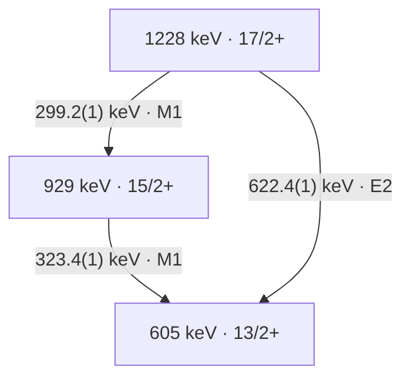

# 从 γ 谱重建能级纲图

## Purpose

把谱峰身份、跃迁放置、multipolarity、自旋宇称与结构解释分层审计，使每一步回到原图/表、门条件和精确来源。

## Inputs and Assumptions

输入包括校准能量及协方差、γγ/γγγ 门与背景、emitter identity、探测效率/响应、角度/偏振标定和可信 spin anchor。下方练习使用作者的打印图表与明确写出的误差假设，没有原始事件；先保留 rounding、feeding、复合峰和未确认 linking 的边界。

## What It Can Establish

可复核已报告子级联的 energy closure、source-level coincidence/assignment chain，建立最低伴随观测和可证伪的重排条件。

## What It Cannot Establish Alone

单一谱峰、共同下方门或能量闭合不能独自确定唯一 Jπ、configuration、形变或 absolute B 值；本方法也不把 source 图表的重算当作新独立实验。

## 证据层与最小审计矩阵

能量、符合关系和 multipolarity 分别回答不同问题。下表是基于 [[herzan-2015-193bi-spectroscopy]] 的方法综合，不能将作者的最终纲图当作本任务已重新拟合的数据。

| 步骤 | 可建立的约束 | 原文例子 | 最小伴随观测与边界 |
|---|---|---|---|
| emitter identity | 谱线可属于某残核/衰变链。 | 165Ho(32S,4n)193Bi、RITU/GREAT recoil/RDT/isomer tagging；HE15-1，PDF pp.1–2。 | α/recoil correlation、random rate、timing/particle PID；元素 x ray 或相近能量不能单独识别 isotope。 |
| line identity | 同一观测峰可能含多个跃迁。 | Fig.5(a) 的约323-keV peak 是315/320/323/327-keV quadruplet；HE15-5。 | matched gates、response-aware multi-line fitting、污染和逐角度检查；峰宽不是一条跃迁的身份。 |
| coincidence and ordering | γγ/γγγ 和 energy sums 支持 cascade/branch placement。 | Fig.2 / Table I 的 Band1 三层；HE15-4。 | 一张共用下方门通常同时选中该带多条线；能量闭合不是独立符合证据。 |
| multipolarity | 角度强度比和偏振支持 dipole/quadrupole 与电/磁 character。 | 299.2、323.4 列 M1，622.4 列 E2；HE15-4。 | 保留同门、效率、alignment、响应和 a(Eγ)/Q(Eγ)；不能把列 M1 当作已测 δ=0。 |
| spin/parity | multipolarity 和可信 anchor 可沿级联传播约束。 | 17/2+→15/2+→13/2+ 的作者赋值；HE15-4。 | 绝对 spin anchor 与混合/非 stretched 可能性；作者 label 不自动成为独立新测量。 |
| lifetime/absolute strength | 时间或 Doppler-history 与分支/δ 可转换到绝对 B 值。 | 13/2+ bandhead 的153(10) ns来自先前 Ref.[7]；PDF p.10。 | 对本三条线没有新 τ/δ 包；箭头、相对 Iγ、能量和不提供 absolute B。 |
| configuration/shape | systematics 与模型约束解释。 | SD Table II 保留 X 和括号 spins；1836-keV candidate link 未确认；HE15-6。 | 无 confirmed link 和绝对 strengths 时不能固定 X 或把相似带能量当成直接形变测量。 |

## 193Bi Band 1 三层实例

下面是原作者 Figure 2 / Table I 的一个子图。level energies 为论文打印的整数近似；不要要求其逐差等于带小数的 γ energy。

| γ energy (keV) | 作者母态→子态 | R_exp | Δ_IPDCO | 作者 multipolarity | 证据等级 |
|---:|---|---:|---:|---|---|
| 299.2(1) | 17/2+→15/2+ | 0.68(2) | −0.032(1) | M1 | 能量与比值/偏振为直接报告；placement/Jπ 为联合赋值。 |
| 323.4(1) | 15/2+→13/2+ | 0.74(4) | −0.012(1) | M1 | 同上；真实 gate 中还须保留邻线/复合峰边界。 |
| 622.4(1) | 17/2+→13/2+ | 1.30(16) | +0.086(10) | E2 | 同上；直接分支与299.2+323.4级联为不同衰变路径。 |

此处 Table I 的三个 R_exp 来自作者的 `Iγ(157.6°)/Iγ(75.5°)`，每个 angle-vs-all-angles matrix 在 all-angles 轴上使用相同 energy gate，并修正效率（PDF p.2）。作者称其为 RDCO；其0.8/1.3参考值属于该阵列/程序，不能替代其它 DCO/reference-gate 定义。偏振同样依赖 clover a(Eγ) 和 Q(Eγ)；跨阵列不得照搬阈值。

### 能量和练习与误差边界

中心值闭合残差为 `299.2+323.4−622.4=+0.2 keV`。只把三个打印拟合误差0.1 keV视为独立，σ为 `sqrt(3)×0.1=0.1732 keV`。Table I caption 另要求对多数 γ energy 加约0.3 keV statistical error；若自设这项与拟合误差及各线均独立，则每条 σ为0.3162 keV，闭合 σ为0.5477 keV。论文没有为这三条提供 joint covariance，此合成仅为带假设的练习，不能写成作者报告的 closure uncertainty。

一般地，令 `a=(1,1,−1)`，则 `σ_closure²=aᵀΣa`。共同能量 offset、gain 和峰拟合相关性不应都当作三份独立误差。中心值闭合支持放置但不能唯一确定 ordering、Jπ 或 configuration，也不是与 Fig.2 独立的第二实验。

### 门条件、反证与可以重排纲图的观察

- 299.2与323.4是同一路径的连续 γ，适当的prompt coincidence可以支持级联；622.4是同母态直接分支，不要求它在同一单核衰变事件中与前两条同时出现。看到三者强互符合时，应先检查feeding、多核事件、random或能量重叠，而非直接把互斥分支改成连续三级联。
- Table I 另列299.8(1) keV、41/2+→39/2+ 的Band1 line，离299.2仅0.6 keV；共用323.4下方门可能仍接受两个band内事件种类，不能靠一张gate自动拆峰。可设计622.4直接分支门与323.4级联门的比较，并控制上方feeding和污染；本文未提供本任务可复算的逐门计数/协方差。
- 若响应/背景控制后的候选299-keV component在互斥直接分支门中占主导，且对应上方feeding而非17/2+母态，当前单峰归属应拆分；若可靠energy sums或独立spin/parity anchor冲突，相关放置/赋值应重审。一个弱线不出现仅在给出灵敏度、gate acceptance和预期强度后才是反证。
- Fig.5(a) 的 quadruplet 是实测多线峰的直接反例；[[doppler-correction]] 中Klemme shifted/unshifted双分量是同一跃迁的另一类反例。两者是独立实验、不同机制，不能互相移植仪器响应或数据。
- 另一种 negative-evidence 边界是SD带底部约87/46-keV候选线未观察到。作者讨论87.4-keV Bi x ray重叠及强内转换，并假设强度经这些线流走（HE15-7，PDF p.19）。观察缺失是报告事实，原因与intensity flow为作者解释；没有detection/ICC/branching closure时，不能由缺失峰单独否定该级联，也不能把未见的线补写成已测跃迁。

## 独立性与知识判断

Herzáň Figure 2、Table I、Figure 5 是同一 acquisition 的图/表/投影（`multiple-dependent`），不是三个独立实验。DCO、偏振和符合是互补约束，仍共享事件、标定及门；bandhead的先前寿命是外部依赖，不能当作本次新τ测量。Mavela与Klemme是独立方法对照，并非193Bi的复测。

Self-audit结果：`supports` level/transition identity与联合assignment；`limits` 单峰、单门、closure或relative Iγ的结构解释。SD序列的X、括号spins和tentative linking是另一种必要保留的不确定性。原始事件、response和covariance不足，当前只有L2/L3方法审计，不是新实验L4。

## Sources

- [[herzan-2015-193bi-spectroscopy]] HE15-4：PDF p.3 Table I / p.8 Fig.2 / p.2 setup-specific ratios。
- [[herzan-2015-193bi-spectroscopy]] HE15-5：PDF p.10 Fig.5(a) quadruplet and gated-spectrum boundary。
- [[herzan-2015-193bi-spectroscopy]] HE15-6：PDF p.15 Table II / Fig.13, tentative linking and X。
- [[herzan-2015-193bi-spectroscopy]] HE15-7：PDF p.19 Sec.IV.D, low-energy non-observation and conversion/x-ray explanation。
- [[klemme-1999-lifetimes-134nd-neighbors]] KL99-18：同一跃迁的距离相关双分量。
- [[gamma-gamma-coincidence]]、[[spin-parity-assignment]]、[[doppler-correction]]：配套方法入口。
