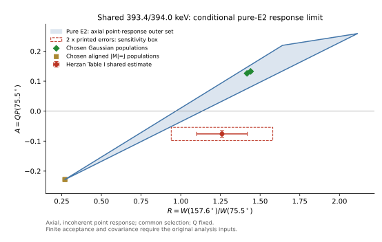

# 线偏振不对称分析（Linear Polarization Asymmetry）

## 同参考校准的计数与误差门

[[polarimetry-shared-calibration-count-design]]保存本session重新核ST99/SG98后的P/A/Q分层表、两种Jacobian和新声明计数练习。若reference/target共用a或η，P_t=P_ref A_t/A_ref的primitive计数传播应保留Cov(A_t,Q)；同一reference的A/Q回代是恒等式，不是独立验证。该设计不补原实验Σ或δ置信区间（ST99-14；SG98-13）。

SG98若把分母√η(C+S)改为ηC+S，则B=(1+η)QP/[2√η+(η−1)QP]；一般已不是线性A=QP，重标一条reference也不足以使单一Q对所有P通用。旧Q及source/Table3的判断不能跟着名称裸迁。最小独立检查需一条未参与Q拟合、且P/门/response可追溯匹配的支路，另带背景和共同校准信息。

实际consumer也须核归一统计：[[grsisort-2026-compton-polarimetry-code]] GRS26-7/8在固定newAnalyze/ROOT组件中复现A_CE=1−normalizedratio的null零误差、分组重复边界bin；真实mixed复用/共同norm仍需Σ。不能用软件字段或同nominalQ替代对实际执行path的验证；默认Lean与newAnalyze版本差别见GRS26-6。

[[garnsworthy-2019-griffin-facility]] GF19-6/8/9/10的GRIFFIN source-reference使用两γ方向定义的coincidence plane和.5QPcos2ξ，1332-keV Q=.240(.012)由nominalP90=1/6标定。Fig18分组是同data，570/1064的scatter/gate双角色亦共享cascade；[[triumf-griffin-compton-source-calibration]]保存实际值和missingledger。它不提供可裸搬到ST99/SG98或in-beam target的通用A/Q。

## Purpose

利用分段 HPGe/Clover 的 Compton 散射方位分布判断跃迁的电或磁性质。

## Inputs and Assumptions

探测器偏振灵敏度、非对称校正、符合门和足够统计；还需spin/geometry、核取向或其约束、门/背景与未分峰component条件。

## Procedure

比较垂直/平行于反应平面的散射计数并构造不对称量。

## What It Can Establish

为电/磁性质提供不同于DCO的互补约束；两者共享事件、门或标定时，不能自动视为统计独立或两条独立实验。

## What It Cannot Establish Alone

弱跃迁的不确定度可能过大，不能可靠提取小 E2 admixture。

未分峰的共同asymmetry不能自动分配成逐线性质；若无相应取向、geometry和spin条件，符号本身也不能独自给出electric/magnetic或绝对Jπ。

## Conventions and Systematics

不对称量符号依实验定义，必须引用原文校准。

[[bark-2024-investigations-nuclear-chirality-ithembalabs]] 的 Eq.(5) 把 `A_p` 分子与分母都印成同一个 minus-form expression，代数上会恒等于 1，并与紧随其后的 `A_p=Q(Eγ)P(θ)` 不相容。该公式作为 source error 隔离，不据此修改本页定义；AFRODITE-specific sign/efficiency convention 应回到原始 calibration source。

不要把所有“asymmetry”默认理解为同一种 in-beam clover Compton polarimetry。[[rusev-2009-multipole-mixing-ratios-11b]] 测量的是 linearly polarized photon beam 激发后，发射 gamma rays 在水平/垂直平面的 azimuthal asymmetry；它与 clover Compton scattering asymmetry 共享“偏振相关”这一物理思想，但实验量和系统项不同。

[[lauritsen-2025-gamma-angular-formalism-tracking-arrays]] treats tracking-array linear polarization as a continuous-angle response-function problem. For in-beam single-gamma polarization, its Eq.35 expands the angular-distribution expression with a `P_pm cos(2 zeta)` term and includes mixed transitions. Its `152Dy` 432-keV example shows why angular distribution, DCO and linear polarization may all be needed to resolve `M1/E2` versus `E1/M2` ambiguity.

[[zheng-2013-linear-polarization-91ru]] provides a clover implementation boundary: EXOGAM `90°` clovers use adjacent-crystal Compton scatters, an unpolarized `152Eu` normalization `a(Eγ)`, and known pure E2 transitions to fit `Q(Eγ)`. The experiment uses `A=QP` together with `R_DCO`; the sign and magnitude separate stretched electric/magnetic and nonstretched cases under the stated geometry. Its `91Ru` assignments remain conditional on the assumed `(9/2+)` ground state, so a clean asymmetry does not remove level-scheme assumptions by itself.

[[garciaraffi-1997-monte-carlo-compton-polarimeters]] shows why `Q` calibration is not a universal constant: geometry, thresholds, scatter-angle windows and polarization transport through multiple scatters must be reproduced before a simulated or measured asymmetry is converted to physical `P`.

[[twin-1970-polarization-angular-correlation-40k]] is an early joint-analysis example: Compton polarization provides parity/multipole sensitivity only after `a2/a4` angular distributions constrain spin and population; polarization alone can admit several spin/parity fits.

[[wadsworth-1977-61ni-levels]] extends the same Rose–Brink/three-GeLi method to a `61Ni` level scheme and demonstrates that polarization, angular distributions and DSAM must be kept as separate evidence layers.

[[falkoff-1948-polarization-correlation]] supplies an early successive-γ polarization-correlation sign formalism; it is not the same detector-level asymmetry as modern segmented-clover analyses.

[[starosta-1999-pdco-experimental-test]] demonstrates the PDCO joint observable in EUROGAM-II: the CLOVER asymmetry is converted with `Q(E)` and combined with a geometry-dependent `R_DCO`. The study explicitly retains an E2 versus mixed M1/E2 branch for the 490-keV transition, showing why polarization plus DCO is narrowing evidence rather than an automatic unique assignment.

[[jones-1995-clover-compton-calibration]] defines the detector-level separation used in later CLOVER work: angular-distribution fitting supplies `P`, adjacent-crystal counts supply `A`, and the calibration is `Q=A/P`. Its 197–1368 keV response and 60-keV threshold should not be copied to another array without recalibration.

## Formalism Boundary

The three new method sources make the detector-layer separation explicit: Jones 2002 defines physical polarization `P`, experimental count asymmetry `A` and detector sensitivity `Q`; Go 2024 extracts a polarization from normalized measured/simulated azimuthal distributions; Longfellow 2026 uses `A0=1/2 Q Pbar` after integrating GRETINA coverage. These are related observables, not interchangeable names for the same quantity.

The special `|P|=1` cases in Jones 2002 require particular alignment and pure transitions. Longfellow's Appendix further shows that the sign of `A0` alone cannot generally identify electric or magnetic character for mixed transitions. Use [[gamma-ray-linear-polarization]], [[experimental-asymmetry]] and [[polarization-sensitivity]] for the separate evidence layers.

### 135Pr的A与P跨表闭合

[[135pr-mixing-branch-input-contract]]按M15-16、[[lv-2022-evidence-against-wobbling-135pr]] L22-16/17与HE15-10核对：Matta TableI是INGA不对称度A，Lv主文是P而SI Table1另列Ap。同一次Lv数据满足P=Ap/Q；采用的Q来自Herzan2015，但a(E)使用Lv自己的calibration，不一并复制Herzan的a。独立原件的Q中央系数使三线Ap→P及误差尺度在印刷精度内闭合；这是身份核验，不新增独立偏振实验或完整error-budget认证。

同页的G Sigma_cal G^T给共享截距/斜率的条件敏感性；原calibration Cov与P–Rac overlap未知，不能把该chosen模型当实验Σ。源P区间跨零不禁止联合分析，也不支持仅按符号选择大模delta。无INGA自己的Q/response时，不把其A=.047/.054直接同JUROGAM的P=.04/−.03作数值冲突检验。

## Examples

`131Xe` 论文明确指出弱连接跃迁的偏振误差较大，因此主要依赖角关联/角分布约束 δ。

[[matta-2015-transverse-wobbling-135pr]] 用 INGA clover 得到 747.0、812.8 keV transitions 的正 asymmetry，并以 593.9 keV signature-partner link 的负 asymmetry 作 M1 对照。只有统计足够的 transitions 才报告可靠结果。

[[guo-2022-low-spin-wobbling-187au]] 用 clover 相邻晶体中垂直/平行方向的 Compton scattering，与 `R_ac` 联合约束 376/462 keV links。该文同时强调：偏振通常只利用相邻晶体，统计误差可能很大；选 mixing-ratio branch 时必须使用偏振幅度与可信不确定度，不能只看正负号。

[[rusev-2009-multipole-mixing-ratios-11b]] 则给出另一种边界：即使 measured asymmetry 很干净，predicted asymmetry versus `delta` 仍可能给出两支解。该文对 `11B` 选择较小 `|delta|` branch，是因为大 `|delta|` branch 会对应异常大的 `E2` admixture，而不是因为 asymmetry 本身已经唯一选解。

[[liu-2016-octupole-correlations-multiple-chiral-doublet-bands-78br]] 用两个 90° AFRODITE clovers 作 Compton polarimeters，并与 [[angular-distribution]] 中的 ADO ratio 联合约束 `78Br` linking transitions；其 Fig.3 采用正值为 electric、负值为 magnetic 的本文约定。

## Sources

- [[herzan-2015-193bi-spectroscopy]] HE15-9/10：共同393/394观测与clover实际a(E)/Q(E)；[[nndc-2017-193bi-level-scheme-evaluation]] N193-5保留Q及(E2)/negativePOL矛盾。
- [[rose-brink-1967-phase-defined-angular-distributions]] RB67-2/11：population与photon helicity的相干差/和；下方模型是任务重构，不是作者实验。

## 未分峰偏振的联合命题与选择条件

[[herzan-2015-193bi-spectroscopy]] HE15-9的393.4/394.0-keV doublet报告共同Rexp=1.26(16)、A=−0.076(11)。它不是两条independent polarization measurements。N193-5只保留multipolarity字段Q（quadrupole），不能把此Q与detector sensitivity `Q_sens(Eγ)`混成一个量。

若两component使用相同a，真计数已去除背景且非负，令`z_j=aN⊥,j+N∥,j`，则`A_shared=Σz_j A_j/Σz_j`。这是count-level convex mixture；共享事件不破坏均值恒等式，统计Σ仍须另算。共同negative A能限制“两条在该选择下都A_j≥0”的joint命题，却不能指定哪一条为负。自设pair(−.20,+.10)或(+.10,−.20)，配合不同正权重都可给−.076；这些权重不是原表的Iγ，也不是新fit。

HE15-10的a(E)在0.6keV跨度的差仅3.24×10⁻5；若common energy取该区间内，对两个本来非负的component，最多引入约−1.484×10⁻5的合成floor，远小于−.076。用原a(393.7)=1.0917402和报告A反推条件raw N⊥/N∥≈.786575，若仅靠重标a把mean推至0，需要a≈1.271334（增加16.45%）。这是固定count ratio下的校准敏感性，不是指控真实calibration错误，未把原.011当完整Gaussian误差或重新报告source significance。

### 纯E2的取向反例与joint R/A必要域

RB67-11/2在printed p.316 / PDF11把线偏振强度写成helicity λ=±1 amplitudes的coherent difference/sum，并以substate population加权；本轮原图/hash再核。这里`mγ=Mi−Mf∈[−2,2]`是多极场的magnetic projection，不能与helicity λ混用。

本任务用pureE2 transverse field `∇ΩY_(2,mγ)`与独立Wigner-rotation/helicity路线复核W和N（linear numerator），所有kernel一致；对任一mγ，W的angular average为1，isotropic初态给W=1、N=0。点角157.6°/75.5°、共同conditional selection、轴对称diagonal population、同一positive Q_sens、无背景与有限接受度的极限中，各非负mγ权重给一个pureE2 **outer set**；不是每个vertex都可由指定J的核布居实现。

Gaussian σ/J=.3的自设15/2→11/2、19/2→15/2 pureE2分别给(R,A)≈(1.4402,+.1325)、(1.4177,+.1260)；自设aligned |Mi|=Ji同样pureE2却给R≈.2704、A≈−.2280。这说明A sign依赖population。后者虽然negative，但不能同时解释原R≈1.26。

在这个松弛的pureE2 outer set中，固定R=1.26时A范围为+.03325到+.09507。一条可直接复核的necessary inequality为`A≥0.264123 R−0.299545`；所有six vertices满足它，报告mean的margin为−.10925。中心值和逐坐标2×printed-error sensitivity box在集合之外；3×box有可行点。这些boxes不是joint confidence regions；未知R/A/标定Σ、finite acceptance与实际gating都未重放，不能将其写成实验排除概率。

若允许不同effective selection/population，单独R和单独A都能由合法核CG权重匹配；它们却不再是一套共同forward model。magnetic quadrupole模型可通过EM duality反转N而保留W，在松弛核CG模型中包含该joint mean；它需要opposite endpoint parities，不能原封不动保留原same-parity暂定纲图，也不提供某条线的M2赋值。Higher multipoles、背景/门/geometry失效和parity-anchor变化均应继续保留，不强行选解释。

图中source shared estimate与chosen模型点分开；灰红误差框只是敏感性范围。可复算[day14_shared_polarization_limits.py](../../system/scripts/day14_shared_polarization_limits.py)与[结果回执](../../outputs/learning-daily/20261014-DAY14-week-two-spectrum-to-level-scheme-exam-run-02/shared-polarization-limits.json)，70项数学/独立kernel/LP/CG检查通过。核模型假设、公式、结果与失败条件在本knowledge页，outputs不是唯一事实副本。

### 必要伴随观测与判断边界

- 先核DCO/POL是否使用相同transition identity、gate/事件选择与兼容的effective population；仅仅“同一acquisition”不够。
- 在实际angular acceptance和clover threshold/geometry上重放response，使用matched-gate known-transition controls、a/Q完整Σ与相关背景；one-angle ratio不能代替full response。
- 逐component偏振/转换和spin/parity锚点才可能定位究竟哪条性质/π需要重审；Gamma Iγ不是polarimetric z_j权重，τ/δ也不由共同A生成。

Self-audit：`supports`shared observable对joint假设的条件约束；`limits`按符号给每条M2、忽略取向或把point model当experiment。N193-5的Q与原review flags保留；没有新的human-review或193Bi/A≈130模式排名。

- [[chakraborty-2023-131xe-wobbling-origin]]
- [[matta-2015-transverse-wobbling-135pr]]
- [[guo-2022-low-spin-wobbling-187au]]
- [[rusev-2009-multipole-mixing-ratios-11b]]
- [[simpson-1983-sectored-geli-compton-polarimeter]]
- [[garciaraffi-1995-nonorthogonal-compton-polarimeter]]
- [[taras-1971-phase-defined-polarization-formulas]]
- [[butler-1973-three-geli-compton-polarimeter]]
- [[lauritsen-2025-gamma-angular-formalism-tracking-arrays]]
- [[liu-2016-octupole-correlations-multiple-chiral-doublet-bands-78br]]
- [[zheng-2013-linear-polarization-91ru]]
- [[bark-2024-investigations-nuclear-chirality-ithembalabs]]
- [[garciaraffi-1997-monte-carlo-compton-polarimeters]]

## Evolution Log

- 2026-07-01：记录与 DCO 的互补及统计限制。
- 2026-07-03：加入 `135Pr` electric/M1 同核素偏振对照。
- 2026-07-04：加入 Guo 2022 的联合 `P-R_ac` 选解与偏振误差低估风险。
- 2026-07-12：加入 Rusev 2009 的 polarized-photon asymmetry 技术与双解边界。
- 2026-07-13：加入 Liu 2016 AFRODITE ADO+polarization linking-transition 案例。
- 2026-08-11：记录 Bark 2024 Eq.(5) 的 algebraic source error；禁止传播为 polarimeter formula。

## 双分段Gammasphere的A须随定义携带Q

[[schmid-1998-gammasphere-polarization]] SG98-4/5/6/7定义A=(etaC−S)/(sqrteta(C+S))，C包括sideADCzero所代表的另一侧photopeak，eta来自unpolarizedS/C。它不是本页genericclover平行/垂直计数式；改分母、丢zero或改threshold后不能沿用原Q。[[compton-polarimetry]]保存actual197Pb峰面积、PAQ分层、梯度/fullCov、294打印closure失败及高背景限制。

432-keV中央A符号支持源的E1link解释，但sourceP幅值和带内scatter的系统边界保留；不能把同data的TableA/P/curve当多份独立实证，或用Q=Acal/Pcal的同calibrationroundtrip当P的独立验证。原197Pb结果、userreview和未解Cov不被本preview重新认证；Day17仅无学分预习。

## EXOGAM真实反例：负A也可以是nonstretched E1

[[zheng-2013-linear-polarization-91ru]] Z13-6/8、原Table II及Fig.6/正文044328-7给出同一EXOGAM数据中的对照：

| target / keV | spin path与作者性质 | RDCO及其门 / keV | A |
| --- | --- | --- | --- |
| 919.8 | 13/2−→13/2+，nonstretched E1 | .99(.04)，974门 | −.07(.01) |
| 615.8 | 23/2+→21/2+，stretched M1 | .50(.02)，497门 | −.07(.01) |
| 328.0 | 17/2−→17/2+，nonstretched E1 | 1.06(.05)，898门 | −.25(.04) |
| 1280.7 | 15/2−→13/2+，stretched E1 | .6(.1)，974门 | +.14(.04) |

前两项A与σ相同，不能仅用负号把两者都判成磁跃迁。spin path、geometry与DCO支持不同ΔJ，再同偏振一起限制性质；本例绝对Jπ仍依赖作者采用的(9/2+)基态。这里各门是原表DCO门，论文未给逐线Compton gate ledger，不能声称偏振选样已与它完全匹配或与R统计独立。

同target也须保留门身份：898.5在Table II用974门得1.01(.01)，Fig.2的497门由两角净面积得.96426并印.96(.02)。二者不是同一观测。436-keV doublet也需parent/child，不能将upper435.9的E2偏振移给436→0弱线。Q(E)>0只允许从该约定的A得到P的符号，不能取消这些谱学/选择条件。参见[[compton-polarimetry]]的校准Cov与同数据回代边界（Z13-7/9/10/11）。

## 25Na1041：同号A0与source具体例句的复核

[[longfellow-2026-gretina-energy-ordering-polarization]] L26-18的9/2+→9/2+真实AD数据允许作者δRB约0/−.85，两支predicted A0分别+.021/.002，同为正；实测+.043(.008)。作者在adopted response/布居下偏好0，不能只由符号作同一选择。AD与ξ共享当前事件，Q又借上游model calibration，完整Cov和另一支sigma/error未给；不把quoted margins当独立联合显著性。

L26-19原件p7的positive E1+M2 ΔJ0例句与p8 Table3 negative冲突；在其Fig7条件下，δ0的M1/E2 P90=.726274而E1/M2为−.726274。旧L26-15须连同新对照使用，不把p7单句当普遍规则；旧人审prefix/flags保留，新自审needs_review。[[gretina-25na1041-polarization-response-contract]]另将Pi、upper multipole、RB/nativeδ及A0=Q Pbar/2定义分开，避免从同名符号推断同一observable。

### 交换分析晶体的cross-ratio与稳定性条件

[[jones-2002-calibration-compton-polarimeters]] J02-17/18核p458Eq10–12。四峰顺序为(Na0[A1],Na90[A2],Nb0[A2],Nb90[A1])，定义R=sqrt(Na0 Nb0/(Na90 Nb90))、A=(1−R)/(1+R)。只有两orientation相同物理A、对应效率可因子分离且比值稳定时，Ta/Tb与晶体效率才消去；若效率比产品残留κ，则Ahat=tanh(atanhA−lnκ/4)。能窗/角门/偏振参考面/response/切选变化不能靠产品一概取消。

一般VarA=gᵀΣg，g_i=−(1−A²)s_i/(4N_i)、s=(+1,−1,+1,−1)；四独立Poisson时才化为(1−A²)²Σ_i1/N_i/16。原background/netpeak/sharedfit和calibration需实际Σ，零或负峰面积不能套log delta-method，不加伪计数或clip成结果。

声明设计A=.2、曝光5000/7000、效率.8/.4给期望四峰3200/2400/2240/6720；裸单orientation A=−.142857，cross-ratio=.2±.008734（仅独立Poisson一阶）。比值产品κ=1.1使Ahat=.1770204。共同纯曝光rank1Cov控制抵消，不代表共同background也抵消；不是实测counts/漂移或exactCI。[[compton-polarimetry]]保存校准P与Q的另层误差。

### 反序不等于cos2符号必翻

[[tsuzuki-2021-sicdte-template-polarimetry]] T21-11/12：同pointsource两hit反序使scatterplane normal乘−1、在共同轴下φ→φ+π，cos2φ不变。实际错误incomingdirection/referenceplane、kinematicθ、ARM和cut仍可改变观测；不能将一个π反向当成δ/EM符号翻转。75keV的minenergy-order域亦不能迁到847，实际错序率须真实response/事件，未由本设计估计。

### AGATA源文的literal符号边界

[[bizzeti-2015-agata-triple-cluster-polarimetry]] B15-7/8的同zero计数式给As_end=−a2/a0，而源文表按As_fit=+a2/a0；同时对As/P反号不改A=As/P，不能只改一端。electricaxis/beamplane/scatteringplane的π/2桥应明写；pureprobe与AppendixB几何不闭合并未证明actualproducer用了这些字面式，原data/table保持。未知代码/ME/Cov下不据P号重分核跃迁。

### 1959 normal轴与现代plane轴的明确桥

[[suffert-1959-proton-capture-polarization]] SEH59-4/5：其P_SU按electricnormal减electricplane定义。若以同一beam–γ plane定义P_plane，则P_SU=−P_plane；同计数分布1+pP_SUcos2χ=1−pP_planecos2χ。原Fig3交叉比为Nscatter,plane/Nscatter,normal，须按此角色翻译R。它补上[[bizzeti-2015-agata-triple-cluster-polarimetry]] B15-16的上游坐标桥，未认证真实producer或消除所有literal差异。

### Electric的P号依角/布居而变化

[[fagg-hanna-1959-polarization-measurements]] FH59-5/10–12的plane-axis E3/m1原式可写两非负平方强度，literalPplus在90°为−1、118°约+.9984；不是electricpositive的普遍规则。SU59normal轴还需额外反号；source的约62/118角、realacceptance与actualproducer分别保留。FH59-16另隔离同综述Ap58正文/表的数对交换，不据review表任意选符号。

### 零偏振可由未区分gamma-role抵消

[[hamilton-1948-successive-quanta-polarization]] HAM48-7–11的原14/15有8个weight-dependent pure序列；αAB=αBC时P为0，已核symboliclimits。它们的role效率不能靠一个近零asymmetry独立辨认；finitegeometry/ComptonQ和未知feeding还需另核。原pure模型的relativeparity结论保留nondegeneracy与已知weightordering，不裸迁混合δ。

### 正不对称仍需同跃迁AD排竞争EM混合

[[palit-2000-rh99-clover-polarimetry]] P00-4/5的Rh991117 Δ=.05(.03)、Pexp=.37(.21)在作者Fig4既可交largeδ M1+E2也可交nearlypureE1+M2，作者再用15/45/75/90°AD选后者并报δ=.015(.055)。本run不重拟其phase/ADCov或授独立唯一性；这与SU59替代AD仍留双解共同说明companion要绑定实际transition/response/模型。

### 三个观测均值不等于已知联合区间

[[rh99-1117-population-feasibility]]以[[palit-2000-rh99-clover-polarimetry]] P00-14的实际摘要、声明point/freepositivepopulation模型，给M1/E2与E1/M2在边际box内strictq witness。exactcentral另求全部quadratic根再作momentconvex检查，避免grid0命中误排isolatedroot。结果不充sourceδ/CI/parity；alignment/response与a2-a4-P的Cov仍是必要companion。

Rh99同一条件note还给最小额外输入示例（P00-15）：若独立验证同发射态u2≤0，则该point/sourcebox下sameParityM1/E2的P全域上界约.04364，低于box.16。未验证的取向符号仍是额外假设，不借其它reference核素或reaction名称代替；自由正q的原多解结果继续保留。

### 同母态参考还需阶次混合与条件布居

[[nndc-2017-99rh-matched-reference-records]] N099-2/7/13列实际Rh99同母态weakΔJ0与strongerΔJ1支路。pure极限的AD比例可消去未知u2，但保证符号所需的纯度条件不同；a4=0/EM标签/理论CC均不能独立验证pure。原u2≤0仍额外未测条件，实际分辨需samegate/feeding/response及共同Σ。

## 非负偏振度不替相对物理平面的signedP

[[garciaraffi-1997-monte-carlo-compton-polarimeters]] GR97-14的sqrt(P1²+P2²)/P0是degree幅度；source/反应平面上的signed分量、photon参考轴、Compton散射平面与detectorcount角色须同时携带。[[gr97-stokes-response-and-merit]]的点核与TableI只核相应合同，不把M=εQ²当符号校准或未知阵列的实验Q。

软件输入字段也需绑定实际作用的物理路径：[[geant3-vmc-2026-compton-baseline]] G3-2/3/8的POLAR存在但未进入所读G3COMP。对称/正性或unpolarized分布检查通过，仍不能代替signedpolarization传递、实际Q和门响应的核验。

## spin1/2的linear与circular对象

[[spinhalf-angular-nuisance-response-contract]]根据[[sun-2023-bayesian-dsam-31s]] SUN23-23/24的条件核与必要反例分开singles、γgate及frame：末态全求迹的parityconservingEM、Ji1/2核rest发射可强度各向同性/linearP0而circularV非0；这不是“光子完全无偏振”。下游γgate与boost会改变条件/lab观测，不能把该定理直接套任意experimentalA2或迁用polarimeterQ。

## 与寿命companion结合仍需保留DCO合同

[[jenkins-2004-23mg-fractional-doppler-rate]] J04-4/10给实际反例式使用门：all-axis gate比较90与32/37组，pureD约.9、pureQ约1.7，不能迁到另一array/gate或补未明分子分母。作者spin判断结合旧transferL、branch/mirror和angular诊断；“E2”这个EM标签本身不等于只允许DeltaJ2。没有matchingstretched/nonstretched响应与ρ，不能把裸比值/寿命变成唯一δ或Jπ，也不能假装此文测过linearP。

## DCO的EM字符可能已借寿命先验

[[nndc-2021-mg23-lifetime-strength-reference]] M23-3/4明确编译的stretchedD/Q参照与EM字符角色：后者还借RUL/寿命。若再用这个EM标签去“独立验证”同一寿命或用DCO保证唯一J，会形成共享输入；matching原门/取向/响应及独立P校准仍需另得。Adopted保留不同spin，不能把DCO、P正负和总τ三者拼成无条件唯一解释。

## 名义magic angle与共同效率的companion边界

[[sallaska-2011-na22-absolute-resonance-strength]] S11-4/5/17：55°降低P2项但P4/有限接受/boost仍在；source另给angular系统尺度，不拿名义点角宣称完整response无取向依赖。活动度和高能产额共用效率时还需Cov(η1275,ηH)，共同scale在条件比可消；此推导不能冒作原实验误差重评或polarimeterQ标定。

## 共享归一与净计数：低p伴随观测的实际例子

[[saastamoinen-2011-thesis-al23-proton-response]] SA11-5/6/11/12/14：perβ强度与daughterfraction分母不同；共同reference可在归一比消去，却让多行absolute强度相关。平滑/缩放/减背景后的误差须实际版本与Cov，不用净counts平方根或Sumw2名义buffer替全联合误差。这个原则同样用于Compton侧带/校准，但不得迁用本Si响应作为polarimeterQ。
