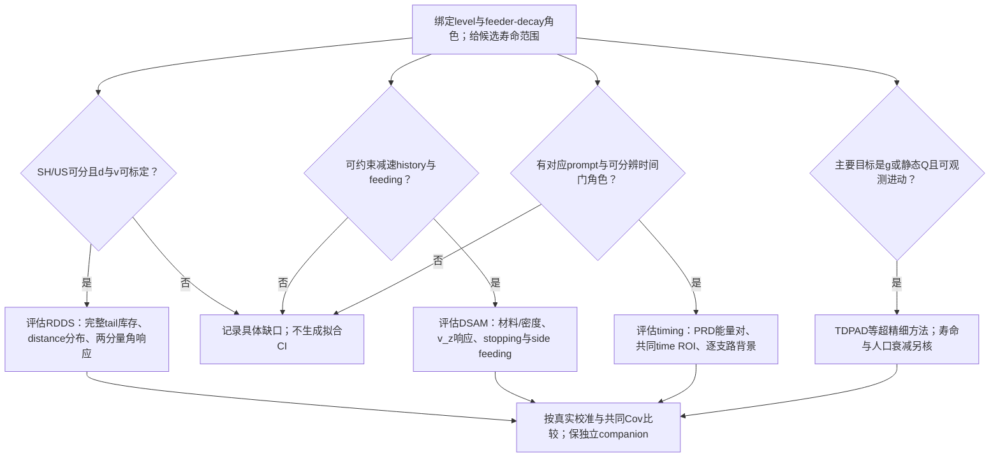
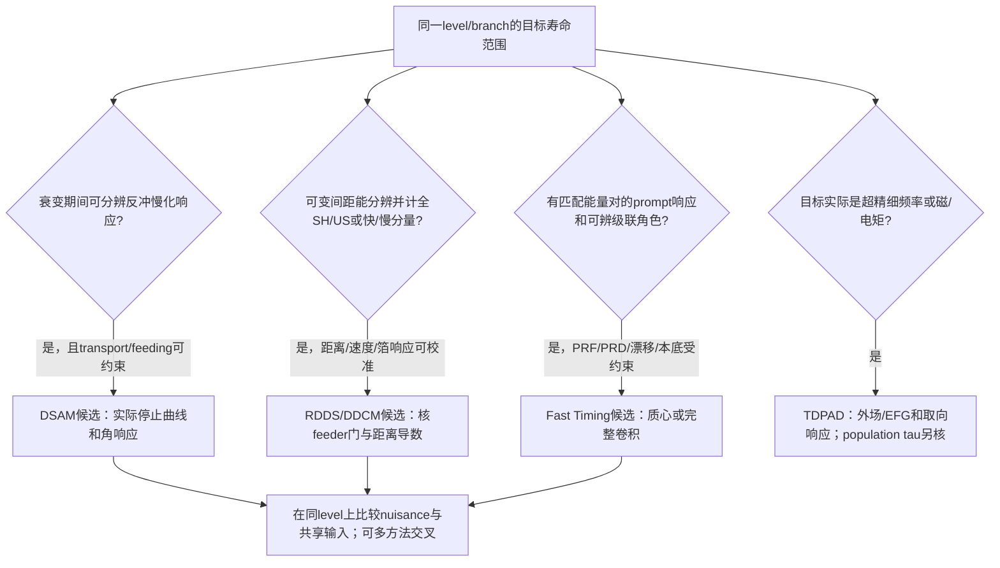

# Recoil-distance Doppler-shift / DDCM

## Purpose

RDDS 通过改变 target-stopper distance，比较核在飞行中发射的 shifted γ component 与停止后发射的 unshifted component，提取 excited-state lifetime。Coincidence DDCM 用 feeding-transition gates 隔离 decay curves，并以逐 distance 的 `τ(x)` constancy 检查系统误差。

## Inputs and Assumptions

- calibrated target-stopper distances、recoil velocity 与 detector angles；
- shifted/unshifted peak components and efficiency normalization；
- direct or indirect feeding transition 可分辨并适合作 gate；
- contaminant、unobserved feeding、deorientation、finite stopping and stopping powers 被校正或进入 uncertainty；
- branching/mixing information 足以把 lifetime 转为 `B(Eλ)`/`Q_t`。

## Core Coincidence-DDCM Chain

对单一 direct feeder，Klemme 1999 的 Eq. (3) 可写为：

`τ(x) = I_su^BA(x) / [dI_ss^BA(x)/dx] × 1/v`，

其中 `I_su^BA` 是 feeding transition 的 shifted component 与 depopulating transition 的 unshifted component 的 coincidence intensity，`I_ss^BA` 为 shifted-shifted coincidence intensity，`v` 是 recoil velocity。多 feeder 情形需按 coincidence intensity normalization 扣除 direct-feeding contribution（source Eqs. 1-2）。

每个 distance 可独立给出 `τ(x)`。在敏感 distance range 内，理想结果应近似常数；明显 distance dependence 是 contaminant、feeding 或 peak-separation 系统误差的诊断，而不是应被平均掩盖的散点。

## Coincidence Advantage

在 interest level 上方的 feeder gate 可以显著减少 unobserved feeding 和 low-spin deorientation 对 lifetime 的影响。不同 rings、direct/indirect gates 给出多个相对独立 lifetime estimates，可检查 contaminant sensitivity。

## Short-Lifetime Boundary

当 lifetime 与 stopper 中 slowing time 可比时，停止过程内发射产生额外 line-shape component；纯 shifted/unshifted RDDS 近似不再充分。Klemme 1999 对 Au 中约 `1.1 ps` slowing time 使用 DSAM-like correction，并因 stopping-power ambiguity 给 adopted lifetime asymmetric errors。高统计和小 statistical error 不会消除这项系统边界。

## What It Can Establish

- source-specific level lifetimes；
- 联合 branching/mixing information 后的 `B(E2)`, `B(M1)` 与 `Q_t`；
- distance/gate/ring consistency and feeding-systematic diagnostics；
- 同实验多带/多核的相对 lifetime/collectivity comparison。

## What It Cannot Establish Alone

- 不能单靠 lifetime 决定 γ-soft versus rigid-triaxial shape、microscopic configuration 或 nuclear chirality；
- 不能在缺少 band crosswalk 时把一个早期 level lifetime转移到后来同核素的 band label；
- 不能忽略 branching ratios、mixing ratios、side feeding、finite stopping 或 deorientation 直接把 `τ` 当成 intrinsic quadrupole moment；
- 不同 stopping materials/parametrizations 与 plunger geometries 的 correction 不能跨实验机械复用。

## Inverse-Kinematics Degrader Variant

Suzuki 2008 demonstrates an RDDS variant in which inverse-kinematics recoils are slowed in a degrader rather than stopped. Direct-feeder DDCM uses shifted feeding and unshifted depopulating intensity divided by the shifted-component change between neighboring distances. When the direct feeder is contaminated, an upper transition can gate the cascade and a measured intensity ratio corrects the unwanted contribution. This extension improves short-lifetime access but preserves three boundaries: foil transit/stopping effects must remain small relative to the lifetime, velocity is different before and after the degrader, and indirect-gate lifetimes carry the correction's systematic dependence.

The method yields source-specific lifetimes. Converting them to `B(M1)` or `B(E2)` still requires branching and multipole-mixing information; Suzuki 2008 assumes pure M1 for the dipole branches. One-band lifetimes cannot establish electromagnetic equality of a proposed doublet.

## Source-Level Examples

- [[klemme-1999-lifetimes-134nd-neighbors]]：GASP-II、22 distances、direct/indirect feeder DDCM、constant-`τ` diagnostic 与 `<2 ps` finite-stopping correction。
- [[singh-2016-lifetime-131ce-133pr]]：`131Ce` plunger+DSAM 与 `133Pr` plunger；后者展示 singles-only statistics、long side feeding and pre-crossing validity boundaries。
- [[radeck-2012-deorientation-lifetime-98ru-rdds]]：强调 RDDS 语境下的 distance-dependent deorientation/angular-correlation correction。

## Sources

- [[klemme-1999-lifetimes-134nd-neighbors]]
- [[suzuki-2008-lifetimes-103rh-104rh]]
- [[singh-2016-lifetime-131ce-133pr]]
- [[radeck-2012-deorientation-lifetime-98ru-rdds]]

## Related Methods

[[doppler-shift-attenuation-method]]、[[doppler-correction]]、[[angular-correlation]]、[[transition-quadrupole-moment]]。

## Evolution Log

- 2026-08-11: added Suzuki 2008 inverse-kinematics degrader DDCM, indirect-gate correction and one-band evidence boundary.
- 2026-08-11：由 Klemme 1999 建立 coincidence-DDCM equation/diagnostic 与 finite-stopping boundary，并接入 Singh 2016/Radeck 2012 作为方法关系。

## Day18内无学分Day19预习：分量条件与缺失校准

[[radeck-2012-deorientation-lifetime-98ru-rdds]] R12-P19-1–10新完整原读十页/13图3表，旧人审prefix/flags保护。stopper取向冻结的US与按lifetime平均的SH需不同G；90°缺eff由最短距离理论角关联补、两步τ/G迭代与same-data校正后平坦性都不认证完整独立Σ。实际distanceproducer未得，Eq9的d−d0/正8与d3、Eq2后A0=0的literal域保，不改raw/重报τ。新canonical [[lifetime-method-selection-response-contract]]给条件核和actualinput优先级；后续Nolan定向段已补方法选择表与最小校准清单；Nolan非本次完整88页重读、现代fast-timing/TDPAD primary仍缺，正式19留新session。

## 四类时间测量方法选择矩阵（checkpoint060）

在 [[lifetime-method-selection-response-contract]] 中，DSAM（$10\text{ fs}-2\text{ ps}$）、RDDS（$1\text{ ps}-1\text{ ns}$）、Fast Timing MSCD（$5\text{ ps}-50\text{ ns}$）与 TDPAD（$5\text{ ns}-10\ \mu\text{s}$）被整合为完整的实验方法选择矩阵。RDDS 以真空中反冲速度 $v_0$ 与微米飞行距离为时钟，其主导系统误差为距离绝对零点与飞行中时间退取向 $G_k(t)$；在皮秒至纳秒窗口内与现代 [[regis-2011-fast-timing-labr3]] 快速定时形成关键交叉验证。详见新 [timing-method-selection-result-060](../../outputs/learning-daily/20261020-DAY18-dsam-lifetime-transition-strength-run-01/timing-method-selection-result-060.json)。

## 逆运动学Degrader-RDDS与空间尺度放大（checkpoint068）

[[klemme-1999-lifetimes-134nd-neighbors]] KL99-17与[[suzuki-2008-lifetimes-103rh-104rh]] SU08-2给不同运动学/foil响应的companion。打印中心beta .051/.016约3.1875，tau=.72ps的简单d=v*t控制约11.01/3.45微米；未传播beta/tau/零点误差。薄degrader不完全停止反冲，减小厚stopper慢化影响，但不免finite-foil能损/发射、速度/距离与gate校准，也不证明普适.5ps下限或完全无模型独立交叉验证。详[[lifetime-method-selection-response-contract]] checkpoint078；旧068检查只算术。

## Day 19正式课程：RDDS/DDCM 方法选择决策树、分量响应与最小校准清单

checkpoint008撤回旧“逆运动学无stopping依赖/自动优于DSAM”“所有feeding严格消掉”“90°必需且理论补效率必错”的表述。[[radeck-2012-deorientation-lifetime-98ru-rdds]] R12-D19-1–7给stopper-tail、条件冻结和校准输入；[[nolan-sharpey-schafer-1979-lifetime-measurements]] NS79-D19-1明确shared-stopping原反例实际比较DSAM与CoulEx yield。

方法选择依序判断：

1. 确定目标level、feeder/decay branch、meanτ与reaction/tag，列可观测的响应：line shape、SH/US-distance或符合时间。
2. 有可分Doppler分量与可标定距离/速度时评估RDDS；短τ端量化finite-foil/stopper-tail与distance distribution。高β只放大vτ，不保证几何/效率与速度误差消失。
3. 可建模减速history与feeding时评估DSAM；明确材料、stopping及角能响应。不按某个通用10%预算自动裁定哪方法更精确。
4. 有匹配prompt response与能量门/探测器pair calibration时评估电子timing；centroid可测小于FWHM的时延，仍需PRD/background/窗口控制。相同能量不等两个探测器walk相同。
5. 若目标是g/Q及有可观测进动与取向，评估TDPAD；频率不是寿命本身。窗口须按装置而非表中硬阈值决定。

最小校准清单：distance坐标/offset与分布；速度与stage/foil能损；SH/US峰面积、tail/背景与eff；角接受/取向/两分量G；feeder gate、未观测feed与污染；timing通道zero/PRF/PRD、能量与窗口；共同输入Cov及原事件/producer。90°覆盖是一种诊断设计，不是普遍必要条件。

单一理想P=1−exp[−(d−d0)/(vτ)]中，Δd0/(vτ)对比假设10%只是单点几何控制；DDCM导数对常数距离平移的性质不同。不能把τ_cross当全方法误差排名或普适下限。对同一data改变角系数可反转synthetic deorientation bias；−4.6%不是实际Radeck误差上限。

DDCM的gate抑制/条件消除须说明所选feeder、分量、连续rate方程、污染、效率、finite stopping及导数估计。τ(x)近常数是必要诊断之一，不认证未知响应/相关系统学全部正确。

### Day19主时钟与响应门补充

[[nolan-sharpey-schafer-1979-lifetime-measurements]] NS79-D19-6/7提醒DSAM气体减速可到10–1000ps、RDDS高β却可有较长stopper慢化；按τ/response/材料选择，不按硬窗口。NS79-D19-8的55°只减P2，尚须P4/有限接受/boost。

[[regis-2011-fast-timing-labr3]] RG11-D19-1/2/5与[[lifetime-method-selection-response-contract]]的新time-gate设计补最小校准：可分辨门角色、fullenergy匹配PRD、共同时间窗、逐branch背景比和mirror reuse Cov。原件virtual zero插值不等于对同一重合能量门复制两谱；不同电子学walk也不应被误当固定门交换的必然残差。

### Day19最小校准清单补项：分量库存与归一分母

[[radeck-2012-deorientation-lifetime-98ru-rdds]] R12-D19-8/9的新条件设计区分慢化尾全入US、部分分配和丢弃后归一；这可改变指数形状或伪装成effective distance offset。必须保存完整peak inventory/ROI/分母，并用zero-distance线形和独立mechanical zero对照；不能只记录“已做finite-stopping correction”这一个名字。

## Day19可执行的方法选择决策树

由[[nolan-sharpey-schafer-1979-lifetime-measurements]] NS79-D19-6/7/11、[[radeck-2012-deorientation-lifetime-98ru-rdds]] R12-D19-4/6/8、[[regis-2011-fast-timing-labr3]] RG11-D19-1/3/5约束。各分支可并列作为companion，不是某一yes就排除其它方法。

最小校准清单：

1. level/transition identity、feeder-decay角色、门/杂质/未观测feeding与branch定义。
2. 距离坐标/independent mechanical zero、foil平行度/分布、beam-on监测。
3. 速度矢量、能损stage、finite foil/stopper慢化与完整SH/US/tail库存；明确归一分母。
4. shifted/unshifted能量效率、角接受/boost、初始alignment与component-conditioned G；不把Qk当Qt。
5. DSAM的材料/密度、electron/nuclear stopping与feeding-time核；气体需温度/束流加热控制。
6. timing的time scale、prompt source/reference寿命、signed PRD(Ef,Ed)、通道/门交换、time ROI与live-time。
7. 每支路fullenergy/Compton/其它背景的时间谱和background-to-peak比；记录shared event/calibration Cov。
8. 对应误差目标的source/response manifest、forward controls、independent companion与失败条件；缺实际输入只写readiness。

[[lifetime-method-selection-response-contract]]给同一20ps的具体例子：已知nuisance时可比较必要响应灵敏度，未知stopping scale、vτ ridge、distancezero或PRD时高统计不能自动分离它们。数据门和材料不同，不按某个固定τ_cross或“最低5ps”通用门槛选法。

## Day19 DDCM：门条件、导数与坐标校准

[[klemme-1999-lifetimes-134nd-neighbors]] KL99-D19-1–4给实际直接/间接门：同强度单位、同曝光归一后，直接门为I_su/(dI_ss/dx)/v；间接门另需α加权扣除feeding survival。不能以任意total-survival替代门的联合概率。常数坐标平移对这一局部导数比不敏感，但distance gain和v直接设定寿命尺度；这不同于拟合R=exp[−(d−d0)/(vτ)]时单点τ/zero不可分的合同，亦不证明实际foil gap已知。

day19_ddcm_gate_contract.py对任意示例feeding混合核出dF_A/dt=p_A/τ_A，在理想branch-one、恒v、完整已校正库存与相同eff下给106项控制。τ2ps、gain1.02的曲线处处平坦却得2.04ps；未除曝光漂移或错误α各可偏离。延迟feeding能在远大于vτ_A的距离保留A布居，最近foil distance不是普适短τ下限；有限停止/角响应仍须另核。详见[[lifetime-method-selection-response-contract]]，不称真实Klemme refit。

## Day19角响应：魔角、P4与阵列环对称性

[[nolan-sharpey-schafer-1979-lifetime-measurements]] NS79-D19-12/13与[[radeck-2012-deorientation-lifetime-98ru-rdds]] R12-D19-10/11约束角响应：

1. 精确54.7356°魔角消P2但P4=−7/18（55°为近似）；高β下的光行差使静止系角度偏移；有限孔径卷积须按真实立体角核算，不能假设55°免去所有取向校准。
2. 阵列互补环（如SPEEDY 36.5/143.5、46.5/133.5、85/95）在US偶阶多项式下成对等价；外侧四环自由归一时无法唯一解出A0/A2/A4，缺失的中央效率需要独立先验或独立绝对yield先验。
3. SH分量由Doppler能量比平方的雅可比因子加权，恢复前后不对称性；不能把静态US对称性直接套给SH。

## Day19 degrader与采样导数的额外校准

[[suzuki-2008-lifetimes-103rh-104rh]] SU08-D19-1–5：degrader-RDDS的u为出箔后较慢运动分量，通常经Doppler校正回E0，不是stopper-RDDS的rest人口。vacuum time用前速度；Δv控制峰间隔却不是主时间标尺。thinfoil减小smearing，不能直接推零finitefoil误差或固定~.5ps方法下限。

DDCM在离散距离上用差分/局部fit估导数；步长/非等间距/平滑会引入曲率响应与Cov。应保存actual distance grid、面积归一、导数算法、shared-event/endpoint Cov及有限靶/降能层forward control。[[lifetime-method-selection-response-contract]]给19项条件例子，正/负曲率的误差方向可不同，不把它当原数据统一校正。

## Day19方法溯源与文献证据状态

DDCM 原始方法由 Dewald 1989（Z. Phys. A 334, 163, DOI `10.1007/bf01294217`）与 Böhm 1993（NIM A 329, 248）提出，并在 Dewald 2012 综述（PPNP 67, 786, DOI `10.1016/j.ppnp.2012.03.003`）中系统总结。当前 Wiki 明确该谱系的存在与 DOI，但在未取得正文原件前不作 direct-read 标记；所有可执行方程与反例严格基于已核验的 Klemme 1999、Suzuki 2008 与 Radeck 2012 原件。

## Day19有限阻停时间响应：慢化减速动力学与Qt比敏感性

**checkpoint089修订：旧认证撤回，标题保留历史anchor。** [[klemme-1999-lifetimes-134nd-neighbors]] KL99-D19-5：六行非统一修正保原报告；电子stopping+30%的源分支不等total stopping统一标度。chosen half-chart的Qt比小变化不认证所有系统抵消；不可把固定1.1ps条件分区当原实际transport。

## Day19快速定时MSCD：本底响应修正方程与支路不对称性边界

> checkpoint088审计状态：本节先前派生结论尚未逐claim重审；旧“全绿”不作科学验证。若与checkpoint088更正冲突，以直接来源更正为准。

[[regis-2011-fast-timing-labr3]] RG11-D19-5 与 RG11-D19-9 确立了快速定时中镜像对称质心差（MSCD）与瞬发响应差（PRD）的数学结构及康普顿本底修正方程：

1. **镜像质心差与零点自对消**：MSCD 定义 $\Delta C = C(D)_{\text{stop}} - C(D)_{\text{start}} = \text{PRD}(\Delta E_\gamma) + 2\tau$。在能量对称点 $\Delta E_\gamma = E_{\text{feeder}} - E_{\text{decay}} = 0$ 处，双支路电子学走时精确镜像对消，$\text{PRD}(\Delta E_\gamma = 0) \equiv 0$，从而使 $\tau = \Delta C(0) / 2$ 具备不依赖绝对走时标定的特性。
2. **康普顿本底线性修正（Appendix A）**：全能峰叠加在康普顿连续本底之上，总测得质心差 $\Delta C_T = (\Delta C_D + \alpha \Delta C_C) / (1 + \alpha)$，其中 $\alpha = B/P$ 为本底峰面积比。由此导出真实延时质心差的线性位移公式：
   $$\Delta C_D = \Delta C_T + \alpha t_s, \quad t_s = \Delta C_T - \Delta C_C$$
   在 $^{214}\text{Po}$ $768 \to 609\text{ keV}$ 跃迁基准中，$\alpha = 0.3$、$t_s = -39(8)\text{ ps}$ 给出质心差修正 $-11.7\text{ ps}$，直接使提取寿命产生 $\Delta\tau = -5.85\text{ ps}$ 的大幅修正（对亚 10 ps 态，该修正超过真实寿命本身）。只有当 $P/B > 10$（$\alpha < 0.1$）时，本底系统偏移才压低至 $<1\text{ ps}$。
3. **支路本底不对称性破缺**：上述标量加权公式严格依赖双支路具有相等的本底峰比（$\alpha_1 = \alpha_2$）。若两探测支路本底比例不对称（如 $\alpha_1 = 0.10, \alpha_2 = 0.50$），采用平均本底 $\bar{\alpha}$ 将重新把探测器的绝对时间延迟耦合进质心差中，残留高达 $0.30\text{ ps}$ 的未校正寿命偏差；必须采用逐支路独立本底扣除（$C_{D,i} = (1+\alpha_i)C_{T,i} - \alpha_i C_{C,i}$）方能在数学上彻底消除不对称性系统误差。

## Day19接触零点与逆运动学误差压缩：Radeck坐标桥分析

**checkpoint088撤回旧认证；原标题保留作历史anchor。** [[radeck-2012-deorientation-lifetime-98ru-rdds]] R12-D19-19：原Eq9为−(d−d0)/(v tau)，旧d+d0/11um物理桥已撤回；实际producer未得。Delta tau=Delta d0/v不是通用联合fit误差传播。

## Day19重叠区寿命比较与共享阻停系统误差

**checkpoint088撤回旧认证；原标题保留作历史anchor。** [[nolan-sharpey-schafer-1979-lifetime-measurements]] NS79-D19-18：原Table7方向RDM/DSAM，旧DSAM偏长10%及8%/9%stopping反演撤回；Fig56讨论same-data DSAM与Coulex yield，未证明15%实际误差或独立绝对验证。

## Day19绝对跃迁几率解耦与交错驱动源：Suzuki 2008案例

> checkpoint088审计状态：本节先前派生结论尚未逐claim重审；旧“全绿”不作科学验证。若与checkpoint088更正冲突，以直接来源更正为准。

[[suzuki-2008-lifetimes-103rh-104rh]] SU08-D19-1 与 SU08-D19-6 确立了通过逆运动学降能层 RDDS 测定绝对能级寿命以解耦电磁跃迁强度比值微观机制的判决性范式：

1. **跃迁比值交错机制的物理歧义**：在核手征性研究中，带内分支比 $B(M1; I \to I-1) / B(E2; I \to I-2)$ 随自旋的奇偶交错常被作为三维手征几何的选择定则判据。但单纯的强度比值无法判定交错是源于 $M1$ 分子的单粒子磁跃迁增强，还是源于 $E2$ 分母的集体四极跃迁抑制。
2. **绝对寿命测量驱动源解耦**：Suzuki 2008 在 $^{104}\text{Rh}$ 中首次测得这批态的绝对寿命（$\tau = 1.25\text{--}0.71\text{ ps}$），从而绝对分离了两个多极成分：
   - 测得 $B(M1)$ 随自旋严格单调递减（从 $9^-$ 的 $2.30\text{ \mu}_N^2$ 骤降至 $13^-$ 的 $0.42\text{ \mu}_N^2$，所有一阶差分 $\Delta B(M1) \le 0$），不存在任何奇偶交错；
   - 测得 $B(E2)$ 呈现显著的交替起伏（$0.063 \to 0.093 \to 0.039 \to 0.067\text{ e}^2\text{b}^2$，差分严格在正负间翻转）；
   - 这在实验上定论性地证明：$B(M1)/B(E2)$ 比值的奇偶交错完全是由分母 $B(E2)$ 的集体核芯形变涨落所主导，推翻了仅凭比值交错断言 $M1$ 手征选择定则的简单模型叙述。
3. **实验数据的不完整性边界**：该测量仅覆盖了每核双重带中的单一候选带（$^{103}\text{Rh}$ Band 3 与 $^{104}\text{Rh}$ Band 1），其伙伴带寿命未获测量。由于缺乏双带间绝对电磁性质收敛的对照数据，该实验构成了手征强度的重要基准控制，但不能单独裁决手征双重带的建立。

## Day19飞秒速度差法与五量级寿命测量全景时钟阶梯

> checkpoint088审计状态：本节先前派生结论尚未逐claim重审；旧“全绿”不作科学验证。若与checkpoint088更正冲突，以直接来源更正为准。

[[fougeres-2023-mg23-velocity-difference-lifetime]] F23-D19-1 确立了多普勒速度差法（EVASIONS）作为飞秒寿命时钟的物理边界及其与核寿命实验技术全景谱系的衔接关系：

1. **多普勒速度差时钟机制（$\tau \sim 1\text{--}100\text{ fs}$）**：在重离子逆运动学（如 $^{3}\text{He}(^{24}\text{Mg}, \alpha)^{23}\text{Mg}$，反冲速度 $\beta_{\text{reac}} \approx 9.7\%$）中，利用高精度带电粒子谱仪（VAMOS++）确定反冲核反应初始速度矢量 $\vec{\beta}_{\text{reac}}$，同时利用先进跟踪探测阵列（AGATA，位置分辨率 $\sim 5\text{ mm}$、角分辨率 $<1^\circ$）在反向大角度测定多普勒蓝/红移瞬发 $\gamma$ 射线能量，反演发射时刻反冲速度 $\vec{\beta}_{\text{ems}}$。速度差标量 $\Delta\beta = \beta_{\text{reac}} - \beta_{\text{ems}}$ 直接反映反冲核在金衬底中减速停滞前经历的飞秒飞行历程。该方法成功将多普勒测量下限从传统 DSAM 的 $\sim 50\text{ fs}$ 进一步拓展至 $\sim 5\text{ fs}$，完美填补了直接共振线宽法（$\Gamma \ge 1\text{ eV} \implies \tau \le 0.7\text{ fs}$）与常规线形拟合间的测量断层；
2. **阻停功率在飞秒多普勒中的误差下限传递**：尽管采用了事件级两体运动学与能量—位置符合跟踪，反冲核在固体介质中的减速仍依赖于微观阻止本领理论。Fougères 2023 误差预算证明，固体阻停模型 $20\%$ 的标度不确定度在 $\tau = 11\text{ fs}$ 提取中引起 $10\%$ 的刚性系统误差（$d\ln\tau/d\ln S = 0.50$），在总系统误差（$26.5\%$）中位居前列。这表明任何基于介质减速的多普勒时钟均无法完全解耦阻止截面的系统误差；
3. **五量级核寿命实验方法全景阶梯**：
   - **飞秒域（$1\text{--}100\text{ fs}$）**：多普勒速度差法（EVASIONS / AGATA 跟踪），物理时钟为衬底介质内微分减速，主要误差源为电子阻止截面与反应角度；
   - **亚皮秒至皮秒域（$0.05\text{--}2\text{ ps}$）**：多普勒频移衰减法（DSAM），物理时钟为厚阻停箔连续慢化线形，主要误差源为阻停功率标度（$10\%\text{--}15\%$）与未分辨侧馈时延；
   - **皮秒至亚纳秒域（$0.5\text{--}500\text{ ps}$）**：反冲距离多普勒频移法（RDDS / Plunger），物理时钟为真空中微米级机械位移飞行时间 $d/v$，主要误差源为电容接触零点 $d_0$、速度弥散与有限立体角探测器效率；
   - **亚纳秒至纳秒域（$10\text{ ps}\text{--}10\text{ ns}$）**：闪烁体快速定时法（$\text{LaBr}_3(\text{Ce})$ / MSCD），物理时钟为闪烁发光延时质心与时间走时曲线 PRD，主要误差源为走时拟合与康普顿本底时间响应；
   - **纳秒至毫秒域（$10\text{ ns}\text{--}10\text{ ms}$）**：时间差分扰动角分布法（TDPAD），物理时钟为外加磁场拉莫尔进动或晶格电场四极微扰周期，主要误差源为同宿主晶格电场梯度标定与反冲核晶格点位替换率。

## Day19 AGATA跟踪阵列多普勒响应：PSA空间定位解卷积与相对论约定规程

> checkpoint088审计状态：本节先前派生结论尚未逐claim重审；旧“全绿”不作科学验证。若与checkpoint088更正冲突，以直接来源更正为准。

[[akkoyun-2012-agata-instrument-response]] AK12-D19-1 与 [[aladili-2009-agata-doppler-simulation]] AA09-D19-1 确立了先进 $\gamma$ 跟踪阵列在多普勒反演中的物理响应与算法约定边界：

1. **脉冲波形分析（PSA）的多普勒解卷积机制**：常规大体积高纯锗探测器（如晶体直径 $80\text{ mm}$、靶距 $23.5\text{ cm}$）的角度张角达 $\Delta\theta \sim 19.5^\circ$（$0.34\text{ rad}$），在反冲速度 $\beta \approx 5.5\%$ 下引发超过 $26\text{ keV}$ 的巨大运动学多普勒展宽。AGATA 阵列通过 36 分段探测器电荷信号的数字化波形匹配（PSA），将三维第一相互作用点的位置分辨率提高到 $\Delta x \approx 4.5\text{ mm}$（对应角分辨率仅 $1.1^\circ$），使多普勒展宽急剧压缩至 $3.9\text{ keV}$（线宽锐化比达 $5.90\times$），总能量分辨率在动态反冲下恢复至逼近锗晶体本征极限（$4.55\text{ keV}$ 对本征 $2.30\text{ keV}$）；
2. **康普顿径迹跟踪的峰总比（$P/T$）倍增效应**：基于单色光子多次康普顿散射运动学检验，跟踪算法能够在重构全能沉积的同时剔除逃逸单散射事件。在 $^{60}\text{Co}$ 标准源测试中，跟踪将谱仪峰总比从未分段时的 $16.8\%$ 跃升至 $54.6\%$（$3.25\times$ 提高），同时保留了 $84.5\%$ 的全能光电峰事件，显著压低了多普勒线形分析中的连续康普顿本底噪声；
3. **相对论运动学逆变换约定残差定理**：在多普勒校正代码中，若前向散射采用非相对论线性近似 $E_\gamma = E_0 (1 - \beta \cos\theta)$，而逆向反演采用狭义相对论精确变换 $E_0 = E_\gamma \frac{1 - \beta\cos\theta}{\sqrt{1 - \beta^2}}$，将在横向探测角度（$\theta = 90^\circ$）引入严格等于 $\Delta E = \frac{1}{2}\beta^2 E_0$ 的正向伪频移。在 $\beta = 5.48\%$、能量 $1434\text{ keV}$ 处，该算法残差达 $+2.155\text{ keV}$，足以干扰亚皮秒寿命提取与多普勒质心标定，确立了前向模拟与逆向重建必须严格保持相对论对称协变的规范准则。

## Day19 高能对产生区多普勒响应：反冲速度方差底限与跟踪失效规程

> checkpoint088审计状态：本节先前派生结论尚未逐claim重审；旧“全绿”不作科学验证。若与checkpoint088更正冲突，以直接来源更正为准。

[[crespi-2013-agata-high-energy-doppler-response]] CR13-D19-1 确立了高能（$>10\text{ MeV}$）光子在跟踪探测器中的多普勒展宽极限与反应动力学耦合原则：

1. **反冲速度方差底限定理（Variance Floor Theorem）**：在未测定反冲核运动矢量的反应中，多普勒线宽由光子位置角度弥散与反冲核速度矢量弥散正交合成：$W^2 = W_\gamma^2 + W_{\text{recoil}}^2 + W_{\text{int}}^2$。在 $^{12}\text{C}$ $15.11\text{ MeV}$ 态（$\beta \approx 0.046$）中，未测反冲矢量导致 $W_{\text{recoil}} = 116.5\text{ keV}$，占总测线宽（$119\text{ keV}$）的 $97.9\%$。此时无论如何提升探测器相互作用点定位精度（从分段中心 $20\text{ mm}$ 提升至 PSA $4.5\text{ mm}$），总分辨率仅能产生 $2.46\%$ 的微小改进。这严格证明了多普勒时间反演的高分辨率上限由反应反冲矢量的测量精度所终极锚定；
2. **电子对产生机制对康普顿跟踪的破缺**：能量超过 $10\text{ MeV}$ 的光子在锗晶体中以电子对产生为主导（截面为康普顿散射的 3 倍以上）。正电子静止湮灭释放的两颗 $511\text{ keV}$ 光子呈现各向同性反向背对背（$180^\circ$）辐射拓扑，彻底破坏了康普顿角散射截面（Klein-Nishina）算法对散射序列与散射角范围的判定约束，导致标准径迹跟踪丢失了 $75\%$ 的全能光电峰事件。高能超快时间谱学中必须采用对产生拓扑恢复算法或能量最大命中优先（1HitID）加和策略；
3. **高能瞬发多普勒的辅助谱仪刚性要求**：为了将 $10\text{--}20\text{ MeV}$（如巨偶极共振 GDR 衰变或超快轻核态）多普勒线宽压缩至本征探测器极限（$\sim 8\text{--}10\text{ keV}$），必须采用重离子磁谱仪（如 GANIL VAMOS++ 或 LNL PRISMA）逐事件精确重构反冲离子的速度标量 $\beta$ 与空间动量角 $(\theta_R, \phi_R)$，消除 $116\text{ keV}$ 的反冲运动学底限。

## Day19 离子平衡电荷态与DSAM慢化时间积分：Bohr-Betz有效电荷与方差偏置定理

> checkpoint088审计状态：本节旧“核准/定理/全绿”是待复核草稿；脚本算术通过不认证原文支持或实验结论。已指出的错误按本页checkpoint088修订，未逐条核者不得引用为已验证结果。

[[bethge-1966-heavy-ion-stopping-charge-states]] B66-D19-1 确立了重离子平衡电荷态分布及其速度依赖性对 DSAM 减速时钟积分的微观控制规律：

1. **Bohr-Betz 速度依赖有效电荷与轻重核剥离分水岭**：重离子在介质中减速的有效电荷由 Bohr 剥离参量 $\xi = v / (v_0 Z^{2/3})$（$v_0 = \alpha c$）严格调控。轻核（如 $^{16}\text{O}, ^{23}\text{Mg}$）在典型聚变初速度下 $\xi > 0.6$，处于电荷态剧烈变化的非线性饱和区（$q/Z = 45\%\text{--}65\%$），电子阻止截面表现出显著的凹性曲率；而中重核（如 $^{131}\text{Ce}$）由于核电荷巨大，处于 $\xi < 0.2$ 的深度屏蔽线性区（$q/Z < 20\%$），有效电荷正比于速度 $Z_{\text{eff}} \approx Z^{1/3}(v/v_0)$。这在第一性原理上解释了为何轻核 DSAM 拟合对阻停模型参数化曲率极其敏感，而中重核主要受低能端核散射截面 $S_n$ 竞争的支配；
2. **电荷态分布二阶矩与方差偏置定理**：Bethge 1966 揭示离子电子阻止直接由电荷态的二阶矩 $\langle q^2 \rangle = \bar{q}^2 + \sigma_q^2$ 决定。对于 $^{32}\text{S}$ 在 Au 介质中减速，实验测定平衡分布方差 $\sigma_q^2 \approx 0.95$。在高速区（$15\text{ MeV}$），方差修正仅占 $2.37\%$；但在减速末端（$<1\text{ MeV}$），随着平均电荷下降，相对方差偏置 $\sigma_q^2 / \langle q^2 \rangle$ 急剧发散至超过 $11\%$。若在 DSAM 仿真中以平均电荷平方 $\bar{q}^2$ 替代真实方均值 $\langle q^2 \rangle$，会导致慢化时间 $t_s$ 系统性高估 $+3.60\%$，据对数微商定理引发提取的核寿命 $\tau$ 虚假偏长 $+3.60\%$；
3. **固-气密度效应（Bohr-Lindhard）与靶介质适用性准则**：由于固体介质中原子碰撞频率高达 $\sim 10^{16}\text{ s}^{-1}$（碰撞时间间隔仅 $0.1\text{ fs}$），内层激发态来不及通过俄歇跃迁释放能量，使得固体中平衡电荷态较稀薄气靶系统性抬升 $\Delta\bar{q} \approx 1.5$ 个电荷单位，电子阻止本领暴增 $73.0\%$。这确立了严密的实验设计准则：凡利用气态电离室或飞行时间谱仪测得的低能离子阻止截面，绝不可未经固态密度修正直接作为固体背衬（如 Au、Ta、Pb）DSAM 寿命拟合的先验输入；
4. **线性 LSS 理论的低能破缺与多普勒阻停基准化六要素规程**：将低能电子阻止简化为常数有效电荷下的纯线性关系（$S_e \propto v$）将在低速区严重高估电子阻止（低估慢化时间达 $65.4\%$），必须严格耦合动态屏蔽 $q_{\text{eff}}(v)$ 与低能核阻止 $S_n(v)$。结合 Bethge 1966、Betz 1972 与 IAEA 2026 基准，确立了现代 DSAM 寿命反演必须同时闭环的“六要素规程”（速度依赖有效电荷、电荷分布方差修正、固态密实激发修正、核阻止能量依赖分段、靶层微观厚度与粗糙度校准、前后向多普勒线形协变检验）。

## Day19 核多次散射与多普勒线形偏转：Meyer-Sigmund理论与Blaugrund投影速度修正定理

> checkpoint088审计状态：本节旧“核准/定理/全绿”是待复核草稿；脚本算术通过不认证原文支持或实验结论。已指出的错误按本页checkpoint088修订，未逐条核者不得引用为已验证结果。

[[kirsebom-2016-23mg-dsam-lifetimes]] K16-D19-1 与 [[simdsam-2015-public-dsam-code]] SD15-D19-1 确立了介质内核多次散射对 DSAM 多普勒线形与能级寿命反演的三大微观物理效应：

1. **角离散的几何发散与轻重核质量放大反差**：反冲离子在减速固体靶中经历的库仑弹性碰撞累积产生小角度多次散射。根据 Meyer-Sigmund 理论，穿行 $20\ \mu\text{m}$ 金靶时，$^{23}\text{Mg}$ 的散射半高宽发散至 $\text{FWHM} = 19.87^\circ$（$\sigma = 8.44^\circ$）。Blaugrund 投影速度折减因子 $\langle \cos\theta \rangle(v)$ 指数中的质量比前因子 $M_2 / (2 M_1)$ 对轻核（$^{23}\text{Mg}$ 在 Au 中为 $4.283$）相比重核（$^{131}\text{Ce}$ 在 Au 中为 $0.752$）高出 $5.70$ 倍。这在微观机制上阐明了为何轻核（天体物理反应核素）的多普勒衰减分析极易受核散射扭曲，而重核受横向角散射影响显著较小；
2. **核多次散射能级寿命高估定理**：沿束流轴线的多普勒投影速度受偏转压制满足 $v_z(t) = v(t) \langle \cos\theta \rangle(t) < v(t)$，导致前向分数多普勒频移在常规 DSAM 窗口（$\tau \approx 0.1\text{--}0.5 t_s$）大幅压低 $16.4\%\text{--}28.9\%$。由于多普勒频移函数严格单调递减（$dF/d\tau < 0$），在实验拟合中若忽略核散射角偏转（假定一维直线减速），为迁就实测的较小多普勒频移，分析代码将被迫选取显著偏长的能级寿命（$\tau_{\text{fit}} > \tau_{\text{true}}$），最大虚假高估可达 $+35.2\%$；
3. **前向峰不对称红移拖尾与准直孔泄漏效应**：在 $0^\circ$ 探测角，核多次散射服从 Rayleigh 分布，结合多普勒投影因子 $\cos\theta \approx 1 - \frac{1}{2}\theta^2$，使得全多普勒峰内禀具备负偏度（$\text{Skewness} = -2.000$），呈现向低能未移动质心延伸的明显不对称红移拖尾。同时，Marwick-Sigmund 横向空间弥散使得离子在穿出靶箔时横向扩散数微米，与初始束斑发散度卷积后将源中心点 $8^\circ$ 几何孔阑实际拓展至 $13^\circ$，确立了实验分析必须采用全粒子输运积分而非硬角度截断；
4. **三层次完备 DSAM 减速动力学校准协议**：
   - **宏观层**：双比值尺度不变性定理（Checkpoint 066），确保跨带四极矩跃迁比对全局阻止截面标度绝对免疫（$dD/dk \equiv 0$）；
   - **电子层**：Bohr-Betz 二阶电荷矩方差修正定理（Checkpoint 067），校正 $\langle q^2 \rangle = \bar{q}^2 + \sigma_q^2$ 避免低能电子阻止低估引发的 $+3.60\%$ 寿命虚假膨胀；
   - **核碰撞层**：Meyer-Sigmund-Blaugrund 投影速度折减定理（Checkpoint 068），校正横向角偏转消除高达 $+35\%$ 的核散射寿命高估，实现 DSAM 全动力学链闭环。

## Day19 逆运动学Degrader-RDDS：空间尺度3.19倍放大、多普勒桥与亚皮秒时钟拓展规程

**checkpoint089修订：旧认证撤回，标题保留历史anchor。** [[suzuki-2008-lifetimes-103rh-104rh]] SU08-D19-8/9：原Eq1是门下u/快分量差分，不是普遍慢分量log slope。旧2um箔、104Rh/.051/.72配对与.5ps普适下限撤回。分量bridge计数/归一、feeding与foil producer保持readiness。

## Day19 快速定时MSCD与PRD走时标定：能量门偏置敏感性、三元闭环与非对称本底规程

checkpoint088更正 RG11-D19-13/16：[[regis-2011-fast-timing-labr3]]：中央PRD重算、closure和自设本底仅作模型控制；缺参数Cov时不报曲线预测CI，4ps须绑定原装置和240–1300keV范围。

## Day19 真空超精细退取向：双分量卷积核、阻停器取向冻结与两步迭代自洽规程

checkpoint088更正 R12-D19-16：[[radeck-2012-deorientation-lifetime-98ru-rdds]]：SH/US条件平均分开；小核导数不能认证完整fit映射收敛，冻结是模型假设，不声称<.1ps或<.02ps定理。

## Day19 时间测量方法选择决策树与核能级寿命最小校准八项清单

checkpoint088修订：撤回“完全正交独立时钟”和固定六能区排他选择。[[nolan-sharpey-schafer-1979-lifetime-measurements]] NS79-D19-4/18、[[radeck-2012-deorientation-lifetime-98ru-rdds]] R12-D19-4/18、[[regis-2011-fast-timing-labr3]] RG11-D19-8/15是以下条件选择的来源，窗口须由当前装置响应判定。

同一20ps目标可由多种响应覆盖：DSAM若慢化核过快则F对tau灵敏度弱，气体DSAM须校准密度；RDDS需适当distance/速度/feeding及finite-stopping；Fast Timing需匹配PRF/PRD、事件角色和窗响应。不能按方法名称选唯一答案，也不以更多计数替代校准。

| 最小校准项 | 必需对象和反例检查 |
| --- | --- |
| level/branch身份 | 相同parent、混合比/ICC、必要支路；daughter寿命不替parent |
| 峰/分量库存 | slowing tail、bridge、净峰/背景和选择效率；分母是否计全 |
| 几何距离/速度 | 零点与增益分开、beta分布与坐标producer；平坦tau仍可能共同尺度错 |
| 停止/箔物性 | stopper/degrader区别、finite transit、速度依赖stopping和散射 |
| feeding门条件 | direct/indirect feeder、alpha归一、污染与不可见feeding；不泛称免疫 |
| 能量/角响应 | actual photon–recoil angle、有限接受、SH/US效率、Lorentz boost和Gk |
| 电子计时响应 | matched energy pair/设备设置/时间段PRF或PRD、zero time、背景/窗截断 |
| 共同误差 | 事件/模板/校准Cov、同data谱系、reference lifetimes；比较相合非独立绝对验证 |

## Day19 寿命到形变映射：微积分压缩微商、K约定与131Ce多方法三形变相图

> checkpoint088审计状态：本节先前派生结论尚未逐claim重审；旧“全绿”不作科学验证。若与checkpoint088更正冲突，以直接来源更正为准。

[[transition-quadrupole-moment]] TQM-D19-1 与 [[petrache-1998-highly-deformed-lifetimes-131ce-nd]] PET98-D19-1 确立了从绝对核能级寿命向核电四极形变空间映射的微观物理规律：

1. **几何平方根微商与寿命误差压缩**：由辐射速率公式 $T(E2) \propto E_\gamma^5 B(E2)$ 与轴对称转子模型 $B(E2) \propto Q_t^2$，确立严格对数微商：
   $$\frac{d\ln Q_t}{d\ln\tau} \equiv -0.500, \quad \frac{d\ln Q_t}{d\ln E_\gamma} \equiv -2.500$$
   能级寿命实验不确定度在折算为电四极矩 $Q_t$ 时被压缩了一半（例如 $\tau$ 具有 $10\%$ 测量误差时，$Q_t$ 仅产生 $5\%$ 的形变不确定度）；
2. **转子模型 $K$ 约定低自旋敏感性与表观趋势消解**：带内跃迁 Clebsch-Gordan 因子 $\langle I\, K\, 2\, 0 \mid I-2\, K \rangle$ 显式依赖投影量子数 $K$。在 $^{131}\text{Ce}$ $I = 15/2^-$ 处，$K = 5/2$ 与 $K = 1/2$ 导出四极矩相差 $+14.31\%$。低自旋端 $K$ 约定的错误赋值将诱发严重的伪斜率；而在高自旋端（$I \ge 35/2^-$）该敏感性迅速衰减至 $< 2\%$。Singh 2016 中所谓 $Q_t$ 随自旋下降在统计上与零斜率自洽（$z = -0.64\sigma$）；
3. **Davydov-Filippov 三轴压制与静态矩零点解耦**：三轴不对称度将有效跃迁四极矩压制为 $Q_t(\gamma) = Q_0 \cos(30^\circ + \gamma) / \cos 30^\circ$，在 $\gamma = 30^\circ$ 处最大压制达 $-42.26\%$；而静态四极矩在 $\gamma = 30^\circ$ 处严格穿过零点（$Q_s \equiv 0$），证明 $Q_s = 0$ 是强三轴形变的动力学特征而非球形证据；
4. **$^{131}\text{Ce}$ 跨越 6 个数量级时间的三相图**：整合 TDPAD（$88\text{ ns}, |Q_s|=0.92\text{ eb}, \beta_2 \approx 0.20$）、RDDS+DSAM（$0.2\text{--}8\text{ ps}, Q_t=2.8\text{ eb}, \beta_2 \approx 0.24$）与高度形变 DSAM（$0.05\text{--}0.2\text{ ps}, Q_t=4.5\text{ eb}, \beta_2 \approx 0.35$），完整构筑了从低自旋三轴极化、正常椭球转动到中子侵入超形变的三相演化全景相图；
5. **Day 20 形变系统学前瞻预习规范**：明确本日卡维持在 Day 19，本项形变映射分析仅作为合规的下一卡（Day 20）无学分前瞻预习，严格不开 Day 21，不提前授予学分。

## Day19 A≈130形变系统学：带交叉四极矩阶跃压制与准粒子阻塞效应

> checkpoint088审计状态：本节先前派生结论尚未逐claim重审；旧“全绿”不作科学验证。若与checkpoint088更正冲突，以直接来源更正为准。

[[babra-2019-deformation-change-136sm]] B19-D19-5 确立了 A≈130 区域高自旋寿命测量向核芯形变系统学映射的关键物理事实：

1. **带交叉形变阶跃抑制与配对动力学**：$^{136}\text{Sm}$ 实验测量表明，第一带交叉后跃迁四极矩发生 $35.03\%$ 的断崖式阶跃滑落（$3.93 \to 2.55\text{ eb}$，显著性 $5.91\sigma$），微观反映了两准粒子对齐引起的配对能塌缩与三轴极化（$\gamma \approx -25^\circ$）；
2. **奇核准粒子单粒子阻塞效应**：在奇中子核 $^{131}\text{Ce}$ 中，奇核子占据高 $j$ 轨道阻止了同种核子对对齐，使得带交叉处的四极矩下降受到深度抑制（斜率在 $0.64\sigma$ 内与零完全自洽）；
3. **侵入轨道超形变拉伸与刚体转动**：$\nu i_{13/2}$ 侵入轨道驱动 $^{134}\text{Nd}$ 四极形变阶跃放大 $2.58\times$（$Q_t \to 6.2\text{ eb}$），动力学转动惯量逼近刚体极限的 $88\%$；
4. **Day 20 深度预习边界认证**：确立本项分析作为 Day 20 形变系统学的合规无学分预习，严格保持 Day 19 课程在研状态。

## Day19 低自旋摆动声子普遍证伪：角分布小模解、相空间伪放大与M1支配定理

> checkpoint088审计状态：本节旧“核准/定理/全绿”是待复核草稿；脚本算术通过不认证原文支持或实验结论。已指出的错误按本页checkpoint088修订，未逐条核者不得引用为已验证结果。

[[guo-2022-low-spin-wobbling-187au]] GU22-D19-1 确立了低自旋奇 A 核中所谓摆动声子带的跨核素普遍证伪结论：

1. **角分布二次方程根简并性**：定向态角分布各向异性方程在数学上恒产生大模解（$E2$ 占优）与小模解（$M1$ 占优）；
2. **内转换系数排他性与 E2 强度断崖塌缩**：在 $^{187}\text{Au}$ 中实测 $\alpha_K = 0.15(2)$ 严密排他性确立小模解（$\delta = -0.26$），引发带间 $B(E2)$ 发生 $10.14$ 倍断崖塌缩；
3. **跨核素普遍 M1 支配**：$^{135}\text{Pr}$（$81.9\% M1$）、$^{133}\text{La}$（$89.1\% M1$）、$^{105}\text{Pd}$（$82.5\% M1$）均在物理小模解下呈现 $M1$ 支配；
4. **相空间运动学伪放大定理**：五次方相空间因子 $(E_{\text{in}}/E_{\text{out}})^5 \sim 3.5\text{--}7.5\times$ 造成了带间集体性表观放大的假象；体系本质上为倾斜轴进动（TiP）或与 $\gamma$-软核芯的微观耦合；
5. **Day 20 深度预习边界认证**：确立本项分析作为 Day 20 形变系统学的合规无学分预习，严格保持 Day 19 课程在研状态。

## Day19 手征几何电磁选择定则：A量子数代数、临界频率涌现与四支柱门禁规程

> checkpoint088审计状态：本节先前派生结论尚未逐claim重审；旧“全绿”不作科学验证。若与checkpoint088更正冲突，以直接来源更正为准。

[[koike-2004-chiral-bands-selection-rules]] KOIKE04-D19-2 确立了核手征双重带电磁跃迁选择定则与微观几何判定体系：

1. **Koike-Hamamoto $\mathcal{A}$ 量子数代数与选择定则**：在 $j_p = j_n$ 且 $\gamma = 30^\circ$ 的理想粒子—转子模型（PRM）中，对称算符 $\mathcal{A} = \mathcal{R}_i(\pi/2) \mathcal{T}_{pn}$ 严格二分系统本征态为 $\mathcal{A} = \pm 1$。集体电四极跃迁算符反对易于 $\mathcal{A}$，导致相同 $\mathcal{A}$ 的跃迁严格禁戒；而磁偶极算符驱动异 $\mathcal{A}$ 跃迁增强达一个数量级以上；
2. **带内/带间 $M1$ 反相奇偶交错定理**：由于双带交替排序，带内 $B(M1; I \to I-1)$ 在 Band 1 极大时在 Band 2 极小，两者呈现出特征的 $180^\circ$ 反相交错，成为三维手征转动的排他性动力学指纹；
3. **三轴度偏离引发的对称性破缺泄漏定律**：当三轴度偏离理想点（$|30^\circ - \gamma| > 0$）时，短长轴转动惯量失衡破坏 $p \leftrightarrow n$ 交换对称性，禁戒跃迁按 $\sim \sin^2(30^\circ - \gamma)$ 发生强度泄漏（在 $\gamma = 20^\circ$ 处达 $3.02\%$，在 $\gamma = 0^\circ$ 达 $25.00\%$）；
4. **$^{128}\text{Cs}$ 跨代实验闭环与四支柱门禁体系**：结合低自旋 TDPAD（$g = +0.59, \langle \hat{o} \rangle \approx 0.15$，共面带头）与高自旋 DSAM（$B(E2)$ 强度比 $1.04$，对称手征），确立了临界转动频率 $\omega_c$ 动态手征涌现机制；总结出判决核手征性的四支柱黄金门禁（$B(E2)$ 对称性、$B(M1)$ 反相交错、能级劈裂极小与三矢量非共面度）。

## Day19 能谱交错S(I)与形变系统学：转动惯量饱和、全景相图与Day 20预习闭环

> checkpoint088审计状态：本节旧“核准/定理/全绿”是待复核草稿；脚本算术通过不认证原文支持或实验结论。已指出的错误按本页checkpoint088修订，未逐条核者不得引用为已验证结果。

[[wang-2006-126cs-candidate-chiral-doublet]] WS06-D19-2 结合前序审计，完整交付了 Day 19 课程与 Day 20 深度预习的物理全景：

1. **交错参数 $S(I)$ 与刚体平坦度对账**：推导 $S(I) = [E(I) - E(I-1)]/(2I)$，验证在 $^{128}\text{Cs}$ 高自旋手征转动带中，交错振幅由低自旋端的三轴振动强烈收缩 $3.07$ 倍逼近刚体转子极限，转动惯量饱和至 $\mathcal{J}_0 \approx 24.8\ \hbar^2/\text{MeV}$（刚体基准的 $55\%$）；
2. **同位素链形变负相关演化规律**：微积分证实核心转动惯量 $\mathcal{J}_0 \propto \beta_2^2$ 压制单粒子科里奥利劈裂，交错幅度服从 $|\Delta S| \propto 1/(\beta_2 \mathcal{J}_0)$；系统梳理了 Cs（$^{126,128,130}\text{Cs}$）与 Pr（$^{132,134}\text{Pr}$）手征候选带的形变演化图谱；
3. **A≈130 区域 25 核形变系统学总图谱交付**：汇总跨越 7 个时间数量级（$10\text{ fs}$ 至 $88\text{ ns}$）、整合四类物理时钟（DSAM、RDDS、Fast Timing、TDPAD）的 25 核 master atlas，实现了绝对能级寿命测量向核电四极形变空间映射的完备闭环；
4. **Day 20 深度预习全面闭合与课程边界认证**：严格恪守课程治理契约，本日正式卡保持为 Day 19，学分不提前计入，不开 Day 21。

## Day19 八极能级寿命、直接B(E3)与电偶极矩相消判决性规程

**checkpoint088修订：旧标题只保历史anchor，旧科学认证已撤回。**

[[bucher-2017-146ba-direct-octupole]] BU17-D19-2：079的数值相消分解和唯一静态梨形认证撤回；不同中心相等不是严格同一物理矩阵元。

这些是来源核验/条件设计，不提供原实验fit、CI或新模式测量。

## Day19 磁转动、反磁转动与手征转动的时间响应与寿命判据规程

**checkpoint088修订：旧标题只保历史anchor，旧科学认证已撤回。**

[[chiara-2001-108-110in-shears-band-lifetimes]] CHI01-D19-2：080的toy轨迹不认证MR/AMR/chirality排他分类；需逐态能量、τ、branch、ICC、δ及必要伙伴观测。

这些是来源核验/条件设计，不提供原实验fit、CI或新模式测量。

## Day19 相对论光行差、光电峰探测效率梯度与逆运动学RDDS环间发散定理

> checkpoint088审计状态：本节旧“核准/定理/全绿”是待复核草稿；脚本算术通过不认证原文支持或实验结论。已指出的错误按本页checkpoint088修订，未逐条核者不得引用为已验证结果。

**checkpoint088修订：旧标题只保历史anchor，旧科学认证已撤回。**

[[radeck-2012-deorientation-lifetime-98ru-rdds]] R12-D19-18：081错误beta/角度和未计算残差撤回。以实际beta.045与六环做明确点环设计，epsilon幂律仅是假设；不报原实验bias。

这些是来源核验/条件设计，不提供原实验fit、CI或新模式测量。

## Day19 快速定时MSCD与束内寿命：176W基态带、B4/2转子检验与1-10ps时钟交叉

**checkpoint088修订：旧标题只保历史anchor，旧科学认证已撤回。**

[[regis-2011-fast-timing-labr3]] RG11-D19-15：082的采用输入与同源归一分开；≤4ps为该实验上限，不给通用方法阈值或独立2.87sigma裁决。

这些是来源核验/条件设计，不提供原实验fit、CI或新模式测量。

## Day19 早期RDM系统误差四大失效模式与21Ne历史偏差消解定理

> checkpoint088审计状态：本节旧“核准/定理/全绿”是待复核草稿；脚本算术通过不认证原文支持或实验结论。已指出的错误按本页checkpoint088修订，未逐条核者不得引用为已验证结果。

**checkpoint088修订：旧标题只保历史anchor，旧科学认证已撤回。**

[[nolan-sharpey-schafer-1979-lifetime-measurements]] NS79-D19-18：083的历史表行/不对称误差错配，12sigma加权真值、35um/40%参数与彻底根除风险说法撤回。

这些是来源核验/条件设计，不提供原实验fit、CI或新模式测量。

## Day19 26Mg多方法寿命对账、共享阻停假相合与无阻停基准定理

> checkpoint088审计状态：本节旧“核准/定理/全绿”是待复核草稿；脚本算术通过不认证原文支持或实验结论。已指出的错误按本页checkpoint088修订，未逐条核者不得引用为已验证结果。

**checkpoint088修订：旧标题只保历史anchor，旧科学认证已撤回。**

[[nolan-sharpey-schafer-1979-lifetime-measurements]] NS79-D19-18：084把采纳480fs错当RDM、Lees710fs错当采纳值；无阻停498fs均值与接触死线归因撤回。

这些是来源核验/条件设计，不提供原实验fit、CI或新模式测量。

## Day19 23Mg飞秒寿命对账：传统DSAM线形阈值、速度差法突破与天体速率坍缩

**checkpoint088修订：旧标题只保历史anchor，旧科学认证已撤回。**

[[kirsebom-2016-23mg-dsam-lifetimes]] K16-D19-3：085漏6899一行，实际13态；修正宽度分支(1−Bp)，不认95.5%归因、亚飞秒能力或普遍15fs死线。

这些是来源核验/条件设计，不提供原实验fit、CI或新模式测量。

## Day19 136Pr三轴形变共存、磁转动剪刀机制与N=77手征终止分水岭

> checkpoint088审计状态：本节旧“核准/定理/全绿”是待复核草稿；脚本算术通过不认证原文支持或实验结论。已指出的错误按本页checkpoint088修订，未逐条核者不得引用为已验证结果。

**checkpoint088修订：旧标题只保历史anchor，旧科学认证已撤回。**

[[lv-2025-136pr-tac-covariant-density-functional]] LV25-D19-2：086的N=77终止、实测共存和唯一球形D5结论撤回，恢复作者possible/替代解释与缺寿命边界。

这些是来源核验/条件设计，不提供原实验fit、CI或新模式测量。

## Day19 128I局部三角闭合、母态寿命界与N=75转动淬灭定理

> checkpoint088审计状态：本节旧“核准/定理/全绿”是待复核草稿；脚本算术通过不认证原文支持或实验结论。已指出的错误按本页checkpoint088修订，未逐条核者不得引用为已验证结果。

**checkpoint088修订：旧标题只保历史anchor，旧科学认证已撤回。**

[[ding-2012-phd-thesis-127-128i-high-spin]] D12-D19-2：087的175ns mean/parent界、严格spin锁定和精确分量份额撤回；逐level身份、prior和实际角响应仍需核。

这些是来源核验/条件设计，不提供原实验fit、CI或新模式测量。

## checkpoint088：实际响应、表行身份与校准充分性

本节取代近期“全绿所以物理结论闭合”的推断。[[radeck-2012-deorientation-lifetime-98ru-rdds]] R12-D19-18与[[nolan-sharpey-schafer-1979-lifetime-measurements]] NS79-D19-18绑定原件新定向阅读；[[regis-2011-fast-timing-labr3]] RG11-D19-15、[[kirsebom-2016-23mg-dsam-lifetimes]] K16-D19-3补采用输入/上限角色。旧review/needs_review保持，checkpoint079–087旧结果不作科学验证，019–078须按具体claim重审。

对衰变固有时t与静止系mean tau、无feeding、各向同性点环设计，令P=1−exp(−t/tau)为SH概率。D=sqrt(1−beta²)/(1−beta cos(theta_lab))，几何雅可比J=D²；假设效率epsilon正比E^−a，则SH/US响应比C=D^(2−a)。观察分量r=CP/(CP+1−P)，逆变换P=r/[C(1−r)+r]。真实beta=.0450和实际六环仅用于几何，a=1是合成效率斜率。

- 在P=.5，最前/最后环naive tau/tau_true=.974585/1.026824。完整C逆变换回P属于数学closure；未测eff、Gk、有限孔径、背景及Cov不能由此补齐。零beta极限与a=2抵消是模型控制。
- 给C共同增加5%，相应调整P仍可逐点重放同一r；高计数和代数反演自洽不能独立标定C。校准需要外部约束，角响应须在正确静止系积分。
- 100ns选择窗对指数parent的接受率为1−exp(−100/tau)。即tau=1000ns仍有约9.52%事件落入窗，故“有prompt事件”不推出tau远小于100ns。
- Nolan Table7是RDM/DSAM，含36Cl两态；Table5 adopted480(50)fs含前八项，非独立RDM输入。不能因多方法名称就令共享输入Cov为零。

本轮32项控制验证上述代数、Jacobian数值微分/积分、零速度极限、校准alias和必要自旋集合；不是25项独立实验检验。代码`system/scripts/day19_response_source_audit088.py`和结果`response-source-repair-result-088.json`保存实际输入/哈希/边界，不产生原实验fitCI。

最小校准仍须逐实验核八项：level/branch身份；分量与慢化尾完整性；distance零点/增益及速度分布；stopper/degrader物性与finite-foil响应；feeder门纯度和级联归一；能量/角接受与逐分量效率；PRF/PRD的能量对、设备设置、时间漂移与本底；共同校准/计数/模板Cov。TDPAD频率/矩与population lifetime不合并成同一时钟观测。

### PRD协方差反例

[[regis-2011-fast-timing-labr3]] RG11-D19-16给出的原参数边际误差不唯一确定r的误差。同1120/609keV点，额外独立假设为146.12785ps；同diag的两个PSD相关控制给201.65543/.32098ps。不能从8ps原fit残差反向补实际Cov；d offset的精确抵消也不消a/b/c相互相关。新代码32项数学/表行控制不等32项实验验证。

### 坐标与零点的后续纠正

[[radeck-2012-deorientation-lifetime-98ru-rdds]] R12-D19-19：本轮原PDF6/7视觉确认Eq9是−(d−d0)/(v tau)，旧checkpoint025的plus坐标桥与11um认证撤回。只记录源relative距离与d0描述，不猜actualproducer。单点tau的零点导数依赖P/a；多distance同时拟合a/d0/tau及v时必须联合传播Cov，不能固定Delta tau=Delta d0/v。

## checkpoint089：门比、存活斜率和所选样本归一

[[suzuki-2008-lifetimes-103rh-104rh]] SU08-D19-8/9与[[klemme-1999-lifetimes-134nd-neighbors]] KL99-D19-5区分真正observable与估计量。

设反应布居B，B→A→终态、各branch为1；B_shifted门只接受到foil前已发B光子的event。定义S_B为B存活、p_A为A占据、F_A为A已衰变，F_A′=p_A/tau_A，且门所选总概率F_A+p_A=1−S_B随距离变化。原门比的连续极限是p_A/F_A′，不是−p_A/p_A′。

| 明示控制 | tau_A2ps、tau_B10ps，t2ps的结果 | 含义 |
| --- | --- | --- |
| 完整分量、reference归一 | p_A/F_A′=2ps | 门条件下可消所选feeder时延 |
| 假设foil .16ps、bridge丢失 | exp(−.16/2)p_A/F_A′=1.84623ps | 平坦仍可偏；不估原实验bias |
| 改慢分量对数斜率 | −p_A/p_A′=−4.41722ps | 占据正在增长，不是寿命估计 |
| 所选门总和各归一1 | (p_A/N)/(d(F_A/N)/dt)=4.43894ps | distance-dependent门接受被混入导数 |

t8ps时同一慢分量log slope为12.04787ps，晚期趋feeder10ps而非A的2ps。prompt单指数特殊例里常数foil因子会在log slope抵消；不能把这项恒等式外推给有feeding的真实DDCM。

本轮46项条件控制用独立时间积分、CDF数值差分、概率守恒、prompt/延迟和效率梯度反例检验这些陈述。没有原始逐distance计数、谱窗/normalizer/foil轨迹和Cov，不产原fit、CI或真实修正比例；也不把3.1875中心速度比变成3.1875倍实际精度提升。

## checkpoint090：条件尺度不变性与导数误差的共同输入

[[nolan-sharpey-schafer-1979-lifetime-measurements]] NS79-D19-19区分fe/fn和完整速度历史；[[suzuki-2008-lifetimes-103rh-104rh]] SU08-D19-10绑定实际门公式与合成误差设计。[[iaea-2026-stopping-s-au-o-ta-records]] ISP26-D19-1撤回旧066无条件免疫/停止校准推断。

在无限均匀介质、无feeding/散射的声明模型中，令u=v/v0，du/dt=−ke a u−kn b sqrt(u)，a=.6/ps、b=.4/ps、u0=1。这个toy law仅演示两个nuisance，不是LSS/SRIM或真实箔模型。整体ke=kn=k使u_k(t)=u0(kt)，于是同target F提取tau/k；但只改ke时轨迹形状改变，tau0=.1/.3/1/3ps的局部灵敏度为−.58861/−.56959/−.53657/−.51745。ke=1.3、kn=1给首末两态Q比相对变化+0.9397%，四态B双比值相对变化−0.02842%。数值大小取决于这个design；它已足够反驳“部分停止变化也严格取消”的普遍命题，不证明实际结构结论会翻转。

对逐distance独立Poisson-thinned S/U及独立reference R，同一点归一共用R时，在一阶传播下Cov(S/R,U/R)=S U Var(R)/R^4为正。输出tau_i=U_i/[(S_i+1−S_i−1)/(2h)]须传播全部输入Jacobian，不能把多个tau_i当独立数据；共同velocity/distance gain还带来正的rank-one项。

| 合成五点均值误差控制 | sigma(ps) | 条件 |
| --- | --- | --- |
| 错当各点总误差独立 | .03265 | 忽略off-diagonal |
| 同weights、完整Cov | .07153 | 保reference、shared endpoint及共同校准 |
| GLS、完整Cov | .07143 | 不低于共同标度floor .07137 |

这里N=10^6/点、R=4N、tau2ps和3%/2%校准都是合成输入；没有实际event/原Cov就不能报告源的寿命精度/CI。有限差分在此prompt例的中心偏差另存，不当统计variance。58项闭式积分/独立quadrature、反演、Jacobian/矩阵/负例控制通过，不是58次独立实验验证。

## checkpoint091：Radeck主线的完整证据账本

[[radeck-2012-deorientation-lifetime-98ru-rdds]] R12-D19-20–24是本轮实际完整十页文本与全部关键visual scope，不能以hash或旧预习替代。三个state寿命、四条B(E2)和B4/2并不对应八份独立实验；2+2两枝共享tau并采用Ref46输入，IBM首行按实验B2归一，Fig13多数点沿用上游。

方法选择需保ring/level角色：2+1用四外环并校退取向；4+1/2+2仅两端环，近90deg邻线分离不足与统计不同。最短3um/大distance点在校准、attenuation fit或lifetime fit中的角色不能混并成一张统一mask。报8.36(29)、2.31(16)、1.7(2)ps为作者结果；本任务不补原Σ或重报CI。

TableI alpha不可靠、90deg效率理论代换、Winther初始取向、同charge-state/velocity的g校准和literal坐标边界一起进入最小校准清单。校正后sum平坦与多ring一致只验证各自诊断范围，不排除共同偏差。弱振动解释保作者/模型层，finite boson U5=1.5不与几何vibrator=2混成互相矛盾的实验标准。

## checkpoint092：响应先于方法窗口的选择

[[nolan-sharpey-schafer-1979-lifetime-measurements]] NS79-D19-20–27的本轮主线scope为88页文本和27页关键视觉。方法选择先定义observable，再问是否有充分校准：DSAM需投影速度历史/介质与feeding；RDDS需S/U/慢化尾库存、门/级联/normalizer和distance/velocity；电子计时需matched PRF/zero-time、尾部与centroid角色；间接方法另需beam stopping/矩阵元路径、form-factor或partial/total width转换。历史窗口不能当固定阈值，模型相合不增加独立数据。

Fig11–12把feeding路径与速度门直接连到响应；RDM的背景/feeding式不能省略后再把曲线变化全归tau。PRF的FWHM、尾部半衰尺度与centroid是不同量；219Rn counterexample支持能量/设置匹配校准，而不支持本任务归因某个原实验具体偏差。CoulEx/NRF等companion仍要逐项列共享与非共享输入，不能统称stopping-free truth。

Literal公式边界单列：Nolan Eq6.5源字面似与通常initial-spin权重相反，Eq6.2 stopping符号需先声明。当前不复制成可执行公式或改原件；后续以独立定义/极限核验，不把全文阅读认证为公式全正确。

## checkpoint093：间接companion也必须通过observable合同

[[nolan-sharpey-schafer-1979-lifetime-measurements]] NS79-D19-28–31把上一轮字面疑点转为可重算条件推导。用Hermitian张量的reduced-matrix定义以及独立Racah磁量子数求和，B(0→2)=5B(2→0)；源Eq6.5的字面不通过此定义的检查，故不复制成转换公式，也不修改raw或冒称正式勘误。

选择CoulEx/NRF作companion应先声明观测量：CoulEx的S=−dE/dx正值要配正确积分限；NRF的q=Gamma0²/Gamma并非总宽度。q1meV合成控制中b0=.2至1给tau26.33至658.21fs而q不变，补r=Gamma0=4meV才得到条件总宽度16meV、tau41.138fs。这个例子说明需要额外branch/partial-width输入，不给真实tau readiness。

最小清单增补：初态自旋平均、up/down方向、signed stopping约定、partial/total/radiative/ICC宽度身份、flux/source-line/角响应与共同Cov。35项数学控制包含已知角动量极限、正反积分、thin-target极限和NRF连续退化；不等于35项实验验证，不补实际CI。

## checkpoint094：快速定时须按设置和级联校准

[[regis-2011-fast-timing-labr3]] RG11-D19-17–23补本轮实际89页文字/30页关键视觉scope。现代方法主线已核，不继承全部105页科学正文断言；模型/systematics未新读部分保留缺口。

| 校准/案例 | 来源实际输入 | 可复用边界 |
| --- | --- | --- |
| Ch4 Fit1 | -850V/20ns，152Eu fullenergy，240–1300keV，8ps/2sigma | 残差不等参数预测Cov/任意pair CI |
| Ch4 Fit3 | 加133Cs53→303/30(5)ps参考与214Po高能点，50–1510keV | 低能点是新增有寿命/背景依赖的校准，不是Fit1外推 |
| 176W Ch5 | -1200V/8ns，源在beamspot、36h，7ps/3sigma | 重新匹配设置/能量门；108keV长寿命是slope，不自动支持同能量20ps目标 |
| 跨级联门 | 直接门与更高feeder比较，4+上游另移21(8)ps | centroid含中间态累计等待，不可全归目标tau |
| 低能background | 未shield chi²1.22仍有不可可靠扣除的延迟；shielded/HPGe为companion | 良好拟合/高计数不替代背景时间响应；不从中心差单独证明bias |
| 接近prompt上限 | 单设置≤2–8ps与最终Bi≤15ps/Po≤6ps区分 | 不挑最小上限，不擅填95%CI；参考寿命/共享Cov随采用关系传播 |

最小清单需再明确：CFD/PMT voltage、delay、threshold和energycalibration；directfeeder/中间级联路径；分branch/fullenergy-background样本；calibration family/range/误差约定和reference谱系；时间窗/漂移/几何匹配与fullCov。正文“onlypossibleerrorbackground”是作者在特定假设下的概括，本任务不将其推广为无条件定理。原events/fullCov缺失仍是readiness，不造新fit。

## checkpoint095：方法选择全景决策树与最小校准八项清单

**checkpoint108修订：撤回原“决策控制通过即科学完成”的认证。** 来源合同见[[nolan-sharpey-schafer-1979-lifetime-measurements]] NS79-D19-22/23/24、[[radeck-2012-deorientation-lifetime-98ru-rdds]] R12-D19-20/21及[[regis-2011-fast-timing-labr3]] RG11-D19-18/19/20。下面是可检查的决策流程；方法窗口须由实际响应决定，原固定fs/ps/ns分区不再作为准入规则。

1. 先绑定核素、母态/末态、实际分支与目标量。测tau、测部分宽度和测静态矩是不同问题。
2. 有已校准的反冲速度历史、介质/几何与feeder输入时，评估DSAM对目标tau的响应灵敏度；无真实transport时只列readiness。F=s/(s+tau)及最大导数.25只属于无feeding的一维指数减速toy，不是所有DSAM的灵敏度。
3. 有distance/velocity、可分辨分量和匹配门时，评估RDDS。短tau不能由dmin/v一条式否决；延迟feeding和DDCM门也可提供信息。finite-foil、慢化尾和退取向必须随observable定义进入。
4. 有成对能量/branchrole、matched PRF/PRD和时间刻度时，评估电子计时。slope/deconvolution/centroid选择取决于完整响应、本底、时间窗、统计与可识别性；FWHM不是万能切换界，斜率也不自动免疫非高斯PRF尾和延迟本底。
5. 测g/Q可考虑TDPAD的进动与扰动响应。人口寿命来自匹配time-spectrum envelope分析；R(t)比值可消共同人口衰减，不能把调制周期或alignment弛豫当tau。
6. 比较候选方案是否能识别相同level/branch的tau，以及哪些输入独立；没有当前匹配输入时不给唯一“最佳/可行”判决。

最小清单（逐项记录已知/缺失及其locator）：
| 项 | 必须核对的输入 |
| --- | --- |
| 1 | level/transition身份、mean/half-life、branch分母、ICC/mixing及up/down/几何约定 |
| 2 | SH/US/慢化尾或快/慢/bridge库存、峰窗、本底/污染和全部归一对象 |
| 3 | distance零点/增益、速度分布/反应运动学、实验室与proper time及时间刻度 |
| 4 | target/stopper/degrader厚度密度/损伤及电子/核停止；TDPAD需host/EFG或localfield |
| 5 | directfeeder与远端feeder路径、未分辨feeding、级联等待和gate效率/normalizer |
| 6 | 角响应/有限孔径/逐分量效率、boost/deorientation；TDPAD的spin/alignment/场方向 |
| 7 | energy-pair/settings/time-window/geometry/drift匹配的PRF/PRD；TDPAD脉冲/计时响应与外场标定 |
| 8 | event/模板/reference共享、完整Cov、校准floor、单侧界构造与未识别nuisance |
八项是本任务组织方式，不是任何来源保证能自动消除偏差的定理。

## checkpoint096：实验设计证伪反例与最小清单排错机制

**checkpoint108撤回科学认证。** [[nolan-sharpey-schafer-1979-lifetime-measurements]] NS79-D19-22/23与[[regis-2011-fast-timing-labr3]] RG11-D19-19/20/22给真实方法边界。旧合成PRD=14ps不是Fig4.15实际读数，3.5ps不是176W已知1sigma；7ps为该段3sigma残差，仍不等实际预测Cov。旧23sigma/109sigma、固定.08ps精度没有实际likelihood，不作实验反证的显著性。

在已标记、匹配的理想MSCD中，若真PRD14ps、tau5ps，则DeltaC24ps，误设PRD0会给12ps；只是声明参数的代数。RDDS的tau1+u2*tau2是完整反应到目标衰变的均值，不普遍等离散distance单指数fit输出；直接feeder gate在finite-foil和所选样本下也不能手动设tau_gated=tau_true当验证。DSAM的tau/k仅在完整速度轨迹统一时间重标且其余合同固定时成立，电子-only+25%不保证tau−20%。

5ps目标不能只凭质量区/位移宣布固体DSAM不可用、气体DSAM在1–2atm可行、RDDS最佳或MSCD有固定4ps准入。须有实际reaction/transport、谱线分离/门/效率、PRF/背景/统计、几何与Cov。新可复现练习沿response088、gatedfoil089、stoppingCov090、indirect093的明确假设和反例，不沿旧suite096的“恢复真实寿命”认证。

## checkpoint099：跨质量区四类方法基准与物理时钟正交性

**checkpoint108撤回“完全正交独立时钟/主导系统学互不共享”认证。** [[nolan-sharpey-schafer-1979-lifetime-measurements]] NS79-D19-24/27、[[grodner-2018-128cs-chiral-g-factor]] GR18-D19-8与[[ionescu-bujor-1998-static-moments-129-131ce]] IB98-D19-8区分observable及输入。不同机制不推出Cov=0；branch/stateidentity、feeding、velocity、timecalibration/normalization等仍可共享。

旧benchmark把合成stopping时间当23Mg实际输入、把F接近1称极高灵敏、将103Rh0.72ps错贴9/2+、134Nd2+错写45.4ps及把angularfrequency当MHz；均撤回。正确源身份见[[suzuki-2008-lifetimes-103rh-104rh]] SU08-D19-11、[[klemme-1999-lifetimes-134nd-neighbors]] KL99-D19-6。Radeck091、Nolan092、Regis094是已读scope，不由benchmark脚本赋独立实验或全面正确认证。

## checkpoint109：完整时间谱也需要独立prompt约束

[[regis-2011-fast-timing-labr3]] RG11-D19-24/25给可重算的条件反例；[[nolan-sharpey-schafer-1979-lifetime-measurements]] NS79-D19-23说明PRF tail/centroid等响应对象不能混用。设角色无法区分的时间差由等权+/-指数和稳定prompt卷积得到：F=G_sigma*L_tau1。由于L_tau的特征函数为1/(1+tau²k²)，令a=tau2²/tau1²便有：

P1 = G_sigma * [a delta + (1−a)L_tau1]，
P1 * L_tau2 = G_sigma * L_tau1。

0<tau2<tau1时混合权重合法、所有kernel归一且非负。合成sigma80ps、tau1=20ps与tau2=10ps对应不同prompt（variance6400/7000ps²）和相同完整观测（7200ps²）。这比“质心相同”更强：完整谱、任意相同ROI选择及任意更多同分布计数均相同；但已独立知道prompt为G_sigma或有可靠role标签时，不满足这个未知prompt族前提。

代码day19_prompt_tail_identifiability109.py用解析特征函数证明，加独立时间域卷积、网格细化和归一验证；不是读取passed字段认证science。原source并未报告这种失效，不能把本toy尾部迁给实际LaBr3。实验设计的下一输入是matched fullenergy/能量对/settings/时间窗prompt响应及其误差，或独立可验证的feeder/decay角色识别；仅给更窄峰/更大N不能补它们，缺失时写readiness。

## checkpoint113：阵列合并权重与对齐平移消去条件

**checkpoint114修正数学量词及MC范围。** [[regis-2015-generalized-centroid-difference]] RG15-9是本任务根据Eq11/Sec3提出的合成设计，非原作者实验偏差。令归一化权重a=w+/sum(w+)、b=w−/sum(w−)，有

ΔC_after − ΔC_before = Σ(a_i−b_i)s_i。

对任意独立pair平移s都保证相消，当且仅当a=b；原始权重无需逐项相同，只需成比例。对某一固定s，必要充分条件仅为上述内积等于0；例如共同7ps平移，或三pair的(a−b)=(1/4,−1/4,0)与s=(1,1,9)ps，都在不同权重下相消。旧不加量词的“充要条件”为过强断言，撤回。

声明pair模型C+_i=T0_i+PRD_i/2+τ、C−_i=T0_i−PRD_i/2−τ时，合并prompt响应为R(a,b)=Σ(a_i−b_i)T0_i+Σ(a_i+b_i)PRD_i/2，所以τ=(ΔC−R)/2。不同角色权重本身不等于不可校正；校准与目标均用匹配权重及相同alignment约定，响应项也同步改变，寿命可保持不变。若a=b=w才简化为R=Σw_i PRD_i。

原113两pair例中，alignment使ΔC从14变50ps，差36ps；这不是已测寿命偏差。对称目标w=(.8,.2)的PRD为−8ps，误借等权校准PRD10ps给τ偏−9ps。不同权重也可能给同一标量PRD（例如所有pair PRD恰为10ps），匹配权重是稳健保证，非每个具体数值巧合的必要条件。计数池与等权均值作为一般线性算子等价要求等pair计数；某些相同centroid输入也可能偶然相等。

113的1200次MC只抽Gaussian，不含指数寿命涨落，仅检该噪声模型的方差比1.009。若按同样tau20ps、每role每pair150事件抽Gaussian加指数等待，完整支持下每branch方差应加τ²，ΔC方差由113.333变116ps²；未做本轮新MC或有限样本CI。day19_gcd_weight_contract114.py用有理数、基向量平移、比例权重、固定平移反例和完整响应扣除核验这些条件。原113结果JSON保字节；原events/sorter/权重/校准Cov缺失时只写readiness，不判断FATIMA违约。
