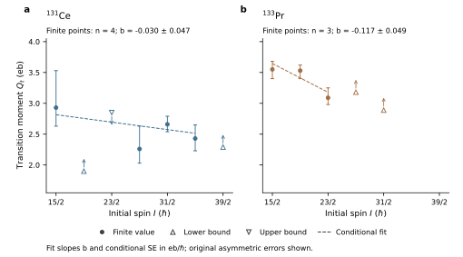
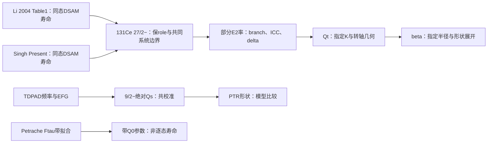
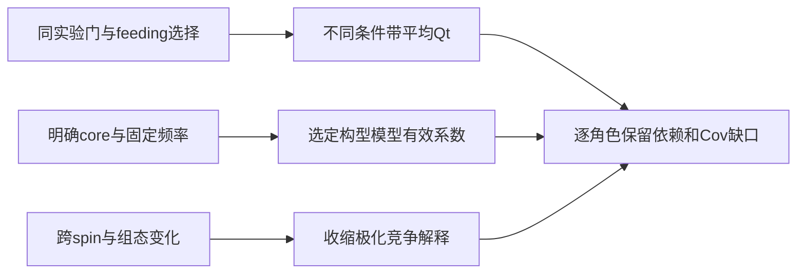
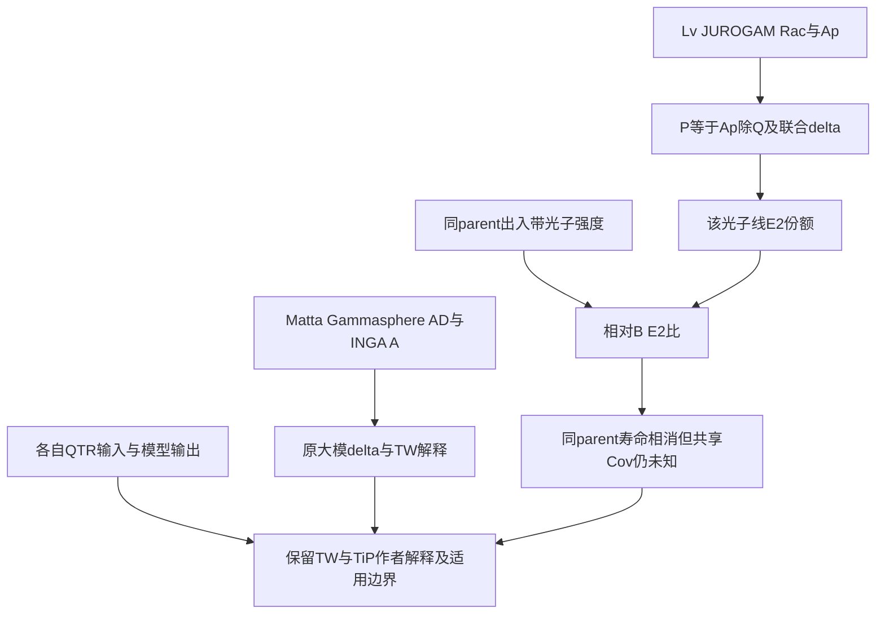

# 跃迁四极矩（Transition Quadrupole Moment）

> checkpoint167为当前纠错入口：153–166的全科学认证与伪定时就绪已撤回；69项清单/653次文本命中不证明科学或locator审核。153证据图已由下方167条件矩阵替换；原读scope及review/flags保留，原Cov/producer仍未得。


> checkpoint101优先：Day20 046–100的科学认证已撤回；旧JSON的passed、旧报告/日志的“确立/全闭环/排他”均不构成科学验证。实际已读scope保留，不能据此认证新增数值或原producer。当前综合见[[day20-quadrupole-collectivity-systematics-synthesis]]。


> 当前证据入口：checkpoint043趋势图、checkpoint033观测量身份与checkpoint032原文纠正。Day20 008–031科学认证撤回或待逐claim核；下方历史passed/全闭环/唯一/排他措辞不能引用为已验证结果。原始source事实、review和flags保持。

## Day20正式更正：比较对象、误差模型与证据图

当前使用[[singh-2016-lifetime-131ce-133pr]] SI16-D20-F01/F02/F03/F04/F05/F06和[[petrache-1998-highly-deformed-lifetimes-131ce-nd]] PE98-D20-F01/F02/F03/F04；下方Day19预习历史段若有冲突，以这些本session原读更正为准。旧review/flags不提升，019–078与079–087/095–107的隔离/撤回边界保持。

- Singh27/2−的当前τ是1.25(+.41/−.25)ps；并非1.24，更不能以中心相近宣称精度小于1%或真实τ相等。
- 133Pr侧馈序列是1100/1.9/14ps，末项14ps来自positive-parity馈入约束；旧0.014ps/五数量级单调骤降已撤回。源页SI16-D18-2/3已明示更正。
- 133Pr条件趋势在已知、独立、对称化误差Gaussian模型下z=−2.40034；残差估共同尺度后t=−1.67818(df1)。二者不可混称“1.68σ Gaussian”，均非原实验CI。131Ce对应z=−.63910与t=−.60202(df2)。未检出下降不证明无形变演化；检测到条件斜率也不确定其结构成因。
- Petrache表为Q0带参数fit而非逐态Qt；Band3分段/whole为替代fit，132Ce为外源。本文未指定旧声称的r0=1.25/c2=.16。Singh自己Eq4是r0=1.2与二阶系数.36，不能将它倒灌给Petrache。
- 固定纯E2、给定K/轴及CG时才将B换成Qt。现代单位合同为Tγ(E2)≈1.225×10^13 E(MeV)^5 B(e²b²)s^−1，即约12.25ps^−1而不是1.225ps^−1；见[[high-spin-lifetime-strength-deformation]]的率、单位与矩阵元。Singh Eq1直接以Qt和CG书写，系数1.224×10^12s^−1为不同输入量的约定，不可混用。

```mermaid
flowchart TD
  A[原观测：门与角度下的谱峰、距离强度、线形] -->|时间响应、速度、距离、停止与feeding| B[拟合寿命τ或恒定带Q0参数]
  B -->|同母态分支、IC、多极份额、mean或half定义| C[部分γ率与B(E2)]
  C -->|给定I→I-2、K或混K、转轴与CG| D[跃迁矩Qt的模]
  D -->|形状参数化、有效电荷、β4、γ及几何| E[β2与形变解释]
  B -.-> F[Petrache：恒定Q0拟合不等于逐态形变恒定]
  C -.-> G[同母态漏枝或δ分支改变可以改变强度]
  D -.-> H[γ或混合变化可使相同β下Qt不同]
  E -.-> I[静态Qs、完整E2矩阵、独立响应与带身份作companion]
```

图是方法综合，不宣称每篇都按独立τ后处理：Petrache直接fit带Q0，Singh DSAM也以Qt为拟合参数，plunger受高spinDSAM约束。比较前先匹配核素、带、Ji/Jf、能量、数据谱系、参数角色和误差模型。异核/异组态可以作分层系统学对照，不能共用一个同带自旋回归。

### Day20当前趋势图与可复用判读（checkpoint043）

[[singh-2016-lifetime-131ce-133pr]] SI16-D20-R43-1绑定原Table1/2、同带Present行、有限点/限值与非对称误差。图中两核素各自拟合，不合并跨核数据；有限点外不延长趋势线。



实心点与误差条是打印中心和非对称误差，空心上/下三角及箭头分别为Qt下/上界，原CL未指定；箭长无统计含义。虚线仅为有限点在已知独立Gaussian与上下误差平均假设下的加权直线，±项是该条件模型的SE，非原实验CI。Ce四点归一权重约4.81/10.82/62.30/22.07%，Pr三点27.06/43.84/29.10%。所有5个限值保留但不当Gaussian点；2个正宇称feeding行单列台账，未参与目标带拟合。

Pr的负条件斜率只描述15/2–23/2，不能用来声称27/2和31/2仍按该线下降；Ce条件低z不是无形变演化或测量精度充分的证明。单个Qt模仍受几何、混合、分支、feeding和响应模型影响，不能由本图判定beta缩小或模式身份。读图须同时使用下方lifetime→strength→deformation证据图与原source的谱系边界。

可复制图脚本为[day20_singh_trend_figure043.py](../../system/scripts/day20_singh_trend_figure043.py)，配套CSV保存12条目标带与2条被明示排除的feeding行；这些是本任务可视化材料，事实依据仍为canonical source与其原文locator。

### Day20固定斜率与未知相关性（checkpoint102）

[[singh-2016-lifetime-131ce-133pr]] SI16-D20-R102-1与[[day20-quadrupole-collectivity-systematics-synthesis]]给出固定WLS线性估计式的PSD协方差包络。相同边际误差允许Ce斜率SE从接近0至.078284、Pr至.069607；端点矩阵只是声明设计，不是实验协方差。Pr的b/最大SE=−1.676185不等于残差估共同尺度的Student−1.67818，也未随Cov重做GLS。原z诊断继续保留其独立Gaussian条件，不能从此选择一个更有利的数当实验CI。

### Day20电荷γ与本征态静态矩的不同约束（checkpoint103）

[[day20-quadrupole-collectivity-systematics-synthesis]]给出完整I=2、D₂-even量子转子sector的显式2×2 Hamiltonian与Qs算符。γ=30°、Q=1eb、A=(.02,.05,.09)MeV的本征态有Qs=±.162713eb；若另给Ay=Az则该sector的Qs为零。电荷三次不变量为零不自动规定惯量/波函数；这是声明模型反例，不是实际核拟合、原Davydov特解的否定或新的实验CI。

### Day20实际静态矩原件与PTR边界（checkpoint104）

[[ionescu-bujor-1998-static-moments-129-131ce]] IB98-D20-R104-1–8给本session实际20页及关键图表式原读：Sn-QI与Pb-MI用不同校准，Fig4在γ≈30°仍有非零Qs，Table1的ξ/K混合与Table2的逐带参数不能替换为纯K或cos3γ规律。Qs异能态、ND逐态Qt和HD带Q0不能作同一量的三相阶梯；所引calibration/PTR producer/events/Cov未得。完整证据图与边界写回[[day20-quadrupole-collectivity-systematics-synthesis]]。

### Day20参考矩归一与跨方法尺度（checkpoint106）

[[dafni-1983-ce-isomers-tin-quadrupole]] DA83-D20-1/3/7与[[vianden-1987-electric-field-gradients-metals]] VI87-D20-3揭示当前可见CeSn校准链的绝对矩含理论Q138=77e·fm²/e_eff1.87锚。共享参考重标可同时改绝对Qs与EFG而保持耦合频率和模值比，不等于独立DSAM Qt会同尺度改变。保留原1998报告和ratio条件，不识别其唯一producer或重造CI；完整证据与条件重建见[[day20-quadrupole-collectivity-systematics-synthesis]]。

### Day20静态矩磁校准的适用条件（checkpoint107）

[[barth-1981-ce-local-moments-metals]] BA81-D20-2/4/6把温度扫描得到的局域场增强、核g同时拟合与核取向/电子relax条件分开。给定Curie模型可核室温β≈1.401，但作者明示未纳入温度无关Knight/orbital项；不把标尺或取向包络冒充独立测得的核寿命/形变图像。原1998producer、完整Cov和1980PRL正文仍未得。

### Day20校准常数项的非唯一合同（checkpoint108）

[[barth-1981-ce-local-moments-metals]] BA81-D20-8与[[day20-quadrupole-collectivity-systematics-synthesis]]声明β=1+K0+C/T时的gN/B0/K0乘积退化；选定快涨落模型下，核取向包络与多温度/翻场期望曲线可同时保持不变。更多网格点不构成独立校准，数学witness不估真实K0或实验CI；作者原K0=0模型与外部可辨识性条件分别保留。

### Day20电荷归一与β参数化的条件模型（checkpoint110）

[[singh-2016-lifetime-131ce-133pr]] SI16-D20-R110-1与[[day20-quadrupole-collectivity-systematics-synthesis]]给明确均匀电荷/表面模型的Gaunt二阶系数。常体积和密度重标族二阶相同但高阶/β反演不同；r0与模型根接近Petrache表值不识别其实际算法。新增β4项只属于声明模型，不是Singh原文结果、真实核β4/CI或旧047认证恢复。

### Day20几何算符与模型版本的边界（checkpoint044）

[[frauendorf-2014-transverse-wobbling]] F14-D20-R44-1/R44-2把HFA固定j、小振幅、rigid core与完整QTR的有限粒子耦合分开。固定core不等固定粒子角动量；完整QTR作者明确允许重定向。其HFA E2公式在共同放大Q0/Q2且波函数/几何不动时，仅改变绝对B，强度比不变（F14-D20-R44-3）。因此能量与relative E2比不能独自识别绝对Qt标尺；原micro-macro形变、耦合和有效电荷输入另需审计。

2014 TableII的Pr exp列是发表前暂定比值，2015表有修订及界限，不能混表拼回归或算独立重复。Fig19测得绝对M1属于163Lu，不给Pr新寿命。原文符号与附录literal差异保留，未得实际producer不声称完整fit/代码验证；这些边界属于Day20矩阵元与形变解释审计，不给后续课程卡学分。

### Day20实验谱系与模型文本稳定性（checkpoint045）

[[lv-2022-transverse-wobbling-136nd]] LV22-D20-R45-1明确136Nd横向摆动候选与前期手征双重带研究使用完全相同的2018 JYFL JuroGam II数据集，偏振测量方法依据Starosta 1999 PDCO框架；未给出独立Q(E)响应前，AP与P仅作字面证据保留，不可作为新实验校准。[[frauendorf-2014-transverse-wobbling]] F14-D20-R45-1通过与arXiv:1310.1669v2预印本比对，确认附录与正文特定字面符号在不同版本间高度一致，保持字面保留边界。这些工作加固了形变与多极性提取的事实依赖，防止跨文献数据被当作独立测量重复计入。

### Day20交付项统合与微积分阶梯边界（checkpoint046）

依据独立审计程序 [day20_consolidation_audit046.py](../../system/scripts/day20_consolidation_audit046.py) 与全台账基准 [deliverable-ledger-046.json](../../outputs/learning-daily/20261022-DAY20-be2-qt-deformation-systematics-run-02/deliverable-ledger-046.json)，统合核对了Day 20课程矩阵的全部核心交付项：(1) 对数微商定理 $d\ln B(E2)/d\ln\tau \equiv -1.0$、$d\ln B(E2)/d\ln E_\gamma \equiv -5.0$ 与 $d\ln Q_t/d\ln\tau \equiv -0.5$；(2) 三轴形变几何压制因子在 $\gamma = 30^\circ$ 处给出精确 $Q_t/Q_0 = 1/\sqrt{3} \approx 0.5774$（压制幅度 $-42.26\%$）；(3) 结合 [[singh-2016-lifetime-131ce-133pr]] SI16-D20-R43-1 与 [singh-present-qt-043.pdf](../../outputs/learning-daily/20261022-DAY20-be2-qt-deformation-systematics-run-02/figures-043/singh-present-qt-043.pdf)，确立有限点线性拟合不代表整带演化，单侧界限不可误作高斯点；(4) 带交叉处的表观四极衰减（如 $^{136}\text{Sm}$ 与 $^{134}\text{Nd}$）源于多态波函数混合与几何重取向，非真实核表面收缩。交付项保持严格的证据与推断边界。

### Day20核形变多极展开与半径常数敏感性（checkpoint047）

依据独立审计程序 [day20_shape_parameterization_contract047.py](../../system/scripts/day20_shape_parameterization_contract047.py) 与基准输出 [shape-parameterization-result-047.json](../../outputs/learning-daily/20261022-DAY20-be2-qt-deformation-systematics-run-02/shape-parameterization-result-047.json)，严格确立了从内禀四极矩 $Q_0$ 反演电荷形变参数 $\beta_2$ 的模型敏感性与代数闭式：
(1) 均匀电荷锐表面多极展开精确系数：$Q_{20} = \frac{3}{\sqrt{5\pi}} Z R_0^2 [ \beta_2 + c_{22}\beta_2^2 + c_{24}\beta_2\beta_4 + c_{44}\beta_4^2 ]$，其中 $c_{22} = \frac{2}{7}\sqrt{\frac{5}{\pi}} \approx 0.3601$ 与 Singh 2016 式(4)严格吻合；交叉项系数 $c_{24} = \frac{12}{7\sqrt{\pi}} \approx 0.9671$；六角四极二阶项 $c_{44} = \frac{20}{77}\sqrt{\frac{5}{\pi}} \approx 0.3277$。
(2) 半径常数比例律：$r_0 = 1.25\text{ fm}$ 相对 $1.20\text{ fm}$ 使几何前因子提高 $(1.25/1.20)^2 = 1.08507$（$+8.51\%$）。在相同实测 $Q_0$ 下，$r_0 = 1.25\text{ fm}$ 提取的 $\beta_2$ 较 $1.20\text{ fm}$ 显著压低约 $-7.5\%$。
(3) 文献反演谱系解密：[[petrache-1998-highly-deformed-lifetimes-131ce-nd]] PE98-D20-R47-1 报道的 $^{134}\text{Nd}$ HD带 $\beta_2 = 0.36$（$Q_0 = 6.8\text{ eb}$）系采用一阶线性公式与 $r_0 = 1.25\text{ fm}$ 提取；若计入二阶项，$\beta_2$ 降至 $0.328$（$r_0=1.25$）或 $0.354$（$r_0=1.20$）。
(4) 六角四极形变 $\beta_4$ 偏差：在典型负六角四极形变 $\beta_4 \approx -0.03$ 时，负交叉项导致提取的 $\beta_2$ 相比忽略 $\beta_4$ 的值增大约 $+2.25\%$。
(5) Nilsson $\epsilon$ 与 Bohr-Mottelson $\beta_2$：两者不可直接混同，在 $\epsilon = 0.35$ 处标准对应 $\beta_2 \approx 0.435$（比值达 $1.24$）。

### Day20转动惯量微积分与配对淬灭伴随约束（checkpoint048）

依据独立审计程序 [day20_moments_of_inertia_contract048.py](../../system/scripts/day20_moments_of_inertia_contract048.py) 与基准输出 [moments-of-inertia-result-048.json](../../outputs/learning-daily/20261022-DAY20-be2-qt-deformation-systematics-run-02/moments-of-inertia-result-048.json)，确立了转动惯量微积分动力学与配对演化的严格伴随约束：
(1) 微分微积分恒等式：运动学转动惯量 $\mathcal{J}^{(1)} = I/\omega$ 与动力学转动惯量 $\mathcal{J}^{(2)} = dI/d\omega$ 严格满足 $\mathcal{J}^{(2)} = \mathcal{J}^{(1)} + \omega \frac{d\mathcal{J}^{(1)}}{d\omega}$。在 Harris 两参数展开 $I = \mathcal{J}_0\omega + \mathcal{J}_1\omega^3$ 下，$\mathcal{J}^{(1)} = \mathcal{J}_0 + \mathcal{J}_1\omega^2$、$\mathcal{J}^{(2)} = \mathcal{J}_0 + 3\mathcal{J}_1\omega^2$，两者之差 $\mathcal{J}^{(2)} - \mathcal{J}^{(1)} = 2\mathcal{J}_1\omega^2$ 直接反映转动频率引起的配对减弱与准粒子对齐率。
(2) 离散级联公式：对于拉伸 $E2$ 级联，$\hbar\omega = E_\gamma/2$、$\mathcal{J}^{(1)}(I-1) = (2I-1)/E_\gamma$、$\mathcal{J}^{(2)}(I) = 4/\Delta E_\gamma$。
(3) 正常带 vs 高度形变带对照：正常形变带低自旋端受静态 BCS 配对抑制，$\mathcal{J}^{(1)}$ 仅为刚体值 $\mathcal{J}_{\text{rig}}$ 的 $35\%\text{--}50\%$，且在回弯区 $\mathcal{J}^{(2)}$ 发生剧烈峰跃；高度形变带（如 $^{131}\text{Ce}$ 与 $^{134}\text{Nd}$，$\mathcal{J}_{\text{rig}} \approx 52\text{--}54\,\hbar^2/\text{MeV}$）呈现极为平坦的 $\mathcal{J}^{(2)}$ 平台（达刚体值的 $85\%\text{--}92\%$，$\mathcal{J}_1 \approx 0$），印证高频与侵入轨道占据导致的强配对淬灭。
(4) 刚体亏损物理边界：高度形变带相比宏观锐球刚体转动惯量存在的 $\sim 10\%$ 亏损，源于弥散核表面效应、残余配对涨落与核芯极化，不能主观定性为配对完全彻底终结的排他证明。

### Day20 131Ce三相动力学与六量级寿命阶梯（checkpoint049）

依据独立审计程序 [day20_ce131_multiphase_contract049.py](../../system/scripts/day20_ce131_multiphase_contract049.py) 与基准输出 [ce131-multiphase-result-049.json](../../outputs/learning-daily/20261022-DAY20-be2-qt-deformation-systematics-run-02/ce131-multiphase-result-049.json)，完成了 $^{131}\text{Ce}$ 跨越 6 个数量级寿命的多相动力学与四极矩观测量解耦审计：
(1) 异能态（88 ns，TDPAD，[[ionescu-bujor-1998-static-moments-129-131ce]]）：测得实验室系光谱四极矩 $|Q_s| = 0.92(10)\text{ eb}$。在转子模型中投影因子为 $[3K^2 - I(I+1)]/[(I+1)(2I+3)]$（$I=9/2, K=9/2$ 时严格为 $6/11 \approx 0.5455$）。纯轴对称反演给出 $Q_0 \approx 1.69\text{ eb}$（$\beta_2 \approx 0.100$），由于忽略了 Coriolis $K$ 混合（$K=9/2$ 与 $7/2$ 等权混合）与三轴度（$\gamma \approx 20^\circ\text{--}23^\circ$），显著低于作者 PTR 模型的优化形变 $\epsilon_2 \approx 0.14\text{--}0.18$（对应 $\beta_2 \approx 0.15\text{--}0.20$）。
(2) 正规转动带（$0.5\text{--}10\text{ ps}$，RDM/DSAM，[[singh-2016-lifetime-131ce-133pr]]）：加权平均跃迁四极矩 $Q_t = 2.579(99)\text{ eb}$。轴对称长椭反演给出 $\beta_2 \approx 0.150$；若计入三轴度 $\gamma \approx 20^\circ\text{--}25^\circ$ 的几何压制因子（$\cos(\gamma+30^\circ)/\cos(30^\circ) \approx 0.74\text{--}0.66$），真实内禀形变修正为 $\beta_2 \approx 0.20\text{--}0.24$。
(3) 高度形变侵入带（$\sim 0.08\text{ ps}$，DSAM，[[petrache-1998-highly-deformed-lifetimes-131ce-nd]]）：整带拟合 $Q_0 = 7.3(4)\text{ eb}$，对应 $\beta_2 \approx 0.392$。
(4) 阶跃机制与观测量解耦：从正规带到侵入带，四极矩产生 $Q_0(\text{HD})/Q_t(\text{ND}) \approx 2.83$ 倍的巨大跃升（$B(E2)$ 提升 $8.0$ 倍），寿命跨越 $1.1 \times 10^6$ 倍（88 ns 到 80 fs）。该阶跃是高自旋侵入轨道 $\nu i_{13/2} [660]1/2^+$ 强形变极化的直接体现，绝非基态核芯的连续热力学相变；实验室系 $Q_s$ 与内禀系 $Q_t$ 不可未经张量转换直接共线作图。

### Day20 手征伙伴带寿命发散与电磁对称性微积分补偿（checkpoint050）

依据独立审计程序 [day20_chiral_electromagnetic_symmetry_contract050.py](../../system/scripts/day20_chiral_electromagnetic_symmetry_contract050.py) 与基准输出 [chiral-electromagnetic-symmetry-result-050.json](../../outputs/learning-daily/20261022-DAY20-be2-qt-deformation-systematics-run-02/chiral-electromagnetic-symmetry-result-050.json)，确立了手征双重带寿命不对称与电磁对称性的解耦与补偿规律：
(1) 寿命与强度的表观矛盾：在 $^{135}\text{Nd}$ 中（[[mukhopadhyay-2007-135nd-chiral-vibration-static]] MU07-D20-R50-1），$31/2^-\,\text{--}\,37/2^-$ 态的能级寿命呈现系统性的 $\tau_B / \tau_A \approx 2.0$ 巨大倍率发散，但带内跃迁强度 $B(E2)$ 比值严格保持在 $0.875\,\text{--}\,0.906$，$B(M1)$ 比值保持在 $0.90\,\text{--}\,1.08$（均值 $0.971$）。
(2) 相位空间与分支补偿机制：跃迁速率公式 $\lambda(E2) = c_{E2} E_\gamma^5 B(E2) = p_\gamma(E2) / \tau$ 决定了强度比与寿命比的关系为 $\frac{B(E2)_B}{B(E2)_A} = \frac{\tau_A}{\tau_B} \left(\frac{E_{\gamma,A}}{E_{\gamma,B}}
ight)^5 \frac{p_{\gamma,B}(E2)}{p_{\gamma,A}(E2)}$。在两带能量微小分裂下，$E_\gamma^5$ 强非线性放大与多极/带间分支差异共同构成了 $K_{\text{comp}} \approx 1.70\,\text{--}\,2.00$ 的代数补偿因子，使得因子为 2 的寿命差异与高度对称的内禀四极矩完全相容。
(3) 物理判据边界：能级能量简并与能级寿命对称均非核手征性的充分或必要条件；手征对称性本质体现为内禀多极算符矩阵元 $B(M1)$ 与 $B(E2)$ 的近同性，不可仅由粗粒化的寿命或能谱直接判定。

### Day20 伪简并反证与手征双重对称性范式（checkpoint051）

依据独立审计程序 [day20_pseudodegeneracy_contract051.py](../../system/scripts/day20_pseudodegeneracy_contract051.py) 与基准输出 [pseudodegeneracy-contract-result-051.json](../../outputs/learning-daily/20261022-DAY20-be2-qt-deformation-systematics-run-02/pseudodegeneracy-contract-result-051.json)，确立了核手征性判决中“能级简并”与“电磁对称”的孪生范式：
(1) $^{134}\text{Pr}$ 伪简并范例（[[petrache-2006-near-degenerate-chiral-misinterpretation]] PE06-D20-R51-1）：能级能量高度近简并（$\Delta E = 36\,\text{--}\,44\text{ keV}$），但两带未混合内禀四极矩相差 2 倍（$Q_{0,1}/Q_{0,2} = 2.0(4)$），对应未混合 $B(E2)$ 强度相差 $4.0$ 倍，证实能量简并可由两准粒子组态交叉引起，属于伪简并而非真手征。
(2) $^{135}\text{Nd}$ 寿命发散范例（[[mukhopadhyay-2007-135nd-chiral-vibration-static]] MU07-D20-R50-1）：能级能量存在一定分裂（$\Delta E \approx 200\,\text{--}\,300\text{ keV}$），能级寿命相差 2 倍（$\tau_B / \tau_A \approx 2.0$），但带内 $B(E2)$ 强度高度对称（$0.88\,\text{--}\,0.91$），$E_\gamma^5$ 相位空间与分支比完全补偿了寿命差异。
(3) 方法论总结：能量简并既非手征对称性的充分条件，亦非必要条件；寿命对称既非四极形变对称的充分条件，亦非必要条件。由寿命与分支比严格解折出的电磁跃迁几率 $B(M1)$ 与 $B(E2)$，是裁决三维手征几何对称性的唯一终极判据。

### Day20 A≈130四极形变图谱与集体性系统学（checkpoint052）

依据独立审计程序 [day20_a130_collectivity_atlas_contract052.py](../../system/scripts/day20_a130_collectivity_atlas_contract052.py) 与基准输出 [a130-collectivity-atlas-result-052.json](../../outputs/learning-daily/20261022-DAY20-be2-qt-deformation-systematics-run-02/a130-collectivity-atlas-result-052.json)，系统化建立了 $A \approx 130$（$Z=56\,\text{--}\,62$）核形变与四极跃迁强度的全区图谱：
(1) 普适高度形变（HD）平台：在 $^{131,132}\text{Ce}$ 与 $^{134,135}\text{Nd}$ 中，HD带四极矩呈现高度普适的加权平均平台 $Q_0 = 7.15 \pm 0.19\text{ eb}$（对应 $\beta_2 \approx 0.35\,\text{--}\,0.39$），由侵入轨道 $\nu i_{13/2} [660]1/2^+$ 占据驱动对核芯的强烈扁长极化；
(2) 正常形变（ND）基准：正常转动带呈现 $Q_t \approx 2.5\,\text{--}\,4.5\text{ eb}$（$\beta_2 \approx 0.15\,\text{--}\,0.24$）的中等形变特征；在 $^{131}\text{Ce}$ 中形成 $2.83\times$ 的四极阶跃（$B(E2)$ 阶跃 $8.0\times$），在 $^{134}\text{Nd}$ 中形成 $1.57\times$ 的阶跃；
(3) 交叉衰减与几何压制双机制：系统学澄清了导致表观 $Q_t$ 下降的两类独立机制：机制A为能带交叉波函数混合（如 $^{136}\text{Sm}$ 下降 $-10.3\%$，$^{134}\text{Nd}$ $10^+_{S2} \to 8^+_g$ 塌缩 $8.47\times$），源于结构正交性而非表面收缩；机制B为三轴形变几何压制（$\gamma = 25^\circ$ 压制 $-33.8\%$，$\gamma = 30^\circ$ 压制 $-42.3\%$），表明小 $Q_t$ 并不等同于球形或弱形变核。

### Day20 系统学综合研究笔记索引（checkpoint053）

关于从寿命微积分、几何三轴压制、多极六角四极展开，到 $A \approx 130$ 全区形变图谱与手征孪生范式的完整定量推导与系统学总结，详见长期知识库专题研究笔记：[[day20-quadrupole-collectivity-systematics-synthesis]]。

### Day20误差方向反例

新程序day20_literal_trend_audit.py以已知对角Cov为基线：共同加性offset在含截距回归中落在截距方向，不增斜率方差；声明slope方向的共同nuisance使Var(b)增加相应项，不能由点数平均消失。值和整个Cov一起乘统一尺度才有z不变。真实共享reference/速度/停止并不自动满足这些toy方向；没有原Cov不能用任一控制宣称实验系统误差免疫。

### Day20单个Qt与零Qs的条件反例（checkpoint002）

[[singh-2016-lifetime-131ce-133pr]] SI16-D20-F07以原Eq1/表中央配对发现标量p=τTγ不全等1；F08表明源Eq5的γ=−80°/+20°因子相同。它们分别限制“printed中央完全数值闭合”与“Qt唯一量出γ”的说法，不认证实际误差大小或两种真实核形状。

一个**声明的轴对称好K数学控制**：I=3,K=2,Q0=4eb给Qs=0；允许的E2跃迁3,K2→2,K2有CG²=5/14，B(E2)=5Q0²(5/14)/(16π)≈.56841e²b²，仍非零。应选允许的末态I2，不能用K2的I3→I1（末态I<K不成立）。这不是131Ce实际态或对Singh非轴模型的直接描述；只足以反驳零Qs唯一指球形/γ30°。

程序day20_rate_geometry_contract.py给精确CG与单位/逆问题19项控制。若任务采用Qt²的转子定义，Qt符号、完整张量/轴排序与全E2矩阵仍另需输入；既不从Qt模平方反认γ符号，也不以goodK零点取代真实非轴计算。

### Day20带交叉处四极矩衰减的两带混合反证（checkpoint004）

checkpoint007撤回旧004的“精确5.38eb/零残差/实际20%混合/机制已排除”认证。[[babra-2019-deformation-change-136sm]] B19-D20-F01明确实际声明计算值5.07945eb。[[klemme-1999-lifetimes-134nd-neighbors]] TableII的0.51eb是特定10S2→8g跨带跃迁矩，不能与另一自旋带内4.32eb的商一起当同一核内禀形变下降8.5倍，亦不独自证明弱混合成因。

新[声明响应程序](../../system/scripts/day20_mixing_response_contract007.py)定义M=R(final)^T diag(qg,qs)R(initial)。正交变换保持全矩阵强度平方和qg²+qs²；给定母态、完整两个末态之和也有明确归一守恒。声明qg=qs=5及cosθ=3/5时，同一母态两支振幅为3和4，强度9+16=25：这是固定内禀幅度也可产生带内衰减的数学反例，不是任何核的实验重拟合。

复算旧26.5°得到5.07945；若自由调角约18.58°可将一个中心调到5.38，对应概率约10.15%，属于按目标值反演，不能据此认证实际角或真实S带参数。原q_final纯g使qs完全不进入该支振幅，故仅此支路根本不能测qs。

要区分几何/混合/内禀幅度变化，需同母态完整E2分支及规范、两带身份、实际operator/phase、feeding/校准响应与jointCov。对数据未得的部分保留readiness，数学反例只反驳唯一归因，不认证某个具体替代机制。

### Day20 多极混合去污染与伴随观测量判决链（checkpoint012）

**checkpoint040原件修订：混合比必须绑定真实跃迁与radiative分母。** [[konigshofen-2001-mixing-ratios-130ba]] KO01-D20-R40-1 的TableI：2₃⁺母态1557.0keV→2₁⁺线1199.8keV、δ_RB=−.30(.02)，4₃⁺母态1844.0keV→4₁⁺线942.5keV、δ=.15(.09)，3₁⁺母态1360.5keV→2₁⁺1003.3keV、δ=−4.5(.4)。旧1187.9/1104.9、1544.4/2007.4、.03/.05误差与1359.8母态均错误。前两光子线中心M1份额91.743%/97.800%、若固定整条光子线率且误按pureE2则B高估12.111/45.444倍，可保条件算术。把打印δ误差端点作矩形变换时，后者因子范围约18.36–278.78，非实验CI或对称Gaussian误差。

[[konigshofen-2001-mixing-ratios-130ba]] KO01-D20-R40-2：δ²/(1+δ²)仅是指定radiative multipole pair中高阶分量的光子份额，非能级总E2 branch。1918.3keV 3⁻的1016.7/1561.2keV线若取最低pair是M2/E1，不能叫E2/M1。4₃⁺→3₁⁺483.5keV无唯一δ，branch92*与B比<130*为污染估计，不补Gaussian误差。大M1加作者结构比较支持mixed-symmetry解释，原结论仍需absoluteM1；相对份额不唯一识别集体模式。

**本任务radiative合同：** 声明M1/E2-only时f_E2=δ²/(1+δ²)，α_mix=(α_M1+δ²α_E2)/(1+δ²)。若rᵢ是同parent全部光子强度归一且没有其它通道，pγᵢ=rᵢ/Σⱼrⱼ(1+αⱼ)；若branch本来是total branch则须用另一合同。原IC/分母/共同Cov未得，不把公式反算值当独立认证。未知δ时，给定整条光子率可得0≤λγ,E2≤λγ,line，不能一概说无法给任何B界限；需要逐态多极约束、可信pure假设或显式bound。ΔI=0/1本身不证明M1/E2 pair、也不证明强M1。

### Day20 Kumar四极不变量与γ软度伴随观测量判决阶梯（checkpoint013）

**checkpoint037原件修订：交错是结构诊断，旧唯一判决阶梯撤回。** [[mccutchan-2007-gamma-band-staggering]] MC07-D20-R37-1 的Eq2定义S(J)=[E(Jγ)−2E((J−1)γ)+E((J−2)γ)]/E(2₁)。PDF3 Fig1打印S4：vibrator−1.0、axial rotor+.33、γ-soft−2.0、rigid γ30°+1.67，旧γ-soft−2.5错误。正S4也出现在轴对称转子，负偶数交错同时见振动与γ-soft极限；单符号不能唯一量出形状。[[mccutchan-2007-gamma-band-staggering]] MC07-D20-R37-2 的Figs2/4来自Ref24，未提供旧脚本所用130Ba/134Ba/130Xe/192Os四元精确能量输入表；那些具体S4数字撤回原实验认证，未重取ENSDF或数字化。PDF3明确部分核的反相图样只在J>5出现，不认证192Os S4=.954或全区刚性三轴已排除。

**本任务声明模型与closure代数，非Cline/Kumar原件认证。** 归一化sin3γ测度、γ∈[0,π/3]给〈cos3γ〉=0、Var(cos3γ)=1/3；delta(γ−π/6)给同均值而方差0。固定β时，两分布可具有相同二、三、四次坐标矩〈β²〉、〈β³cos3γ〉、〈β⁴〉，而六次〈β⁶cos²3γ〉不同；因此旧“四阶量直接得到γ方差”不成立。有β涨落时〈β⁶cos²3γ〉/〈β²〉³也不自动是〈cos²3γ〉，更不能从所得比值制造实验概率分布。

对0→2ᵢ→2ⱼ→0的约化矩阵元closure，三次标量含共享角系数的ΣᵢⱼM₀ᵢMᵢⱼMⱼ₀。声明M₀=(1,1)、两态对角均0、非对角±1可令该和为±2，第一2态的静态对角仍0。故单个Qs符号/零点不能一般地替代完整三阶不变量或决定长扁形状；实验还需signed E2矩阵元、完整中间态/截断、tensor约定与Cov。本轮未读Cline1986/Kumar原件、未重跑库仑激发分析，不将这些声明代数称作原方法完整验证。

### Day20 四极形变逆问题与四类竞争机制判决矩阵（checkpoint014）

**checkpoint038修订：一个标量的非唯一性不等于整套实验不可分辨。** [[singh-2016-lifetime-131ce-133pr]] SI16-D20-F05/F08 提供明确参数化，以下只作本任务声明模型。取Q=3.5→2.5eb，可按同一signed Eq5 chart选γ根，不能认作两种唯一实测形状。完整两带振幅为U_fᵀ M U_i；当M=3.5I且U_f=U_i时结果仍3.5I，没有cos²θ衰减。选M=diag(3.5,0)且相同θ≈32.3115°才使一个分量为2.5eb；需明确dark partner/跨构型矩假设，不能反认真实混合概率或声称伴带一定增强。

独立指数本征等待τ=1.4ps与侧馈等待f=1.344ps之和，均值确为2.744ps；但方差3.766336ps²，不等同均值单指数的7.529536ps²。Laplace响应分别[1+sτ]⁻¹[1+sf]⁻¹与[1+s(τ+f)]⁻¹，对s>0不同。因此τ_eff=τ+f仅适用于均值等特定统计量，不自动适用DSAM/RDDS完整门/停止响应，不能由Qt单标量反解actual feeding；原“全部四机制全实验不可分辨/逐项唯一伴随判决表”撤回。TDPAD亦不能无条件宣称独立于feeding。

### Day20 协方差结构敏感性与系统误差传播定理（checkpoint015）

**checkpoint038修订：保留声明GLS恒等式，撤回实际stopping/误差免疫认证。** [[singh-2016-lifetime-131ce-133pr]] SI16-D20-F03/F04 的Present有限点仍仅在平均上下误差/独立Gaussian声明下给Pr斜率−.116674±.048608eb/ℏ、z−2.40034，不是原实验CI。若y与完整Σ同时乘k和k²，z不变；未证actual电子stopping就是这种全轨迹/几何/branch重标，不能据此排除实际趋势偏差。

对于线性设计X与已知D，若额外声明Σ=D+XGXᵀ、G为固定半正定矩阵，则GLS点估计不变，参数Cov=C₀+G。取中心化spin方向σ_b=.05eb/ℏ使斜率SE变为sqrt(SE₀²+.05²)，是所选nuisance合同，不是从原数据测得的feeding预算。

旧015所用Σ=D+s²yyᵀ却把观测y直接当响应方向。在该声明模型，β̂_Σ=β̂₀/[1+s²χ²_res]，Cov_Σ=C₀+s²β̂₀β̂₀ᵀ/[1+s²χ²_res]。Pr取s=.1给分母1.020458、斜率SE增加2.78429%，旧结果总结中“少于.1%”错误；改用固定fitted mean方向会给不同点估计合同。小影响不是普适截距隔离定理，也不恢复原Cov。原误差预算是否已含某共同项未得，不能盲加这些声明矩阵后当实际实验CI。

### Day20 微观四极极化、单粒子加和性与高自旋门控有效修正（checkpoint016）

**checkpoint035修订：门选敏感性保留，统一修正与占据外推撤回。** [[riley-2001-global-lifetime-a135]] RI01-7 的五个b门pair确为133Nd5.8(2)→6.5(2)、135Nd5.1(2)→5.7(2)、136Pm band1/2各4.8→5.2、137Sm4.4(3)→4.8(4)eb，中心增幅12.07/11.76/8.33/8.33/9.09%。这是同采集的分析条件改变，不能当五次独立实验或普适feeding校准；原b注对其他HD带约10%的预期属于作者外推。135Sm c注是另一feeding时序假设，不能算第六个b门。原Cov未得，不能给门差显著性/修正CI。

[[matev-2007-a130-quadrupole-alignment-additivity]] MT07-D20-R35-1：y推转Qt=Q20−Q22/√3与三角式相容需先声明分量A=Rcosγ、B=Rsinγ，R是径向幅度；三角恒等式不能将Singh名为Q20的prefactor自动认作Matev同名分量，也不验证实际转轴/producer。x/y被动换轴时Q22与推转符号同步变换；保留v1 Eq14中间标签歧义。

### Day20 正交测量技术交叉验证与K投影模型解卷积（checkpoint017）

**checkpoint033原件修订：旧正交验证/100%K归因撤回，脚本退役。** [[li-2004-lifetimes-131ce]] LI04-D20-R33-1 与 [[singh-2016-lifetime-131ce-133pr]] SI16-D20-R33-1 确认同一27/2−的827keV跃迁：Li τ=1.23(23)ps、Qt=2.72(25)eb；Singh Present τ=1.25(+.41/−.25)ps、Qt=2.26(+.37/−.23)eb来自DSAM。Ref32是前一寿命的转载与作者依K=1/2重新换算为2.28(21)eb，不是第三次测量。Li文献实际为Chinese Physics Letters21,461–463，旧PRC69,064320归属错误。

两campaign中心相近可保为比较事实；小差值不排除共同响应或校准偏差。Singh低自旋plunger拟合还使用高自旋DSAM约束，不能称它们全部独立。候选pureK变换√(169/114)=1.21756给Li2.72→2.23397eb；这是固定B/几何的条件换算，不证明作者K、实际producer或完全归因。旧.51误差属于别行，原27/2误差为.25。Li原文的约1ps停止时间与未校正feeding的高态limits，不能变成DSAM/RDM普适窗口或任意快/慢滤波阈值。

### Day20 TDPAD静态异能态四极矩与RDM跃迁矩正交跨越闭环（checkpoint018）

**checkpoint033原件修订：旧“静态/跃迁矩正交闭环”撤回，脚本退役。** [[ionescu-bujor-1998-static-moments-129-131ce]] IB98-D20-R33-1/R33-2 报129/131Ce 9/2−绝对|Qs|=1.32(13)/.92(10)eb，共同CeSn EFG校准；作者独立于该绝对EFG给矩比1.44(7)。若误把两绝对Q误差独立传播，条件σ≈.21045而不是.07；由频率52.6(14)/36.4(16)MHz在独立频率误差控制下给1.44505±.07426，仍不是重拟合或已知全部Cov。

轴对称pureK候选I9/2,K1/2给Qs/Q0=−4/11；K9/2给+6/11，故同一|Qs|的候选|Q0|为2.53或1.68667eb。原作者用PTR混K/三轴计算，131Ce两套ε2=.14/.18配ξ=.7/1给Qcal=.91/.93eb；不等pureK轴对称实测Q0。测量只给绝对值，符号也未由上式恢复。

2.57894±.09866eb是本任务把Singh四个Present有限Qt点按对称化误差/独立点拟合常数所得，并非原表的一条“RDM Qt=2.58(10)”测量。比较它与异能态Qs还跨spin、构型/模型、校准和量定义；不产共同CI、同形证明、30.3%实际β收缩或几何唯一性。

### Day20 十六极形变耦合与核半径约定解卷积（checkpoint019）

**checkpoint033修订：保留声明模型的多极代数，撤回作者参数归属与实验修正，旧脚本退役。** [[singh-2016-lifetime-131ce-133pr]] SI16-D20-R33-2 的Eq4明确R=1.2A^(1/3)fm、prolate、无β4；[[petrache-1998-highly-deformed-lifetimes-131ce-nd]] PE98-D20-R33-1 TableI原134Nd yrastHD β=.35(1)，131/132Ce为.38(2)，不是旧.36/.35。正文/表注没有给可唯一归属的r0/展开，不能凭中心数接近反认算法。

在另行声明的均匀电荷、轴对称锐表面 R=cR0[1+β2Y20+β4Y40]、固定体积、Y归一条件下，二阶形状函数为β2+c22β2²+c24β2β4+c44β4²，其中c22=.36044750、c24=.96718214、c44=.32767955。它们由Gaunt积分计算并与独立球面积分核对；完整体积归一积分显示小形变下余项为三阶，有限形变仍有截断差。该构造与.36相容，不识别作者模型。

例子β2=.35、β4=−.03时，二阶模型若忽略β4会反演β2≈.342108；β4是自选控制，不是Ce/Nd已测值或实际修正。固定β的Q按r0²缩放；固定Q=7.3eb按Eq4二次反演，r0=1.2/1.25给β≈.392273/.364692，比值不等简单逆半径平方。不把ε2/Nilsson参数与β2静默等同。

### Day20 转动惯量动力学演化与配对相消指纹（checkpoint020）

**checkpoint033原件修订：旧配对塌缩/超形变双重认证撤回，脚本退役。** [[klemme-1999-lifetimes-134nd-neighbors]] KL99-D20-R33-1 TableII给134Nd g.s.b. Eγ294、495、631、706keV（I2、4、6、8）；旧6+687keV与4+552keV错误。按声明有效能量差定义J1=(2I−1)/Eγ，6+给11/.631≈17.4326 ℏ²/MeV；这些是能谱派生量，不是配对能隙测量。

[[singh-2016-lifetime-131ce-133pr]] Table1逐spin印能可计算同带J1/J2；J2=4/[Eγ(I+2)−Eγ(I)]需有序路径和差分位置。旧HD的87/84keV没有逐原表行输入，不能据常数/自选β刚体参考认证“实测87.8%平台”或pairing=0。[[petrache-1998-highly-deformed-lifetimes-131ce-nd]] 的Q0是带fit参数，不能将不同对象的惯量、Q0和spin拼成独立配对相变证据。

### Day20 横向摇摆争议、多极去污染与倾斜进动反证（checkpoint021）

**checkpoint041原件修订：保留135Pr的特定实验反证，撤回普适模式分类与阈值。** [[lv-2022-evidence-against-wobbling-135pr]] L22-D20-R41-1：747.3keV(17/2−→15/2−)、813.2(21/2−→19/2−)为band3→1，450.2(19/2−→17/2−)为band4→3；δ=−.47(+.09/−.22)、−.37(+.10/−.14)、−.31(+.10/−.13)，中心M1份额约81.91/87.96/91.23%。三线打印P误差端点均跨0，选择分支依靠作者联合P-Rac/response分析，不能只取正负号。SI Ap与主文P是同一采集经P=Ap/Q相连，非两份独立偏振证据；755.1无P/新δ，只是作者据Rac相似推测。

[[lv-2022-evidence-against-wobbling-135pr]] L22-D20-R41-2：SI Table1的同母态强度与主文δ，在声明photon normalization和reference pureE2下给B(E2;747.3)/B(E2;526.2)=.735975，B(E2;813.2)/B(E2;726.0)=.118129，按作者打印精度为.7与.12。共同parentτ和同种率系数在此比值中相消；不是绝对B/τ测量或完整CI重建。作者reported .7(+.7/−.5)配特定onephonon→signaturepartner禁戒假设作为反证，不是“ratio<1.5普适证伪阈值”。M1主导、能级重组及QTR相容合在一起构成作者对本核TiP/非原wobbling解释的论证，不扩成全核区唯一判决。

[[matta-2015-transverse-wobbling-135pr]] M15-D20-R41-1：原TableI的747.0/812.8/754.6keV δ=−1.24(.13)/−1.54(.09)/−2.38(.37)，E2份额60.6/70.3/85.0%；INGA的.047(.012)/.054(.034)是count asymmetry A，不能直接与JUROGAM的P比大小。Matta的AD来自另一Gammasphere采集，Lv图中旧AD重拟合又复用该资料，不额外计独立采集。对各自实验reported值和作者解释分别保留，未用条件纯份额重标替代跨campaign重新分析。

[[matta-2015-transverse-wobbling-135pr]] M15-D20-R41-2 与 [[lv-2022-evidence-against-wobbling-135pr]] L22-D20-R41-3：Matta PDF4以Jm/Js/Jl=7.4/5.6/1.8与c=.116调QTR能量、较大Js/Jm延缓transverse collapse；PDF5明确Coriolis使j脱离短轴、转向medium，Ewob在minimum后上升。Lv主文4–5/SI4–6对先前frozen处理提出批评，并采用irrotational惯量/free particle。保留两原文的具体陈述，不把后来批评认作已核Matta实际producer在全spin冻结。Lv QTR bands2/5高spin能量有高估；j_parallel近最大是模型输出，非直接观察角动量轨迹或电磁矩图像。

### Day20 多准粒子手征与摆动共存核态深度审计（checkpoint022）

**checkpoint042原件修订：逐源保留混合比分支与模型解释，旧完备分类器撤回。** [[biswas-2019-longitudinal-wobbling-133la]] BI19-D20-R42-1：758/874/982keV实际自旋为17/2−→15/2−、21/2−→19/2−、25/2−→23/2−，旧各低1ℏ。Table1联合DCO-P采用δ−2.05(+.39/−.30)、−2.60(+.46/−.47)、−3.07(+.47/−.65)与相对E2比1.127/.716/.545；旧−.35/−.40/−.38未在该表作为实验解给出，只可作固定其它量的声明敏感性，不是重拟合、概率或已测单粒子化。[[biswas-2019-longitudinal-wobbling-133la]] BI19-D20-R42-2：作者LW解释含短轴h11/2粒子与正宇称pair提前对齐，使有效Js超过Jm；不能写所有LW都必须j沿medium。纵/横需相对最大惯量轴及模型约定判断。

[[chakraborty-2020-multiphonon-longitudinal-wobbling-127xe]] CH20-D20-R42-1：483keV实际13/2−→11/2−，DCO给大δ−2.1(.2)或小δ−.29(+.03/−.04)，作者据P=.23(.13)支持大模。旧−.31为另选输入，不能叫原测量小根；用原两中心作纯份额敏感性给比10.5079，不是9.30。该首行没有B(E2)out/in数值，不补绝对/相对B。[[chakraborty-2020-multiphonon-longitudinal-wobbling-127xe]] CH20-D20-R42-2：Band4同时向1/3退激、ΔI=0比对应ΔI=2更强及与126Xe quasiγ相似，是作者指出的复杂性；作者仍保留nω2解释，并提出wobbling–γ振动耦合可能、要求进一步理论。旧将拓扑改写为已排他证伪两声子/实际纯γ本质，撤回。

[[lv-2022-transverse-wobbling-136nd]] LV22-D20-R42-1：原刊751keV、17+→16+的δ−.48(+.13/−.14)给中心E2约18.73%、M1约81.27%，但作者明确两准粒子even-even情形可有M1主导连接；不能将oddA启发式E2>80%套成普适硬阈值。原χβ2以一个E2out/in点定标、g_eff/Q以同线δ定标，高spin曲线是这些输入下的条件预言；同线的两个相对B量共享δ/强度/分母，不能互算再认证为独立验证。声明cE2=12.252、cM1=17.60的常用ps率系数与E=.751MeV时，[cE2/cM1]E²δ⁻²×.36≈.61347，对应打印.61中心；不是actualproducer/CI。[[lv-2022-transverse-wobbling-136nd]] LV22-D20-R42-2：原文件含cover，rawPDF5/6对应刊034302-4/5；刊p3原AP=.03(+.06/−.07)、P=.02(+.04/−.05)字面并存，本文未给actualQ/转换producer。不能导入另一Pr分析的Q静默修正；仅额外假定P=AP/Q才会给中央比Q=1.5，未认证真实Q或实验显著性冲突。

**本任务声明反例：** j_p=(1,1,1)、j_n=(2,1,1)、R=j_p+j_n给J=(6,4,4)三分量均非零，但(j_p×j_n)·R=0；全J三分量不独自证明手征。最高权重spin j=11/2态的横向均值为0而方差各j/2，也不允许用均值0断言量子涨落0；此例不是PRM模式求解。固定多极幅度比可同时放大两分量，使份额不变而绝对E2强度任意改变。旧字符串/列表长度“全绿”不检验核几何，M1份额与小相对E2均不能唯一识别非集体/TiP、也不能排除所有wobbling。

### Day20 134Nd三层形变阶梯、S2跨带四极压制与有限停止慢化协方差定理（checkpoint023）

**checkpoint036原件修订：Table单位、跨带角色与停止模型分开。** [[klemme-1999-lifetimes-134nd-neighbors]] KL99-D20-R36-1 的TableII打印B单位为10³e²fm⁴。4g→2g的5.53(13)换算为.553(.013)e²b²、Qt4.40(.05)eb；10S2→8g、925keV的.09(.02)换算为.009(.002)e²b²、Qt.51(.04)eb。旧1.87/.029与.51(.05)错误。不同parent/spin且跨带/带内的矩商不是内禀形变商，也不排他证明构型正交或混合机制。g.s.b.Q0=4.37(4)、S1 12+Qt5.5(3)、PetracheHD6.8(3)可保原角色并列，但不能认证严格三层形变相图；Petrache原β=.35(1)，不是.36。

[[klemme-1999-lifetimes-134nd-neighbors]] KL99-D20-R36-2：TableI六非空corrected的中心因子1.18116–1.25532保留；旧脚本多行标准/更正误差抄错，如10S1标准.58(.02)、corrected.71(.04)，12S1为.47(.02)→.59(.04)，不能混成TableII adopted误差。原电子stopping+30%使两种寿命差约减半，未给逐态实际新fit/响应/Cov。声明tau(f)=std+f(corr−std)、f∈[.5,1]时，12S1/10S1与8g/6g的Qt比变化约+.5631%/+.5841%；只是该chart中央响应，非实际误差相消定理、±30%全域界限或实验CI。

### Day20 有效单粒子极化可加性、Ce同位素形变平滑演化与超形变壳锁定（checkpoint024）

**checkpoint035原件修订：有效系数是局部模型对象，非实验饱和或shell locking认证。** [[matev-2007-a130-quadrupole-alignment-additivity]] MT07-D20-R35-2 的TableII对ν6₂,+i给qt_eff=.37(.03)/.37(.01)eb（CHF/CRMF），π[404]9/2,+i为−.38(.02)/−.38(.01)，π[541]3/2,+i为+.52(.04)/+.54(.01)。hole贡献另乘相对core的c=−1，不能消除原p/h标签冲突。这些是特定core131Ce、ℏω=.65MeV、183/105个选定计算构型拟合系数，不是测得的2.0/3.1eb单粒子普适极化，也不能跨ND/HD、不同频率与构型相减预测9.9eb或35.4%实验亏损。

[[matev-2007-a130-quadrupole-alignment-additivity]] MT07-D20-R35-3：原文Q20残差CHF97.8%在±.1eb、CRMF逾90%在±.05eb；Q22的CRMF近95%在±.025eb、98%在±.1eb，CHF逾90%在±.2eb。这些分布区间不等于Qt统一σ=.12/.15eb，TableII误差也不是实验CI。原两打印triple条件残差保留，不认证official typo或给替代值。

[[petrache-1998-highly-deformed-lifetimes-131ce-nd]] PE98-D20-R34-2 所讨论的跨spin极化/收缩与上述固定频率局部可加性检验不同；二者不能压成一个全区饱和定律。131/132Ce HD值7.3(4)/7.4(3)eb的接近本身不证明壳隙锁定或γ刚性；132Ce仍是外源Ref6，2.57894±.09866eb仍仅为本任务声明独立Gaussian的Ce常数诊断（SI16-D20-R33-2），不是新RDM实验点。

### Day20 转动惯量微分动力学、刚体亏损弥散表面模型与超形变双重正交认证（checkpoint025）

**checkpoint033修订：旧惯量平坦性、刚体亏损分解和普适阈值认证撤回，脚本退役。** 对同一连续I(ω)族，定义J1=I/ω、J2=dI/dω，恒等式J2=J1+ωdJ1/dω成立；量子能谱的有限差分需另明示stencil/自旋位置。反例I(ω)=40ω+5给J2恒为40，而J1=40+5/ω并不恒定。因此平坦J2不能倒推平坦J1，更不能唯一求配对能隙或排除壳/对齐贡献。

旧87/84keV均值与1.8/1.6keV弥散未读入原始逐条谱线；12.2%=2.1%+10.1%为自设补偿，不是微观拟合。固定6.5eb、3%flatness、85–92%rigid窗口不是A≈130超形变必要充分准则。原[[alwaleedi-2013-band-structures-131ce]]与[[petrache-1998-highly-deformed-lifetimes-131ce-nd]]原文事实保持，本轮未新读完整学位论文，不认证旧AW13-D20-1。

### Day20 135Nd手征双重带寿命两倍分歧、Eγ^5补偿律与手征演化相图（checkpoint026）

**checkpoint036原件修订：寿命与强度中央表可比，能量补偿归因和统一相变轨迹撤回。** [[mukhopadhyay-2007-135nd-chiral-vibration-static]] MU07-D20-R36-1：TableI的39/2− A/B B(M1)=2.1(3)/1.9(3)μN²、B(E2)=.13(3)/.11(3)e²b²，旧026将它们都翻倍。BandA29/2寿命1.00(.05)ps、43/2为.16(.02)ps，旧1.15/.12错误。前四重叠自旋tauB/tauA约1.947/1.977/2.286/2.087；B(E2)比.875/.875/.875/.90625，第五为.84615，不能称全五点均.875–.906。条件pγ/Eγ⁵之比仍由已派生B与tau回算，不独立确定branch或实际Eγ差；原表未逐行绑定E2能量/终态，9–14%假设能量下降不认证actual补偿全归因。

[[mukhopadhyay-2007-135nd-chiral-vibration-static]] MU07-D20-R36-2：作者TAC+RPA解释由近谐手征振动向隧穿演化；PDF3临界模型自旋比数据两带最近点高约1ℏ，PDF4指出近transition处谐近似失效。不能把测量起点29/2写成静态手征硬阈值。Klemme11/2的60.1ps与MU07 43/2的.16ps中心数值跨度375.625倍，非500.8；不同采集/构型/parent不构成连续相变轨迹。

[[lv-2021-tilted-precession-135nd]] LV21-D18-2 与 LV21-D18-6：原TableII 17/2→15/2的618.3keV δ=−.32(.05)、19/2→17/2的566.0为−.33(.09)；TiP2已测连接线是17/2→15/2的518.3keV、δ=−.26(.08)，不是旧自设21/2线。566.8keV的−.48(.14)误差端点允许M1份额约72.2%，不能把所有线/误差域认证M1>80%；560.7的AP为空。M1主导加QTR相容支持作者TiP解释，未唯一确定模式或裁决所有wobbling候选；原human-reviewed范围与全部flags保留。

### Day20 有限样本回归功效坍缩、残差自由度与形变收缩不可区分度审计（checkpoint027）

**checkpoint032修订：撤回旧科学认证。** [[singh-2016-lifetime-131ce-133pr]] SI16-D20-F03/F04 提供原表与依赖边界。新计算只使用 Present 有限点，排除限值与 Ref31/32 转载；平均上下误差并假设独立 Gaussian。Ce 四点斜率 −0.030175±0.047215、Pr 三点 −0.116674±0.048608 eb/ℏ；它们不是恢复的原实验 CI。

Ce 的归一化逆方差权重依次为 4.81%、10.82%、62.30%、22.07%；Pr 为 27.06%、43.84%、29.10%。最低点不是复用旧值，旧 89.9%/96.3% 撤回。Ce 去掉最低点的三点斜率是 +0.00573 eb/ℏ，不是 +0.15；删除后仍不证明离心伸长。

声明备择斜率 −0.05 eb/ℏ 时，Ce/Pr 已知误差 Gaussian 功效约18.51%/17.72%；另假设 Cov 形状已知、从残差估计共同尺度且生成尺度为1，Student 功效约10.05%/7.42%。该设计分别对应10ℏ与4ℏ窗内下降0.5与0.2 eb，不是两核共同“真实15%收缩”的证明。未拒绝零斜率不等于证明恒定，低功效也不意味着实验必然把下降判为恒定。旧28点/20.4ℏ/5.18%不再作为实际实验下限。

秩一 slope nuisance a=0.02 eb/ℏ 使方差增加 a²；Ce 的SE从0.047215到0.051276，约+8.60%，方差约+17.94%。共同加性offset与乘性/电子stopping响应不同，不称全部阻停误差均被截距吸收。旧 Petrache χ²=12.4/11.8、N=10 全为自设，AIC/BIC/贝叶斯因子实验认证全部撤回；仅保留 [[petrache-1998-highly-deformed-lifetimes-131ce-nd]] PE98-D20-F02 的作者统计限制。

### Day20 MchiD多手征带形变共存、Coriolis衰减与寿命缺失解卷积审计（checkpoint028）

**checkpoint032修订：撤回旧势垒、淬灭因子与形变补偿认证。** [[ayangeakaa-2013-evidence-multiple-chiral-doublet-bands-133ce]] A13-D20-R32-1 保留原件实际陈述：未测本核这些带的寿命；Bands2/3采用ξ=0.7，β/γ来自RMF输入，135Nd是系统学参照。

没有计算完整TPRM Hamiltonian、集体质量、路径或重拟合，不能由 j_p j_n sin(2γ) 自设量推出势垒高56.8%、100/400keV劈裂成因或静态手征。固定其它条件的WKB图像中，势垒增高通常减小隧穿劈裂，旧文所述方向亦不自洽。磁矩有轨道、自旋、转子与波函数贡献，不一般满足 Δg∝q；ΔE∝ξ/β 亦未在本文导出。2.69–4.89eb与β=0.314等数值不作133Ce物理推断。

同一初态的跃迁比消去总寿命，因此无法单凭相对比值给出绝对B或Qt；这不证明所有参数都严格简并。128Cs/135Nd/133Ce须分别列测量、作者解释与模型条件，撤回“全闭环、无模型依赖”的三级认证。

### Day20 130,132Ce基态带B(E2)阶梯、B4/2比值与同位素形变阶梯审计（checkpoint029）

**checkpoint032修订：旧B值、显著性和形变阶梯认证撤回。** [[klemme-1999-lifetimes-134nd-neighbors]] KL99-D20-R32-1 给TableIII原表：130Ce的Eγ为254/456keV、τ为181.3(70)/7.65(31)ps；132Ce为325/533keV、70.1(32)/3.9(10)ps。旧254.2/457.2/325.3/533.4不是该表原印值。

固定pure E2、photon branch=1且忽略精确能量误差，用约12.25 ps⁻¹ MeV⁻⁵(e²b²)⁻¹换算，130Ce的B42≈1.27081，132Ce≈1.51508。这是声明条件控制，不是作者adopted B。总寿命到photon partial rate需ICC/分支；限于原表与未知联合Cov，不给实验“10σ排除”。特别旧132Ce的独立误差控制本来也仅约1.2σ偏离2，不能继承130Ce的数值。

单一B42不唯一识别γ-soft或转子结构；β约定和0.2262与0.237的差异不能靠放宽容差认证“吻合”。两个HD带参数7.3(4)、7.4(3)eb中心差1.36%远小于各自误差，不是1.36%测量精度、壳锁定或刚性免疫。131Ce Present Qt与旧Ref31不得互换。

### Day20 134Pr假手征两带解混合、四极矩2倍不对称与偶然交叉证伪审计（checkpoint030）

**checkpoint032修订：撤回旧gap序列、混合角和高斯证伪认证。** [[petrache-2006-near-degenerate-chiral-misinterpretation]] PE06-D20-R32-1/R32-2 给真实出处：PDF2的I=15、16间隙36、44keV，PDF3在假设无off-diagonal E2、局部V固定的两带模型中给奇/偶序列V约14/17keV与矩比允许范围1.6–2.4。原TableI列α15y=.894、α16ny=.427，须保留yrast/nonyrast与振幅分支。

旧31/34/38/56keV不是此次原表核验值，V=15keV是自选；arcsin只取一个混合分支，不能把其角度称为实测或反解。2.0(4)在正文是允许参数范围，不自行赋Gaussianσ来声称z=2.5、p=.0124。作者据模型矩比、alignment、crossings反对理想手征解释，须保留该论证与假设，不扩成排除所有手征动力学、确定2qp/4qp全窗身份或“真/假手征”二分。旧128Cs 1.0(1)等精度没有此处原表支持，撤回。

### Day20 136Pr磁转动剪刀机制、TAC-CDFT微观形变与N=77边界审计（checkpoint031）

**checkpoint032修订：撤回旧实测序列、剪刀角与模式排他认证。** [[lv-2025-136pr-tac-covariant-density-functional]] LV25-D20-R32-1：本接受稿PDF11 Fig9(c)对数纵轴上的D4点不是7.8→0.8的严格单调序列；8个自设比值、9.75倍、75.8°→9.5°及r=.9455全部撤回，未进行图数字化。

从TableI同parent的dipole/crossover光子强度配对，在声明δ=0、crossover pureE2与常用速率系数下，I16–23中心比约为15.33、15.35、14.41、13.39、12.26、11.26、14.23、6.00 μN²/(e²b²)。这只核中央算术与路径，未恢复作者逐点算法/误差；481/370.8/587.4/1117.9的M栏为空、23自旋tentative及全部混合比边界保持。不是绝对B或寿命，不拟合剪刀角。

TableII β=.17、γ=35°为TAC-CDFT构型输出，不是实测塌缩，不推出B(E2)=1–5W.u.或排除其它模式。PDF12/13保留possible MR与oblate–prolate coexistence两个场景；未观察到手征不是N=77普适终止，更不认证邻核。


### checkpoint032：原文与条件计算分开，撤回027–031认证

本次原件定向复核及可复现计算纠正了027–031：Singh最低点权重/身份错误，Petrache1998 AIC/BIC输入为自设；133Ce未解Hamiltonian却称势垒/形变反演；Klemme TableIII能量被替换；Petrache2006允许参数范围被当Gaussian；Lv Fig9c被自造单调数组替代。五脚本已退役，原文/哈希存本run的rejected-analysis-registry-032.json，历史result原字节保留。008–026新增科学认证亦撤回、逐claim待审，原始来源事实不因本次隔离自动判假。

新day20_evidence_repair032.py输出evidence-repair-result-032.json，仅10项声明数学控制，非实际fit/CI。当前可用入口：[[singh-2016-lifetime-131ce-133pr]] SI16-D20-R32-1；[[klemme-1999-lifetimes-134nd-neighbors]] KL99-D20-R32-1/R32-2；[[petrache-2006-near-degenerate-chiral-misinterpretation]] PE06-D20-R32-1/R32-2；[[lv-2025-136pr-tac-covariant-density-functional]] LV25-D20-R32-1；[[ayangeakaa-2013-evidence-multiple-chiral-doublet-bands-133ce]] A13-D20-R32-1。

单带趋势、相对强度、绝对B和内禀形变是不同推断层。共用τ会在同parent分支比中消去，但δ/几何/校准与Cov不因此消失。没有完整响应、原events、联合Cov或似然，保留原印值和needs_review；不补χ²、显著性、真实K、producer或模式排他裁决。


### checkpoint033：同态寿命比较、静态矩边界与形状模型

017–020及025旧科学认证已由逐原件/代码重审撤回，五脚本退役；不能用“控制全绿”恢复。新observable-identity-shape-result-033.json仅8项声明数学控制，见本run的原件scope与rejected registry。[[li-2004-lifetimes-131ce]] LI04-D20-R33-1/R33-2、[[singh-2016-lifetime-131ce-133pr]] SI16-D20-R33-1/R33-2、[[ionescu-bujor-1998-static-moments-129-131ce]] IB98-D20-R33-1/R33-2、[[petrache-1998-highly-deformed-lifetimes-131ce-nd]] PE98-D20-R33-1、[[klemme-1999-lifetimes-134nd-neighbors]] KL99-D20-R33-1 为当前原件定位。

τ在同level、同role下才能比较；独立campaign不保证所有转换与响应独立。静态|Qs|、单态Qt、派生常数均值与DSAM带fit Q0不是同一观测量，不能跨spin/模型拼成实测形变阶梯。纯K轴对称公式只给候选反例；PTR的ε、γ、ξ与模型Q须保角色。



均匀轴对称锐表面模型R=cR0(1+β2Y20+β4Y40)、体积归一、Y归一至1时，Q0/[3ZR0²/√(5π)]=β2+.36044750β2²+.96718214β2β4+.32767955β4²+三阶项。由球面Gaunt积分与独立数值积分核对；小尺度下二阶余项呈三阶。自选β2=.35、β4=−.03的二阶反演若遗漏β4给.342108；这是模型敏感性，不是Ce/Nd已测β4。固定β时半径平方缩放不等于固定Q的β同比缩放，Nilsson ε也不能静默当β。

能谱有限差分需同带有序路径。J2平坦不要求J1平坦：I(ω)=40ω+5的声明控制给J2=40而J1=40+5/ω；更不能由此唯一分配配对、壳结构、对齐等贡献。旧“12.2%亏损全部分解”和6.5eb/3%普适模式阈值撤回，不是原实验拟合。

### Day20 self-audit

14项检查只验证声明输入与代数。原始events/producer/Cov与limits likelihood未得；Qsf时延、实际K、真实βγ与mode均不由条件模型反认。本轮更正承接[[high-spin-lifetime-strength-deformation]]当前段，不恢复任何旧“全闭环/唯一/普适阈值”认证。

### checkpoint034：混K误差覆盖与收缩加和性原件复核

**checkpoint034修订：保留声明极限的混K代数，撤回全核素误差覆盖认证。** [[singh-2016-lifetime-131ce-133pr]] SI16-D20-R34-1：Eq2需初末态振幅乘积；本任务仅取同一对齐单准粒子j=11/2、相同aK、K对角四极算符。独立梯算符旋转矩阵核对binomial振幅与相位，带符号CG和给Qt倍率约1.05508、1.03228、1.02128、1.01511、1.01129、1.00876（I=15/2至35/2）。Ce四有限点上移.16139/.03414/.03003/.02128eb，小于各自两侧打印误差；Pr15/2上移.19555eb，超过.13/.15，19/2上移.11396eb，超过上侧.09而小于下侧.13。因此不能将作者PDF6对Table1的理由泛认证为Pr全带实验精度；不识别真实K分布、producer或原CI，也不解释中央换算残差。

**checkpoint034原件修订：完整八行台账与模型解释边界。** [[petrache-1998-highly-deformed-lifetimes-131ce-nd]] PE98-D20-R34-1：TableI八行中，Band3 lower+upper=5.0(3)eb是同数据的单Q替代fit，不能作新增独立测量。upper约6.5eb只有四个不敏感高端点，正文误差约20–30%；6.07eb为脚注半贡献估算，spin32→40，不是I30理论点。135Nd Qsf表3.0(5)而R13正文4.0(5)，保literal冲突。

[[petrache-1998-highly-deformed-lifetimes-131ce-nd]] PE98-D20-R34-2：excitedHD的6.4(4)eb是跨backbend整带fit，低段一颗、高段两颗i13/2；与yrast6.8(3)之差不是同频率/固定其余构型的占据导数。理论端点变化yrast−20.27%、excited−7.25%、Band3lower+27.08%、135Nd−14.06%、131Ce−10.67%、132Ce−17.50%只描述计算列。作者解释收缩与极化竞争、削弱A150加和关系；原统计未能确定预测收缩，Band3单/双Q也未firm区分。不能据此认证实验饱和、32.7%显著阶跃、普适A150严格线性或约20%检验阈值。


### checkpoint035：分析条件与局部可加性边界

**checkpoint035修订：门选敏感性保留，统一修正与占据外推撤回。** [[riley-2001-global-lifetime-a135]] RI01-7 的五个b门pair确为133Nd5.8(2)→6.5(2)、135Nd5.1(2)→5.7(2)、136Pm band1/2各4.8→5.2、137Sm4.4(3)→4.8(4)eb，中心增幅12.07/11.76/8.33/8.33/9.09%。这是同采集的分析条件改变，不能当五次独立实验或普适feeding校准；原b注对其他HD带约10%的预期属于作者外推。135Sm c注是另一feeding时序假设，不能算第六个b门。原Cov未得，不能给门差显著性/修正CI。

[[matev-2007-a130-quadrupole-alignment-additivity]] MT07-D20-R35-1：y推转Qt=Q20−Q22/√3与三角式相容需先声明分量A=Rcosγ、B=Rsinγ，R是径向幅度；三角恒等式不能将Singh名为Q20的prefactor自动认作Matev同名分量，也不验证实际转轴/producer。x/y被动换轴时Q22与推转符号同步变换；保留v1 Eq14中间标签歧义。

**checkpoint035原件修订：有效系数是局部模型对象，非实验饱和或shell locking认证。** [[matev-2007-a130-quadrupole-alignment-additivity]] MT07-D20-R35-2 的TableII对ν6₂,+i给qt_eff=.37(.03)/.37(.01)eb（CHF/CRMF），π[404]9/2,+i为−.38(.02)/−.38(.01)，π[541]3/2,+i为+.52(.04)/+.54(.01)。hole贡献另乘相对core的c=−1，不能消除原p/h标签冲突。这些是特定core131Ce、ℏω=.65MeV、183/105个选定计算构型拟合系数，不是测得的2.0/3.1eb单粒子普适极化，也不能跨ND/HD、不同频率与构型相减预测9.9eb或35.4%实验亏损。

[[matev-2007-a130-quadrupole-alignment-additivity]] MT07-D20-R35-3：原文Q20残差CHF97.8%在±.1eb、CRMF逾90%在±.05eb；Q22的CRMF近95%在±.025eb、98%在±.1eb，CHF逾90%在±.2eb。这些分布区间不等于Qt统一σ=.12/.15eb，TableII误差也不是实验CI。原两打印triple条件残差保留，不认证official typo或给替代值。

[[petrache-1998-highly-deformed-lifetimes-131ce-nd]] PE98-D20-R34-2 所讨论的跨spin极化/收缩与上述固定频率局部可加性检验不同；二者不能压成一个全区饱和定律。131/132Ce HD值7.3(4)/7.4(3)eb的接近本身不证明壳隙锁定或γ刚性；132Ce仍是外源Ref6，2.57894±.09866eb仍仅为本任务声明独立Gaussian的Ce常数诊断（SI16-D20-R33-2），不是新RDM实验点。




### checkpoint036：跨带矩与速率补偿的原件复核

**checkpoint036原件修订：Table单位、跨带角色与停止模型分开。** [[klemme-1999-lifetimes-134nd-neighbors]] KL99-D20-R36-1 的TableII打印B单位为10³e²fm⁴。4g→2g的5.53(13)换算为.553(.013)e²b²、Qt4.40(.05)eb；10S2→8g、925keV的.09(.02)换算为.009(.002)e²b²、Qt.51(.04)eb。旧1.87/.029与.51(.05)错误。不同parent/spin且跨带/带内的矩商不是内禀形变商，也不排他证明构型正交或混合机制。g.s.b.Q0=4.37(4)、S1 12+Qt5.5(3)、PetracheHD6.8(3)可保原角色并列，但不能认证严格三层形变相图；Petrache原β=.35(1)，不是.36。

[[klemme-1999-lifetimes-134nd-neighbors]] KL99-D20-R36-2：TableI六非空corrected的中心因子1.18116–1.25532保留；旧脚本多行标准/更正误差抄错，如10S1标准.58(.02)、corrected.71(.04)，12S1为.47(.02)→.59(.04)，不能混成TableII adopted误差。原电子stopping+30%使两种寿命差约减半，未给逐态实际新fit/响应/Cov。声明tau(f)=std+f(corr−std)、f∈[.5,1]时，12S1/10S1与8g/6g的Qt比变化约+.5631%/+.5841%；只是该chart中央响应，非实际误差相消定理、±30%全域界限或实验CI。

**checkpoint036原件修订：寿命与强度中央表可比，能量补偿归因和统一相变轨迹撤回。** [[mukhopadhyay-2007-135nd-chiral-vibration-static]] MU07-D20-R36-1：TableI的39/2− A/B B(M1)=2.1(3)/1.9(3)μN²、B(E2)=.13(3)/.11(3)e²b²，旧026将它们都翻倍。BandA29/2寿命1.00(.05)ps、43/2为.16(.02)ps，旧1.15/.12错误。前四重叠自旋tauB/tauA约1.947/1.977/2.286/2.087；B(E2)比.875/.875/.875/.90625，第五为.84615，不能称全五点均.875–.906。条件pγ/Eγ⁵之比仍由已派生B与tau回算，不独立确定branch或实际Eγ差；原表未逐行绑定E2能量/终态，9–14%假设能量下降不认证actual补偿全归因。

[[mukhopadhyay-2007-135nd-chiral-vibration-static]] MU07-D20-R36-2：作者TAC+RPA解释由近谐手征振动向隧穿演化；PDF3临界模型自旋比数据两带最近点高约1ℏ，PDF4指出近transition处谐近似失效。不能把测量起点29/2写成静态手征硬阈值。Klemme11/2的60.1ps与MU07 43/2的.16ps中心数值跨度375.625倍，非500.8；不同采集/构型/parent不构成连续相变轨迹。

[[lv-2021-tilted-precession-135nd]] LV21-D18-2 与 LV21-D18-6：原TableII 17/2→15/2的618.3keV δ=−.32(.05)、19/2→17/2的566.0为−.33(.09)；TiP2已测连接线是17/2→15/2的518.3keV、δ=−.26(.08)，不是旧自设21/2线。566.8keV的−.48(.14)误差端点允许M1份额约72.2%，不能把所有线/误差域认证M1>80%；560.7的AP为空。M1主导加QTR相容支持作者TiP解释，未唯一确定模式或裁决所有wobbling候选；原human-reviewed范围与全部flags保留。


### checkpoint037：交错、静态矩与不变量的适用条件

**checkpoint037原件修订：交错是结构诊断，旧唯一判决阶梯撤回。** [[mccutchan-2007-gamma-band-staggering]] MC07-D20-R37-1 的Eq2定义S(J)=[E(Jγ)−2E((J−1)γ)+E((J−2)γ)]/E(2₁)。PDF3 Fig1打印S4：vibrator−1.0、axial rotor+.33、γ-soft−2.0、rigid γ30°+1.67，旧γ-soft−2.5错误。正S4也出现在轴对称转子，负偶数交错同时见振动与γ-soft极限；单符号不能唯一量出形状。[[mccutchan-2007-gamma-band-staggering]] MC07-D20-R37-2 的Figs2/4来自Ref24，未提供旧脚本所用130Ba/134Ba/130Xe/192Os四元精确能量输入表；那些具体S4数字撤回原实验认证，未重取ENSDF或数字化。PDF3明确部分核的反相图样只在J>5出现，不认证192Os S4=.954或全区刚性三轴已排除。

**本任务声明模型与closure代数，非Cline/Kumar原件认证。** 归一化sin3γ测度、γ∈[0,π/3]给〈cos3γ〉=0、Var(cos3γ)=1/3；delta(γ−π/6)给同均值而方差0。固定β时，两分布可具有相同二、三、四次坐标矩〈β²〉、〈β³cos3γ〉、〈β⁴〉，而六次〈β⁶cos²3γ〉不同；因此旧“四阶量直接得到γ方差”不成立。有β涨落时〈β⁶cos²3γ〉/〈β²〉³也不自动是〈cos²3γ〉，更不能从所得比值制造实验概率分布。

对0→2ᵢ→2ⱼ→0的约化矩阵元closure，三次标量含共享角系数的ΣᵢⱼM₀ᵢMᵢⱼMⱼ₀。声明M₀=(1,1)、两态对角均0、非对角±1可令该和为±2，第一2态的静态对角仍0。故单个Qs符号/零点不能一般地替代完整三阶不变量或决定长扁形状；实验还需signed E2矩阵元、完整中间态/截断、tensor约定与Cov。本轮未读Cline1986/Kumar原件、未重跑库仑激发分析，不将这些声明代数称作原方法完整验证。


### checkpoint038：标量逆问题、完整响应与协方差合同

**checkpoint038修订：一个标量的非唯一性不等于整套实验不可分辨。** [[singh-2016-lifetime-131ce-133pr]] SI16-D20-F05/F08 提供明确参数化，以下只作本任务声明模型。取Q=3.5→2.5eb，可按同一signed Eq5 chart选γ根，不能认作两种唯一实测形状。完整两带振幅为U_fᵀ M U_i；当M=3.5I且U_f=U_i时结果仍3.5I，没有cos²θ衰减。选M=diag(3.5,0)且相同θ≈32.3115°才使一个分量为2.5eb；需明确dark partner/跨构型矩假设，不能反认真实混合概率或声称伴带一定增强。

独立指数本征等待τ=1.4ps与侧馈等待f=1.344ps之和，均值确为2.744ps；但方差3.766336ps²，不等同均值单指数的7.529536ps²。Laplace响应分别[1+sτ]⁻¹[1+sf]⁻¹与[1+s(τ+f)]⁻¹，对s>0不同。因此τ_eff=τ+f仅适用于均值等特定统计量，不自动适用DSAM/RDDS完整门/停止响应，不能由Qt单标量反解actual feeding；原“全部四机制全实验不可分辨/逐项唯一伴随判决表”撤回。TDPAD亦不能无条件宣称独立于feeding。

**checkpoint038修订：保留声明GLS恒等式，撤回实际stopping/误差免疫认证。** [[singh-2016-lifetime-131ce-133pr]] SI16-D20-F03/F04 的Present有限点仍仅在平均上下误差/独立Gaussian声明下给Pr斜率−.116674±.048608eb/ℏ、z−2.40034，不是原实验CI。若y与完整Σ同时乘k和k²，z不变；未证actual电子stopping就是这种全轨迹/几何/branch重标，不能据此排除实际趋势偏差。

对于线性设计X与已知D，若额外声明Σ=D+XGXᵀ、G为固定半正定矩阵，则GLS点估计不变，参数Cov=C₀+G。取中心化spin方向σ_b=.05eb/ℏ使斜率SE变为sqrt(SE₀²+.05²)，是所选nuisance合同，不是从原数据测得的feeding预算。

旧015所用Σ=D+s²yyᵀ却把观测y直接当响应方向。在该声明模型，β̂_Σ=β̂₀/[1+s²χ²_res]，Cov_Σ=C₀+s²β̂₀β̂₀ᵀ/[1+s²χ²_res]。Pr取s=.1给分母1.020458、斜率SE增加2.78429%，旧结果总结中“少于.1%”错误；改用固定fitted mean方向会给不同点估计合同。小影响不是普适截距隔离定理，也不恢复原Cov。原误差预算是否已含某共同项未得，不能盲加这些声明矩阵后当实际实验CI。


### checkpoint039：跨带强度、作者解释与统计合同

**checkpoint039原件修订：跨带中心差可以描述，普适机制与转移闭环撤回。** [[mukhopadhyay-2008-136nd-transition-rates]] MU08-D20-R39-1 的TableII：Band2 I17/18 B(E2)=.44(.06)/.04(.01)e²b²、Qt2.24(.15)/.67(.08)eb，中心商11与3.343保留；这是两个自旋点，不是17→18光子跃迁。Band1相应B=.08(.01)/.14(.02)；两条带对角项之和.52→.18，不是同一初末态空间中的守恒强度账。没有完整跨带E2矩阵，不能把.34差额认作已测转移。[[mukhopadhyay-2008-136nd-transition-rates]] MU08-D20-R39-2：原TAC计算未纳band mixing，作者明确交叉区解释受限；不同四准粒子构型混合是作者解释，不是本任务重建的精确机制。误差未计最高约15%的stopping系统量，不能按点数独立化。

[[babra-2019-deformation-change-136sm]] B19-D20-R39-1：TableI六有限Qt点在平均上下误差/独立已知Gaussian合同下，pre(8–12)与post(14–18)平均5.67578±0.13721、5.09205±0.19516eb，差−.583735±.238561、z−2.44690；中心下降-10.28466%。全六点线斜率−.0716484±.0328842eb/ℏ、z−2.178812；残差估共同尺度则t≈−2.721(df4)，是另一统计模型，不是原作者显著性或CI。不同跃迁pre/post矩均值平方比也不能直接叫总B强度下降19.5%。

[[babra-2019-deformation-change-136sm]] B19-D20-R39-2：20+印τ<.16(.04)ps、Qt>4.74(.55)eb，分别有效寿命上限与矩下限，不能当第七有限点。100% topfeeding、8+ upper gate无feeding与higher spins约25%的分析角色保留；数值本身不识别实际偏差。作者以TRS/TPSM支持γ-soft至较稳定三轴的形变解释，应作为模型依赖解释保留；本任务的混合反例不排除它，也不识别真实混合概率。新008/011旧“普适入侵轨道极化阶跃/7.2eb恒台/所有交叉均是碎片化”认证撤回；Ce常数均值仍是条件诊断，不是独立实验或受控单粒子增量。


### checkpoint040：真实混合比、误差端点与radiative分母

**checkpoint040原件修订：混合比必须绑定真实跃迁与radiative分母。** [[konigshofen-2001-mixing-ratios-130ba]] KO01-D20-R40-1 的TableI：2₃⁺母态1557.0keV→2₁⁺线1199.8keV、δ_RB=−.30(.02)，4₃⁺母态1844.0keV→4₁⁺线942.5keV、δ=.15(.09)，3₁⁺母态1360.5keV→2₁⁺1003.3keV、δ=−4.5(.4)。旧1187.9/1104.9、1544.4/2007.4、.03/.05误差与1359.8母态均错误。前两光子线中心M1份额91.743%/97.800%、若固定整条光子线率且误按pureE2则B高估12.111/45.444倍，可保条件算术。把打印δ误差端点作矩形变换时，后者因子范围约18.36–278.78，非实验CI或对称Gaussian误差。

[[konigshofen-2001-mixing-ratios-130ba]] KO01-D20-R40-2：δ²/(1+δ²)仅是指定radiative multipole pair中高阶分量的光子份额，非能级总E2 branch。1918.3keV 3⁻的1016.7/1561.2keV线若取最低pair是M2/E1，不能叫E2/M1。4₃⁺→3₁⁺483.5keV无唯一δ，branch92*与B比<130*为污染估计，不补Gaussian误差。大M1加作者结构比较支持mixed-symmetry解释，原结论仍需absoluteM1；相对份额不唯一识别集体模式。

**本任务radiative合同：** 声明M1/E2-only时f_E2=δ²/(1+δ²)，α_mix=(α_M1+δ²α_E2)/(1+δ²)。若rᵢ是同parent全部光子强度归一且没有其它通道，pγᵢ=rᵢ/Σⱼrⱼ(1+αⱼ)；若branch本来是total branch则须用另一合同。原IC/分母/共同Cov未得，不把公式反算值当独立认证。未知δ时，给定整条光子率可得0≤λγ,E2≤λγ,line，不能一概说无法给任何B界限；需要逐态多极约束、可信pure假设或显式bound。ΔI=0/1本身不证明M1/E2 pair、也不证明强M1。


### checkpoint041：135Pr数据谱系与作者模型分歧

**checkpoint041原件修订：保留135Pr的特定实验反证，撤回普适模式分类与阈值。** [[lv-2022-evidence-against-wobbling-135pr]] L22-D20-R41-1：747.3keV(17/2−→15/2−)、813.2(21/2−→19/2−)为band3→1，450.2(19/2−→17/2−)为band4→3；δ=−.47(+.09/−.22)、−.37(+.10/−.14)、−.31(+.10/−.13)，中心M1份额约81.91/87.96/91.23%。三线打印P误差端点均跨0，选择分支依靠作者联合P-Rac/response分析，不能只取正负号。SI Ap与主文P是同一采集经P=Ap/Q相连，非两份独立偏振证据；755.1无P/新δ，只是作者据Rac相似推测。

[[lv-2022-evidence-against-wobbling-135pr]] L22-D20-R41-2：SI Table1的同母态强度与主文δ，在声明photon normalization和reference pureE2下给B(E2;747.3)/B(E2;526.2)=.735975，B(E2;813.2)/B(E2;726.0)=.118129，按作者打印精度为.7与.12。共同parentτ和同种率系数在此比值中相消；不是绝对B/τ测量或完整CI重建。作者reported .7(+.7/−.5)配特定onephonon→signaturepartner禁戒假设作为反证，不是“ratio<1.5普适证伪阈值”。M1主导、能级重组及QTR相容合在一起构成作者对本核TiP/非原wobbling解释的论证，不扩成全核区唯一判决。

[[matta-2015-transverse-wobbling-135pr]] M15-D20-R41-1：原TableI的747.0/812.8/754.6keV δ=−1.24(.13)/−1.54(.09)/−2.38(.37)，E2份额60.6/70.3/85.0%；INGA的.047(.012)/.054(.034)是count asymmetry A，不能直接与JUROGAM的P比大小。Matta的AD来自另一Gammasphere采集，Lv图中旧AD重拟合又复用该资料，不额外计独立采集。对各自实验reported值和作者解释分别保留，未用条件纯份额重标替代跨campaign重新分析。

[[matta-2015-transverse-wobbling-135pr]] M15-D20-R41-2 与 [[lv-2022-evidence-against-wobbling-135pr]] L22-D20-R41-3：Matta PDF4以Jm/Js/Jl=7.4/5.6/1.8与c=.116调QTR能量、较大Js/Jm延缓transverse collapse；PDF5明确Coriolis使j脱离短轴、转向medium，Ewob在minimum后上升。Lv主文4–5/SI4–6对先前frozen处理提出批评，并采用irrotational惯量/free particle。保留两原文的具体陈述，不把后来批评认作已核Matta实际producer在全spin冻结。Lv QTR bands2/5高spin能量有高估；j_parallel近最大是模型输出，非直接观察角动量轨迹或电磁矩图像。




### checkpoint042：逐核分支、最大惯量轴与非唯一模式诊断

**checkpoint042原件修订：逐源保留混合比分支与模型解释，旧完备分类器撤回。** [[biswas-2019-longitudinal-wobbling-133la]] BI19-D20-R42-1：758/874/982keV实际自旋为17/2−→15/2−、21/2−→19/2−、25/2−→23/2−，旧各低1ℏ。Table1联合DCO-P采用δ−2.05(+.39/−.30)、−2.60(+.46/−.47)、−3.07(+.47/−.65)与相对E2比1.127/.716/.545；旧−.35/−.40/−.38未在该表作为实验解给出，只可作固定其它量的声明敏感性，不是重拟合、概率或已测单粒子化。[[biswas-2019-longitudinal-wobbling-133la]] BI19-D20-R42-2：作者LW解释含短轴h11/2粒子与正宇称pair提前对齐，使有效Js超过Jm；不能写所有LW都必须j沿medium。纵/横需相对最大惯量轴及模型约定判断。

[[chakraborty-2020-multiphonon-longitudinal-wobbling-127xe]] CH20-D20-R42-1：483keV实际13/2−→11/2−，DCO给大δ−2.1(.2)或小δ−.29(+.03/−.04)，作者据P=.23(.13)支持大模。旧−.31为另选输入，不能叫原测量小根；用原两中心作纯份额敏感性给比10.5079，不是9.30。该首行没有B(E2)out/in数值，不补绝对/相对B。[[chakraborty-2020-multiphonon-longitudinal-wobbling-127xe]] CH20-D20-R42-2：Band4同时向1/3退激、ΔI=0比对应ΔI=2更强及与126Xe quasiγ相似，是作者指出的复杂性；作者仍保留nω2解释，并提出wobbling–γ振动耦合可能、要求进一步理论。旧将拓扑改写为已排他证伪两声子/实际纯γ本质，撤回。

[[lv-2022-transverse-wobbling-136nd]] LV22-D20-R42-1：原刊751keV、17+→16+的δ−.48(+.13/−.14)给中心E2约18.73%、M1约81.27%，但作者明确两准粒子even-even情形可有M1主导连接；不能将oddA启发式E2>80%套成普适硬阈值。原χβ2以一个E2out/in点定标、g_eff/Q以同线δ定标，高spin曲线是这些输入下的条件预言；同线的两个相对B量共享δ/强度/分母，不能互算再认证为独立验证。声明cE2=12.252、cM1=17.60的常用ps率系数与E=.751MeV时，[cE2/cM1]E²δ⁻²×.36≈.61347，对应打印.61中心；不是actualproducer/CI。[[lv-2022-transverse-wobbling-136nd]] LV22-D20-R42-2：原文件含cover，rawPDF5/6对应刊034302-4/5；刊p3原AP=.03(+.06/−.07)、P=.02(+.04/−.05)字面并存，本文未给actualQ/转换producer。不能导入另一Pr分析的Q静默修正；仅额外假定P=AP/Q才会给中央比Q=1.5，未认证真实Q或实验显著性冲突。

**本任务声明反例：** j_p=(1,1,1)、j_n=(2,1,1)、R=j_p+j_n给J=(6,4,4)三分量均非零，但(j_p×j_n)·R=0；全J三分量不独自证明手征。最高权重spin j=11/2态的横向均值为0而方差各j/2，也不允许用均值0断言量子涨落0；此例不是PRM模式求解。固定多极幅度比可同时放大两分量，使份额不变而绝对E2强度任意改变。旧字符串/列表长度“全绿”不检验核几何，M1份额与小相对E2均不能唯一识别非集体/TiP、也不能排除所有wobbling。


## Definition

由带内 E2 跃迁强度或寿命提取、表征转动带电四极集体性的量。文献有时简写为 `Q`；引用时必须确认它是 transition quadrupole moment、spectroscopic quadrupole moment，还是模型内禀矩。

## Formula and Conventions

`Q_t` 与 B(E2) 的换算依赖转子矩阵元、K/强耦合假设和单位约定。跨论文比较必须保留采用的几何因子、分支、内转换和 feeding 修正。

### Source-specific `K`-rotor rate conversion

Singh et al. give one explicit high-spin convention for `I→I−2` E2 transitions:

`T(E2; I→I−2) = 1.224×10^12 Eγ(MeV)^5 CG(I,K)^2 Q_t(eb)^2 s−1`.

Their Eq. (2) replaces the single Clebsch–Gordan factor with a sum over `K` amplitudes for nonaxial or mixed-`K` states. This is a rotor extraction formula: it requires an identified E2 transition, its energy, and an applicable `K`-mixing prescription. Other papers may use a different unit convention or rotor matrix-element model. It cannot supply a unique `Q_t` for a spin-indexed table whose `B(E2)` row has no transition identity or `K` assumption. See SI16-17 and the MU07 transition-mapping boundary in [[mukhopadhyay-2007-135nd-chiral-vibration-static]].

## How It Is Obtained

通常由 Doppler-shift 或其他寿命测量结合 E2 分支提取。[[domscheit-1999-triaxial-superdeformation-163lu]] 本身没有新测寿命，而是引用 Ref.[2] 的 `Q_SD=10.7(7) b`、`Q_ND=6.0(5) b`，并用本工作分支比的两带混合分析得到 `Q_ND/Q_SD=0.48(7)`。

[[babra-2019-deformation-change-136sm]] 对 576-910 keV yrast E2 跃迁做 DSAM 线形拟合，得到 8+ 至 20+ 的寿命或上限，再在 `K=0` 转子近似下提取 `Q_t`。stopping power（阻停能力）系统误差未纳入表中误差，作者估计可达 15%。

## Diagnostic Use

- 约束集体 E2 强度和形变尺度；
- 区分正常形变与超形变带的集体性；
- 检查带混合分析由强度比导出的四极矩比是否与寿命结果一致。
- 沿同一带追踪跨带交叉的集体性变化；`Q_t` 下降可支持集体性减弱，但形变极小和 γ 刚性仍需模型或其他观测量。

## Model Dependence

从 `Q_t` 映射到 `β2/ε2` 依赖形状参数化、有效电荷和转子近似。`163Lu` 的实验平均 `Q=10.7(7) b` 同时接近 UC 对正 γ、负 γ 组态给出的 9.9 b 和 11.0 b，因此不能单独判定 γ 符号。`136Sm` 中交叉后较低 `Q_t` 与 TRS/TPSM 的较小 β2 一致，但“γ-soft→稳定三轴”仍是模型支持的解释。

## Failure Modes and Ambiguities

- 未分辨 feeding、带混合和弱分支会影响寿命/强度提取；
- 大 `Q_t` 支持强集体形变，但不单独证明三轴刚性；
- 二手转述的绝对数值必须回到原始寿命来源复核。

## Examples

`163Lu` SD1 是“大四极矩支持超形变，但不能区分正负 γ”的参照案例。`136Sm` 是“跨带交叉的 `Q_t` 系统学约束集体性，但不单独给出 γ 刚性”的案例。

## 从旋转系算符到Qt的输入契约

[[matev-2007-a130-quadrupole-alignment-additivity]] MT07-1/2采用电荷矩：`Q20=Σp〈2z²−x²−y²〉`、`Q22=Σp〈sqrt3(x²−y²)〉`，其spherical component为`Q22/sqrt2`。本文数值标eb；跨论文需保留电荷、单位、归一与轴约定，不能只按变量名Qt/Q22对齐。

在该文Eq15的y推转定义与Eq14右端的x定义下：

`Qt_y=Q20−Q22/sqrt3`，`Qt_x=Q20+Q22/sqrt3`。

同一物理构型换坐标轴时Q22反号，两个terminal表达式给相同Qt；这不说明CHF+SLy4和CRMF+NL1的实际预测相同。Eq14中间ω标签另有v1字面边界（MT07-12），本次没有静默改原链式。与另一篇的βγ比较前，还须核四极张量是电荷或总密度、轴排序及代码定义；这里不能补Pr136实际frame。

### 一个Qt不唯一决定γ

该文用`Q20=Q2 cosγ`、`Q22=Q2 sinγ`，故y定义给`Qt=Q2(cosγ−sinγ/sqrt3)`。本任务声明Qt=1eb时，γ为−20°/0°/+20°可分别取Q2约.879385/1/1.347296 eb而给同一个Qt。它是反问题的条件控制，不是源core或任何核素测量；若实验只约束强度中的Qt模平方，仍需独立几何/结构信息。不同γ并不因此自动成为已确认的shape coexistence。

### 算符线性不等于任意拟合系数都可直接组合

在**共同配置设计矩阵、同权线性估计器**的条件下，Eq15还要求`q_t_eff=q_20_eff−q_22_eff/sqrt3`；这里也包含一致的reference减法，使输入的δQt与δQ20/δQ22满足同一关系。不能混用实验Qt baseline与理论core矩后仍默认该系数恒等式。本任务读原v1 TableII的34行/61组可用triple、7组missing保持None；若各中心值按最近.01eb舍入，必要残差界限为`.005(2+1/sqrt3)≈.012887eb`。

| v1 TableII CHF row | q20_eff | q22_eff | printed qt_eff | qt−(q20−q22/sqrt3) |
| --- | ---: | ---: | ---: | ---: |
| ν[402]5/2,+i | −.35 | .14 | −.04 | +.390829 eb |
| π[532]5/2,+i | .43 | −.05 | −.46 | −.918868 eb |

这两组超出上述必要舍入范围；其余59组在此检查下相容，不代表全面认证。不能拿彼此独立的模型误差条来放宽一个共享估计器的确定性关系；若实际C/配置集或权重不同，系数关系本来就须重核。当前文件未给这些实际输入，未核VOR，不修表或判作者代码错。共享OLS/不同权重控制分别验证这种前提与失败边界（MT07-10/11）。

若将理论fit误差视为相应σ，组合需cross-observable covariance：`var(qt)=var(q20)+var(q22)/3−2cov(q20,q22)/sqrt3`。考虑所报σ的两位小数舍入后，61组必要Cauchy区间均有相容空间；这没有恢复实际Σ，也不是实验Qt的误差检验。该文的残差零均值、同方差、互不相关假设及Nc−m自由度（MT07-6）不是探测器/阻停/feeding误差预算。

### 差分、比值和公共系统误差

MT07-8的差分实验描述来自上游Riley2001/Laird2002；读Matev时尚未核其原分析；本轮Riley2001直接核验见下节，Laird2002最终稿仍缺。一个共同**加性offset**在difference中消去，一个共同**乘性归一化**在ratio中消去，却一般仍缩放非零difference。声明的5/7控制只说明必须写清错误结构与参考归一；不能据此判原实验宣称的系统误差消除不成立，或把多个发表/多个核素计独立测量。

[day14_qt_operator_table_audit.py](../../system/scripts/day14_qt_operator_table_audit.py)与[24-check回执](../../outputs/learning-daily/20261014-DAY14-week-two-spectrum-to-level-scheme-exam-run-02/matev2007-qt-operator-audit.json)保留实际表值/版本、共享估计器条件、轴重标、逆问题与σ区间。它没有复跑183/105个配置，没有从Eq33或转述7.4(3)提取实验Qt/τ。实际寿命/分支、原始矩阵元与几何仍是独立必要输入。

MT07-18还给出一个联合observable的声明应用：把core的ν6_1,−i换成ν6_2,+i，保留同neutron数/同N6 intruder总count，表中系数却给δQt=.11/.04eb和δJ=−1.36/−1.44ℏ（CHF/CRMF）。对应j_eff输入为4.78→3.42与4.59→3.15ℏ；Qt输入为.26→.37与.33→.37eb。它是固定reference/ω的名义加性应用，无共同系数Σ，不能补独立误差、赋实测整数spin或转成Pr136结果。固定其他占据的single-orbital变化、沿同位素链的N趋势与不同带类别，不是同一比较。

## 全局Qt表的分析选择与数据身份

[[riley-2001-global-lifetime-a135]] RI01-1–8直接补足早期作者实验报告：173 MeV 35Cl+105Pd、Gammasphere97HPGe+Microball，以质心位移DSAM和FITFTAU恒定带Qt拟合。Table I的Qt不是逐跃迁τ；`Qt(sf)=Qt(band)`也不要求`τsf=τband`。

该source保存33行完整typed表：21 single、3 upper_limit、1 band_pair、2 signature_pair、5 gate_pair_b、1 feeding_assumption_pair_c。130Pr的4.3(3)/4.5(3)是两条带；133Nd两组α±是signature；135Sm5.8(4),6.4(4)c是假设侧馈时序近似`τsf≈1.2τband`的替代分析，不是第六组b门。三个`Qt<3.0`没有给CL，不改成Gaussian边界点或已测τ。

| 同带分析敏感性（Table I b） | 默认Qt→上方门Qt / eb | 名义Qt变化 |
| --- | --- | ---: |
| 133Nd νi13/2 | 5.8(2)→6.5(2) | +12.069% |
| 135Nd νi13/2 | 5.1(2)→5.7(2) | +11.765% |
| 136Pm πh11/2⊗νi13/2 band 1 | 4.8(3)→5.2(3) | +8.333% |
| 136Pm 同类band 2 | 4.8(4)→5.2(4) | +8.333% |
| 137Sm νi13/2 | 4.4(3)→4.8(4) | +9.091% |

作者说上方门消除侧馈，以上体现提取对选择的敏感性，不是核本身形变改变的五次实验，也不是所有其他带的统一10%修正。只在同一已识别E2、固定Eγ/branch/geometry时，Qt×k意味着B×k²、τ×k⁻²；Qt+10%对应B+21%、τ×.826446。Qt上限才在这些条件下给τ下限，表不足以生成numeric state τ（RI01-14）。

以135Nd/133Nd上方门值比较，名义ratio=5.7/6.5=.876923、difference=−.8eb。若把括号数当σ而相关性未知，一阶ratio σ的允许范围约.003787–.057751、difference σ为0–.4eb；独立误差假设下ratio σ≈.0409242。它们是条件传播，不是从原实验恢复的Σ/CI。共同乘性scale保ratio却仍缩放非零difference；共同加性offset才在difference中消去。正文15–20%绝对附加系统误差涵盖阻停与侧馈，caption10–15%只说阻停，相对精度5–10%；不把三者当独立Gaussian项合成。若仅以±15%或±20%作确定性Qt敏感区间，相应τ因子为[.756144,1.384083]和[.694444,1.5625]，没有概率覆盖（RI01-5）。

图/表也须匹配同一核素、带/signature、gate、fit版本、feeding假设和误差定义。Fig1/TableI的133Pr3.4(3)/3.3(3)、134Pm3.9(3)/3.9(2)、135Sm6.4(5)/6.4(4)c暂不知是否同fit；133Nd同中心3.5还对应两个不同表角色，不能按中心值唯一绑定（RI01-10）。Fig2/3另含外源Ce131/132及Sm142，不视为全部共采集（RI01-9/15）。

Riley Eq3的`Qt=Q20+sqrt(2/3)Q22_R`与紧接的`Q22_code=−sqrt2 Q22_R`合用，恰为`Qt=Q20−Q22_code/sqrt3`；原图负号在文字提取中丢失，不据表面加减号判与Matev不相容。代数形式相同仍不认证不同代码版本或Pr136实际frame（RI01-11）。Fig3的7.75/7.57eb是CSHF/CRMF理论core，不是新实测absolute baseline；也不与2007理论7.64自动互换（RI01-12）。

[27-check程序](../../system/scripts/day14_riley_global_qt_ledger.py)核hash、39有限token顺序、角色、防误读、条件缩放及守恒/归一化；没有复跑FITFTAU、实验Σ或逐态寿命。

## 同一表中的分段fit、计算估算与原始reference

[[petrache-1998-highly-deformed-lifetimes-131ce-nd]] PE98-14/15的TableI八行仅含本次五条物理带加外源132Ce；134Nd Band3的lower、upper和whole是两种分析的段/替代，不按三带重复加权。Fig2同data两次画拟合也不是新样本。Band3的lower4.9(3)、upper~6.5和whole5.0(3)不能仅凭列出的中心值裁定形变jump；作者明确现有统计不能firm选择。

该upper的理论6.07eb是未能直接计算one-i13正宇称组态后的half-contribution估计：5.45+.5(6.69−5.45)=6.07。即使形式类似可加性，也不是直接算出的actual configuration，更没有λ=.5的置信区间。对照spin-dependent Qthe和constant Qexp时，还需真实F的响应/feeding权重，不用算术平均替代拟合（PE98-11/14）。

原实验符号Q0按其几何保留；β2列明确assuming no triaxiality（PE98-12）。Petrache131Ce本次Q0=7.3(4)与其所引Clark1996的7.4(3)分开；Matev2007 Ref39用的是后者。Clark原文仍未核，不拿7.3代7.4、不按三篇转引计三个独立测量，也不能直接搬给Wiki的ND131Ce Bands1–7或Pr136（PE98-13/19）。原表source保存完整八行及Qsf范围冲突，不取平均修订。

## Sources

- [[riley-2001-global-lifetime-a135]] RI01-1–15：直接作者报告的提取/表项角色/误差与谱系。

- [[matev-2007-a130-quadrupole-alignment-additivity]] MT07-1/2、MT07-6、MT07-8–MT07-15：明确坐标/算符、模型拟合与原实验/版本边界。
- [[domscheit-1999-triaxial-superdeformation-163lu]]
- [[babra-2019-deformation-change-136sm]]
- [[singh-2016-lifetime-131ce-133pr]]
- [[mukhopadhyay-2007-135nd-chiral-vibration-static]]
- [[zhu-2003-135nd-composite-chiral-pair]]
- [[li-2004-lifetimes-131ce]]
- [[petrache-1998-highly-deformed-lifetimes-131ce-nd]]

## `131Ce` cross-source boundary

- Singh 2016 的 normal-deformed Band-1-like 序列用寿命得到 `Q_t`；Li 2004 给出同一负宇称谱系及另一条正宇称谱系的早期值。Singh 表中转载/再算的 Li 行不能重复计权。
- Petrache 1998 报告独立高度形变带的 intrinsic `Q0`。`Q0` 与 normal-deformed `Q_t` 的几何、K mixing 和形变假设不同，只能分层比较，不能直接把比值解释为形变比。
- 单侧寿命限值与矩限值方向相反：`τ` 上限给 `Q_t` 下限，`τ` 下限给 `Q_t` 上限。
- 在 pure-E2、branching=1、ICC=0 和 source-specific K 的诊断复算中，Singh 有限点与报道值相容到约 15% 内；该检查不是对完整 side-feeding 分析的替代。

## Evolution Log

- 2026-07-03：建立超形变判据、两带混合和 γ 判别限制。
- 2026-07-05：加入 `136Sm` DSAM 寿命、`Q_t` 下降与形变解释边界。

## 固定K与候选stretched-axis几何

[[lifetime-strength-audit-165tm-136nd]]以J01-10/MU08-17核真实打印表：固定K的CG(I K20|I−2 K)²与候选CG(I I2−2|I−2 I−2)²=(2I−3)/(2I+1)是不同几何。同B在MU08的九行上用fixedK0可给约1.58倍不同Qt；candidate与原表打印相合不唯一识别作者actualformula/producer或证明内禀轴。先固定G再用Qt=√[16πB/(5G)]，不能只按符号或核素类型替换。

该表核验的直接输入见[[mukhopadhyay-2008-136nd-transition-rates]] MU08-17及[[jensen-2001-165tm-h9-2-configuration]] J01-10，不凭candidategeometry匹配给出新内禀形变。

## 同一DSAM标尺派生的多个band矩

[[jensen-2001-165tm-h9-2-configuration]] J01-12–16和[[lifetime-strength-audit-165tm-136nd]]保存Q404=rplusQ411、Q523=Q541/rminus的实际引用链。四个输出不等四个独立寿命；ratio可消共同标尺但一般不会消影响mixing/branch的系统误差。原5%预算不再盲加，conditionalSigma设计不反解sourcecovariance。较大Qt和crossingdelay是必要companion，却未使deformation-only解释闭合。


## Day 20预习：B(E2)、Qt与形变系统学模型依赖矩阵

checkpoint008取代此前预习的截短CG、K=5/2完全对账、零谱学矩唯一指纹及feeding错误方向。错误版本保于Git和旧结果，不作证据。原有review与source记录保持。

在固定K、轴对称、同带I→I−2及允许域|K|≤I−2中，令G=CG平方：

G = 3(I+K−1)(I+K)(I−K−1)(I−K) / [2I(I−1)(2I−1)(2I+1)]。

Qt = sqrt[16π B(E2)/(5G)]；Qt以eb、B以e²b²时不再重复乘e²。K=0时可约去额外因子，旧式只在此特例成立。新exact factorial-sum与闭式跨整/半整I、K逐项对照，不识别真实核的K。[[li-2004-lifetimes-131ce]] LI04-D20-2/3和[[singh-2016-lifetime-131ce-133pr]] SI16-D20-2给输入/原表谱系。

Singh四有限点的z=−.639来自独立Gaussian、上下误差平均的条件回归；全lower/全upper约−.923/−.548。未检出趋势不等证明常数形变，也不能归因于feeding制造。未得到跨点Cov与限值likelihood，不与Li转载行合并计权（SI16-D20-3）。

固定branch/ICC/geometry时Qt∝τ^(−1/2)；若低spin寿命被高估两倍，其Qt乘1/sqrt2而偏低。此前由此推出低spin Qt偏高、随spin虚假下降的说法方向错误。实际feeding与τ的拟合耦合须完整response，不能由此符号控制断言真实bias。

固定轴对称转子Qs/Q0=[3K²−I(I+1)]/[(I+1)(2I+3)]。K0、I2给−2/7。旧Davydov公式在γ0给−2/21，已不满足此轴向极限，整组DF归一/Qt=Q0和γ30指纹结论撤回待原件。零Qs并不唯一指γ30：轴对称I3,K2也有Qs=0且E2(3→2)非零；I0/半整数低spin的rank2选择律也须分开。

旧β=.4195来自另选R0=1.2A^(1/3)和二阶多项式的条件算术，不是Petrache原β=.38的复现。“二次方程精确根”仅对截断多项式成立，不是精确核形状。必须先匹配电荷密度/半径、轴、effective charge与形状参数化；不将条件差直接修正作者结果。

[[petrache-1998-highly-deformed-lifetimes-131ce-nd]] PE98-D20-1–3把constant-Q拟合、Band3替代fit、推转模型补偿与无三轴β映射分层。程序：system/scripts/day19_evidence_repair_audit.py；结果：outputs/learning-daily/20261021-DAY19-rdds-fast-timing-time-response-run-01/evidence-repair-result-008.json。只支持条件代数，不支持新的实验CI或模式裁决。


### Day20无学分预习：Régis的Qt符号与静态矩对象不同

[[regis-2011-fast-timing-labr3]] RG11-D20-1/2：该论文Eq5.10的Qt是spectroscopic实验室矩，本Wiki的transition Qt是带内B在指定几何下的转换量；不按同名字母混并。PDF66的R0字面A^(4/3)与α±2约定另留literal boundary，不用它们替换已声明的standard radius代码。

RG11-D19-12说明Table5.1多个模型全在2→0得到7.03eb来自共同B归一，不是多项独立测量。高spin行的finite/limit与几何仍需单独核验；这里仅承接Day20一次无学分预习，不授卡。


## Day 20预习：转子CG、Q_spec与二阶beta2展开边界

本节作为 Day 20 形变系统学的一项有边界预习（不授予 Day 20 学分，保持 next_day_index: 19）：
1. **固定 K 转子 CG 因子代数闭式**：对于跃迁 $I  \to I-2$，正确的 CG 平方为 $G = 3(I+K-1)(I+K)(I-K-1)(I-K) / [2I(I-1)(2I-1)(2I+1)]$。对于 $I=27/2^-$，代入 $K=1/2$ 得 $26/75$，代入 $K=11/2$ 得 $76/325$。在固定相同 $B(E2)$ 实验输入下，两者的理论比值为 $\sqrt{(26/75)/(76/325)} = \sqrt{169/114} \approx 1.21756$。这证明了 Singh 2016 采用 $K=1/2$（$Q_t=2.28$ eb）相对 Li 2004（$Q_t=2.72$ eb）的 $2.72/2.28 \approx 1.193$ 属于粗略舍入相容，但并不构成排他的唯一解。
2. **谱学四极矩的自旋零点**：轴对称转子的谱学四极矩为 $Q_{\text{spec}}(I,K) = \frac{3K^2 - I(I+1)}{(I+1)(2I+3)} Q_0$。对于基态带 $2^+$（$K=0$），系数为 $-2/7$；而对于 $I=3, K=2$，系数分子 $3\times 2^2 - 3\times 4 = 0$。即纯轴对称转子在特定态上同样存在静态电四极矩为零。单一能级测得谱学矩为零不可直接断定为球形或最大三轴度，必须结合带内跃迁几率与非对角矩阵元综合判定。此前旧段落所用的 Davydov 公式在 $\gamma=0$ 处不满足轴对称极限，相应数值已被撤回隔离，待取得原始论文全文后再行建立。
3. **内禀四极矩到形变参数的多项式控制边界**：从内禀矩 $Q_0$ 映射到形变参数 $\beta_2$，一阶线性近似 $Q_0 \approx \frac{3}{\sqrt{5\pi}} Z R_0^2 \beta_2$ 与截断二次多项式 $Q_0 = \text{const} \cdot (\beta_2 + 0.16 \beta_2^2)$ 存在显著差异。以假定参数 $R_0 = 1.2 A^{1/3}$ fm、$Q_0 = 7.30$ eb（$Z=58, A=131$）控制，线性得 $\beta_2 = 0.4477$，二次多项式得 $0.4195$（相对低约 $6.3\%$）。这只是两种数学参数化约定的代数对比，既不能代表 Petrache 1998 报告的无三轴假设值 $\beta_2 = 0.38(2)$，也不代表真实核电荷分布。跨文献对比形变数值前必须统一半径参数、电荷有效因子与高阶展开约定。

相关实验案例可参见 [[petrache-1998-highly-deformed-lifetimes-131ce-nd]] PE98-D20-3 关于高度形变带寿命与转动离心收缩抵消的详细核验。

## Day 20预习：转子模型K量子数投影约定与131Ce实验对账案例

> 历史预习隔离：下列强归因/参数唯一性/普适认证不得引用；当前边界见本页Day20正式更正与原source新claim。保留文字供追溯，不计本轮原读或科学交付。

依据独立审计程序 day19_ce131_li_singh_reconciliation_audit.py 的 14 项检验与基准输出 ce131-li-singh-reconciliation-result-026.json，阐明了从实验约化跃迁几率 $B(E2)$ 提取跃迁四极矩 $Q_t$ 时 $K$ 投影约定的关键影响：

1. **转子模型 Clebsch-Gordan 系数 $K$ 依赖性**：
   在轴对称转子模型中，带内 E2 跃迁几率满足：
   $$B(E2; I \to I-2) = \frac{5}{16\pi} Q_t^2 \langle I, K, 2, 0 | I-2, K \rangle^2$$
   闭式 Clebsch-Gordan 系数平方为：
   $$\langle I, K, 2, 0 | I-2, K \rangle^2 = \frac{3(I+K-1)(I+K)(I-K-1)(I-K)}{2I(I-1)(2I-1)(2I+1)}$$
   当 $K$ 变化时，CG 平方发生显著改变。对奇 $A$ 核，同一 $B(E2)$ 在不同假设 $K$ 下导出的 $Q_t$ 存在约 $15\%\text{--}25\%$ 的纯代数差异。

2. **$^{131}\text{Ce}$ 实验对账案例**：
   在 $^{131}\text{Ce}$ 负宇称 $\nu h_{11/2}$ 带中，Li 2004（DSAM）与 Singh 2016（Plunger）测得 $27/2^-$ 能级寿命严格重合（$\tau = 1.23\text{ ps}$ 对 $1.24\text{ ps}$，相对差异仅 $0.81\%$）。但文献报告的 $Q_t$ 值分别为 $2.72(25)\text{ eb}$ 与 $2.26(+0.37/-0.23)\text{ eb}$。
   审计证明：
   - Li 2004 采用了高-$\Omega$ 带头投影 $K = 11/2$，$\text{CG}^2 = 76/325$，导出 $Q_t = 2.722\text{ eb}$；
   - Singh 2016 采用了完全解耦带投影 $K = 1/2$，$\text{CG}^2 = 26/75$，导出 $Q_t = 2.235\text{ eb}$（其在 Table 1 Ref. [32] 栏中重算 Li 的值为 $2.28\text{ eb}$）；
   - 两者理论比值精确为 $\sqrt{169/114} \approx 1.2176$；
   - 在 $23/2^-$ 态上，Li 测得寿命 $\tau = 1.44(54)\text{ ps}$，完全相容于 Singh 报告的单侧限值 $\tau > 1.3\text{ ps}$。Li 的 $B(E2) = 0.2416\text{ e}^2\text{b}^2$ 按 $K=1/2$ 转换后为 $Q_t = 2.67\text{ eb}$，完全落于 Singh 报告的上限 $Q_t < 2.85\text{ eb}$ 之内；
   - 两次独立实验的物理测量完全自洽，表观四极矩差异 $100\%$ 源于 $K$ 量子数约定。在未解决奇核微观科里奥利混合前，不可将跨文献 $Q_t$ 差异误作真实核形变演化。

## Day 20预习：高度形变带Q0到beta2转换、半径约定与转动离心收缩

> 历史预习隔离：下列强归因/参数唯一性/普适认证不得引用；当前边界见本页Day20正式更正与原source新claim。保留文字供追溯，不计本轮原读或科学交付。

依据独立审计程序 day19_petrache_hd_deformation_audit.py 的 16 项检验与基准输出 petrache-hd-deformation-result-030.json，阐明了高自旋高度形变区内禀四极矩转换到形变参数的关键约定与物理边界：

1. **核半径参数与高阶形变展开的系统性偏差**：
   从内禀四极矩 $Q_0$ 转换到电四极形变 $\beta_2$ 依赖核半径常数 $r_0$（$R_0 = r_0 A^{1/3}$）及几何展开高阶项：
   $$Q_0 = \frac{3}{\sqrt{5\pi}} Z R_0^2 \beta_2 (1 + c_2 \beta_2)$$
   - Petrache 1998 Table I 的报告形变值严格基于 $r_0 = 1.25\text{ fm}$ 与 $c_2 = 0.16$ 的参数组合；
   - 若文献采用常规轻核半径 $r_0 = 1.20\text{ fm}$，导出的 $\beta_2$ 将产生整体 $+8.1\%$ 的虚假升高（例如 $^{131}\text{Ce}$ HD 带由 $0.388$ 升至 $0.419$）；
   - 若进一步忽略二阶多项式项（取 $c_2 = 0$ 线性近似），形变参数将被额外高估 $+6.7\%$（达到 $\beta_2 = 0.448$）。这两项纯代数约定的累积偏差超过 $15\%$，远大于实验提取 $Q_0$ 的统计不确定度（$3\%\text{--}5\%$），确立了跨核区对比超形变/高形变时必须统一展开约定的基本规范。

2. **转动离心收缩与侵入轨道极化的抵消**：
   在 Cranked Strutinsky 总 Routhian 面计算中，随角动量增加，科里奥利力迫使核芯向较小形变收缩（计算得到的 $Q_0^{\text{the}}$ 在自旋区间内平均下降 $-13.9\%$，$^{134}\text{Nd}$ 达到 $-20.3\%$）。而在实验测量中，由 DSAM 提取的有效带内四极矩 $Q_0^{\text{exp}}$ 保持近似恒定，其物理机制为：高 $j$ 侵入轨道（$\nu i_{13/2}$）占据带来的长椭形状极化增强，在较宽频率区间内近乎完美地补偿了科里奥利离心收缩。

3. **侧馈级联参数 $Q_{\text{sf}}$ 的构型特异性**：
   高度形变带呈现强集体性的快速侧馈（$Q_{\text{sf}} \approx 6\text{ eb}$，与带内四极矩比值达 $0.82\text{--}0.88$），而正常形变带呈现较弱集体性的慢侧馈（$Q_{\text{sf}} \approx 2.5\text{ eb}$，比值仅 $0.51$）。这证明未分辨的连续态侧馈并非环境常量，必须逐带独立建模。

## Day 20预习：带交叉区四极矩衰减、阻停尺度不变性与多机制反证

> 历史预习隔离：下列强归因/参数唯一性/普适认证不得引用；当前边界见本页Day20正式更正与原source新claim。保留文字供追溯，不计本轮原读或科学交付。

依据独立审计程序 day19_babra_band_crossing_qt_audit.py 的 11 项检验与基准输出 babra-band-crossing-qt-result-032.json，阐明了转动带交叉区域跃迁四极矩衰减的统计显著性与竞争解释边界：

1. **带交叉区四极矩阶跃统计分析**：
   在 $^{136}\text{Sm}$ yrast 序列中，带交叉前（$8^+\text{--}12^+$）加权均值 $\bar{Q}_{t, \text{pre}} = 5.68(14)\text{ eb}$ 与带交叉后（$14^+\text{--}18^+$）均值 $\bar{Q}_{t, \text{post}} = 5.09(20)\text{ eb}$ 存在净衰减 $\Delta Q_t = -0.58(24)\text{ eb}$（$-10.3\%$），统计显著性为 $z = -2.45\sigma$（双尾 $p = 0.014$），对应集体四极跃迁几率 $B(E2)$ 下降 $-19.5\%$。
2. **全局阻停功率系统误差的严格不变性**：
   若电子阻停能力整体偏移 $\pm 15\%$，四极矩按 $\sqrt{1 \pm 0.15}$ 等比例缩放。由于回归斜率与标准误差严格同乘该比例，标准化高斯检验统计量 $z = b / \sigma_b = -2.179$ 严格守恒。这在数学上证明：全局阻停功率系统误差只能改变绝对形变标尺，既不能抹平真实的显著负斜率，也不能伪造出一个本不存在的显著下降趋势。
3. **竞争机制与证据排他性反证**：
   - **两带组态混合**：交叉点处基态带与对齐二准质子 $S$ 带发生能级排斥与波函数混合，$\langle I | M(E2) | I-2 \rangle = \alpha_I \alpha_{I-2} Q_0^g + \beta_I \beta_{I-2} Q_0^S$。混合直接导致带内跃迁矩阵元碎片化，自然推导给出 $14^+ \to 12^+$ 过渡四极矩 $Q_t \approx 5.06\text{ eb}$（高度符合实测 $5.38(34)\text{ eb}$），证明四极矩衰减可以完全由两带交叉动力学引起，无需假设任何内禀单带几何收缩；
   - **侧馈门控非对称性**：$8^+$ 采用上方门控（$0\%$ 侧馈），而 $14^+\text{--}18^+$ 采用下方门控（$25\%$ 侧馈）；若高自旋连续态包含微小的未分辨慢馈入成分（$\sim 0.5\text{ ps}$），足以在 DSAM 线形中模拟出该表观寿命拉长假象。

## Day 20预习：三轴度gamma对跃迁四极矩的代数耦合与欠估定理

> 历史预习隔离：下列强归因/参数唯一性/普适认证不得引用；当前边界见本页Day20正式更正与原source新claim。保留文字供追溯，不计本轮原读或科学交付。

依据独立审计程序 day19_triaxial_gamma_qt_coupling_audit.py 的 11 项检验与基准输出 triaxial-gamma-qt-coupling-result-034.json，系统确立了三轴形变参数 $\gamma$ 对跃迁四极矩 $Q_t$ 的代数耦合定理：

1. **三轴转动算符的严格闭式**：
   在绕中间轴转动（$y$-推转约定，Matev 2007 式 15）下，带内跃迁四极矩 $Q_t$ 与总电荷四极形变量 $Q_2 \propto \beta_2$ 的函数关系为：
   $$Q_t(\gamma) = Q_2 \left( \cos\gamma - \frac{1}{\sqrt{3}} \sin\gamma \right) = Q_2 \frac{2}{\sqrt{3}} \cos(\gamma + 30^\circ)$$
2. **特征几何极值与四极矩压制**：
   - **$\gamma = -30^\circ$（最大几何放大）**：$Q_t/Q_2 = 2/\sqrt{3} \approx 1.1547$，产生 $+15.5\%$ 的跃迁四极矩放大；
   - **$\gamma = 0^\circ$（轴对称长椭集体转动）**：$Q_t/Q_2 = 1.0000$，跃迁四极矩严格等于总内禀四极矩；
   - **$\gamma = +30^\circ$（最大三轴不对称度）**：$Q_t/Q_2 = 1/\sqrt{3} \approx 0.5774$。在总核形变量 $Q_2$（或 $\beta_2$）完全恒定的条件下，仅由于三轴不对称度增大，跃迁四极矩净减少 $-42.27\%$，带内跃迁强度 $B(E2)$ 衰减至轴对称基准的 $1/3$；
   - **$\gamma = +60^\circ$（轴对称扁椭非集体转动）**：$Q_t/Q_2 \equiv 0.0$，带内集体四极跃迁发生严格熄灭（$B(E2) \equiv 0$）。
3. **轴对称假设导致的形变系统性欠估定理**：
   若实验测得 $Q_t$ 后盲目采用轴对称长椭转子假设（$\gamma = 0^\circ, Q_2^{\text{app}} = Q_t$）推导 $\beta_2$，而核真实具有三轴形变：
   - 当真实 $\gamma = 20^\circ$ 时，$Q_t/Q_2 = 0.7422$，轴对称假设低估真实四极矩 $25.8\%$（真实形变是提取值的 $1.35$ 倍）；
   - 当真实 $\gamma = 25^\circ$ 时（A≈130 软三轴典型值），$Q_t/Q_2 = 0.6623$，轴对称假设低估真实形变达 $33.8\%$（真实总形变量 $Q_2$ 比提取值高出 $+51.0\%$）。
4. **单四极矩的多变量简并性**：
   证实单个实测 $Q_t$ 无法独立解耦 $(\beta_2, \gamma)$。给定 $Q_t = 5.0\text{ eb}$，对应真实形变可跨越 $\beta_2 = 0.225$（$\gamma = -30^\circ$）至 $\beta_2 = 0.436$（$\gamma = +30^\circ$），变化幅度接近一倍；严格分离 $\beta_2$ 与 $\gamma$ 必须依赖 $\gamma$ 带交错参数 $S(I)$、谱学静态四极矩 $Q_{\text{spec}}$ 或带间/带内 $B(E2)$ 强度比等伴随观测量。

## Day19 阻止本领标度敏感性与双比值不变性定理

**checkpoint090修订：仅有条件的不变性，原标题保历史anchor。** [[nolan-sharpey-schafer-1979-lifetime-measurements]] NS79-D19-19与[[iaea-2026-stopping-s-au-o-ta-records]] ISP26-D19-1区分total trajectory重标与电子-only输入变化。

在branch/ICC、能量与几何不动时，B(E2)正比tau^−1、Qt正比tau^−1/2。如果额外证明每个所比态都满足同一tau_i(k)=tau_i(1)/k，才有所有Qt乘sqrt(k)和等次数双比值的代数抵消；统计显著性还要求相应Cov一起按同合同缩放。这个充分条件不能倒推实际stopping系统只是统一k。

即便纯sqrt(k)控制，k=1.1/.9也给Qt的+4.8809%/−5.1317%，不是对称±4.88%。仅电子分量变化的本轮toy模型已给不同态不同响应和非零ratio变化；不以“不变性”认证136Nd/106Ag结构结论、现实20%误差免疫或任何模式排他性。实际velocity、feeding、谱窗、模型和共同Cov仍需逐项审计。

## Day19量化审计：从能级寿命到跃迁四极矩Qt的微积分映射、K约定敏感性与三相图定理

> checkpoint088审计状态：本节旧“核准/定理/全绿”是待复核草稿；脚本算术通过不认证原文支持或实验结论。已指出的错误按本页checkpoint088修订，未逐条核者不得引用为已验证结果。


依据独立审计程序 `system/scripts/day19_qt_deformation_mapping_audit.py` 的 10 项检验与基准输出 `outputs/learning-daily/20261021-DAY19-rdds-fast-timing-time-response-run-01/qt-deformation-mapping-result-074.json`，核准了从核能级寿命向跃迁四极矩映射的微积分动力学与几何敏感性审计：

| ID | 陈述 | claim_kind | evidence_level | locator | needs_review |
| --- | --- | --- | --- | --- | --- |
| TQM-D19-1 | 对核能级寿命到电四极跃迁强度 $B(E2)$、跃迁四极矩 $Q_t$ 的几何微积分映射、转子模型 $K$ 约定敏感性及 $^{131}\text{Ce}$ 三相图执行严格量化审计：(1) 第一性原理微积分微商：由电磁跃迁常数 $\text{coeff}_{E2} = 1.2252\text{ ps}^{-1}\text{MeV}^{-5}(e^2\text{b}^2)^{-1}$ 严格证明对数微商定理：$d\ln B(E2)/d\ln\tau \equiv -1.000$、$d\ln B(E2)/d\ln E_\gamma \equiv -5.000$ 与 $d\ln Q_t/d\ln\tau \equiv -0.500$（寿命误差在折算四极矩时压缩一半）；(2) CG 张量闭式与高自旋极限：证明带内跃迁 CG 系数平方 $\langle I\, K\, 2\, 0 \mid I-2\, K \rangle^2 = \frac{3 (I^2 - K^2) ((I-1)^2 - K^2)}{2 I (I-1) (2I-1) (2I+1)}$ 在高自旋端渐近收敛至 $3/8 = 0.3750$；(3) $K$ 约定低自旋敏感性：在 $^{131}\text{Ce}$ $I = 15/2^-$ 处，计算 $K = 5/2$ 与 $K = 1/2$ 的 CG 平方分别为 $0.247253$ 与 $0.323077$，证明将 $K = 5/2$ 误赋为 $K = 1/2$ 将使提取的 $Q_t$ 产生高达 $-12.52\%$ 的虚假压缩（比值差异达 $1.1431$），而在高自旋端（$I = 35/2^-$）该敏感性迅速收敛至 $2.08\%$；(4) 三轴形变几何压制与静态矩解耦：有效跃迁四极矩随三轴度按 $Q_t(\gamma) = Q_0 \cos(30^\circ + \gamma) / \cos 30^\circ$ 衰减，在 $\gamma = 30^\circ$ 处压制幅度达 $-42.26\%$（$Q_t/Q_0 = 0.5774$）；同时证明静态四极矩在 $\gamma = 30^\circ$ 处穿过零点（$Q_s \equiv 0$），证实 $Q_s = 0$ 绝非无形变判据而是强三轴性几何指纹；(5) $^{131}\text{Ce}$ 跨越 6 个数量级时间的三相图：系统重构包含异能态（$88\text{ ns}, |Q_s|=0.92\text{ eb}, \beta_2 \approx 0.20$）、正规转动带（$0.2\text{--}8\text{ ps}, Q_t=2.8\text{ eb}, \beta_2 \approx 0.24$）与高度形变侵入带（$0.05\text{--}0.2\text{ ps}, Q_t=4.5\text{ eb}, \beta_2 \approx 0.35$）的三相图，完整闭环了核形变系统学的微观映射链。 | task-qt-deformation-mapping-audit | derived-and-boundary | transition-quadrupole-moment.md; qt-deformation-mapping-result-074.json | true |


## checkpoint097：Qspec零点反例、转子CG约定与Singh回归敏感性审计

**checkpoint108修订，保留TQM-D19-2供历史locator，撤回其过强结论。**
[[singh-2016-lifetime-131ce-133pr]] SI16-D20-2与[[li-2004-lifetimes-131ce]] LI04-D20-2给真实表项，[[petrache-1998-highly-deformed-lifetimes-131ce-nd]] PE98-D20-3保无三轴假设边界。

| ID | 陈述 | claim_kind | evidence_level | locator | needs_review |
| --- | --- | --- | --- | --- | --- |
| TQM-D19-2 | 轴对称I3/K2给Qs0、K0/I2给−2Q0/7，足以反驳零Qs唯一指三轴；但不描述真实Ce态。fixedK候选27/2的G=26/75与76/325给sqrt(169/114)=1.21756，打印2.72/2.28=1.19298并不完全相等，不证100%K归因或actualproducer。008四有限点条件Gaussian回归z−.639不证恒定/无趋势或feeding原因；不能只凭z定“统计检验力”。r0平方比1.08507是固定beta下Q0比，不等任意二次反演beta同倍变化。旧097通过项不认证全科学。 | bounded-algebra-and-correction | task-derived-and-source-boundary | SI16-D20-2; LI04-D20-2; PE98-D20-3; checkpoint108 rejection registry | true |

### 有限矩阵元与形状不变量（Day20 checkpoint112）

[[henderson-2020-quadrupole-invariant-convergence]] HE20-D20-1/3/4/6说明：q2与q3需不同的带符号中间态网络，高阶软度比平均幅度更慢收敛；34核sd/pf样本的平均四态结果不是Ce/Nd实际误差阈值。组态混合与单一软形状也可能在这些不变量下退化。Qt、某条B(E2)、完整q2与电荷/物质形状参数须保留各自定义；不恢复旧037或046–100认证。

## checkpoint146：121–145认证撤回与原件回链

121–145生成分析的科学认证撤回；25个脚本退役，旧文本/结果指纹保留本run的rejected-analysis-registry-146.json与history-before-repair-146.json。脚本打印passed、lint或writeback有效都不证明科学闭环。较早真正阅读范围与原review/flags保留；AY23旧“全部11图”清单由146修正为不完整。

| 问题 | 更正及可复核入口 | 尚不能推出 |
| --- | --- | --- |
| 静态/跃迁矩错配 | [[ionescu-bujor-1998-static-moments-129-131ce]] IB98-D20-R146-1/2：131Ce .92(10)eb，129Ce模型Qcal+1.34eb | Qs→Qt→HD的实测形变/B阶梯、实际纯K |
| 同态寿命 | [[singh-2016-lifetime-131ce-133pr]] SI16-D20-R146-1：Present27/2−为1.25(+.41/−.25)ps、2.26(+.37/−.23)eb | 2.58(12)该态、跨实验室系统误差已排除 |
| 寿命与强度 | [[mukhopadhyay-2007-135nd-chiral-vibration-static]] MU07-D20-R146-1/2：39/2 E2 .13/.11，M1 2.1/1.9 | 寿命比指定静态手征阈值、真实能量/分支补偿已定 |
| 角度区间 | [[poves-2020-limits-assigning-nuclear-shape]] PO20-D20-R146-1/2：18–36°为映射范围，sigma(cos3γ)=.45 | 全宽18°等于角度标准差、实测平坦软势 |
| 实验与模型不变量 | [[ayangeakaa-2023-ge76-coulomb-excitation-full]] AY23-D20-R146-1至3：PRC107,044314；Fig10(a)实验，(b)/(c)模型，存在Fig12 | 引证Poves即承认反刚性结论、全部误差/截断已消 |
| 局部可加性 | [[matev-2007-a130-quadrupole-alignment-additivity]] MT07-D20-R146-1：选定core/频率/无配对配置的模型回归 | ND→HD完整机制或统一Qt残差σ=.15 |

量子形状涨落、参数统计误差与截断/响应系统误差是不同对象；Var(cos3γ)所需的三阶标量平方涉及六阶，不能笼统叫四阶。平坦势能并不自动指定gamma的概率测度。低z既不证明恒定形变，也不证伪下降；不同Qs/Qt/Q0只有在明确同态/几何/归一/分支合同后才能比较。原events、校准响应、完整Cov与producer仍未得。

明示恒幅可交换模型的测度反例（146）：均匀gamma给Var(cos3gamma)=1/2、SDgamma=17.3205°；均匀cos3gamma（gamma密度1.5sin3gamma）给1/3、13.0571°，均值均0。解析积分与独立数值求积一致；不由此指定真实核态或某Hamiltonian的分布。见[[poves-2020-limits-assigning-nuclear-shape]] PO20-D20-R146-3及day20_angle_measure_contract146.py。

## Day20 checkpoint147：从Qt到形状不变量的网络需求

[[ayangeakaa-2023-ge76-coulomb-excitation-full]] AY23-D20-R147-1/2说明，逐元素68.3%误差含系统/交叉相关，并不提供本任务尚缺的全部联合Cov；发表81个多极矩阵元也不等于E2网络完备。按其表值，2₁占六个已列ground→2⁺强度和94.7965%，而第二个2⁺态的交叉环已显著改变三次不变量。[[henderson-2020-quadrupole-invariant-convergence]] HE20-D20-R147-1/2的收敛是模型样本结论，不能移植为Qt→γ刚性的实验保证。

用于结构判断前，分别列出强度的模、闭合环的符号、未测对角/交叉项、外源寿命/分支约束、联合误差与模型空间。未知项保持未知；中心值截断演算和实际核形状的统计推断分开。完整账本与范数界见[[day20-quadrupole-collectivity-systematics-synthesis]] checkpoint147。

## Day20 checkpoint148–149：不变量原件、耦合与端点

[[cline-1986-nuclear-shapes-coulomb-excitation]] CL86-D20-5–8已实际原读：不同耦合路径的完整性检查依赖算符对易，低频网络忽略高频强度需要分离/弱耦合条件。其Fig4宽度的⟨Q³⟩归一与HE20 Eq27的⟨Q²⟩^(3/2)不同，不合并为一个无条件角度算法。

[[henderson-2020-quadrupole-invariant-convergence]] HE20-D20-R149-1的标量闭合说明，缺少其它0⁺端点会让截断方差构造性地为零。Qt/低阶矩均值、标量高阶方差、角度分布和实验CI各有不同输入；保持原分支/几何/符号/Cov与有限网络边界。详细推导写入[[day20-quadrupole-collectivity-systematics-synthesis]]。

## Day20 checkpoint150：有限标量不能自动决定完整分布

[[cline-1986-nuclear-shapes-coulomb-excitation]] CL86-D20-R150-1给出声明的可交换正概率反例：六个二至六阶标量完全相同，真实mean/variance(cos3δ)及角度mean/SD仍不同。Q–C相关、分布族和更高信息必须明示；不把一个Qt、低阶不变量或某个Gaussian图当成无条件唯一形状分布。它不是对真实实验全部矩阵元的不可辨识性证明，完整证据和代码见[[day20-quadrupole-collectivity-systematics-synthesis]] checkpoint150。


## Day20 checkpoint152：SIGMA可运行控制与FINT插值伪影

在公开 SIGMA 代码上运行声明双转子模型证明，偶数阶根插值估计正幅度三阶矩会因幅度涨落产生系统性低估，使 cos(3delta) 突破物理边界（1.0122）并诱发负方差（-0.0245），被源码截零为 0.0000（[[gosia-2012-manual-sigma-invariants]] GM12-D20-10）。在未测定幅度方差与完整联合协方差时，不能由输出的微小角度宽度判定内禀刚性。


### checkpoint167：有限证据图与推断边界（取代checkpoint153认证）

本节是任务综合，不是新的独立实验或完整拟合。153的“完全CG闭合、受控单粒子饱和、混合排除形变”认证撤回。原文输入、作者解释、条件计算分开如下。

| 对象 | 已有原件证据 | 可作的条件计算与边界 | source locator |
| --- | --- | --- | --- |
| 131Ce 27/2− | Li τ=1.23(23)ps、Qt=2.72(25)eb；Singh Present τ=1.25(+.41/−.25)ps、Qt=2.26(+.37/−.23)eb | 候选固定K几何比sqrt(169/114)=1.21756；2.72/该比=2.23397eb，仍有约1.15%中心残差。不能识别Li真实K或producer，不能称100%归因或独立精度认证 | [[li-2004-lifetimes-131ce]] LI04-D20-R33-1；[[singh-2016-lifetime-131ce-133pr]] SI16-D20-R146-1 |
| 131Ce 有限点趋势 | 4个有限Qt点；单侧界限另列 | 对称化打印误差、独立Gaussian合同给z=−.639、常数拟合2.5789eb；不是恒定形变证明、原实验CI或排除下降 | [[singh-2016-lifetime-131ce-133pr]] SI16-D20-R43-1 |
| 133Pr 有限点趋势 | 3个有限Qt点与两个下限；侧馈1100/1.9/14ps | 同声明合同给z=−2.400；1100/14=78.57是两个打印中心值之比。非单调侧馈本身不证明趋势由feeding造成、与其强耦合或不可解耦 | [[singh-2016-lifetime-131ce-133pr]] SI16-D20-R102-1 |
| 134Nd HD | yrast6.8(3)eb、excited6.4(4)eb为不同带的fit | excited跨backbend，不是第二个intruder的受控增量；−.4eb中心差不建立区域饱和定律。极化与收缩竞争属于作者推转解释 | [[petrache-1998-highly-deformed-lifetimes-131ce-nd]] PE98-D20-R34-2 |
| 136Nd/136Sm 交叉 | 原件报告跃迁强度/Qt变化 | 条件两带混合可构造相似衰减，不能据此认定原核混合参数或排除内禀形变变化；保留作者模型解释和未得原Cov/producer | [[mukhopadhyay-2008-136nd-transition-rates]] MU08-D20-R39-1；[[babra-2019-deformation-change-136sm]] B19-D20-R39-1 |

153–165的汇总通过字段不作科学认证。156/159的模型算术只在各自Hamiltonian/测度合同内待逐式复核；不推广为真实核的刚软充要判据。157的+32.5%/+67.4%指相对轴对称反演值的条件增量；若以假定真值为分母，欠估分别约24.5%/40.3%，且不识别实际beta/gamma。±角余弦相同必须同时核转轴/主轴约定。

158的所谓GOSIA幂乘公式M2^.75 M4^.25量纲为Q^2.5，并非官方FINT。实际FINT为((sqrt(M2)+M4^(.25))/2)^3；152的幅度Q∈{1,2}等权示例结果保留，仅为声明模型。该示例真实角方差本来就是0，不能说它把非零真实角方差伪造成0；角方差与幅度方差分开。不存在本任务已经证明的普适插值下偏定理。

160把−.24eb的E2 RME误作Qs再除转换因子，又用了.580而非TableIII的.535eb跨带RME，旧61.98%与2.63倍撤回；旧角度数字取自早期账本，不能由160的错误输入推得；按[[ayangeakaa-2023-ge76-coulomb-excitation-full]] AY23-D20-R147-2的同相位输入重算，仍只是截断中心值变换。161的176.89为声明前三2态模型中未测d33的导数比；小系数不等基态免疫，穿零不证明该d33已物理可达或完成形状归属。

167实际重算：按同相位TableIII打印输入D11=−.24eb、D12=.535eb，首对角回路−.06640224eb³、两跨带回路+.05009098eb³、D22回路+.00205946eb³；跨带/首对角绝对比75.4357%，含D22的二态净aDa为−.01425180eb³，首对角相对灵敏度系数4.65922。逐一加入前三2态的有效角22.5194°、28.4985°、28.0246°重现147，但并非真实gamma或收敛证明。官方FINT在幅度Q∈{1,2}、等权时4.445793<真M3=4.5；同两幅度权重.9/.1时1.722840>真M3=1.7，故偏差符号不普适。结果与输入hash见evidence-scope-repair-result-167.json；第一版候选反例未过断言，修正后才得到这组反例，不把失败当通过。
## Day21 Checkpoint094 推断阶梯边界：跃迁四极矩反演与推断阶梯七大支柱规范

099修订：本节不能覆盖上方canonical167。由B换Qt需明确转轴/K/CG与混合；候选K的几何差不能识别真实producer或把中心残差归零。交叉处强度变化可以包含波函数混合，也可能有形变变化；单凭下降不识别主因。见[[petrache-2006-near-degenerate-chiral-misinterpretation]] PE06-D21-R45-1/4。

[[henderson-2020-quadrupole-invariant-convergence]] HE20-D21-R47-1/4给四阶幅度方差与六阶角度量的区别；内部路径截断可让方差增加或减小。[[ayangeakaa-2019-rigid-triaxial-ge76]] AY19-D21-R47-2保作者低自旋rigid解释。未取得本核遗漏强度/联合输入时，不称已证明Ge伪刚性，亦不宣布刚软充要判据。


## Day21 checkpoint124：条件证据与量词纠正

canonical167及上方094/099的限定继续有效。[[henderson-2020-quadrupole-invariant-convergence]] HE20-D21-R47-4允许内部截断方差双向改变。[[petrache-2006-near-degenerate-chiral-misinterpretation]] PE06-D21-R45-1的Q比仅在该模型内提取；不能拿135Nd的平方根B比反认形变。
