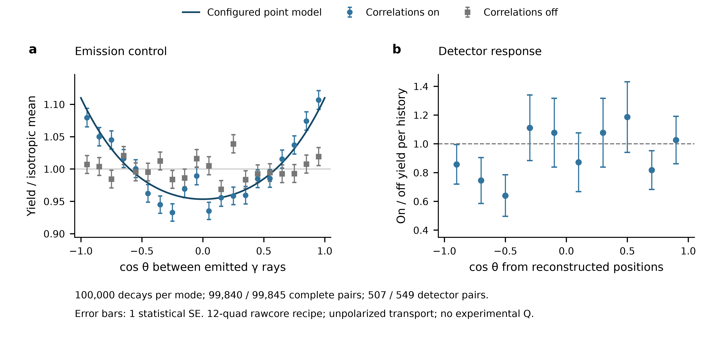

# 同一个60Co源需要分别保存γ角色和响应对象

## Research Trigger

Day16的δ多解判别需要matching companion。Riley2021与L25均使用60Co校准，但target/gate相反；公开源例又用两条γ均在GRETINA的pair selection。本note用实际代码、输入与有限MC核对象，不给新的实验Q/δ。

## Grounded Evidence

[[riley-2021-ucgretina-energy-response]] R21-5/14：GRETINA的1172/1173target、上游LaBr的1332gate，用于背景较干净的continuum response；真实segmentation/partial charge collection仍关系到未来polarimetry。

[[lauritsen-2025-gamma-angular-formalism-tracking-arrays]] L25-30：1173 coincidence准备1333偏振reference，measured/ideal amplitudes形成其Q；具体response/角/归一随原定义保存。R21的反向角色不能仅靠同source名替换。

[[ucgretina-2024-geant4-11-source-replay]] UG24-19–26实际十二quad/noPOL例、Ni60 MP407小混合、两组1000history/native/坐标控制与理论。它和先前Eu152七quad不同，虚拟history时间戳也不是实验DAQ积分时间。

## Assumptions

源模型为静止Co60、原level文件和当前11.4.2，原无sourceFrame宏不补造真实capsule。native nuclear AngularCorrelations的开/关独立于polarized photon transport；当前GammaPolarization关闭。本note只处理γγ角、source角色和明确命名的rawcore recipe。

理论取初始Ji4 unpolarized、第一光子轴固定z且helicity未观测，忽略核反冲/有限角/材料响应；实际first1173为E2/M3、last1332为E2。pureE2只作极限，不静默替换nativeδ−.0025输入。δ来自固定文件配置，不是本run实验测量。

## Provisional Reasoning

| 对象 | target/γ角色 | reference/gate | 已约束的响应 | 保留边界 |
| --- | --- | --- | --- | --- |
| R21 continuum | 1172/1173，级联first | 上游LaBr的1332，last | 能谱/continuum | 没有本run matching ξ/Q |
| L25 polarization reference | 1333，级联last | 1173，first | 原定义ideal/measured幅度比 | detector/gate/归一不能借R21填 |
| 原公开Co60 pair例 | 1173与1332 symmetric pair | 两者均GRETINA | corr/iso ratio的角关联形状 | 原Gaussian/threshold/runtime矩阵未重放 |
| 本note source truth | 两个唯一能窗光子 | 无detector门 | emitted γγ cosθ及moment Cov | 缺失/多解必须排除，不是ξ |
| 本note rawcore recipe | 两个不同晶体、1168–1178/1328–1337 | unordered双门、最高IP位置 | 有明确N的模型pair counts | 无smear/addback/Q，非原sorting复现 |

### 实际控制与可辨识性

1000history的corr/iso完整truth pairs为999/994；原placeholder路径在其余1/6history仍能算出有限数字，本recipe显式记录并排除。源moment a2约.13998±.07327/.09773±.07094，远不足以用小样本判完整kernel或小混合相位；detector pairs仅7/4，10bins有7个iso denominator为0。不能在0处填平谱或以delta-method插件Cov作exact CI。

当前最高deposit IP的native坐标用producer crmat恢复；与固定GRUT默认ASCII矩阵的48套对应R/平移分别在2.96×10^-8/1.22×10^-5mm内相符。往返误差约.0012mm只反映rounded rotation/float。原GRUTSYS配置、binary、Gaussian重复抽样及physical位置分辨率仍未认证。

### back-slice归一还须先固定选择对象

UG24-27在实际相同1k数据上比较：每晶体是否有back IP、原sorting累计到当前晶体的prefix标记、整history是否有back IP。corr三者为103/123/166条，iso为78/89/126；倒序同一history的晶体bank分别改变48/35个history的prefix标签，能量/IP本身不改。这些是all-crystal记录计数，未经photopeak拟合、FEP选择或activity归一，不能叫新的back fraction/efficiency。

R21的原producer与分母未取得，公开代码的prefix也不等于其论文实验使用该代码。这个具体控制保留了“先固定选择对象再问分母”的反证，无法靠增大当前模拟N解决。原GRUT BuildHits当前路径保留输入hit顺序，仍不认证实际pipeline是否另排序。

whole-cascade amplitudes给actual nativeδ−.0025下`W=1+.1005293099 P2+.00940581308 P4`；RB δ+.0025同时换operator phase后W不变。pureE2给5/49与4/441。独立helicity trace和官方F/F3收缩闭合；同符号δ跨operator套用产生另一条曲线，这条曲线属于失败控制，不能当新增物理解。

### 统计对象与后续大样本

source选择后以`a_k=(2k+1) mean(P_k(cosθ))`估计moment，Cov来自同一selected-history向量；条件化N与探测history N分开。corr/iso新seed可作条件统计独立的MC控制，模型/geometry/leveldata仍共享，不能计独立实验。

detector ratio定义为`(C_corr/N_corr)/(C_iso/N_iso)`，不拟合scale强制均值1。每个完整decay最多取一个本命名unique pair，fixedN count Cov与iso denominator误差共同传播；zero support保留undefined。一阶delta-method Cov不解决小计数/零计数区间，也不包含共同geometry/源参数systematics。

### 各100000history的实际结果

UG24-28/29：新seed601101/601102的run、native和angle分析均exit0；完整truth pairs99840/99845，source a2分别.105902±.007183/.006829±.007092，a4分别.007674±.009631/.008455±.009514。corr与预先固定的mixed point模型、iso与0均在条件2D moment Cov下相容；χ²df2 tail近似.740/.426不作全producer认证或实验CI。a4和微小M3/相位差未被此N唯一分辨。

detector rawcore pairs507/549，全部10bin有iso支撑（最小39），ratioSE约.135–.245。source moment相容性不使detector ratio成为point W；README约10^7event的精度仍未达到，没有拟Q。输入hash、无IP截断、矩阵与PSD/Sum检查均过，几何警告与实际response边界保持。

图a使用完整truth pair条件N，图b以全部generated history为分母；误差棒分别为multinomial bin SE和有限MC ratio的一阶SE，非实验CI。曲线是配置理论，图b仅有unity参考。完整source CSV/可编辑SVG/PDF与中文caption在同图目录。Python导出实际180×86mm、最小字7pt、alignment与collision PASS；source静态检查仅保留“有PNG无TIFF”的warning；本研究笔记交付PDF/SVG/600dpiPNG，不声称投稿raster合规。

## Failure Conditions

缺光子却用−1向量、单位/索引不匹配、把whole-history总能当单γFEP、将cosθ当ξ、将native nuclear correlation开关当polarized EM，都阻止相应结论。新未知warning、ABI/能量/容量失败或矩阵不支持时，不扩大到detector/Q分析。

## Transfer Conditions

迁移到同一实验reference时，还须给actual target与gate、能区/角区、源或reaction plane、threshold、efficiency/归一、背景、interaction ordering和joint Cov。静态matrix一致只支持坐标合同；实验P/Q与δ支判别须另外的matching inputs。

## Competing Explanations

small-N source曲线看似非平坦，可同时容纳真实correlation、有限统计和缺失占位路径；只有具备两光子的truth/iso控制才有明确比较对象。detector形状还包含finite geometry与门选择，其corr/iso ratio也不自动等于point W。

## Falsification or Reverse Tests

pureE2控制、native/RB同步转换和源码F3/独立trace提供不变性检查；iso source moment应与0相容，corr应与声明的mixed point benchmark比较，保留recoil/selection边界。PSD、逐history/bin求和、输入hash和zero-support检查必须同时保留，不能靠归一或clip隐藏失败。

## Open Questions

100k两mode的run/native/moment Cov已实际交付，detector统计/readiness边界保持。下一可问在理想point reference下first/last photons的conditional Stokes是否因pureE2对称而相同，以及小M3如何改变；必须整套joint amplitudes/轴/相位核，不能预设角色互换必有或必无影响。原Weisshaar2017 DOI10.1016/j.nima.2016.12.001的题名/卷页已核，正确正文未取得：出版商XML仅coredata、仓储403/连接失败、配置provider缺credentials；不重试终态或从metadata补原back-fraction分母。

## Human Review

本note为Codex self-audit/模型设计，不新增human-reviewed，不清needs_review。原L25人审prefix保留；新关联和物理边界不覆盖旧实验结论。

## Promotion or Rejection History

2026-10-19：接受实际输入/1k与各100k记录、坐标和声明理论控制；source开关局部核验获支持。拒绝以缺失占位、粗detector ratio、同source名或source数学闭合认证实验Q/δ/原producer。

## Reproducibility

原G411 sha02e5a9241322f661c6918f6705cab813c691cd21/HIGHMULT40 source-only记录副本固定，官方SDK11.4.2与GRUT f648d7cb4fc0609f13aaad7148977f87641ecac9选定文件具hash/locator。co60-gate-role-before、input-reading、smoke/native、analysis-before、theory/F3及100k freeze位于原Day16 run目录；脚本和原文件身份见UG24-19–26。全部原输入/binary保留，未运行destructive Makefile或创建新session/daemon。
