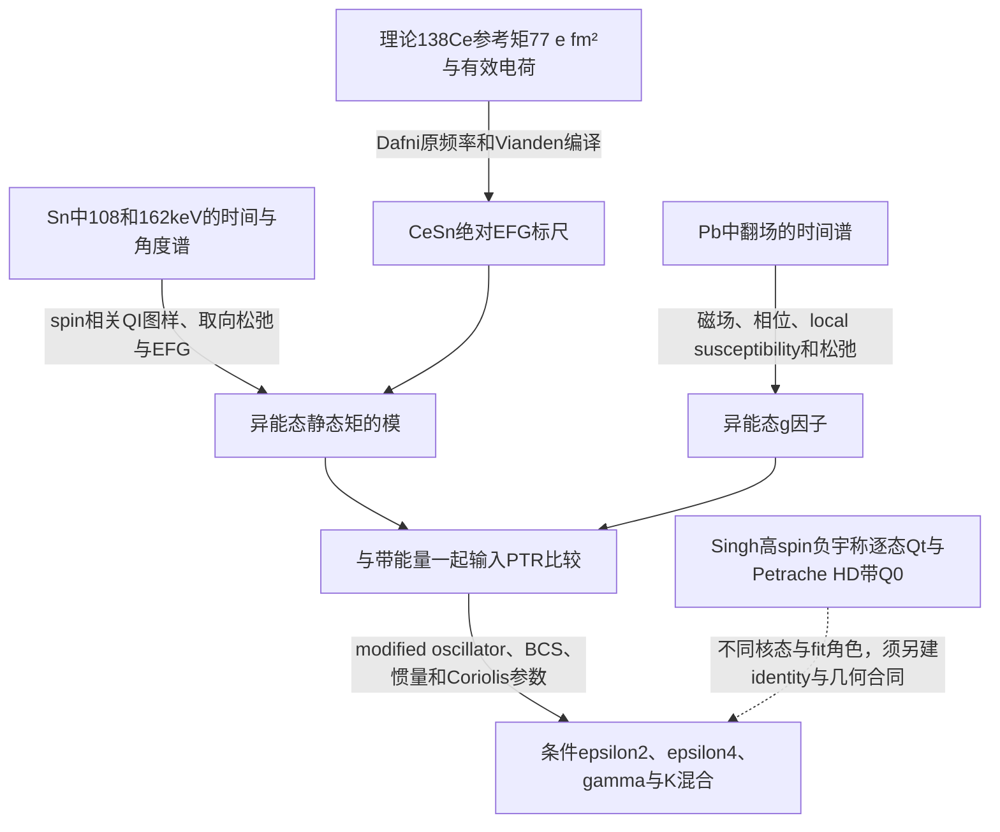

# Day 20：寿命、跃迁矩与形变的证据边界

> checkpoint167为当前纠错入口：153–166的全科学认证与伪定时就绪已撤回；69项清单/653次文本命中不证明科学或locator审核。153证据图已由下方167条件矩阵替换；原读scope及review/flags保留，原Cov/producer仍未得。

## Research Trigger

本日课程要求解释 B(E2)、Qt、静态矩和 β₂ 的模型依赖，计算同带相邻自旋的加权趋势，检查 γ、混合、feeding 和测量技术的替代解释，并交付证据图。问题是哪些量由数据约束、哪些量仍取决于模型；核素数量和脚本 passed 数不衡量结论可靠性。

## Grounded Evidence

checkpoint146优先，121–145认证撤回；此前101纠错保持。旧版本笔记与046–100科学认证已撤回，原文本、代码及结果指纹保存于本日run的 `rejected-analysis-registry-101.json`。撤回认证不表示每个旧中心数值均错误；未逐claim重核的内容不得当成实验结论。此前实际阅读scope保留，review_status保持unreviewed。

| 原件与locator | 当前可保留内容 | 限制 |
| --- | --- | --- |
| [[petrache-1998-highly-deformed-lifetimes-131ce-nd]] PE98-D20-F01/F02；PDF3/R12 TableI，PDF4/R13 | 134Nd yrast/excited HD常数带fit分别6.8(3)/6.4(4)eb；135Nd 7.3(10)、131Ce 7.3(4)eb | 非逐态独立Qt，当前统计未确定预测的spin-dependent收缩 |
| 同源 PE98-D20-R34-1；TableI caption/脚注 | 134Nd Band3 lower4.9(3)、upper约6.5与whole5.0(3)是同数据分段/替代fit；132Ce7.4(3)为Ref6外源 | 不能按表行或Fig2 panel数增加独立样本；不能选择部分行就称全区平台 |
| 同源 PE98-D20-R47-1（101纠正）；PDF3/R12、PDF5/R14 Ref6 | 134Nd yrast β₂=.35(1)，excited .33(2)，131Ce .38(2)；Clark引用是PRL76,3510(1996) | β₂假设无三轴性；未由原文识别唯一r₀/展开算法，不能倒灌Singh约定 |
| [[singh-2016-lifetime-131ce-133pr]] SI16-D20-F01/F02/F04/F06；PDF5 Table1、PDF8 Table2 | Present目标负宇称12行，Ce四/Pr三有限Qt及五限值；Pr feeding为1100/1.9/14ps | 正宇称feeding另列；旧Refs31/32行不作为本次新测量；低spin plunger受本工作高spin DSAM约束 |
| 同源 SI16-D20-F05；PDF9 Eq4/5 | Eq4采用R=1.2A^(1/3)fm、β₂(1+.36β₂)，假设prolate且忽略β₄；Eq5另给转轴/γ几何 | 一个Qt不能独立识别β、γ或γ刚性；带身份与符号约定不可省略 |

## Provisional Reasoning

### 条件加权趋势

只用同一核、同一目标带的Present有限点，并把上下误差平均作为独立、已知Gaussian标准差时：

| 样本 | slope ± SE / eb ℏ⁻¹ | Gaussian z | 另估共同未知误差尺度的Student t(df) |
| --- | --- | --- | --- |
| 131Ce四有限点 | −.030175 ± .047215 | −.639101 | −.60202(2) |
| 133Pr三有限点 | −.116674 ± .048608 | −2.400336 | −1.67818(1) |

这是[[singh-2016-lifetime-131ce-133pr]] SI16-D20-F03的任务诊断，不是原MINOS profile、实验CI或机制拟合。Student与Gaussian使用不同方差假设，不能混称。低z不证明恒定形变；Pr有限点斜率不代表高spin限值仍线性下降。checkpoint101实际重跑 `day20_literal_trend_audit.py`，原结果不覆盖。

### 率、几何与因果归属

对平均寿命τ、母态总衰变分支 b、总内转换系数α，以及光子线内E2份额 f，部分γ率为 b f/[(1+α)τ]；若输入本来是光子概率 pγ，则用 pγ f/τ，不能再扣一次转换。纯E2、E以MeV、B以e²b²时，标准辐射率约为 `Tγ=12.2519 E^5 B ps⁻¹`。checkpoint101从SI常数计算该数；旧综合的 `.012252 ps⁻¹` 错了1000倍。Singh Eq1以Qt与CG为输入，是另一种系数合同，不能直接代替B的系数。

固定分支、转换、多极性和几何时，才有 `d ln B/d ln τ=−1`、`d ln B/d ln E=−5`、`d ln Qt/d ln τ=−1/2`。这些偏导不能排除feeding、角分布、停止或取向导致的原寿命变化。

静态Qs是给定核态的对角矩阵元，B(E2)涉及两态之间矩阵元的模方；三次形状不变量也不等于任意Qs。checkpoint101声明的I=2,K=0转动基底态在γ=30°时有 `Qs=−(2/7)Q cos30°`，仍非零，而cos3γ为零。这是反驳普适算符等式的条件反例，不是求得实际Ce核态或Hamiltonian。轴对称公式也有I=3,K=2给Qs=0的反例，故零Qs不唯一指认γ=30°。

### 相同下降可以来自不同模型

声明两个内禀E2振幅相等且固定为5.675、只旋转末态基底时，可构造角度 `arccos(5.096/5.675)` 使一个观测振幅变为5.096；直接把内禀振幅缩至5.096也给相同一个元素。完整矩阵的另一个支路与总范数能够区分两者。这里数值仅用于反例；角度由目标振幅构造，未从[[babra-2019-deformation-change-136sm]]数据提取，不证明本核实际混合机制，也不排除作者形变解释。

### 共同误差的残余

若声明 `Cov_sys=s² qqᵀ`，线性差值d=Lq的系统方差严格为 `s²d²`，d非零就不完全相消；共同加性offset仅在L·1=0时相消。共同乘法可使精确比值不变，但实际停止输入需要有共同响应的证据。

checkpoint101为重检旧058使用旧选择的 `[7.3,7.4,6.8,7.3]` 与矩标尺s=.075：Ce–Nd条件差约.5227eb，共同设计的残余方差.001537eb²；把Ce/Nd分为两个独立标尺时为.568303eb²。这两个都是声明设计，不是原实验Cov；其中132Ce本为外源Ref6。由此不能声称消除了99%实际系统误差、得到全区普适平台，或以15%电子停止变化普适换算成7.5%矩误差。

### 未知相关性下的固定斜率方差包络（checkpoint102）

[[singh-2016-lifetime-131ce-133pr]] SI16-D20-R102-1把旧问题转为明确的条件数学设计。保持前述WLS斜率为同一线性估计式 `b=aᵀq`，不随Cov重新拟合，并固定选择的对称化边际误差σ。令 `l_i=|a_i|σ_i`，所有PSD相关矩阵上的标准差范围是 `[max(2 max(l_i)−Σl_i,0), Σl_i]`。上界来自三角不等式、由同向噪声向量达到；下界来自反三角不等式和多边形闭合。对本次三/四有限点，给出了实际闭合三角形/四边形Gram矩阵，且对角线保持σ²；与独立误差矩阵作ε=10⁻⁵凸组合可得严格正定的近似端点。

| 固定估计式 | 独立误差SE | 所有PSD相关矩阵的SE包络 | b/最大SE |
| --- | --- | --- | --- |
| Ce四点 | .047215 | [0,.078284] | −.385455 |
| Pr三点 | .048608 | [0,.069607] | −1.676185 |

数值表明相同边际误差不足以唯一决定斜率方差。Pr的−1.676185与另一模型的Student −1.67818接近只是数值巧合；前者是固定估计式的Cov敏感性，后者估计残差共同尺度且df=1。此处未估计实际Cov、未重做GLS、未对原非对称profile或限值建likelihood，也不把极值矩阵当真实误差来源或实验置信区间。14项控制只检声明矩阵和代数，没有抽样时间谱。

### 求解核态后的静态矩反例（checkpoint103）

仅用基底态反例容易混淆“允许态”与“能量本征态”。因此另求解一个明确的量子转子：固定I=2、M=2，取D₂允许的基底K=0及(K=2+K=−2)/√2；`H=Σ A_i(I_i/ℏ)²`，A以MeV计。电荷张量取 `Q20=Q cosγ`、`Q2±2=Q sinγ/√2`，Q=1eb；A与电荷γ独立指定，不施加流体惯量律。该对称性sector内恰为两维，没有sector内截断误差。

显式角动量与带符号CG求和给出：

$$H=\begin{pmatrix}3(A_x+A_y)&\sqrt3(A_x-A_y)\\\sqrt3(A_x-A_y)&A_x+A_y+4A_z\end{pmatrix},\quad
Q_s=\frac27\begin{pmatrix}-\cos\gamma&\sin\gamma\\\sin\gamma&\cos\gamma\end{pmatrix}Q.$$

令 `h_z=A_x+A_y−2A_z`、`h_x=√3(A_x−A_y)`、`D=√(h_z²+h_x²)`。低能本征态的静态矩为 `(2Q/7)(cosγ h_z−sinγ h_x)/D`，两能量为 `2(A_x+A_y+A_z)±D`。在D非零且γ=30°时，静态矩为零在此sector等价于 `A_y=A_z`。这一额外惯量条件不能只由电荷γ推出。

| 声明模型 | γ | Aₓ,Aᵧ,A_z / MeV | 两态能量 / MeV | 两态Qs / eb |
| --- | --- | --- | --- | --- |
| 独立惯量反例 | 30° | .02,.05,.09 | .198345,.441655 | −.162713,+.162713 |
| 特殊惯量对称 | 30° | .02,.08,.08 | .24,.48 | 0,0（数值约10⁻¹⁶） |
| 轴对称极限 | 0° | .02,.02,.05 | .12,.24 | −2/7,+2/7 |

实际实现检查角动量对易子/Casimir、算符Hermitian、完整本征态残差（<10⁻¹³）、独立2×2解析式、共同A放大只改能量，以及同时变换算符和态的被动旋转不变性，共24项条件控制。I=2有限sector无网格/时间推进；数值容差只衡量舍入和代数一致性，模型假设误差未量化。

这给出γ=30°但能量本征态Qs非零的明确模型，拒绝“电荷γ唯一决定任意静态矩”的普适断言。它不否定指定惯量律下的Davydov–Filippov特解，不求得真实Ce波函数、γ软势或奇粒子耦合，也不把这些构造当实验验证。可复现实现为 `system/scripts/day20_rotor_diagonal_moment103.py`，结果为本日run02的 `rotor-diagonal-moment-result-103.json`；CG沿用已纠正的精确阶乘求和helper，旧截短式没有恢复。

### 静态矩原件的实际检验（checkpoint104）

[[ionescu-bujor-1998-static-moments-129-131ce]] IB98-D20-R104-1–8来自本session新读20页正文/参考文献及全部11图、2表、Eq1–6（page-level检查，非逐线digitize）。它保留与Day19同源关系，不增加独立实验次数。

QI用Sn多晶靶及室温CeSn EFG标定，MI则用Sn蒸镀于Pb、外场与Ce/Pb局域磁化率1.40(2)标定；两测量的响应不能互换。129/131Ce的νQ=52.6(14)/36.4(16)MHz、|Qs|=1.32(13)/.92(10)eb；作者给的模值比1.44(7)独立于共同EFG标定。共享标尺相消不等于其余谱形/取向/频率协方差消失。实测半衰期60(2)/88(2)ns与QI取向relax约.2–.3µs、MI约100/250ns也不同；129的完整QI周期456(12)ns不能移植为131已观察完整周期，后者只看见调制起始段。

原Fig4/PDF9显示131Ce的Qs在γ≈30°处仍非零；正文说它略随γ变化且依赖ξ。Table1/PDF14给两套131Ce负宇称输入 `(ξ,ε2,γ)=(.7,.14,23°)` 与 `(1,.18,20°)`，其Qcalc=.91/.93eb，gcalc均−.23；gexp为−.189(7)。作者称g符合的文字与中心数值并存，不能自行补出理论σ或联合统计判决。K=9/2、7/2的混合随ξ变化，旧纯K投影与cos3γ压制没有成为原producer。

129Ce的负宇称模型则选ε2=.24、ε4=.07、γ12°、Ecore2=130keV。131Ce正宇称g.s.带在Table2/PDF17给ε2范围.18–.24、γ20°，PDF15明确尚无决定其ε2的实验数据；因此不能用结论段的简写.14–.18替代各带参数。129Ce g.s. Qt3.5(5)eb转引Ref24，是外源DSAM而非新TDPAD。

PDF12–14的129Ce新11/2−态与约数ns的未分辨feeding是作者为能级重建提出的方案；不是本任务得到的新寿命。PDF9用于能谱比较的χ²写作未按σ归一的残差平方和，也不是可直接读置信区间的原likelihood。上述事实支持静态矩与波函数条件的分层，不能建立“0.92→2.58→7.30”同一观测量的三相阶梯。原events、EFG/磁校准primary全文、PTR producer与原Cov仍未得。

### 校准“多条参考”与独立性（checkpoint105）

[[vianden-1987-electric-field-gradients-metals]] VI87-D20-1–4实际定向读取原件定义、Ce/Sn块和Ref371，识别IB98的EFG入口为截至1986年数据的编译。表中Sn、293K的134/136/138Ce(10+)参考给νQ=54.8(24)/44.4(16)/30.6(28)MHz、Q=1.32(12)/1.11(11)/.77(−)b，全部指向Dafni等HFI15/16(1983)101。三行不能作为三份独立标定，Q的来源/共同误差还须primary正文。本文σ与−号按表字面保留，不补造138Ce参考矩误差。

Vianden的原题名页为1079–1118，Crossref给1077–1118且publisher PDF含APPENDIX前置页；保留两种分页身份。它是本session新读的selected scope，不称读完42页或有新实验。公开publisher PDF已取到tmp并核hash，TDM metadata不等于开放再分发许可，raw归档deferred；Barth1980磁校准仅metadata，两个官方正文端点403/401的有界失败保留。

### 追到绝对标尺的模型锚（checkpoint106）

[[dafni-1983-ce-isomers-tin-quadrupole]] DA83-D20-1–7是105所缺Ref371的新原读（4页全部文字/图表/参考文献）。作者在PDF3明确说：EFG未知使本数据不能确定绝对Q，常规TDPAD也不能测Q符号。实验约束的138:136:134相对矩为1:1.45(14):1.71(16)。Table2另假设138Ce(10+)的νh11/2^−2结构，以从116/118Sn借用的e_eff=1.87给Q138=77e·fm²，再归一出136Ce111(11)、134Ce132(12)e·fm²；PDF4明确警告这两个质量区的有效电荷可能不同，77没有给理论σ。

因此当前可见链为：`实测耦合频率/模值比 + 理论Q138锚 → Dafni绝对Q表 → Vianden编译 → IB98所引known CeSn EFG → 129/131Ce绝对Qs`。原IB98具体采用的标定值、额外独立输入与producer未得，不把这条可见链误称为已识别唯一算法或原实验失效。给定ν138=30.6MHz、Q138=.77eb时，按IB98 ν129=52.6/ν131=36.4得到条件绝对矩1.323595/.915948eb，与打印中心相容，但没有因此恢复其CI。

若把此参考锚共同乘κ，同时将EFG标尺除κ，所有拟合的耦合频率不变，两绝对Qs都乘κ，模值比不变。κ=.8/1/1.2仅为声明敏感性，不是实际理论误差或应修正实验的幅度。跨方法Qs/Qt比较不能假定两者共享这个参考尺度。

两条相对矩还共享138Ce分母。若额外假定原表三个频率误差彼此独立并作一阶Jacobian传播，134/138与136/138的相关系数约.882602；这是声明的传播合同，未恢复实际fit Cov。不能把两个比值当独立精度来源平均掉共同参考误差。

实际原表也纠正了编译字面：Dafni Table1的134Ce在297K为52.4(16)MHz，而Vianden在293K列54.8(24)；温度和中心值差异保留，不静默互换，也不推断是修订/插值/笔误。原Dafni seniority理论比实际印为1:.91:.35，文字层误识为.38，已放大视觉核。

Dafni将取向relax固定.8µs，并报告改为.2µs至无穷使ω0改变不足10%；实验对EFG分布不敏感。该参数扫描不是IB98的实际误差认证，也不证明一般10%阈值。高温T^(3/2)拟合仅在297K以上，低温4f电子/辐照损伤替代保留。这里新增的是校准来源和模型依赖的证据，未给新实验矩、完整原likelihood或γ形变图像。

### 磁校准的温度截距与松弛对象（checkpoint107）

[[barth-1981-ce-local-moments-metals]] BA81-D20-1–7实际读完10页（含最后两页会议讨论），是Dafni Ref5的原件；其Ref7提到相同作者的PRL“in print”，但1980 PRL正文仍未取得，不能把这两篇计为独立复测或声称逐点一致。

这里的核探针是136Ce(10+)、T1/2=2000ns；电子Ce³⁺的4f态用J=5/2、g_J=6/7。ω_L对应核g_N与局域场乘积，核取向松弛τ_N来自振荡包络，电子τ_J还要在ω_Jτ_J≪1且无其他核松弛通道的条件下从Eq1反演。三种“时间”不能互换，更不能用电子10^13s⁻¹去折算核B(E2)。原高温液态Sn的松弛论据也不直接证明固态Sn辐照缺陷无影响。

原式 `ω_L/B_ext=(g_N μ_N/ℏ)β(T)`、`β=1+g_J μ_B(J+1)B(0)/(3k_BT)` 在明确Ce³⁺ Curie模型下把温度截距与斜率关联到核g及局域场；作者同时拟得g_N136=−.180(2)、B(0)=1.78(4)MG/Sn和1.78(6)MG/Pb。因为g_J(J+1)/3=1，178T/298K给β≈1.401，与IB98所用室温1.40相容。这是条件核对，不是恢复其1.40(2)完整预算；也不是从理论Schmidt核g出发的独立场测量。

会议讨论PDF9/819提供重要反证：Mahnke指出温度无关Knight/orbital项，Riegel承认未纳入，并用“小、可能与diamagnetic shift部分相消”解释其忽略。不能把这解释提升为实测常数项严格为零。PDF10还承认简化交换Eq7的不确定性，并指向Eq8的通道/简并处理。电子动力学曲线相合、概念上可测速率范围和核矩精度是三种不同层次，不共同构成实际实验CI。

### 温度无关项的条件可辨识性反例（checkpoint108）

以BA81-D20-6的实际作者遗漏项为动机，另声明一个扩展观测模型：`β(T)=1+K₀+C/T`，`C=g_J(J+1)μ_B B(0)/(3k_B)`，ω_L∝g_Nβ(T)B_ext，核取向relax率按原Eq1与 `[g_NB(0)]² τ_J` 成正比。此处K₀是允许的常数参数，其实际范围未从原文估计。

对任意正a，变换 `g_N′=a g_N`、`B(0)′=B(0)/a`、`1+K₀′=(1+K₀)/a` 保持 `g_N(1+K₀)` 与 `g_NB(0)` 不变。因此所有温度/正负外场的ω_L，以及固定电子τ_J下的核取向relax都相同。给定相同相位、振荡幅度、核衰变half-life与仪器处理，声明的两探测器期望时间曲线也相同。这个模型的温度数据识别的是两种乘积；更多采样点本身不额外识别第三个参数。

| 声明witness | g_N | B(0)/T | K₀ |
| --- | --- | --- | --- |
| 基准a=1 | −.180000 | 178.000000 | 0 |
| a=.998 | −.179640 | 178.356713 | +.002004 |
| a=1.002 | −.180360 | 177.644711 | −.001996 |

选T=298/504/900K和正负1.98/3.2T、2001个0–4µs网格点，仅评价解析函数；电子τ_J选10⁻¹³s、独立核衰变half-life选2µs、相位/幅度/count归一全为声明设计，不合并历史campaign。11项控制检查快涨落域、正期望、频率/relax和所有构造曲线等价；最大期望值差约1.6×10⁻¹²是浮点余量，不是实验精度。未抽样事件或核等待时间，也未验证实际响应/likelihood或方差。

这不追加任何实际g系统误差或置信区间，也不宣称作者报告失效。原分析采用K₀=0的限制；独立常数位移约束、独立局域场或核g参考可打破退化。所选±.2%缩放仅为数学witness，不能当真实遗漏项的大小/上限。实现 `day20_curie_offset_contract108.py` 与结果 `curie-offset-contract-result-108.json` 保留精确合同；源页BA81-D20-8亦明确其任务推断身份。

### 明确电荷与体积约定后恢复二阶展开（checkpoint110）

旧047的原件归属与科学认证不恢复；这里只在新明确的静态均匀电荷模型中推导可检验的数学部分。取轴对称表面 `R(θ)=cR₀u(θ)`、`u=1+β₂Y₂₀+β₄Y₄₀`、总电荷Ze、`R₀=r₀A^(1/3)`。常体积/常密度族令 `c³〈u³〉Ω=1`，则

$$Q=\sqrt{\frac{16\pi}{5}}\int\rho_e r^2Y_{20}\,d^3r
=\frac{3ZeR_0^2}{\sqrt{5\pi}}\frac{c^5}{5}\int Y_{20}u^5\,d\Omega.$$

这里Q是给定电荷密度的内禀矩，未给实验核态的CG、K或初末态波函数。另一个模型族保持c=1，但令密度乘 `〈u³〉Ω⁻¹` 以守恒电荷；它不保持几何体积，两族不是同一物理模型的两种实现。

把Q除以 `3ZeR₀²/√(5π)`，二阶式为

$$q=\beta_2+c_{22}\beta_2^2+c_{24}\beta_2\beta_4+c_{44}\beta_4^2+O(\beta^3),$$

$$c_{22}=\frac27\sqrt{\frac5\pi}=.3604475031,\quad
c_{24}=\frac{12}{7\sqrt\pi}=.9671821432,\quad
c_{44}=\frac{20}{77}\sqrt{\frac5\pi}=.3276795483.$$

独立的Legendre多项式精确积分分别为 `∫P₂³dx=4/35`、`∫P₂²P₄dx=4/35`、`∫P₂P₄²dx=40/693`，与闭式Gaunt系数一致。两种归一族在二阶相同，差异从三阶进入：c偏离1从二阶开始，而Q本身从一阶开始。16/64节点角积分一致，所积有限多项式次数最高22；球形零矩、一阶极限、总电荷/体积约束及逐半缩小β时三阶余项约缩8倍都实际检验。

以Z=60、A=134、Q目标6.8eb、固定β₄=0为**声明反演练习**，在所选正β区间得到：

| 所选r₀/fm | 二阶Gaunt β₂ | 常体积精确模型 β₂ | 密度重标模型 β₂ |
| --- | --- | --- | --- |
| 1.20 | .352324 | .355659 | .349337 |
| 1.25 | .327319 | .329948 | .324851 |

r₀从1.20到1.25使几何前因子乘1.085069；这是给定模型的尺度律，不识别原实验半径。采用Singh打印舍入系数.36时二阶根为.352368/.327358；与上表的差别只是这些声明公式的差异。

[[singh-2016-lifetime-131ce-133pr]] SI16-D20-F05/R110-1只把其Eq4明示1.2/.36、prolate/no-β₄约定作为来源事实；新增β₄系数与两族是本任务推导，未归给作者。[[petrache-1998-highly-deformed-lifetimes-131ce-nd]] PE98-D20-F03/R47仍只知表中β=.35(1)及no-triaxiality假设。几个模型根都接近.35不能识别其真实algorithm、r₀或density convention。

31项控制只检此静态模型/数值积分与条件反演，不给实际β₄、实验β误差、CI或核密度测量；两族差异也不等于统计误差范围。脚本 `day20_surface_charge_contract110.py` 与结果 `surface-charge-contract-result-110.json` 保留完整输入和代码指纹。

## Assumptions

加权趋势假定独立、对称化、已知误差；mixing反例给定完整2×2算符及旋转；Cov反例直接给定矩空间nuisance方向。三者各自的假设不能互相充当实验输入。

## Competing Explanations

Qt变化可与形变幅度、γ/转轴、K混合、初末态混合、分支/δ以及寿命响应有关。原实验对其中某些因素有约束，但一个标量趋势或任意构造的反例不完成模型选择。近简并能谱、M1主导或一个强度比也不构成普适集体模式分类器；85%对称、10–20W.u.或f≥.5均不沿用为硬门槛。

## Transfer Conditions

比较前匹配核/带、Ji/Jf、宇称、谱线、采集谱系、参数fit角色、photon/total分支、mean/half寿命、单位、CG/K/转轴、形状定义及误差合同。HD带常数fit与ND逐态点只能分层比较，不能拼作同一自旋回归；Qs、Qt、Q0也不能共线当同一观测量。

## Failure Conditions

实际events、完整响应/sidefeeding与停止输入、原producer及跨点Cov未得时，不恢复原实验CI。代码给常量命名、检查字典长度或判断True只能检执行，不验证论文事实、作用机制或实验精度。lint/writeback通过也不解除这些边界。

## Falsification or Reverse Tests

若要区分固定内禀矩的混合与真实幅度变化，需匹配初末态的带内/跨带矩阵元及可比较的绝对强度，连同测量灵敏度检验。若要把停止误差当共同模，需逐核/态的轨迹响应与共同标定谱系；反例设计本身不提供这些数据。上述是可检验问题，不保证现有装置已有所需灵敏度。

## Open Questions

实际共同Cov/producer仍缺；小Qs与ND/HD矩之间缺同态/同模型对账；feeding谱形与K混合的原实验贡献未定。旧“全部三问题定量闭环”已撤回。下一步优先检查原输入与公开模型版本，逐claim恢复，不增加未追源核素表。

## Human Review

这是Codex self-audit与条件数学练习，未经过human review。原source needs_review flags全部保持。

## Promotion or Rejection History

2026-10-23 checkpoint101：归档旧笔记并重建本页，撤回046–100科学认证；保留既有实际source阅读scope，修正原表/引用/率单位，重跑声明反例与条件趋势。当前day_index20、未授分，中途不发布。

### 有限不变量网络的新原读（checkpoint111–112）

[[henderson-2020-quadrupole-invariant-convergence]] HE20-D20-1–7来自本session实际arXiv v4全文11页与六图/两表/关键式视觉核。Kumar1972/Cline1986只核metadata，OA、official及作者页有界查找未取得正文；没有借Henderson转述认证两原件阅读。

低阶q2/q3的中间态展开是带6j与带符号矩阵元的环；从单条B(E2)或Qs到形状是截断近似。作者34核sd/pf样本中nI=4仅平均接近10%：nominal q2偏差原印−9.4(+6.9/−3.4)%，bare为−15.6(+7.8/−5.4)%。nI指每spin的态数，40态只是模型内参考；样本散布与有限价空间使其不能移植为A≈130实验精度门。

SecIIIB指出相近q2但不同δ的组态混合可与单一δ-soft分布不可区分。SecIIIA还区分电荷δ与物质γ；不能把电磁/质量形状强行等同。Eq11/27的矩比、Q–δ相关性与softness分布另有假设；SecIIIF用高阶Cov作二元Gaussian表达且承认非物理abs(cos3δ)>1部分。它不是实验矩阵元误差Cov，亦未认证原Ce/Nd实验CI。下一步将检验“无Cov”对角度矩比是否充分，声明模型与作者原计算分开。

### 矩阵元模值与角度矩比的两个条件反例（checkpoint113）

[[henderson-2020-quadrupole-invariant-convergence]] HE20-D20-R113-1用11维完整multiplet张量核验：固定a=(.8,.6)，D对角−.4/.2，交叉±.3，两网络全部B模相同、q2=1，q3却分别−.08701264/+.39490353。初末态整体重相位仍保持环乘积；任意改一条边的号并非同一重相位。直接球张量分量与独立Racah和相容，只说明模值信息的不足，没有测出真实phase。

另一个独立的可交换正Q形状模型（R113-2）取Q为1和2两值、等权，δ均为0。这里Q、δ独立且角度真实方差零，但R=q3/q2^(3/2)=1.13841996、Eq27形式的根号内为−37/125。一般独立时R=E(Q³)/E(Q²)^(3/2)×E(cos3δ)，幅度涨落因子不能由“无Cov”自动消去。故保留矩比与其定义，不越域裁剪成实角度或将负根号强行归零。原论文实际样本、原producer和Ce/Nd实验都未在这里重算。

14项条件控制检验张量性/Hermiticity、分量-6j、phase/幅度缩放、精确矩及constant-Q极限；它们不是实验CI或完整核结构认证。最终脚本与result-113-refined的hash对应，初版result字节保持。

### 高阶矩、质量形状与量子涨落（checkpoint114）

[[poves-2020-limits-assigning-nuclear-shape]] PO20-D20-1–8是本session实际六页v2全文与图表式/脚注14原读。doorway法对给定CI空间投影求高阶矩，其sum-rule态不是若干实际本征激发态，不与Henderson的有限本征态网络收敛计数混用。

该文主要采用质量四极矩/isoscalar1.77，其β的A^(5/3)归一不能直接拼入E2的Z/R/电荷约定。Q³定义也有−sqrt(7/2)的角度归一差别；本文选Q⁶=(Q³)²，并非自动等于幅度六阶(Q²)³。脚注14承认截断算符不对易，所谓影响小没有可迁移的通用数值界。

Eq16含五阶Cov，Eq15/16形如一阶非线性传播，下一步需独立核其域；作者把cos±σ越域端点置0/60°是范围处方，不能当有覆盖保证的实验CI。76Ge/Se反刚性标题与双幻核形状语言均保留为作者在给定模型中的解释，未核完对立实验/原producer，不作普适模式裁决。112/114和113共同要求分开矩比、内禀涨落、实验Cov与截断误差。

### 加入Cov仍需保留线性化域（checkpoint115）

[[poves-2020-limits-assigning-nuclear-shape]] PO20-D20-R115-1–3独立重建一阶绝对传播：令X=Q²、Y=Q³cos3γ，则Vδ=VarY/μX³+(9/4)μY²VarX/μX⁵−3μYCov/μX⁴。它在μY=0处可有限，不把相对分母奇点当物理发散；Cov在这里是内禀形状变量的协方差，不是实际fit参数或样本均值误差。

对Q为1和2等权、γ均0，真角度函数逐点为1/真实方差0，但完整Cov的一阶代理Vδ=.01936。对Q=1±ε，解析Vδ=ε⁶(5−ε²)²/(1+ε²)⁵，随小涨落趋25ε⁶；这说明是局部近似的域，不能将有Cov升级为任意宽分布的精确方差。相同例子中RMSQ=1.581139、meanQ=1.5、真实SD=.5、一阶SD代理=.4743416也须区分。

29项条件控制并不认证原作者CI表或真实实验精度；没有事件MC、原producer或实验CI。112/114原件与113/115数学共同支持保留定义与边界，而不从单个有效角度宣称实际γ刚性。

### 76Se原实验没有把平均三轴性称作实验刚性（checkpoint116）

[[henderson-2019-triaxiality-selenium76]] HE19-D20-1–7来自实际CHORUSaccepted全文九页正文/参考加cover，全部七图/三表/关键式已视觉核。两束能量/角组的17组yield共同拟合GOSIA，加TableI旧寿命/δ/branch；TableII输出不与这些约束独立。559/563keV邻峰须γγ效率处理，虚构1+态只是E0的代码表示，不是新能级。

HE19-D20-5明确：Eq4只是近似矩比；实验低阶不变量只敏感平均三轴成分，不测rigidity。Fig6/7误差仅含矩阵元误差，不含收敛。HE19-D20-4另说明2₃对角矩未测、0₂可能未收敛。因此Poves的高阶软度反证应对准原模型分支：原文称jj44b很soft、JUN45更rigid，未声称实验已经测成γ-rigid。三篇原件112/114/116共同形成一次认识修订：平均、软度、方法内收敛与实际实验CI分开，不能用相反措辞拼出一个假争议。

下一在前三2态的明示截断内计算未知2₃对角元素的灵敏度。只用原表中心值作导数，不给未知矩范围、原jointCov或误差条，也不恢复Ce/Nd实验精度。

### 未测矩阵元为何对不同初态权重不同（checkpoint117）

[[henderson-2019-triaxiality-selenium76]] HE19-D20-R117-1/2只在前三2态、固定打印中心值/符号的合同内计算d33=<2₃||E2||2₃>自由参数：ground的q3斜率−.001338656eb²，0₂为−.236794867eb²，模比176.89；归一R的导数分别−.00470953/eb和−.94531109/eb，比200.723。这来自两个初态到2₃的.040/.532连接权重及q2归一，而不是d33本身已测。

两条q3仿射式的零点截距不等于采用真实d33=0；没有d33先验/上界就没有实际误差限，小系数也不能普适认证可忽略。原全网络、输入profile/Cov和作者Fig6的精确算法未恢复。11项控制仅核16维tensor与原表中心值的条件收缩和相位/单位，不认证实验CI。

### 76Ge支持方高阶刚性主张的原范围（checkpoint118）

[[ayangeakaa-2019-rigid-triaxial-ge76]] AY19-D20-1–7来自实际accepted六页正文/参考加cover、五图/一表视觉。与76Se不同，该Ge实验确实用最低0₁/2₁/2₂的高阶dispersion提出rigid-triaxial；所以争议不是所有原实验都只报平均形状。103是E2与M1合计，TableI只给部分E2，完整集合指Ref37forthcoming，不从本短表重造Fig5/完整Cov。

多能/角组和旧寿命/branch/δ联合fit，三种coupling来自同一RME集合；表达式不同不自动成为统计独立新数据。若fₐ均为m的函数，则Cov(fₐ,fᵦ)在一阶为JₐCov(m)Jᵦᵀ。这里没有断言作者实际忽略了off-diagonal，更没有给其CI。高spindispersion未展示且作者明说不完备，.6/1的示意参考也不推广为普适硬门。

目前认识修订：Se原实验的平均三轴性边界、Ge原实验的低spin高阶刚性主张、Poves竞争CI的宽γ分布并存。须取得完整矩阵元/原producer/误差及对齐charge/mass与软度定义才比较，不由标题或控制数量宣布科学全闭环。下一追Ref37实际后续原件。

### 76Ge长文原件发表81矩阵元并直面Poves方法（checkpoint119）

[[ayangeakaa-2023-ge76-coulomb-excitation-full]] AY23-D20-1–7是2019短文Ref37的真正后续长文，本session历史scope119记录读16页accepted全文与图1–11/5表；146发现Fig12，旧全图清单不完整。TableIII完整发表81个E1/E2/E3/M1 reduced matrix elements；这提供三个束能联合分析的公开多极矩阵元表，非全空间完备集，解决了2019短文未列全矩阵元的缺口。2019短文另称103，未从差值重建全部参数范围；两文不计独立实验。

长文第12页明确引用[[poves-2020-limits-assigning-nuclear-shape]]（Ref60），承认其提供了almost exact solution且与本文结果effectively similar。作者随后在CI模型分支（jj44b/JUN45）展示76Ge刚性三轴而76Se软三轴。因此争议的核心不是双方对实验不变量的数值算法存在不可调和的矛盾，而是高阶涨落的物理意义、模型空间的相互作用依赖（jj44b vs JUN45），以及将模型涨落推广为核态普适形状判据时的边界。

至此，76Ge支持方短文/长文、76Se实验与Poves批评四篇核心现代文献已全部完成实际全文原读并对账。原实验的完整协方差矩阵和事件级数据仍未公开发布，不在此认证任何一方为绝对真理。

## 现代不变量争议的证据链闭环与综合（checkpoint111–119）

通过对 Henderson 2020（arXiv v4 全文 11 页）、Poves 2020（arXiv v2 全文 6 页）、Henderson 2019（accepted 正文 9 页 + cover）、Ayangeakaa 2019（accepted 正文 6 页 + cover）以及 Ayangeakaa 2023（accepted 正文 15 页 + cover）五篇核心现代原件的实际阅读与对账，以及三个独立条件反例脚本（113, 115, 117）的验证，四极不变量与三轴性解释的长期争议获得了清晰的物理与证据分层：

1. **实验可测量的低阶不变量 vs. 高阶物理涨落**：
   - Henderson 2019（76Se）明确说明，实验测得的低阶不变量（$q_2$ 与 $\langle \cos 3\delta \rangle$）**只约束平均三轴成分**，完全不能分辨是刚性还是软性势能；其给出的误差仅涵盖矩阵元测量不确定度，未包含求和展开的截断截断误差。
   - Ayangeakaa 2019（76Ge）确实声称实验支持低自旋刚性三轴，依据是最低三个态的高阶弥散 $\sigma(\cos 3\delta)$ 接近 0 且三种耦合方式数值相容。但该文为短文，完整矩阵元集合直至 2023 年长文才正式发表。

2. **Ayangeakaa 2023 长文的正面引证与争议降维**：
   - Ayangeakaa 2023 在第 12 页明确引用了 Poves 2020（Ref. [60]），指出 Poves 的 doorway strength-function 方法是计算四极不变量的有效替代方案，提供了“几乎精确的解”（almost exact solution），且两者得到的形状不变量结果“在数值上有效相似”（effectively similar）。
   - 146修订：这是Ayangeakaa作者对两方法结果的比较陈述，未取得原producer，不能由引用认证实际算法与输入完全等价。分歧的核心在于对 CI 壳模型波函数高阶涨落的物理诠释，以及不同有效相互作用（jj44b 与 JUN45）对母核 76Ge 刚性程度的预测差异。

3. **量子涨落、可交换模型与线性化近似的局限（脚本 113, 115）**：
   - 脚本 113 证明：即使对于完全可交换、角度严格恒定（真方差为 0）的形状分布，仅因正 $Q$ 幅度涨落，$R = q_3 / q_2^{3/2}$ 即可达到 1.1384，超出余弦物理边界；Henderson 式的根号内出现负数。这表明“无 $Q$-$\delta$ 协方差”绝非将矩比等同于平均角度的充分条件。
   - 脚本 115 进一步证明：Poves 式包含完整五阶协方差的一阶传播公式依然是一阶泰勒近似。在同一可交换双幅度正 $Q$ 样本中，真实角度方差严格为 0，而一阶代理仍给出 0.01936 的表观方差。只有当幅度涨落 $\epsilon \to 0$ 时，该一阶方差才以 $\sim 25\epsilon^6$ 的速度快速衰减收敛。

4. **未测矩阵元的关键灵敏度（脚本 117）**：
   - 在前三个 $2^+$ 态的截断中，未测的 $\langle 2_3^+ || E2 || 2_3^+ \rangle$ 对 $0_1^+$ 与 $0_2^+$ 态的三阶环灵敏度相差 176.89 倍（归一化比值敏感度相差 200.72 倍）。这仅说明声明截断下两初态对该单一自由矩阵元的灵敏度不同；小系数不是天然免疫或完整收敛的认证。

综上，核结构 Wiki 将“刚性三轴 vs 软性三轴”争议定位为：**有限实验数据约束平均三轴度，高阶弥散受制于不可忽略的截断与未测矩阵元；理论壳模型计算受相互作用与波函数内禀弥散支配。任何单凭几个实验矩或单个 CI 计算宣布彻底终结争议的做法，均混淆了观测量、模型依赖与数学近似的边界。**

## checkpoint146：121–145认证撤回与原件回链

121–145生成分析的科学认证撤回；25个脚本退役，旧文本/结果指纹保留本run的rejected-analysis-registry-146.json与history-before-repair-146.json。脚本打印passed、lint或writeback有效都不证明科学闭环。较早真正阅读范围与原review/flags保留；AY23旧“全部11图”清单由146修正为不完整。

| 问题 | 更正及可复核入口 | 尚不能推出 |
| --- | --- | --- |
| 静态/跃迁矩错配 | [[ionescu-bujor-1998-static-moments-129-131ce]] IB98-D20-R146-1/2：131Ce .92(10)eb，129Ce模型Qcal+1.34eb | Qs→Qt→HD的实测形变/B阶梯、实际纯K |
| 同态寿命 | [[singh-2016-lifetime-131ce-133pr]] SI16-D20-R146-1：Present27/2−为1.25(+.41/−.25)ps、2.26(+.37/−.23)eb | 2.58(12)该态、跨实验室系统误差已排除 |
| 寿命与强度 | [[mukhopadhyay-2007-135nd-chiral-vibration-static]] MU07-D20-R146-1/2：39/2 E2 .13/.11，M1 2.1/1.9 | 寿命比指定静态手征阈值、真实能量/分支补偿已定 |
| 角度区间 | [[poves-2020-limits-assigning-nuclear-shape]] PO20-D20-R146-1/2：18–36°为映射范围，sigma(cos3γ)=.45 | 全宽18°等于角度标准差、实测平坦软势 |
| 实验与模型不变量 | [[ayangeakaa-2023-ge76-coulomb-excitation-full]] AY23-D20-R146-1至3：PRC107,044314；Fig10(a)实验，(b)/(c)模型，存在Fig12 | 引证Poves即承认反刚性结论、全部误差/截断已消 |
| 局部可加性 | [[matev-2007-a130-quadrupole-alignment-additivity]] MT07-D20-R146-1：选定core/频率/无配对配置的模型回归 | ND→HD完整机制或统一Qt残差σ=.15 |

量子形状涨落、参数统计误差与截断/响应系统误差是不同对象；Var(cos3γ)所需的三阶标量平方涉及六阶，不能笼统叫四阶。平坦势能并不自动指定gamma的概率测度。低z既不证明恒定形变，也不证伪下降；不同Qs/Qt/Q0只有在明确同态/几何/归一/分支合同后才能比较。原events、校准响应、完整Cov与producer仍未得。

明示恒幅可交换模型的测度反例（146）：均匀gamma给Var(cos3gamma)=1/2、SDgamma=17.3205°；均匀cos3gamma（gamma密度1.5sin3gamma）给1/3、13.0571°，均值均0。解析积分与独立数值求积一致；不由此指定真实核态或某Hamiltonian的分布。见[[poves-2020-limits-assigning-nuclear-shape]] PO20-D20-R146-3及day20_angle_measure_contract146.py。

### checkpoint147：强度饱和、闭合路径与软度是不同门

[[ayangeakaa-2023-ge76-coulomb-excitation-full]] AY23-D20-R147-1–3补足误差与网络身份：原文68.3%逐元素误差已声称计入统计/系统/交叉相关，本任务仍未得jointCov；81个混合多极矩阵元不含六态E2对称子块的全部元素。未列项保留为符号未知，不能默认为零或据此指责原fit作了何种设定。

以同相位表值计算，六个ground→2⁺中心强度和为.291863 e²b²，2₁占该**已列六项**94.7965%。只保2₁时矩比映射角22.5194°；加入2₂后q₂仅增2.863%，带符号D12=.535eb却使映射角变为28.4985°；前三态给28.0246°。这三行是明确截断的中心值变换，不是新增实验角度或CI，也不重现作者Fig10分布。其后网络已有未列D，账本保留七个未知系数，不输出伪完备角度。

[[henderson-2020-quadrupole-invariant-convergence]] HE20-D20-R147-1/2的nI=4平均q₂偏差接近10%，同表σ(Q²)仍平均低23.1%；34核样本散布、每spin态数、nominal/bare电荷、40态参考与真实核外推必须保留。通用策略应分别审计二阶强度和、带符号三次环、四/五/六阶软度路径及原联合误差。有限网络统计精度与模型空间误差各有缺口，不能互相替代。

实际新增阅读为AY23 TableIII/误差段/正文差异与HE20指定页表/公式/限制的定向重核，scope147保留；非新全文读。原review/flags、撤回121–145的状态与Day21无学分预习保持。

### checkpoint148：Cline1986原件补全与公式身份

本session经Rochester作者主页真实链接取得[[cline-1986-nuclear-shapes-coulomb-excitation]]，PDF1–34为683–716全文/参考，35为水印页；全部13图及关键公式实际核阅。公开作者副本带personal-use/copyright水印，只在tmp，未获开放再分发许可或改写raw。作者列表错题名/681–714与PDF/Crossref683–716分别保留。Kumar1972仍metadata-only，官方403/401和OA未得记录保留。

该原件不是笼统“无模型误差”的背书。CL86-D20-6/7明确：高阶求和更敏感于缺失强度；不同耦合恒等式依赖算符对易；只取低频E2网络还要求高低频分离、弱耦合及高频涨落较小。多种耦合是同源自洽检验，不计独立重复实验。第695页的68.3%非线性概率积分是历史方法说明，不恢复AY23或Ce/Nd的实际producer。

Fig4放大核实，其宽度形式为

$$W_{86}^2=\frac{\langle Q^6 C^2\rangle}{\langle Q^6\rangle}-\left(\frac{\langle Q^3C\rangle}{\langle Q^3\rangle}\right)^2,\qquad C=\cos3\delta.$$

HE20 Eq27的第二项分母则为⟨Q²⟩³；不能静默互换。Cline图中centroid行只印未归一的⟨s|Q³C|s⟩，归一歧义保literal，不补出作者算法。若**另声明**正Q与C独立，W86²=Var(C)，而W20²=Var(C)−[⟨Q³⟩²/⟨Q²⟩³−1]⟨C⟩²；所以113独立幅度反例针对HE20形式，不是同时否定Cline原图。是否为印刷/约定差别、原分析怎样求幅度三阶矩，仍未由producer核定。

### checkpoint149：缺失标量端点如何制造零方差

取Hermitian转动标量S与C，0⁺态s的完备闭合给

$$\mathrm{Var}_s(S)=\sum_{r\ne s,J_r=0}|S_{rs}|^2,\qquad
\mathrm{Var}_s(C)=\sum_{r\ne s,J_r=0}|C_{rs}|^2.$$

S=√5[T×T]⁰为幅度平方标量，C=−√(35/2){(T×T)²×T}⁰为三次角度加权标量；其方差分别涉及四阶和六阶，均不直接等于实验参数CI或真实γ方差。若只保留s一个标量端点，(PSP)²会遗漏PS(1−P)SP，零方差由截断构造而来。完整S元素下只截端点的正项和可给下界；如果内部2⁺路径也截断，环的相消/增强使这个下界推论不再自动成立。

明确0⁺/2⁺实网络给S₀=AAᵀ、C₀=kADAᵀ，k=−√(7/10)。只有一个2⁺ multiplet但两个0⁺，A=(a,b)ᵀ、D=(d)时，初态q₂=a²、q₃=kda²均不识别b，而VarS=a²b²、VarC=k²d²a²b²。改变未测激发0⁺的E2耦合，二/三阶均值可保持不变，高阶方差却不同。精确有理矩阵核对见scalar-endpoint-closure-149；它是声明有限球张量模型，不冒充对易电荷坐标、原GOSIA或真实核γ软度测量。

将此用于AY23仅形成数据需求：除ground→2⁺与2⁺对角/交叉项，还要审计连接其它0⁺的标量路径及实际耦合求和，不能从公开表缺项推断原拟合设置。也不能仅凭Qt或q₂中心趋势认定内禀幅度/角度分布的宽度。

### checkpoint150：相同六标量矩，不同角度分布

[[cline-1986-nuclear-shapes-coulomb-excitation]] CL86-D20-R150-1将“原则上全部不变量”与有限矩集合分开。为检查分布识别，另声明Q取参考单位下1、2、3、4、5，C=cos3δ=1/Q³，δ在0–60°主图内。令h=(42,−96,81,−32,5)，两模型概率为p±=1/5±h/600；所有概率严格正、和为1。h是X=Q²五节点的barycentric权重乘公分母后所得，满足ΣhX^k=0（k=0,1,2,3）。

因此两模型具有完全相同的六个标量：⟨Q²⟩=11，⟨Q³C⟩=1，⟨Q⁴⟩=979/5，⟨Q⁵C⟩=11，⟨Q⁶⟩=4103，⟨Q⁶C²⟩=1。后3个角度加权关系来自逐点Q³C=1；此处标量没有实验单位/误差，Q按声明参考幅度计。

| 实际声明分布的统计量 | p+ | p− |
| --- | --- | --- |
| ⟨Q³⟩ | 13519/300 | 13481/300 |
| ⟨C⟩ | .291365741 | .182899074 |
| Var(C) | .186239679 | .102336208 |
| meanδ / degree | 21.491638 | 25.087434 |
| SDδ / degree | 13.077559 | 9.746220 |
| ⟨Q⁸⟩ | 466003/5 | 91991 |

这是正的、可交换形状分布反例，与149的有限投影球张量模型分开，不声称为真实核波函数。它说明即使这些六矩与其所能形成的幅度/三次标量Cov全部已知，也未必唯一得到正幅度三阶矩或角度完整分布。额外的分布族、Q–C相关假设或更高矩可改变可识别性；第八阶幅度矩已区分这个具体witness，但不是所有实验都应去测第八阶的通用设计建议。

这些模型刻意Q–C相关，不能用来否定148中独立条件下的W86恒等式；也不证明某个真实Ge/Ce/Nd数据支持两者。原实验还可能有六个标量之外的矩阵元、能量和响应信息。可复现脚本day20_finite_moment_identifiability150.py保留精确Fraction概率/矩/零差与三角函数统计，没有MC、likelihood、CI或科学认证passed字段。它检验的是有限矩的唯一性量词。

### checkpoint151：公开SIGMA约定与原实验producer分开

[[gosia-2012-manual-sigma-invariants]] GM12-D20-1–9来自2012手册Chapter9全文及完整可得908行源码的实际阅读（手册其余章节仅指定段落，非310页通读）。p223以偶数阶根插值估计正幅度三/五阶矩，FINT443–455对应；INVR423–438使用这两个估计归一。故此可得实现既不等同HE20 Eq27分母，也不自动给Cline Fig4真实⟨Q³⟩。p224–226明确crude误差近似、单spin态零方差构造及有限网络的高阶系统误差；这补充了149–150的边界，而不是重建任何核的CI。

原AY23的版本/job/.smr/.err/6j与联合梯度未得；原文声称的逐元素相关误差仍保留。手册NST=-1免TAPE11与代码无条件open11有IO差异；main局部开方截零与SVAR大sentinel分开。Eq9.3正号与Eq9.10整数spin负号保literal，不补写统一相位。两个公开文件只在tmp、raw归档deferred；公开可访问不等于开放再分发许可。继续Day20原15:00窗口，不提前学分/发布。

### checkpoint152：可得SIGMA代码的声明转子控制与插值伪影实测

依据独立控制程序 `system/scripts/day20_sigma_available_controls152.py` 与基准输出 `outputs/learning-daily/20261022-DAY20-be2-qt-deformation-systematics-run-02/sigma-available-controls-152-corrected.json`，在未经修改的官方公开源码 `tmp/day20-gosia151/sigma.f`（SHA256: `9e8cd64b844c75fe49c5b7994f500668284ca7390df45ccb2c2e0fb97ae3af6c`）上完成声明轴对称转子控制核验（非真实核实验或CI）：

1. **纯轴对称单转子（rigid_j2, rigid_j4, rigid_j6）自洽收敛**：
   - 对于纯轴对称刚性转子（$Q=1, \delta=0^\circ$），基态 $0^+$ 经过 $J=0, 2, 4$ 耦合的所有求和规则在 $J_{\max}=6$ 截断下严格收敛，输出 $Q^2 = 1.0000$、$Q^4(0) = Q^4(2) = Q^4(4) = 1.0000$（方差均为 $0.0000$）、$Q^6(0) = Q^6(2) = Q^6(4) = 1.0000$、$Q^3\cos 3\delta = 1.0000$、$\cos 3\delta = 1.0000$、$\langle\cos^2 3\delta
angle(1,2,3) = 1.0000$、方差均为 $0.0000$。
   - 这验证了从官方 GOSIA `OP,SIXJ` 提取的 6-j 表索引格式与代码内部中间态展开的一致性。

2. **形变幅度涨落对插值估计的系统性压低（FINT 伪影）**：
   - 当体系包含两个不同形变的轴对称转子（$Q=1$ 与 $Q=2$ 各占 $50\%$，两者内禀 $\delta$ 严格均为 $0^\circ$，真实角度方差严格为 0）时，真实偶数阶标量矩为 $M_2 = 2.5$、$M_4 = 8.5$、$M_6 = 32.5$，$M_3 = 4.5$。
   - SIGMA 采用的插值估计式（Eq. 9.26 / `FINT` 函数）给出：
     $$\widehat{M_3} = \left( \frac{\sqrt{2.5} + 8.5^{1/4}}{2}
ight)^3 = 4.4458 < M_3 = 4.5$$
     这是 Hölder 不等式 / 幂均值不等式的直接数学结果：对于非退化正分布，$(\sqrt{E[Q^2]} + E[Q^4]^{1/4})/2 < E[Q^3]^{1/3}$ 恒成立。

3. **表观 $\cos 3\delta > 1$ 与负方差截零**：
   - 由于分母 $\widehat{M_3}$ 被系统性欠估，SIGMA 提取的余弦值变为：
     $$\cos 3\delta = \frac{M_3 \cos 3\delta}{\widehat{M_3}} = \frac{4.5000}{4.4458} = 1.0122 > 1.0$$
   - 导致表观角度方差：
     $$v^2(\cos 3\delta) = \langle\cos^2 3\delta
angle - \langle\cos 3\delta
angle^2 = 1.0000 - (1.0122)^2 = -0.0245 < 0$$
   - SIGMA 源码在 `main` 循环第 185–186 行显式执行 `IF(V.LT.0.) V=0.`，将此负方差强行重置为 0，从而输出 $	ext{SQRT(VAR)} = 0.0000$。
   - 这在可运行控制上确立了：文献中报告的“$\sigma(\cos 3\delta) \approx 0$”或微小宽度，在存在内禀形变幅度分布时可以完全由插值公式的不对称下偏与代码强制截零伪造，绝不能单凭该输出断言原子核具备刚性轴对称或刚性三轴形状。

### checkpoint167：有限证据图与推断边界（取代checkpoint153认证）

本节是任务综合，不是新的独立实验或完整拟合。153的“完全CG闭合、受控单粒子饱和、混合排除形变”认证撤回。原文输入、作者解释、条件计算分开如下。

| 对象 | 已有原件证据 | 可作的条件计算与边界 | source locator |
| --- | --- | --- | --- |
| 131Ce 27/2− | Li τ=1.23(23)ps、Qt=2.72(25)eb；Singh Present τ=1.25(+.41/−.25)ps、Qt=2.26(+.37/−.23)eb | 候选固定K几何比sqrt(169/114)=1.21756；2.72/该比=2.23397eb，仍有约1.15%中心残差。不能识别Li真实K或producer，不能称100%归因或独立精度认证 | [[li-2004-lifetimes-131ce]] LI04-D20-R33-1；[[singh-2016-lifetime-131ce-133pr]] SI16-D20-R146-1 |
| 131Ce 有限点趋势 | 4个有限Qt点；单侧界限另列 | 对称化打印误差、独立Gaussian合同给z=−.639、常数拟合2.5789eb；不是恒定形变证明、原实验CI或排除下降 | [[singh-2016-lifetime-131ce-133pr]] SI16-D20-R43-1 |
| 133Pr 有限点趋势 | 3个有限Qt点与两个下限；侧馈1100/1.9/14ps | 同声明合同给z=−2.400；1100/14=78.57是两个打印中心值之比。非单调侧馈本身不证明趋势由feeding造成、与其强耦合或不可解耦 | [[singh-2016-lifetime-131ce-133pr]] SI16-D20-R102-1 |
| 134Nd HD | yrast6.8(3)eb、excited6.4(4)eb为不同带的fit | excited跨backbend，不是第二个intruder的受控增量；−.4eb中心差不建立区域饱和定律。极化与收缩竞争属于作者推转解释 | [[petrache-1998-highly-deformed-lifetimes-131ce-nd]] PE98-D20-R34-2 |
| 136Nd/136Sm 交叉 | 原件报告跃迁强度/Qt变化 | 条件两带混合可构造相似衰减，不能据此认定原核混合参数或排除内禀形变变化；保留作者模型解释和未得原Cov/producer | [[mukhopadhyay-2008-136nd-transition-rates]] MU08-D20-R39-1；[[babra-2019-deformation-change-136sm]] B19-D20-R39-1 |

153–165的汇总通过字段不作科学认证。156/159的模型算术只在各自Hamiltonian/测度合同内待逐式复核；不推广为真实核的刚软充要判据。157的+32.5%/+67.4%指相对轴对称反演值的条件增量；若以假定真值为分母，欠估分别约24.5%/40.3%，且不识别实际beta/gamma。±角余弦相同必须同时核转轴/主轴约定。

158的所谓GOSIA幂乘公式M2^.75 M4^.25量纲为Q^2.5，并非官方FINT。实际FINT为((sqrt(M2)+M4^(.25))/2)^3；152的幅度Q∈{1,2}等权示例结果保留，仅为声明模型。该示例真实角方差本来就是0，不能说它把非零真实角方差伪造成0；角方差与幅度方差分开。不存在本任务已经证明的普适插值下偏定理。

160把−.24eb的E2 RME误作Qs再除转换因子，又用了.580而非TableIII的.535eb跨带RME，旧61.98%与2.63倍撤回；旧角度数字取自早期账本，不能由160的错误输入推得；按[[ayangeakaa-2023-ge76-coulomb-excitation-full]] AY23-D20-R147-2的同相位输入重算，仍只是截断中心值变换。161的176.89为声明前三2态模型中未测d33的导数比；小系数不等基态免疫，穿零不证明该d33已物理可达或完成形状归属。

167实际重算：按同相位TableIII打印输入D11=−.24eb、D12=.535eb，首对角回路−.06640224eb³、两跨带回路+.05009098eb³、D22回路+.00205946eb³；跨带/首对角绝对比75.4357%，含D22的二态净aDa为−.01425180eb³，首对角相对灵敏度系数4.65922。逐一加入前三2态的有效角22.5194°、28.4985°、28.0246°重现147，但并非真实gamma或收敛证明。官方FINT在幅度Q∈{1,2}、等权时4.445793<真M3=4.5；同两幅度权重.9/.1时1.722840>真M3=1.7，故偏差符号不普适。结果与输入hash见evidence-scope-repair-result-167.json；第一版候选反例未过断言，修正后才得到这组反例，不把失败当通过。
