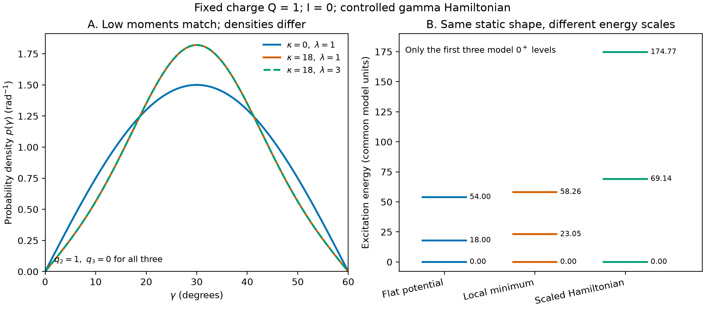

# T03：四极矩、γ 动力学及其可识别边界

## Research Trigger

问题：在 A≈60–190 的研究背景下，给定单一态的 q₂、q₃，什么更高阶 E2 信息能约束电荷形状分布，怎样再区分静态分布与集体惯量、势曲率和激发动力学？本页是基础方法研究，**不定义博士章节、不宣称特定核或整个质量区的发现**。结果分为可交换坐标模型中的严格恒等式、给定 γ Hamiltonian 的模型计算、实验可及性的条件判断。旧奇 Ba restricted-spin 及 seniority toy 均不在范围内。

## Grounded Evidence

| ID | 可使用的直接来源 / 本轮定位 | 证据属性与限制 |
|---|---|---|
| E1 | [[henderson-2020-quadrupole-invariant-convergence]]；本地 arXiv v4 原件 `raw/papers/gpt/learning-daily/20261022-DAY20-be2-qt-deformation-systematics/henderson-2020-quadrupole-invariant-convergence.pdf`，PDF pp.2–3 Eq.3–11、14–17、Fig.1；PDF p.5 Eq.27；PDF p.8 §III.B；p.9 §III.E–G；SHA-256 `ed2d48f63e1e18a721e1bb3e01676ca91160d1a683d7447e574788a6f5c8e044`。 | 符号约定、有限矩阵元链和模型依赖；不再重复该来源既有 checkpoint113 的有限分布反例。原文矩比不自动等同于几何平均。 |
| E2 | [[cline-1986-nuclear-shapes-coulomb-excitation]]；本地原件 `raw/papers/gpt/learning-daily/20261022-DAY20-be2-qt-deformation-systematics/cline-1986-nuclear-shapes-coulomb-excitation.pdf`，PDF16–18 / printed pp.698–700；SHA-256 `76d89a9bc5d603aa8dae104c0b6356271b7d152e0bff33e3cf78138861670113`。 | 零耦合张量的高阶产物、不同耦合方案、缺失强度及对易条件；本轮只核相关页，不重新追溯其历史。 |
| E3 | [[book-bohr-mottelson-nuclear-structure-vol2]]；`raw/books/nuclear structure Ⅱ_Bohr, Mottelson.pdf`，PDF704 / printed p.682，Appendix 6B-2 Eqs.6B-17–19；SHA-256 `46015a1401bcbdd40d4fd7267a1b066b4aef662050dcf35693e4e3a10a6d417a`。 | 集体坐标、动力学算符和体积元的原书锚点；本页固定 β 的 γ 模型与数值是任务构造，并非该书具体算例。 |
| E4 | [[book-casten-nuclear-structure-simple-perspective]]；`raw/books/Nuclear Structure From A Simple Perspective Casten.pdf`，PDF202 / printed p.187，§6.5；SHA-256 `9028649fb9fad55d6d624b88ef8bf8487e8462c07596d9a42bd6117552fa3ea9`。 | 原书比较固定非轴形变和动力学涨落，并指出某些预测近似相同；不把本页数值模型归于该书，也不把其理想模型阈值推广为普适判据。 |
| E5 | `system/scripts/quadrupole_softness_identifiability.py` 和 `outputs/l4/20261108-shape-softness-identifiability/results.csv`、`run-provenance.json`。 | 本任务模型、计算与验证；没有实验数据拟合，也没有自动获取新原文。Kumar 原件由父任务处理，本页不宣称已原读。 |

## Provisional Reasoning

### 1. 电荷张量、度规和低阶比值

**本任务约定**：在每个瞬时主轴系中令电四极球张量
\(T_{20}=Q\cos\gamma\), \(T_{2,\pm2}=Q\sin\gamma/\sqrt2\), \(T_{2,\pm1}=0\)，实验室分量为对应 Wigner \(D^2_{\mu\nu}(\Omega)\) 的旋转；\(Q=s\beta\ge0\)，\(s>0\) 带 E2 矩单位，\(\beta\) 无量纲。选 \(0\le\gamma\le\pi/3\)，其中 0、π/3 分别是此约定下的长轴／扁轴端点，π/6 为中点；端点处主轴角坐标退化。将 \(\gamma\) 用作**电荷**形状角；把它识别为质量集体坐标需额外假设，非电磁数据自动保证。

要求 \(T_{2\mu}^{\dagger}=(-1)^\mu T_{2,-\mu}\)，且分量为同一组位置自由度的乘法算符，\([T_{2\mu},T_{2\nu}]=0\)。定义耦合次序明确的 Hermitian 标量
\[
 S=\sqrt5[T\times T]^{(0)},\qquad
 C=-\sqrt{35/2}\{[T\times T]^{(2)}\times T\}^{(0)}.
\]
采用 Condon–Shortley CG 约定，直接取主轴 \(\gamma=0\) 有 \(\langle20\,20|20\rangle=-\sqrt{2/7}\)，加上二阶张量相乘的余项，得 **任务推导** \(S=Q^2\)、\(C=Q^3\cos3\gamma\)；其系数与 E1/E2 的列式一致。任意固定初态 \(|sIM\rangle\) 的期望与 \(M\) 无关，记
\[
 q_2=\langle S\rangle=s^2\langle\beta^2\rangle,\qquad
 q_3=\langle C\rangle=s^3\langle\beta^3\cos3\gamma\rangle.
\]
积分使用波函数概率而非坐标平直分布：五维欧氏四极坐标的体积元为 \(d\tau\propto\beta^4|\sin3\gamma|\,d\beta\,d\gamma\,d\Omega\)，Euler Haar 元包含 \(\sin\theta\)；波函数模方与此度规一起归一。对 I>0，允许 \(\gamma\) 和朝向／K 分量相关，先做正确的全角度概率积分；不能不加说明用 \(d\gamma\) 均匀概率。此为常规几何惯量下的体积元；一般集体度规／质量张量需重新指定测度及量子化。

令 \(x=\cos3\gamma\)，\(q_2>0\)。常用矩比 \(R=q_3/q_2^{3/2}\) 满足
\[
 R={\langle Q^3\rangle\over\langle Q^2\rangle^{3/2}}
       {\langle Q^3x\rangle\over\langle Q^3\rangle},
\]
而非一般的 \(\langle x\rangle\)；即使 \(Q\) 与 \(x\) 独立，前一幅度因子通常也不等于 1。仅当 \(|R|\le1\) 时才能在所选楔区定义 \(\gamma_{\rm eff}=\arccos R/3\)，越域应保留矩比和不确定性，不能截成端点。即便 \(R=\langle x\rangle\)，非线性变换也一般使 \(\arccos\langle x\rangle/3\ne\langle\gamma\rangle\)。两者均不是对每次形状测量的直接取平均。β≈0 时角度本身退化，尤其不宜赋予精确解释。

### 2. 四阶、六阶与可验证的闭合合同

在上述对易坐标合同下，令 \(A_4=\langle S^2\rangle=s^4\langle\beta^4\rangle\)、\(A_6=\langle S^3\rangle=s^6\langle\beta^6\rangle\)、\(B_6=\langle C^2\rangle=s^6\langle\beta^6x^2\rangle\)，且 \(A_5=\langle SC\rangle=s^5\langle\beta^5x\rangle\)。相应幅度方差为 \(A_4-q_2^2\)，三阶标量方差为 \(B_6-q_3^2\)，协方差为 \(A_5-q_2q_3\)。它们维度分别是 E2⁴、E2⁶、E2⁵；\(B_6/A_6\) 是 **β⁶ 加权** \(x^2\) 平均，不自动是无权 \(\langle x^2\rangle\)，而 \(q_3/q_2^{3/2}\) 也不自动是相同权重的均值。即使获得这些有限矩，非平凡 β–γ 相关下通常仍不能唯一重建无权 \(\mathrm{Var}(\gamma)\) 或完整分布。\(B_6-q_3^2\) 是 C 的方差，不能重新命名为 γ 方差。

**闭合必须在算符之间而非平均值之间插入**。若完整物理本征态集合在相关扇区闭合，则对于旋转标量 S、C 和任何指定 I、M：
\[
 A_4=\sum_{n,I}|\langle nIM|S|sIM\rangle|^2,\quad
 B_6=\sum_{n,I}|\langle nIM|C|sIM\rangle|^2.
\]
因此 \(\mathrm{Var}_s(C)=\sum_{n\ne s}|\langle nIM|C|sIM\rangle|^2\)。等价的标量约化矩阵元写法含 \(1/(2I+1)\) 因子。只保 \(n=s\) 人为得到 \(B_6=q_3^2\)、零方差；这不是测到刚性。仅当每个已保留标量元素的内部 E2 展开已完整时，标量端点正项部分和才给方差下界；同时截断内部 E2 路径时，中心值和方差误差没有普适方向。

**实际 E2 网络的无歧义计算式**：固定 \(\langle fI_fM_f|T_{2\mu}|iI_iM_i\rangle=(-1)^{I_f-M_f}\begin{pmatrix}I_f&2&I_i\\-M_f&\mu&M_i\end{pmatrix}\langle fI_f\|T\|iI_i\rangle\)。以此矩阵和 CG 系数按上面定义的顺序生成 S、C，每两个 T 之间及两个标量之间都插入完整单位算符。也可先将两个 rank-2 耦合到 J=0、2、4，再使用 6j 做重耦合；具体系数依矩阵元顺序与约化相位约定，不能跨约定直接搬用。可交换坐标下不同重耦合形式相等；有效算符分量不对易或态空间投影不完整时，这种等价必须单独验证。对于非对易算符，\(C^\dagger C\) 的正项闭合仍成立，但不得自动把它等同于坐标型 \(Q^6\cos^23\gamma\)。

例如初态 0⁺ 时：q₂ 链为 \(0_s\to2_a\to0_s\)；q₃ 为 \(0_s\to2_a\to2_b\to0_s\)；\(A_4\) 为 \(0_s\to2_a\to0_n\to2_b\to0_s\)；\(B_6\) 是两个三步标量之间闭合，即 \(0_s\to2_a\to2_b\to0_n\to2_c\to2_d\to0_s\)。这里箭头只是矩阵元连接次序，含全部允许态、复共轭和约化相位，并非宣称可直接制备六步单条事件。\(A_6\) 的一种耦合链为三个 S 相连：\(0_s\to2\to0_n\to2\to0_m\to2\to0_s\)。I>0 时中间自旋需按每步三角条件与对应耦合逐一列举，标量连接端点仍为 I；不可套用 0⁺ 的链。算符顺序被测矩阵与定义固定；相位变换下封闭环不变，但单个跃迁模方不包含所有环的相对符号。

### 3. 受控 γ 动力学：相同 q₂/q₃、不同高阶矩

构造严格限定的偶偶 I=0、固定 \(Q=s\beta_0=1\) 模型。β 固定代表受约束的角向流形／理想刚性 β 极限，不是假称 δ 函数是完整五维可归一径向波函数。\(\gamma\in[0,\pi/3]\)，内积为 \(\int_0^{\pi/3}|\psi|^2\sin3\gamma\,d\gamma\)，正则端点满足 \(\sin3\gamma\,\partial_\gamma\psi\to0\)。设角向惯量 \(M_\gamma>0\)，动能和势为
\[
 H=-{\hbar^2\over2M_\gamma}{1\over\sin3\gamma}
  {d\over d\gamma}\left(\sin3\gamma{d\over d\gamma}\right)
   +v\cos^23\gamma.
\]
这是选定 Bohr 度规在 I=0 的固定 β 角向算符；\(M_\gamma\) 吸收固定 β 的惯量尺度，模型常数不代表实核已知惯量。令 \(x=\cos3\gamma\)、\(E_*=\hbar^2/(2M_\gamma)\)，得到
\(H/E_*= -9\partial_x[(1-x^2)\partial_x]+\kappa x^2\)，\(\kappa=v/E_*\)，内积等比例变成 \(\int_{-1}^{1}dx\)。对 \(\kappa=0\)，本征态为 Legendre \(P_\ell(x)\)，能量 \(9E_*\ell(\ell+1)\)，基态均匀于 x、并非均匀于 γ。

令 \(\hbar=1\)、\(E_*=1\)、\(M_\gamma=1/2\)，比较 \(\kappa=0\) 与 \(18\)。两基态的势和测度在 \(x\to-x\) 下对称，基态唯一且为偶，故两者严格有 \(q_2=1,q_3=\langle x\rangle=0,A_4=A_6=1\)，且 \(\gamma_{\rm eff}=30^\circ\)。一个平坦势与一个最低点在 \(30^\circ\) 的势，在这些低阶静态量上不可识别。数值结果如下；无实验拟合，能量为自定义单位。

| κ | \(B_6=\langle x^2\rangle\) | \(\sqrt{\langle(\gamma-\pi/6)^2\rangle}\) | 第一个 0⁺ 激发间隔 | 第二个 0⁺ 激发间隔 |
|---:|---:|---:|---:|---:|
| 0 | 0.3333333333 | 0.22788911 rad | 18.000000 | 54.000000 |
| 18 | 0.2799730035 | 0.20539866 rad | 23.047322 | 58.256497 |

这证明在本模型与精确闭合下 \(B_6\) 对电荷角分布有额外辨识力，**不是**用一条普适阈值判定实核 soft/rigid。实际平均角都由对称性给出 30°；这些 RMS 值是指定的波函数概率宽度，不是已测实验误差或势曲率。固定 Q 且中心在 30° 的严格界可由 \((2/\pi)|u|\le |\sin u|\le|u|\), \(u=3(\gamma-\pi/6)\) 推出：
\[
 \langle x^2\rangle/9\le\langle(\gamma-\pi/6)^2\rangle\le(\pi^2/36)\langle x^2\rangle.
\]
若 Q 涨落，则把左侧输入换成 \(B_6/A_6\) 只约束 **Q⁶ 加权分布**的相应宽度。

### 4. 保持所有静态矩：惯量、势曲率和谱仍可变

对任意 \(\lambda>0\) 同时做 \(M_\gamma\mapsto M_\gamma/\lambda\)、\(v\mapsto\lambda v\)，则 \(H\mapsto\lambda H\)。故全部本征波函数及固定 E2 算符的**全部静态形状矩**完全不变，而所有激发间隔与能量加权响应乘 \(\lambda\)。这是解析恒等式，并非只针对有限几阶矩。对上面 κ=18 情形，\(\lambda=3\) 时 \(M_\gamma=1/6\)、\(v=54\)，最低处 \(V''(\pi/6)=18v\) 从 324 变为 972，端点势垒从 18 变为 54；第一个与第二个 0⁺ 间隔分别从 23.047322、58.256497 变为 69.141967、174.769490。所有能量和曲率均仅是模型单位。有限基代码验证相同基态、六阶矩及缩放间隔；同单位 E2 下 \(\sum_n(E_n-E_0)|\langle n|C|0\rangle|^2\) 从 6.480243 变为 19.440729。这是形状分布不能独立确定势垒绝对尺度、质量或动力学能标的直接反例。

即便有全部静态 E2 矩，实际电荷分布、动力学质量／转动惯量与势能仍为不同对象；实验能量及跃迁响应能破除此处的简单整体能标退化，但依然不保证唯一反演完整的多维 Hamiltonian。离散形状共存、两个构型相干混合或未分辨的子结构同样可产生宽电荷矩；仅有方差不能证明连续 γ 振动或波函数沿某势面的运动。若希望以高阶观测反驳候选，必须展示各模型同一套带符号矩阵元及谱的共同输入与实验协方差。

### 5. 数值实现与实际检查

脚本 `python3 system/scripts/quadrupole_softness_identifiability.py`：用 \(\sqrt{(2\ell+1)/2}P_\ell\) 在 \(dx\) 下正交的 Galerkin 基，动能对角元 \(9\ell(\ell+1)\)，Gauss–Legendre 积分势和矩。基维数 4、8、12、20、32；标准计算积分点 128–256，角度 RMS 另比较 1024。正规多项式端点有限，且自然通量 \((1-x^2)\psi'(x)\) 在 \(x=\pm1\) 为零。无随机数；Python、NumPy、SciPy、UTC 时间及脚本 SHA-256 从运行环境写入 `run-provenance.json`；CSV LF。精确 flat 极限 \(E_1-E_0=18,E_2-E_0=54,\langle x^2\rangle=1/3\) 和归一均通过；C 标量端点闭合差 \(6.3\times10^{-15}\)。κ=18 的 N=20 与 32 的 \(\langle x^2\rangle\) 差 \(8.3\times10^{-16}\)，人为欠收敛 N=4 偏差 \(2.08\times10^{-4}\)（负例，不能将其当通过精度）；256 与 1024 点积分的 γ RMS 差 \(1.3\times10^{-8}\) rad。λ 缩放基态系数差 \(5.8\times10^{-17}\)。这些只评估声明数值方案，不包含实验误差或模型误差。首次执行结果写 JSON 时暴露 NumPy `bool_` 的序列化异常；已显式转为 Python bool 并重跑，最终文件来自成功执行。

总控独立复跑后补充了谱求和与微分算符的交叉控制：
对本模型的\(F=x\)，\(\tfrac12\langle[x,[H,x]]\rangle
=9\langle1-x^2\rangle\)（λ=1）。
它与完整有限基谱的能量加权强度在声明容差内一致；
运行provenance同时登记结果CSV哈希。该控制不增加真实核实验信息。

### 6. 分布与谱的可复现图

左图画的是含Jacobian的\(p(\gamma)=3\sin3\gamma\,|\psi(\cos3\gamma)|^2\)，
在\(d\gamma\)下归一，单位rad⁻¹；不是把\(|\psi|^2\)直接当平直γ概率。
橙/绿两模型全部静态波函数相同，右图的相同三个模型0⁺态激发能却按λ=3缩放。
蓝/橙的q₂/q₃相同，高阶矩和分布不同。图与CSV可由同一producer重放，
另有PDF/SVG导出；没有使用真实核能级或MeV标定。

## Assumptions

1. 电荷四极算符由可交换坐标张量表示，整体尺度正且固定或明示其概率；有效价空间中的算符不默认满足此假设。
2. 六阶标量的实验解释须有足够闭合的实际 E2 网络及带符号的相对相位；无凭据的遗漏边不能设为零。
3. 固定 β、I=0、单 γ 自由度、常质量、势 \(v\cos^23\gamma\)、同一电荷算符是受控模型而非完整实核假设。示例激发态是模型 0⁺，不是把 2⁺ γ 带认作 0⁺。
4. 相位约定一旦选择在矩阵元网络与 CG/6j 中一贯使用；不把态重相位当物理符号变化。

## Competing Explanations

较宽的电荷形状矩可由连续 γ 波函数、相近或不相近 β 的不同构型混合、β–γ 相关、多准粒子和有效算符效应，或有限矩阵元网络的系统偏差产生。激发谱还受集体质量、转动自由度、配对和其他模式耦合约束。单个 \(B(E2)\)、对角 \(Q_s\)、能级交错或单个 \(\gamma_{\rm eff}\) 均不能单独选出唯一机制。能谱和 E2 网络同属一个联合分析时需保留它们的共同模型和系统误差，而不是按观测个数机械相乘独立证据。

## Transfer Conditions

真实 CoulEx/γ 谱的**最小增量取决于已有矩阵元网络，没有普适固定态数**。对指定 0⁺ 态及完整度可量化的情形：

1. 用绝对寿命/分支/混合比和 CoulEx 产额约束从该态通向多个 2⁺ 的 E2 模、2⁺ 对角及跨态矩阵元；多步路径与再取向干涉提供相对环符号，报告 joint likelihood／协方差和离散符号分支。若只给 B(E2) 模则 q₃ 通常仍不唯一。
2. 增测其他 0⁺ 与 2⁺ 间的绝对 E2 连接，以形成可检查的 \(S_{n s}\) 和 \(A_4-q_2^2\)，约束**幅度**涨落；对角 q₂ 并不能代替它。
3. 要约束角向的六阶信息，至少还需要贯通 \(0_s\to2_a\to2_b\to0_n\) 的成套带符号矩阵元及足够多 \(0_n\) 端点，得到 \(B_6\)；还需 \(A_6\) 或其他独立 β 信息，才能理解 β⁶ 权重。缺失项、不可达态、有效电荷、混合比歧义、共变误差和上限都要进入传播。0⁺ 示意不自动适用于 I>0，后者另列自旋网络。
4. 联合谱：0⁺ 激发、γ 带多个自旋能量、带间绝对 E2 强度／寿命、必要的 E0 混合信息与 CoulEx 相位，比较连续 γ、固定三轴和多构型模型。观测能排除模型的程度由灵敏度与误差决定；它们仍不保证唯一势面/惯量。

理想完整闭合能给标量矩，实验有限子集一般只能给在所列参数空间中受约束的区间；不仅评估统计误差，也应显式扫描遗漏强度和相位的可行域。所谓“最小”是一套功能需求，不是声称每种装置都能充分测到所有高阶矩阵元。

## Failure Conditions

- \(q_2=0\) 或 \(|R|>1\) 仍硬报告实数角度；把非定域的 Q 分布压成单一 β 后忽略幅度权重。
- 将 \(\langle C\rangle^2\) 充当 \(\langle C^2\rangle\)，或因只测到初态端点而得出零波动；忽视非对易、投影、6j 约定和 I 依赖。
- 用固定 β 的模型数值去判定某核、某质量区或实测态；把物理分布宽度当成实验参数后验误差，或把电荷形状与质量形变直接等同。
- 使用其他来源的历史 review 状态或未复核技能公式取代原件、实际矩阵元及不确定性。

## Falsification or Reverse Tests

- 在完整且对易的张量模型中独立构造各允许耦合通道；若数值不等先核约化相位、粒子数投影与完整闭合，不能直接宣布物理非对易。
- 实验中逐步增补 E2 路径、扫描未测参数及干涉符号，检验 \(A_4,B_6,A_6\) 的收敛与不确定性；不将某模型的平均收敛速率当成普适态数门槛。
- 在共同输入下构造一套连续 γ 模型和一套构型混合模型，前向预测未用于拟合的绝对带间强度、0⁺ 能量、E0 等；如果都落入实验联合置信范围，保留不可识别结论。
- \(\kappa=0\) 的精确谱、\(1/3\) 及 λ 缩放对任何重实现均为零自由参数核对；改变边界条件、质量函数或量子化排序后需重新推导。

## Open Questions

- 对具体目标核，实际可达矩阵元、状态指认、相对相位分支、截断误差和联合似然究竟支持到哪一阶？尚无目标核数据拟合。
- β–γ 相关、非平凡集体质量和电荷/物质映射下，现有有限矩能对无权角分布给多强的模型依赖界？
- 在保持低阶电荷矩一致时，哪组可实测的 0⁺/2⁺ 能级、E2 和 E0 最能区分针对某核具体构建的配置混合与 γ 动力学模型？需要后续逐核设计。

## Human Review

- Review scope: 本任务为 Codex 自主推导和自检；未发生用户逐项审阅。
- Decision: 未记录用户审核决定；科研使用按直接证据和适用条件评估。
- Complete unresolved P0/P1 inventory: 未发现已纳入结论的来源身份 P0；P1 为真实核矩阵元网络和协方差未取得、完整高阶闭合未证、核素特定比较未进行。它们不自动转为用户审核待办。

## Promotion or Rejection History

| Date | event | previous state | new state | reason / triggering evidence | target or successor |
|---|---|---|---|---|---|
| 2026-11-08 | 构建受控 γ 动力学与局部数值检查 | 无 T03 页面 | provisional | 同 q₂/q₃ 的动力学模型，以及保持全部静态矩的 H 整体缩放反例；不涉及新核素结论 | 待具体核的完整 E2 网络和谱比较 |
