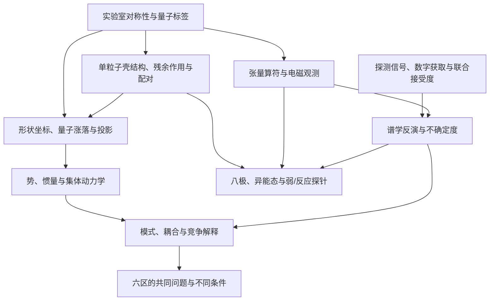

# 先规定读者要学会怎样判断，再安排章节

## Research Trigger

用户要求前置非个人成果章节既有博士深度，也解释历史和高阶基础，
以克制的想象力帮助阅读，减少模板化名录。
第一阶段的科学就绪依据见[[doctoral-r3-readiness-evidence-matrix-20261108]]。
当前进入设计研究；本页先固定论证与读者标准，不是论文正文。

“历年博士论文同质化严重”在此是用户提出的阅读体验和待检验问题，
不能从两三篇样本推出总体统计结论，也不评价作者能力。
样本任务须同时找优点、差异和具体跳步；没有证据的缺点不补写。

## Grounded Evidence

| 基础 | 可复用内容 | 使用边界 |
|---|---|---|
| [[doctoral-foundations-laboratory-shape-and-dynamics-20261108]] | 实验室态、电荷形状矩和动力学响应的区分 | 不以同一个“形状”词覆盖全部对象 |
| [[doctoral-r1-t03-shape-invariants-and-softness-20261108]] | 正确测度、加权矩、静态/动力学反例 | 控制模型不是实核发现 |
| [[doctoral-r2-collective-inertia-response-crosswalk-20261108]] | 微观惯量/配对响应与约定 | 不把PC/IB/TV叫同一个经验因子 |
| [[doctoral-r3-quantum-labels-and-model-boundaries-20261108]] | 坐标冗余、量子标签、投影、历史对账 | 历史暂定与现代核态分开 |
| [[doctoral-r3-daq-spectroscopy-inverse-20261108]] | 从信号/事件到联合接受度、率、矩阵元 | 用户实际装置与个人结果未知 |
| [[six-region-shape-and-collective-dynamics-foundations]] | 六区同问题、不同微观条件 | 代表案例不是互斥模式分区 |
| [[doctoral-r3-weak-operators-and-delayed-particles-20261108]]、[[doctoral-r3-isomers-shell-and-survival-20261108]] | 两翼的算符/通道/环境与反馈 | 共同波函数输入不等于同一物理过程 |

这些是设计可用的知识来源，不是新稿中可省掉原作引用的理由。
每条核物理事实写入论文时，仍回对应source和原件locator。

## Provisional Reasoning

### 设计前固定的标准

1. **每节有需要回答的问题。** 读者知道引入一个模型或公式要解释什么，
   不能只由“某某模型简介”堆出目录。
2. **把推理台阶写出来。** 直观图像、数学定义、假设、推导、观测意义和失效例
   要接得上；高阶基础不因复杂就只留一个名称。
3. **模型首先是有条件的前向预言。** 先说固定什么、算什么，再问数据能否反演；
   避免从一个能比或δ直接宣判模式。
4. **历史以真实问题和证据变化组织。** 可讲早期关系为何有说服力、又在哪里暴露不足；
   不能虚构心理、对白或未经来源证明的直接思想传承。
5. **跨区比较同一条因果链。** 占据、配对/惯量、形状分布、取向、算符与响应
   至少明确其中哪些保持、哪些改变；不把区名当结论。
6. **核心深入，拓展不漏项。** 两翼的实质学习已具备，正文深度按与中央论证的关系安排；
   深入推导、比较框或附录是不同位置，不是“只略懂”的代名词。
7. **技术必须改变某个物理推断。** 说明事件选择、响应、误差怎样进入B或模型判断，
   不复制产品手册，也不省略电子学。
8. **争议保留真正的反方。** 对其最强版本比较可测预言；不能把反方写成明显错误的陪衬。
9. **图区分来源与性质。** 真实表重绘、模型控制、概念示意和用户实验分别标明，
   不用漂亮曲线冒充数据。
10. **叙事负责引出可证的问题。** 比喻必须能收回到物理变量和观测；
    不借悬疑语气放大确定性，不拟人化波函数为有意选择。
11. **各章服务后续研究接口。** 前置内容应让读者能够理解后面的分析选择与限制；
    尚无个人数据的部分只留接口，不能套样本研究填充。
12. **设计验收不用伪精确打分。** 看是否存在必要先修、可追溯证据和可执行改进，
    不由页数、术语数、模型数或生成token选择架构。

### 先修关系图

下面是总控拟定的教学依赖示意，不是微观因果模型或实验数据。



章节顺序不必等于从左到右讲完所有先修：
可以先提出形状的直观问题，再在需要时补定义/推导，
并用明确回链保证读者不被突然出现的符号拦住。
图只限制“不能完全省掉”的依赖，不要求所有基础都放在第一章。

### 节级写作合同模板

```yaml
section_id: "<待总控选定>"
reader_question: "<读完后应能回答的一个具体问题>"
role_in_argument: "<为什么后续研究需要这一节>"
prerequisites:
  - "<概念/符号及其已介绍位置>"
central_claims:
  - claim: "<拟写句子的科学范围>"
    source_page: "knowledge/sources/<真实source>.md"
    raw_locator: "<实际版本、PDF/印刷页、图表或式>"
    claim_kind: "<实测/采用输入/作者解释/模型/本任务推论>"
    dependence: "<与其它输入的同采集、拟合或转引关系>"
derivation:
  assumptions: ["<近似、空间、边界及适用域>"]
  conventions: ["<轴序、相位、方向、单位与归一>"]
  required_steps: ["<不能跳过的推理>"]
  limit_or_counterexample: "<何时不能继续套式>"
figures:
  - purpose: "<该图增加什么信息>"
    evidence_type: "<原表重绘/模型控制/概念示意/实测>"
    provenance: "<原件locator或自有producer/输入>"
competing_explanations:
  - "<能产生相近观测的最强竞争及区分量>"
cross_region_case:
  preserved_conditions: ["<保留什么>"]
  changed_conditions: ["<需重新计算/测量什么>"]
  no_transfer_claim: "<不能由区名或单点推出什么>"
narrative_entry:
  intended_image: "<可选的克制引子>"
  physical_mapping: "<比喻中的对象对应什么变量>"
  boundary: "<哪里会误导、怎样及时收回>"
reader_check:
  - "<公式从何来、如何观测或反例>"
unavailable_inputs: ["<真正尚缺，不补默认数>"]
output_scope: "<一节；不能扩展相邻节或个人成果>"
```

这个模板是给Gemini的工作合同，不应以YAML进入论文读者流程。
总控按实际节填具体source/locator后才下发；不能让writer自行填造示例项。
正文要连贯成段，不能把模板字段改成机械清单拼进章节。

### 核查与回退

Writer交付一节时同时提交简短claim-to-source台账与实际新引入的概念列表。
总控先核主张、公式、约定和反方，再核先修是否足够、叙事是否帮助理解。
关键不实断言须修订，不能靠“局限性”一段掩盖；
已明确的领域开放问题则按边界讨论，不要求writer求出未知参数。
学位格式和学校模板待实际输入确定后落实，不由当前设计假定。

三包接收演练显示，详细合同仍可能被writer改写成过强的物理断言。
因此，接收回执不认证writer已完全理解，也不认证正文已科学正确。
总控须对每个小节最重要的公式、定义、反方和来源定位逐项复核；
不能把worker的“通过”自评作为晋升或发布依据。

## Assumptions

目标语言以简体中文为工作默认；本阶段没有学校规范、个人实验或作者成果输入。
经典文献与新观点按具体问题并列，不将年代当质量排序。

## Competing Explanations

模板式目录并不必然低质量，问题可能在实际解释与证据衔接；
相反，叙事新颖也不保证逻辑或科学深度。样本审计应允许两种情况。

## Transfer Conditions

这些标准可跨基础、实验、六区和两翼章节复用，但每节具体证据和深度不同。
章节设计选择须在样本复盘与候选比较后由总控记录，当前不预定结论。

## Failure Conditions

用未知个人结果填模板、把来源标题当locator、给所有模式设统一阈值、
将比喻当机制、或删掉必要推导来维持“轻松”阅读，均须退回修改。

## Falsification or Reverse Tests

拿一节拟稿，要求读者说明测得什么、解释多加了什么假设、什么观测能改变判断。
若无法回答，应定位缺少的台阶，不靠增加形容词和故事篇幅补救。
实际读者效果尚未测试，不把此设计称为已验证教学方法。

## Open Questions

哪一种章节组织最能减少先修跳跃和重复？哪些博士样本已有好的做法可保留？
等待G58–G61的有页码观察及候选比较，再决定正式章/节结构。

## Human Review

本页是总控设计前标准和合同模板，不是人工阅读试验或用户批准的新目录。
用户已授权总控主理与自主推进，本阶段不为常规取舍重复发起批准。

## Promotion or Rejection History

- 2026-11-08：在读取样本结果前固定设计标准与合同要求，防止只挑支持偏好的样本证据。
