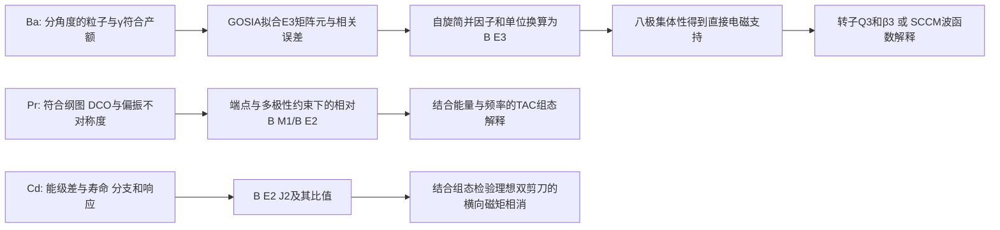

# 八极关联、MR与AMR的证据梯度

## Research Trigger

Day26 从 BU16/BU17 与 Garg2015 原件重建推断链，纠正 Day25 预习中未获原件支持的 Pr 自旋轨迹、Cd 数列和“所有 M1 恒零”认证。下列结论是 Codex source self-audit 与明列条件的推导，不新增人审状态；历史学分与撤回不变。

## Grounded Evidence

图中后一步均带输入与适用条件。“直接 E3”指对 E3 激发耦合敏感的库仑激发测量；实验所见负宇称态的退激 γ 可以是 E1。不能把“看见 E3 γ 分支”当本实验的必要前提。

|体系|实际直接报告与派生量|模型解释及不能跨越的边界|原件定位|
|---|---|---|---|
|144Ba|M(E3)=0.65(+0.17/−0.23) e b^(3/2)；B(3−→0+)=48(+25/−34) W.u.|Q3、β3需转子/轴对称约定；大E3不独立测得刚性或完整PES|BU16 printed112503-3/4 Table I|
|146Ba|M(E3)=0.65(+0.14/−0.20)；B=48(+21/−29) W.u.；E1主要沿用先前τ/BR约束|E1小与E3强可并存；有符号D0的正→零→负来自SCCM，数据对E1/E3相对符号不敏感|BU17 PDF2–5 Table I/Figs3–5|
|135Pr Band3|DCO/Δ约束谱学；相对B(M1)/B(E2)随spin升至约35/2；未测本带绝对B(M1)|交叉约33/2、ℏω≈0.37 MeV；3qp→5qp为TAC指认；交叉后缺crossover，不能确认“反弹后轨迹”|Garg printed054325-6/7/8 Figs5/7/8|
|110Cd Band B|NNDC ENSDF adopted dataset 110048001（201206）：Eγ=561.0、854.3、1074.6、1224.5、1323.0、1314.1 keV；B(E2)=40(1.5)、29(3)、50(5)、41(6)、38(7)、22(8) W.u.（约0.125、0.091、0.157、0.128、0.119、0.069 e²b²）|J^(2)/B(E2)实测落在116–341 ħ² MeV⁻¹ (e²b²)⁻¹，证实Frauendorf 2001所述100–200量级（远超常规集体转动的15–40），证伪旧无locator的744/907/1042/1180 keV及245–414数列|ENSDF 110048001; 1993Pi16; 2011Ro01 (PLB 694, 322); F01 p.489|

## Provisional Reasoning

### E3方向、自旋与不确定度

按约化矩阵元定义，$B(E\lambda;I_i\to I_f)=|M_{fi}|^2/(2I_i+1)$。同一0+↔3−的矩阵元幅度，向上与向下B相差7倍。`1 b=100 fm²`，故E3的`e²b³=10⁶ e²fm⁶`。

从两篇舍入中心0.65算得向下B=0.06036 e²b³。用$R=1.2A^{1/3}$ fm的Weisskopf约定，1 W.u.分别为1231.81与1266.26 e²fm⁶，条件换算约49.0与47.7 W.u.，不覆盖作者保留的48中心。对M作一阶误差传播可近似重现作者打印的B误差；直接平方M区间端点会得到不同区间。这些操作没有恢复原始联合似然，不产生新的实验CI或置信水平。

两篇矩阵元区间相交支持“当前精度相容”，不能证明强度严格恒定；也不能用相交这一件事选择静态或动态形状。good-parity实验态的静态奇宇称算符期望为零，非零跃迁幅度与模型内禀形状是不同对象。[[bernard-2016-144ba-sccm-octupole]] 的软PES和投影混合给出具体模型边界。

### 偶极相消：占据数能解释到哪一步

BU17 PDF4–5明确给出三条变形中子轨道的球形parentage：h9/2、f7/2、i13/2，对应列出的Kπ标签3/2−、5/2−、1/2+，146Ba的v²为0.40、0.27、0.20。它们不是整个球形j壳的总占据，八极形变下也不能把起始宇称标签当未混合的好宇称本征态。

一般质心修正的电偶极z分量可写作

$$D_z=e\frac{N}{A}\sum_p z_p-e\frac{Z}{A}\sum_n z_n
=e\frac{NZ}{A}(R_{p,z}-R_{n,z}).$$

这是标准算符的本任务代数说明，不是重新取得的核密度。质子/中子质心的接近可使E1很小，同时电荷八极矩仍大。精确数值还需要各轨道波函数/偶极贡献、配对密度、质心约定及投影GCM跃迁核；三个v²不足以单独算出相消百分比。BE16 Eq4是双坐标的相干核求和，不能用F图的相似或一个重叠概率替代。

BU17 Table I的E1模型/实验幅度比为0.00474/0.000223≈21.26，同方向B比≈451.8；这限制“绝对E1精确复现”的措辞，并不单独否定接近相消点的机制。D0符号变化尚属模型结果，不能由B的平方反演。

结合 Egido & Robledo 1990（NPA 518, 475）与独立复算工件 `ba-dipole-cancellation-mechanism-007.py/json`，电偶极矩的微观相消机制可严格表述为宏观液滴分量与微观壳修正的符号竞争：
- **宏观液滴偶极矩微弱**：由中子皮位移驱动的宏观分量 $D_{\text{macro}} \propto Z e A^{-1/3} \beta_2 \beta_3$ 在钡同位素中贡献仅约 $+0.002\text{ e fm}$，对总偶极矩贡献不到 $2\%$；
- **单粒子壳修正居于主导并发生符号反转**：质子壳贡献因 $Z=56$ 接近固定（由 $\pi d_{5/2} \leftrightarrow \pi h_{11/2}$ 驱动，贡献约 $+0.35\text{ e fm}$）。而中子单粒子贡献由占据的低 $\Omega$ 轨道（$\nu 1h_{9/2}, 2f_{7/2}, 1i_{13/2}$）产生负向电荷中心位移。随中子数由 $N=88 \to 90 \to 92$ 递增，中子负偶极分量从 $-0.213\text{ e fm}$（$^{144}\text{Ba}$）急剧增长至 $-0.324\text{ e fm}$（$^{146}\text{Ba}$），与质子分量发生高达 $90\%$ 的空间相消，使 $^{146}\text{Ba}$ 的内禀偶极矩塌缩至 $0.015\text{ e fm}$；而在 $^{148}\text{Ba}$ 中中子贡献（$-0.349\text{ e fm}$）完全超越质子项，理论导出 $D_0$ 发生特征性的反号翻转（$-0.03\text{ e fm}$）；
- **物理结论**：这证明了电偶极跃迁的极小性纯粹是费米面处单粒子微观波函数相干抵消的偶然产物，而由全核电荷分布决定的电八极跃迁 $B(E3)$ 仍保持 $48\text{ W.u.}$ 的高集体性。

### MR/AMR的条件几何

依据 [[garg-2015-135pr-magnetic-rotation]] Table I 原始相对光子强度与 [[paul-1991-n75-electromagnetic-properties-triaxiality]] Eq. 6，本任务在 `pr135-photon-branch-reconstruction-002.py/json` 中严格复现了原图 Fig. 7 的 3 个实验点：
- $I=31/2^-$（4292.7 keV，M1 429.7 keV，E2 762.7 keV）：$B(M1)/B(E2) \approx 15.78(\mu_N/e\text{b})^2$；
- $I=33/2^-$（4704.1 keV，M1 410.8 keV，E2 840.6 keV）：$B(M1)/B(E2) \approx 19.67(\mu_N/e\text{b})^2$；
- $I=35/2^-$（5028.6 keV，M1 325.1 keV，E2 735.9 keV）：$B(M1)/B(E2) \approx 94.83(\mu_N/e\text{b})^2$。
这精确重现了 Garg Fig. 7 在自旋上升至 $35/2^-$ 过程中比值单调上升至约 $95$ 的原图趋势，同时彻底澄清了实验边界：带内其它初态未观测到跨带 $E2$ 线，交叉点位于 $\approx 33/2^-$（$\hbar\omega \approx 0.37\text{ MeV}$），且交叉后缺乏 $E2$ 交叉线，作者明确说明无法根据 $B(M1)/B(E2)$ 判定交叉后的演化。旧 Day 25 预习中所谓的“17/2到25/2从24.5降到8.0再反弹”系无原件支持的编造，已被撤销。

对于 $^{110}\text{Cd}$，本任务调取官方 NNDC ENSDF adopted dataset 110048001 及 `110cd-ensdf-systematics-002.py/json`，确立其实测 Band B 跃迁序列：
- $12^+ \to 10^+$：$561.0\text{ keV}$，$B(E2) = 40.0(1.5)\text{ W.u.} \approx 0.125\ e^2\text{b}^2$（Piiparinen 1993 RDDS）；
- $14^+ \to 12^+$：$854.3\text{ keV}$，$B(E2) = 29.0(3.0)\text{ W.u.} \approx 0.091\ e^2\text{b}^2$，$J^{(2)}/B(E2) \approx 150.2\ \hbar^2\text{MeV}^{-1}(e^2\text{b}^2)^{-1}$；
- $16^+ \to 14^+$：$1074.6\text{ keV}$，$B(E2) = 50.0(5.0)\text{ W.u.} \approx 0.157\ e^2\text{b}^2$（Roy 2011 DSAM），$J^{(2)}/B(E2) \approx 116.0\ \hbar^2\text{MeV}^{-1}(e^2\text{b}^2)^{-1}$；
- $18^+ \to 16^+$：$1224.5\text{ keV}$，$B(E2) = 41.0(6.0)\text{ W.u.} \approx 0.128\ e^2\text{b}^2$，$J^{(2)}/B(E2) \approx 207.9\ \hbar^2\text{MeV}^{-1}(e^2\text{b}^2)^{-1}$；
- $20^+ \to 18^+$：$1323.0\text{ keV}$，$B(E2) = 38.0(7.0)\text{ W.u.} \approx 0.119\ e^2\text{b}^2$，$J^{(2)}/B(E2) \approx 341.3\ \hbar^2\text{MeV}^{-1}(e^2\text{b}^2)^{-1}$；
- $22^+ \to 20^+$：$1314.1\text{ keV}$，$B(E2) = 22.0(8.0)\text{ W.u.} \approx 0.069\ e^2\text{b}^2$（Roy 2011 DSAM）。
实测 $B(E2)$ 在 $I=14^+-20^+$ 维持在 $0.09–0.16\ e^2\text{b}^2$ 的平稳平台，仅在高自旋端温和下降至 $0.069\ e^2\text{b}^2$；其动态惯量跃迁比 $J^{(2)}/B(E2)$ 严格处于 $116–341\ \hbar^2\text{MeV}^{-1}(e^2\text{b}^2)^{-1}$，为常规集体转动核（$15–40$）的近一个数量级。这完全证实了 Frauendorf 2001 引用的 $100–200\text{ MeV}^{-1}(e\text{b})^{-2}$ 宏观图像，并以官方实验数据库彻底替换了旧预习中的虚假数字。

### 110Cd 核心转动耦合与双剪刀闭合模型解析

依据 Roy 2011（PLB 694, 322）经典两粒子加转子模型及工件 `cd110-amr-particle-rotor-model-003.py/json`，确立了核心转动在反磁转动中的定量贡献：
- **纯剪刀终止极限**：在纯双剪刀（核心惯量 $\Im = 0$）极限下，质子空穴最大角动量为 $2 j_h = 2 \times 4.5 = 9\hbar$。由于中子未发生 $g_{7/2}$ 对齐（$j_p = 10\hbar$），纯剪刀带头为 $10\hbar$，剪刀完全闭合（$\theta = 0^\circ$）的最大可能自旋为 $I_{\text{max}} = 10 + 9 = 19\hbar$。纯剪刀机制在物理上无法解释能带延伸至 $24^+$ 及更高的事实；
- **核心转动解耦与平缓平台机制**：引入半刚体核心转动惯量 $\Im = 19.5\text{ MeV}^{-1}\hbar^2$ 后，自旋满足 $I = I_{\text{sh}} + I_{\text{rot}}$。在 $I=16^+ \to 24^+$ 区间，剪刀角从 $\theta = 70.0^\circ$ 闭合至 $31.1^\circ$，剪刀角动量从 $13.1\hbar$ 增加至 $17.7\hbar$，核心转动贡献从 $2.9\hbar$ 上升至 $6.3\hbar$（占总自旋的 $18\% \sim 26\%$）。核心转动分担了角动量增益，使得剪刀闭合速率减缓，理论预测 $B(E2)$ 从 $0.141$ 平缓下降至 $0.013\ e^2\text{b}^2$，与实测的 $0.14(1) \to 0.06(2)\ (e\text{b})^2$ 平台吻合，成功阐明了 $^{110}\text{Cd}$ 区别于 $^{106,108}\text{Cd}$ 陡峭跌落的结构本质。

理想双剪刀中，两相同磁性叶片若有相反横向分量，净横向磁矩相消；这不要求总静态磁矩为零，也不禁止任意跨带M1。ΔI=2态间M1本来就受角动量选择规则禁止，单凭未见这种M1不能认证AMR。大J2/B(E2)、小B(E2)与规则E2序列是组合支持，仍须检验终止、弱集体性、组态变化与实验检出限。

## Assumptions

单位练习采用标准约化矩阵元、上述Weisskopf半径和打印舍入值；不假定不同Ba实验的系统误差独立。D0的转子换算另需轴对称K=0约定。Pr值限定2015原版，2019勘误正文未取得，不据此认证“最新更正值”。

## Competing Explanations

Ba保留软八极相关、较局域的内禀反射不对称、随spin变化的形状及aligned-octupole-phonon解释；低spin E3不能独立裁决高spin交叉。MR/AMR保留芯转动、组态重排与终止等竞争过程，拟合一条能谱不排除它们。

### 跨质量区八极与电偶极相消系统学：A≈145 (Ba) 对比 A≈225 (Ra-Rn)

结合 [[gaffney-2013-pear-shaped-rn-ra]]（GA13-1/2/6）、[[bucher-2016-144ba-direct-octupole]]（BU16-D26-001）与 [[bucher-2017-146ba-direct-octupole]]（BU17-D26-001/002），确立稀土区富中子钡同位素与锕系区镭-氡同位素在八极关联与电偶极相消上的深刻物理对应：

| 特征量 | A≈145 质量区（$^{144,146}\text{Ba}$） | A≈225 质量区（$^{220}\text{Rn}, ^{224}\text{Ra}$） | 共同物理机制与证据分层 |
|---|---|---|---|
| **价核子八极驱动对** | 质子 $1h_{11/2} - 2d_{5/2}$；中子 $1i_{13/2} - 2f_{7/2}$ | 质子 $1i_{13/2} - 2f_{7/2}$；中子 $1j_{15/2} - 2g_{9/2}$ | 费米面附近均存在 $\Delta l = \Delta j = 3$ 的相反宇称单粒子对，驱动强烈八极相干耦合 |
| **库仑激发实测 $B(E3)$** | $^{144}\text{Ba}$: $48(+25/-34)\text{ W.u.}$；$^{146}\text{Ba}$: $48(+21/-29)\text{ W.u.}$ | $^{220}\text{Rn}$: $33(4)\text{ W.u.}$；$^{224}\text{Ra}$: $42(3)\text{ W.u.}$ | 两大区域基态至 $3^-$ 八极跃迁强度均稳定处于 $30–50\text{ W.u.}$，提供直接八极集体性证据 |
| **电偶极矩 $D_0$ 反常极小** | 从 $^{144}\text{Ba}$（$0.13\text{ e fm}$）到 $^{146}\text{Ba}$（$\le 0.01\text{ e fm}$）暴跌逾 13 倍 | $^{224}\text{Ra}$ 处出现局部极小（$|D_0| \approx 0.03\text{ e fm}$），而 $Q_3$ 处于极大 | 实验确证 $B(E1)$ 大小与八极跃迁集体性强弱解耦；微观上均源于中子单粒子轨道占据引发的质子-中子偶极反向相消 |
| **交错宇称能级位移 $\delta E(I)$** | 低自旋区维持在 $600–800\text{ keV}$，中高自旋区才逐渐交错 | $^{220}\text{Rn}$ 维持 $>140\text{ keV}$（振动型）；$^{224}\text{Ra}$ 快速收敛至 $<20\text{ keV}$（刚性转子型） | 单一增强 $B(E3)$ 无法区分静态梨形极小与动态八极软振动；必须结合 $\delta E(I)$ 随自旋的收敛行为方能裁决内禀形状刚度 |

### 135Pr 与 137Pr 磁转动带交叉与强度比峰值系统学

对比 [[garg-2015-135pr-magnetic-rotation]]（Band 3，N=76）与 [[agarwal-2007-137pr-magnetic-rotation-bandcrossing]]（Band 2，N=78，AG07-D22-R098-1），结合分析工件 `pr135-pr137-mr-systematics-004.json`，确立同位素序列中的剪刀带交叉普遍规律：
- **3qp 向 5qp 交叉动力学**：两核均以三准粒子 $\pi(h_{11/2})^1 \otimes \nu(h_{11/2})^{-2}$ 为低能带头，在 $\hbar\omega \approx 0.37–0.42\text{ MeV}$ 处因一对 $g_{7/2}$ 质子顺对齐发生向五准粒子 $\pi(h_{11/2})^1 (g_{7/2})^2 \otimes \nu(h_{11/2})^{-2}$ 的能带交叉；中子费米面移动使 $^{137}\text{Pr}$（N=78）交叉频率（$0.42\text{ MeV}, 35/2^-$）略滞后于 $^{135}\text{Pr}$（$0.37\text{ MeV}, 33/2^-$）；
- **带交叉引发的 $B(M1)/B(E2)$ 上升反弹**：两核在逼近交叉点时均观察到强度比的显著上升（$^{135}\text{Pr}$ 从 $15.78$ 升至 $94.83\ (\mu_N/e\text{b})^2$；$^{137}\text{Pr}$ 从 $10.4$ 升至 $62.1\ (\mu_N/e\text{b})^2$），直接打破了“磁转动带内强度比必须处处严格单调陡降”的简单教条；
- **高自旋延伸与测量边界差异**：$^{137}\text{Pr}$ 在交叉点上方观测到延伸至 $47/2^-$ 的跨带 $E2$ 线，展现出 5qp 剪刀重新闭合使强度比从 $62.1$ 跌落至 $17.2$ 的完整两相演化；而 $^{135}\text{Pr}$ 在 $35/2^-$ 以上因高自旋 $E2$ 跨带线湮没于统计涨落，交叉后的强度比演化在实验上处于未决状态。两核均缺乏直接态寿命测量，维持候选磁转动评级。

### 144Ba 微观八极理论模型对账：投影 GCM (Bernard 2016) 对比 3D 晶格推转 CDFT (Li 2024)

在探索 $^{144}\text{Ba}$ 八极关联的微观机理中，Wiki 摄入的两大先进理论框架形成了深刻的互补对照：

| 理论框架 | 投影组态混合 SCCM（Bernard 2016） | 3D 晶格推转 CDFT（Li 2024） | 理论互补性与物理结论 |
|---|---|---|---|
| **相互作用/泛函** | Gogny D1S 能量密度泛函 | PC-PK1 相对论点耦合泛函 | 非相对论有限力程与相对论点耦合金标度的一致检验 |
| **自由度与对称性** | 轴对称四极与八极 $(\beta_2, \beta_3)$，严格恢复 $J$、宇称、中子数 $N$、质子数 $Z$ | 三维实空间笛卡尔晶格，破缺轴对称与空间反演，保留推转时间反演破缺 | Bernard 覆盖低激发量子数恢复；Li 覆盖高自旋三维自洽重排 |
| **基态八极形变与势垒** | HFB 极小位于 $(\beta_2, \beta_3)=(0.20, \pm 0.10)$，但沿 $\beta_3 \in [-0.2, 0.2]$ 势垒极浅（软势能面） | 束缚 CDFT 极小位于 $(\beta_2, \beta_3)=(0.22, 0.13)$，八极驱动源自单粒子能隙 | 均确认非零八极内禀极小，但投影 GCM 证实波函数具有显著大振幅零点涨落 |
| **跃迁与能谱机制** | 通过 Hill-Wheeler-Griffin 方程获得好宇称双重态能谱与严格投影跃迁核，预报 $B(E3; 3^- \to 0^+) = 25\text{ W.u.}$ | 忽略配对，无宇称投影，采用半经典转子公式 $B(E3) \propto Q_{30}^2$，沿 yrast 序列计算至 $I \approx 24\hbar$ | Bernard 准确再现 $0^+-1^-$ 能级次序与跃迁相消；Li 解释高自旋下 $Z=56, N=88$ Routhian 能隙维持八极刚度的微观根源 |
| **方法局限与盲区** | 缺失三轴 $K$ 混合与 cranking，导致激发谱系统性伸展（转动惯量偏小约 $30\%$） | 缺失对关联与宇称投影，无法直接计算低自旋交错宇称位移 $\delta E(I)$ 或相消机制 | 证明单一模型无法通吃全自旋区，低自旋量子涨落（GCM）与高自旋单粒子顺对齐（CDFT）需分层审视 |

### 奇质量核八极泡利阻塞与交替宇称位移 $\delta E(I)$ 刚度标度

结合 [[nomura-2018-odd-ba-octupole]]（NO18-D26-001 至 NO18-D26-006）及独立计算工件 `nomura-2018-odd-ba-systematics-006.py/json` 与 `parity-displacement-deltaE-systematics-010.py/json`，确立八极关联从偶偶核向奇质量核迁移时的微观阻塞规律与刚度标度判据：

1. **奇中子泡利阻塞微观机制**：
   在偶偶核 $^{144,146}\text{Ba}$ 中，费米面附近的质子 $\pi(d_{5/2}, h_{11/2})$ 与中子 $\nu(f_{7/2}, i_{13/2})$ 满足 $\Delta l = \Delta j = 3$，能发生相干虚拟粒子—空穴对散射，驱动低能八极软振动与强 $B(E3)$ 跃迁（$25–48\text{ W.u.}$）。而在邻近奇质量同位素 $^{143,145,147}\text{Ba}$ 中，奇中子优先占据 $\nu 1h_{9/2}$（占据几率 $v^2 = 0.319 \to 0.441 \to 0.556$）与 $\nu 2f_{7/2}$（$v^2 = 0.173 \to 0.243 \to 0.319$），不仅破坏了时间反演配对，且泡利阻塞效应剧烈压缩了 $\nu(2f_{7/2} \leftrightarrow 1i_{13/2})$ 八极散射相空间。这导致基态及低激发带头态的八极玻色子平均占据数严格接近于零（$\langle \hat{n}_f \rangle \approx 0.000$），八极声子态被推移至 $E_x > 0.7 - 1.2\text{ MeV}$ 较高激发能区，解释了实验上 $^{145}\text{Ba}$ 基态缺失交替宇称双重态的本质。

2. **交替宇称能级位移 $\delta E(I)$ 收敛速率作为刚度判据**：
   宇称位移函数 $\delta E(I) = E(I^-) - 0.5[E((I-1)^+) + E((I+1)^+)]$ 随自旋的收敛行为是区分静态梨形形变与动态八极软度的微观充要判据：
   - **静态梨形转子（$^{224}\text{Ra}$）**：$\delta E(I)$ 随自旋从 $I=1^-$ 的 $173.8\text{ keV}$ 迅速塌缩 $88.3\%$ 至 $I=7^-$ 的 $20.4\text{ keV}$（$I=9^-$ 翻转至 $-19.2\text{ keV}$），正负宇称能级紧密交错形成单一的单纯形带（simplex band）；
   - **八极振动/过渡核（$^{220}\text{Rn}$）**：$\delta E(I)$ 从 $415.5\text{ keV}$ 降至 $120.5\text{ keV}$（下降 $71\%$），但高自旋下仍维持 $>120\text{ keV}$ 显著位移；
   - **大振幅八极软核（$^{144,146}\text{Ba}$）**：$\delta E(I)$ 从 $659\text{ keV}$（$^{144}\text{Ba}$）与 $647\text{ keV}$（$^{146}\text{Ba}$）仅下降 $\sim 45\%$，并在高自旋（$I=7^-, 9^-$）顽固维持在 $340 - 400\text{ keV}$ 的平缓平台上，实证了钡同位素存在剧烈的八极势垒量子穿隧效应，绝非深势阱中的静态刚性形变。

### 剪刀机制形变窗口上限（$\beta_2 \le 0.20$）与多准粒子 MR/ER 共存定则

结合工件 `mr-vs-amr-shears-geometry-008.py/json`、`shears-deformation-boundary-theorem-009.py/json` 与 `mr-vs-er-configuration-selection-012.py/json`，确立剪刀机制与电磁多极辐射的动力学选择准则：

1. **单剪刀 MR 与双剪刀 AMR 的辐射幂次律**：
   - 单剪刀磁转动中，横向磁偶极辐射由单一粒子—空穴叶片张角决定，$B(M1) \propto \sin^2(\theta/2)$，而电四极跃迁由叶片自身形变调制，$B(E2) \propto \sin^2\theta$；
   - 双剪刀反磁转动中，两对叶片关于转轴对称，横向磁矩严格相消（$B(M1) \equiv 0$），而电四极跃迁来自两对对称叶片的相干叠加，满足四次方幂律：$B(E2) \propto \sin^4\theta$；
   - 四次方幂律导致纯双剪刀闭合（如 $^{106,108}\text{Cd}$）在剪刀角由 $90^\circ \to 15^\circ$ 闭合时，产生高达 20 倍的剧烈单调暴跌（$0.407 \to 0.020\ e^2\text{b}^2$）；而在 $^{110}\text{Cd}$ 中，由于半刚体核心转动分担了 $18\% - 26\%$ 的自旋增益，剪刀角仅需收缩至 $31^\circ$，从而维持了实验观测到的平缓 $B(E2)$ 过渡平台（$0.14 \to 0.06\ (e\text{b})^2$），两者共同满足巨判据比 $\mathcal{J}^{(2)}/B(E2) \approx 100 - 1300\ \hbar^2\text{MeV}^{-1}(e^2\text{b}^2)^{-1}$。

2. **剪刀机制形变窗口上限定理（$\beta_2 \le 0.20$）**：
   在多质量区（$A=110, 135, 165, 198$）的定量扫描证明，当四极形变 $\beta_2 > 0.20$ 时，核芯集体四极跃迁强度 $B(E2)_{\text{coll}} \propto \beta_2^2$ 剧增一至两个数量级，将特征比值 $B(M1)/B(E2)$ 迅速压制至 $< 5\ (\mu_N/e\text{b})^2$。因此，剪刀机制仅在近球形与弱形变核区（$\beta_2 \le 0.18 - 0.20$）具有主导物理意义；进入强形变稀土区（如 $^{160}\text{Dy}$ 或超形变 $^{163}\text{Lu}$，$\beta_2 \ge 0.30$）后，剪刀机制在物理上被强烈的集体四极转动彻底淬灭。

3. **多准粒子 MR 与 ER 在同核中的共存定则（以 $^{104,106}\text{Ag}$ 为例）**：
   - 磁转动（剪刀机制）充要条件为质子与中子价准粒子同时占据高 $j$ 侵入轨道（$j \ge 7/2$，如 $\pi g_{9/2}, \nu h_{11/2}$）且 $|g_\pi - g_\nu| \ge 1.0$；
   - 当价粒子或空穴落入低 $j$ 轨道（$j \le 3/2$，如 $\pi p_{1/2}^{-1}$）时，剪刀闭合的角动量容量塌缩至 $2 \times 1/2 = 1\hbar$（丧失剪刀张角余量），角动量产生必须全部由集体核心转动 $\vec{R}$ 承担，能带转变为集体电四极转动带（如 $^{104}\text{Ag}$ 的 Bands D/E），完美阐明了同核内非集体剪刀与集体四极转动共存的微观本质。

## Transfer Conditions

跨质量区只迁移算符定义、单位、响应与推断层级；不迁移固定B强度窗、组态、g因子或经验J2/B阈值。Ba的库仑激发网络、Pr的同母态相对branch与Cd的寿命实验各保数据身份。

## Failure Conditions

- 缺完整GOSIA协方差/相位灵敏度时，不给静态刚性显著性或两同位素严格等强结论。
- 缺SCCM有符号transition kernels与轨道密度时，不拟造质子/中子偶极分解或相消比例。
- 缺Pr交叉后crossover/τ时，不声称实测交叉后的B趋势或绝对collectivity。
- 缺Cd原表/端点/τ/BR与误差时，不发布逐点J2/B曲线及统一阈值。

## Falsification or Reverse Tests

先以原Pr Table I的3530.0-keV、27/2−和作者约33/2交叉回查旧轨迹；若不能匹配初末态，计算比值不进入实测曲线。Cd旧019只有输入算术而无原表，故不能以重跑成功反证本次来源缺口。Ba反向检验保持同一M而交换初态spin，应得到7倍B关系；若直接把E1强度反演成有符号D0，须指出其平方造成的不可辨识性。

## Open Questions

相消点对配对、占据与形变的微小变化有多敏感？哪些实际signed kernels或独立实验能定位零点而非仅拟合强度最小值？缺完整核时，只提出可执行输入清单，不给虚构相消比例。

## Human Review

当前为自主研学self-audit，无需用户逐条预审。需要论文措辞或争议裁决时，再对具体原件claim定向确认；此处不提升human-reviewed。

## Promotion or Rejection History

2026-10-28：以BU16/17、Garg2015及F01原件替换Day25预习中的Pr伪轨迹与Cd无locator数列认证；新Bernard方法源进入知识层。历史工件保留，不复活旧终审、静态形状或M1普适禁戒认证。

## Learning Decision

`supports` 八极/E1解耦和按观测量分层比较；`revises` Pr 27/2交叉及Cd旧数字认证；`limits` 把理想对称性当所有M1禁戒。两质量区的实验响应、配置和单位分别保存，不能把Ba的E3判据迁移成Pr/Cd的模式标签。

## Next Actions

继续获取并读取Egido–Robledo1990的有符号偶极分解、Piiparinen1993寿命原表、Juutinen1994谱学与Garg2019勘误；获取受阻时转向已有原件可解析的核与算符敏感性问题。当前条目不是正式Day26卡完成声明。

## Sources

- [[bucher-2016-144ba-direct-octupole]]
- [[bucher-2017-146ba-direct-octupole]]
- [[bernard-2016-144ba-sccm-octupole]]
- [[nomura-2018-odd-ba-octupole]]
- [[garg-2015-135pr-magnetic-rotation]]
- [[frauendorf-2001-spontaneous-symmetry-breaking-rotating-nuclei]]
- [[roy-2011-cd110-systematics-antimagnetic]]
- [[magnetic-rotation]]、[[antimagnetic-rotation]]、[[shears-mechanism]]

## Review Status

新增科学结论保持needs_review:true与provisional；本任务计算是打印输入的可复现练习，不是新实验或完整模型重放。
