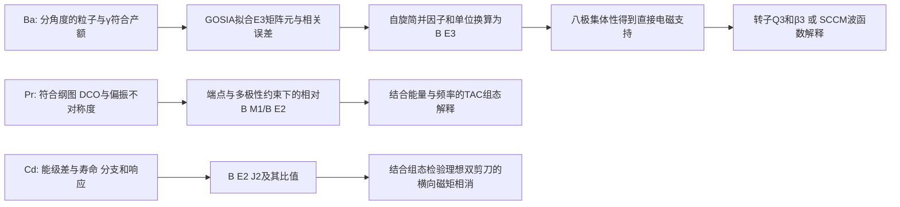

# 八极关联、MR与AMR的证据梯度

## Research Trigger

Day26 从 BU16/BU17 与 Garg2015 原件重建推断链，纠正 Day25 预习中未获原件支持的 Pr 自旋轨迹、Cd 数列和“所有 M1 恒零”认证。下列结论是 Codex source self-audit 与明列条件的推导，不新增人审状态；历史学分与撤回不变。

## Grounded Evidence

图中后一步均带输入与适用条件。“直接 E3”指对 E3 激发耦合敏感的库仑激发测量；实验所见负宇称态的退激 γ 可以是 E1。不能把“看见 E3 γ 分支”当本实验的必要前提。

|体系|实际直接报告与派生量|模型解释及不能跨越的边界|原件定位|
|---|---|---|---|
|144Ba|M(E3)=0.65(+0.17/−0.23) e b^(3/2)；B(3−→0+)=48(+25/−34) W.u.|Q3、β3需转子/轴对称约定；大E3不独立测得刚性或完整PES|BU16 printed112503-3/4 Table I|
|146Ba|M(E3)=0.65(+0.14/−0.20)；B=48(+21/−29) W.u.；E1主要沿用先前τ/BR约束|E1小与E3强可并存；有符号D0的正→零→负来自SCCM，数据对E1/E3相对符号不敏感|BU17 PDF2–5 Table I/Figs3–5|
|135Pr Band3|DCO/Δ约束谱学；相对B(M1)/B(E2)随spin升至约35/2；未测本带绝对B(M1)|交叉约33/2、ℏω≈0.37 MeV；3qp→5qp为TAC指认；交叉后缺crossover，不能确认“反弹后轨迹”|Garg printed054325-6/7/8 Figs5/7/8|
|110Cd|Frauendorf综述引RDDS的12+与14+为0.12、0.09 e²b²；引另一组DSAM数据；综述比值约100–200|近常数0.10 e²b²在该段首先是PAC计算；逐点实验与误差仍须回原实验，不能复用无locator的245–414数列|F01 printed489–490；Piiparinen1993/Clark1999谱系|

## Provisional Reasoning

### E3方向、自旋与不确定度

按约化矩阵元定义，$B(E\lambda;I_i\to I_f)=|M_{fi}|^2/(2I_i+1)$。同一0+↔3−的矩阵元幅度，向上与向下B相差7倍。`1 b=100 fm²`，故E3的`e²b³=10⁶ e²fm⁶`。

从两篇舍入中心0.65算得向下B=0.06036 e²b³。用$R=1.2A^{1/3}$ fm的Weisskopf约定，1 W.u.分别为1231.81与1266.26 e²fm⁶，条件换算约49.0与47.7 W.u.，不覆盖作者保留的48中心。对M作一阶误差传播可近似重现作者打印的B误差；直接平方M区间端点会得到不同区间。这些操作没有恢复原始联合似然，不产生新的实验CI或置信水平。

两篇矩阵元区间相交支持“当前精度相容”，不能证明强度严格恒定；也不能用相交这一件事选择静态或动态形状。good-parity实验态的静态奇宇称算符期望为零，非零跃迁幅度与模型内禀形状是不同对象。[[bernard-2016-144ba-sccm-octupole]] 的软PES和投影混合给出具体模型边界。

### 偶极相消：占据数能解释到哪一步

BU17 PDF4–5明确给出三条变形中子轨道的球形parentage：h9/2、f7/2、i13/2，对应列出的Kπ标签3/2−、5/2−、1/2+，146Ba的v²为0.40、0.27、0.20。它们不是整个球形j壳的总占据，八极形变下也不能把起始宇称标签当未混合的好宇称本征态。

一般质心修正的电偶极z分量可写作

$$D_z=e\frac{N}{A}\sum_p z_p-e\frac{Z}{A}\sum_n z_n
=e\frac{NZ}{A}(R_{p,z}-R_{n,z}).$$

这是标准算符的本任务代数说明，不是重新取得的核密度。质子/中子质心的接近可使E1很小，同时电荷八极矩仍大。精确数值还需要各轨道波函数/偶极贡献、配对密度、质心约定及投影GCM跃迁核；三个v²不足以单独算出相消百分比。BE16 Eq4是双坐标的相干核求和，不能用F图的相似或一个重叠概率替代。

BU17 Table I的E1模型/实验幅度比为0.00474/0.000223≈21.26，同方向B比≈451.8；这限制“绝对E1精确复现”的措辞，并不单独否定接近相消点的机制。D0符号变化尚属模型结果，不能由B的平方反演。

### MR/AMR的条件几何

固定组态、g因子与芯贡献的剪刀模型可预报M1演化；跨组态比值还会受E2分母和新alignment影响。Pr原文提供的上升趋势足以限制普适“比值必须陡降”硬门，却未提供27/2处的5qp反弹事实。

理想双剪刀中，两相同磁性叶片若有相反横向分量，净横向磁矩相消；这不要求总静态磁矩为零，也不禁止任意跨带M1。ΔI=2态间M1本来就受角动量选择规则禁止，单凭未见这种M1不能认证AMR。大J2/B(E2)、小B(E2)与规则E2序列是组合支持，仍须检验终止、弱集体性、组态变化与实验检出限。

## Assumptions

单位练习采用标准约化矩阵元、上述Weisskopf半径和打印舍入值；不假定不同Ba实验的系统误差独立。D0的转子换算另需轴对称K=0约定。Pr值限定2015原版，2019勘误正文未取得，不据此认证“最新更正值”。

## Competing Explanations

Ba保留软八极相关、较局域的内禀反射不对称、随spin变化的形状及aligned-octupole-phonon解释；低spin E3不能独立裁决高spin交叉。MR/AMR保留芯转动、组态重排与终止等竞争过程，拟合一条能谱不排除它们。

## Transfer Conditions

跨质量区只迁移算符定义、单位、响应与推断层级；不迁移固定B强度窗、组态、g因子或经验J2/B阈值。Ba的库仑激发网络、Pr的同母态相对branch与Cd的寿命实验各保数据身份。

## Failure Conditions

- 缺完整GOSIA协方差/相位灵敏度时，不给静态刚性显著性或两同位素严格等强结论。
- 缺SCCM有符号transition kernels与轨道密度时，不拟造质子/中子偶极分解或相消比例。
- 缺Pr交叉后crossover/τ时，不声称实测交叉后的B趋势或绝对collectivity。
- 缺Cd原表/端点/τ/BR与误差时，不发布逐点J2/B曲线及统一阈值。

## Falsification or Reverse Tests

先以原Pr Table I的3530.0-keV、27/2−和作者约33/2交叉回查旧轨迹；若不能匹配初末态，计算比值不进入实测曲线。Cd旧019只有输入算术而无原表，故不能以重跑成功反证本次来源缺口。Ba反向检验保持同一M而交换初态spin，应得到7倍B关系；若直接把E1强度反演成有符号D0，须指出其平方造成的不可辨识性。

## Open Questions

相消点对配对、占据与形变的微小变化有多敏感？哪些实际signed kernels或独立实验能定位零点而非仅拟合强度最小值？缺完整核时，只提出可执行输入清单，不给虚构相消比例。

## Human Review

当前为自主研学self-audit，无需用户逐条预审。需要论文措辞或争议裁决时，再对具体原件claim定向确认；此处不提升human-reviewed。

## Promotion or Rejection History

2026-10-28：以BU16/17、Garg2015及F01原件替换Day25预习中的Pr伪轨迹与Cd无locator数列认证；新Bernard方法源进入知识层。历史工件保留，不复活旧终审、静态形状或M1普适禁戒认证。

## Learning Decision

`supports` 八极/E1解耦和按观测量分层比较；`revises` Pr 27/2交叉及Cd旧数字认证；`limits` 把理想对称性当所有M1禁戒。两质量区的实验响应、配置和单位分别保存，不能把Ba的E3判据迁移成Pr/Cd的模式标签。

## Next Actions

继续获取并读取Egido–Robledo1990的有符号偶极分解、Piiparinen1993寿命原表、Juutinen1994谱学与Garg2019勘误；获取受阻时转向已有原件可解析的核与算符敏感性问题。当前条目不是正式Day26卡完成声明。

## Sources

- [[bucher-2016-144ba-direct-octupole]]
- [[bucher-2017-146ba-direct-octupole]]
- [[bernard-2016-144ba-sccm-octupole]]
- [[garg-2015-135pr-magnetic-rotation]]
- [[frauendorf-2001-spontaneous-symmetry-breaking-rotating-nuclei]]
- [[magnetic-rotation]]、[[antimagnetic-rotation]]、[[shears-mechanism]]

## Review Status

新增科学结论保持needs_review:true与provisional；本任务计算是打印输入的可复现练习，不是新实验或完整模型重放。
