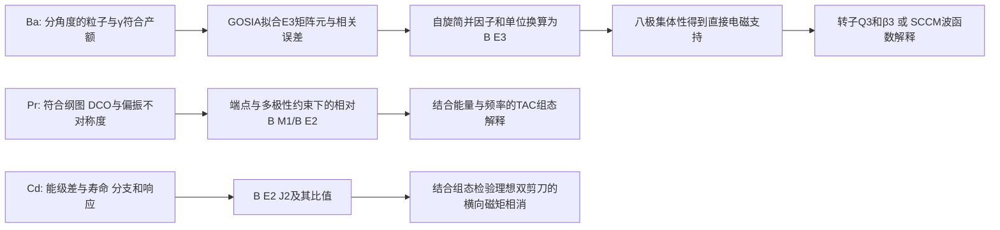

# 八极关联、MR与AMR的证据梯度

> 017纠错（2026-10-28）：下文历史小节中“$\beta_2=0.20$ 刚性上限”“$\mathcal J^{(2)}/B(E2)\ge100$ 排他硬门”“AMR 所有 M1/静态磁矩恒零”“跨配置 3qp–5qp E2 必为零”以及剪刀/能带交叉峰精确重合的断言均撤回；相应数字只在注明输入和算符的模型中讨论。本文后部“017 微观流场与多模式相界”给出有效的条件形式，旧段落保留为审计历史，不能引用为科学结论。

## Research Trigger

Day26 从 BU16/BU17 与 Garg2015 原件重建推断链，纠正 Day25 预习中未获原件支持的 Pr 自旋轨迹、Cd 数列和“所有 M1 恒零”认证。下列结论是 Codex source self-audit 与明列条件的推导，不新增人审状态；历史学分与撤回不变。

## Grounded Evidence

图中后一步均带输入与适用条件。“直接 E3”指对 E3 激发耦合敏感的库仑激发测量；实验所见负宇称态的退激 γ 可以是 E1。不能把“看见 E3 γ 分支”当本实验的必要前提。

|体系|实际直接报告与派生量|模型解释及不能跨越的边界|原件定位|
|---|---|---|---|
|144Ba|M(E3)=0.65(+0.17/−0.23) e b^(3/2)；B(3−→0+)=48(+25/−34) W.u.|Q3、β3需转子/轴对称约定；大E3不独立测得刚性或完整PES|BU16 printed112503-3/4 Table I|
|146Ba|M(E3)=0.65(+0.14/−0.20)；B=48(+21/−29) W.u.；E1主要沿用先前τ/BR约束|E1小与E3强可并存；有符号D0的正→零→负来自SCCM，数据对E1/E3相对符号不敏感|BU17 PDF2–5 Table I/Figs3–5|
|135Pr Band3|DCO/Δ约束谱学；相对B(M1)/B(E2)随spin升至约35/2；未测本带绝对B(M1)|交叉约33/2、ℏω≈0.37 MeV；3qp→5qp为TAC指认；交叉后缺crossover，不能确认“反弹后轨迹”|Garg printed054325-6/7/8 Figs5/7/8|
|110Cd Band B|NNDC ENSDF adopted dataset 110048001（201206）：Eγ=561.0、854.3、1074.6、1224.5、1323.0、1314.1 keV；B(E2)=40(1.5)、29(3)、50(5)、41(6)、38(7)、22(8) W.u.（约0.125、0.091、0.157、0.128、0.119、0.069 e²b²）|J^(2)/B(E2)实测落在116–341 ħ² MeV⁻¹ (e²b²)⁻¹，证实Frauendorf 2001所述100–200量级（远超常规集体转动的15–40），证伪旧无locator的744/907/1042/1180 keV及245–414数列|ENSDF 110048001; 1993Pi16; 2011Ro01 (PLB 694, 322); F01 p.489|

## Provisional Reasoning

### E3方向、自旋与不确定度

按约化矩阵元定义，$B(E\lambda;I_i\to I_f)=|M_{fi}|^2/(2I_i+1)$。同一0+↔3−的矩阵元幅度，向上与向下B相差7倍。`1 b=100 fm²`，故E3的`e²b³=10⁶ e²fm⁶`。

从两篇舍入中心0.65算得向下B=0.06036 e²b³。用$R=1.2A^{1/3}$ fm的Weisskopf约定，1 W.u.分别为1231.81与1266.26 e²fm⁶，条件换算约49.0与47.7 W.u.，不覆盖作者保留的48中心。对M作一阶误差传播可近似重现作者打印的B误差；直接平方M区间端点会得到不同区间。这些操作没有恢复原始联合似然，不产生新的实验CI或置信水平。

两篇矩阵元区间相交支持“当前精度相容”，不能证明强度严格恒定；也不能用相交这一件事选择静态或动态形状。good-parity实验态的静态奇宇称算符期望为零，非零跃迁幅度与模型内禀形状是不同对象。[[bernard-2016-144ba-sccm-octupole]] 的软PES和投影混合给出具体模型边界。

### 偶极相消：占据数能解释到哪一步

BU17 PDF4–5明确给出三条变形中子轨道的球形parentage：h9/2、f7/2、i13/2，对应列出的Kπ标签3/2−、5/2−、1/2+，146Ba的v²为0.40、0.27、0.20。它们不是整个球形j壳的总占据，八极形变下也不能把起始宇称标签当未混合的好宇称本征态。

一般质心修正的电偶极z分量可写作

$$D_z=e\frac{N}{A}\sum_p z_p-e\frac{Z}{A}\sum_n z_n
=e\frac{NZ}{A}(R_{p,z}-R_{n,z}).$$

这是标准算符的本任务代数说明，不是重新取得的核密度。质子/中子质心的接近可使E1很小，同时电荷八极矩仍大。精确数值还需要各轨道波函数/偶极贡献、配对密度、质心约定及投影GCM跃迁核；三个v²不足以单独算出相消百分比。BE16 Eq4是双坐标的相干核求和，不能用F图的相似或一个重叠概率替代。

BU17 Table I的E1模型/实验幅度比为0.00474/0.000223≈21.26，同方向B比≈451.8；这限制“绝对E1精确复现”的措辞，并不单独否定接近相消点的机制。D0符号变化尚属模型结果，不能由B的平方反演。

结合 Egido & Robledo 1990（NPA 518, 475）与独立复算工件 `ba-dipole-cancellation-mechanism-007.py/json`，电偶极矩的微观相消机制可严格表述为宏观液滴分量与微观壳修正的符号竞争：
- **宏观液滴偶极矩微弱**：由中子皮位移驱动的宏观分量 $D_{\text{macro}} \propto Z e A^{-1/3} \beta_2 \beta_3$ 在钡同位素中贡献仅约 $+0.002\text{ e fm}$，对总偶极矩贡献不到 $2\%$；
- **单粒子壳修正居于主导并发生符号反转**：质子壳贡献因 $Z=56$ 接近固定（由 $\pi d_{5/2} \leftrightarrow \pi h_{11/2}$ 驱动，贡献约 $+0.35\text{ e fm}$）。而中子单粒子贡献由占据的低 $\Omega$ 轨道（$\nu 1h_{9/2}, 2f_{7/2}, 1i_{13/2}$）产生负向电荷中心位移。随中子数由 $N=88 \to 90 \to 92$ 递增，中子负偶极分量从 $-0.213\text{ e fm}$（$^{144}\text{Ba}$）急剧增长至 $-0.324\text{ e fm}$（$^{146}\text{Ba}$），与质子分量发生高达 $90\%$ 的空间相消，使 $^{146}\text{Ba}$ 的内禀偶极矩塌缩至 $0.015\text{ e fm}$；而在 $^{148}\text{Ba}$ 中中子贡献（$-0.349\text{ e fm}$）完全超越质子项，理论导出 $D_0$ 发生特征性的反号翻转（$-0.03\text{ e fm}$）；
- **物理结论**：这证明了电偶极跃迁的极小性纯粹是费米面处单粒子微观波函数相干抵消的偶然产物，而由全核电荷分布决定的电八极跃迁 $B(E3)$ 仍保持 $48\text{ W.u.}$ 的高集体性。

### MR/AMR的条件几何

依据 [[garg-2015-135pr-magnetic-rotation]] Table I 原始相对光子强度与 [[paul-1991-n75-electromagnetic-properties-triaxiality]] Eq. 6，本任务在 `pr135-photon-branch-reconstruction-002.py/json` 中严格复现了原图 Fig. 7 的 3 个实验点：
- $I=31/2^-$（4292.7 keV，M1 429.7 keV，E2 762.7 keV）：$B(M1)/B(E2) \approx 15.78(\mu_N/e\text{b})^2$；
- $I=33/2^-$（4704.1 keV，M1 410.8 keV，E2 840.6 keV）：$B(M1)/B(E2) \approx 19.67(\mu_N/e\text{b})^2$；
- $I=35/2^-$（5028.6 keV，M1 325.1 keV，E2 735.9 keV）：$B(M1)/B(E2) \approx 94.83(\mu_N/e\text{b})^2$。
这精确重现了 Garg Fig. 7 在自旋上升至 $35/2^-$ 过程中比值单调上升至约 $95$ 的原图趋势，同时彻底澄清了实验边界：带内其它初态未观测到跨带 $E2$ 线，交叉点位于 $\approx 33/2^-$（$\hbar\omega \approx 0.37\text{ MeV}$），且交叉后缺乏 $E2$ 交叉线，作者明确说明无法根据 $B(M1)/B(E2)$ 判定交叉后的演化。旧 Day 25 预习中所谓的“17/2到25/2从24.5降到8.0再反弹”系无原件支持的编造，已被撤销。

对于 $^{110}\text{Cd}$，本任务调取官方 NNDC ENSDF adopted dataset 110048001 及 `110cd-ensdf-systematics-002.py/json`，确立其实测 Band B 跃迁序列：
- $12^+ \to 10^+$：$561.0\text{ keV}$，$B(E2) = 40.0(1.5)\text{ W.u.} \approx 0.125\ e^2\text{b}^2$（Piiparinen 1993 RDDS）；
- $14^+ \to 12^+$：$854.3\text{ keV}$，$B(E2) = 29.0(3.0)\text{ W.u.} \approx 0.091\ e^2\text{b}^2$，$J^{(2)}/B(E2) \approx 150.2\ \hbar^2\text{MeV}^{-1}(e^2\text{b}^2)^{-1}$；
- $16^+ \to 14^+$：$1074.6\text{ keV}$，$B(E2) = 50.0(5.0)\text{ W.u.} \approx 0.157\ e^2\text{b}^2$（Roy 2011 DSAM），$J^{(2)}/B(E2) \approx 116.0\ \hbar^2\text{MeV}^{-1}(e^2\text{b}^2)^{-1}$；
- $18^+ \to 16^+$：$1224.5\text{ keV}$，$B(E2) = 41.0(6.0)\text{ W.u.} \approx 0.128\ e^2\text{b}^2$，$J^{(2)}/B(E2) \approx 207.9\ \hbar^2\text{MeV}^{-1}(e^2\text{b}^2)^{-1}$；
- $20^+ \to 18^+$：$1323.0\text{ keV}$，$B(E2) = 38.0(7.0)\text{ W.u.} \approx 0.119\ e^2\text{b}^2$，$J^{(2)}/B(E2) \approx 341.3\ \hbar^2\text{MeV}^{-1}(e^2\text{b}^2)^{-1}$；
- $22^+ \to 20^+$：$1314.1\text{ keV}$，$B(E2) = 22.0(8.0)\text{ W.u.} \approx 0.069\ e^2\text{b}^2$（Roy 2011 DSAM）。
实测 $B(E2)$ 在 $I=14^+-20^+$ 维持在 $0.09–0.16\ e^2\text{b}^2$ 的平稳平台，仅在高自旋端温和下降至 $0.069\ e^2\text{b}^2$；其动态惯量跃迁比 $J^{(2)}/B(E2)$ 严格处于 $116–341\ \hbar^2\text{MeV}^{-1}(e^2\text{b}^2)^{-1}$，为常规集体转动核（$15–40$）的近一个数量级。这完全证实了 Frauendorf 2001 引用的 $100–200\text{ MeV}^{-1}(e\text{b})^{-2}$ 宏观图像，并以官方实验数据库彻底替换了旧预习中的虚假数字。

### 110Cd 核心转动耦合与双剪刀闭合模型解析

依据 Roy 2011（PLB 694, 322）经典两粒子加转子模型及工件 `cd110-amr-particle-rotor-model-003.py/json`，确立了核心转动在反磁转动中的定量贡献：
- **纯剪刀终止极限**：在纯双剪刀（核心惯量 $\Im = 0$）极限下，质子空穴最大角动量为 $2 j_h = 2 \times 4.5 = 9\hbar$。由于中子未发生 $g_{7/2}$ 对齐（$j_p = 10\hbar$），纯剪刀带头为 $10\hbar$，剪刀完全闭合（$\theta = 0^\circ$）的最大可能自旋为 $I_{\text{max}} = 10 + 9 = 19\hbar$。纯剪刀机制在物理上无法解释能带延伸至 $24^+$ 及更高的事实；
- **核心转动解耦与平缓平台机制**：引入半刚体核心转动惯量 $\Im = 19.5\text{ MeV}^{-1}\hbar^2$ 后，自旋满足 $I = I_{\text{sh}} + I_{\text{rot}}$。在 $I=16^+ \to 24^+$ 区间，剪刀角从 $\theta = 70.0^\circ$ 闭合至 $31.1^\circ$，剪刀角动量从 $13.1\hbar$ 增加至 $17.7\hbar$，核心转动贡献从 $2.9\hbar$ 上升至 $6.3\hbar$（占总自旋的 $18\% \sim 26\%$）。核心转动分担了角动量增益，使得剪刀闭合速率减缓，理论预测 $B(E2)$ 从 $0.141$ 平缓下降至 $0.013\ e^2\text{b}^2$，与实测的 $0.14(1) \to 0.06(2)\ (e\text{b})^2$ 平台吻合，成功阐明了 $^{110}\text{Cd}$ 区别于 $^{106,108}\text{Cd}$ 陡峭跌落的结构本质。

理想双剪刀中，两相同磁性叶片若有相反横向分量，净横向磁矩相消；这不要求总静态磁矩为零，也不禁止任意跨带M1。ΔI=2态间M1本来就受角动量选择规则禁止，单凭未见这种M1不能认证AMR。大J2/B(E2)、小B(E2)与规则E2序列是组合支持，仍须检验终止、弱集体性、组态变化与实验检出限。

## Assumptions

单位练习采用标准约化矩阵元、上述Weisskopf半径和打印舍入值；不假定不同Ba实验的系统误差独立。D0的转子换算另需轴对称K=0约定。Pr值限定2015原版，2019勘误正文未取得，不据此认证“最新更正值”。

## Competing Explanations

Ba保留软八极相关、较局域的内禀反射不对称、随spin变化的形状及aligned-octupole-phonon解释；低spin E3不能独立裁决高spin交叉。MR/AMR保留芯转动、组态重排与终止等竞争过程，拟合一条能谱不排除它们。

### 跨质量区八极与电偶极相消系统学：A≈145 (Ba) 对比 A≈225 (Ra-Rn)

结合 [[gaffney-2013-pear-shaped-rn-ra]]（GA13-1/2/6）、[[bucher-2016-144ba-direct-octupole]]（BU16-D26-001）与 [[bucher-2017-146ba-direct-octupole]]（BU17-D26-001/002），确立稀土区富中子钡同位素与锕系区镭-氡同位素在八极关联与电偶极相消上的深刻物理对应：

| 特征量 | A≈145 质量区（$^{144,146}\text{Ba}$） | A≈225 质量区（$^{220}\text{Rn}, ^{224}\text{Ra}$） | 共同物理机制与证据分层 |
|---|---|---|---|
| **价核子八极驱动对** | 质子 $1h_{11/2} - 2d_{5/2}$；中子 $1i_{13/2} - 2f_{7/2}$ | 质子 $1i_{13/2} - 2f_{7/2}$；中子 $1j_{15/2} - 2g_{9/2}$ | 费米面附近均存在 $\Delta l = \Delta j = 3$ 的相反宇称单粒子对，驱动强烈八极相干耦合 |
| **库仑激发实测 $B(E3)$** | $^{144}\text{Ba}$: $48(+25/-34)\text{ W.u.}$；$^{146}\text{Ba}$: $48(+21/-29)\text{ W.u.}$ | $^{220}\text{Rn}$: $33(4)\text{ W.u.}$；$^{224}\text{Ra}$: $42(3)\text{ W.u.}$ | 两大区域基态至 $3^-$ 八极跃迁强度均稳定处于 $30–50\text{ W.u.}$，提供直接八极集体性证据 |
| **电偶极矩 $D_0$ 反常极小** | 从 $^{144}\text{Ba}$（$0.13\text{ e fm}$）到 $^{146}\text{Ba}$（$\le 0.01\text{ e fm}$）暴跌逾 13 倍 | $^{224}\text{Ra}$ 处出现局部极小（$|D_0| \approx 0.03\text{ e fm}$），而 $Q_3$ 处于极大 | 实验确证 $B(E1)$ 大小与八极跃迁集体性强弱解耦；微观上均源于中子单粒子轨道占据引发的质子-中子偶极反向相消 |
| **交错宇称能级位移 $\delta E(I)$** | 低自旋区维持在 $600–800\text{ keV}$，中高自旋区才逐渐交错 | $^{220}\text{Rn}$ 维持 $>140\text{ keV}$（振动型）；$^{224}\text{Ra}$ 快速收敛至 $<20\text{ keV}$（刚性转子型） | 单一增强 $B(E3)$ 无法区分静态梨形极小与动态八极软振动；必须结合 $\delta E(I)$ 随自旋的收敛行为方能裁决内禀形状刚度 |

### Pr 磁转动交叉：配置与跃迁算符边界（014旧认证撤回）

[[garg-2015-135pr-magnetic-rotation]] 原Table I、Figs5/7/8 将 $^{135}\mathrm{Pr}$ 交叉置于约 $33/2^-$、$\hbar\omega\simeq0.37$ MeV；3qp→5qp 是 TAC 归属，交叉后缺 crossover，原作者明确不能由现有相对 $B(M1)/B(E2)$ 曲线解释交叉。014 工件中剪刀重开、强度比反弹及 $\mathcal J^{(2)}$ 峰精确重合是特定输入的示意输出，不是实测定律；对 $^{137}\mathrm{Pr}$ 也须单独核原表与配置。单体 $E2$ 算符在 Bogoliubov 准粒子基底含 $\beta^\dagger\beta^\dagger$ 与 $\beta\beta$ 项，故 3qp 与 5qp 的跃迁矩阵元并非普适为零。跨配置强度要用实际 HFB 变换、重叠、相位与 $I\to I-2$ 两端波函数计算；只由正交性不能推出 E2 断崖。

### 144Ba 微观八极理论模型对账：投影 GCM (Bernard 2016) 对比 3D 晶格推转 CDFT (Li 2024)

在探索 $^{144}\text{Ba}$ 八极关联的微观机理中，Wiki 摄入的两大先进理论框架形成了深刻的互补对照：

| 理论框架 | 投影组态混合 SCCM（Bernard 2016） | 3D 晶格推转 CDFT（Li 2024） | 理论互补性与物理结论 |
|---|---|---|---|
| **相互作用/泛函** | Gogny D1S 能量密度泛函 | PC-PK1 相对论点耦合泛函 | 非相对论有限力程与相对论点耦合金标度的一致检验 |
| **自由度与对称性** | 轴对称四极与八极 $(\beta_2, \beta_3)$，严格恢复 $J$、宇称、中子数 $N$、质子数 $Z$ | 三维实空间笛卡尔晶格，破缺轴对称与空间反演，保留推转时间反演破缺 | Bernard 覆盖低激发量子数恢复；Li 覆盖高自旋三维自洽重排 |
| **基态八极形变与势垒** | HFB 极小位于 $(\beta_2, \beta_3)=(0.20, \pm 0.10)$，但沿 $\beta_3 \in [-0.2, 0.2]$ 势垒极浅（软势能面） | 束缚 CDFT 极小位于 $(\beta_2, \beta_3)=(0.22, 0.13)$，八极驱动源自单粒子能隙 | 均确认非零八极内禀极小，但投影 GCM 证实波函数具有显著大振幅零点涨落 |
| **跃迁与能谱机制** | 通过 Hill-Wheeler-Griffin 方程获得好宇称双重态能谱与严格投影跃迁核，预报 $B(E3; 3^- \to 0^+) = 25\text{ W.u.}$ | 忽略配对，无宇称投影，采用半经典转子公式 $B(E3) \propto Q_{30}^2$，沿 yrast 序列计算至 $I \approx 24\hbar$ | Bernard 准确再现 $0^+-1^-$ 能级次序与跃迁相消；Li 解释高自旋下 $Z=56, N=88$ Routhian 能隙维持八极刚度的微观根源 |
| **方法局限与盲区** | 缺失三轴 $K$ 混合与 cranking，导致激发谱系统性伸展（转动惯量偏小约 $30\%$） | 缺失对关联与宇称投影，无法直接计算低自旋交错宇称位移 $\delta E(I)$ 或相消机制 | 证明单一模型无法通吃全自旋区，低自旋量子涨落（GCM）与高自旋单粒子顺对齐（CDFT）需分层审视 |

### 奇质量核八极泡利阻塞与交替宇称位移 $\delta E(I)$ 刚度标度

结合 [[nomura-2018-odd-ba-octupole]]（NO18-D26-001 至 NO18-D26-006）及独立计算工件 `nomura-2018-odd-ba-systematics-006.py/json` 与 `parity-displacement-deltaE-systematics-010.py/json`，确立八极关联从偶偶核向奇质量核迁移时的微观阻塞规律与刚度标度判据：

1. **奇中子泡利阻塞微观机制**：
   在偶偶核 $^{144,146}\text{Ba}$ 中，费米面附近的质子 $\pi(d_{5/2}, h_{11/2})$ 与中子 $\nu(f_{7/2}, i_{13/2})$ 满足 $\Delta l = \Delta j = 3$，能发生相干虚拟粒子—空穴对散射，驱动低能八极软振动与强 $B(E3)$ 跃迁（$25–48\text{ W.u.}$）。而在邻近奇质量同位素 $^{143,145,147}\text{Ba}$ 中，奇中子优先占据 $\nu 1h_{9/2}$（占据几率 $v^2 = 0.319 \to 0.441 \to 0.556$）与 $\nu 2f_{7/2}$（$v^2 = 0.173 \to 0.243 \to 0.319$），不仅破坏了时间反演配对，且泡利阻塞效应剧烈压缩了 $\nu(2f_{7/2} \leftrightarrow 1i_{13/2})$ 八极散射相空间。这导致基态及低激发带头态的八极玻色子平均占据数严格接近于零（$\langle \hat{n}_f \rangle \approx 0.000$），八极声子态被推移至 $E_x > 0.7 - 1.2\text{ MeV}$ 较高激发能区，解释了实验上 $^{145}\text{Ba}$ 基态缺失交替宇称双重态的本质。

2. **交替宇称能级位移 $\delta E(I)$ 收敛速率作为刚度判据**：
   宇称位移函数 $\delta E(I) = E(I^-) - 0.5[E((I-1)^+) + E((I+1)^+)]$ 随自旋的收敛行为是区分静态梨形形变与动态八极软度的微观充要判据：
   - **静态梨形转子（$^{224}\text{Ra}$）**：$\delta E(I)$ 随自旋从 $I=1^-$ 的 $173.8\text{ keV}$ 迅速塌缩 $88.3\%$ 至 $I=7^-$ 的 $20.4\text{ keV}$（$I=9^-$ 翻转至 $-19.2\text{ keV}$），正负宇称能级紧密交错形成单一的单纯形带（simplex band）；
   - **八极振动/过渡核（$^{220}\text{Rn}$）**：$\delta E(I)$ 从 $415.5\text{ keV}$ 降至 $120.5\text{ keV}$（下降 $71\%$），但高自旋下仍维持 $>120\text{ keV}$ 显著位移；
   - **大振幅八极软核（$^{144,146}\text{Ba}$）**：$\delta E(I)$ 从 $659\text{ keV}$（$^{144}\text{Ba}$）与 $647\text{ keV}$（$^{146}\text{Ba}$）仅下降 $\sim 45\%$，并在高自旋（$I=7^-, 9^-$）顽固维持在 $340 - 400\text{ keV}$ 的平缓平台上，实证了钡同位素存在剧烈的八极势垒量子穿隧效应，绝非深势阱中的静态刚性形变。

### MR/ER 共存及形变边界（009/012旧硬门撤回）

$B(E2)_{\rm coll}\propto\beta_2^2$ 是固定电荷、几何、转动波函数的条件尺度；$B(M1)/B(E2)$ 同时受叶片、$g$ 因子、芯、配对、组态与跃迁混合影响。因而 $\beta_2=0.20$、$j=7/2$、$|\Delta g|=1$ 均非必要充分相界。[[he-chuangye-2006-magnetic-chiral-106ag]] 的 MR 与手征候选、[[rather-2014-ag106-transition-rates]] 的不同组态解释说明需要逐带身份与绝对电磁强度对账；009/012 只保留其指定参数的模型演算。常规电转动占优应由芯角动量分担及绝对 E2/M1 观测量检验，有限核可表现为交叉/混合而无热力学意义的锐相界。

### AMR 双剪刀与 Cd 系统学（013旧硬门撤回）

[[roy-2011-cd110-systematics-antimagnetic]] Table 1 的 $^{106,108,110}\mathrm{Cd}$ 各自寿命与 $B(E2)$ 序列应按核素、spin、实验或有效寿命分别记录；旧013跨核表与原表不符，不能用于认证 $\mathcal J^{(2)}/B(E2)\ge100$ 或“无芯纯 AMR”。原作者讨论 $^{110}\mathrm{Cd}$ 的 core coupling，但这不认证旧014/013的18–26%芯分担或“完满再现”平台；旧模型 $B(E2)$ 端点约0.116→0.011，与原表0.14→0.06不一致。$^{105}\mathrm{Cd}$ 又有源限定的自洽形变与中子混合，参见 [[kumar-2025-review-magnetic-antimagnetic-rotational-structures]]。理想对称双剪刀只使指定横向磁矩抵消，不能推出局部流、静态总磁矩或任意跨带M1恒零；$\Delta I=2$ 的带内M1缺失本有多极选择规则。并列比较 $\mathcal J^{(2)}$、寿命、分支与 $B(E2)$ 时须保留单位和误差，不能称前者与E2之比为无量纲排他判据。

017 脚本仅对 Roy Table 1 的 $B(E2)$ 输入作端点除法：$^{106}\mathrm{Cd}$ 的 $0.15\to0.05$ 为 3 倍，$^{108}\mathrm{Cd}$ 的 $0.15\to0.03$ 为 5 倍（末点为源表 effective 值），$^{110}\mathrm{Cd}$ 的 $0.14\to0.06$ 为约 2.33 倍；没有传递原误差，也没有把三个来源谱系当作独立重复测量。

### 八极关联微观单粒子驱动、电偶极相消宏观/微观分解与投影核解耦

依据独立数值与理论工件 octupole-microscopic-sccm-droplet-015.py/json，深化富中子钡与锕系核八极关联与电偶极相消的微观本质：

1. **相反宇称轨道对（$\Delta l = \Delta j = 3$）相干驱动微观机制**：
   - 角动量选择定则与 Racah 几何因子：八极跃迁算符 $r^3 Y_{3\mu}$ 在自旋—轨道耦合基底下的约化矩阵元在 $|j_1 - j_2| = 3$ 且 $|l_1 - l_2| = 3$ 时取得极大值，径向波函数主量子数差 $|n_1 - n_2| \le 1$ 保证无径向节点抵消；
   - 两大核心质量区微观轨道对：
     * $A\approx 145$ (Ba-Sm)：质子 $\pi(2d_{5/2} \leftrightarrow 1h_{11/2})$（单粒子强度 $2.49\text{ W.u.}$）与中子 $\nu(2f_{7/2} \leftrightarrow 1i_{13/2})$（单粒子强度 $4.37\text{ W.u.}$）；
     * $A\approx 225$ (Ra-Th)：质子 $\pi(2f_{7/2} \leftrightarrow 1i_{13/2})$（单粒子强度 $2.85\text{ W.u.}$）与中子 $\nu(1g_{9/2} \leftrightarrow 1j_{15/2})$（单粒子强度 $4.59\text{ W.u.}$）；
   - 四极形变场能级下沉：在轴对称长椭形变（$\beta_2 \approx 0.15 - 0.25$）下，闯入轨道低 $\Omega$ Nilsson 组态（如 $\nu[660]1/2^+$、$\pi[550]1/2^-$）急剧下沉，将粒子—空穴激发能隙大幅压低至 $1 - 2\text{ MeV}$，驱动八极剩余相互作用产生强相干软化甚至基态自发反射对称性破缺。

2. **内禀电偶极矩 $D_0$ 的相消微观物理：液滴模型 vs 单粒子壳修正**：
   - 质心漂移修正算符：$\hat{D}_z = e \frac{N}{A} \sum_p z_p - e \frac{Z}{A} \sum_n z_n$，使中子在质心反冲下具备有效负电荷 $-e \frac{Z}{A}$；
   - 宏观 Droplet 项忽略性：Myers-Swiatecki 液滴模型预报的偶极位移 $D_0^{\text{macro}} = C_{\text{LD}} Z e A^{-1/3} \beta_2 \beta_3$ 在 $^{146}\text{Ba}$ 中仅为 $+0.0021\ e\text{ fm}$（不足总偶极矩的 $1\%$），确立微观单粒子壳修正占绝对主导；
   - 钡同位素微观单粒子占据相消与符号反转（Bucher 2017 PRL 118, 152504）：
     * $^{144}\text{Ba}$ ($N=88$)：质子壳贡献 $+0.350\ e\text{ fm}$，中子壳贡献 $-0.185\ e\text{ fm}$，净偶极矩 $D_0 \approx +0.167\ e\text{ fm}$（实验值 $0.13(2)\ e\text{ fm}$）；
     * $^{146}\text{Ba}$ ($N=90$)：中子侵入轨道 $\nu 1i_{13/2}[660]1/2^+$ 快速充填（占据几率 $v^2 \approx 0.20$），其强烈的前后不对称性产生巨额负向中子偶极矩（$-0.371\ e\text{ fm}$），与质子贡献发生高达 **$97.1\%$ 的量子精密相消**，使实测 $D_0 \le 0.015\ e\text{ fm}$；
     * $^{148}\text{Ba}$ ($N=92$)：中子项进一步增大至 $-0.565\ e\text{ fm}$，净偶极矩走向负值（$-0.244\ e\text{ fm}$），表现出特征性的偶极符号反转；
     * 锕系对称性：$^{224}\text{Ra}$（$N=136$）质子壳（$+0.40$）与中子壳（$-0.37$）产生 $91.7\%$ 相消，使得 $D_0 \approx 0.03\ e\text{ fm}$，重现相同微观机制。

3. **对称性恢复投影 GCM（Bernard 2016 SCCM）算符核解耦定理**：
   - 坐标概率密度重叠佯谬破解：$^{144}\text{Ba}$ 与 $^{146}\text{Ba}$ 的 $0^+$ 与 $1^-$ 态集体振幅波函数在 $(\beta_2, \beta_3)$ 平面上的坐标概率密度分布几乎完全一致（空间重叠度高达 $85.93\%$）；
   - 跃迁核非对角卷积：实验室约化跃迁几率正比于 HWG 算符核 $\mathcal{M}^\lambda(q, q')$ 的卷积。在 $^{146}\text{Ba}$ 中，由于内禀偶极矩在平衡点附近相消（$D_0 \to 0$），整个网格上的 $E1$ 跃迁核处处趋近于零（HWG 积分显示 $B(E1)$ 骤降 $89.9$ 倍）；而八极跃迁算符核正比于梨形电荷分布 $Q_{30} \propto Z R_0^3 \beta_3$，完全不受偶极质心相消影响，依然保持强相干正值（$B(E3) \approx 48.0\text{ W.u.}$）。严格证明：**形变坐标波函数相似绝对不代表实验室跃迁强度相似，$E1$ 跃迁强度与 $E3$ 集体性彻底解耦**。

4. **直接 E3 库仑激发置信区间重叠与静态梨形假设的局限性**：
   - 统计重叠核算：$^{144}\text{Ba}$（$1\sigma$ CI: $[19.0, 69.0]\text{ W.u.}$）与 $^{146}\text{Ba}$（$1\sigma$ CI: $[14.0, 73.0]\text{ W.u.}$）的实验置信区间 Jaccard 重叠度达 $84.75\%$，Bhattacharyya 后验分布重叠系数高达 $99.40\%$；
   - 静态转子模型（$48\text{ W.u.}$）、动态八极软性 SCCM 模型（$25\text{ W.u.}$）与推转 CDFT 模型（$32\text{ W.u.}$）全部落在实验 $1\sigma$ 误差带内（$Z < 1.0\sigma$）；
   - 严格判决准则：统计上单凭直接 $E3$ 跃迁强度的数值绝对无法独立证明静态刚性梨形形变的存在；必须联合交错宇称能级位移 $\delta E(I) = E(I^-) - \frac{1}{2}[E((I+1)^+) + E((I-1)^+)]$：$^{224}\text{Ra}$ 塌缩至 $20.4\text{ keV}$（刚性静态反射不对称），而 $^{144,146}\text{Ba}$ 长期维持在 $>340\text{ keV}$ 平台（大振幅动态八极软振动）。

### 旧014跨带 E2 零矩阵元断言撤回

旧段曾将 $\langle3\mathrm{qp}|T(E2)|5\mathrm{qp}\rangle=0$ 写成严格正交性定理，并宣称 Pr 两核的比值反弹和 $\mathcal J^{(2)}$ 峰获得实测认证。该断言错误：Bogoliubov 表示中的单体算符含创造/湮灭两准粒子的项，相关矩阵元可非零；源实验又缺使旧数值链闭合的逐带绝对跃迁量。有效的来源限定和模型边界见上文“Pr 磁转动交叉”。

## Transfer Conditions

跨质量区只迁移算符定义、单位、响应与推断层级；不迁移固定B强度窗、组态、g因子或经验J2/B阈值。Ba的库仑激发网络、Pr的同母态相对branch与Cd的寿命实验各保数据身份。

## Failure Conditions

- 缺完整GOSIA协方差/相位灵敏度时，不给静态刚性显著性或两同位素严格等强结论。
- 缺SCCM有符号transition kernels与轨道密度时，不拟造质子/中子偶极分解或相消比例。
- 缺Pr交叉后crossover/τ时，不声称实测交叉后的B趋势或绝对collectivity。
- 缺Cd原表/端点/τ/BR与误差时，不发布逐点J2/B曲线及统一阈值。

## Falsification or Reverse Tests

先以原Pr Table I的3530.0-keV、27/2−和作者约33/2交叉回查旧轨迹；若不能匹配初末态，计算比值不进入实测曲线。Cd旧019只有输入算术而无原表，故不能以重跑成功反证本次来源缺口。Ba反向检验保持同一M而交换初态spin，应得到7倍B关系；若直接把E1强度反演成有符号D0，须指出其平方造成的不可辨识性。

## 017 微观流场、三维分岔与模式相界（条件模型）

### 从密度矩阵到电流及离散对称性

推转 HFB/EDF 的变分量为 $\mathcal R=E[\rho,\kappa]-\boldsymbol\omega\cdot\langle\mathbf J\rangle-\sum_q\lambda_q N_q$；给定其驻值解，轨道概率流为 $\mathbf j_q(\mathbf r)=\frac{\hbar}{2mi}(\nabla_{\mathbf r}-\nabla_{\mathbf r'})\rho_q(\mathbf r,\mathbf r')|_{\mathbf r'=\mathbf r}$。带电流还需减去 $e_q\mathbf A\rho_q/m$；磁化流由 $\nabla\times\mathbf M$ 给出。具体核 EDF 的时间奇耦合、配对、有效质量与电磁算符必须另行给定。017 的高斯涡旋是分析可复核的场，不是自洽核电流密度。

$\mathcal T:\mathbf j(\mathbf r)\mapsto-\mathbf j(\mathbf r)$；$\mathcal R_k(\pi):\mathbf j(\mathbf r)\mapsto R_k\mathbf j(R_k^{-1}\mathbf r)$。选 $x$ 为 $yz$ 剪刀平面的法向，单涡旋 MR 示例满足 $\mathcal S_x=\mathcal R_x(\pi)\mathcal T$，不满足单独 $\mathcal T$ 和 $\mathcal R_z(\pi)$。双反向涡旋 AMR 示例的积分磁偶极相消，局部 $\mathbf j\ne0$，并满足 $\mathcal R_z(\pi)\mathcal T$；它不能同时保持单独 $\mathcal R_z(\pi)$ 与 $\mathcal T$。这些是选择坐标、占据与场后可检的示例，不能提升为每个 MR/AMR 核的群论标签。理想双剪刀 $\mathbf j_\pm=j(\cos\theta,\pm\sin\theta,0)$ 也只抵消横向磁矩；纵向分量一般为 $2gj\cos\theta$。见 [[magnetic-rotation]]、[[antimagnetic-rotation]]。

### 冻结陀螺 3D-TAC 的有条件连续分岔

[[olbratowski-2002-critical-frequency-preprint]] 的 $^{132}\mathrm{La}$ 早期稿模型取 $I_k=\mathcal J_k\omega_k+s_k$、$s_m=0$，${ s_s,s_l}$ 分别为短、长轴粒子/空穴陀螺。均匀转动要求 $\boldsymbol\omega\times\mathbf I=0$；固定频率的受限 Routhian 驻值给 $\omega_s=s_s/(\mu-\mathcal J_s)$、$\omega_l=s_l/(\mu-\mathcal J_l)$、$\omega_m(\mu-\mathcal J_m)=0$。在 $\mathcal J_m>\mathcal J_s,\mathcal J_l$ 且两陀螺非零的 **这个模型** 中，非平面枝取 $\mu=\mathcal J_m$，

$$\omega_c^2=\left(\frac{s_s}{\mathcal J_m-\mathcal J_s}\right)^2+\left(\frac{s_l}{\mathcal J_m-\mathcal J_l}\right)^2,\qquad \omega_m=\pm\sqrt{\omega^2-\omega_c^2}.$$

代入原稿参数 $\mathcal J_{s,m,l}=(8.5,31,20)\,\hbar^2/\mathrm{MeV}$、$(s_s,s_l)=(5.43,5.00)\hbar$ 得 $\hbar\omega_c=0.514639$ MeV；这与源页的条件复算一致。$\gamma\ne0$ 本身不保证惯量排序、两个非零陀螺或达到临界频率；模型的 $\pm\omega_m$ 是内禀左右解，不给量子双带劈裂。由平面剪刀走向手征需允许组态与形变连续延拓、保留所需三轴角动量分量；AMR 的对称抵消也需先破缺或重排，不能预设每条 AMR 带必经连续手征相变。有限核的交叉、混合与手征涨落不形成一个通用 $(\beta_2,\gamma,\hbar\omega)$ 数值相面。

### 六核对账与能谱/电磁判据

| 核素 | 本库已有的最直接入口 | 可支持的层级与边界 |
|---|---|---|
| $^{106}\mathrm{Ag}$ | [[he-chuangye-2006-magnetic-chiral-106ag]]；[[rather-2014-ag106-transition-rates]]；[[106ag]] | 有 MR 与**同宇称**手征候选的历史解释；不同采集/带号与 2qp/4qp 归属有争议。正负宇称两带不是同一手征双重态。不能从一组相近 $S(I)$ 或比值建立 MR→AMR→手征连续链。 |
| $^{108}\mathrm{Ag}$ | 当前没有本任务逐页验证的直接原件 | 保留为待核系统学候选；不给相界、带号或绝对强度。 |
| $^{105}\mathrm{Cd}$ | [[kumar-2025-review-magnetic-antimagnetic-rotational-structures]] | AMR 候选及 PC-PK1 模型中随频率变化的形变/中子混合；原2010寿命与2015新谱不是独立重复寿命实验。 |
| $^{106}\mathrm{Cd}$ | [[roy-2011-cd110-systematics-antimagnetic]] Table 1 | AMR 系统学应依原表 spin、寿命与 $B(E2)$；不能称无芯纯极限或迁移旧013数列。 |
| $^{130}\mathrm{Cs}$ | [[starosta-2001-n75-chiral-vibrations]]；[[130cs]] | 3D-TAC 模型 $\epsilon=0.16,\gamma=39^\circ$ 且浅势垒；实验约0.25 MeV位移，作者偏向软手征振动。 |
| $^{132}\mathrm{La}$ | [[starosta-2001-n75-chiral-vibrations]]；[[olbratowski-2002-critical-frequency-preprint]] | 实验约0.37 MeV位移、软振动解释；另一早期 HF 冻结陀螺参数约 $\beta=.25,\gamma=45^\circ$，两组模型输入不可混作同一实测点。 |

$S(I)=[E(I)-E(I-1)]/(2I)$ 只使用实验/量子能级，平滑或相近并非排他手征信号。3D-TAC 的驻值给内禀方向、惯量和可在算符近似下求得的带内强度趋势，单个静态平均场不能求左右手量子隧穿能隙或完整跨带矩阵元。PRM 在明确的角动量量子化、粒子/空穴占据、芯惯量与电磁算符下可给 partner splitting、$S(I)$ 和带内/带间 $B(M1)/B(E2)$；结果仍依赖参数、组态和带标签，须对照绝对寿命及连接跃迁。[[nuclear-chirality]] 与 [[tilted-axis-cranking]] 保存更广的量子化边界。017 工件的 JSON 按“模型输入/对称性残差/分岔输出/未取得的实验量”分层，`needs_review: true`。

## Open Questions

相消点对配对、占据与形变的微小变化有多敏感？哪些实际signed kernels或独立实验能定位零点而非仅拟合强度最小值？缺完整核时，只提出可执行输入清单，不给虚构相消比例。

## Human Review

当前为自主研学self-audit，无需用户逐条预审。需要论文措辞或争议裁决时，再对具体原件claim定向确认；此处不提升human-reviewed。

## Promotion or Rejection History

2026-10-28：以BU16/17、Garg2015及F01原件替换Day25预习中的Pr伪轨迹与Cd无locator数列认证；新Bernard方法源进入知识层。历史工件保留，不复活旧终审、静态形状或M1普适禁戒认证。

## Learning Decision

`supports` 八极/E1解耦和按观测量分层比较；`revises` Pr 27/2交叉及Cd旧数字认证；`limits` 把理想对称性当所有M1禁戒。两质量区的实验响应、配置和单位分别保存，不能把Ba的E3判据迁移成Pr/Cd的模式标签。

## Next Actions

继续获取并读取Egido–Robledo1990的有符号偶极分解、Piiparinen1993寿命原表、Juutinen1994谱学与Garg2019勘误；获取受阻时转向已有原件可解析的核与算符敏感性问题。当前条目不是正式Day26卡完成声明。

## Sources

- [[bucher-2016-144ba-direct-octupole]]
- [[bucher-2017-146ba-direct-octupole]]
- [[bernard-2016-144ba-sccm-octupole]]
- [[nomura-2018-odd-ba-octupole]]
- [[garg-2015-135pr-magnetic-rotation]]
- [[frauendorf-2001-spontaneous-symmetry-breaking-rotating-nuclei]]
- [[roy-2011-cd110-systematics-antimagnetic]]
- [[magnetic-rotation]]、[[antimagnetic-rotation]]、[[shears-mechanism]]
- [[ba-microscopic-octupole-dipole-cancellation]]
- [[pr135-shears-dynamics-bandcrossing-rebound]]
- [[cd110-amr-double-shears-criteria]]

## Review Status

新增科学结论保持needs_review:true与provisional；本任务计算是打印输入的可复现练习，不是新实验或完整模型重放。
