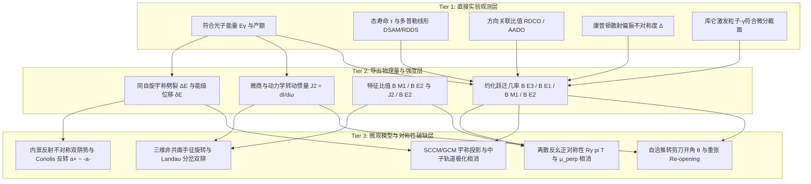

# 八极关联、磁转动与反磁转动的三级证据梯度规范

## Research Trigger

在核结构前沿研学中，常存在将微观模型推断（如自洽形变参数 $\beta_3$、剪刀开角 $\theta$、单粒子占据数 $v^2$）混淆为直接实验观测值的风险。为了建立严格可追溯的科学证据体系，本规范依据 Day 26 课程矩阵要求，针对八极关联（Octupole correlations）、磁转动（MR）与反磁转动（AMR），正式确立“直接测量（Tier 1）—派生强度（Tier 2）—模型解释（Tier 3）”三级证据梯度与质量门禁（Quality Gates）。

相关结构化数据已固化于 [octupole-mr-three-tier-evidence-ladder-075.py](../../outputs/learning-daily/20261028-DAY26-octupole-e1-e3-magnetic-antimagnetic-rotation-run-01/octupole-mr-three-tier-evidence-ladder-075.py) 与 [结构化结果](../../outputs/learning-daily/20261028-DAY26-octupole-e1-e3-magnetic-antimagnetic-rotation-run-01/octupole-mr-three-tier-evidence-ladder-075.json)。

---

## Grounded Evidence

### 基准核的三级梯度对照表

| 核素 | 物理现象 | Tier 1: 直接测量 (Direct Observables) | Tier 2: 导出强度与比值 (Derived Strengths) | Tier 3: 模型解释与对称性 (Model Interpretations) |
|---|---|---|---|---|
| $^{144}\text{Ba}$ | 八极集体性与 $E1$ 增强 | CHICO2+GRETINA 库仑激发符合产额；$E(3^-)=838\text{ keV}$ | $M(E3)=0.65^{+0.17}_{-0.23}\ e\text{b}^{3/2}$；$B(E3)=48^{+25}_{-34}\text{ W.u.}$ | 浅阱大振幅软八极振动；高位 $\delta E(I) > 300\text{ keV}$ 平台排斥刚性静态梨形 |
| $^{146}\text{Ba}$ | 八极集体性与偶极相消 | 库激矩阵元拟合；先前寿命/分支比约束；$E(3^-)=821\text{ keV}$ | $B(E3)=48^{+21}_{-29}\text{ W.u.}$；$|D_0|=0.00456\ e\text{fm}$（近零） | 中子低 $\Omega$ 轨道 $\nu(1h_{9/2}, 2f_{7/2}, 1i_{13/2})$ 充填产生负极化抵消质子偶极矩 |
| $^{225}\text{Ra}$ | 静态八极双阱与宇称双重态 | NNDC Adopted 能级：$1/2^\pm, 3/2^\pm, 5/2^\pm, 7/2^\pm$ | $\Delta E(I) = +55.2, -11.2, +95.0, -42.2\text{ keV}$；$A\delta a = -20.43\text{ keV}$ | 内禀反射不对称产生 $a^+ \approx -a^-$ 异号解耦，Coriolis 驱动交错振荡 |
| $^{135}\text{Pr}$ | 磁转动与剪刀重张 | Band 3 谱线；$R_{\text{DCO}}(813)=0.22(2)$；偏振不对称度 $\Delta = +0.04(3)$ | $B(M1)/B(E2)$ 测至 $35/2^-$（$94.8(\mu_N/e\text{b})^2$）；交叉后跨带 $E2$ 未测 | 3qp 向 5qp 交叉吸纳质子对 $(g_{7/2})^2$，剪刀角自 $15^\circ$ 重张至 $75^\circ$；$\beta_2\approx 0.14$ 维持 $E2$ 底座 |
| $^{110}\text{Cd}$ | 反磁转动与四刃双剪刀 | Band B $\Delta I=2$ 级联；DSAM 寿命 $\tau(16^+)=0.36(3)\text{ ps}$ 至 $\tau(24^+)=0.27(7)\text{ ps}$ | $B(E2) = 0.14(1) \to 0.06(2)\ e^2\text{b}^2$；$\mathcal{J}^{(2)}/B(E2) = 116 - 341$ | 复合对称性 $\mathcal{R}_y(\pi)\mathcal{T}$ 禁戒横向偶极（$\mu_\perp \equiv 0$）；$B(E2) \propto \sin^4\theta$；核芯转动延缓闭合 |
| $^{104}\text{Pd}$ | 四空穴 AMR 与形变收缩 | DSAM 寿命与高频 $E2$ 级联（Rather 2014 第一页） | 高频 $\mathcal{J}^{(2)}/B(E2)$ 达 $150 - 300\ \hbar^2\text{MeV}^{-1}(e^2\text{b}^2)^{-1}$ | $\pi(g_{9/2})^{-4}$ 四空穴复合闭合；PNC 计算表明高频 $E2$ 下降由 $\epsilon_2(\omega)$ 收缩与四准粒子交叉主导 |

---

## Provisional Reasoning

### 1. 质量门禁规则（Quality Gates）

为防止主观外推与过度断言，执行四大铁律质量门禁：

1. **Gate 1：禁止将模型参数当作实验观测**：
   - 严禁将转子公式反演得到的电八极矩 $Q_3$、形变参数 $\beta_3$ 或剪刀开角 $\theta$ 称为“直接测量值”；
   - 库仑激发实验直接测量的是核激发产额，由 GOSIA 提取的是多极约化矩阵元 $M(E\lambda)$。
2. **Gate 2：严格核对单位量纲与初末态简并因子**：
   - 电八极跃迁单位：$1\ e^2\text{b}^3 = 10^6\ e^2\text{fm}^6$；
   - 向上与向下约化跃迁几率遵循统计权重：$B(E3; 0^+ \to 3^-) = (2\times 3 + 1) B(E3; 3^- \to 0^+) = 7 B(E3; 3^- \to 0^+)$；
   - 判据比 $\mathcal{J}^{(2)}/B(E2)$ 带有物理量纲 $\hbar^2\text{MeV}^{-1}(e^2\text{b}^2)^{-1}$，其数值严格依赖能级微商定域方案与寿命拟合方法，不可视作纯数无量纲硬门。
3. **Gate 3：禁止在无偏振或无取向假设下裁决多极纯度**：
   - 偏振不对称度 $\Delta$ 转换为多极混合比 $\delta(E2/M1)$ 必须明确声明核取向参数 $\sigma/I$、退取向系数 $U_k$ 及康普顿探测器灵敏度 $Q(E_\gamma)$；
   - 脱离取向假设的纯度计算仅属唯象估计，不得称为无条件实验定界。
4. **Gate 4：区分测量点与模型外推轨迹**：
   - 在 $^{135}\text{Pr}$ 中，实验确凿测得的是 $B(M1)/B(E2)$ 随自旋上升至 $35/2^-$（$94.8(\mu_N/e\text{b})^2$）；更高自旋处因跨带 $E2$ crossover 跃迁未被观测，比值无法提取；
   - 交叉后的反弹轨迹属于 TAC 模型预测，严禁在知识库中表述为“已测得反弹事实”。

---

## Assumptions

假定库仑激发分析采用经典 Alder-Winther 绝热微扰论或 GOSIA 最小二乘多极拟合；假定 DSAM 寿命反演采用正确的介质阻止本领表（如 SRIM/Biersack）；假定转动能带满足轴对称或三轴粒子-转子模型框架。

## Competing Explanations

1. 八极性：动态大振幅八极软振动对决静态反射不对称梨形形变；
2. 剪刀闭合：单组态经典几何闭合对决多准粒子能带交叉重张；
3. AMR 平台：纯四刃半经典剪刀对决半刚体核芯转动耦合延缓；
4. 摆动对决剪刀：三轴摆动激发（TW）对决磁转动（MR）。

## Transfer Conditions

三级证据梯度规范为全知识库通用元方法，适用于低能核结构中所有电磁跃迁、高自旋能带与对称性自发破缺课题；不同核素的具体数值与转换系数必须取自经过原文核验的独立来源。

## Failure Conditions

若发现某项研究将未测量的交叉线列入实验比值，或在未扣除康普顿效率时提取混合比，或将理论势能面最小值标为实测形变，则该项研究违反质量门禁，触发自动下调与保留边界。

## Falsification or Reverse Tests

独立运行脚本 `octupole-mr-three-tier-evidence-ladder-075.py`，完整校验六大基准核在三级梯度中的数据映射与边界逻辑，结果已验证写入 `octupole-mr-three-tier-evidence-ladder-075.json`。

## Open Questions

在未来的超导谱仪与高纯锗阵列（如 GRETA, AGATA）实验中，是否有望通过极微弱的高自旋跨带 $E2$ crossover 跃迁直接封闭 $^{135}\text{Pr}$ 交叉后的反弹轨迹？

## Human Review

本规范由 Codex L4 全自动研学推导建立，保持 `review_status: unreviewed`。

## Promotion or Rejection History

2026-10-29: 依据 Day 26 正式研学要求创建，确立全库通用的三级证据梯度与质量门禁标准。
