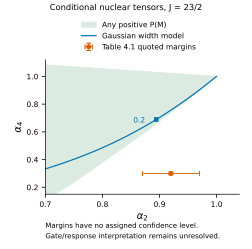

# 先核准 attenuation 的含义，再用它限定混合比

## Research Trigger

[[sensharma-2021-wobbling-motion-135pr-187au]] SE21-9/10 同时给出了核对齐的定义和实际参考线校准。问题是表列 alpha_exp 是否已能直接当作同一核布居的 rho/B，还是还混有响应、归一或参考跃迁的约定。本页只检验这一条件，不裁决其原实验数据或 wobbling 指认。

## Grounded Evidence

本次实际定向阅读 2021 thesis 的方法、相关校准/角度表，保留其与 Springer2022 书的版本区别：

| 输入 | 原件值与定义 | 精确入口 |
| --- | --- | --- |
| nuclear attenuation | αk=ρk/Bk；半整数 complete reference 为 \|M\|=1/2 | SE21-9，printed41–42/PDF63–64，Eqs2.45/2.49/2.50 |
| Gaussian | P(M)∝exp[−M²/(2σ²)]；σ为指数width | SE21-9，printed42/PDF64，Eq2.51 |
| calibration参考 | 854.3keV，23/2−→19/2−，作者采用pureE2近似 | SE21-10，printed97/Table4.1与printed109/Table4.3 |
| 表列 attenuation | α2=.92(5)，α4=.30(1)，adopted σ/J=.2 | SE21-10，printed97/PDF119，Table4.1 |
| 同线拟合系数 | A2exp=.352(1)，A4exp=−.212(1) | SE21-10，printed109/PDF131，Table4.3 |

原始逐 ring 峰与背景、complete fit covariance、实际校准操作和 production code 未得。表的误差不在本页被重新解释为完整高斯分布或某个联合置信区间。

## Provisional Reasoning

### 按相同 rho/B 定义的精确正布居检查

由 [[yamazaki-1967-aligned-angular-coefficients]] YA67-13 与 SE21 Eq2.45/2.50，对 J=23/2、S=J(J+1)、h=1/2，定义

$$t_2(m)=\frac{3m^2-S}{3h^2-S},\qquad
t_4(m)=\frac{35m^4-(30S-25)m^2+3S^2-6S}
{35h^4-(30S-25)h^2+3S^2-6S}.$$

若 αk=Σm P(m)tk(m)、P≥0 且 ΣP=1，则每个允许 m 都满足

$$7-10t_2(m)+3t_4(m)
=\frac{105(m^2-\tfrac14)(m^2-\tfrac94)}
{3(S-\tfrac34)(S-\tfrac{15}{4})}\ge0.$$

因为允许的半整数 \|m\| 为 1/2、3/2、5/2…，分子逐项非负。由凸性得到必要条件

$$7-10\alpha_2+3\alpha_4\ge0.$$

本 run 用新输入 J=23/2 的逐 m 有理 CG 与独立 Stevens 多项式比较，并用线性规划核对；复用已有通用 helper，没有重跑旧的 67Ga 数据或沿用旧检查数加分。必要式针对任意 positive P，不限 Gaussian。

源 Table4.1 的字面 mean 给 −1.3。将 quoted margins 仅当作 rectangle，其最大值仍为

$$7-10(.92-.05)+3(.30+.01)=-.77.$$

独立 LP 对 mean 和这个 rectangle 都返回 infeasible。这是定义条件下的集合不相交，不是实验显著性检验。没有联合 coverage，未知 covariance 也不被补成零。

在 α2=.92 时，必要 α4≥11/15≈.733333；在 α4=.30 时，必要 α2≤.79。这些是该条件模型的必要阈值，不能替换成对实验系数的新建议值。

### 单参数 Gaussian 也不闭合

| source-defined 条件计算 | α2 | α4 |
| --- | ---: | ---: |
| adopted σ/J=.2 | .894266 | .689096 |
| 只匹配 α2=.92，得到 σ/J=.175284 | .920000 | .756606 |
| 只匹配 α4=.30，得到 σ/J=.350794 | .673420 | .300000 |

这三行不是重新测得的 σ。采用 width=2.3 时，有限离散布居的 RMS=2.299995；数值接近不改变两者在一般有限 J、窄 width 下的不同定义。半整数 σ→0 应取 \|M\|=1/2 的极限，不能直接计算零除指数。

### 同一参考线的第二张表也须经过转换

为避免只凭一份张量实现作判断，另取 complete reference 的 M=±1/2，用 doubled-spin CG 算 pureE2 的 photon-mass μ 分布：

$$p_{\mu=-2,\ldots,2}
=(15/322,\ 40/161,\ 66/161,\ 40/161,\ 15/322).$$

在 [[rose-brink-1967-phase-defined-angular-distributions]] RB67-11 的横向光子基底下，纯 E2 的 μ=0、\|μ\|=1、\|μ\|=2 的 (A2,A4) 分别为
(5/7,−12/7)、(5/14,8/7)、(−5/7,−2/7)。
它们给本参考的

$$A_{2,\max}=65/161,\qquad A_{4,\max}=-26/161.$$

用 Eq2.51 的 Gaussian 作完整 CG 求和，与 αkAk,max 独立闭合，得到 (.361039,−.111283)。若将 Table4.3 的 .352/−.212 当作这个 pure-point convention 下的系数相除，得到 (.871877,1.312769)，并不是 Table4.1 的 (.92,.30)。

这里没有把仅验证过整数 spin 的混合光子计算核用于半整数；本段是明确的 doubled-spin、single-pure-E2 检查。也没有拟合实际 E2/M3 干涉、detector acceptance 或门条件。它增加了“必须先核参数层”的证据，不定位作者实现中的原因。

图中绿色为 positive-P 凸包、蓝线为 source-defined Gaussian family，方块标 adopted .2；橙色点及横纵 margins 为源 Table4.1。误差棒没有被赋联合置信水平，图的 nuclear-only 约定与 unresolved gate/response 条件已显式标注。

## Competing Explanations

- alpha_exp 的实际提取可能还包含不同的 reference、有限响应、归一或表记操作；必须取得该层定义才能把它转换为 ρ/B。
- 854.3 参考的原文还报告小 E2/M3 成分。少量高阶辐射强度仍可能通过线性干涉影响较小的 A4，不能只因 δ² 小便认证 exact pureE2。当前未计算这项实际干涉或认定它解释了差异。
- quasi-isotropic gates、方向依赖 postselection、逐 ring 效率或背景处理可能使拟合系数不对应同一 unconditional nuclear density；这些不是本页已经定位的故障。
- 仅把 Gaussian 换成其它非高斯 positive P，不能消除同一 ρ/B 定义下的必要式失配。应先审定义和响应层，再讨论 feeding 形状。

## Assumptions

检验采用固定 J=23/2、同一 complete reference、同一核布居与 normalized tensor 定义。source error margins 只作字面矩形。source raw、old claims 和 review flags 不变；结果不进入实验 L4。

## Knowledge Impact and Lifecycle

判断为 limits 直接把 Table4.1 的 alpha_exp 传给后续 δ 的 Gaussian prior；supports 先用同阵列参考控制闭合参数定义。不是对所有 angular-distribution δ、135Pr 数据或某个集体模式的整体否定。

[脚本](../../system/scripts/day16_se21_alignment_audit.py)、[冻结输入](../../outputs/learning-daily/20261016-DAY15-ado-angular-distribution-geometry-run-01/day16-se21-alignment-input.json)、[有理证书/LP/CG结果](../../outputs/learning-daily/20261016-DAY15-ado-angular-distribution-geometry-run-01/day16-se21-alignment-audit.json) 和[图QA](../../outputs/learning-daily/20261016-DAY15-ado-angular-distribution-geometry-run-01/day16-se21-figure-qa.json)保存完整过程；定义、数据、证明及边界已在本页。

## Transfer Conditions

可迁移的是共用定义后检查 coefficient feasibility 的方法。整数 spin 的 reference、缺失 rank4 的低 spin、不同核态或不同 response correction 须另写，不直接复制本例数值或半整数参考。

## Failure Conditions

若作者的 alpha_exp 不是 Eq2.49 的核 ρ/B，或两表已用不同 normalization/geometry 操作，本例不能按同一核布居解释它们。取得该变换并闭合后，应修订本页的具体应用，而保留正性检查方法及历史。

## Falsification or Reverse Tests

优先核 SE21 Ref26 的 attenuation 提取规则和 Ref56 的 σ/J 表，再对照实际所用校准程序；这些引用本身不是已经读到的正文证据。随后需要 854.3 的 singles/相同 below-gate 逐角净峰、背景、效率及其 joint covariance，分别复算 measured A、reference coefficient、geometry factor 和 nuclear α。

## Open Questions

Table4.1 与 Table4.3 的确切归一层能否从 method primary 或实际程序恢复？小 E2/M3 与门效应各有多大？完整校准 Cov 是否存在？这些问题由当前研究继续追踪，不自动转成用户待办。

## Human Review

Codex self-audit，仍 unreviewed/provisional；没有新 human-reviewed 或作者代码错误认定。

## Promotion or Rejection History

2026-10-17：Day15窗口内的Day16无学分预习创建，以新原件行作条件检查。图的首次碰撞审计捕捉到 off-viewport polygon stroke；仅裁切显示几何后通过，数值不变。所有原始 PDF 保持，Day16不授卡。
