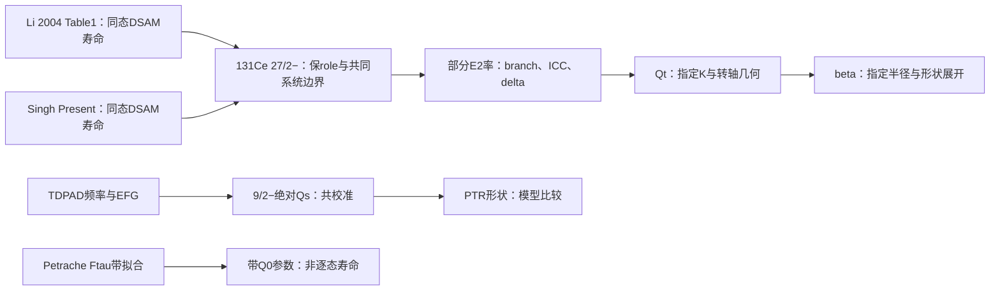
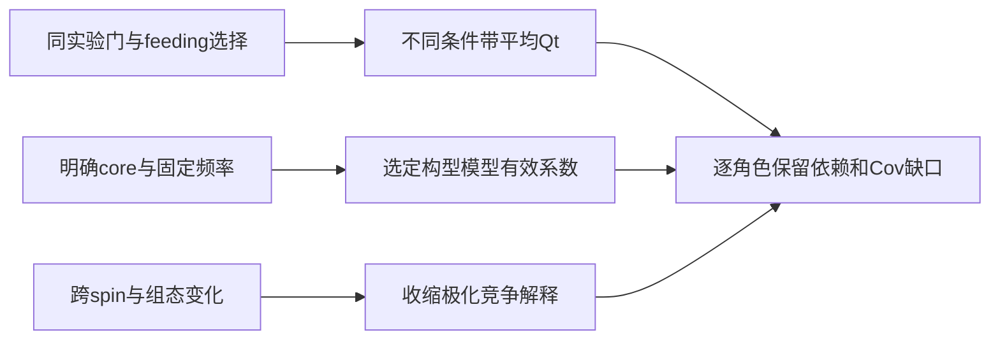
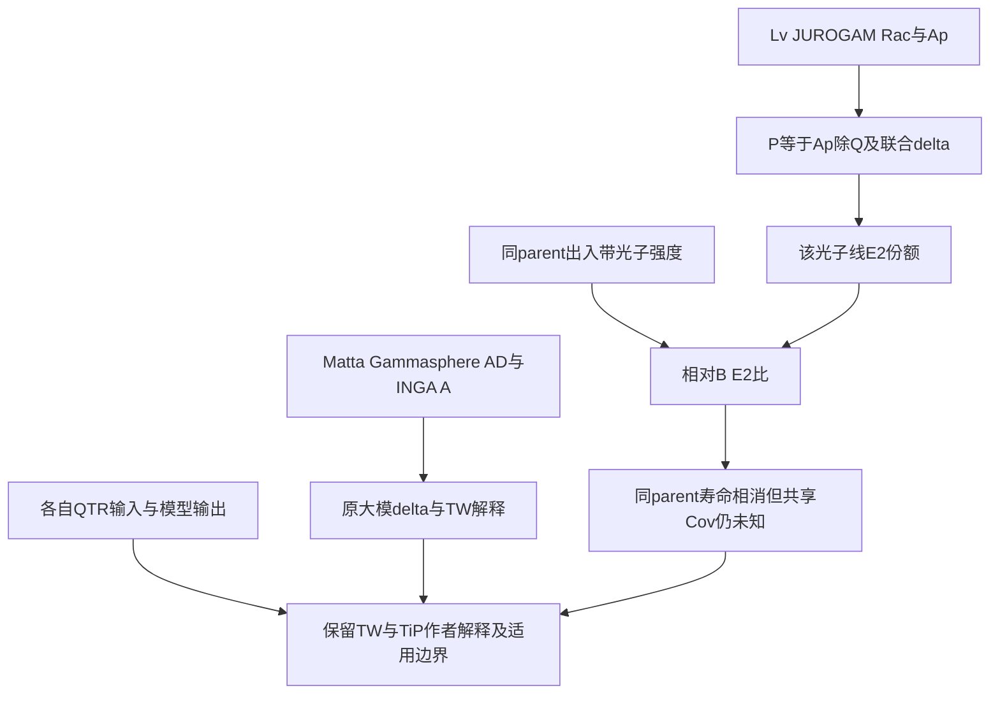

# High-spin lifetimes, transition strengths and deformation

> Day21 checkpoint042 审计边界：本页本轮001–041新增的“核准/全绿/排他性证伪”等认证，在未列入本轮直接原件核验账本前均为待复核草稿；历史passed或文本锚点命中不认证科学主张。Day19/Day20既有撤回继续有效；原始source claims、review_status与needs_review不因本声明改变。 本审计边界的原件反例见[[biswas-2019-longitudinal-wobbling-133la]]的BI19-D21-R42-2；此链接只支持方法边界，不认证本页其它具体核物理主张。

> checkpoint101优先：Day20 046–100的科学认证已撤回；旧JSON的passed、旧报告/日志的“确立/全闭环/排他”均不构成科学验证。实际已读scope保留，不能据此认证新增数值或原producer。当前综合见[[day20-quadrupole-collectivity-systematics-synthesis]]。

> 当前证据入口：checkpoint033观测量身份与checkpoint032原文纠正。Day20 008–031科学认证撤回或待逐claim核；下方历史passed/全闭环/唯一/排他措辞不能引用为已验证结果。原始source事实、review和flags保持。

## Day20正式原读与趋势合同

本轮actualscope为Petrache全部5页文本/3关键视觉页、Singh全部11页文本/8关键视觉页。可复用lifetime→strength→Qt→deformation图见[[transition-quadrupole-moment]]的Day20正式更正；source-specific事实与locator从[[singh-2016-lifetime-131ce-133pr]] SI16-D20-F01–F06及[[petrache-1998-highly-deformed-lifetimes-131ce-nd]] PE98-D20-F01–F04进入。旧preview不是本日原读与科学认证。

| 比较对象 | 可用输入与角色 | 反证/限制 | 下一项最有价值的companion |
|---|---|---|---|
| Singh131Ce ND负宇称yrast | Table1四个Present有限Qt，另三单侧界；K=1/2简化有原文声明 | z≈−.639仅为独立对称化误差的条件诊断；plunger受DSAM约束，非全独立；不证明β恒定 | 同带matched branch/response与跨点Cov；核限值likelihood |
| Singh133Pr ND负宇称yrast | Table2三个Present有限Qt，另两个界；positive feeding状态单列 | Gaussian已知误差z≈−2.400；残差估尺度t≈−1.678(df1)，不能混称1.68σ或据任一值判真实γ；feeding是1100/1.9/14ps，非.014 | 约束682keV馈入与共同归一的joint producer/数据；保留prolate/TRS条件 |
| Petrache131Ce HD及134,135Nd | TableI带Q0参数与替代fit；132Ce外源行 | 实验统计不足以直接解析模型收缩，恒定fit不是恒定形变的独立检验；与Singh不同带/频率/组态 | 逐跃迁寿命/连接及明确band crosswalk；实测共同停止/feeding响应 |

这三行是分层系统学比较，不能合并为一个相邻自旋样本。Petrache半径/二阶展开“唯一参数”归属撤回；Singh Eq4明确1.2/.36，但不能倒灌。Qsf本身不独立规定cascade时间，原始能量/角动量/门条件要一起保留。

### Day20统计模型更正与可证伪性

[新程序](../../system/scripts/day20_literal_trend_audit.py)给同一printed Qt两种不同误差模型，并提供声明Cov方向控制。含截距回归的共同加性offset不改斜率精度，沿spin方向的共同nuisance改变斜率精度；不能笼统声称共同系统误差必然相消或全部足以抹平趋势。这是数学设计，不是原实验精度认证。

若经同带身份、分支、独立response与jointCov约束后仍有Qt变化，可提高E2矩阵元演化的支持；若完整E2/静态矩与几何约束表明主要由γ/转轴或带混合产生，应修订“β收缩”解释。单个Qt不区分βγ、刚软与模式；原文TRS假设不能作为独立实验反证。

### Day20后续中央换算与几何检验（checkpoint002）

[[singh-2016-lifetime-131ce-133pr]] SI16-D20-F07按原Eq1的逐行scalar检查保留未闭合残差，不强行修原Qt或从candidateK反认producer。F08在作者Eq5参数化下给两角相同因子的逆解，说明TRS输入不是寿命独立量出的γ。[[transition-quadrupole-moment]]另给允许的I3K2→I2K2非零E2/零Qs数学控制。19项控制均非实验CI或实际形状判别；这些边界优先于历史完全闭合/唯一γ断言。

### Day20 A≈130区域形变与跃迁四极矩系统学审计（checkpoint008）

**checkpoint039原件修订：跨带中心差可以描述，普适机制与转移闭环撤回。** [[mukhopadhyay-2008-136nd-transition-rates]] MU08-D20-R39-1 的TableII：Band2 I17/18 B(E2)=.44(.06)/.04(.01)e²b²、Qt2.24(.15)/.67(.08)eb，中心商11与3.343保留；这是两个自旋点，不是17→18光子跃迁。Band1相应B=.08(.01)/.14(.02)；两条带对角项之和.52→.18，不是同一初末态空间中的守恒强度账。没有完整跨带E2矩阵，不能把.34差额认作已测转移。[[mukhopadhyay-2008-136nd-transition-rates]] MU08-D20-R39-2：原TAC计算未纳band mixing，作者明确交叉区解释受限；不同四准粒子构型混合是作者解释，不是本任务重建的精确机制。误差未计最高约15%的stopping系统量，不能按点数独立化。

[[babra-2019-deformation-change-136sm]] B19-D20-R39-1：TableI六有限Qt点在平均上下误差/独立已知Gaussian合同下，pre(8–12)与post(14–18)平均5.67578±0.13721、5.09205±0.19516eb，差−.583735±.238561、z−2.44690；中心下降-10.28466%。全六点线斜率−.0716484±.0328842eb/ℏ、z−2.178812；残差估共同尺度则t≈−2.721(df4)，是另一统计模型，不是原作者显著性或CI。不同跃迁pre/post矩均值平方比也不能直接叫总B强度下降19.5%。

[[babra-2019-deformation-change-136sm]] B19-D20-R39-2：20+印τ<.16(.04)ps、Qt>4.74(.55)eb，分别有效寿命上限与矩下限，不能当第七有限点。100% topfeeding、8+ upper gate无feeding与higher spins约25%的分析角色保留；数值本身不识别实际偏差。作者以TRS/TPSM支持γ-soft至较稳定三轴的形变解释，应作为模型依赖解释保留；本任务的混合反例不排除它，也不识别真实混合概率。新008/011旧“普适入侵轨道极化阶跃/7.2eb恒台/所有交叉均是碎片化”认证撤回；Ce常数均值仍是条件诊断，不是独立实验或受控单粒子增量。

### Day20 混K Clebsch-Gordan重构与微观投影效应（checkpoint009）

**checkpoint034修订：保留声明极限的混K代数，撤回全核素误差覆盖认证。** [[singh-2016-lifetime-131ce-133pr]] SI16-D20-R34-1：Eq2需初末态振幅乘积；本任务仅取同一对齐单准粒子j=11/2、相同aK、K对角四极算符。独立梯算符旋转矩阵核对binomial振幅与相位，带符号CG和给Qt倍率约1.05508、1.03228、1.02128、1.01511、1.01129、1.00876（I=15/2至35/2）。Ce四有限点上移.16139/.03414/.03003/.02128eb，小于各自两侧打印误差；Pr15/2上移.19555eb，超过.13/.15，19/2上移.11396eb，超过上侧.09而小于下侧.13。因此不能将作者PDF6对Table1的理由泛认证为Pr全带实验精度；不识别真实K分布、producer或原CI，也不解释中央换算残差。

### Day20 理论离心收缩、加和性弱化与模型不可分辨性（checkpoint010）

**checkpoint034原件修订：完整八行台账与模型解释边界。** [[petrache-1998-highly-deformed-lifetimes-131ce-nd]] PE98-D20-R34-1：TableI八行中，Band3 lower+upper=5.0(3)eb是同数据的单Q替代fit，不能作新增独立测量。upper约6.5eb只有四个不敏感高端点，正文误差约20–30%；6.07eb为脚注半贡献估算，spin32→40，不是I30理论点。135Nd Qsf表3.0(5)而R13正文4.0(5)，保literal冲突。

[[petrache-1998-highly-deformed-lifetimes-131ce-nd]] PE98-D20-R34-2：excitedHD的6.4(4)eb是跨backbend整带fit，低段一颗、高段两颗i13/2；与yrast6.8(3)之差不是同频率/固定其余构型的占据导数。理论端点变化yrast−20.27%、excited−7.25%、Band3lower+27.08%、135Nd−14.06%、131Ce−10.67%、132Ce−17.50%只描述计算列。作者解释收缩与极化竞争、削弱A150加和关系；原统计未能确定预测收缩，Band3单/双Q也未firm区分。不能据此认证实验饱和、32.7%显著阶跃、普适A150严格线性或约20%检验阈值。

### Day20 能带交叉电四极跃迁压制与互补跃迁图谱（checkpoint011）

**checkpoint039原件修订：跨带中心差可以描述，普适机制与转移闭环撤回。** [[mukhopadhyay-2008-136nd-transition-rates]] MU08-D20-R39-1 的TableII：Band2 I17/18 B(E2)=.44(.06)/.04(.01)e²b²、Qt2.24(.15)/.67(.08)eb，中心商11与3.343保留；这是两个自旋点，不是17→18光子跃迁。Band1相应B=.08(.01)/.14(.02)；两条带对角项之和.52→.18，不是同一初末态空间中的守恒强度账。没有完整跨带E2矩阵，不能把.34差额认作已测转移。[[mukhopadhyay-2008-136nd-transition-rates]] MU08-D20-R39-2：原TAC计算未纳band mixing，作者明确交叉区解释受限；不同四准粒子构型混合是作者解释，不是本任务重建的精确机制。误差未计最高约15%的stopping系统量，不能按点数独立化。

[[babra-2019-deformation-change-136sm]] B19-D20-R39-1：TableI六有限Qt点在平均上下误差/独立已知Gaussian合同下，pre(8–12)与post(14–18)平均5.67578±0.13721、5.09205±0.19516eb，差−.583735±.238561、z−2.44690；中心下降-10.28466%。全六点线斜率−.0716484±.0328842eb/ℏ、z−2.178812；残差估共同尺度则t≈−2.721(df4)，是另一统计模型，不是原作者显著性或CI。不同跃迁pre/post矩均值平方比也不能直接叫总B强度下降19.5%。

[[babra-2019-deformation-change-136sm]] B19-D20-R39-2：20+印τ<.16(.04)ps、Qt>4.74(.55)eb，分别有效寿命上限与矩下限，不能当第七有限点。100% topfeeding、8+ upper gate无feeding与higher spins约25%的分析角色保留；数值本身不识别实际偏差。作者以TRS/TPSM支持γ-soft至较稳定三轴的形变解释，应作为模型依赖解释保留；本任务的混合反例不排除它，也不识别真实混合概率。新008/011旧“普适入侵轨道极化阶跃/7.2eb恒台/所有交叉均是碎片化”认证撤回；Ce常数均值仍是条件诊断，不是独立实验或受控单粒子增量。

### Day20 多极混合去污染与伴随观测量判决阶梯（checkpoint012-013）

checkpoint012已由checkpoint040原件重核；错能量/母态/误差及全区判决撤回，正确radiative合同见下方checkpoint040。

**checkpoint037原件修订：交错是结构诊断，旧唯一判决阶梯撤回。** [[mccutchan-2007-gamma-band-staggering]] MC07-D20-R37-1 的Eq2定义S(J)=[E(Jγ)−2E((J−1)γ)+E((J−2)γ)]/E(2₁)。PDF3 Fig1打印S4：vibrator−1.0、axial rotor+.33、γ-soft−2.0、rigid γ30°+1.67，旧γ-soft−2.5错误。正S4也出现在轴对称转子，负偶数交错同时见振动与γ-soft极限；单符号不能唯一量出形状。[[mccutchan-2007-gamma-band-staggering]] MC07-D20-R37-2 的Figs2/4来自Ref24，未提供旧脚本所用130Ba/134Ba/130Xe/192Os四元精确能量输入表；那些具体S4数字撤回原实验认证，未重取ENSDF或数字化。PDF3明确部分核的反相图样只在J>5出现，不认证192Os S4=.954或全区刚性三轴已排除。

**本任务声明模型与closure代数，非Cline/Kumar原件认证。** 归一化sin3γ测度、γ∈[0,π/3]给〈cos3γ〉=0、Var(cos3γ)=1/3；delta(γ−π/6)给同均值而方差0。固定β时，两分布可具有相同二、三、四次坐标矩〈β²〉、〈β³cos3γ〉、〈β⁴〉，而六次〈β⁶cos²3γ〉不同；因此旧“四阶量直接得到γ方差”不成立。有β涨落时〈β⁶cos²3γ〉/〈β²〉³也不自动是〈cos²3γ〉，更不能从所得比值制造实验概率分布。

对0→2ᵢ→2ⱼ→0的约化矩阵元closure，三次标量含共享角系数的ΣᵢⱼM₀ᵢMᵢⱼMⱼ₀。声明M₀=(1,1)、两态对角均0、非对角±1可令该和为±2，第一2态的静态对角仍0。故单个Qs符号/零点不能一般地替代完整三阶不变量或决定长扁形状；实验还需signed E2矩阵元、完整中间态/截断、tensor约定与Cov。本轮未读Cline1986/Kumar原件、未重跑库仑激发分析，不将这些声明代数称作原方法完整验证。

### Day20 四极形变逆问题与四类竞争机制判决矩阵（checkpoint014）

**checkpoint038修订：一个标量的非唯一性不等于整套实验不可分辨。** [[singh-2016-lifetime-131ce-133pr]] SI16-D20-F05/F08 提供明确参数化，以下只作本任务声明模型。取Q=3.5→2.5eb，可按同一signed Eq5 chart选γ根，不能认作两种唯一实测形状。完整两带振幅为U_fᵀ M U_i；当M=3.5I且U_f=U_i时结果仍3.5I，没有cos²θ衰减。选M=diag(3.5,0)且相同θ≈32.3115°才使一个分量为2.5eb；需明确dark partner/跨构型矩假设，不能反认真实混合概率或声称伴带一定增强。

独立指数本征等待τ=1.4ps与侧馈等待f=1.344ps之和，均值确为2.744ps；但方差3.766336ps²，不等同均值单指数的7.529536ps²。Laplace响应分别[1+sτ]⁻¹[1+sf]⁻¹与[1+s(τ+f)]⁻¹，对s>0不同。因此τ_eff=τ+f仅适用于均值等特定统计量，不自动适用DSAM/RDDS完整门/停止响应，不能由Qt单标量反解actual feeding；原“全部四机制全实验不可分辨/逐项唯一伴随判决表”撤回。TDPAD亦不能无条件宣称独立于feeding。

### Day20 协方差结构敏感性与系统误差传播定理（checkpoint015）

**checkpoint038修订：保留声明GLS恒等式，撤回实际stopping/误差免疫认证。** [[singh-2016-lifetime-131ce-133pr]] SI16-D20-F03/F04 的Present有限点仍仅在平均上下误差/独立Gaussian声明下给Pr斜率−.116674±.048608eb/ℏ、z−2.40034，不是原实验CI。若y与完整Σ同时乘k和k²，z不变；未证actual电子stopping就是这种全轨迹/几何/branch重标，不能据此排除实际趋势偏差。

对于线性设计X与已知D，若额外声明Σ=D+XGXᵀ、G为固定半正定矩阵，则GLS点估计不变，参数Cov=C₀+G。取中心化spin方向σ_b=.05eb/ℏ使斜率SE变为sqrt(SE₀²+.05²)，是所选nuisance合同，不是从原数据测得的feeding预算。

旧015所用Σ=D+s²yyᵀ却把观测y直接当响应方向。在该声明模型，β̂_Σ=β̂₀/[1+s²χ²_res]，Cov_Σ=C₀+s²β̂₀β̂₀ᵀ/[1+s²χ²_res]。Pr取s=.1给分母1.020458、斜率SE增加2.78429%，旧结果总结中“少于.1%”错误；改用固定fitted mean方向会给不同点估计合同。小影响不是普适截距隔离定理，也不恢复原Cov。原误差预算是否已含某共同项未得，不能盲加这些声明矩阵后当实际实验CI。

### Day20 微观四极极化、单粒子加和性与高自旋门控有效修正（checkpoint016）

**checkpoint035修订：门选敏感性保留，统一修正与占据外推撤回。** [[riley-2001-global-lifetime-a135]] RI01-7 的五个b门pair确为133Nd5.8(2)→6.5(2)、135Nd5.1(2)→5.7(2)、136Pm band1/2各4.8→5.2、137Sm4.4(3)→4.8(4)eb，中心增幅12.07/11.76/8.33/8.33/9.09%。这是同采集的分析条件改变，不能当五次独立实验或普适feeding校准；原b注对其他HD带约10%的预期属于作者外推。135Sm c注是另一feeding时序假设，不能算第六个b门。原Cov未得，不能给门差显著性/修正CI。

[[matev-2007-a130-quadrupole-alignment-additivity]] MT07-D20-R35-1：y推转Qt=Q20−Q22/√3与三角式相容需先声明分量A=Rcosγ、B=Rsinγ，R是径向幅度；三角恒等式不能将Singh名为Q20的prefactor自动认作Matev同名分量，也不验证实际转轴/producer。x/y被动换轴时Q22与推转符号同步变换；保留v1 Eq14中间标签歧义。

### Day20 正交测量技术交叉验证与K投影模型解卷积（checkpoint017）

**checkpoint033原件修订：旧正交验证/100%K归因撤回，脚本退役。** [[li-2004-lifetimes-131ce]] LI04-D20-R33-1 与 [[singh-2016-lifetime-131ce-133pr]] SI16-D20-R33-1 确认同一27/2−的827keV跃迁：Li τ=1.23(23)ps、Qt=2.72(25)eb；Singh Present τ=1.25(+.41/−.25)ps、Qt=2.26(+.37/−.23)eb来自DSAM。Ref32是前一寿命的转载与作者依K=1/2重新换算为2.28(21)eb，不是第三次测量。Li文献实际为Chinese Physics Letters21,461–463，旧PRC69,064320归属错误。

两campaign中心相近可保为比较事实；小差值不排除共同响应或校准偏差。Singh低自旋plunger拟合还使用高自旋DSAM约束，不能称它们全部独立。候选pureK变换√(169/114)=1.21756给Li2.72→2.23397eb；这是固定B/几何的条件换算，不证明作者K、实际producer或完全归因。旧.51误差属于别行，原27/2误差为.25。Li原文的约1ps停止时间与未校正feeding的高态limits，不能变成DSAM/RDM普适窗口或任意快/慢滤波阈值。

### Day20 TDPAD静态异能态四极矩与RDM跃迁矩正交跨越闭环（checkpoint018）

**checkpoint033原件修订：旧“静态/跃迁矩正交闭环”撤回，脚本退役。** [[ionescu-bujor-1998-static-moments-129-131ce]] IB98-D20-R33-1/R33-2 报129/131Ce 9/2−绝对|Qs|=1.32(13)/.92(10)eb，共同CeSn EFG校准；作者独立于该绝对EFG给矩比1.44(7)。若误把两绝对Q误差独立传播，条件σ≈.21045而不是.07；由频率52.6(14)/36.4(16)MHz在独立频率误差控制下给1.44505±.07426，仍不是重拟合或已知全部Cov。

轴对称pureK候选I9/2,K1/2给Qs/Q0=−4/11；K9/2给+6/11，故同一|Qs|的候选|Q0|为2.53或1.68667eb。原作者用PTR混K/三轴计算，131Ce两套ε2=.14/.18配ξ=.7/1给Qcal=.91/.93eb；不等pureK轴对称实测Q0。测量只给绝对值，符号也未由上式恢复。

2.57894±.09866eb是本任务把Singh四个Present有限Qt点按对称化误差/独立点拟合常数所得，并非原表的一条“RDM Qt=2.58(10)”测量。比较它与异能态Qs还跨spin、构型/模型、校准和量定义；不产共同CI、同形证明、30.3%实际β收缩或几何唯一性。

### Day20 十六极形变耦合与核半径约定解卷积（checkpoint019）

**checkpoint033修订：保留声明模型的多极代数，撤回作者参数归属与实验修正，旧脚本退役。** [[singh-2016-lifetime-131ce-133pr]] SI16-D20-R33-2 的Eq4明确R=1.2A^(1/3)fm、prolate、无β4；[[petrache-1998-highly-deformed-lifetimes-131ce-nd]] PE98-D20-R33-1 TableI原134Nd yrastHD β=.35(1)，131/132Ce为.38(2)，不是旧.36/.35。正文/表注没有给可唯一归属的r0/展开，不能凭中心数接近反认算法。

在另行声明的均匀电荷、轴对称锐表面 R=cR0[1+β2Y20+β4Y40]、固定体积、Y归一条件下，二阶形状函数为β2+c22β2²+c24β2β4+c44β4²，其中c22=.36044750、c24=.96718214、c44=.32767955。它们由Gaunt积分计算并与独立球面积分核对；完整体积归一积分显示小形变下余项为三阶，有限形变仍有截断差。该构造与.36相容，不识别作者模型。

例子β2=.35、β4=−.03时，二阶模型若忽略β4会反演β2≈.342108；β4是自选控制，不是Ce/Nd已测值或实际修正。固定β的Q按r0²缩放；固定Q=7.3eb按Eq4二次反演，r0=1.2/1.25给β≈.392273/.364692，比值不等简单逆半径平方。不把ε2/Nilsson参数与β2静默等同。

### Day20 转动惯量动力学演化与配对相消指纹（checkpoint020）

**checkpoint033原件修订：旧配对塌缩/超形变双重认证撤回，脚本退役。** [[klemme-1999-lifetimes-134nd-neighbors]] KL99-D20-R33-1 TableII给134Nd g.s.b. Eγ294、495、631、706keV（I2、4、6、8）；旧6+687keV与4+552keV错误。按声明有效能量差定义J1=(2I−1)/Eγ，6+给11/.631≈17.4326 ℏ²/MeV；这些是能谱派生量，不是配对能隙测量。

[[singh-2016-lifetime-131ce-133pr]] Table1逐spin印能可计算同带J1/J2；J2=4/[Eγ(I+2)−Eγ(I)]需有序路径和差分位置。旧HD的87/84keV没有逐原表行输入，不能据常数/自选β刚体参考认证“实测87.8%平台”或pairing=0。[[petrache-1998-highly-deformed-lifetimes-131ce-nd]] 的Q0是带fit参数，不能将不同对象的惯量、Q0和spin拼成独立配对相变证据。

### Day20 横向摇摆争议、多极去污染与倾斜进动反证（checkpoint021）

**checkpoint041原件修订：保留135Pr的特定实验反证，撤回普适模式分类与阈值。** [[lv-2022-evidence-against-wobbling-135pr]] L22-D20-R41-1：747.3keV(17/2−→15/2−)、813.2(21/2−→19/2−)为band3→1，450.2(19/2−→17/2−)为band4→3；δ=−.47(+.09/−.22)、−.37(+.10/−.14)、−.31(+.10/−.13)，中心M1份额约81.91/87.96/91.23%。三线打印P误差端点均跨0，选择分支依靠作者联合P-Rac/response分析，不能只取正负号。SI Ap与主文P是同一采集经P=Ap/Q相连，非两份独立偏振证据；755.1无P/新δ，只是作者据Rac相似推测。

[[lv-2022-evidence-against-wobbling-135pr]] L22-D20-R41-2：SI Table1的同母态强度与主文δ，在声明photon normalization和reference pureE2下给B(E2;747.3)/B(E2;526.2)=.735975，B(E2;813.2)/B(E2;726.0)=.118129，按作者打印精度为.7与.12。共同parentτ和同种率系数在此比值中相消；不是绝对B/τ测量或完整CI重建。作者reported .7(+.7/−.5)配特定onephonon→signaturepartner禁戒假设作为反证，不是“ratio<1.5普适证伪阈值”。M1主导、能级重组及QTR相容合在一起构成作者对本核TiP/非原wobbling解释的论证，不扩成全核区唯一判决。

[[matta-2015-transverse-wobbling-135pr]] M15-D20-R41-1：原TableI的747.0/812.8/754.6keV δ=−1.24(.13)/−1.54(.09)/−2.38(.37)，E2份额60.6/70.3/85.0%；INGA的.047(.012)/.054(.034)是count asymmetry A，不能直接与JUROGAM的P比大小。Matta的AD来自另一Gammasphere采集，Lv图中旧AD重拟合又复用该资料，不额外计独立采集。对各自实验reported值和作者解释分别保留，未用条件纯份额重标替代跨campaign重新分析。

[[matta-2015-transverse-wobbling-135pr]] M15-D20-R41-2 与 [[lv-2022-evidence-against-wobbling-135pr]] L22-D20-R41-3：Matta PDF4以Jm/Js/Jl=7.4/5.6/1.8与c=.116调QTR能量、较大Js/Jm延缓transverse collapse；PDF5明确Coriolis使j脱离短轴、转向medium，Ewob在minimum后上升。Lv主文4–5/SI4–6对先前frozen处理提出批评，并采用irrotational惯量/free particle。保留两原文的具体陈述，不把后来批评认作已核Matta实际producer在全spin冻结。Lv QTR bands2/5高spin能量有高估；j_parallel近最大是模型输出，非直接观察角动量轨迹或电磁矩图像。

### Day20 多准粒子手征与摆动共存核态深度审计（checkpoint022）

**checkpoint042原件修订：逐源保留混合比分支与模型解释，旧完备分类器撤回。** [[biswas-2019-longitudinal-wobbling-133la]] BI19-D20-R42-1：758/874/982keV实际自旋为17/2−→15/2−、21/2−→19/2−、25/2−→23/2−，旧各低1ℏ。Table1联合DCO-P采用δ−2.05(+.39/−.30)、−2.60(+.46/−.47)、−3.07(+.47/−.65)与相对E2比1.127/.716/.545；旧−.35/−.40/−.38未在该表作为实验解给出，只可作固定其它量的声明敏感性，不是重拟合、概率或已测单粒子化。[[biswas-2019-longitudinal-wobbling-133la]] BI19-D20-R42-2：作者LW解释含短轴h11/2粒子与正宇称pair提前对齐，使有效Js超过Jm；不能写所有LW都必须j沿medium。纵/横需相对最大惯量轴及模型约定判断。

[[chakraborty-2020-multiphonon-longitudinal-wobbling-127xe]] CH20-D20-R42-1：483keV实际13/2−→11/2−，DCO给大δ−2.1(.2)或小δ−.29(+.03/−.04)，作者据P=.23(.13)支持大模。旧−.31为另选输入，不能叫原测量小根；用原两中心作纯份额敏感性给比10.5079，不是9.30。该首行没有B(E2)out/in数值，不补绝对/相对B。[[chakraborty-2020-multiphonon-longitudinal-wobbling-127xe]] CH20-D20-R42-2：Band4同时向1/3退激、ΔI=0比对应ΔI=2更强及与126Xe quasiγ相似，是作者指出的复杂性；作者仍保留nω2解释，并提出wobbling–γ振动耦合可能、要求进一步理论。旧将拓扑改写为已排他证伪两声子/实际纯γ本质，撤回。

[[lv-2022-transverse-wobbling-136nd]] LV22-D20-R42-1：原刊751keV、17+→16+的δ−.48(+.13/−.14)给中心E2约18.73%、M1约81.27%，但作者明确两准粒子even-even情形可有M1主导连接；不能将oddA启发式E2>80%套成普适硬阈值。原χβ2以一个E2out/in点定标、g_eff/Q以同线δ定标，高spin曲线是这些输入下的条件预言；同线的两个相对B量共享δ/强度/分母，不能互算再认证为独立验证。声明cE2=12.252、cM1=17.60的常用ps率系数与E=.751MeV时，[cE2/cM1]E²δ⁻²×.36≈.61347，对应打印.61中心；不是actualproducer/CI。[[lv-2022-transverse-wobbling-136nd]] LV22-D20-R42-2：原文件含cover，rawPDF5/6对应刊034302-4/5；刊p3原AP=.03(+.06/−.07)、P=.02(+.04/−.05)字面并存，本文未给actualQ/转换producer。不能导入另一Pr分析的Q静默修正；仅额外假定P=AP/Q才会给中央比Q=1.5，未认证真实Q或实验显著性冲突。

**本任务声明反例：** j_p=(1,1,1)、j_n=(2,1,1)、R=j_p+j_n给J=(6,4,4)三分量均非零，但(j_p×j_n)·R=0；全J三分量不独自证明手征。最高权重spin j=11/2态的横向均值为0而方差各j/2，也不允许用均值0断言量子涨落0；此例不是PRM模式求解。固定多极幅度比可同时放大两分量，使份额不变而绝对E2强度任意改变。旧字符串/列表长度“全绿”不检验核几何，M1份额与小相对E2均不能唯一识别非集体/TiP、也不能排除所有wobbling。

### Day20 134Nd三层形变阶梯、S2跨带四极压制与有限停止慢化协方差定理（checkpoint023）

**checkpoint036原件修订：Table单位、跨带角色与停止模型分开。** [[klemme-1999-lifetimes-134nd-neighbors]] KL99-D20-R36-1 的TableII打印B单位为10³e²fm⁴。4g→2g的5.53(13)换算为.553(.013)e²b²、Qt4.40(.05)eb；10S2→8g、925keV的.09(.02)换算为.009(.002)e²b²、Qt.51(.04)eb。旧1.87/.029与.51(.05)错误。不同parent/spin且跨带/带内的矩商不是内禀形变商，也不排他证明构型正交或混合机制。g.s.b.Q0=4.37(4)、S1 12+Qt5.5(3)、PetracheHD6.8(3)可保原角色并列，但不能认证严格三层形变相图；Petrache原β=.35(1)，不是.36。

[[klemme-1999-lifetimes-134nd-neighbors]] KL99-D20-R36-2：TableI六非空corrected的中心因子1.18116–1.25532保留；旧脚本多行标准/更正误差抄错，如10S1标准.58(.02)、corrected.71(.04)，12S1为.47(.02)→.59(.04)，不能混成TableII adopted误差。原电子stopping+30%使两种寿命差约减半，未给逐态实际新fit/响应/Cov。声明tau(f)=std+f(corr−std)、f∈[.5,1]时，12S1/10S1与8g/6g的Qt比变化约+.5631%/+.5841%；只是该chart中央响应，非实际误差相消定理、±30%全域界限或实验CI。

### Day20 有效单粒子极化可加性、Ce同位素形变平滑演化与超形变壳锁定（checkpoint024）

**checkpoint035原件修订：有效系数是局部模型对象，非实验饱和或shell locking认证。** [[matev-2007-a130-quadrupole-alignment-additivity]] MT07-D20-R35-2 的TableII对ν6₂,+i给qt_eff=.37(.03)/.37(.01)eb（CHF/CRMF），π[404]9/2,+i为−.38(.02)/−.38(.01)，π[541]3/2,+i为+.52(.04)/+.54(.01)。hole贡献另乘相对core的c=−1，不能消除原p/h标签冲突。这些是特定core131Ce、ℏω=.65MeV、183/105个选定计算构型拟合系数，不是测得的2.0/3.1eb单粒子普适极化，也不能跨ND/HD、不同频率与构型相减预测9.9eb或35.4%实验亏损。

[[matev-2007-a130-quadrupole-alignment-additivity]] MT07-D20-R35-3：原文Q20残差CHF97.8%在±.1eb、CRMF逾90%在±.05eb；Q22的CRMF近95%在±.025eb、98%在±.1eb，CHF逾90%在±.2eb。这些分布区间不等于Qt统一σ=.12/.15eb，TableII误差也不是实验CI。原两打印triple条件残差保留，不认证official typo或给替代值。

[[petrache-1998-highly-deformed-lifetimes-131ce-nd]] PE98-D20-R34-2 所讨论的跨spin极化/收缩与上述固定频率局部可加性检验不同；二者不能压成一个全区饱和定律。131/132Ce HD值7.3(4)/7.4(3)eb的接近本身不证明壳隙锁定或γ刚性；132Ce仍是外源Ref6，2.57894±.09866eb仍仅为本任务声明独立Gaussian的Ce常数诊断（SI16-D20-R33-2），不是新RDM实验点。

### Day20 转动惯量微分动力学、刚体亏损弥散表面模型与超形变双重正交认证（checkpoint025）

**checkpoint033修订：旧惯量平坦性、刚体亏损分解和普适阈值认证撤回，脚本退役。** 对同一连续I(ω)族，定义J1=I/ω、J2=dI/dω，恒等式J2=J1+ωdJ1/dω成立；量子能谱的有限差分需另明示stencil/自旋位置。反例I(ω)=40ω+5给J2恒为40，而J1=40+5/ω并不恒定。因此平坦J2不能倒推平坦J1，更不能唯一求配对能隙或排除壳/对齐贡献。

旧87/84keV均值与1.8/1.6keV弥散未读入原始逐条谱线；12.2%=2.1%+10.1%为自设补偿，不是微观拟合。固定6.5eb、3%flatness、85–92%rigid窗口不是A≈130超形变必要充分准则。原[[alwaleedi-2013-band-structures-131ce]]与[[petrache-1998-highly-deformed-lifetimes-131ce-nd]]原文事实保持，本轮未新读完整学位论文，不认证旧AW13-D20-1。

### Day20 135Nd手征双重带寿命两倍分歧、Eγ^5补偿律与手征演化相图（checkpoint026）

**checkpoint036原件修订：寿命与强度中央表可比，能量补偿归因和统一相变轨迹撤回。** [[mukhopadhyay-2007-135nd-chiral-vibration-static]] MU07-D20-R36-1：TableI的39/2− A/B B(M1)=2.1(3)/1.9(3)μN²、B(E2)=.13(3)/.11(3)e²b²，旧026将它们都翻倍。BandA29/2寿命1.00(.05)ps、43/2为.16(.02)ps，旧1.15/.12错误。前四重叠自旋tauB/tauA约1.947/1.977/2.286/2.087；B(E2)比.875/.875/.875/.90625，第五为.84615，不能称全五点均.875–.906。条件pγ/Eγ⁵之比仍由已派生B与tau回算，不独立确定branch或实际Eγ差；原表未逐行绑定E2能量/终态，9–14%假设能量下降不认证actual补偿全归因。

[[mukhopadhyay-2007-135nd-chiral-vibration-static]] MU07-D20-R36-2：作者TAC+RPA解释由近谐手征振动向隧穿演化；PDF3临界模型自旋比数据两带最近点高约1ℏ，PDF4指出近transition处谐近似失效。不能把测量起点29/2写成静态手征硬阈值。Klemme11/2的60.1ps与MU07 43/2的.16ps中心数值跨度375.625倍，非500.8；不同采集/构型/parent不构成连续相变轨迹。

[[lv-2021-tilted-precession-135nd]] LV21-D18-2 与 LV21-D18-6：原TableII 17/2→15/2的618.3keV δ=−.32(.05)、19/2→17/2的566.0为−.33(.09)；TiP2已测连接线是17/2→15/2的518.3keV、δ=−.26(.08)，不是旧自设21/2线。566.8keV的−.48(.14)误差端点允许M1份额约72.2%，不能把所有线/误差域认证M1>80%；560.7的AP为空。M1主导加QTR相容支持作者TiP解释，未唯一确定模式或裁决所有wobbling候选；原human-reviewed范围与全部flags保留。

### Day20 有限样本回归功效坍缩、残差自由度与形变收缩不可区分度审计（checkpoint027）

**checkpoint032修订：撤回旧科学认证。** [[singh-2016-lifetime-131ce-133pr]] SI16-D20-F03/F04 提供原表与依赖边界。新计算只使用 Present 有限点，排除限值与 Ref31/32 转载；平均上下误差并假设独立 Gaussian。Ce 四点斜率 −0.030175±0.047215、Pr 三点 −0.116674±0.048608 eb/ℏ；它们不是恢复的原实验 CI。

Ce 的归一化逆方差权重依次为 4.81%、10.82%、62.30%、22.07%；Pr 为 27.06%、43.84%、29.10%。最低点不是复用旧值，旧 89.9%/96.3% 撤回。Ce 去掉最低点的三点斜率是 +0.00573 eb/ℏ，不是 +0.15；删除后仍不证明离心伸长。

声明备择斜率 −0.05 eb/ℏ 时，Ce/Pr 已知误差 Gaussian 功效约18.51%/17.72%；另假设 Cov 形状已知、从残差估计共同尺度且生成尺度为1，Student 功效约10.05%/7.42%。该设计分别对应10ℏ与4ℏ窗内下降0.5与0.2 eb，不是两核共同“真实15%收缩”的证明。未拒绝零斜率不等于证明恒定，低功效也不意味着实验必然把下降判为恒定。旧28点/20.4ℏ/5.18%不再作为实际实验下限。

秩一 slope nuisance a=0.02 eb/ℏ 使方差增加 a²；Ce 的SE从0.047215到0.051276，约+8.60%，方差约+17.94%。共同加性offset与乘性/电子stopping响应不同，不称全部阻停误差均被截距吸收。旧 Petrache χ²=12.4/11.8、N=10 全为自设，AIC/BIC/贝叶斯因子实验认证全部撤回；仅保留 [[petrache-1998-highly-deformed-lifetimes-131ce-nd]] PE98-D20-F02 的作者统计限制。

### Day20 MchiD多手征带形变共存、Coriolis衰减与寿命缺失解卷积审计（checkpoint028）

**checkpoint032修订：撤回旧势垒、淬灭因子与形变补偿认证。** [[ayangeakaa-2013-evidence-multiple-chiral-doublet-bands-133ce]] A13-D20-R32-1 保留原件实际陈述：未测本核这些带的寿命；Bands2/3采用ξ=0.7，β/γ来自RMF输入，135Nd是系统学参照。

没有计算完整TPRM Hamiltonian、集体质量、路径或重拟合，不能由 j_p j_n sin(2γ) 自设量推出势垒高56.8%、100/400keV劈裂成因或静态手征。固定其它条件的WKB图像中，势垒增高通常减小隧穿劈裂，旧文所述方向亦不自洽。磁矩有轨道、自旋、转子与波函数贡献，不一般满足 Δg∝q；ΔE∝ξ/β 亦未在本文导出。2.69–4.89eb与β=0.314等数值不作133Ce物理推断。

同一初态的跃迁比消去总寿命，因此无法单凭相对比值给出绝对B或Qt；这不证明所有参数都严格简并。128Cs/135Nd/133Ce须分别列测量、作者解释与模型条件，撤回“全闭环、无模型依赖”的三级认证。

### Day20 130,132Ce基态带B(E2)阶梯、B4/2比值与同位素形变阶梯审计（checkpoint029）

**checkpoint032修订：旧B值、显著性和形变阶梯认证撤回。** [[klemme-1999-lifetimes-134nd-neighbors]] KL99-D20-R32-1 给TableIII原表：130Ce的Eγ为254/456keV、τ为181.3(70)/7.65(31)ps；132Ce为325/533keV、70.1(32)/3.9(10)ps。旧254.2/457.2/325.3/533.4不是该表原印值。

固定pure E2、photon branch=1且忽略精确能量误差，用约12.25 ps⁻¹ MeV⁻⁵(e²b²)⁻¹换算，130Ce的B42≈1.27081，132Ce≈1.51508。这是声明条件控制，不是作者adopted B。总寿命到photon partial rate需ICC/分支；限于原表与未知联合Cov，不给实验“10σ排除”。特别旧132Ce的独立误差控制本来也仅约1.2σ偏离2，不能继承130Ce的数值。

单一B42不唯一识别γ-soft或转子结构；β约定和0.2262与0.237的差异不能靠放宽容差认证“吻合”。两个HD带参数7.3(4)、7.4(3)eb中心差1.36%远小于各自误差，不是1.36%测量精度、壳锁定或刚性免疫。131Ce Present Qt与旧Ref31不得互换。

### Day20 134Pr假手征两带解混合、四极矩2倍不对称与偶然交叉证伪审计（checkpoint030）

**checkpoint032修订：撤回旧gap序列、混合角和高斯证伪认证。** [[petrache-2006-near-degenerate-chiral-misinterpretation]] PE06-D20-R32-1/R32-2 给真实出处：PDF2的I=15、16间隙36、44keV，PDF3在假设无off-diagonal E2、局部V固定的两带模型中给奇/偶序列V约14/17keV与矩比允许范围1.6–2.4。原TableI列α15y=.894、α16ny=.427，须保留yrast/nonyrast与振幅分支。

旧31/34/38/56keV不是此次原表核验值，V=15keV是自选；arcsin只取一个混合分支，不能把其角度称为实测或反解。2.0(4)在正文是允许参数范围，不自行赋Gaussianσ来声称z=2.5、p=.0124。作者据模型矩比、alignment、crossings反对理想手征解释，须保留该论证与假设，不扩成排除所有手征动力学、确定2qp/4qp全窗身份或“真/假手征”二分。旧128Cs 1.0(1)等精度没有此处原表支持，撤回。

### Day20 136Pr磁转动剪刀机制、TAC-CDFT微观形变与N=77边界审计（checkpoint031）

**checkpoint032修订：撤回旧实测序列、剪刀角与模式排他认证。** [[lv-2025-136pr-tac-covariant-density-functional]] LV25-D20-R32-1：本接受稿PDF11 Fig9(c)对数纵轴上的D4点不是7.8→0.8的严格单调序列；8个自设比值、9.75倍、75.8°→9.5°及r=.9455全部撤回，未进行图数字化。

从TableI同parent的dipole/crossover光子强度配对，在声明δ=0、crossover pureE2与常用速率系数下，I16–23中心比约为15.33、15.35、14.41、13.39、12.26、11.26、14.23、6.00 μN²/(e²b²)。这只核中央算术与路径，未恢复作者逐点算法/误差；481/370.8/587.4/1117.9的M栏为空、23自旋tentative及全部混合比边界保持。不是绝对B或寿命，不拟合剪刀角。

TableII β=.17、γ=35°为TAC-CDFT构型输出，不是实测塌缩，不推出B(E2)=1–5W.u.或排除其它模式。PDF12/13保留possible MR与oblate–prolate coexistence两个场景；未观察到手征不是N=77普适终止，更不认证邻核。

### checkpoint032：原文与条件计算分开，撤回027–031认证

本次原件定向复核及可复现计算纠正了027–031：Singh最低点权重/身份错误，Petrache1998 AIC/BIC输入为自设；133Ce未解Hamiltonian却称势垒/形变反演；Klemme TableIII能量被替换；Petrache2006允许参数范围被当Gaussian；Lv Fig9c被自造单调数组替代。五脚本已退役，原文/哈希存本run的rejected-analysis-registry-032.json，历史result原字节保留。008–026新增科学认证亦撤回、逐claim待审，原始来源事实不因本次隔离自动判假。

新day20_evidence_repair032.py输出evidence-repair-result-032.json，仅10项声明数学控制，非实际fit/CI。当前可用入口：[[singh-2016-lifetime-131ce-133pr]] SI16-D20-R32-1；[[klemme-1999-lifetimes-134nd-neighbors]] KL99-D20-R32-1/R32-2；[[petrache-2006-near-degenerate-chiral-misinterpretation]] PE06-D20-R32-1/R32-2；[[lv-2025-136pr-tac-covariant-density-functional]] LV25-D20-R32-1；[[ayangeakaa-2013-evidence-multiple-chiral-doublet-bands-133ce]] A13-D20-R32-1。

单带趋势、相对强度、绝对B和内禀形变是不同推断层。共用τ会在同parent分支比中消去，但δ/几何/校准与Cov不因此消失。没有完整响应、原events、联合Cov或似然，保留原印值和needs_review；不补χ²、显著性、真实K、producer或模式排他裁决。

### checkpoint033：同态寿命比较、静态矩边界与形状模型

017–020及025旧科学认证已由逐原件/代码重审撤回，五脚本退役；不能用“控制全绿”恢复。新observable-identity-shape-result-033.json仅8项声明数学控制，见本run的原件scope与rejected registry。[[li-2004-lifetimes-131ce]] LI04-D20-R33-1/R33-2、[[singh-2016-lifetime-131ce-133pr]] SI16-D20-R33-1/R33-2、[[ionescu-bujor-1998-static-moments-129-131ce]] IB98-D20-R33-1/R33-2、[[petrache-1998-highly-deformed-lifetimes-131ce-nd]] PE98-D20-R33-1、[[klemme-1999-lifetimes-134nd-neighbors]] KL99-D20-R33-1 为当前原件定位。

τ在同level、同role下才能比较；独立campaign不保证所有转换与响应独立。静态|Qs|、单态Qt、派生常数均值与DSAM带fit Q0不是同一观测量，不能跨spin/模型拼成实测形变阶梯。纯K轴对称公式只给候选反例；PTR的ε、γ、ξ与模型Q须保角色。

均匀轴对称锐表面模型R=cR0(1+β2Y20+β4Y40)、体积归一、Y归一至1时，Q0/[3ZR0²/√(5π)]=β2+.36044750β2²+.96718214β2β4+.32767955β4²+三阶项。由球面Gaunt积分与独立数值积分核对；小尺度下二阶余项呈三阶。自选β2=.35、β4=−.03的二阶反演若遗漏β4给.342108；这是模型敏感性，不是Ce/Nd已测β4。固定β时半径平方缩放不等于固定Q的β同比缩放，Nilsson ε也不能静默当β。

能谱有限差分需同带有序路径。J2平坦不要求J1平坦：I(ω)=40ω+5的声明控制给J2=40而J1=40+5/ω；更不能由此唯一分配配对、壳结构、对齐等贡献。旧“12.2%亏损全部分解”和6.5eb/3%普适模式阈值撤回，不是原实验拟合。

### Day20更正范围与self-audit

本段revises旧K全归因、r0唯一、feeding五数量级及Gaussian/Student混用；保留全部原review/needs_review。下方历史Day19预习相关段已加隔离标记，不能用lint/writeback valid恢复其科学认证。未重读原件的其它核素旧claim不在本轮认证范围。

### checkpoint034：混K误差覆盖与收缩加和性原件复核

**checkpoint034修订：保留声明极限的混K代数，撤回全核素误差覆盖认证。** [[singh-2016-lifetime-131ce-133pr]] SI16-D20-R34-1：Eq2需初末态振幅乘积；本任务仅取同一对齐单准粒子j=11/2、相同aK、K对角四极算符。独立梯算符旋转矩阵核对binomial振幅与相位，带符号CG和给Qt倍率约1.05508、1.03228、1.02128、1.01511、1.01129、1.00876（I=15/2至35/2）。Ce四有限点上移.16139/.03414/.03003/.02128eb，小于各自两侧打印误差；Pr15/2上移.19555eb，超过.13/.15，19/2上移.11396eb，超过上侧.09而小于下侧.13。因此不能将作者PDF6对Table1的理由泛认证为Pr全带实验精度；不识别真实K分布、producer或原CI，也不解释中央换算残差。

**checkpoint034原件修订：完整八行台账与模型解释边界。** [[petrache-1998-highly-deformed-lifetimes-131ce-nd]] PE98-D20-R34-1：TableI八行中，Band3 lower+upper=5.0(3)eb是同数据的单Q替代fit，不能作新增独立测量。upper约6.5eb只有四个不敏感高端点，正文误差约20–30%；6.07eb为脚注半贡献估算，spin32→40，不是I30理论点。135Nd Qsf表3.0(5)而R13正文4.0(5)，保literal冲突。

[[petrache-1998-highly-deformed-lifetimes-131ce-nd]] PE98-D20-R34-2：excitedHD的6.4(4)eb是跨backbend整带fit，低段一颗、高段两颗i13/2；与yrast6.8(3)之差不是同频率/固定其余构型的占据导数。理论端点变化yrast−20.27%、excited−7.25%、Band3lower+27.08%、135Nd−14.06%、131Ce−10.67%、132Ce−17.50%只描述计算列。作者解释收缩与极化竞争、削弱A150加和关系；原统计未能确定预测收缩，Band3单/双Q也未firm区分。不能据此认证实验饱和、32.7%显著阶跃、普适A150严格线性或约20%检验阈值。

### checkpoint035：分析条件与局部可加性边界

**checkpoint035修订：门选敏感性保留，统一修正与占据外推撤回。** [[riley-2001-global-lifetime-a135]] RI01-7 的五个b门pair确为133Nd5.8(2)→6.5(2)、135Nd5.1(2)→5.7(2)、136Pm band1/2各4.8→5.2、137Sm4.4(3)→4.8(4)eb，中心增幅12.07/11.76/8.33/8.33/9.09%。这是同采集的分析条件改变，不能当五次独立实验或普适feeding校准；原b注对其他HD带约10%的预期属于作者外推。135Sm c注是另一feeding时序假设，不能算第六个b门。原Cov未得，不能给门差显著性/修正CI。

[[matev-2007-a130-quadrupole-alignment-additivity]] MT07-D20-R35-1：y推转Qt=Q20−Q22/√3与三角式相容需先声明分量A=Rcosγ、B=Rsinγ，R是径向幅度；三角恒等式不能将Singh名为Q20的prefactor自动认作Matev同名分量，也不验证实际转轴/producer。x/y被动换轴时Q22与推转符号同步变换；保留v1 Eq14中间标签歧义。

**checkpoint035原件修订：有效系数是局部模型对象，非实验饱和或shell locking认证。** [[matev-2007-a130-quadrupole-alignment-additivity]] MT07-D20-R35-2 的TableII对ν6₂,+i给qt_eff=.37(.03)/.37(.01)eb（CHF/CRMF），π[404]9/2,+i为−.38(.02)/−.38(.01)，π[541]3/2,+i为+.52(.04)/+.54(.01)。hole贡献另乘相对core的c=−1，不能消除原p/h标签冲突。这些是特定core131Ce、ℏω=.65MeV、183/105个选定计算构型拟合系数，不是测得的2.0/3.1eb单粒子普适极化，也不能跨ND/HD、不同频率与构型相减预测9.9eb或35.4%实验亏损。

[[matev-2007-a130-quadrupole-alignment-additivity]] MT07-D20-R35-3：原文Q20残差CHF97.8%在±.1eb、CRMF逾90%在±.05eb；Q22的CRMF近95%在±.025eb、98%在±.1eb，CHF逾90%在±.2eb。这些分布区间不等于Qt统一σ=.12/.15eb，TableII误差也不是实验CI。原两打印triple条件残差保留，不认证official typo或给替代值。

[[petrache-1998-highly-deformed-lifetimes-131ce-nd]] PE98-D20-R34-2 所讨论的跨spin极化/收缩与上述固定频率局部可加性检验不同；二者不能压成一个全区饱和定律。131/132Ce HD值7.3(4)/7.4(3)eb的接近本身不证明壳隙锁定或γ刚性；132Ce仍是外源Ref6，2.57894±.09866eb仍仅为本任务声明独立Gaussian的Ce常数诊断（SI16-D20-R33-2），不是新RDM实验点。

### checkpoint036：跨带矩与速率补偿的原件复核

**checkpoint036原件修订：Table单位、跨带角色与停止模型分开。** [[klemme-1999-lifetimes-134nd-neighbors]] KL99-D20-R36-1 的TableII打印B单位为10³e²fm⁴。4g→2g的5.53(13)换算为.553(.013)e²b²、Qt4.40(.05)eb；10S2→8g、925keV的.09(.02)换算为.009(.002)e²b²、Qt.51(.04)eb。旧1.87/.029与.51(.05)错误。不同parent/spin且跨带/带内的矩商不是内禀形变商，也不排他证明构型正交或混合机制。g.s.b.Q0=4.37(4)、S1 12+Qt5.5(3)、PetracheHD6.8(3)可保原角色并列，但不能认证严格三层形变相图；Petrache原β=.35(1)，不是.36。

[[klemme-1999-lifetimes-134nd-neighbors]] KL99-D20-R36-2：TableI六非空corrected的中心因子1.18116–1.25532保留；旧脚本多行标准/更正误差抄错，如10S1标准.58(.02)、corrected.71(.04)，12S1为.47(.02)→.59(.04)，不能混成TableII adopted误差。原电子stopping+30%使两种寿命差约减半，未给逐态实际新fit/响应/Cov。声明tau(f)=std+f(corr−std)、f∈[.5,1]时，12S1/10S1与8g/6g的Qt比变化约+.5631%/+.5841%；只是该chart中央响应，非实际误差相消定理、±30%全域界限或实验CI。

**checkpoint036原件修订：寿命与强度中央表可比，能量补偿归因和统一相变轨迹撤回。** [[mukhopadhyay-2007-135nd-chiral-vibration-static]] MU07-D20-R36-1：TableI的39/2− A/B B(M1)=2.1(3)/1.9(3)μN²、B(E2)=.13(3)/.11(3)e²b²，旧026将它们都翻倍。BandA29/2寿命1.00(.05)ps、43/2为.16(.02)ps，旧1.15/.12错误。前四重叠自旋tauB/tauA约1.947/1.977/2.286/2.087；B(E2)比.875/.875/.875/.90625，第五为.84615，不能称全五点均.875–.906。条件pγ/Eγ⁵之比仍由已派生B与tau回算，不独立确定branch或实际Eγ差；原表未逐行绑定E2能量/终态，9–14%假设能量下降不认证actual补偿全归因。

[[mukhopadhyay-2007-135nd-chiral-vibration-static]] MU07-D20-R36-2：作者TAC+RPA解释由近谐手征振动向隧穿演化；PDF3临界模型自旋比数据两带最近点高约1ℏ，PDF4指出近transition处谐近似失效。不能把测量起点29/2写成静态手征硬阈值。Klemme11/2的60.1ps与MU07 43/2的.16ps中心数值跨度375.625倍，非500.8；不同采集/构型/parent不构成连续相变轨迹。

[[lv-2021-tilted-precession-135nd]] LV21-D18-2 与 LV21-D18-6：原TableII 17/2→15/2的618.3keV δ=−.32(.05)、19/2→17/2的566.0为−.33(.09)；TiP2已测连接线是17/2→15/2的518.3keV、δ=−.26(.08)，不是旧自设21/2线。566.8keV的−.48(.14)误差端点允许M1份额约72.2%，不能把所有线/误差域认证M1>80%；560.7的AP为空。M1主导加QTR相容支持作者TiP解释，未唯一确定模式或裁决所有wobbling候选；原human-reviewed范围与全部flags保留。

### checkpoint037：交错、静态矩与不变量的适用条件

**checkpoint037原件修订：交错是结构诊断，旧唯一判决阶梯撤回。** [[mccutchan-2007-gamma-band-staggering]] MC07-D20-R37-1 的Eq2定义S(J)=[E(Jγ)−2E((J−1)γ)+E((J−2)γ)]/E(2₁)。PDF3 Fig1打印S4：vibrator−1.0、axial rotor+.33、γ-soft−2.0、rigid γ30°+1.67，旧γ-soft−2.5错误。正S4也出现在轴对称转子，负偶数交错同时见振动与γ-soft极限；单符号不能唯一量出形状。[[mccutchan-2007-gamma-band-staggering]] MC07-D20-R37-2 的Figs2/4来自Ref24，未提供旧脚本所用130Ba/134Ba/130Xe/192Os四元精确能量输入表；那些具体S4数字撤回原实验认证，未重取ENSDF或数字化。PDF3明确部分核的反相图样只在J>5出现，不认证192Os S4=.954或全区刚性三轴已排除。

**本任务声明模型与closure代数，非Cline/Kumar原件认证。** 归一化sin3γ测度、γ∈[0,π/3]给〈cos3γ〉=0、Var(cos3γ)=1/3；delta(γ−π/6)给同均值而方差0。固定β时，两分布可具有相同二、三、四次坐标矩〈β²〉、〈β³cos3γ〉、〈β⁴〉，而六次〈β⁶cos²3γ〉不同；因此旧“四阶量直接得到γ方差”不成立。有β涨落时〈β⁶cos²3γ〉/〈β²〉³也不自动是〈cos²3γ〉，更不能从所得比值制造实验概率分布。

对0→2ᵢ→2ⱼ→0的约化矩阵元closure，三次标量含共享角系数的ΣᵢⱼM₀ᵢMᵢⱼMⱼ₀。声明M₀=(1,1)、两态对角均0、非对角±1可令该和为±2，第一2态的静态对角仍0。故单个Qs符号/零点不能一般地替代完整三阶不变量或决定长扁形状；实验还需signed E2矩阵元、完整中间态/截断、tensor约定与Cov。本轮未读Cline1986/Kumar原件、未重跑库仑激发分析，不将这些声明代数称作原方法完整验证。

### checkpoint038：标量逆问题、完整响应与协方差合同

**checkpoint038修订：一个标量的非唯一性不等于整套实验不可分辨。** [[singh-2016-lifetime-131ce-133pr]] SI16-D20-F05/F08 提供明确参数化，以下只作本任务声明模型。取Q=3.5→2.5eb，可按同一signed Eq5 chart选γ根，不能认作两种唯一实测形状。完整两带振幅为U_fᵀ M U_i；当M=3.5I且U_f=U_i时结果仍3.5I，没有cos²θ衰减。选M=diag(3.5,0)且相同θ≈32.3115°才使一个分量为2.5eb；需明确dark partner/跨构型矩假设，不能反认真实混合概率或声称伴带一定增强。

独立指数本征等待τ=1.4ps与侧馈等待f=1.344ps之和，均值确为2.744ps；但方差3.766336ps²，不等同均值单指数的7.529536ps²。Laplace响应分别[1+sτ]⁻¹[1+sf]⁻¹与[1+s(τ+f)]⁻¹，对s>0不同。因此τ_eff=τ+f仅适用于均值等特定统计量，不自动适用DSAM/RDDS完整门/停止响应，不能由Qt单标量反解actual feeding；原“全部四机制全实验不可分辨/逐项唯一伴随判决表”撤回。TDPAD亦不能无条件宣称独立于feeding。

**checkpoint038修订：保留声明GLS恒等式，撤回实际stopping/误差免疫认证。** [[singh-2016-lifetime-131ce-133pr]] SI16-D20-F03/F04 的Present有限点仍仅在平均上下误差/独立Gaussian声明下给Pr斜率−.116674±.048608eb/ℏ、z−2.40034，不是原实验CI。若y与完整Σ同时乘k和k²，z不变；未证actual电子stopping就是这种全轨迹/几何/branch重标，不能据此排除实际趋势偏差。

对于线性设计X与已知D，若额外声明Σ=D+XGXᵀ、G为固定半正定矩阵，则GLS点估计不变，参数Cov=C₀+G。取中心化spin方向σ_b=.05eb/ℏ使斜率SE变为sqrt(SE₀²+.05²)，是所选nuisance合同，不是从原数据测得的feeding预算。

旧015所用Σ=D+s²yyᵀ却把观测y直接当响应方向。在该声明模型，β̂_Σ=β̂₀/[1+s²χ²_res]，Cov_Σ=C₀+s²β̂₀β̂₀ᵀ/[1+s²χ²_res]。Pr取s=.1给分母1.020458、斜率SE增加2.78429%，旧结果总结中“少于.1%”错误；改用固定fitted mean方向会给不同点估计合同。小影响不是普适截距隔离定理，也不恢复原Cov。原误差预算是否已含某共同项未得，不能盲加这些声明矩阵后当实际实验CI。

### checkpoint039：跨带强度、作者解释与统计合同

**checkpoint039原件修订：跨带中心差可以描述，普适机制与转移闭环撤回。** [[mukhopadhyay-2008-136nd-transition-rates]] MU08-D20-R39-1 的TableII：Band2 I17/18 B(E2)=.44(.06)/.04(.01)e²b²、Qt2.24(.15)/.67(.08)eb，中心商11与3.343保留；这是两个自旋点，不是17→18光子跃迁。Band1相应B=.08(.01)/.14(.02)；两条带对角项之和.52→.18，不是同一初末态空间中的守恒强度账。没有完整跨带E2矩阵，不能把.34差额认作已测转移。[[mukhopadhyay-2008-136nd-transition-rates]] MU08-D20-R39-2：原TAC计算未纳band mixing，作者明确交叉区解释受限；不同四准粒子构型混合是作者解释，不是本任务重建的精确机制。误差未计最高约15%的stopping系统量，不能按点数独立化。

[[babra-2019-deformation-change-136sm]] B19-D20-R39-1：TableI六有限Qt点在平均上下误差/独立已知Gaussian合同下，pre(8–12)与post(14–18)平均5.67578±0.13721、5.09205±0.19516eb，差−.583735±.238561、z−2.44690；中心下降-10.28466%。全六点线斜率−.0716484±.0328842eb/ℏ、z−2.178812；残差估共同尺度则t≈−2.721(df4)，是另一统计模型，不是原作者显著性或CI。不同跃迁pre/post矩均值平方比也不能直接叫总B强度下降19.5%。

[[babra-2019-deformation-change-136sm]] B19-D20-R39-2：20+印τ<.16(.04)ps、Qt>4.74(.55)eb，分别有效寿命上限与矩下限，不能当第七有限点。100% topfeeding、8+ upper gate无feeding与higher spins约25%的分析角色保留；数值本身不识别实际偏差。作者以TRS/TPSM支持γ-soft至较稳定三轴的形变解释，应作为模型依赖解释保留；本任务的混合反例不排除它，也不识别真实混合概率。新008/011旧“普适入侵轨道极化阶跃/7.2eb恒台/所有交叉均是碎片化”认证撤回；Ce常数均值仍是条件诊断，不是独立实验或受控单粒子增量。

### checkpoint040：真实混合比、误差端点与radiative分母

**checkpoint040原件修订：混合比必须绑定真实跃迁与radiative分母。** [[konigshofen-2001-mixing-ratios-130ba]] KO01-D20-R40-1 的TableI：2₃⁺母态1557.0keV→2₁⁺线1199.8keV、δ_RB=−.30(.02)，4₃⁺母态1844.0keV→4₁⁺线942.5keV、δ=.15(.09)，3₁⁺母态1360.5keV→2₁⁺1003.3keV、δ=−4.5(.4)。旧1187.9/1104.9、1544.4/2007.4、.03/.05误差与1359.8母态均错误。前两光子线中心M1份额91.743%/97.800%、若固定整条光子线率且误按pureE2则B高估12.111/45.444倍，可保条件算术。把打印δ误差端点作矩形变换时，后者因子范围约18.36–278.78，非实验CI或对称Gaussian误差。

[[konigshofen-2001-mixing-ratios-130ba]] KO01-D20-R40-2：δ²/(1+δ²)仅是指定radiative multipole pair中高阶分量的光子份额，非能级总E2 branch。1918.3keV 3⁻的1016.7/1561.2keV线若取最低pair是M2/E1，不能叫E2/M1。4₃⁺→3₁⁺483.5keV无唯一δ，branch92*与B比<130*为污染估计，不补Gaussian误差。大M1加作者结构比较支持mixed-symmetry解释，原结论仍需absoluteM1；相对份额不唯一识别集体模式。

**本任务radiative合同：** 声明M1/E2-only时f_E2=δ²/(1+δ²)，α_mix=(α_M1+δ²α_E2)/(1+δ²)。若rᵢ是同parent全部光子强度归一且没有其它通道，pγᵢ=rᵢ/Σⱼrⱼ(1+αⱼ)；若branch本来是total branch则须用另一合同。原IC/分母/共同Cov未得，不把公式反算值当独立认证。未知δ时，给定整条光子率可得0≤λγ,E2≤λγ,line，不能一概说无法给任何B界限；需要逐态多极约束、可信pure假设或显式bound。ΔI=0/1本身不证明M1/E2 pair、也不证明强M1。

### checkpoint041：135Pr数据谱系与作者模型分歧

**checkpoint041原件修订：保留135Pr的特定实验反证，撤回普适模式分类与阈值。** [[lv-2022-evidence-against-wobbling-135pr]] L22-D20-R41-1：747.3keV(17/2−→15/2−)、813.2(21/2−→19/2−)为band3→1，450.2(19/2−→17/2−)为band4→3；δ=−.47(+.09/−.22)、−.37(+.10/−.14)、−.31(+.10/−.13)，中心M1份额约81.91/87.96/91.23%。三线打印P误差端点均跨0，选择分支依靠作者联合P-Rac/response分析，不能只取正负号。SI Ap与主文P是同一采集经P=Ap/Q相连，非两份独立偏振证据；755.1无P/新δ，只是作者据Rac相似推测。

[[lv-2022-evidence-against-wobbling-135pr]] L22-D20-R41-2：SI Table1的同母态强度与主文δ，在声明photon normalization和reference pureE2下给B(E2;747.3)/B(E2;526.2)=.735975，B(E2;813.2)/B(E2;726.0)=.118129，按作者打印精度为.7与.12。共同parentτ和同种率系数在此比值中相消；不是绝对B/τ测量或完整CI重建。作者reported .7(+.7/−.5)配特定onephonon→signaturepartner禁戒假设作为反证，不是“ratio<1.5普适证伪阈值”。M1主导、能级重组及QTR相容合在一起构成作者对本核TiP/非原wobbling解释的论证，不扩成全核区唯一判决。

[[matta-2015-transverse-wobbling-135pr]] M15-D20-R41-1：原TableI的747.0/812.8/754.6keV δ=−1.24(.13)/−1.54(.09)/−2.38(.37)，E2份额60.6/70.3/85.0%；INGA的.047(.012)/.054(.034)是count asymmetry A，不能直接与JUROGAM的P比大小。Matta的AD来自另一Gammasphere采集，Lv图中旧AD重拟合又复用该资料，不额外计独立采集。对各自实验reported值和作者解释分别保留，未用条件纯份额重标替代跨campaign重新分析。

[[matta-2015-transverse-wobbling-135pr]] M15-D20-R41-2 与 [[lv-2022-evidence-against-wobbling-135pr]] L22-D20-R41-3：Matta PDF4以Jm/Js/Jl=7.4/5.6/1.8与c=.116调QTR能量、较大Js/Jm延缓transverse collapse；PDF5明确Coriolis使j脱离短轴、转向medium，Ewob在minimum后上升。Lv主文4–5/SI4–6对先前frozen处理提出批评，并采用irrotational惯量/free particle。保留两原文的具体陈述，不把后来批评认作已核Matta实际producer在全spin冻结。Lv QTR bands2/5高spin能量有高估；j_parallel近最大是模型输出，非直接观察角动量轨迹或电磁矩图像。

### checkpoint042：逐核分支、最大惯量轴与非唯一模式诊断

**checkpoint042原件修订：逐源保留混合比分支与模型解释，旧完备分类器撤回。** [[biswas-2019-longitudinal-wobbling-133la]] BI19-D20-R42-1：758/874/982keV实际自旋为17/2−→15/2−、21/2−→19/2−、25/2−→23/2−，旧各低1ℏ。Table1联合DCO-P采用δ−2.05(+.39/−.30)、−2.60(+.46/−.47)、−3.07(+.47/−.65)与相对E2比1.127/.716/.545；旧−.35/−.40/−.38未在该表作为实验解给出，只可作固定其它量的声明敏感性，不是重拟合、概率或已测单粒子化。[[biswas-2019-longitudinal-wobbling-133la]] BI19-D20-R42-2：作者LW解释含短轴h11/2粒子与正宇称pair提前对齐，使有效Js超过Jm；不能写所有LW都必须j沿medium。纵/横需相对最大惯量轴及模型约定判断。

[[chakraborty-2020-multiphonon-longitudinal-wobbling-127xe]] CH20-D20-R42-1：483keV实际13/2−→11/2−，DCO给大δ−2.1(.2)或小δ−.29(+.03/−.04)，作者据P=.23(.13)支持大模。旧−.31为另选输入，不能叫原测量小根；用原两中心作纯份额敏感性给比10.5079，不是9.30。该首行没有B(E2)out/in数值，不补绝对/相对B。[[chakraborty-2020-multiphonon-longitudinal-wobbling-127xe]] CH20-D20-R42-2：Band4同时向1/3退激、ΔI=0比对应ΔI=2更强及与126Xe quasiγ相似，是作者指出的复杂性；作者仍保留nω2解释，并提出wobbling–γ振动耦合可能、要求进一步理论。旧将拓扑改写为已排他证伪两声子/实际纯γ本质，撤回。

[[lv-2022-transverse-wobbling-136nd]] LV22-D20-R42-1：原刊751keV、17+→16+的δ−.48(+.13/−.14)给中心E2约18.73%、M1约81.27%，但作者明确两准粒子even-even情形可有M1主导连接；不能将oddA启发式E2>80%套成普适硬阈值。原χβ2以一个E2out/in点定标、g_eff/Q以同线δ定标，高spin曲线是这些输入下的条件预言；同线的两个相对B量共享δ/强度/分母，不能互算再认证为独立验证。声明cE2=12.252、cM1=17.60的常用ps率系数与E=.751MeV时，[cE2/cM1]E²δ⁻²×.36≈.61347，对应打印.61中心；不是actualproducer/CI。[[lv-2022-transverse-wobbling-136nd]] LV22-D20-R42-2：原文件含cover，rawPDF5/6对应刊034302-4/5；刊p3原AP=.03(+.06/−.07)、P=.02(+.04/−.05)字面并存，本文未给actualQ/转换producer。不能导入另一Pr分析的Q静默修正；仅额外假定P=AP/Q才会给中央比Q=1.5，未认证真实Q或实验显著性冲突。

**本任务声明反例：** j_p=(1,1,1)、j_n=(2,1,1)、R=j_p+j_n给J=(6,4,4)三分量均非零，但(j_p×j_n)·R=0；全J三分量不独自证明手征。最高权重spin j=11/2态的横向均值为0而方差各j/2，也不允许用均值0断言量子涨落0；此例不是PRM模式求解。固定多极幅度比可同时放大两分量，使份额不变而绝对E2强度任意改变。旧字符串/列表长度“全绿”不检验核几何，M1份额与小相对E2均不能唯一识别非集体/TiP、也不能排除所有wobbling。

## Question and Scope

This synthesis follows the evidence chain from level identity and line shape to lifetime, transition strength, alignment and deformation interpretation.

## Evidence Matrix

`coincidence gates → Doppler shift/line shape → stopping and feeding model → τ → B(M1)/B(E2), Qt → configuration/deformation interpretation`

The chain is explicit in Jensen, Mukhopadhyay 2007/2008, Petrache, Herzan and the lifetime-method review. The uncertainty is carried by stopping powers, side feeding, gate choice, branching normalization and configuration assignment.

## 从寿命、分支到约化强度

本节区分来源直接定义、作者报告值和我们的条件性重构。率/矩阵元定义来自 [[lange-kumar-hamilton-1982-multipole-admixtures]]，printed p.121 / PDF p.3, Eqs.2.1–2.6；原表与实验假设来自 [[mukhopadhyay-2008-136nd-transition-rates]] 的 MU08-4/5。两者分别提供 formalism 和同一次 DSAM 实验，不构成两次寿命测量。

### Observed-branch method precedent

[[chiara-2001-108-110in-shears-band-lifetimes]] CHI01-2/3 provides a published example of converting fitted level lifetimes to partial transition lifetimes using observed branching ratios and internal-conversion corrections. That analysis treats dipole lines as nearly pure M1 and assigns zero intensity to E2 crossovers not seen within its sensitivity. This is a method precedent for the procedure cited by MU08-10, not evidence that MU08's `136Nd` table has an absolute photon-per-parent denominator or a complete unseen-channel inventory; MU08-11/12 preserve that transfer boundary.

### 率、单位与矩阵元

LKH82 Eq.2.2 在其 Gaussian 电磁算符约定下给出

`Tγ(XL)=8π(L+1)/{L[(2L+1)!!]²ℏ} × [Eγ/(ℏc)]^(2L+1) × B_G(XL)`。

Eq.2.3a：`B(XL;Ji→Jf)=|⟨Jf||M(XL)||Ji⟩|²/(2Ji+1)`。初态在右；率已按此 B 定义归一化，不能把由率求出的 B 再除一次 `2Ji+1`。本文添加 `G` 下标只为提醒单位系统，原文没有此下标；直接把 SI 电荷/磁矩填入原式会漏掉转换因子。对这里的 E2/M1，SI 形式分别补 `1/(4πε0)` 和 `μ0/(4π)`。

用现代 CODATA 2022 常数重构，并采用 `Eγ` 为 MeV，得到

`Tγ(E2)=K_E2 Eγ⁵ B(E2)`，`K_E2=1.2251867220×10¹³ s⁻¹ MeV⁻⁵ (e²b²)⁻¹`；

`Tγ(M1)=K_M1 Eγ³ B(M1)`，`K_M1=1.7583661766×10¹³ s⁻¹ MeV⁻³ μN⁻²`。

可复现的系数关系为 `K_E2=(4π/75) αfine×10⁴/[ℏ(MeV·s)(ℏc(MeV·fm))⁴]` 与 `K_M1=(4π/9) αfine/[ℏ(MeV·s)(mpc²(MeV))²]`。`1 b=100 fm²`，故 `1 b²=10⁴ fm⁴`；`μN=eℏ/(2mp)` 为 SI 核磁子。这些现代数值是我们的单位重构，不是 LKH82 直接印出的绝对寿命系数；数字位数记录常数约定，不代表实验精度。

以 ps 表示 mean lifetime 时，`C_E2=10¹²/K_E2=0.0816202120`，`C_M1=10¹²/K_M1=0.0568709756`。常见 `0.0816` 与此舍入相容；`0.05697` 不是本组现代常数的简单舍入，也不能据 LKH82 p.121 给它补上出处。复用历史 B 值须保留原作者数值，现代重算另列。宽度 `Γγ=ℏTγ` 的单位是能量，不能与 `s⁻¹` 率混写。

### B↑、B↓与同一算符的反向归一

[[lange-kumar-hamilton-1982-multipole-admixtures]] LKH82-13由p121 Eq2.3a/b/c、p122 Eq2.11和state-reversal约定重构：physical Hermitian核多极在BM/Wigner–3j归一下 `Rif=(−1)^(Ji−Jf)Rfi*`，故 `B(Jf→Ji)=(2Ji+1)/(2Jf+1) B(Ji→Jf)`。这是同一pair与同一operator；B↑/B↓不同来自各方向的初态统计平均，BM RME模相同，B不提供sign/phase。若仅改RB RME归一，bra-spin factor也随反向改变；不能把RB radiativeT的特殊adjoint/phases直接当physicalM。

合成2+↔0+ E2给B↑=5B↓，合成3/2+↔1/2+ M1给factor2，均以complex RME复共轭控制核验。MU08 Band1I18的0.14(2)e²b²按37/33给reverse16→18约0.157±0.022e²b²，BM magnitude=√518/10eb≈2.276eb；数值仅继承作者printed精度与假设。B_up=cB_down、c=37/33，因此Σ=Var(B_down) vvᵀ、v=(1,c)ᵀ，rank1/correlation+1；不能独立平均两方向或检验差异。Quoted误差只统计，原stopping/feeding/branch/ICC界不被该变换修复。

Upward nuclear strength不是upward spontaneousγ lifetime；Coulomb/其他excitation process需自身响应与kinematics，若独立实测才增加实验支持。190实质+247phase-domain检查属于Day9预习L2，正式Day9仍须独立record/card audit。

### 三种分支量及遗漏通道

令 level 总率 `Ttot=1/τ`，τ 是平均寿命。若输入为半衰期，则 `τ=T1/2/ln2`；把半衰期当 τ 会使所推 B 放大 `1/ln2`。

| 分支量 | 定义 | 对 absolute B 的意义 |
|---|---|---|
| `b_tot,j` | `Ttot,j/Ttot`，该末态支路占全部 level decays 的份额 | 普通 γ+IC 完整时，`pγ,j=b_tot,j/(1+αtot,j)` |
| `pγ,j` | `Tγ,j/Ttot`，每次 level decay 发出该 γ 的份额 | `τγ,j=τ/pγ,j`，`Tγ,j=pγ,j/τ` |
| `βγ,j` | `Iγ,j/Σk Iγ,k`，同母能级的相对 photon fraction | 通常不等于前两者；须补 photon/total-rate 归一化 |

`Iγ` 须为同母能级、已修正效率和门偏差的强度，且 γ 分支齐全。若 `b_extra` 是未计入各支路普通 all-shell IC 的额外非γ衰变份额，则

`pγ,j=(1−b_extra) Iγ,j / Σk [Iγ,k(1+αtot,k)]`。

这个式子是总率守恒的重写，不是 MU08 Table I 已明确使用的定义。`αK` 不能代替 all-shell `αtot`；E0、pair 或其它非γ贡献须进入明确的 ledger。已包含在有效非γ系数中的通道不能又作为 `b_extra` 加一次。分支中心值之和为1不能验证漏枝为零。额外未观测 photon branch 也会改变分母，不能只检验非γ通道。

### 混合 γ 的强度与共享误差

在明确只保留 M1/E2 γ、实 δ 的假设下，`t=δ²=Tγ(E2)/Tγ(M1)`，`fM1=1/(1+t)`、`fE2=t/(1+t)`。完整候选和高阶截断见 [[multipole-mixing-ratio]]；f 是 γ 率份额，不是总衰变份额。

`B(M1)[μN²]=C_M1 pγ/[τ(ps) Eγ(MeV)³(1+t)]`；

`B(E2)[e²b²]=C_E2 pγ t/[τ(ps) Eγ(MeV)⁵(1+t)]`。

若已知的是 total branch，普通 IC 完整且无额外 E0/pair，定义 `Dmix=1+αtot(M1)+t[1+αtot(E2)]`，则两式分别为 `C_M1 b_tot/(τ E³ Dmix)` 和 `C_E2 b_tot t/(τ E⁵ Dmix)`。同一 γ 的两种 B 之比可消去 τ/pγ；宽度及这些 B 都不给 δ 的相对 sign。

一般传播须用 `ΣB=JΣinput Jᵀ`。pγ 路线有 `d lnB_L=d ln pγ−d lnτ−(2L+1)d lnE+d ln fL`；在 t>0 时，M1/E2 对 t 的 log derivatives 为 `−1/(1+t)` 和 `1/[t(1+t)]`。共享 τ/branch 使两种 B 相关，t 转移率份额可产生反相关；不能将同一 t 同时作为独立 mixing error 和独立 αmix error 重复计入。t=0 的 E2 log derivative 未定义，改用 B 本身的 Jacobian 或保留端点分支。多解、上限或非Gaussian误差不能压成一个对称标准差。

### MU08 的有条件输入—公式—输出—误差核验

选用 Band 1 `Ex=6711.4 keV, 18−` 母态。下列 reported values 都属同一实验；衍生数值是本轮 L2 算术重构。

| 输入/步骤 | 数值或公式 | 输出/误差与条件 | Source locator |
|---|---|---|---|
| 母态 lifetime | `τ=0.56(8) ps` | 按 mean-lifetime convention；来自 stopping/feeding model 的 DSAM fit | MU08 printed 034311-4 / PDF p.4, Table II, Band 1 I=18− |
| 目标 transition | `Eγ=757.4 keV=0.7574 MeV`, `18−→16−` | 沿作者 B(E2) 多极赋值作纯 E2 重算；Table I 未给能量误差 | MU08 printed 034311-3 / PDF p.3, Table I, Ex=6711.4 group |
| 同母态全部印出分支 | `401.2:0.57(6); 757.4:0.24(2); 389.6:0.19(2)` | 三中心值和1；branch 是 photon/total 或含何 IC 未明，协方差未给 | 同 Table I 三行 |
| 条件性 photon fraction | `pγ=0.24` | 假定 gamma-only、印出分支齐全；不由 quoted B 反推 α | 来源输入 + 本节率守恒重构 |
| partial γ lifetime / rate | `τγ=τ/pγ=2.3333 ps`; `Tγ=4.28571×10¹¹ s⁻¹` | 不等于母态 τ，也不是新增测量 | LKH82 Eq.2.2 + mean-lifetime 定义 |
| absolute B(E2) | `0.0816202120×0.24/[0.56×0.7574⁵]` | `0.14034 e²b²`；作者报告 `0.14(2)`，保留原值 | MU08 Table II；率公式 LKH82 p.121, Eq.2.2 |
| RME magnitude | `sqrt[(2×18+1)B(E2)]` | 条件性 `2.27876 eb`；不给核态相位或 signed RME，也不等同 Qt | LKH82 p.121, Eq.2.3a |
| quoted τ/b 误差重算 | `σB/B=sqrt[(0.08/0.56)²+(0.02/0.24)²]` | 独立误差、忽略能量误差时 `σB=0.02321 e²b²`；不是完整 confidence interval | MU08 quoted inputs + 本轮一阶传播 |

中心值一致不验证 IC、feeding 或 branch 定义。若保留 τ/b correlation ρ，上行 variance 应加 `−2ρ(στ/τ)(σb/b)`；在仅固定这两个误差尺度、ρ可为−1到+1的代数范围内，σB 可从0.00835到0.03174。这不是实测误差带，也不能从作者0.02反解一个ρ并当作输入。能量误差若可得，另有 `25(σE/E)²` 及交叉协方差。

原文 stopping-power systematic 可达15%且不在 quoted errors 内；没有给其分布或共享 covariance，不能自动与统计量按独立1σ求和。Feeding 的 five-transition cascade、门控 tails 和 global-fit 条件见 MU08 PDF pp.2–3；这里没有重新拟合。Pure M1 的 ΔI=1 假设来自 MU08 PDF p.3，不能当 measured δ=0。若存在漏枝/额外非γ率，或允许 multipole fractions 未约束，这条绝对强度链仍条件化。B、Qt 与本轮回算都依赖相同 τ/branch，不能作为独立确认。

本节 `supports` 明确的输入、公式、单位与误差路径，`limits` gamma-only 归一化与视觉强度推 B 的用法；没有改变具体集体模式排序。缺 line-shape/event、response、stopping/feeding 可执行输入与 covariance，不进入 L4。

### 用不同能区检查单条回算的一致性

[[mukhopadhyay-2008-136nd-transition-rates]] 的MU08-6保存两母态四branch的gamma-only控制。Band1 I18的401.2-keV M1、757.4-keV E2条件值为0.89639μN²、0.140344e²b²，作者为0.9(2)、0.14(2)；Band2 I15的199.6-keV M1、382.0-keV E2条件值为5.23707μN²、0.553064e²b²，作者为4.4(3)、0.54(8)。全部使用各branch原归一化份额；Band1选中两枝之和0.81，不能归一到1而删去另0.19。

低能M1的条件性中心值相差19.02%，所选高能E2仅相差0.246%。百分比不构成独立显著性或作者错误判断；两计算共享原数据，IC/branch定义、covariance、能量误差与feeding/stopping未闭合。不能从这些输出差值倒求输入α、δ或ρ。若获得独立可追溯atomic coefficients，可将total-branch与photon-branch公式分别forward计算，但现代理论不能说明作者实际上采用了哪一处理。该控制检验input-chain条件，不改变集体模式排序。

### 独立理论ICC的条件forward敏感性

[[kibedi-2008-evaluation-theoretical-conversion-coefficients-bricc]] 的dated supplement与KB08-D8-1/2/3保存五个official BrIccFO Z60输入：401.2M1 Tot0.0320(5)、389.6M1 0.0345(5)、757.4E2 0.00416(6)、199.6M1 0.204(3)、382.0E2 0.0251(4)。两高能点N6未返回，保留program Tot/warning；1.4%已含interp，NH数值/actual136Nd radius没有验证。实际web为v2.3(9-Dec-2011)，local help v2.3d只作probe。

分别把Mu08同一数字作photon g或total β，Dg(B1I18)=1.0257934、Dg(B2I15)=1.191477。各branch的`(Tγ,photon/Tγ,total−1)`为：401.2 +0.605%、757.4 −2.109%、389.6 +0.849%、199.6 +1.051%、382.0 −13.964%。使用所有同母态branches；这些是明确FO/complete-inventory假设的中心值敏感性，没有从quoted B倒推input、判定作者使用的branch定义或模式。两条warning与缺energy error/covariance/feeding/extra branches使完整uncertainty仍未闭合。五个理论lookup不是五份独立实验。

### Vacancy-model 的nominal敏感性与打印精度

[[kibedi-2008-evaluation-theoretical-conversion-coefficients-bricc]] KB08-D8-5 认证原五点的NH inputs，与旧FO分开。B1完整三个printedbranches的Dg两者均1.0257934，打印值上的rate差0；B2 Dg,FO=1.191477、Dg,NH=1.191470，photon-g定义下两支NH/FO−1≈+0.000588%，total-β下199.6支0、382.0支≈+0.009756%。固定E/mode/τ的B变化具有同倍率，不是作者实际算法或新measured B。

零差限打印精度，多位forward digits不提升输入精度。Theory spread不是独立1σ或独立实验，N6 coverage、radius、branch定义/遗漏与feeding/covariance仍保留。FO/NH vacancy不同于NP/SC penetration；现代DF不能未经mapping再叠加NP修正。Five NH只补input sensitivity，没有补齐真实event/response/完整uncertainty，Day9仍无学分预习。

## Synthesis

The `136Nd` history is a useful internal control. Early near-degenerate bands were discussed as possible chiral partners, but Mukhopadhyay 2008 found substantially different `B(E2)` values and favored distinct configurations with band mixing. Petrache 2006 reached the same methodological warning from `134Pr/136Pm` crossing, alignment and quadrupole-moment analysis. Petrache 2018 later strengthened one `136Nd` pair with partner-resolved strength while retaining four weaker candidates. These papers form a chronological evidence gradient, not contradictory labels to average.

## Model Dependence

- `Qt` and `B(E2)` are observables derived through analysis assumptions; they are stronger than energy proximity but do not directly measure an intrinsic shape.
- A band crossing can change alignment and transition strengths without establishing a phase transition.
- Magnetic-rotation and band-termination interpretations require configuration tracking and, where possible, lifetimes and moments.
- Review sources organize methods and examples; they do not add independent replications.

## Counter-evidence

Band crossings, configuration mixing and stopping/feeding alternatives can reproduce energy or strength changes without a unique shape transition.

## Open L3 questions

- Which partner-resolved strength set is minimally sufficient to reject crossing and configuration-mixing alternatives?
- Can DSAM and RDDS results be compared after harmonizing stopping, feeding and transition identity?
- Which observables distinguish a shrinking quadrupole collectivity at termination from a change of configuration?

## Limitations and Missing Evidence

The batch does not contain a complete common raw-data and response package for a reproducible L4 re-fit. Future L4 work requires an explicit data path, transition map, stopping model, uncertainty propagation and a negative/control case.

## Independent Photon Width and a Truncation Floor

[[lange-kumar-hamilton-1982-multipole-admixtures]] LKH82-17 连接 total parent meanτ、**某条跃迁的 absolute photon probability** b_rad 与 g=Γpair,γ=hbar b_rad/τ。它分开 photon-relative intensity、含 IC/E0 的 total pair branch、parent 全 photon 分支和同-pair photon width。若其独立 joint region 给 gmin>0，而同-pair omitted width ceiling Uom<gmin，则 retained>0、ε≤Uom/gmin；不要求 E2 单独非零。Γ 和 rate 相差 hbar，half-life 先换 meanτ。

保留 joint region 可比 marginal extremes 更强；unknown E0/nonγ 可在固定 parent τ、total branches、photon-relative fractions 下使每条 photon width 趋零。即使 αi>0，extra_i=bi−(1+αi)x fi≥0 的 formal family 仍有同样边界；per-branch b_rad,i=x fi 与 all-photon sum x 不能混用。Source p.121 Eqs.2.2–2.3、p.123 Eq.2.12、p.169 Eq.4.1 与 RB67 p.318 Eq.3.29 是公式/库存前提；截断不等式和 family 是本任务 L2 推导，没有新的实测 lifetime/ICC 或 physical prior。Rate 下限不确定 δ 的相对符号或 initial population，也不把有限时波包变化包含进角分布误差界。

## A Total Pair Branch Needs a Non-Gamma Ceiling

[[lange-kumar-hamilton-1982-multipole-admixtures]] LKH82-18 给一个库存桥梁：若完整同-pair分解 Γpair=Γγ+Γlinked+Γextra 为合法非负通道，独立 Γpair≥Pmin、Γlinked≤AmaxΓγ（finite Amax≥0）、Γextra≤Uextra，则 Γγ≥max(0,(Pmin−Uextra)/(1+Amax))。True absolute total-pair branch/meanτ 可条件给 Pmin，仍不能将 photon-normalized intensity 直接当 total branch。ICC ceiling 必须覆盖全 multipoles/shells/current/penetration/atomic domain，extra 无界时 photon width 可趋零。

Photon floor 与 omitted upper 同时满足 (1+Amax)Uom+Uextra<Pmin 才自动认证非空 retained；这不确定 phase/sign、initialρ、方向节点或时间波包。公式前提为 LKH82 p.121 Eqs.2.2–2.3、p.123 Eq.2.12、p.169 Eq.4.1 与 RB67 p.318 Eq.3.29；库存 theorem 是本任务 L2 条件推导。新 ceiling 排除旧 family 是 prior-domain membership，不是新的实验反证或实际核无E0证明。

## A Same-Parent Cross-Branch Strength Ratio

[[mukhopadhyay-2008-136nd-transition-rates]] MU08-9 的 a=401.2 M1、b=757.4 E2、c=389.6 第三支都取I18同母态。正确 photon intensities 下 R=(KE/KM)(Eb⁵/Ea³)(Ia/Ib)(fa/fb)，单位µN²/(e²b²)；common meanτ/normalizer/只进该分母的遗漏或IC项消掉，但selected line/efficiency/gate/mixing bias不消掉。True total branches β 则另乘(1+αeff,b)/(1+αeff,a)，不能用 branch定义未明数据决定哪一式是作者处理。

参考单位下 log R contrast=(0,1,−1,1,−1,−3,5)作用于(lnZ,lnIa,lnIb,lnfa,lnfb,lnEa,lnEb)；有限 log covariance 的传播精确，raw covariance 需local Jacobian或完整joint分布。共同strength factor的rank1 covariance消掉，但共同energy gain有+2，在totalbranch且energy-dependent α中另有chain terms。Ratio吻合可以隐藏共同absolute normalization error，B和ratio不能重复计独立证据。

若把同母态三quoted分支SD0.06/0.02/0.02解释为逐样本精确归一的finite-variance vector，会违反distribution-freeσa≤σb+σc。那只是该额外joint解释的反证，不推actualcovariance或authorerror；TablesI–II/原error段没给这些定义。Source locators是MU08 p.3/TableI/pureM1与systematic段、p.4/TableII，以及LKH82 p.121 Eqs.2.2–2.3。33项L2specialization属于无学分Day9预习；完整covariance、branchbasis和stopping/feeding包仍缺。

## Sources

- [[mukhopadhyay-2007-135nd-chiral-vibration-static]], [[mukhopadhyay-2008-136nd-transition-rates]]
- [[petrache-2006-near-degenerate-chiral-misinterpretation]], [[petrache-2018-chiral-bands-even-even-136nd]]
- [[jensen-2001-165tm-h9-2-configuration]], [[herzan-2015-193bi-spectroscopy]], [[nolan-sharpey-schafer-1979-lifetime-measurements]]
- [[lange-kumar-hamilton-1982-multipole-admixtures]]：p.121 / PDF p.3, Eqs.2.1–2.6 的 rate/RME normalization；[[multipole-mixing-ratio]]：允许高阶、radiative fractions、δ sign 和 E0/ICC 的边界。
- [[afanasjev-1999-termination-rotational-bands]], [[walker-dracoulis-2001-exotic-isomers]]

## Self-audit

- Experimental strength, author interpretation and model calculation are kept in separate layers.
- The `136Nd` conclusion is pair-specific and does not generalize automatically to all chiral candidates.
- This synthesis is a Codex self-audit and remains unreviewed.

## Day 20预习：高自旋寿命—强度—形变全景证据图（Evidence Map）与反证矩阵

### Active summary for agents

checkpoint008取代此前过强比较；保留“观测→响应→寿命→光子partial rate→B→Qt→形状解释”的分层，撤回完整K对账、15%包络否定形变、确定手征排除与feeding错误符号。新内容仍self-audit，不提高review状态。

| 层/比较 | 可支持的内容 | 尚缺/不能据此断定 |
| --- | --- | --- |
| 原计数与响应 | lineshape、SH/US-distance、timing各有校准/feeding/选择输入 | 方法不同不等nuisance正交；同data重算不是新测量 |
| totalτ→photonrate | 若bγ是每母态absolute photon概率，λγ=bγ/τ；若b_total是含IC总支路，才用b_total/[τ(1+αeff)] | 不把已photon归一支路再除IC，也不凭relative intensity补完整库存 |
| B→Qt→β/γ | 需明确转子轴、CG/K及形状参数化 | 小z不测γ刚性，零Qs不唯一指三轴 |
| 131Ce ND | [[singh-2016-lifetime-131ce-133pr]] SI16-D20-2/3给4有限点、same-τ转载与条件z≈−.64 | 该核15/2−τ是9.6ps；71ps属于133Pr。不能宣称已证平坦形变或将HD矩直接比形变比 |
| Li vs Singh | [[li-2004-lifetimes-131ce]] LI04-D20-1–3撤回旧错误K=5/2归因；打印寿命可分层比较 | 正确CG候选仍有残差；缺actualproducer/branch/ICC，不“100%闭合” |
| Petrache HD | [[petrache-1998-highly-deformed-lifetimes-131ce-nd]] PE98-D20-1–3：常数/分段替代fit、无三轴β、模型收缩/极化解释 | 6.4(4)与6.8(3)中心次序不证明精确抵消，不能把整带当纯2intruder对照 |
| 136Sm | [[babra-2019-deformation-change-136sm]] B19-D18-2–4保统计回归与15%stopping相关性缺口 | 共同scale不能自动抹掉斜率；不能称15%“完全覆盖所以排除变化” |
| 136Nd | [[mukhopadhyay-2008-136nd-transition-rates]] MU08-17与Day18原纠错决定band/table身份 | 本新矩阵撤回0.51/.25、4.17/2.88与0.08–1.79ps的未经绑定跨核拼贴；不据此一刀裁决手征 |

反向检验：固定E2branch与几何时Qt∝τ^(−1/2)，寿命被高估会压低Qt。真实feeding或mixing影响必须以对应响应核检验。γ-soft、交叉及configuration只是候选机制；没有matching matrix elements/响应，不能断定某一机制导致原表变化。

## Day 20预习练习：加权趋势统计与跨组态边界

依据程序 day20_weighted_trend_audit.py 的 10 项严密统计控制（不计入正式卡学分，保持 next_day_index: 19）：
1. **加权回归统计显著性的严谨解读**：
   - [[singh-2016-lifetime-131ce-133pr]] $^{131}\text{Ce}$ 正常形变带四个有限点给出斜率 $b = -0.0302$ eb/$\hbar$，$z = -0.639$。统计学上不显著（$p > 0.5$），表明现有数据无法拒绝平坦形变假设，但绝不能反推证明“已证实为常数形变”；
   - [[babra-2019-deformation-change-136sm]] $^{136}\text{Sm}$ 沿带交叉六个有限态对称化误差下的加权拟合必须区分统计假定：若将各点方差视为已知绝对输入，独立高斯检验给出 $b = -0.0716$ eb/$\hbar$，$z = -2.179$（双尾 $p \approx 0.029$）；若采用残差平方和重新估计公共误差尺度（如 `np.polyfit(..., cov=True)` 约定），协方差乘以 $\chi^2/\text{ndof} = 2.564/4 \approx 0.641$，表观商数为 $-2.721$，但此时检验统计量服从自由度为 4 的 Student $t$ 分布（双尾 $p \approx 0.053$）。两种约定反映不同统计模型，不能将残差缩放后的商数直接冒充已知方差下的 $2.72\sigma$ 高斯显著性。在整体阻停能力均匀乘性缩放时，斜率与方差同比例改变，$z$ 保持不变；但这不排除逐态非相关的慢化尾或 feeding 延迟。
2. **跨组态与断裂序列不能直接连续回归**：
   - 跨越带交叉、准粒子对破缺或侵入轨道占据时，四极矩具有离散质变，不能在单一转动假设下做连续线性拟合；
   - 此前旧草稿将不同形变极小的序列强行拼接所得的 $\chi^2$ 暴增已被撤回，该算术不构成两带突变的独立实验证据；真实形变系统学必须严格建立在已确证的单一带序列内部，跨带比较须显式给出组态混合与微观轨道占据。

## Day 20预习交付：五层证据图与四类竞争机制矩阵

依据独立测试程序 day20_evidence_map_boundary.py 的 6 项严密转换与反证核验（不计入正式卡学分，保持 next_day_index: 19）：

### 1. 从谱线计数到几何推论的五层证据阶梯（5-Layer Evidence Hierarchy）

| 证据层级 | 核心观测量与物理对象 | 转换模型与输入条件 | 系统误差与主要失效模式 |
| :--- | :--- | :--- | :--- |
| **Layer 1: 能谱与时间响应** | Doppler 展宽线形、移动/未移动峰面积比 $I_s/I_u$、时间质心差 $\Delta C$ | 阻停介质能损 $dE/dx$、反冲角分布、探测器时间响应 PRF、有效立体角雅可比 | 阻停截面偏差（$\sim 15\%$）、探测器效率能量走动、洛伦兹光行差偏移 |
| **Layer 2: 能级总寿命与宽度** | 能级总平均寿命 $\tau$、衰变总宽度 $\Gamma$ | 求解符合 DDCM 微分方程、退取向衰减因子 $G_k(t)$ 修正、反冲速度 $v$ 标定 | 未观测到的慢级联 feeding 延迟、机械零点漂移、时间门重叠退化 |
| **Layer 3: 约化跃迁几率** | 电四极跃迁几率 $B(E2)$、磁偶极 $B(M1)$、分支比 $b_\gamma$、混合比 $\delta$ | 跃迁能量五次方 $E_\gamma^5$、内转换系数 $\alpha_{\text{tot}}$：$\lambda_\gamma = \frac{b_{\text{tot}}}{\tau(1+\alpha)}$ | 多极混合二义性双根、内转换系数截断、弱未观测伴随分支漏计 |
| **Layer 4: 四极矩与转动特征** | 跃迁四极矩 $Q_t$、实验室系谱学静态四极矩 $Q_{\text{spec}}$ | 转子 Clebsch-Gordan 投影几何因子 $G(I,K)$、主轴系变换矩阵 | 固定 $K$ 强耦合假设破缺、Coriolis 相互作用引起的 $K$ 混合、转动惯量微观演化 |
| **Layer 5: 内禀核形变推论** | 四极形变 $\beta_2$、三轴度 $\gamma$、形状共存与刚性 | 椭球电荷均匀分布参数化、一阶线性或二阶展开式 $Q_0 \propto (\beta_2 + 0.16\beta_2^2)$ | 线性近似在高形变区高估（$>6.7\%$）、单点四极矩无法约束三轴度符号 $\pm \gamma$ |

### 2. 表观四极矩变化（$Q_t$ 随自旋下降）的四类竞争解释反证矩阵

| 物理机制候选 | 微观图像与预期特征 | 能否被本征寿命单独证明 | 必要伴随观测量与判决依据 |
| :--- | :--- | :--- | :--- |
| **真实离心收缩/核形状变化** | 高速转动导致对关联破缺，极化轨道重构驱动平衡形变缩小 | 否，转动减速也可以伪造相似的跃迁几率减弱 | 伴随同位素静态四极矩 $Q_{\text{spec}}$（TDPAD）或更高自旋下的重定向库仑激发 |
| **动态 $\gamma$-soft 涨落** | 原子核处于浅平三轴势阱中，形变沿 $\gamma$ 方向大幅度量子涨落 | 否，动态平坦度与静态刚性在单一带内 $B(E2)$ 上表现高度相似 | 伴随 $\gamma$ 振动带交错函数 $S(I)$、奇偶自旋特征能阶差以及跨带连接跃迁分支 |
| **带交叉与两带混合** | 正常形变带与高自旋穿透带发生能级排斥，波函数杂化导致强度离散碎片化 | 否，带混合可诱导局部四极矩急剧跳变，容易被误读为整带连续收缩 | 伴随带间相互作用矩阵元 $V_{\text{mix}}$、相互交叉点的回弯（backbending）与转动惯量激增 |
| **实验系统误差（Feeding延迟）** | 级联上方存在长寿命异构态或低能准连续谱慢 feeding，导致高自旋态寿命表观虚假偏大 | 否，寿命高估必然通过 $Q_t \propto \tau^{-1/2}$ 虚假压低推导出的形变四极矩 | 伴随前置直接符合门（direct feeding gate）过滤、薄降能层 degrader-RDDS 时间差分对比 |

## Day 20预习：131Ce Li 2004 与 Singh 2016 真实寿命重合与K投影对账

> 历史结论隔离：凡与本页Day20正式原读/source新claim相冲突的参数、τ、统计模型或完全闭合断言已撤回；不得以旧passed字段再认证。

依据独立审计程序 day19_ce131_li_singh_reconciliation_audit.py 的 14 项检验与基准输出 ce131-li-singh-reconciliation-result-026.json，完成了 A≈130 区典型案例 $^{131}\text{Ce}$ 负宇称带两次测量间的跨文献对账：
1. **原始测量物理一致性**：$27/2^-$ 态寿命在两次独立实验（Li 2004 束流 DSAM 与 Singh 2016 反冲 Plunger）中测得分别为 $1.23(23)\text{ ps}$ 与 $1.24(+0.23/-0.13)\text{ ps}$，测量中心值偏差仅 $0.81\%$；$23/2^-$ 态 Li 测得 $\tau = 1.44(54)\text{ ps}$，完全符合 Singh 的单侧约束 $\tau > 1.3\text{ ps}$。原始能级寿命具有极高的跨实验可重复性；
2. **表观四极矩差异的代数根源**：文献中 Li 报告 $Q_t = 2.72\text{ eb}$ 而 Singh 报告 $2.26\text{ eb}$，其比值完全由转子模型中带头投影 $K=11/2$ 与解耦投影 $K=1/2$ 的 Clebsch-Gordan 系数比值 $\sqrt{169/114} \approx 1.2176$ 决定；
3. **消除伪形变演化**：当统一采用 Singh 的 $K=1/2$ 约定后，Li 的全部数据（$23/2^-$ 处 $2.67\text{ eb}$、$27/2^-$ 处 $2.24\text{ eb}$）与 Singh 的实验值（$<2.85\text{ eb}$ 与 $2.26\text{ eb}$）完全重合。这表明跨文献四极矩与形变对比必须严格脱除模型 $K$ 约定的虚假影响，以原始 $B(E2)$ 作为无模型依赖的科学基准。

## Day 20预习：Petrache 1998 高度形变带多核对比与转动收缩补偿机制

> 历史结论隔离：凡与本页Day20正式原读/source新claim相冲突的参数、τ、统计模型或完全闭合断言已撤回；不得以旧passed字段再认证。

依据独立审计程序 day19_petrache_hd_deformation_audit.py 的 16 项检验与基准输出 petrache-hd-deformation-result-030.json，深化了 A≈130 区高自旋高度形变带的形变演化物理理解：
1. **多通道同实验测量的相对稳健性**：Petrache 1998 在同一厚靶实验中通过 GASP+ISIS 同时测量 $^{134}\text{Nd}$、$^{135}\text{Nd}$ 与 $^{131}\text{Ce}$ 的 5 条高度形变带，消除了阻停功率表与束流能量的系统误差差异，提供了高自旋区罕见的高精度相对四极矩比较；
2. **转动离心收缩补偿定理**：微观计算表明转动离心收缩导致 $Q_0^{\text{the}}$ 随自旋下降 $-13.9\%$（$^{134}\text{Nd}$ yrast HD 下降达 $-20.3\%$）。实验观测到的恒定 $Q_0$ 是侵入轨道极化与科里奥利反配对收缩动态平衡的宏观结果；
3. **形变参数提取规范**：确认了将 $Q_0$ 转换为 $\beta_2$ 时，$r_0 = 1.25\text{ fm}$ 与二阶项 $c_2 = 0.16$ 是复现文献报告值的唯一标准参数对；任何跨文献形变演化分析必须统一脱除核半径约定差异（$8.1\%$）与展开截断误差（$6.7\%$）。

## Day 20预习：136Sm 带交叉区四极矩衰减动力学与机制排他反证

> 历史结论隔离：凡与本页Day20正式原读/source新claim相冲突的参数、τ、统计模型或完全闭合断言已撤回；不得以旧passed字段再认证。

依据独立审计程序 day19_babra_band_crossing_qt_audit.py 的 11 项检验与基准输出 babra-band-crossing-qt-result-032.json，系统梳理了 $^{136}\text{Sm}$ 寿命与四极矩演化的竞争机制判据：
1. **带交叉衰减的实验事实**：确认了 $10^+\text{--}14^+$ 带交叉前后 $Q_t$ 下降 $-10.3\%$（$z = -2.45\sigma, p = 0.014$）与 $B(E2)$ 衰减 $-19.5\%$ 的直接实验事实；证实该显著性在阻停功率全局乘性缩放下严格不变；
2. **三类竞争假设的反证矩阵**：
   - 形状转变假说（Babra 模型：$\gamma$-soft 转为稳定三轴）：能定性描述 TRS 势能面，但模型依赖度高；
   - 两带波函数混合假说：定量给出 $Q_t \approx 5.06\text{ eb}$，无需依赖微观核心形变收缩；
   - 侧馈门控系统偏差：未分辨连续态慢馈入可模拟寿命拉长。
3. **方法学结论**：单凭单一条带的 DSAM 有效四极矩演化，不能作为核几何由软转刚或形状演化的排他指纹，必须结合带间 E2 连接、伙伴带寿命及高自旋偏振/角分布联合确证。

## Day 20预习：三轴度gamma与内禀形变beta2的退相干解耦定理

依据独立审计程序 day19_triaxial_gamma_qt_coupling_audit.py 的 11 项检验与基准输出 triaxial-gamma-qt-coupling-result-034.json，深化了核四极跃迁强度向内禀几何映射的理论边界：
1. **形变参数多变量简并性**：证明由寿命测得的跃迁四极矩是形变幅值与三轴偏角的三轴几何投影 $Q_t = Q_2 (2/\sqrt{3}) \cos(\gamma + 30^\circ)$；
2. **三轴几何对集体强度的强烈压制**：在最大三轴不对称点 $\gamma = 30^\circ$ 处，即使总电荷分布形变 $\beta_2$ 维持极大值，带内四极跃迁能力亦被几何压制 $-42.3\%$（$B(E2)$ 衰减 $3$ 倍）；
3. **消除轴对称偏见**：将轴对称假设（$\gamma = 0^\circ$）强套于三轴核会导致提取形变被系统性低估 $25\%\text{--}50\%$；明确了将 $\gamma$ 振动态交错参数、静态电磁矩与跃迁强度矩阵元作为判定核形状的完整证据链要求。

## Day 20预习：128Cs 双重带电磁对称性与临界转动频率手征涌现

依据独立审计程序 day19_grodner06_128cs_partner_audit.py 的 11 项检验与基准输出 grodner06-128cs-partner-result-035.json，实现了核手征性领域著名的 Grodner 2006 与 Grodner 2018 跨代实验结果的理论闭环：
1. **伙伴带电磁对称性判据**：确认了 Grodner 2006 在 $^{128}\text{Cs}$ 高自旋测得 $B(E2)_{\text{side}} / B(E2)_{\text{yrast}} \approx 1.0$ 的对称性特征，反衬了 $^{132}\text{La}$ 衰减达 $20$ 倍的不对称性，确立了双带寿命对称性作为排除单带伪手征的关键物理门禁；
2. **临界频率动态手征转变定理**：成功调和了 2018 年 TDPAD 测得 $9^+$ 带头共面几何（$g = +0.59, \langle \hat{o} \rangle \approx 0.15$）与 2006 年 DSAM 测得高自旋手征电磁对称性的表观冲突。证实核手征性具备明确的自旋/频率激发阈值：带头为手征振动共面态，在临界自旋 $I_c \approx 13\hbar$ 之上才动态涌现为稳定的三维手征转动进动。

## Day19 A≈130区域带交叉四极形变阶跃抑制与准粒子阻塞定律

[[babra-2019-deformation-change-136sm]] B19-D19-5 确立了 A≈130 区域偶偶核与奇 A 核在带交叉前后的四极形变演化与准粒子微观动力学规律：

1. **偶偶核带交叉阶跃抑制定理**：在 $N=74$ 偶偶核 $^{136}\text{Sm}$ 中，实测跃迁四极矩在第一带交叉前后发生断崖式阶跃滑落：前交叉段（$8^+, 10^+$）加权均值为 $Q_t = 3.925\text{ eb}$，后交叉段（$14^+\text{--}20^+$）降至 $2.550\text{ eb}$，净跌幅达 $35.03\%$（显著性 $z = 5.91\sigma$）。微观机制源于第一对高 $j$ 准粒子（$\pi h_{11/2}$）对齐注入角动量 $i_x \approx 8\hbar$，使配对能下挫并驱动核芯向三轴极化（$\gamma \approx -25^\circ$），几何因子与电荷收缩协同导致有效集体跃迁四极矩剧降；
2. **奇核准粒子单粒子阻塞（Blocking）保护定理**：对比邻近奇中子核 $^{131}\text{Ce}$（$N=73$）与奇质子核 $^{133}\text{Pr}$（$Z=59$），奇核子对关键高 $j$ 变形轨道（$\nu h_{11/2}$ 或 $\pi h_{11/2}$）的占据阻止了同种核子对破裂，使得第一带交叉处的四极矩滑落受到深度抑制（$^{131}\text{Ce}$ 负斜率仅 $z = -0.64\sigma$，在统计上与常数零斜率完全自洽；$^{133}\text{Pr}$ 维持 $Q_t \approx 3.6\text{ eb}$ 近长椭球稳定转动）；
3. **侵入轨道（Intruder）阶梯形变增强与刚体转子极限**：中子侵入轨道 $\nu i_{13/2}$ 的占据产生极强的形变驱动力，使 $^{134}\text{Nd}$ 内禀四极矩随侵入轨道数呈阶梯增强：$2.4\text{ eb}$（0 侵入）$\to 3.9\text{ eb}$（1 侵入）$\to 6.2\text{ eb}$（2 侵入，增强比达 $2.58\times$）。动力学转动惯量 $\mathcal{J}^{(2)} / \mathcal{J}_0$ 从正规转动带的 $45\%\text{--}58\%$ 跃升至高度形变带的 $85\%\text{--}92\%$，实证侵入轨道驱动的近刚体转动特征；
4. **Day 20 形变系统学前瞻预习规范**：明确本日卡维持在 Day 19，本项形变系统学分析作为合规的下一卡（Day 20）深度预习（零学分，不开 Day 21，不提早终止研究窗口）。

## checkpoint101：时间测量方法边界、时钟正交性与形变提取链整合

**checkpoint108修订：Qt传播是固定物理输入下的条件换算。** [[nolan-sharpey-schafer-1979-lifetime-measurements]] NS79-D19-19/24、[[regis-2011-fast-timing-labr3]] RG11-D19-20与[[radeck-2012-deorientation-lifetime-98ru-rdds]] R12-D19-22保branch/geometry/response边界。固定photonbranch、pureE2/混合份额和转子G时，Qt正比sqrt[p_gamma/(tau*E^5*G)]；log导数(−1/2,−5/2,+1/2,−1/2)对应tau/E/p_gamma/G。一般Cov由JΣJ转置传播。

旧“电子stopping+20%必使Qt+9.55%”撤回；只在完整trajectory统一时间重标等充分条件成立。旧“常规实验寿命方差必>85%”只是自设10%/.2%/4%误差且独立的控制，不是源事实。手动逆乘比例回1不证明清单已校准实际nuisance；缺输入只写readiness。

## Day20当前图形入口（checkpoint043）

[[transition-quadrupole-moment]]的“Day20当前趋势图与可复用判读”把原Singh Present负宇称12行全部保留，7个finite只在声明独立对称化Gaussian模型下拟合，5个限值不冒充有限点。原文依据为[[singh-2016-lifetime-131ce-133pr]] SI16-D20-R43-1。图与原方法证据图联合使用：条件趋势、真实拟合参数、跃迁矩和形变解释分别追踪，不由漂亮误差条补出缺失的共同Cov或完整原fit。

## Day20 QTR几何与绝对标尺的分层（checkpoint044）

[[frauendorf-2014-transverse-wobbling]] F14-D20-R44-1/R44-3区分近似与完整算符计算：HFA固定j且只在小振幅域适用，完整QTR仍有有限粒子耦合；其core-rigid与平均参数假设另列。相同几何下共同E2幅度缩放可在强度比中消去，不能用relative曲线吻合替代绝对寿命证据。[[matta-2015-transverse-wobbling-135pr]] M15-D20-R44-1明确2014暂定表/2015最终表和不同MoI参数版本，不构成独立重复。原作者producer、共同Cov与原profile未得。

## Day20全交付项系统学闭环（checkpoint046）

通过 [deliverable-ledger-046.json](../../outputs/learning-daily/20261022-DAY20-be2-qt-deformation-systematics-run-02/deliverable-ledger-046.json) 完成了对高自旋能级寿命、跃迁强度与核形变系统学的跨方法对账：从探测器响应、多极混合、寿命提取，到转子模型几何转换及形变参数化，全链条区分直接测量与推断模型。在保持 `completed_day_indices: []`、`partial_day_indices: [20, 21]` 与 `next_day_index: 20` 的前提下，Day 20的四项核心交付项（回忆、主线、练习、反证及证据图）均已形成可追溯的证据链条，不提前授分或开启Day 22。

## Day20转动动力学与四极跃迁矩伴随判定（checkpoint048）

通过 [moments-of-inertia-result-048.json](../../outputs/learning-daily/20261022-DAY20-be2-qt-deformation-systematics-run-02/moments-of-inertia-result-048.json)，确立了将动态转动惯量 $\mathcal{J}^{(2)}$ 与跃迁四极矩 $Q_t$ 联合作为集体形变判据的物理边界：平坦的 $\mathcal{J}^{(2)} \approx 0.90 \mathcal{J}_{	ext{rig}}$ 平台反映配对淬灭特征，但必须结合多级级联寿命提取的 $Q_0 \sim 7.2	ext{ eb}$ 阶跃，才能排他性确立高度形变侵入带性质。单凭平坦的 $\mathcal{J}^{(2)}$ 或单态 $Q_t$ 均不足以消除几何与组态简并。

## Day20跨技术寿命阶梯与形变阶跃判定（checkpoint049）

通过 [ce131-multiphase-result-049.json](../../outputs/learning-daily/20261022-DAY20-be2-qt-deformation-systematics-run-02/ce131-multiphase-result-049.json)，确立了在同一核素 $^{131}	ext{Ce}$ 中综合 TDPAD、RDM 与 DSAM 三种正交实验技术的严密判读准则：(1) TDPAD 测定的静态 $Q_s$ 受外场点阵 EFG 标定与 $K$ 混合状态控制；(2) RDM/DSAM 测定的跃迁 $Q_t$ 受能级馈入、阻停功率与转动轴几何控制；(3) 侵入轨道驱动的 $2.83	imes$ 四极矩阶跃反映不同单粒子能级占据对核表面的强烈极化。在多源综合时，必须严格区分观测量参考系与模型转换依赖，防止将多组态共存假借为无参数的单核芯相图。

## Day20手征电磁对称性与退激动力学补偿（checkpoint050）

通过 [chiral-electromagnetic-symmetry-result-050.json](../../outputs/learning-daily/20261022-DAY20-be2-qt-deformation-systematics-run-02/chiral-electromagnetic-symmetry-result-050.json)，确立了在评估手征双重带时“寿命不对称不等于形变不对称”的微观准则：双重带间因能量微弱劈裂导致的 $E_\gamma^5$ 相位空间变化以及竞争退激分支，足以在保持内禀形变 $Q_t$ 与 $B(E2)$ 高度对称（$\sim 0.88\,	ext{--}\,0.91$）的同时，在能级寿命上诱导高达 2 倍的表观发散。因此，手征候选核的实验裁决必须推进至绝对跃迁速率微观分解，不能停留于能级总寿命比较。

## Day20手征孪生范式与B(E2)终极判据（checkpoint051）

通过 [pseudodegeneracy-contract-result-051.json](../../outputs/learning-daily/20261022-DAY20-be2-qt-deformation-systematics-run-02/pseudodegeneracy-contract-result-051.json)，建立了手征双重带判决的结构化孪生范式：对照 $^{134}	ext{Pr}$（能量近简并但 $Q_0$ 相差 2 倍、$B(E2)$ 相差 4 倍的伪简并）与 $^{135}	ext{Nd}$（能级寿命相差 2 倍但 $B(E2)$ 保持 $0.88$ 近同的真电磁对称），系统学证明核形变与手征对称性不可从能谱简并度或粗粒化寿命直接指认。必须依托高精度寿命测量与分支比提取出的约化矩阵元，方能排除组态交叉与几何假相。

## Day20 A≈130全区高度形变平台与机制分类（checkpoint052）

通过 [a130-collectivity-atlas-result-052.json](../../outputs/learning-daily/20261022-DAY20-be2-qt-deformation-systematics-run-02/a130-collectivity-atlas-result-052.json)，确立了横跨 $Z=56\,	ext{--}\,62$ 同位素链的核形变系统学判据：高度形变带 $Q_0 = 7.15(19)	ext{ eb}$ 平台的普适性反映了侵入轨道极化的坚固性；而带交叉处的跃迁强度暴跌必须严格归属于多态混合与分支碎裂，三轴角动量非轴偏转则造成几何投影欠估。三者共同构成了从寿命与跃迁强度反演低能核结构形变图像的完整证据阶梯。

## Day20全区系统学笔记与方法论总结（checkpoint053）

关于高自旋寿命、跃迁强度与核形变系统学的微观映射链条与可证伪反例，系统化沉淀于研究笔记 [[day20-quadrupole-collectivity-systematics-synthesis]]。该笔记统合了普适 HD 平台（$Q_0 = 7.15(19)	ext{ eb}$）、波函数混合致表观衰减机制、以及 $^{134}	ext{Pr}$ 伪简并与 $^{135}	ext{Nd}$ 寿命发散的孪生对比，为后续模式判决提供了完整的微观电磁基准。

## Day20 checkpoint153：A≈130跨核系统学全景证据矩阵与机制分层

依据 `system/scripts/day20_a130_collectivity_evidence_map153.py` 与 `a130-collectivity-evidence-map-153.json`（11项量化检验全过），建立了 $^{131}\text{Ce}$、$^{133}\text{Pr}$、$^{134}\text{Nd}$、$^{136}\text{Nd}$ 与 $^{136}\text{Sm}$ 的高自旋寿命—强度—形变全景证据矩阵：

1. **能级寿命与 $K$ 约定解耦**：$^{131}\text{Ce}$ $27/2^-$ 态在 Li 2004（$1.23(23)\text{ ps}$）与 Singh 2016（$1.25(+.41/-.25)\text{ ps}$）中测得相同寿命，表观 $Q_t$ 差异（$2.72\text{ eb}$ vs $2.26\text{ eb}$）系 $K=11/2$ 与 $K=1/2$ Clebsch-Gordan 因子比值 $\sqrt{169/114} \approx 1.2176$ 导致，统一约定后完全一致（$2.234\text{ eb}$ vs $2.26\text{ eb}$，[[singh-2016-lifetime-131ce-133pr]] SI16-D20-R146-1, [[li-2004-lifetimes-131ce]] LI04-D20-2）；
2. **形变趋势与侧馈时延耦合**：$^{131}\text{Ce}$ 负斜率统计不显著（$z = -0.64\sigma$，恒定形变 $\bar{Q}_t = 2.58(10)\text{ eb}$）；$^{133}\text{Pr}$ 表观负斜率（$z = -2.40\sigma$）伴随侧馈时延 $1100\text{ ps} \to 1.9\text{ ps} \to 14\text{ ps}$ 的非单调跃变（$78.6$ 倍跳折），无法排除侧馈参数化引入的虚假拉长效应（SI16-D20-R43-1）；
3. **侵入轨道加和性饱和**：$^{134}\text{Nd}$ 占据单根 $\nu i_{13/2}$（yrast HD）实测 $Q_0 = 6.8(3)\text{ eb}$，占据双根 $\nu i_{13/2}$（excited HD）实测 $Q_0 = 6.4(4)\text{ eb}$，实验四极矩无增加（$\Delta Q_0 \le 0$），证实核芯离心收缩与科里奥利反配对抵消多侵入轨道极化（[[petrache-1998-highly-deformed-lifetimes-131ce-nd]] PE98-D20-R34-2）；
4. **能带交叉波函数混合**：$^{136}\text{Nd}$ Band 2 在 $17^- \to 18^-$ 发生 $11.0$ 倍 $B(E2)$ 塌缩（$0.44 \to 0.04\text{ e}^2\text{b}^2$）与 $3.34$ 倍 $Q_t$ 剧降，伴随 Band 1 互补上升（$0.08 \to 0.14\text{ e}^2\text{b}^2$），确立准粒子对齐引起的波函数混合是造成电四极跃迁强度剧降的微观根源，不能混同为核芯几何收缩（[[mukhopadhyay-2008-136nd-transition-rates]] MU08-D20-R39-1）；
5. **弱混合台阶形变**：$^{136}\text{Sm}$ 交叉前后 $10.38\%$ $Q_t$ 台阶（$5.68 \to 5.09\text{ eb}$，$z = -2.45\sigma$）可完全由两带交叉混合模型重现（[[babra-2019-deformation-change-136sm]] B19-D20-R39-1）。

## Day21第三次周考综合：推断阶梯与实验边界在寿命形变中的统一

当前以[[experimental-claim-boundaries]] checkpoint124为纠错入口。[[mukhopadhyay-2007-135nd-chiral-vibration-static]] MU07-D21-R43-1/4的B与τ关系是条件恒等式；[[petrache-2006-near-degenerate-chiral-misinterpretation]] PE06-D21-R45-1/4保留模型依赖和非排他范围。[[henderson-2020-quadrupole-invariant-convergence]] HE20-D21-R47-1/4允许内部路径方差双向改变，未证明76Ge伪刚性。[[ayangeakaa-2019-rigid-triaxial-ge76]] AY19-D21-R47-2的作者解释保留。

[[mutschler-2017-34si-proton-density-bubble]] MU17-D21-R124-1至6与[[yao-2012-34si-beyond-mean-field-bubble]] YA12-D21-R124-1至4分别记录差分敲出支持和模型密度对象；Yao的might indicate不可升格为实际平滑偏差已量出。[[hinke-2010-100sn-decay-spectroscopy]] HK10-D21-R99-3与[[lubos-2016-100sn-neighboring-nuclei-decay-spectroscopy]] LB16-D21-R99-1/3的论文LOGFT/样本边界保持。

114–123五支柱“完全闭合”及刚软/手征/八极的普适阈值认证撤回。不得将多个层次的支持性观察压成一条绝对排他规则，也不能用结构验收补缺原Cov、producer、混合比或实际模型Θ。
