# Nobs 2017：102Y逐段双语阅读草稿

> 增量草稿：完整138页native block inventory；全文文字已读，部分段落已译。其余中文明确标待译，所有未译块仍保留原文。不是全文完成译稿。图表与公式回退图片未全部核边，数学以原PDF为准。

Source: `raw/theses/degree-dissertation/nobs_thesis.pdf`

SHA256: `acb846d63e4a8cc61491d6f5ba04a4858bf3efd3e98bb9152b50383987b76a57`

[证据链与原文冲突](notes.md) · [范围/不确定性](translation_notes.md)

## 页码索引

[PDF1](#page-1) [PDF2](#page-2) [PDF3](#page-3) [PDF4](#page-4) [PDF5](#page-5) [PDF6](#page-6) [PDF7](#page-7) [PDF8](#page-8) [PDF9](#page-9) [PDF10](#page-10) [PDF11](#page-11) [PDF12](#page-12) [PDF13](#page-13) [PDF14](#page-14) [PDF15](#page-15) [PDF16](#page-16) [PDF17](#page-17) [PDF18](#page-18) [PDF19](#page-19) [PDF20](#page-20)

[PDF21](#page-21) [PDF22](#page-22) [PDF23](#page-23) [PDF24](#page-24) [PDF25](#page-25) [PDF26](#page-26) [PDF27](#page-27) [PDF28](#page-28) [PDF29](#page-29) [PDF30](#page-30) [PDF31](#page-31) [PDF32](#page-32) [PDF33](#page-33) [PDF34](#page-34) [PDF35](#page-35) [PDF36](#page-36) [PDF37](#page-37) [PDF38](#page-38) [PDF39](#page-39) [PDF40](#page-40)

[PDF41](#page-41) [PDF42](#page-42) [PDF43](#page-43) [PDF44](#page-44) [PDF45](#page-45) [PDF46](#page-46) [PDF47](#page-47) [PDF48](#page-48) [PDF49](#page-49) [PDF50](#page-50) [PDF51](#page-51) [PDF52](#page-52) [PDF53](#page-53) [PDF54](#page-54) [PDF55](#page-55) [PDF56](#page-56) [PDF57](#page-57) [PDF58](#page-58) [PDF59](#page-59) [PDF60](#page-60)

[PDF61](#page-61) [PDF62](#page-62) [PDF63](#page-63) [PDF64](#page-64) [PDF65](#page-65) [PDF66](#page-66) [PDF67](#page-67) [PDF68](#page-68) [PDF69](#page-69) [PDF70](#page-70) [PDF71](#page-71) [PDF72](#page-72) [PDF73](#page-73) [PDF74](#page-74) [PDF75](#page-75) [PDF76](#page-76) [PDF77](#page-77) [PDF78](#page-78) [PDF79](#page-79) [PDF80](#page-80)

[PDF81](#page-81) [PDF82](#page-82) [PDF83](#page-83) [PDF84](#page-84) [PDF85](#page-85) [PDF86](#page-86) [PDF87](#page-87) [PDF88](#page-88) [PDF89](#page-89) [PDF90](#page-90) [PDF91](#page-91) [PDF92](#page-92) [PDF93](#page-93) [PDF94](#page-94) [PDF95](#page-95) [PDF96](#page-96) [PDF97](#page-97) [PDF98](#page-98) [PDF99](#page-99) [PDF100](#page-100)

[PDF101](#page-101) [PDF102](#page-102) [PDF103](#page-103) [PDF104](#page-104) [PDF105](#page-105) [PDF106](#page-106) [PDF107](#page-107) [PDF108](#page-108) [PDF109](#page-109) [PDF110](#page-110) [PDF111](#page-111) [PDF112](#page-112) [PDF113](#page-113) [PDF114](#page-114) [PDF115](#page-115) [PDF116](#page-116) [PDF117](#page-117) [PDF118](#page-118) [PDF119](#page-119) [PDF120](#page-120)

[PDF121](#page-121) [PDF122](#page-122) [PDF123](#page-123) [PDF124](#page-124) [PDF125](#page-125) [PDF126](#page-126) [PDF127](#page-127) [PDF128](#page-128) [PDF129](#page-129) [PDF130](#page-130) [PDF131](#page-131) [PDF132](#page-132) [PDF133](#page-133) [PDF134](#page-134) [PDF135](#page-135) [PDF136](#page-136) [PDF137](#page-137) [PDF138](#page-138)

## PDF 1 / 前置页

本页其余原生块：标题、页眉、数学碎片、图中标签、表格与前/后置正文；完整保留，中文待译或不适用

**Source:** PDF1 P001B001; bbox [106.99, 171.71, 516.73, 192.37]

**Original:** Spin and parity assignment for the ground

**中文:** 【待译/版式碎片未作独立语义解释；不得视为已完成双语正文。】

**Source:** PDF1 P001B002; bbox [184.42, 194.03, 439.2, 217.28]

**Original:** and isomeric states in 102Y

**中文:** 【待译/版式碎片未作独立语义解释；不得视为已完成双语正文。】

**Source:** PDF1 P001B003; bbox [243.97, 300.13, 379.66, 314.48]

**Original:** Chantal Rebecca Nobs

**中文:** 【待译/版式碎片未作独立语义解释；不得视为已完成双语正文。】

**Source:** PDF1 P001B004; bbox [115.01, 370.38, 508.6, 384.72]

**Original:** A thesis submitted in partial fulfilment of the requirements of the

**中文:** 【待译/版式碎片未作独立语义解释；不得视为已完成双语正文。】

**Source:** PDF1 P001B005; bbox [128.07, 383.93, 495.52, 398.27]

**Original:** University of Brighton for the degree of Doctor of Philosophy

**中文:** 【待译/版式碎片未作独立语义解释；不得视为已完成双语正文。】

**Source:** PDF1 P001B006; bbox [281.75, 440.0, 341.88, 454.34]

**Original:** June 2017

**中文:** 【待译/版式碎片未作独立语义解释；不得视为已完成双语正文。】

**Source:** PDF1 P001B007; bbox [177.76, 653.84, 445.97, 665.79]

**Original:** School of Computing, Engineering and Mathematics

**中文:** 【待译/版式碎片未作独立语义解释；不得视为已完成双语正文。】

**Source:** PDF1 P001B008; bbox [254.49, 675.89, 369.18, 687.84]

**Original:** University of Brighton

**中文:** 【待译/版式碎片未作独立语义解释；不得视为已完成双语正文。】

## PDF 2 / 前置页

**Source:** PDF2 S0001; native P002B003, P002B004, P002B005, P002B006, P002B007, P002B008, P002B009, P002B010, P002B011

**Original:** Over the last 60 years, there have been a number of studies aimed at understanding the mechanisms that drive deformation. The A∼100 region has been particularly intriguing due to a rapid change from spherical to deformed nuclear shapes at N=59, the suddenness of these changes is not well understood. The results presented in this thesis provide new information about the shape and structure of the Z=39, N=63 nucleus, 102Y. Previous studies at the TRISTAN facility at Brookhaven National Laboratory and at the JOSEF recoil separator at the Research Centre J¨ulich have established the possible existence of a low-lying isomeric state in 102Y, but no spin or parity assignments could be made, nor could the excitation energy be established.

**中文:** 过去60年间，人们开展了许多旨在理解形变驱动机制的研究。A∼100区尤其引人关注，因为在N=59处核形状会从球形迅速转为形变，而这种变化为何如此突然尚未得到充分理解。本论文的结果提供了关于Z=39、N=63核102Y形状和结构的新信息。此前在布鲁克海文国家实验室TRISTAN装置及于利希研究中心JOSEF反冲分离器进行的研究，提示102Y中可能存在一个低能异能态，但无法指定其自旋或宇称，也无法确定激发能。

**Source:** PDF2 S0002; native P002B012, P002B013, P002B014, P002B015, P002B016, P002B017, P002B018, P002B019, P002B020, P002B021, P002B022

**Original:** In the current work, an initial experiment conducted using the double Penning trap system at the University of Jyv¨askyl¨a, Finland, utilised the Ramsey cleaning technique to separate ions in the ground state from ions in the isomeric state. This experiment was able to establish an upper limit of 100 keV to the excitation energy of the isomeric state. In a second experiment at the University of Jyv¨askyl¨a the gamma decay in 102Zr following the beta decay of long-lived states in 102Y was measured simultaneously using a post-trap γ-spectroscopy setup. The results support the existence of two β-decaying states in 102Y, and new γ-ray transitions have been added to level scheme for 102Zr. A supplementary data set obtained at the Radioactive Isotope Beam Factory, RIKEN, Japan provided an alternative way to study the decay of the two long-lived states in 102Y. The results confirm the two different decay chains identified previously at TRISTAN and JOSEF.

**中文:** 本工作首先在芬兰于韦斯屈莱大学双Penning阱系统进行实验，利用Ramsey清洗技术尝试分离基态离子与异能态离子。该实验给出了异能态激发能100keV的上限。随后在同一大学进行第二次实验，使用阱后γ谱学装置，同时测量102Y长寿命态β衰变后102Zr中的γ退激。这些结果支持102Y存在两个β衰变态，并在102Zr能级纲图中加入了新的γ跃迁。日本RIKEN放射性同位素束流工厂取得的补充数据，提供了研究102Y两个长寿命态衰变的另一种方式，结果确认了此前TRISTAN与JOSEF辨识出的两种不同衰变链。

**Source:** PDF2 S0003; native P002B023, P002B024, P002B025, P002B026, P002B027, P002B028

**Original:** With the aid of BCS calculations, spin and parities for the ground and isomeric states in 102Y have been assigned for the first time as 5−and 0−respectively, arising from the coupling of a 5/2[532] neutron and 5/2[422] proton. Combining the theoretical calculations with the experimental data it has been shown that the 5−ground state predominantly populates negative parity states in 102Zr via allowed transitions, while the 0−isomeric state primarily populates positive parity states in 102Zr via first-forbidden decays.

**中文:** 借助BCS计算，本工作首次将102Y基态和异能态的自旋宇称分别指定为5−和0−，两者来自5/2[532]中子与5/2[422]质子的耦合。理论计算与实验数据结合表明，5−基态主要通过允许β跃迁布居102Zr的负宇称态，而0−异能态主要通过一级禁戒β衰变布居102Zr的正宇称态。

本页其余原生块：标题、页眉、数学碎片、图中标签、表格与前/后置正文；完整保留，中文待译或不适用

**Source:** PDF2 P002B001; bbox [521.4, 46.25, 524.41, 57.16]

**Original:** i

**中文:** 【待译/版式碎片未作独立语义解释；不得视为已完成双语正文。】

**Source:** PDF2 P002B002; bbox [275.39, 130.99, 348.27, 151.66]

**Original:** Abstract

**中文:** 【待译/版式碎片未作独立语义解释；不得视为已完成双语正文。】

## PDF 3 / 前置页

本页其余原生块：标题、页眉、数学碎片、图中标签、表格与前/后置正文；完整保留，中文待译或不适用

**Source:** PDF3 P003B001; bbox [518.38, 46.25, 524.4, 57.16]

**Original:** ii

**中文:** 【待译/版式碎片未作独立语义解释；不得视为已完成双语正文。】

**Source:** PDF3 P003B002; bbox [99.21, 130.8, 200.47, 155.58]

**Original:** Contents

**中文:** 【待译/版式碎片未作独立语义解释；不得视为已完成双语正文。】

**Source:** PDF3 P003B003; bbox [99.21, 214.14, 524.4, 225.05]

**Original:** List of Figures
v

**中文:** 【待译/版式碎片未作独立语义解释；不得视为已完成双语正文。】

**Source:** PDF3 P003B004; bbox [99.21, 246.8, 524.4, 257.71]

**Original:** List of Tables
xi

**中文:** 【待译/版式碎片未作独立语义解释；不得视为已完成双语正文。】

**Source:** PDF3 P003B005; bbox [99.21, 279.46, 524.41, 290.37]

**Original:** 1
Introduction
1

**中文:** 【待译/版式碎片未作独立语义解释；不得视为已完成双语正文。】

**Source:** PDF3 P003B006; bbox [99.21, 312.13, 524.4, 323.03]

**Original:** 2
Theoretical Background
4

**中文:** 【待译/版式碎片未作独立语义解释；不得视为已完成双语正文。】

**Source:** PDF3 P003B007; bbox [115.48, 333.94, 524.23, 344.85]

**Original:** 2.1
The Shell Model
. . . . . . . . . . . . . . . . . . . . . . . . . . . . . . . . .
4

**中文:** 【待译/版式碎片未作独立语义解释；不得视为已完成双语正文。】

**Source:** PDF3 P003B008; bbox [140.43, 355.76, 524.24, 366.66]

**Original:** 2.1.1
Magic Numbers . . . . . . . . . . . . . . . . . . . . . . . . . . . . . .
6

**中文:** 【待译/版式碎片未作独立语义解释；不得视为已完成双语正文。】

**Source:** PDF3 P003B009; bbox [175.14, 377.57, 524.26, 388.48]

**Original:** Spin-Orbit Potential . . . . . . . . . . . . . . . . . . . . . . . . . . .
7

**中文:** 【待译/版式碎片未作独立语义解释；不得视为已完成双语正文。】

**Source:** PDF3 P003B010; bbox [175.14, 399.38, 524.25, 410.29]

**Original:** Island of Stability
. . . . . . . . . . . . . . . . . . . . . . . . . . . .
7

**中文:** 【待译/版式碎片未作独立语义解释；不得视为已完成双语正文。】

**Source:** PDF3 P003B011; bbox [115.48, 421.2, 524.25, 432.11]

**Original:** 2.2
Deformation Parameters . . . . . . . . . . . . . . . . . . . . . . . . . . . . .
8

**中文:** 【待译/版式碎片未作独立语义解释；不得视为已完成双语正文。】

**Source:** PDF3 P003B012; bbox [115.48, 443.01, 524.24, 453.92]

**Original:** 2.3
The Deformed Shell Model . . . . . . . . . . . . . . . . . . . . . . . . . . . .
10

**中文:** 【待译/版式碎片未作独立语义解释；不得视为已完成双语正文。】

**Source:** PDF3 P003B013; bbox [175.14, 464.83, 524.26, 475.74]

**Original:** Prolate Dominance . . . . . . . . . . . . . . . . . . . . . . . . . . . .
11

**中文:** 【待译/版式碎片未作独立语义解释；不得视为已完成双语正文。】

**Source:** PDF3 P003B014; bbox [115.48, 486.49, 524.33, 497.55]

**Original:** 2.4
Systematic study of the neutron-rich A∼100 region . . . . . . . . . . . . . .
14

**中文:** 【待译/版式碎片未作独立语义解释；不得视为已完成双语正文。】

**Source:** PDF3 P003B015; bbox [115.48, 506.78, 524.25, 519.36]

**Original:** 2.5
A study of 102Y . . . . . . . . . . . . . . . . . . . . . . . . . . . . . . . . . .
18

**中文:** 【待译/版式碎片未作独立语义解释；不得视为已完成双语正文。】

**Source:** PDF3 P003B016; bbox [99.21, 541.11, 524.37, 552.02]

**Original:** 3
Experimental Details at IGISOL
23

**中文:** 【待译/版式碎片未作独立语义解释；不得视为已完成双语正文。】

**Source:** PDF3 P003B017; bbox [115.48, 562.93, 524.23, 573.84]

**Original:** 3.1
Isotope Production . . . . . . . . . . . . . . . . . . . . . . . . . . . . . . . .
24

**中文:** 【待译/版式碎片未作独立语义解释；不得视为已完成双语正文。】

**Source:** PDF3 P003B018; bbox [115.48, 584.75, 524.23, 595.65]

**Original:** 3.2
Penning Trap Setup
. . . . . . . . . . . . . . . . . . . . . . . . . . . . . . .
25

**中文:** 【待译/版式碎片未作独立语义解释；不得视为已完成双语正文。】

**Source:** PDF3 P003B019; bbox [140.43, 606.56, 524.25, 617.47]

**Original:** 3.2.1
Purification Trap . . . . . . . . . . . . . . . . . . . . . . . . . . . . .
26

**中文:** 【待译/版式碎片未作独立语义解释；不得视为已完成双语正文。】

**Source:** PDF3 P003B020; bbox [140.43, 628.37, 524.24, 639.28]

**Original:** 3.2.2
Precision Trap
. . . . . . . . . . . . . . . . . . . . . . . . . . . . . .
27

**中文:** 【待译/版式碎片未作独立语义解释；不得视为已完成双语正文。】

**Source:** PDF3 P003B021; bbox [115.48, 650.19, 524.23, 661.1]

**Original:** 3.3
Proof of Principle . . . . . . . . . . . . . . . . . . . . . . . . . . . . . . . . .
28

**中文:** 【待译/版式碎片未作独立语义解释；不得视为已完成双语正文。】

**Source:** PDF3 P003B022; bbox [115.48, 670.33, 524.3, 682.91]

**Original:** 3.4
Separation of Isomeric States in 102Y . . . . . . . . . . . . . . . . . . . . . .
30

**中文:** 【待译/版式碎片未作独立语义解释；不得视为已完成双语正文。】

**Source:** PDF3 P003B023; bbox [115.48, 693.82, 524.24, 704.73]

**Original:** 3.5
Post-Trap Setup
. . . . . . . . . . . . . . . . . . . . . . . . . . . . . . . . .
33

**中文:** 【待译/版式碎片未作独立语义解释；不得视为已完成双语正文。】

**Source:** PDF3 P003B024; bbox [140.43, 715.63, 524.24, 726.54]

**Original:** 3.5.1
Energy Calibration . . . . . . . . . . . . . . . . . . . . . . . . . . . .
34

**中文:** 【待译/版式碎片未作独立语义解释；不得视为已完成双语正文。】

**Source:** PDF3 P003B025; bbox [140.43, 737.44, 524.25, 748.35]

**Original:** 3.5.2
Efficiency Calibration
. . . . . . . . . . . . . . . . . . . . . . . . . .
35

**中文:** 【待译/版式碎片未作独立语义解释；不得视为已完成双语正文。】

**Source:** PDF3 P003B026; bbox [140.43, 759.26, 524.24, 770.17]

**Original:** 3.5.3
Data Acquisition . . . . . . . . . . . . . . . . . . . . . . . . . . . . .
36

**中文:** 【待译/版式碎片未作独立语义解释；不得视为已完成双语正文。】

## PDF 4 / 前置页

本页其余原生块：标题、页眉、数学碎片、图中标签、表格与前/后置正文；完整保留，中文待译或不适用

**Source:** PDF4 P004B001; bbox [515.36, 46.25, 524.4, 57.16]

**Original:** iii

**中文:** 【待译/版式碎片未作独立语义解释；不得视为已完成双语正文。】

**Source:** PDF4 P004B002; bbox [99.21, 83.55, 524.38, 94.46]

**Original:** 4
IGISOL Data Analysis and Results
38

**中文:** 【待译/版式碎片未作独立语义解释；不得视为已完成双语正文。】

**Source:** PDF4 P004B003; bbox [115.48, 105.36, 524.24, 116.27]

**Original:** 4.1
First Experiment . . . . . . . . . . . . . . . . . . . . . . . . . . . . . . . . .
38

**中文:** 【待译/版式碎片未作独立语义解释；不得视为已完成双语正文。】

**Source:** PDF4 P004B004; bbox [115.48, 127.18, 524.23, 138.09]

**Original:** 4.2
Second Experiment . . . . . . . . . . . . . . . . . . . . . . . . . . . . . . . .
43

**中文:** 【待译/版式碎片未作独立语义解释；不得视为已完成双语正文。】

**Source:** PDF4 P004B005; bbox [140.43, 148.99, 524.25, 159.9]

**Original:** 4.2.1
Relative Intensities . . . . . . . . . . . . . . . . . . . . . . . . . . . .
43

**中文:** 【待译/版式碎片未作独立语义解释；不得视为已完成双语正文。】

**Source:** PDF4 P004B006; bbox [140.43, 170.81, 524.24, 181.71]

**Original:** 4.2.2
Coincidence Data . . . . . . . . . . . . . . . . . . . . . . . . . . . . .
47

**中文:** 【待译/版式碎片未作独立语义解释；不得视为已完成双语正文。】

**Source:** PDF4 P004B007; bbox [99.21, 203.47, 524.36, 214.37]

**Original:** 5
Experimental Details at RIBF
54

**中文:** 【待译/版式碎片未作独立语义解释；不得视为已完成双语正文。】

**Source:** PDF4 P004B008; bbox [115.48, 225.28, 524.23, 236.19]

**Original:** 5.1
Beam Production . . . . . . . . . . . . . . . . . . . . . . . . . . . . . . . . .
54

**中文:** 【待译/版式碎片未作独立语义解释；不得视为已完成双语正文。】

**Source:** PDF4 P004B009; bbox [140.43, 247.1, 524.25, 258.0]

**Original:** 5.1.1
Particle Identification
. . . . . . . . . . . . . . . . . . . . . . . . . .
55

**中文:** 【待译/版式碎片未作独立语义解释；不得视为已完成双语正文。】

**Source:** PDF4 P004B010; bbox [115.48, 268.91, 524.24, 279.82]

**Original:** 5.2
Detectors
. . . . . . . . . . . . . . . . . . . . . . . . . . . . . . . . . . . . .
56

**中文:** 【待译/版式碎片未作独立语义解释；不得视为已完成双语正文。】

**Source:** PDF4 P004B011; bbox [140.43, 290.72, 524.27, 301.63]

**Original:** 5.2.1
EURICA HPGe Array . . . . . . . . . . . . . . . . . . . . . . . . . .
56

**中文:** 【待译/版式碎片未作独立语义解释；不得视为已完成双语正文。】

**Source:** PDF4 P004B012; bbox [115.48, 312.54, 524.23, 323.45]

**Original:** 5.3
Data collection . . . . . . . . . . . . . . . . . . . . . . . . . . . . . . . . . .
57

**中文:** 【待译/版式碎片未作独立语义解释；不得视为已完成双语正文。】

**Source:** PDF4 P004B013; bbox [99.21, 345.2, 524.38, 356.11]

**Original:** 6
RIBF Data Analysis and Results
58

**中文:** 【待译/版式碎片未作独立语义解释；不得视为已完成双语正文。】

**Source:** PDF4 P004B014; bbox [115.48, 367.01, 524.24, 377.92]

**Original:** 6.1
Particle Identification
. . . . . . . . . . . . . . . . . . . . . . . . . . . . . .
58

**中文:** 【待译/版式碎片未作独立语义解释；不得视为已完成双语正文。】

**Source:** PDF4 P004B015; bbox [115.48, 388.83, 524.24, 399.74]

**Original:** 6.2
Relative Intensities . . . . . . . . . . . . . . . . . . . . . . . . . . . . . . . .
61

**中文:** 【待译/版式碎片未作独立语义解释；不得视为已完成双语正文。】

**Source:** PDF4 P004B016; bbox [140.43, 410.63, 524.27, 421.55]

**Original:** 6.2.1
Ion-β Coincidence Time . . . . . . . . . . . . . . . . . . . . . . . . .
61

**中文:** 【待译/版式碎片未作独立语义解释；不得视为已完成双语正文。】

**Source:** PDF4 P004B017; bbox [140.43, 432.44, 524.29, 443.37]

**Original:** 6.2.2
β-gated γ-ray Spectra
. . . . . . . . . . . . . . . . . . . . . . . . . .
63

**中文:** 【待译/版式碎片未作独立语义解释；不得视为已完成双语正文。】

**Source:** PDF4 P004B018; bbox [115.48, 454.27, 524.23, 465.18]

**Original:** 6.3
Coincidence Data . . . . . . . . . . . . . . . . . . . . . . . . . . . . . . . . .
67

**中文:** 【待译/版式碎片未作独立语义解释；不得视为已完成双语正文。】

**Source:** PDF4 P004B019; bbox [140.43, 476.07, 524.26, 486.99]

**Original:** 6.3.1
γ-γ Coincidence Time . . . . . . . . . . . . . . . . . . . . . . . . . .
68

**中文:** 【待译/版式碎片未作独立语义解释；不得视为已完成双语正文。】

**Source:** PDF4 P004B020; bbox [140.43, 497.9, 524.24, 508.81]

**Original:** 6.3.2
Coincidence gates . . . . . . . . . . . . . . . . . . . . . . . . . . . . .
68

**中文:** 【待译/版式碎片未作独立语义解释；不得视为已完成双语正文。】

**Source:** PDF4 P004B021; bbox [115.48, 518.04, 524.28, 530.62]

**Original:** 6.4
γ-ray transitions in 102Y . . . . . . . . . . . . . . . . . . . . . . . . . . . . .
73

**中文:** 【待译/版式碎片未作独立语义解释；不得视为已完成双语正文。】

**Source:** PDF4 P004B022; bbox [140.43, 541.53, 524.25, 552.44]

**Original:** 6.4.1
Relative Intensities . . . . . . . . . . . . . . . . . . . . . . . . . . . .
73

**中文:** 【待译/版式碎片未作独立语义解释；不得视为已完成双语正文。】

**Source:** PDF4 P004B023; bbox [140.43, 563.34, 524.25, 574.25]

**Original:** 6.4.2
Coincidence Gates . . . . . . . . . . . . . . . . . . . . . . . . . . . .
74

**中文:** 【待译/版式碎片未作独立语义解释；不得视为已完成双语正文。】

**Source:** PDF4 P004B024; bbox [99.21, 596.0, 524.4, 606.91]

**Original:** 7
BCS Calculations
79

**中文:** 【待译/版式碎片未作独立语义解释；不得视为已完成双语正文。】

**Source:** PDF4 P004B025; bbox [115.48, 617.82, 524.23, 628.73]

**Original:** 7.1
Calculating Quasiparticle Energies
. . . . . . . . . . . . . . . . . . . . . . .
82

**中文:** 【待译/版式碎片未作独立语义解释；不得视为已完成双语正文。】

**Source:** PDF4 P004B026; bbox [115.48, 639.63, 524.21, 650.54]

**Original:** 7.2
Blocking calculations . . . . . . . . . . . . . . . . . . . . . . . . . . . . . . .
87

**中文:** 【待译/版式碎片未作独立语义解释；不得视为已完成双语正文。】

**Source:** PDF4 P004B027; bbox [115.48, 659.77, 524.23, 672.35]

**Original:** 7.3
102Y Calculations . . . . . . . . . . . . . . . . . . . . . . . . . . . . . . . . .
89

**中文:** 【待译/版式碎片未作独立语义解释；不得视为已完成双语正文。】

**Source:** PDF4 P004B028; bbox [140.43, 683.26, 524.26, 694.17]

**Original:** 7.3.1
Gallagher-Moszkowski Coupling Rules . . . . . . . . . . . . . . . . .
90

**中文:** 【待译/版式碎片未作独立语义解释；不得视为已完成双语正文。】

**Source:** PDF4 P004B029; bbox [99.21, 715.92, 524.41, 726.83]

**Original:** 8
Discussion
94

**中文:** 【待译/版式碎片未作独立语义解释；不得视为已完成双语正文。】

**Source:** PDF4 P004B030; bbox [115.48, 737.74, 524.24, 748.64]

**Original:** 8.1
IGISOL Experiment
. . . . . . . . . . . . . . . . . . . . . . . . . . . . . . .
94

**中文:** 【待译/版式碎片未作独立语义解释；不得视为已完成双语正文。】

**Source:** PDF4 P004B031; bbox [115.48, 759.55, 524.25, 770.46]

**Original:** 8.2
RIKEN Experiment
. . . . . . . . . . . . . . . . . . . . . . . . . . . . . . . 100

**中文:** 【待译/版式碎片未作独立语义解释；不得视为已完成双语正文。】

## PDF 5 / 前置页

本页其余原生块：标题、页眉、数学碎片、图中标签、表格与前/后置正文；完整保留，中文待译或不适用

**Source:** PDF5 P005B001; bbox [515.67, 46.25, 524.41, 57.16]

**Original:** iv

**中文:** 【待译/版式碎片未作独立语义解释；不得视为已完成双语正文。】

**Source:** PDF5 P005B002; bbox [115.48, 81.87, 524.25, 94.46]

**Original:** 8.3
102Y Level Scheme . . . . . . . . . . . . . . . . . . . . . . . . . . . . . . . . 103

**中文:** 【待译/版式碎片未作独立语义解释；不得视为已完成双语正文。】

**Source:** PDF5 P005B003; bbox [115.48, 105.36, 524.21, 116.27]

**Original:** 8.4
Summary
. . . . . . . . . . . . . . . . . . . . . . . . . . . . . . . . . . . . . 108

**中文:** 【待译/版式碎片未作独立语义解释；不得视为已完成双语正文。】

**Source:** PDF5 P005B004; bbox [99.21, 138.02, 524.4, 148.93]

**Original:** 9
Concluding Remarks
110

**中文:** 【待译/版式碎片未作独立语义解释；不得视为已完成双语正文。】

**Source:** PDF5 P005B005; bbox [115.48, 159.84, 524.24, 170.75]

**Original:** 9.1
Overview
. . . . . . . . . . . . . . . . . . . . . . . . . . . . . . . . . . . . . 110

**中文:** 【待译/版式碎片未作独立语义解释；不得视为已完成双语正文。】

**Source:** PDF5 P005B006; bbox [115.48, 181.65, 524.21, 192.56]

**Original:** 9.2
Outlook . . . . . . . . . . . . . . . . . . . . . . . . . . . . . . . . . . . . . . 112

**中文:** 【待译/版式碎片未作独立语义解释；不得视为已完成双语正文。】

## PDF 6 / 前置页

本页其余原生块：标题、页眉、数学碎片、图中标签、表格与前/后置正文；完整保留，中文待译或不适用

**Source:** PDF6 P006B001; bbox [518.68, 46.25, 524.41, 57.16]

**Original:** v

**中文:** 【待译/版式碎片未作独立语义解释；不得视为已完成双语正文。】

**Source:** PDF6 P006B002; bbox [99.21, 130.8, 263.77, 155.58]

**Original:** List of Figures

**中文:** 【待译/版式碎片未作独立语义解释；不得视为已完成双语正文。】

**Source:** PDF6 P006B003; bbox [115.48, 213.26, 496.63, 224.17]

**Original:** 2.1
The two-neutron separation energies plot as a function of nucleon number

**中文:** 【待译/版式碎片未作独立语义解释；不得视为已完成双语正文。】

**Source:** PDF6 P006B004; bbox [140.43, 235.07, 496.61, 245.98]

**Original:** exhibit spikes corresponding to the magic numbers, which signify closed

**中文:** 【待译/版式碎片未作独立语义解释；不得视为已完成双语正文。】

**Source:** PDF6 P006B005; bbox [140.43, 256.89, 524.25, 267.8]

**Original:** nucleon shells. Taken from Ref [20, p. 119]. . . . . . . . . . . . . . . . . . .
5

**中文:** 【待译/版式碎片未作独立语义解释；不得视为已完成双语正文。】

**Source:** PDF6 P006B006; bbox [115.48, 278.7, 496.64, 289.61]

**Original:** 2.2
A schematic view of the levels calculated using an intermediate form of the

**中文:** 【待译/版式碎片未作独立语义解释；不得视为已完成双语正文。】

**Source:** PDF6 P006B007; bbox [140.43, 300.52, 496.61, 311.42]

**Original:** nuclear potential, Equation 2.2, and the levels calculated after introducing

**中文:** 【待译/版式碎片未作独立语义解释；不得视为已完成双语正文。】

**Source:** PDF6 P006B008; bbox [140.43, 322.33, 496.65, 333.24]

**Original:** the spin-orbit interaction to the nuclear potential. Taken from Ref [20, p.

**中文:** 【待译/版式碎片未作独立语义解释；不得视为已完成双语正文。】

**Source:** PDF6 P006B009; bbox [140.43, 344.14, 524.21, 355.05]

**Original:** 123]. . . . . . . . . . . . . . . . . . . . . . . . . . . . . . . . . . . . . . . . .
8

**中文:** 【待译/版式碎片未作独立语义解释；不得视为已完成双语正文。】

**Source:** PDF6 P006B010; bbox [115.48, 365.96, 496.61, 376.87]

**Original:** 2.3
Nuclear vibrations oscillating from a spherical nucleus, represented by the

**中文:** 【待译/版式碎片未作独立语义解释；不得视为已完成双语正文。】

**Source:** PDF6 P006B011; bbox [140.43, 387.77, 524.26, 398.68]

**Original:** dashed line. Figure taken from Ref [20, p. 140]. . . . . . . . . . . . . . . . .
9

**中文:** 【待译/版式碎片未作独立语义解释；不得视为已完成双语正文。】

**Source:** PDF6 P006B012; bbox [115.48, 409.59, 496.63, 420.5]

**Original:** 2.4
A comparison of the three nuclear shapes most commonly considered, (a)

**中文:** 【待译/版式碎片未作独立语义解释；不得视为已完成双语正文。】

**Source:** PDF6 P006B013; bbox [140.43, 431.4, 524.29, 442.31]

**Original:** spherical, (b) oblate, (c) prolate. Figure adapted from Ref [23]. . . . . . . .
9

**中文:** 【待译/版式碎片未作独立语义解释；不得视为已完成双语正文。】

**Source:** PDF6 P006B014; bbox [115.48, 453.21, 496.73, 465.76]

**Original:** 2.5
Two nucleons orbiting a prolate deformed shape, K1 orbits close to the

**中文:** 【待译/版式碎片未作独立语义解释；不得视为已完成双语正文。】

**Source:** PDF6 P006B015; bbox [140.43, 475.03, 496.7, 487.57]

**Original:** nuclear matter whereas K2 orbits further from the nuclear matter. Figure

**中文:** 【待译/版式碎片未作独立语义解释；不得视为已完成双语正文。】

**Source:** PDF6 P006B016; bbox [140.43, 496.84, 524.25, 507.75]

**Original:** taken from Ref [26, p. 247]. . . . . . . . . . . . . . . . . . . . . . . . . . . .
10

**中文:** 【待译/版式碎片未作独立语义解释；不得视为已完成双语正文。】

**Source:** PDF6 P006B017; bbox [115.48, 518.66, 496.73, 531.79]

**Original:** 2.6
The energy spread in the single-particle states, for the d5/2 state, as defor-

**中文:** 【待译/版式碎片未作独立语义解释；不得视为已完成双语正文。】

**Source:** PDF6 P006B018; bbox [140.43, 540.47, 496.66, 551.38]

**Original:** mation varies from oblate to spherical to prolate, where the energy is on the

**中文:** 【待译/版式碎片未作独立语义解释；不得视为已完成双语正文。】

**Source:** PDF6 P006B019; bbox [140.43, 562.29, 524.24, 573.19]

**Original:** y-axis. . . . . . . . . . . . . . . . . . . . . . . . . . . . . . . . . . . . . . . .
11

**中文:** 【待译/版式碎片未作独立语义解释；不得视为已完成双语正文。】

**Source:** PDF6 P006B020; bbox [115.48, 583.95, 496.74, 596.63]

**Original:** 2.7
Nilsson diagram for protons and neutrons for Z, N≤50 and ϵ4 = 0. Taken

**中文:** 【待译/版式碎片未作独立语义解释；不得视为已完成双语正文。】

**Source:** PDF6 P006B021; bbox [140.43, 605.91, 524.24, 616.82]

**Original:** from Ref [30]. . . . . . . . . . . . . . . . . . . . . . . . . . . . . . . . . . . .
13

**中文:** 【待译/版式碎片未作独立语义解释；不得视为已完成双语正文。】

**Source:** PDF6 P006B022; bbox [115.48, 625.42, 245.45, 638.64]

**Original:** 2.8
The energies of the 2+

**中文:** 【待译/版式碎片未作独立语义解释；不得视为已完成双语正文。】

**Source:** PDF6 P006B023; bbox [238.87, 627.57, 496.74, 641.76]

**Original:** 1 states in even-even neutron-rich nuclei in the A∼100

**中文:** 【待译/版式碎片未作独立语义解释；不得视为已完成双语正文。】

**Source:** PDF6 P006B024; bbox [140.43, 649.54, 524.23, 660.45]

**Original:** region [33].
. . . . . . . . . . . . . . . . . . . . . . . . . . . . . . . . . . . .
15

**中文:** 【待译/版式碎片未作独立语义解释；不得视为已完成双语正文。】

**Source:** PDF6 P006B025; bbox [115.48, 669.05, 269.24, 682.27]

**Original:** 2.9
The energy ratio of the 2+

**中文:** 【待译/版式碎片未作独立语义解释；不得视为已完成双语正文。】

**Source:** PDF6 P006B026; bbox [262.66, 669.05, 496.71, 685.39]

**Original:** 1 and 4+
1 states in even-even neutron-rich nuclei

**中文:** 【待译/版式碎片未作独立语义解释；不得视为已完成双语正文。】

**Source:** PDF6 P006B027; bbox [140.43, 693.02, 524.25, 704.08]

**Original:** in the A∼100 region [33].
. . . . . . . . . . . . . . . . . . . . . . . . . . . .
15

**中文:** 【待译/版式碎片未作独立语义解释；不得视为已完成双语正文。】

**Source:** PDF6 P006B028; bbox [115.48, 714.99, 524.24, 725.89]

**Original:** 2.10 Deformation calculated using Grodzin’s relation 2.5 [33]
. . . . . . . . . . .
16

**中文:** 【待译/版式碎片未作独立语义解释；不得视为已完成双语正文。】

**Source:** PDF6 P006B029; bbox [115.48, 736.8, 524.24, 747.71]

**Original:** 2.11 Deformation calculated using Raman’s relation 2.7 [33] . . . . . . . . . . . .
17

**中文:** 【待译/版式碎片未作独立语义解释；不得视为已完成双语正文。】

## PDF 7 / 前置页

本页其余原生块：标题、页眉、数学碎片、图中标签、表格与前/后置正文；完整保留，中文待译或不适用

**Source:** PDF7 P007B001; bbox [515.67, 46.25, 524.41, 57.16]

**Original:** vi

**中文:** 【待译/版式碎片未作独立语义解释；不得视为已完成双语正文。】

**Source:** PDF7 P007B002; bbox [115.48, 83.55, 496.65, 94.46]

**Original:** 2.12 Calculated values for the mean square radius of yttrium isotopes between

**中文:** 【待译/版式碎片未作独立语义解释；不得视为已完成双语正文。】

**Source:** PDF7 P007B003; bbox [140.43, 105.36, 496.63, 116.27]

**Original:** N=47 to 63 using laser spectroscopy. Figure taken from [10], dashed lines

**中文:** 【待译/版式碎片未作独立语义解释；不得视为已完成双语正文。】

**Source:** PDF7 P007B004; bbox [140.43, 127.16, 524.36, 139.71]

**Original:** represent isodeformation lines for βrms = 0 and βrms = 0.43. . . . . . . . . .
19

**中文:** 【待译/版式碎片未作独立语义解释；不得视为已完成双语正文。】

**Source:** PDF7 P007B005; bbox [115.48, 148.99, 496.6, 159.9]

**Original:** 2.13 A simplified level scheme showing the dominant decay paths from the high

**中文:** 【待译/版式碎片未作独立语义解释；不得视为已完成双语正文。】

**Source:** PDF7 P007B006; bbox [140.43, 170.81, 524.29, 181.71]

**Original:** and low spin states measured at JOSEF [9] and TRISTAN [8] respectively. .
20

**中文:** 【待译/版式碎片未作独立语义解释；不得视为已完成双语正文。】

**Source:** PDF7 P007B007; bbox [115.48, 202.57, 524.33, 213.49]

**Original:** 3.1
The IGISOL facility at the University of Jyv¨askyl¨a [39].
. . . . . . . . . . .
23

**中文:** 【待译/版式碎片未作独立语义解释；不得视为已完成双语正文。】

**Source:** PDF7 P007B008; bbox [115.48, 224.4, 496.6, 235.31]

**Original:** 3.2
This photograph shows the SPIG, a device used to implement the ion guide

**中文:** 【待译/版式碎片未作独立语义解释；不得视为已完成双语正文。】

**Source:** PDF7 P007B009; bbox [140.43, 246.2, 524.34, 257.12]

**Original:** technique at the University of Jyv¨askyl¨a, taken from [42].
. . . . . . . . . .
24

**中文:** 【待译/版式碎片未作独立语义解释；不得视为已完成双语正文。】

**Source:** PDF7 P007B010; bbox [115.48, 268.03, 496.64, 278.93]

**Original:** 3.3
An illustration of the double Penning trap system used at the IGISOL fa-

**中文:** 【待译/版式碎片未作独立语义解释；不得视为已完成双语正文。】

**Source:** PDF7 P007B011; bbox [140.43, 289.83, 524.31, 300.75]

**Original:** cility, at the University of Jyv¨askyl¨a [11] . . . . . . . . . . . . . . . . . . . .
25

**中文:** 【待译/版式碎片未作独立语义解释；不得视为已完成双语正文。】

**Source:** PDF7 P007B012; bbox [115.48, 311.65, 496.64, 322.56]

**Original:** 3.4
(a) Inside the Penning trap the ions exhibit a three eigenmotions, an ax-

**中文:** 【待译/版式碎片未作独立语义解释；不得视为已完成双语正文。】

**Source:** PDF7 P007B013; bbox [140.43, 333.47, 496.64, 344.38]

**Original:** ial motion and two magnetron motions, cyclotron and magnetron. (b) A

**中文:** 【待译/版式碎片未作独立语义解释；不得视为已完成双语正文。】

**Source:** PDF7 P007B014; bbox [140.43, 355.28, 524.29, 366.19]

**Original:** schematic diagram of the Penning trap electrodes at the IGISOL facility [11]. 25

**中文:** 【待译/版式碎片未作独立语义解释；不得视为已完成双语正文。】

**Source:** PDF7 P007B015; bbox [115.48, 377.1, 496.64, 388.01]

**Original:** 3.5
The number of A=100 ions transmitted as a function of precision trap fre-

**中文:** 【待译/版式碎片未作独立语义解释；不得视为已完成双语正文。】

**Source:** PDF7 P007B016; bbox [140.43, 397.24, 496.69, 409.82]

**Original:** quency, where the isomeric state in 100Nb is indicated with an asterix. Taken

**中文:** 【待译/版式碎片未作独立语义解释；不得视为已完成双语正文。】

**Source:** PDF7 P007B017; bbox [140.43, 420.72, 524.23, 431.63]

**Original:** from [38].
. . . . . . . . . . . . . . . . . . . . . . . . . . . . . . . . . . . . .
29

**中文:** 【待译/版式碎片未作独立语义解释；不得视为已完成双语正文。】

**Source:** PDF7 P007B018; bbox [115.48, 442.53, 496.68, 453.45]

**Original:** 3.6
β-gated γ-ray spectra measured at precision trap frequencies 1075391 Hz

**中文:** 【待译/版式碎片未作独立语义解释；不得视为已完成双语正文。】

**Source:** PDF7 P007B019; bbox [140.43, 462.68, 496.68, 475.26]

**Original:** for the isomeric state in 100Nb and at 1075395 Hz for the ground state in

**中文:** 【待译/版式碎片未作独立语义解释；不得视为已完成双语正文。】

**Source:** PDF7 P007B020; bbox [140.43, 484.49, 524.24, 497.08]

**Original:** 100Nb. Taken from [38].
. . . . . . . . . . . . . . . . . . . . . . . . . . . . .
30

**中文:** 【待译/版式碎片未作独立语义解释；不得视为已完成双语正文。】

**Source:** PDF7 P007B021; bbox [115.48, 507.98, 496.66, 518.89]

**Original:** 3.7
A scan over the quadrupole frequency in the purification trap for the A=102

**中文:** 【待译/版式碎片未作独立语义解释；不得视为已完成双语正文。】

**Source:** PDF7 P007B022; bbox [140.43, 529.8, 524.31, 540.71]

**Original:** ions, for the first IGISOL experiment (the inset shows the data in log-scale).
31

**中文:** 【待译/版式碎片未作独立语义解释；不得视为已完成双语正文。】

**Source:** PDF7 P007B023; bbox [115.48, 549.94, 524.35, 562.52]

**Original:** 3.8
A scan over dipole frequency close to 102Y, for Ramsey cleaning.
. . . . . .
31

**中文:** 【待译/版式碎片未作独立语义解释；不得视为已完成双语正文。】

**Source:** PDF7 P007B024; bbox [115.48, 573.42, 496.66, 584.33]

**Original:** 3.9
A scan over the quadrupole frequency in the purification trap for the A=102

**中文:** 【待译/版式碎片未作独立语义解释；不得视为已完成双语正文。】

**Source:** PDF7 P007B025; bbox [140.43, 595.24, 524.26, 606.15]

**Original:** ions, for the second IGISOL experiment. . . . . . . . . . . . . . . . . . . . .
32

**中文:** 【待译/版式碎片未作独立语义解释；不得视为已完成双语正文。】

**Source:** PDF7 P007B026; bbox [115.48, 615.38, 496.74, 627.96]

**Original:** 3.10 A scan over the quadrupole frequency in the precision trap for 102Y, for the

**中文:** 【待译/版式碎片未作独立语义解释；不得视为已完成双语正文。】

**Source:** PDF7 P007B027; bbox [140.43, 638.87, 524.26, 649.78]

**Original:** second IGISOL experiment. . . . . . . . . . . . . . . . . . . . . . . . . . . .
32

**中文:** 【待译/版式碎片未作独立语义解释；不得视为已完成双语正文。】

**Source:** PDF7 P007B028; bbox [115.48, 660.68, 524.3, 671.59]

**Original:** 3.11 Detector arrangement for the first experiment. . . . . . . . . . . . . . . . . .
33

**中文:** 【待译/版式碎片未作独立语义解释；不得视为已完成双语正文。】

**Source:** PDF7 P007B029; bbox [115.48, 682.5, 524.29, 693.4]

**Original:** 3.12 Detector arrangement for the second experiment. . . . . . . . . . . . . . . .
34

**中文:** 【待译/版式碎片未作独立语义解释；不得视为已完成双语正文。】

**Source:** PDF7 P007B030; bbox [115.48, 702.63, 496.75, 715.22]

**Original:** 3.13 Calibrated gamma-ray energy spectrum for a combined 152Eu and 133Ba

**中文:** 【待译/版式碎片未作独立语义解释；不得视为已完成双语正文。】

**Source:** PDF7 P007B031; bbox [140.43, 726.12, 524.23, 737.03]

**Original:** source. . . . . . . . . . . . . . . . . . . . . . . . . . . . . . . . . . . . . . . .
34

**中文:** 【待译/版式碎片未作独立语义解释；不得视为已完成双语正文。】

## PDF 8 / 前置页

本页其余原生块：标题、页眉、数学碎片、图中标签、表格与前/后置正文；完整保留，中文待译或不适用

**Source:** PDF8 P008B001; bbox [512.66, 46.25, 524.4, 57.16]

**Original:** vii

**中文:** 【待译/版式碎片未作独立语义解释；不得视为已完成双语正文。】

**Source:** PDF8 P008B002; bbox [115.48, 83.55, 496.65, 94.46]

**Original:** 3.14 Second experiment Calibrated gamma-ray energy spectrum for a combined

**中文:** 【待译/版式碎片未作独立语义解释；不得视为已完成双语正文。】

**Source:** PDF8 P008B003; bbox [140.43, 103.69, 524.27, 116.27]

**Original:** 152Eu and 133Ba source. . . . . . . . . . . . . . . . . . . . . . . . . . . . . .
35

**中文:** 【待译/版式碎片未作独立语义解释；不得视为已完成双语正文。】

**Source:** PDF8 P008B004; bbox [115.48, 127.18, 496.67, 138.09]

**Original:** 3.15 The efficiency of the post-trap spectroscopic setup used for the first IGISOL

**中文:** 【待译/版式碎片未作独立语义解释；不得视为已完成双语正文。】

**Source:** PDF8 P008B005; bbox [140.43, 147.32, 496.71, 159.9]

**Original:** experiment, measured using a combined 152Eu-133Ba calibration source lo-

**中文:** 【待译/版式碎片未作独立语义解释；不得视为已完成双语正文。】

**Source:** PDF8 P008B006; bbox [140.43, 170.65, 524.36, 181.71]

**Original:** cated near the implantation point, ∼1 cm from the two detectors. . . . . . .
36

**中文:** 【待译/版式碎片未作独立语义解释；不得视为已完成双语正文。】

**Source:** PDF8 P008B007; bbox [115.48, 192.62, 496.66, 203.53]

**Original:** 3.16 The efficiency of the post-trap spectroscopic setup used for the second

**中文:** 【待译/版式碎片未作独立语义解释；不得视为已完成双语正文。】

**Source:** PDF8 P008B008; bbox [140.43, 212.76, 496.73, 225.34]

**Original:** IGISOL experiment, measured using a combined 152Eu-133Ba calibration

**中文:** 【待译/版式碎片未作独立语义解释；不得视为已完成双语正文。】

**Source:** PDF8 P008B009; bbox [140.43, 236.25, 524.25, 247.16]

**Original:** source located at the implantation point. . . . . . . . . . . . . . . . . . . . .
36

**中文:** 【待译/版式碎片未作独立语义解释；不得视为已完成双语正文。】

**Source:** PDF8 P008B010; bbox [115.48, 268.03, 496.63, 278.93]

**Original:** 4.1
The dipole frequency scan with two superimposed Gaussian peaks to indi-

**中文:** 【待译/版式碎片未作独立语义解释；不得视为已完成双语正文。】

**Source:** PDF8 P008B011; bbox [140.43, 289.84, 496.6, 300.75]

**Original:** cate a possible position for the high-spin and low-spin isomeric states, which

**中文:** 【待译/版式碎片未作独立语义解释；不得视为已完成双语正文。】

**Source:** PDF8 P008B012; bbox [140.43, 311.65, 496.68, 322.56]

**Original:** are expected to have a relative strength in the ratio 4:1 respectively [8]. The

**中文:** 【待译/版式碎片未作独立语义解释；不得视为已完成双语正文。】

**Source:** PDF8 P008B013; bbox [140.43, 333.47, 524.29, 344.38]

**Original:** energy separation is expected to be close to 100 keV. . . . . . . . . . . . . .
39

**中文:** 【待译/版式碎片未作独立语义解释；不得视为已完成双语正文。】

**Source:** PDF8 P008B014; bbox [115.48, 355.28, 496.65, 366.19]

**Original:** 4.2
The gamma rays observed when the dipole frequency in the precision trap

**中文:** 【待译/版式碎片未作独立语义解释；不得视为已完成双语正文。】

**Source:** PDF8 P008B015; bbox [140.43, 377.1, 496.65, 388.01]

**Original:** is set to (a) 1054075 Hz and (b) 1054073 Hz. Note the change in the scale

**中文:** 【待译/版式碎片未作独立语义解释；不得视为已完成双语正文。】

**Source:** PDF8 P008B016; bbox [140.43, 397.24, 496.75, 409.82]

**Original:** on the y-axis between (a) and (b). Peaks originating from 102Zr have been

**中文:** 【待译/版式碎片未作独立语义解释；不得视为已完成双语正文。】

**Source:** PDF8 P008B017; bbox [140.43, 420.71, 496.65, 432.62]

**Original:** labelled with Eγ, whereas peaks from daughter nuclei have been labelled by

**中文:** 【待译/版式碎片未作独立语义解释；不得视为已完成双语正文。】

**Source:** PDF8 P008B018; bbox [140.43, 442.54, 524.23, 453.45]

**Original:** the nucleus. . . . . . . . . . . . . . . . . . . . . . . . . . . . . . . . . . . . .
40

**中文:** 【待译/版式碎片未作独立语义解释；不得视为已完成双语正文。】

**Source:** PDF8 P008B019; bbox [115.48, 464.35, 496.67, 475.26]

**Original:** 4.3
These plots show the intensity ratio between six peaks at (a) 160 keV (b)

**中文:** 【待译/版式碎片未作独立语义解释；不得视为已完成双语正文。】

**Source:** PDF8 P008B020; bbox [140.43, 486.17, 496.69, 497.08]

**Original:** 326 keV (c) 579 keV (d) 1059 keV (e) 1090 keV and (f) 1211 keV, and the

**中文:** 【待译/版式碎片未作独立语义解释；不得视为已完成双语正文。】

**Source:** PDF8 P008B021; bbox [140.43, 503.87, 496.68, 518.89]

**Original:** 2+ →0+ transition as a function of RF5 frequency. The dotted green line

**中文:** 【待译/版式碎片未作独立语义解释；不得视为已完成双语正文。】

**Source:** PDF8 P008B022; bbox [140.43, 529.8, 496.67, 540.7]

**Original:** represents the expected intensity ratio calculated from the data collected

**中文:** 【待译/版式碎片未作独立语义解释；不得视为已完成双语正文。】

**Source:** PDF8 P008B023; bbox [140.43, 551.61, 496.65, 562.52]

**Original:** at TRISTAN for the low-spin [8] state. The solid blue line represented the

**中文:** 【待译/版式碎片未作独立语义解释；不得视为已完成双语正文。】

**Source:** PDF8 P008B024; bbox [140.43, 573.42, 496.67, 584.33]

**Original:** expected intensity ratio calculated from the data collected at JOSEF for the

**中文:** 【待译/版式碎片未作独立语义解释；不得视为已完成双语正文。】

**Source:** PDF8 P008B025; bbox [140.43, 595.24, 524.23, 606.15]

**Original:** high-spin [9] state.
. . . . . . . . . . . . . . . . . . . . . . . . . . . . . . . .
42

**中文:** 【待译/版式碎片未作独立语义解释；不得视为已完成双语正文。】

**Source:** PDF8 P008B026; bbox [115.48, 617.04, 496.65, 627.96]

**Original:** 4.4
β-γ coincidence time distribution for the second experiment performed at

**中文:** 【待译/版式碎片未作独立语义解释；不得视为已完成双语正文。】

**Source:** PDF8 P008B027; bbox [140.43, 638.87, 524.25, 649.78]

**Original:** the IGISOL facility. . . . . . . . . . . . . . . . . . . . . . . . . . . . . . . . .
44

**中文:** 【待译/版式碎片未作独立语义解释；不得视为已完成双语正文。】

**Source:** PDF8 P008B028; bbox [115.48, 660.67, 496.68, 671.59]

**Original:** 4.5
β-gated γ-ray spectrum produced for the second IGISOL experiment follow-

**中文:** 【待译/版式碎片未作独立语义解释；不得视为已完成双语正文。】

**Source:** PDF8 P008B029; bbox [140.43, 682.48, 524.33, 693.4]

**Original:** ing the application of a β-γ time gate of 1.5 µs. . . . . . . . . . . . . . . . .
44

**中文:** 【待译/版式碎片未作独立语义解释；不得视为已完成双语正文。】

**Source:** PDF8 P008B030; bbox [115.48, 704.3, 496.69, 715.22]

**Original:** 4.6
β-gated γ-ray spectrum produced in previous work conducted at the TRIS-

**中文:** 【待译/版式碎片未作独立语义解释；不得视为已完成双语正文。】

**Source:** PDF8 P008B031; bbox [140.43, 726.12, 524.25, 737.03]

**Original:** TAN facility, taken from [8]. . . . . . . . . . . . . . . . . . . . . . . . . . . .
45

**中文:** 【待译/版式碎片未作独立语义解释；不得视为已完成双语正文。】

## PDF 9 / 前置页

本页其余原生块：标题、页眉、数学碎片、图中标签、表格与前/后置正文；完整保留，中文待译或不适用

**Source:** PDF9 P009B001; bbox [509.64, 46.25, 524.4, 57.16]

**Original:** viii

**中文:** 【待译/版式碎片未作独立语义解释；不得视为已完成双语正文。】

**Source:** PDF9 P009B002; bbox [115.48, 83.54, 496.65, 94.46]

**Original:** 4.7
γ-γ coincidence time distribution for the second experiment conducted at

**中文:** 【待译/版式碎片未作独立语义解释；不得视为已完成双语正文。】

**Source:** PDF9 P009B003; bbox [140.43, 105.36, 524.25, 116.27]

**Original:** the IGISOL facility. . . . . . . . . . . . . . . . . . . . . . . . . . . . . . . . .
47

**中文:** 【待译/版式碎片未作独立语义解释；不得视为已完成双语正文。】

**Source:** PDF9 P009B004; bbox [115.48, 127.16, 496.72, 138.09]

**Original:** 4.8
Coincidence spectra following the application of a γ coincidence time gate

**中文:** 【待译/版式碎片未作独立语义解释；不得视为已完成双语正文。】

**Source:** PDF9 P009B005; bbox [140.43, 148.99, 496.66, 159.9]

**Original:** on the 152 keV transition for data analysed in this work from the second

**中文:** 【待译/版式碎片未作独立语义解释；不得视为已完成双语正文。】

**Source:** PDF9 P009B006; bbox [140.43, 170.81, 496.67, 181.71]

**Original:** experiment conducted at the IGISOL facility.
Figure (a) shows the full

**中文:** 【待译/版式碎片未作独立语义解释；不得视为已完成双语正文。】

**Source:** PDF9 P009B007; bbox [140.43, 192.62, 524.3, 203.53]

**Original:** energy range, whereas (b) shows an expanded energy range. . . . . . . . . .
49

**中文:** 【待译/版式碎片未作独立语义解释；不得视为已完成双语正文。】

**Source:** PDF9 P009B008; bbox [115.48, 214.42, 496.72, 225.34]

**Original:** 4.9
Coincidence spectra following the application of a γ coincidence time gate

**中文:** 【待译/版式碎片未作独立语义解释；不得视为已完成双语正文。】

**Source:** PDF9 P009B009; bbox [140.43, 236.25, 524.28, 247.16]

**Original:** on the 152 keV transition for data published by Hill, taken from Ref [8]. . .
50

**中文:** 【待译/版式碎片未作独立语义解释；不得视为已完成双语正文。】

**Source:** PDF9 P009B010; bbox [115.48, 258.05, 496.67, 268.97]

**Original:** 4.10 γ-γ coincidence spectra for the second experiment conducted at the IGISOL

**中文:** 【待译/版式碎片未作独立语义解释；不得视为已完成双语正文。】

**Source:** PDF9 P009B011; bbox [140.43, 279.88, 496.68, 290.79]

**Original:** facility for (a) the 160 keV transition (b) the 326 keV transition and (c) the

**中文:** 【待译/版式碎片未作独立语义解释；不得视为已完成双语正文。】

**Source:** PDF9 P009B012; bbox [140.43, 301.69, 524.24, 312.6]

**Original:** 579 keV transition. . . . . . . . . . . . . . . . . . . . . . . . . . . . . . . . .
51

**中文:** 【待译/版式碎片未作独立语义解释；不得视为已完成双语正文。】

**Source:** PDF9 P009B013; bbox [115.48, 323.49, 496.67, 334.42]

**Original:** 4.11 γ-γ coincidence spectra for the second experiment conducted at the IGISOL

**中文:** 【待译/版式碎片未作独立语义解释；不得视为已完成双语正文。】

**Source:** PDF9 P009B014; bbox [140.43, 345.32, 524.31, 356.23]

**Original:** facility for (a) the 283 keV transition and (b) the 326 keV transition. . . . .
52

**中文:** 【待译/版式碎片未作独立语义解释；不得视为已完成双语正文。】

**Source:** PDF9 P009B015; bbox [115.48, 367.12, 496.67, 378.04]

**Original:** 4.12 γ-γ coincidence spectra for the second experiment conducted at the IGISOL

**中文:** 【待译/版式碎片未作独立语义解释；不得视为已完成双语正文。】

**Source:** PDF9 P009B016; bbox [140.43, 388.95, 524.26, 399.86]

**Original:** facility for the 764 keV transition. . . . . . . . . . . . . . . . . . . . . . . . .
53

**中文:** 【待译/版式碎片未作独立语义解释；不得视为已完成双语正文。】

**Source:** PDF9 P009B017; bbox [115.48, 419.05, 554.0, 431.63]

**Original:** 5.1
A schematic of the system of accelerators used to accelerate 238U to 345 MeV/nucleon. 54

**中文:** 【待译/版式碎片未作独立语义解释；不得视为已完成双语正文。】

**Source:** PDF9 P009B018; bbox [115.48, 442.54, 496.65, 453.45]

**Original:** 5.2
A schematic of the BigRIPS spectrometer used to separate fission fragments,

**中文:** 【待译/版式碎片未作独立语义解释；不得视为已完成双语正文。】

**Source:** PDF9 P009B019; bbox [140.43, 464.35, 496.64, 475.26]

**Original:** taken from [60]. Dipole magnets are indicated with "D" and "F" shows the

**中文:** 【待译/版式碎片未作独立语义解释；不得视为已完成双语正文。】

**Source:** PDF9 P009B020; bbox [140.43, 486.17, 524.21, 497.08]

**Original:** focal plane positions. . . . . . . . . . . . . . . . . . . . . . . . . . . . . . . .
55

**中文:** 【待译/版式碎片未作独立语义解释；不得视为已完成双语正文。】

**Source:** PDF9 P009B021; bbox [115.48, 507.98, 496.71, 518.89]

**Original:** 5.3
The relative efficiency curve of the EURICA Cluster detector array, the fit

**中文:** 【待译/版式碎片未作独立语义解释；不得视为已完成双语正文。】

**Source:** PDF9 P009B022; bbox [140.43, 529.8, 524.24, 540.71]

**Original:** was performed using Equation 5.1. . . . . . . . . . . . . . . . . . . . . . . .
57

**中文:** 【待译/版式碎片未作独立语义解释；不得视为已完成双语正文。】

**Source:** PDF9 P009B023; bbox [115.48, 559.9, 496.68, 572.48]

**Original:** 6.1
PID plot for runs optimised for 104,106Zr (A) All ion implantations within

**中文:** 【待译/版式碎片未作独立语义解释；不得视为已完成双语正文。】

**Source:** PDF9 P009B024; bbox [140.43, 583.39, 496.61, 594.3]

**Original:** the A/Q and Z region are shown (B) Ion implantations following application

**中文:** 【待译/版式碎片未作独立语义解释；不得视为已完成双语正文。】

**Source:** PDF9 P009B025; bbox [140.43, 603.53, 524.32, 616.11]

**Original:** of A/Q and Z conditions to gate on 102Sr. . . . . . . . . . . . . . . . . . . .
59

**中文:** 【待译/版式碎片未作独立语义解释；不得视为已完成双语正文。】

**Source:** PDF9 P009B026; bbox [115.48, 625.34, 496.67, 637.92]

**Original:** 6.2
PID plot for runs optimised for 102Y (A) All ion implantations within the

**中文:** 【待译/版式碎片未作独立语义解释；不得视为已完成双语正文。】

**Source:** PDF9 P009B027; bbox [140.43, 648.83, 496.61, 659.74]

**Original:** A/Q and Z region are shown (B) Ion implantations following application of

**中文:** 【待译/版式碎片未作独立语义解释；不得视为已完成双语正文。】

**Source:** PDF9 P009B028; bbox [140.43, 668.97, 524.31, 681.55]

**Original:** A/Q and Z conditions to gate on 102Y. . . . . . . . . . . . . . . . . . . . . .
60

**中文:** 【待译/版式碎片未作独立语义解释；不得视为已完成双语正文。】

**Source:** PDF9 P009B029; bbox [115.48, 690.78, 496.75, 703.37]

**Original:** 6.3
Ion-β coincidence time distributions for (a) runs optimised for 104,106Zr,

**中文:** 【待译/版式碎片未作独立语义解释；不得视为已完成双语正文。】

**Source:** PDF9 P009B030; bbox [140.43, 712.6, 496.71, 725.18]

**Original:** following a particle gate on 102Sr (b) runs optimised for 102Y, following a

**中文:** 【待译/版式碎片未作独立语义解释；不得视为已完成双语正文。】

**Source:** PDF9 P009B031; bbox [140.43, 734.41, 524.27, 747.0]

**Original:** particle gate on 102Y. . . . . . . . . . . . . . . . . . . . . . . . . . . . . . . .
62

**中文:** 【待译/版式碎片未作独立语义解释；不得视为已完成双语正文。】

## PDF 10 / 前置页

本页其余原生块：标题、页眉、数学碎片、图中标签、表格与前/后置正文；完整保留，中文待译或不适用

**Source:** PDF10 P010B001; bbox [515.67, 46.25, 524.41, 57.16]

**Original:** ix

**中文:** 【待译/版式碎片未作独立语义解释；不得视为已完成双语正文。】

**Source:** PDF10 P010B002; bbox [115.48, 81.87, 496.75, 94.46]

**Original:** 6.4
β-gated γ-ray spectra following application of a particle gate on 102Sr with

**中文:** 【待译/版式碎片未作独立语义解释；不得视为已完成双语正文。】

**Source:** PDF10 P010B003; bbox [140.43, 105.21, 496.7, 116.27]

**Original:** (a) no ion-β time gate, (b) an ion-β time gate of ≤1.5 seconds, and (c) an

**中文:** 【待译/版式碎片未作独立语义解释；不得视为已完成双语正文。】

**Source:** PDF10 P010B004; bbox [140.43, 127.02, 496.74, 138.09]

**Original:** ion-β time gate of ≤1.5 seconds as well as the subtraction of an ion-β time

**中文:** 【待译/版式碎片未作独立语义解释；不得视为已完成双语正文。】

**Source:** PDF10 P010B005; bbox [140.43, 148.99, 524.24, 159.9]

**Original:** gate of 2-3.5 seconds. . . . . . . . . . . . . . . . . . . . . . . . . . . . . . . .
62

**中文:** 【待译/版式碎片未作独立语义解释；不得视为已完成双语正文。】

**Source:** PDF10 P010B006; bbox [115.48, 170.79, 496.71, 181.71]

**Original:** 6.5
β-gated γ-ray energy spectra using an ion-β coincidence time gate of (a)

**中文:** 【待译/版式碎片未作独立语义解释；不得视为已完成双语正文。】

**Source:** PDF10 P010B007; bbox [140.43, 192.47, 496.73, 203.53]

**Original:** ≤1.5 seconds, subtracting events in the 2-3.5 second ion-β time window, (b)

**中文:** 【待译/版式碎片未作独立语义解释；不得视为已完成双语正文。】

**Source:** PDF10 P010B008; bbox [140.43, 214.28, 496.71, 225.34]

**Original:** ≤20 ms, subtracting events in the 2-2.02 second ion-β time window, and

**中文:** 【待译/版式碎片未作独立语义解释；不得视为已完成双语正文。】

**Source:** PDF10 P010B009; bbox [140.43, 236.09, 496.72, 247.16]

**Original:** (c) ≤20 ms, subtracting events in the 2-2.02 second ion-β time window, and

**中文:** 【待译/版式碎片未作独立语义解释；不得视为已完成双语正文。】

**Source:** PDF10 P010B010; bbox [140.43, 258.05, 524.35, 268.97]

**Original:** normalising the 244 keV γ ray peak to the 244 keV peak in Figure (a). . . .
64

**中文:** 【待译/版式碎片未作独立语义解释；不得视为已完成双语正文。】

**Source:** PDF10 P010B011; bbox [115.48, 279.86, 496.69, 290.79]

**Original:** 6.6
β-gated γ-ray energy spectra using ion-β coincidence time of 1.5 seconds

**中文:** 【待译/版式碎片未作独立语义解释；不得视为已完成双语正文。】

**Source:** PDF10 P010B012; bbox [140.43, 300.02, 496.75, 312.6]

**Original:** (a) peaks in 102Zr following implantation of 102Sr and subtraction of γ-ray

**中文:** 【待译/版式碎片未作独立语义解释；不得视为已完成双语正文。】

**Source:** PDF10 P010B013; bbox [140.43, 321.83, 524.37, 334.42]

**Original:** peaks in 102Y (b) peaks in 102Zr following implantation of 102Y in WAS3ABi. 65

**中文:** 【待译/版式碎片未作独立语义解释；不得视为已完成双语正文。】

**Source:** PDF10 P010B014; bbox [115.48, 345.31, 524.3, 356.23]

**Original:** 6.7
γ-γ coincidence time distribution for (a) criterion 1 (b) criterion 2. . . . . .
68

**中文:** 【待译/版式碎片未作独立语义解释；不得视为已完成双语正文。】

**Source:** PDF10 P010B015; bbox [115.48, 365.46, 496.69, 378.04]

**Original:** 6.8
γ-γ coincidence spectra for 102Zr gated on the 152 keV transition following

**中文:** 【待译/版式碎片未作独立语义解释；不得视为已完成双语正文。】

**Source:** PDF10 P010B016; bbox [140.43, 387.27, 524.3, 399.86]

**Original:** implantation of (a) 102Sr and (b) 102Y. . . . . . . . . . . . . . . . . . . . . .
70

**中文:** 【待译/版式碎片未作独立语义解释；不得视为已完成双语正文。】

**Source:** PDF10 P010B017; bbox [115.48, 409.09, 496.69, 421.67]

**Original:** 6.9
γ-γ coincidence spectra for 102Zr gated on the 326 keV transition following

**中文:** 【待译/版式碎片未作独立语义解释；不得视为已完成双语正文。】

**Source:** PDF10 P010B018; bbox [140.43, 430.9, 524.3, 443.49]

**Original:** implantation of (a) 102Sr and (b) 102Y. . . . . . . . . . . . . . . . . . . . . .
70

**中文:** 【待译/版式碎片未作独立语义解释；不得视为已完成双语正文。】

**Source:** PDF10 P010B019; bbox [115.48, 452.72, 496.69, 465.3]

**Original:** 6.10 γ-γ coincidence spectra for 102Zr gated on the 1059 keV transition following

**中文:** 【待译/版式碎片未作独立语义解释；不得视为已完成双语正文。】

**Source:** PDF10 P010B020; bbox [140.43, 474.53, 524.3, 487.11]

**Original:** implantation of (a) 102Sr and (b) 102Y. . . . . . . . . . . . . . . . . . . . . .
72

**中文:** 【待译/版式碎片未作独立语义解释；不得视为已完成双语正文。】

**Source:** PDF10 P010B021; bbox [115.48, 496.34, 496.73, 508.93]

**Original:** 6.11 γ-γ coincidence spectra for 102Zr following implantation of 102Y, gated on

**中文:** 【待译/版式碎片未作独立语义解释；不得视为已完成双语正文。】

**Source:** PDF10 P010B022; bbox [140.43, 519.83, 524.29, 530.74]

**Original:** (a) the 764 keV transition and (b) the 579 keV transition.
. . . . . . . . . .
72

**中文:** 【待译/版式碎片未作独立语义解释；不得视为已完成双语正文。】

**Source:** PDF10 P010B023; bbox [115.48, 539.97, 496.73, 552.56]

**Original:** 6.12 γ-γ coincidence spectra for 102Y following implantation of 102Sr, gated on

**中文:** 【待译/版式碎片未作独立语义解释；不得视为已完成双语正文。】

**Source:** PDF10 P010B024; bbox [140.43, 563.46, 524.24, 574.37]

**Original:** 68 keV transition. . . . . . . . . . . . . . . . . . . . . . . . . . . . . . . . . .
76

**中文:** 【待译/版式碎片未作独立语义解释；不得视为已完成双语正文。】

**Source:** PDF10 P010B025; bbox [115.48, 585.28, 524.27, 596.18]

**Original:** 6.13 TRISTAN gated on 68 keV transition, taken from [37]. . . . . . . . . . . . .
76

**中文:** 【待译/版式碎片未作独立语义解释；不得视为已完成双语正文。】

**Source:** PDF10 P010B026; bbox [115.48, 605.42, 496.73, 618.0]

**Original:** 6.14 γ-γ coincidence spectra for 102Y following implantation of 102Sr, gated on (a)

**中文:** 【待译/版式碎片未作独立语义解释；不得视为已完成双语正文。】

**Source:** PDF10 P010B027; bbox [140.43, 628.9, 496.66, 639.81]

**Original:** the 244 keV transition and (b) the 1037 keV transition and (c) the 1193 keV

**中文:** 【待译/版式碎片未作独立语义解释；不得视为已完成双语正文。】

**Source:** PDF10 P010B028; bbox [140.43, 650.72, 524.23, 661.63]

**Original:** transition. . . . . . . . . . . . . . . . . . . . . . . . . . . . . . . . . . . . . .
78

**中文:** 【待译/版式碎片未作独立语义解释；不得视为已完成双语正文。】

**Source:** PDF10 P010B029; bbox [115.48, 682.5, 496.65, 693.4]

**Original:** 7.1
Low-lying levels in tin isotopes between A=115-121, taken from Ref [67,

**中文:** 【待译/版式碎片未作独立语义解释；不得视为已完成双语正文。】

**Source:** PDF10 P010B030; bbox [140.43, 704.31, 524.21, 715.22]

**Original:** p.218]. . . . . . . . . . . . . . . . . . . . . . . . . . . . . . . . . . . . . . . .
80

**中文:** 【待译/版式碎片未作独立语义解释；不得视为已完成双语正文。】

**Source:** PDF10 P010B031; bbox [115.48, 724.45, 496.74, 738.66]

**Original:** 7.2
Single particle energies calculated for 101Y for protons 28<Z<50 ϵ4 = ϵ22/6,

**中文:** 【待译/版式碎片未作独立语义解释；不得视为已完成双语正文。】

**Source:** PDF10 P010B032; bbox [140.43, 747.92, 524.29, 758.85]

**Original:** where λ represents the Fermi surface. . . . . . . . . . . . . . . . . . . . . . .
84

**中文:** 【待译/版式碎片未作独立语义解释；不得视为已完成双语正文。】

## PDF 11 / 前置页

本页其余原生块：标题、页眉、数学碎片、图中标签、表格与前/后置正文；完整保留，中文待译或不适用

**Source:** PDF11 P011B001; bbox [518.68, 46.25, 524.41, 57.16]

**Original:** x

**中文:** 【待译/版式碎片未作独立语义解释；不得视为已完成双语正文。】

**Source:** PDF11 P011B002; bbox [115.48, 81.87, 496.75, 96.08]

**Original:** 7.3
Single particle energies calculated for 101Sr for neutrons 50<N<82 ϵ4 =

**中文:** 【待译/版式碎片未作独立语义解释；不得视为已完成双语正文。】

**Source:** PDF11 P011B003; bbox [140.43, 103.69, 524.3, 117.25]

**Original:** ϵ22/6, where λ respresents the Fermi surface.
. . . . . . . . . . . . . . . . .
85

**中文:** 【待译/版式碎片未作独立语义解释；不得视为已完成双语正文。】

**Source:** PDF11 P011B004; bbox [115.48, 135.47, 496.68, 148.05]

**Original:** 8.1
The level scheme for 102Zr produced from coincidences measured in the

**中文:** 【待译/版式碎片未作独立语义解释；不得视为已完成双语正文。】

**Source:** PDF11 P011B005; bbox [140.43, 158.95, 524.28, 169.86]

**Original:** second experiment at the IGISOL facility. . . . . . . . . . . . . . . . . . . .
95

**中文:** 【待译/版式碎片未作独立语义解释；不得视为已完成双语正文。】

**Source:** PDF11 P011B006; bbox [115.48, 180.77, 496.65, 191.68]

**Original:** 8.2
The published level schemes, taken from [8], for (a) the decay of the low-

**中文:** 【待译/版式碎片未作独立语义解释；不得视为已完成双语正文。】

**Source:** PDF11 P011B007; bbox [140.43, 200.91, 496.73, 213.49]

**Original:** spin isomer in 102Y (b) the decay of the high-spin isomer in 102Y. Note, the

**中文:** 【待译/版式碎片未作独立语义解释；不得视为已完成双语正文。】

**Source:** PDF11 P011B008; bbox [140.43, 224.4, 524.27, 235.31]

**Original:** 468 keV transition is incorrectly labelled and should read 486 keV.
. . . . .
96

**中文:** 【待译/版式碎片未作独立语义解释；不得视为已完成双语正文。】

**Source:** PDF11 P011B009; bbox [115.48, 244.54, 496.66, 257.12]

**Original:** 8.3
A partial level scheme for 102Zr obtained following spontaneous fission of a

**中文:** 【待译/版式碎片未作独立语义解释；不得视为已完成双语正文。】

**Source:** PDF11 P011B010; bbox [140.43, 266.35, 524.28, 278.93]

**Original:** 248Cm source at Daresbury Laboratory [78]. . . . . . . . . . . . . . . . . . .
99

**中文:** 【待译/版式碎片未作独立语义解释；不得视为已完成双语正文。】

**Source:** PDF11 P011B011; bbox [115.48, 288.16, 496.66, 300.75]

**Original:** 8.4
Level scheme for 102Zr from coincidence and intensity information obtained

**中文:** 【待译/版式碎片未作独立语义解释；不得视为已完成双语正文。】

**Source:** PDF11 P011B012; bbox [140.43, 309.98, 496.7, 322.56]

**Original:** following implantation of 102Sr. The arrow widths are determined by the

**中文:** 【待译/版式碎片未作独立语义解释；不得视为已完成双语正文。】

**Source:** PDF11 P011B013; bbox [140.43, 333.47, 524.25, 344.38]

**Original:** relative intensities presented in Table 6.1.
. . . . . . . . . . . . . . . . . . . 101

**中文:** 【待译/版式碎片未作独立语义解释；不得视为已完成双语正文。】

**Source:** PDF11 P011B014; bbox [115.48, 353.61, 496.66, 366.19]

**Original:** 8.5
Level scheme for 102Zr from coincidence and intensity information obtained

**中文:** 【待译/版式碎片未作独立语义解释；不得视为已完成双语正文。】

**Source:** PDF11 P011B015; bbox [140.43, 375.42, 496.71, 388.01]

**Original:** following implantation of 102Y. The arrow widths are determined by the

**中文:** 【待译/版式碎片未作独立语义解释；不得视为已完成双语正文。】

**Source:** PDF11 P011B016; bbox [140.43, 398.91, 524.25, 409.82]

**Original:** relative intensities presented in Table 6.1.
. . . . . . . . . . . . . . . . . . . 101

**中文:** 【待译/版式碎片未作独立语义解释；不得视为已完成双语正文。】

**Source:** PDF11 P011B017; bbox [115.48, 419.05, 524.32, 431.63]

**Original:** 8.6
A partial level scheme for 102Y produced with the aid of BCS calculations. . 104

**中文:** 【待译/版式碎片未作独立语义解释；不得视为已完成双语正文。】

**Source:** PDF11 P011B018; bbox [115.48, 440.86, 496.7, 453.45]

**Original:** 8.7
A final level scheme for 102Y created from information collected at RIKEN

**中文:** 【待译/版式碎片未作独立语义解释；不得视为已完成双语正文。】

**Source:** PDF11 P011B019; bbox [140.43, 464.35, 524.25, 475.26]

**Original:** and IGISOL, and calculations using the BCS code. . . . . . . . . . . . . . . 105

**中文:** 【待译/版式碎片未作独立语义解释；不得视为已完成双语正文。】

**Source:** PDF11 P011B020; bbox [115.48, 484.49, 524.3, 497.08]

**Original:** 8.8
Published level scheme for 102Y, taken from [37].
. . . . . . . . . . . . . . . 107

**中文:** 【待译/版式碎片未作独立语义解释；不得视为已完成双语正文。】

## PDF 12 / 前置页

本页其余原生块：标题、页眉、数学碎片、图中标签、表格与前/后置正文；完整保留，中文待译或不适用

**Source:** PDF12 P012B001; bbox [515.67, 46.25, 524.41, 57.16]

**Original:** xi

**中文:** 【待译/版式碎片未作独立语义解释；不得视为已完成双语正文。】

**Source:** PDF12 P012B002; bbox [99.21, 130.8, 252.99, 155.58]

**Original:** List of Tables

**中文:** 【待译/版式碎片未作独立语义解释；不得视为已完成双语正文。】

**Source:** PDF12 P012B003; bbox [115.48, 213.26, 496.63, 224.17]

**Original:** 2.1
The deformation parameters calculated for the zirconium isotopic chain us-

**中文:** 【待译/版式碎片未作独立语义解释；不得视为已完成双语正文。】

**Source:** PDF12 P012B004; bbox [140.43, 235.07, 496.62, 245.98]

**Original:** ing two different relationships to highlight their differences. Errors have not

**中文:** 【待译/版式碎片未作独立语义解释；不得视为已完成双语正文。】

**Source:** PDF12 P012B005; bbox [140.43, 256.89, 496.64, 267.8]

**Original:** been quoted for calculations using Grodzin’s relation as they are smaller

**中文:** 【待译/版式碎片未作独立语义解释；不得视为已完成双语正文。】

**Source:** PDF12 P012B006; bbox [140.43, 278.7, 524.26, 289.61]

**Original:** than the next significant figure. . . . . . . . . . . . . . . . . . . . . . . . . .
18

**中文:** 【待译/版式碎片未作独立语义解释；不得视为已完成双语正文。】

**Source:** PDF12 P012B007; bbox [115.48, 296.4, 496.72, 311.42]

**Original:** 2.2
The gamma-ray intensities relative to the 2+ →0+ state. The low spin state

**中文:** 【待译/版式碎片未作独立语义解释；不得视为已完成双语正文。】

**Source:** PDF12 P012B008; bbox [140.43, 320.65, 496.65, 333.24]

**Original:** in 102Y was measured at TRISTAN, and the high spin state was measured

**中文:** 【待译/版式碎片未作独立语义解释；不得视为已完成双语正文。】

**Source:** PDF12 P012B009; bbox [140.43, 344.14, 524.26, 355.05]

**Original:** using JOSEF. Table adapted from Ref [8]. . . . . . . . . . . . . . . . . . . .
21

**中文:** 【待译/版式碎片未作独立语义解释；不得视为已完成双语正文。】

**Source:** PDF12 P012B010; bbox [115.48, 375.92, 496.64, 386.83]

**Original:** 4.1
The energies and uncertainties listed in the first column are from the IGISOL

**中文:** 【待译/版式碎片未作独立语义解释；不得视为已完成双语正文。】

**Source:** PDF12 P012B011; bbox [140.43, 397.73, 496.64, 408.64]

**Original:** analysis. The remaining three columns show the relative intensities (a) mea-

**中文:** 【待译/版式碎片未作独立语义解释；不得视为已完成双语正文。】

**Source:** PDF12 P012B012; bbox [140.43, 419.55, 496.66, 430.46]

**Original:** sured at IGISOL (b) measured at TRISTAN [8] from the low-spin isomeric

**中文:** 【待译/版式碎片未作独立语义解释；不得视为已完成双语正文。】

**Source:** PDF12 P012B013; bbox [140.43, 439.69, 496.71, 452.27]

**Original:** state in 102Y and (c) deduced for the high-spin state in 102Y by combining

**中文:** 【待译/版式碎片未作独立语义解释；不得视为已完成双语正文。】

**Source:** PDF12 P012B014; bbox [140.43, 463.16, 496.71, 474.09]

**Original:** TRISTAN and JOSEF studies, as described in [8]. The a values in column

**中文:** 【待译/版式碎片未作独立语义解释；不得视为已完成双语正文。】

**Source:** PDF12 P012B015; bbox [140.43, 484.99, 524.25, 495.9]

**Original:** 5 were calculated using Equation 4.1. . . . . . . . . . . . . . . . . . . . . . .
46

**中文:** 【待译/版式碎片未作独立语义解释；不得视为已完成双语正文。】

**Source:** PDF12 P012B016; bbox [115.48, 505.13, 496.73, 517.71]

**Original:** 4.2
Coincidences observed in the decay of 102Zr at IGISOL, compared with

**中文:** 【待译/版式碎片未作独立语义解释；不得视为已完成双语正文。】

**Source:** PDF12 P012B017; bbox [140.43, 528.62, 524.27, 539.53]

**Original:** coincidences observed at TRISTAN [8] and JOSEF [9]. . . . . . . . . . . . .
49

**中文:** 【待译/版式碎片未作独立语义解释；不得视为已完成双语正文。】

**Source:** PDF12 P012B018; bbox [115.48, 560.4, 496.65, 571.31]

**Original:** 6.1
The energies and uncertainties listed in the first column are from the RIKEN

**中文:** 【待译/版式碎片未作独立语义解释；不得视为已完成双语正文。】

**Source:** PDF12 P012B019; bbox [140.43, 582.21, 496.62, 593.12]

**Original:** analysis. The remaining four columns show the relative intensities (a) mea-

**中文:** 【待译/版式碎片未作独立语义解释；不得视为已完成双语正文。】

**Source:** PDF12 P012B020; bbox [140.43, 604.03, 496.69, 614.93]

**Original:** sured at RIKEN for criterion 1, (b) measured at RIKEN for criterion 2, (c)

**中文:** 【待译/版式碎片未作独立语义解释；不得视为已完成双语正文。】

**Source:** PDF12 P012B021; bbox [140.43, 624.16, 496.73, 636.75]

**Original:** measured at TRISTAN [8] from the low-spin isomeric state in 102Y and (d)

**中文:** 【待译/版式碎片未作独立语义解释；不得视为已完成双语正文。】

**Source:** PDF12 P012B022; bbox [140.43, 647.65, 524.26, 658.56]

**Original:** deduced by combining TRISTAN and JOSEF studies, as described in [8].
.
65

**中文:** 【待译/版式碎片未作独立语义解释；不得视为已完成双语正文。】

**Source:** PDF12 P012B023; bbox [115.48, 667.79, 496.74, 680.38]

**Original:** 6.2
Coincidences observed in the decay of 102Zr at RIKEN for (a) criterion 1

**中文:** 【待译/版式碎片未作独立语义解释；不得视为已完成双语正文。】

**Source:** PDF12 P012B024; bbox [140.43, 691.28, 496.65, 702.19]

**Original:** and (b) criterion 2, compared with coincidences observed at TRISTAN [8]

**中文:** 【待译/版式碎片未作独立语义解释；不得视为已完成双语正文。】

**Source:** PDF12 P012B025; bbox [140.43, 713.1, 524.23, 724.01]

**Original:** and JOSEF [9]. . . . . . . . . . . . . . . . . . . . . . . . . . . . . . . . . . .
69

**中文:** 【待译/版式碎片未作独立语义解释；不得视为已完成双语正文。】

**Source:** PDF12 P012B026; bbox [115.48, 733.24, 496.71, 745.82]

**Original:** 6.3
Relative intensities for gamma-rays assigned to 102Y obtained from this

**中文:** 【待译/版式碎片未作独立语义解释；不得视为已完成双语正文。】

**Source:** PDF12 P012B027; bbox [140.43, 756.72, 524.28, 767.63]

**Original:** work, compared to values obtained at TRISTAN [37]. . . . . . . . . . . . . .
73

**中文:** 【待译/版式碎片未作独立语义解释；不得视为已完成双语正文。】

## PDF 13 / 前置页

本页其余原生块：标题、页眉、数学碎片、图中标签、表格与前/后置正文；完整保留，中文待译或不适用

**Source:** PDF13 P013B001; bbox [512.66, 46.25, 524.4, 57.16]

**Original:** xii

**中文:** 【待译/版式碎片未作独立语义解释；不得视为已完成双语正文。】

**Source:** PDF13 P013B002; bbox [115.48, 81.87, 496.74, 94.46]

**Original:** 6.4
Coincidences measured in 102Y at RIKEN, following the decay of 102Sr,

**中文:** 【待译/版式碎片未作独立语义解释；不得视为已完成双语正文。】

**Source:** PDF13 P013B003; bbox [140.43, 105.36, 524.28, 116.27]

**Original:** compared with coincidences observed at TRISTAN [37].
. . . . . . . . . . .
75

**中文:** 【待译/版式碎片未作独立语义解释；不得视为已完成双语正文。】

**Source:** PDF13 P013B004; bbox [115.48, 137.13, 496.74, 148.05]

**Original:** 7.1
Relationships defining how the energy of an orbital changes when κ or µ is

**中文:** 【待译/版式碎片未作独立语义解释；不得视为已完成双语正文。】

**Source:** PDF13 P013B005; bbox [140.43, 158.94, 524.27, 169.86]

**Original:** varied, for specific l-values.
. . . . . . . . . . . . . . . . . . . . . . . . . . .
83

**中文:** 【待译/版式碎片未作独立语义解释；不得视为已完成双语正文。】

**Source:** PDF13 P013B006; bbox [115.48, 180.77, 496.64, 191.68]

**Original:** 7.2
A comparison between calculated and literature values for the energies of

**中文:** 【待译/版式碎片未作独立语义解释；不得视为已完成双语正文。】

**Source:** PDF13 P013B007; bbox [140.43, 200.91, 524.4, 213.49]

**Original:** the low-lying excited states in the neighbouring isotopes and isotones of 102Y. 88

**中文:** 【待译/版式碎片未作独立语义解释；不得视为已完成双语正文。】

**Source:** PDF13 P013B008; bbox [115.48, 224.4, 496.66, 235.31]

**Original:** 7.3
The change in quasiparticle energy required to reproduce energies in agree-

**中文:** 【待译/版式碎片未作独立语义解释；不得视为已完成双语正文。】

**Source:** PDF13 P013B009; bbox [140.43, 246.21, 496.64, 257.12]

**Original:** ment with literature values for the low-lying states in neighbouring isotopes

**中文:** 【待译/版式碎片未作独立语义解释；不得视为已完成双语正文。】

**Source:** PDF13 P013B010; bbox [140.43, 266.35, 524.26, 278.93]

**Original:** and isotones of 102Y. . . . . . . . . . . . . . . . . . . . . . . . . . . . . . . .
89

**中文:** 【待译/版式碎片未作独立语义解释；不得视为已完成双语正文。】

**Source:** PDF13 P013B011; bbox [115.48, 288.16, 496.71, 300.75]

**Original:** 7.4
The spin, parity and energy of low-lying states in 102Y calculated using

**中文:** 【待译/版式碎片未作独立语义解释；不得视为已完成双语正文。】

**Source:** PDF13 P013B012; bbox [140.43, 311.65, 524.24, 322.56]

**Original:** blocked BCS codes. . . . . . . . . . . . . . . . . . . . . . . . . . . . . . . . .
89

**中文:** 【待译/版式碎片未作独立语义解释；不得视为已完成双语正文。】

**Source:** PDF13 P013B013; bbox [115.48, 331.79, 524.37, 344.38]

**Original:** 7.5
Allowed electromagnetic transitions for states calculated in 102Y.
. . . . . .
92

**中文:** 【待译/版式碎片未作独立语义解释；不得视为已完成双语正文。】

**Source:** PDF13 P013B014; bbox [115.48, 355.28, 524.24, 366.19]

**Original:** 7.6
Weisskopf Estimates, taken from [77]. . . . . . . . . . . . . . . . . . . . . . .
93

**中文:** 【待译/版式碎片未作独立语义解释；不得视为已完成双语正文。】

**Source:** PDF13 P013B015; bbox [115.48, 377.1, 496.64, 388.01]

**Original:** 7.7
Electromagnetic transitions and Weisskopf estimates for the decay paths

**中文:** 【待译/版式碎片未作独立语义解释；不得视为已完成双语正文。】

**Source:** PDF13 P013B016; bbox [140.43, 397.13, 524.31, 409.82]

**Original:** available in the γ-decay of the 0−state.
. . . . . . . . . . . . . . . . . . . .
93

**中文:** 【待译/版式碎片未作独立语义解释；不得视为已完成双语正文。】

## PDF 14 / 前置页

本页其余原生块：标题、页眉、数学碎片、图中标签、表格与前/后置正文；完整保留，中文待译或不适用

**Source:** PDF14 P014B001; bbox [509.64, 46.25, 524.4, 57.16]

**Original:** xiii

**中文:** 【待译/版式碎片未作独立语义解释；不得视为已完成双语正文。】

**Source:** PDF14 P014B002; bbox [233.17, 79.21, 390.46, 99.87]

**Original:** Acknowledgements

**中文:** 【待译/版式碎片未作独立语义解释；不得视为已完成双语正文。】

**Source:** PDF14 P014B003; bbox [116.15, 120.59, 524.28, 131.5]

**Original:** Firstly, I would like to thank my PhD supervisor Professor Alison Bruce. Alison has

**中文:** 【待译/版式碎片未作独立语义解释；不得视为已完成双语正文。】

**Source:** PDF14 P014B004; bbox [99.21, 142.4, 524.3, 153.31]

**Original:** been very supportive and patient throughout my PhD, not just with my project but also

**中文:** 【待译/版式碎片未作独立语义解释；不得视为已完成双语正文。】

**Source:** PDF14 P014B005; bbox [99.21, 164.22, 524.29, 175.13]

**Original:** in the public engagement work I have been involved with. I am thankful to Alison for

**中文:** 【待译/版式碎片未作独立语义解释；不得视为已完成双语正文。】

**Source:** PDF14 P014B006; bbox [99.21, 186.03, 524.26, 196.94]

**Original:** keeping me focused on my PhD work, and facilitating my passion for outreach. I would

**中文:** 【待译/版式碎片未作独立语义解释；不得视为已完成双语正文。】

**Source:** PDF14 P014B007; bbox [99.21, 207.85, 524.28, 218.75]

**Original:** also like to thank my second and third PhD supervisors, Professor Zsolt Podolyák and Dr

**中文:** 【待译/版式碎片未作独立语义解释；不得视为已完成双语正文。】

**Source:** PDF14 P014B008; bbox [99.21, 229.66, 524.28, 240.57]

**Original:** Will Wilkinson, who have always made time to talk with me about my PhD project and

**中文:** 【待译/版式碎片未作独立语义解释；不得视为已完成双语正文。】

**Source:** PDF14 P014B009; bbox [99.21, 251.47, 524.26, 262.38]

**Original:** provide their guidance. Thanks in particular to Zsolt for highlighting the fact that Callum

**中文:** 【待译/版式碎片未作独立语义解释；不得视为已完成双语正文。】

**Source:** PDF14 P014B010; bbox [99.21, 273.29, 269.52, 284.2]

**Original:** finished his PhD quicker than I did.

**中文:** 【待译/版式碎片未作独立语义解释；不得视为已完成双语正文。】

**Source:** PDF14 P014B011; bbox [116.15, 295.1, 524.31, 306.01]

**Original:** Many thanks go to Frank Browne, Eugenio Gamba and Oliver Roberts. Frank and

**中文:** 【待译/版式碎片未作独立语义解释；不得视为已完成双语正文。】

**Source:** PDF14 P014B012; bbox [99.21, 316.92, 524.32, 327.83]

**Original:** Oliver were there to welcome me into the office on the first day of my PhD, and although

**中文:** 【待译/版式碎片未作独立语义解释；不得视为已完成双语正文。】

**Source:** PDF14 P014B013; bbox [99.21, 338.73, 524.26, 349.64]

**Original:** it was sad to see Oliver move on to his new position Eugenio was an ideal addition to

**中文:** 【待译/版式碎片未作独立语义解释；不得视为已完成双语正文。】

**Source:** PDF14 P014B014; bbox [99.21, 360.54, 524.31, 371.45]

**Original:** our office. Frank was around for the majority of my PhD and I thank him for constantly

**中文:** 【待译/版式碎片未作独立语义解释；不得视为已完成双语正文。】

**Source:** PDF14 P014B015; bbox [99.21, 382.36, 524.29, 393.27]

**Original:** reminding me how much more I have yet to understand about nuclear physics, and try

**中文:** 【待译/版式碎片未作独立语义解释；不得视为已完成双语正文。】

**Source:** PDF14 P014B016; bbox [99.21, 404.17, 524.28, 415.08]

**Original:** as he might he never did convince me to duplex. Thanks to Eugenio for not only being

**中文:** 【待译/版式碎片未作独立语义解释；不得视为已完成双语正文。】

**Source:** PDF14 P014B017; bbox [99.21, 425.99, 524.28, 436.9]

**Original:** a constant source of entertainment but also for helping me on some particularly cold

**中文:** 【待译/版式碎片未作独立语义解释；不得视为已完成双语正文。】

**Source:** PDF14 P014B018; bbox [99.21, 447.8, 524.26, 458.71]

**Original:** experiments in Finland. I can only apologise about the fact that I still cannot pronounce

**中文:** 【待译/版式碎片未作独立语义解释；不得视为已完成双语正文。】

**Source:** PDF14 P014B019; bbox [99.21, 469.62, 524.3, 480.53]

**Original:** his name correctly. For a short while we had the pleasure of welcoming Cristina Nita to

**中文:** 【待译/版式碎片未作独立语义解释；不得视为已完成双语正文。】

**Source:** PDF14 P014B020; bbox [99.21, 491.43, 524.28, 502.34]

**Original:** Brighton. I thank Cristina for sharing with me her knowledge and passion for physics,

**中文:** 【待译/版式碎片未作独立语义解释；不得视为已完成双语正文。】

**Source:** PDF14 P014B021; bbox [99.21, 513.24, 524.29, 524.15]

**Original:** not just during her time at Brighton but also during the many experiments we attended

**中文:** 【待译/版式碎片未作独立语义解释；不得视为已完成双语正文。】

**Source:** PDF14 P014B022; bbox [99.21, 535.06, 141.4, 545.97]

**Original:** together.

**中文:** 【待译/版式碎片未作独立语义解释；不得视为已完成双语正文。】

**Source:** PDF14 P014B023; bbox [116.15, 556.87, 524.32, 567.78]

**Original:** It is an impossible task to thank everyone I have attended an experiment with over the

**中文:** 【待译/版式碎片未作独立语义解释；不得视为已完成双语正文。】

**Source:** PDF14 P014B024; bbox [99.21, 578.69, 524.31, 589.6]

**Original:** last three and a half years, so I extend a global thanks to everyone I met and worked with in

**中文:** 【待译/版式碎片未作独立语义解释；不得视为已完成双语正文。】

**Source:** PDF14 P014B025; bbox [99.21, 600.5, 524.32, 611.41]

**Original:** labs across the world. It was a pleasure getting to know everyone I have worked with. The

**中文:** 【待译/版式碎片未作独立语义解释；不得视为已完成双语正文。】

**Source:** PDF14 P014B026; bbox [99.21, 622.3, 524.4, 633.23]

**Original:** majority of the experiments I attended were conducted at the University of Jyv¨askyl¨a and

**中文:** 【待译/版式碎片未作独立语义解释；不得视为已完成双语正文。】

**Source:** PDF14 P014B027; bbox [99.21, 644.13, 524.26, 655.04]

**Original:** I would like to thank Iain Moore, Tommi Eronen, Sammi Rinta-Antila, Anu Kankainen

**中文:** 【待译/版式碎片未作独立语义解释；不得视为已完成双语正文。】

**Source:** PDF14 P014B028; bbox [99.21, 665.94, 524.26, 676.85]

**Original:** and Sarina Geldhof in particular for their support during each experiment. Thanks to Iain

**中文:** 【待译/版式碎片未作独立语义解释；不得视为已完成双语正文。】

**Source:** PDF14 P014B029; bbox [99.21, 687.76, 524.28, 698.67]

**Original:** for always being up for a drink and a boogie, thanks to Tommi for the huge amount of time

**中文:** 【待译/版式碎片未作独立语义解释；不得视为已完成双语正文。】

**Source:** PDF14 P014B030; bbox [99.21, 709.57, 524.29, 720.48]

**Original:** you have given to help me with each experiment and also for driving me to the train station

**中文:** 【待译/版式碎片未作独立语义解释；不得视为已完成双语正文。】

**Source:** PDF14 P014B031; bbox [99.21, 731.39, 524.29, 742.3]

**Original:** in the snow. Thanks to Sammi for always making time to help me with my experiments

**中文:** 【待译/版式碎片未作独立语义解释；不得视为已完成双语正文。】

**Source:** PDF14 P014B032; bbox [99.21, 753.2, 524.28, 764.11]

**Original:** and thanks to Anu for your constant support with data analysis. Finally, thank you to

**中文:** 【待译/版式碎片未作独立语义解释；不得视为已完成双语正文。】

## PDF 15 / 前置页

本页其余原生块：标题、页眉、数学碎片、图中标签、表格与前/后置正文；完整保留，中文待译或不适用

**Source:** PDF15 P015B001; bbox [509.95, 48.71, 524.41, 59.62]

**Original:** xiv

**中文:** 【待译/版式碎片未作独立语义解释；不得视为已完成双语正文。】

**Source:** PDF15 P015B002; bbox [99.21, 83.55, 478.9, 94.46]

**Original:** Sarina for being a fantastic friend, hopefully we can continue to stay in contact.

**中文:** 【待译/版式碎片未作独立语义解释；不得视为已完成双语正文。】

**Source:** PDF15 P015B003; bbox [116.15, 105.36, 524.31, 116.27]

**Original:** During my PhD I have spent many a day working at the University of Surrey, and I

**中文:** 【待译/版式碎片未作独立语义解释；不得视为已完成双语正文。】

**Source:** PDF15 P015B004; bbox [99.21, 127.18, 524.28, 138.09]

**Original:** would like to thank all of the nuclear physics PhD students who have welcomed me into

**中文:** 【待译/版式碎片未作独立语义解释；不得视为已完成双语正文。】

**Source:** PDF15 P015B005; bbox [99.21, 148.99, 524.3, 159.9]

**Original:** their office. Thanks to Riley Ilieva, Ryan Wilkinson, Andy Knapton, Tom Berry, Laila

**中文:** 【待译/版式碎片未作独立语义解释；不得视为已完成双语正文。】

**Source:** PDF15 P015B006; bbox [99.21, 170.81, 524.28, 181.71]

**Original:** Gurgi, Zena Patel, Rob Carroll, Vytas Astromskas, Rob Shearman, Matthias Rudigier, Lisa

**中文:** 【待译/版式碎片未作独立语义解释；不得视为已完成双语正文。】

**Source:** PDF15 P015B007; bbox [99.21, 192.62, 524.26, 203.53]

**Original:** Morrison, and Sam Hallam who made each trip enjoyable. Thanks in particular to Riley

**中文:** 【待译/版式碎片未作独立语义解释；不得视为已完成双语正文。】

**Source:** PDF15 P015B008; bbox [99.21, 214.43, 524.25, 225.34]

**Original:** for providing me and Holly Wilkinson with evenings of tranquillity with yoga, followed by

**中文:** 【待译/版式碎片未作独立语义解释；不得视为已完成双语正文。】

**Source:** PDF15 P015B009; bbox [99.21, 236.25, 260.31, 247.16]

**Original:** some great gossips in the hot tub.

**中文:** 【待译/版式碎片未作独立语义解释；不得视为已完成双语正文。】

**Source:** PDF15 P015B010; bbox [116.15, 258.06, 524.33, 268.97]

**Original:** Outreach has been a huge part of my life over the last few years, thank you to everyone

**中文:** 【待译/版式碎片未作独立语义解释；不得视为已完成双语正文。】

**Source:** PDF15 P015B011; bbox [99.21, 279.88, 524.3, 290.79]

**Original:** I have worked with in public engagement. I would like to extend a thanks to the STEM

**中文:** 【待译/版式碎片未作独立语义解释；不得视为已完成双语正文。】

**Source:** PDF15 P015B012; bbox [99.21, 301.69, 524.3, 312.6]

**Original:** Sussex group at the University of Brighton, for providing many opportunities for me to

**中文:** 【待译/版式碎片未作独立语义解释；不得视为已完成双语正文。】

**Source:** PDF15 P015B013; bbox [99.21, 323.51, 524.28, 334.42]

**Original:** get involved in outreach and inspire the next generation of scientists. I would also like to

**中文:** 【待译/版式碎片未作独立语义解释；不得视为已完成双语正文。】

**Source:** PDF15 P015B014; bbox [99.21, 345.32, 524.31, 356.23]

**Original:** thank the committee members of the IoP South Central Branch for welcoming me onto

**中文:** 【待译/版式碎片未作独立语义解释；不得视为已完成双语正文。】

**Source:** PDF15 P015B015; bbox [99.21, 367.13, 524.28, 378.04]

**Original:** their committee and supporting me in the many outreach activities I have organised and

**中文:** 【待译/版式碎片未作独立语义解释；不得视为已完成双语正文。】

**Source:** PDF15 P015B016; bbox [99.21, 388.95, 524.29, 399.86]

**Original:** run over the last few years. In particular I would like to thank Elizabeth Cunningham for

**中文:** 【待译/版式碎片未作独立语义解释；不得视为已完成双语正文。】

**Source:** PDF15 P015B017; bbox [99.21, 410.76, 296.63, 421.67]

**Original:** her constant support and encouragement.

**中文:** 【待译/版式碎片未作独立语义解释；不得视为已完成双语正文。】

**Source:** PDF15 P015B018; bbox [116.15, 432.58, 524.3, 443.49]

**Original:** My parents have been supportive in everything I have done throughout my life, and I

**中文:** 【待译/版式碎片未作独立语义解释；不得视为已完成双语正文。】

**Source:** PDF15 P015B019; bbox [99.21, 454.39, 524.31, 465.3]

**Original:** am forever thankful to them for giving me the confidence I needed to consider studying

**中文:** 【待译/版式碎片未作独立语义解释；不得视为已完成双语正文。】

**Source:** PDF15 P015B020; bbox [99.21, 476.2, 524.31, 487.11]

**Original:** physics at University. I have had the opportunity to travel to many different countries

**中文:** 【待译/版式碎片未作独立语义解释；不得视为已完成双语正文。】

**Source:** PDF15 P015B021; bbox [99.21, 498.02, 524.29, 508.93]

**Original:** during my PhD and some of my fondest memories are the times my family came to visit

**中文:** 【待译/版式碎片未作独立语义解释；不得视为已完成双语正文。】

**Source:** PDF15 P015B022; bbox [99.21, 519.83, 524.3, 530.74]

**Original:** and show their support. I thank my younger brother Marcus and my sister Stephanie for

**中文:** 【待译/版式碎片未作独立语义解释；不得视为已完成双语正文。】

**Source:** PDF15 P015B023; bbox [99.21, 541.65, 362.36, 552.56]

**Original:** always making me laugh, you are both my best friends.

**中文:** 【待译/版式碎片未作独立语义解释；不得视为已完成双语正文。】

**Source:** PDF15 P015B024; bbox [116.15, 563.46, 524.3, 574.37]

**Original:** Towards the end of my PhD I was lucky enough to be welcomed warmly into the home

**中文:** 【待译/版式碎片未作独立语义解释；不得视为已完成双语正文。】

**Source:** PDF15 P015B025; bbox [99.21, 585.28, 524.29, 596.18]

**Original:** of Dawn and Alistair Shand. They looked after me and supported me as if I were their

**中文:** 【待译/版式碎片未作独立语义解释；不得视为已完成双语正文。】

**Source:** PDF15 P015B026; bbox [99.21, 607.09, 524.29, 618.0]

**Original:** own child. Every day was full of laughter and I am eternally grateful for their love. Thanks

**中文:** 【待译/版式碎片未作独立语义解释；不得视为已完成双语正文。】

**Source:** PDF15 P015B027; bbox [99.21, 628.9, 524.25, 639.81]

**Original:** also to Melody Shand, her addiction to all things small and ugly never ceases to entertain

**中文:** 【待译/版式碎片未作独立语义解释；不得视为已完成双语正文。】

**Source:** PDF15 P015B028; bbox [99.21, 650.72, 423.46, 661.63]

**Original:** me. She has a huge heart and I am thankful to have her as a friend.

**中文:** 【待译/版式碎片未作独立语义解释；不得视为已完成双语正文。】

**Source:** PDF15 P015B029; bbox [116.15, 672.53, 524.29, 683.44]

**Original:** Last but by no means least I would like to thank my partner Callum Shand. Every time

**中文:** 【待译/版式碎片未作独立语义解释；不得视为已完成双语正文。】

**Source:** PDF15 P015B030; bbox [99.21, 694.35, 524.28, 705.26]

**Original:** I consider just how unbelievably lucky it is that Callum and I decided to attend the same

**中文:** 【待译/版式碎片未作独立语义解释；不得视为已完成双语正文。】

**Source:** PDF15 P015B031; bbox [99.21, 716.16, 524.26, 727.07]

**Original:** University, and became friends during our first year I am immensely thankful. Callum has

**中文:** 【待译/版式碎片未作独立语义解释；不得视为已完成双语正文。】

**Source:** PDF15 P015B032; bbox [99.21, 737.98, 524.26, 748.88]

**Original:** been amazingly supportive, and without him I would not have made it this far. I cannot

**中文:** 【待译/版式碎片未作独立语义解释；不得视为已完成双语正文。】

**Source:** PDF15 P015B033; bbox [99.21, 759.79, 368.57, 770.7]

**Original:** imagine my life without him, he makes my life complete.

**中文:** 【待译/版式碎片未作独立语义解释；不得视为已完成双语正文。】

## PDF 16 / 前置页

本页其余原生块：标题、页眉、数学碎片、图中标签、表格与前/后置正文；完整保留，中文待译或不适用

**Source:** PDF16 P016B001; bbox [512.96, 48.71, 524.41, 59.62]

**Original:** xv

**中文:** 【待译/版式碎片未作独立语义解释；不得视为已完成双语正文。】

**Source:** PDF16 P016B002; bbox [99.21, 157.53, 350.99, 178.2]

**Original:** Declaration of Authorship

**中文:** 【待译/版式碎片未作独立语义解释；不得视为已完成双语正文。】

**Source:** PDF16 P016B003; bbox [99.21, 208.59, 524.31, 260.14]

**Original:** I declare that the research contained in this thesis, unless otherwise formally indicated
within the text, is the original work of the author. The thesis has not been previously
submitted to this or any other university for a degree, and does not incorporate any
material already submitted for a degree.

**中文:** 【待译/版式碎片未作独立语义解释；不得视为已完成双语正文。】

**Source:** PDF16 P016B004; bbox [99.21, 375.21, 133.54, 386.12]

**Original:** Signed:

**中文:** 【待译/版式碎片未作独立语义解释；不得视为已完成双语正文。】

**Source:** PDF16 P016B005; bbox [136.55, 345.9, 251.77, 388.42]

**Original:** 【embedded image block；回看原PDF】

**中文:** 【待译/版式碎片未作独立语义解释；不得视为已完成双语正文。】

**Source:** PDF16 P016B006; bbox [99.21, 417.11, 184.0, 428.02]

**Original:** Date: 26/06/2017

**中文:** 【待译/版式碎片未作独立语义解释；不得视为已完成双语正文。】

## PDF 17 / 前置页

本页其余原生块：标题、页眉、数学碎片、图中标签、表格与前/后置正文；完整保留，中文待译或不适用

**Source:** PDF17 P017B001; bbox [509.95, 48.71, 524.41, 59.62]

**Original:** xvi

**中文:** 【待译/版式碎片未作独立语义解释；不得视为已完成双语正文。】

**Source:** PDF17 P017B002; bbox [99.21, 235.28, 524.33, 259.74]

**Original:** “The more that you read, the more things you will know. The more that you learn, the
more places you’ll go.”

**中文:** 【待译/版式碎片未作独立语义解释；不得视为已完成双语正文。】

**Source:** PDF17 P017B003; bbox [478.64, 274.33, 524.39, 285.24]

**Original:** Dr. Seuss

**中文:** 【待译/版式碎片未作独立语义解释；不得视为已完成双语正文。】

## PDF 18 / 前置页

本页其余原生块：标题、页眉、数学碎片、图中标签、表格与前/后置正文；完整保留，中文待译或不适用

**Source:** PDF18 P018B001; bbox [506.93, 48.71, 524.41, 59.62]

**Original:** xvii

**中文:** 【待译/版式碎片未作独立语义解释；不得视为已完成双语正文。】

**Source:** PDF18 P018B002; bbox [132.39, 316.01, 491.2, 330.36]

**Original:** Dedicated to my nan, Audrey Nobs, you are greatly missed.

**中文:** 【待译/版式碎片未作独立语义解释；不得视为已完成双语正文。】

## PDF 19 / 印刷p1

**Source:** PDF19 S0004; native P019B004, P019B005, P019B006, P019B007, P019B008, P019B009, P019B010

**Original:** The first major step in our path to understanding nuclear structure was made by Rutherford, in 1911 [1]. His simplistic description of the nucleus, as being constructed of protons and neutrons bound together by the strong force, and his intensive studies into radioactive decay form the basis for nuclear structure studies today. There exists a plethora of theoretical models, which describe different aspects of our understanding of the atomic nucleus. Through the continuous study of complex nuclei, new phenomena have been revealed that challenge our models. The aim of these studies is to develop a complete theory that can

**中文:** 【待译；保留原文，本块未完成中文翻译。】

**Source:** PDF19 S0005; native P019B012, P019B013, P019B014, P019B015, P019B016, P019B017, P019B018, P019B019, P019B020, P019B021, P019B022, P019B023, P019B024, P019B025, P019B026

**Original:** The shell model [2] considers an ordered structure within the nucleus such that each nucleon moves between defined energy levels in a common potential well. These energy levels come in bunches, called shells, with large energy gaps between each shell and are classified in terms of the quantum numbers n, l and j. These quantum numbers determine the occupancy of each level and at each major shell closure the nucleon numbers are 2, 8, 20, 28, 50, 82 and 126, these are known as the magic numbers [3, 4]. Closed shell configurations generally result in spherical nuclei, however, for those nuclei which lie further from closed shells alternative nuclear shapes are favoured. The three main nuclear shapes are spherical, prolate (compressed in two axes and elongated in the third, resulting in a rugby ball shape) and oblate (compressed in one axis and elongated in the other two, resulting in a disc shape). The majority of deformed nuclei will take on a prolate ground-state, with only a small number favouring an oblate ground-state [5]. Theoretical frameworks that are able to predict these nuclear shapes and their evolution through the nuclear landscape are key to furthering our understanding of nuclear structure. Experimental data for these exotic regions, expedited by the advancement of nuclear facilities, is therefore vital to verify model

**中文:** 【待译；保留原文，本块未完成中文翻译。】

本页其余原生块：标题、页眉、数学碎片、图中标签、表格与前/后置正文；完整保留，中文待译或不适用

**Source:** PDF19 P019B001; bbox [518.99, 46.25, 524.41, 57.16]

**Original:** 1

**中文:** 【待译/版式碎片未作独立语义解释；不得视为已完成双语正文。】

**Source:** PDF19 P019B002; bbox [99.21, 126.0, 195.95, 146.66]

**Original:** Chapter 1

**中文:** 【待译/版式碎片未作独立语义解释；不得视为已完成双语正文。】

**Source:** PDF19 P019B003; bbox [99.21, 190.82, 241.69, 215.61]

**Original:** Introduction

**中文:** 【待译/版式碎片未作独立语义解释；不得视为已完成双语正文。】

**Source:** PDF19 P019B011; bbox [99.21, 416.02, 216.74, 426.93]

**Original:** unify our understanding.

**中文:** 【待译/版式碎片未作独立语义解释；不得视为已完成双语正文。】

## PDF 20 / 印刷p2

**Source:** PDF20 S0006; native P020B002

**Original:** predictions and for the development of these frameworks.

**中文:** 【待译；保留原文，本块未完成中文翻译。】

**Source:** PDF20 S0007; native P020B003, P020B004, P020B005, P020B006, P020B007, P020B008, P020B009, P020B010, P020B011

**Original:** In 1970 a new region of nuclear deformation for neutron-rich isotopes was discovered around the A∼100 region [6], and this has since been a region of great interest within the nuclear structure community. Systematic studies of Sr, Zr and Mo isotopes in this mass region revealed the sudden onset of deformation, from a spherical shape at N∼56 to a well deformed shape above N=60 [7]. The focus of this project is on 102Y, which lies in the middle of this region of rapidly changing nuclear shapes. 102Y is thought to have two beta decaying states [8, 9] one high spin and the other low spin, but it is not clear which is the ground state. Depending on the spin assignments for these two states, the shape of 102Y could be quite different from lighter isotopic neighbours of 102Y [10].

**中文:** 【待译；保留原文，本块未完成中文翻译。】

**Source:** PDF20 S0008; native P020B012, P020B013, P020B014, P020B015, P020B016, P020B017, P020B018, P020B019, P020B020, P020B021, P020B022, P020B023, P020B024

**Original:** In this work the data analysed from two experimental facilities has provided new information about the structure and decay of 102Y. At the IGISOL facility, at the University of Jyv¨askyl¨a (Finland) a proton beam was directed onto a uranium target to produce 102Y ions in the ground and isomeric state. The 102Y ions were injected into the JYFLTRAP [11], a double Penning trap system, which is capable of separating ground and excited states by their masses using the Ramsey cleaning technique [12]. The subsequent decay of the ground and isomeric states in 102Y were then studied using the post-trap γ ray spectroscopy setup. Data was also analysed from the RIKEN laboratory, in Japan. Two decay paths, 102Sr →102Y →102Zr and 102Y →102Zr were investigated and comparisons were made between the intensity ratios of the γ-ray transitions in 102Zr for the two decay paths. I was not present during this experiment, therefore the experimental setup details provided in this thesis are brief. In addition to the analysis of experimental data, theoretical calculations were also performed using BCS codes, which have provided new insights into the

**中文:** 【待译；保留原文，本块未完成中文翻译。】

**Source:** PDF20 S0009; native P020B026, P020B027, P020B028, P020B029, P020B030, P020B031, P020B032

**Original:** Chapter 2 provides a brief introduction to basic nuclear models which explain nuclear deformation, as well as a detailed description of the physics motivation behind this project. Chapter 3 describes the double Penning trap system used at the IGISOL facility, and briefly details the Ramsey cleaning technique along with a previous proof of principle experiment, which shows how this technique can be used in conjunction with γ ray spectroscopy. This chapter also describes the post-trap experimental setup used at the IGISOL facility. Detailed data analysis for the experiments performed at the IGISOL facility is presented in

**中文:** 【待译；保留原文，本块未完成中文翻译。】

本页其余原生块：标题、页眉、数学碎片、图中标签、表格与前/后置正文；完整保留，中文待译或不适用

**Source:** PDF20 P020B001; bbox [99.21, 46.25, 524.41, 57.16]

**Original:** Chapter 1. Introduction
2

**中文:** 【待译/版式碎片未作独立语义解释；不得视为已完成双语正文。】

**Source:** PDF20 P020B025; bbox [99.21, 583.6, 233.6, 596.18]

**Original:** structure and decay of 102Y.

**中文:** 【待译/版式碎片未作独立语义解释；不得视为已完成双语正文。】

## PDF 21 / 印刷p3

**Source:** PDF21 S0010; native P021B002, P021B003, P021B004, P021B005, P021B006, P021B007, P021B008, P021B009

**Original:** Chapter 4. Chapter 5 briefly describes the experimental setup used at the RIKEN laboratory, and detailed data analysis for this experiment is provided in Chapter 6. Chapter 7 provides an introduction to the BCS codes used to provide a comparison between experimental and theoretical results. This chapter details the modifications required to optimise the code for the mass region of interest in this study, and presents the results obtained from the calculations for 102Y. A discussion which draws comparisons between the experimental results obtained, and theoretical calculations is provided in Chapter 8. Finally, Chapter 9 will summarise the findings for 102Y, and conclude with ideas for future work.

**中文:** 【待译；保留原文，本块未完成中文翻译。】

本页其余原生块：标题、页眉、数学碎片、图中标签、表格与前/后置正文；完整保留，中文待译或不适用

**Source:** PDF21 P021B001; bbox [99.21, 46.25, 524.41, 57.16]

**Original:** Chapter 1. Introduction
3

**中文:** 【待译/版式碎片未作独立语义解释；不得视为已完成双语正文。】

## PDF 22 / 印刷p4

**Source:** PDF22 S0011; native P022B004, P022B005, P022B006, P022B007, P022B008, P022B009, P022B010, P022B011, P022B012

**Original:** The atomic nucleus can be described as a collection of protons and neutrons bound together by the nuclear force, a short-range force acting on the femtometre scale. Nuclear properties, such as shape and half-life, can be described and predicted from the interactions of nucleons, however, these interactions become increasingly complex for heavier nuclei. Nuclear models enable the simplification of nuclear structure. For many years two seemingly contradictory model groups have described the nuclear landscape from both a microscopic and macroscopic point of view. One of the main aims of nuclear physics research is to find a unified model robust enough to describe features across the entire nuclear chart. This chapter focuses on the shell model and the deformed shell model from the microscopic

**中文:** 【待译；保留原文，本块未完成中文翻译。】

**Source:** PDF22 S0012; native P022B015, P022B016, P022B017, P022B018, P022B019, P022B020, P022B021

**Original:** In 1932, the same year that Heisenberg proposed that nuclei contained protons and neutrons, Bartlett [13–15] introduced the idea that nucleons are confined to shells within the nucleus, analogous with electron shells in atoms. Following the work by Bartlett there was a number of studies providing more detailed descriptions of the model [16], [17], [18] and a comparison was made with the limited experimental data available at the time [19]. There have since been hundreds of experiments confirming predictions made by the shell model, but by far the most important confirmation of the shell model was the discovery of magic

**中文:** 【待译；保留原文，本块未完成中文翻译。】

**Source:** PDF22 S0013; native P022B023, P022B024, P022B025

**Original:** In 1946 Maria Goeppert Mayer was working on a project to determine the origin of elements, which involved creating a list of isotope abundances. It did not take long for Mayer to identify anomalies. Nuclei with 2, 8, 28, 50, 82 or 126 protons or neutrons were

**中文:** 【待译；保留原文，本块未完成中文翻译。】

本页其余原生块：标题、页眉、数学碎片、图中标签、表格与前/后置正文；完整保留，中文待译或不适用

**Source:** PDF22 P022B001; bbox [518.99, 46.25, 524.41, 57.16]

**Original:** 4

**中文:** 【待译/版式碎片未作独立语义解释；不得视为已完成双语正文。】

**Source:** PDF22 P022B002; bbox [99.21, 126.0, 195.95, 146.66]

**Original:** Chapter 2

**中文:** 【待译/版式碎片未作独立语义解释；不得视为已完成双语正文。】

**Source:** PDF22 P022B003; bbox [99.21, 190.82, 371.72, 215.61]

**Original:** Theoretical Background

**中文:** 【待译/版式碎片未作独立语义解释；不得视为已完成双语正文。】

**Source:** PDF22 P022B013; bbox [99.21, 459.65, 129.33, 470.56]

**Original:** group.

**中文:** 【待译/版式碎片未作独立语义解释；不得视为已完成双语正文。】

**Source:** PDF22 P022B014; bbox [99.21, 502.27, 249.69, 516.62]

**Original:** 2.1
The Shell Model

**中文:** 【待译/版式碎片未作独立语义解释；不得视为已完成双语正文。】

**Source:** PDF22 P022B022; bbox [99.21, 690.27, 175.47, 701.18]

**Original:** numbers [3], [4].

**中文:** 【待译/版式碎片未作独立语义解释；不得视为已完成双语正文。】

## PDF 23 / 印刷p5

**Source:** PDF23 S0014; native P023B002, P023B003, P023B004, P023B005, P023B006, P023B007, P023B008

**Original:** more abundant than nuclei with differing nucleon numbers. This discovery led to the idea that "magic" numbers represented closed shells in nuclei, and started the development of the modern day shell model [2]. Nuclei containing magic nucleon numbers showed a large increase in the binding energy of nucleons, as it becomes more difficult to add or remove nucleons when valence shells are complete. This is analogous with full electron shells, which result in chemically non-reactive elements, known as noble gases. Figure 2.1 illustrates the distinct spikes observed in the two-neutron separation energies of nuclei at

**中文:** 【待译；保留原文，本块未完成中文翻译。】

### Figure 2.1
**Source:** PDF23 P023B011

【图/表图像尚未裁取，回看原PDF；不得将标签提取当作图像审读。】

**Original caption:** Figure 2.1: The two-neutron separation energies plot as a function of nucleon number exhibit spikes corresponding to the magic numbers, which signify closed nucleon shells. Taken from Ref [20, p. 119].

**中文图注:** 【待译；图像状态见source_map。】

本页其余原生块：标题、页眉、数学碎片、图中标签、表格与前/后置正文；完整保留，中文待译或不适用

**Source:** PDF23 P023B001; bbox [99.21, 46.25, 524.41, 57.16]

**Original:** Chapter 2. Theoretical Background
5

**中文:** 【待译/版式碎片未作独立语义解释；不得视为已完成双语正文。】

**Source:** PDF23 P023B009; bbox [99.21, 236.25, 212.82, 247.16]

**Original:** the magic numbers [20].

**中文:** 【待译/版式碎片未作独立语义解释；不得视为已完成双语正文。】

**Source:** PDF23 P023B010; bbox [118.67, 259.44, 501.35, 604.72]

**Original:** 【embedded image block；回看原PDF】

**中文:** 【待译/版式碎片未作独立语义解释；不得视为已完成双语正文。】

## PDF 24 / 印刷p6

**Source:** PDF24 S0015; native P024B003, P024B004, P024B005, P024B006

**Original:** In its simplest form, the nuclear shell model potential can be considered as a simple harmonic oscillator. In the shell model each shell contains multiple levels, the capacity of each level is known as the degeneracy. Analogous with the atomic shell model, the degeneracy of a level with angular momentum l can be described as [20, p. 121]:

**中文:** 【待译；保留原文，本块未完成中文翻译。】

**Source:** PDF24 S0016; native P024B008, P024B009, P024B010, P024B011, P024B012, P024B013, P024B014

**Original:** 2l+1 comes from the magnetic quantum numbers, ml, and the additional factor of 2 comes from the degeneracy of the spin projection quantum number, ms. Using Equation 2.1, when treating neutrons and protons independently, the cumulative nucleon numbers that correspond to full major shells are 2, 8, 20, 44, and 92. Using a simple harmonic oscillator potential only the first three magic numbers are produced. The harmonic oscillator is unsuitable for describing the nuclear potential, not just because it does not produce the magic numbers, but because it requires infinite separation energies. A more realistic potential is

**中文:** 【待译；保留原文，本块未完成中文翻译。】

**Source:** PDF24 S0017; native P024B017, P024B018, P024B019, P024B020, P024B021, P024B022, P024B023, P024B024, P024B025

**Original:** R and a describe the mean radius and skin thickness of the nucleus (which is the same for all nuclei) respectively, where R = 1.25A1/3 fm and a = 0.524 fm. The skin thickness comes from the diffuseness of the nucleus. The charge density is roughly constant out to a certain radius, beyond which it gradually drops to zero. The skin thickness defines the radial distance over which the charge density drops from 90% of its central value to 10%, which is nearly independent of the size of the nucleus, and often taken to be a constant [20, p. 48]. Using a more realistic potential provides the additional splitting of higher levels and produces major shells at nucleon numbers 2, 8, 20, 40, 58, 92, and 112. However, as with the harmonic oscillator, only the first three experimentally observed magic numbers

**中文:** 【待译；保留原文，本块未完成中文翻译。】

### Eq. (2.1) 原页区域回退
**Source:** PDF24 P024B007
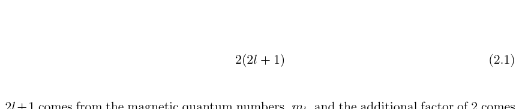

【未转写LaTeX；该裁图按式号定位，可能含邻近文字或需扩大边界，请以原PDF核定完整公式。】

### Eq. (2.2) 原页区域回退
**Source:** PDF24 P024B016
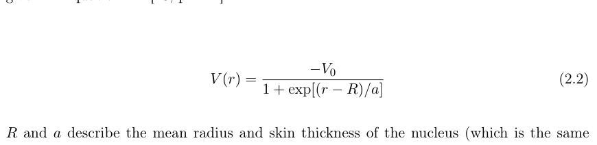

【未转写LaTeX；该裁图按式号定位，可能含邻近文字或需扩大边界，请以原PDF核定完整公式。】

本页其余原生块：标题、页眉、数学碎片、图中标签、表格与前/后置正文；完整保留，中文待译或不适用

**Source:** PDF24 P024B001; bbox [99.21, 46.25, 524.41, 57.16]

**Original:** Chapter 2. Theoretical Background
6

**中文:** 【待译/版式碎片未作独立语义解释；不得视为已完成双语正文。】

**Source:** PDF24 P024B002; bbox [99.21, 82.73, 234.07, 94.69]

**Original:** 2.1.1
Magic Numbers

**中文:** 【待译/版式碎片未作独立语义解释；不得视为已完成双语正文。】

**Source:** PDF24 P024B007; bbox [290.99, 239.11, 524.41, 250.03]

**Original:** 2(2l + 1)
(2.1)

**中文:** 【待译/版式碎片未作独立语义解释；不得视为已完成双语正文。】

**Source:** PDF24 P024B015; bbox [99.21, 431.28, 261.1, 442.19]

**Original:** given in Equation 2.2 [20, p. 122].

**中文:** 【待译/版式碎片未作独立语义解释；不得视为已完成双语正文。】

**Source:** PDF24 P024B016; bbox [248.07, 485.02, 524.41, 510.94]

**Original:** V (r) =
−V0
1 + exp[(r −R)/a]
(2.2)

**中文:** 【待译/版式碎片未作独立语义解释；不得视为已完成双语正文。】

**Source:** PDF24 P024B026; bbox [99.21, 728.34, 163.98, 739.25]

**Original:** are produced.

**中文:** 【待译/版式碎片未作独立语义解释；不得视为已完成双语正文。】

## PDF 25 / 印刷p7

**Source:** PDF25 S0018; native P025B003, P025B004, P025B005, P025B006, P025B007, P025B008, P025B009, P025B010, P025B011, P025B012, P025B013, P025B014, P025B015, P025B016, P025B017, P025B018, P025B019

**Original:** It was a huge achievement of Mayer [4], and, independently, of Haxel, Jensen and Suess [3] to add the spin-orbit potential to the nuclear potential to produce the magic numbers. In the atomic shell model the spin-orbit interaction originates from the electromagnetic interaction of the electron’s magnetic moment with the magnetic field generated as it orbits the nucleus. The total angular momentum of a nucleon, j, is given by the coupling of the orbital angular momentum, l, and the spin angular momentum, s. The spin orbit interaction term is written as Vso(r)l · s. The l · s term is responsible for the reordering of the levels, and has a greater impact on higher l values. A single nucleon has an intrinsic spin of s = 1/2 so the possible values of the total angular momentum quantum number j are j = |l ± 1/2|. The degeneracy of each level changes from 2(2l + 1) to 2j + 1, and the nucleon numbers are again added cumulatively to produce the magic numbers 2, 8, 28, 50, 82, and 126. Figure 2.2 shows a comparison between the levels calculated using an intermediate potential without the spin-orbit interaction (Equation 2.2), and the states calculated after introducing a spin-orbit potential to the nuclear potential. Analogous with the atomic model, in the nuclear shell model spectroscopic notation is used to label the shells. However, for the nuclear shell model the index n refers to the number of levels with a certain l value, rather than representing the principal quantum number.

**中文:** 【待译；保留原文，本块未完成中文翻译。】

**Source:** PDF25 S0019; native P025B021, P025B022, P025B023, P025B024, P025B025, P025B026, P025B027, P025B028, P025B029, P025B030

**Original:** Although Z=82 and N=126 are the highest magic numbers confirmed experimentally there is no reason to assume that magic nucleon numbers cannot exist beyond these values. G.T. Seaborg coined the term "the island of stability" in the 1960s. In a Science article, which Seaborg co-authored with W. Loveland and D.J. Morrissey [21], it was suggested that nuclei near Z=114 and N=184 may exhibit unusually long half-lives for this region of the nuclear chart, and may be candidates for the next magic numbers. There have since been a number of studies into superheavy nuclei, in the search for the island of stability, and to this day work continues to identify the island’s location. Recently a research team directly measured the strength of shell effects in very heavy nuclei at GSI, in Darmstadt, which may facilitate future predictions for the location of the island of stability [22].

**中文:** 【待译；保留原文，本块未完成中文翻译。】

本页其余原生块：标题、页眉、数学碎片、图中标签、表格与前/后置正文；完整保留，中文待译或不适用

**Source:** PDF25 P025B001; bbox [99.21, 46.25, 524.41, 57.16]

**Original:** Chapter 2. Theoretical Background
7

**中文:** 【待译/版式碎片未作独立语义解释；不得视为已完成双语正文。】

**Source:** PDF25 P025B002; bbox [99.21, 83.55, 210.78, 94.46]

**Original:** Spin-Orbit Potential

**中文:** 【待译/版式碎片未作独立语义解释；不得视为已完成双语正文。】

**Source:** PDF25 P025B020; bbox [99.21, 498.51, 196.71, 509.42]

**Original:** Island of Stability

**中文:** 【待译/版式碎片未作独立语义解释；不得视为已完成双语正文。】

## PDF 26 / 印刷p8

**Source:** PDF26 S0020; native P026B004

**Original:** 2.2 Deformation Parameters

**中文:** 【待译；保留原文，本块未完成中文翻译。】

**Source:** PDF26 S0021; native P026B005, P026B006, P026B007, P026B008, P026B009, P026B010

**Original:** Nuclear vibrations result in a nuclear shape which oscillates between spherical and deformed configurations, as illustrated in Figure 2.3. λ represented the multipolarity of the shape. λ=1 describes a dipolar vibration, a net displacement of the centre of mass. λ=2 describes a quadrupole deformation, and λ=3 describes an octupole deformation. The first component of λ which describes the shape of the nucleus is λ=2. This work will focus predominantly on nuclear shape equations, therefore, following this point only terms up to

**中文:** 【待译；保留原文，本块未完成中文翻译。】

### Figure 2.2
**Source:** PDF26 P026B003

【图/表图像尚未裁取，回看原PDF；不得将标签提取当作图像审读。】

**Original caption:** Figure 2.2: A schematic view of the levels calculated using an in- termediate form of the nuclear potential, Equation 2.2, and the levels calculated after introducing the spin-orbit interaction to the nuclear po- tential. Taken from Ref [20, p. 123].

**中文图注:** 【待译；图像状态见source_map。】

本页其余原生块：标题、页眉、数学碎片、图中标签、表格与前/后置正文；完整保留，中文待译或不适用

**Source:** PDF26 P026B001; bbox [99.21, 46.25, 524.41, 57.16]

**Original:** Chapter 2. Theoretical Background
8

**中文:** 【待译/版式碎片未作独立语义解释；不得视为已完成双语正文。】

**Source:** PDF26 P026B002; bbox [118.67, 81.1, 501.34, 459.27]

**Original:** 【embedded image block；回看原PDF】

**中文:** 【待译/版式碎片未作独立语义解释；不得视为已完成双语正文。】

**Source:** PDF26 P026B011; bbox [99.21, 726.56, 210.76, 737.48]

**Original:** λ=2 will be considered.

**中文:** 【待译/版式碎片未作独立语义解释；不得视为已完成双语正文。】

## PDF 27 / 印刷p9

**Source:** PDF27 S0022; native P027B004, P027B005

**Original:** When considering nuclear deformation three main shapes are commonly considered, spherical, oblate and prolate, these shapes are illustrated in Figure 2.4.

**中文:** 【待译；保留原文，本块未完成中文翻译。】

**Source:** PDF27 S0023; native P027B008

**Original:** The eccentricity of the ellipse can be determined from the deformation parameter β2 [20,

**中文:** 【待译；保留原文，本块未完成中文翻译。】

**Source:** PDF27 S0024; native P027B015, P027B016, P027B017, P027B018

**Original:** where ∆R is the difference between the semi-major and semi-minor axes of the ellipse and Rav = R0A1/3. When β2 < 0 the nuclear shape is an oblate ellipsoid, and when β2 > 0 the nuclear shape is a prolate ellipsoid [20, p.142]. β2 is commonly interchanged with the quadrupole deformation parameter ϵ2. β2 and ϵ2 are related by [24]

**中文:** 【待译；保留原文，本块未完成中文翻译。】

### Figure 2.3
**Source:** PDF27 P027B003

【图/表图像尚未裁取，回看原PDF；不得将标签提取当作图像审读。】

**Original caption:** Figure 2.3: Nuclear vibrations oscillating from a spherical nucleus, represented by the dashed line. Figure taken from Ref [20, p. 140].

**中文图注:** 【待译；图像状态见source_map。】

### Figure 2.4
**Source:** PDF27 P027B007

【图/表图像尚未裁取，回看原PDF；不得将标签提取当作图像审读。】

**Original caption:** Figure 2.4: A comparison of the three nuclear shapes most commonly considered, (a) spherical, (b) oblate, (c) prolate. Figure adapted from Ref [23].

**中文图注:** 【待译；图像状态见source_map。】

### Eq. (2.3) 原页区域回退
**Source:** PDF27 P027B011
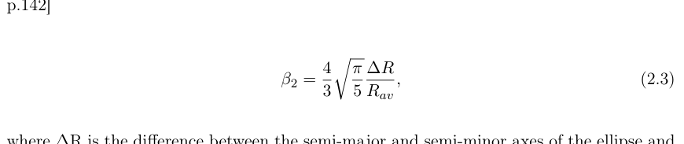

【未转写LaTeX；该裁图按式号定位，可能含邻近文字或需扩大边界，请以原PDF核定完整公式。】

### Eq. (2.4) 原页区域回退
**Source:** PDF27 P027B021
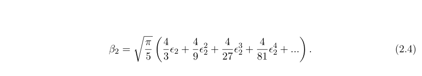

【未转写LaTeX；该裁图按式号定位，可能含邻近文字或需扩大边界，请以原PDF核定完整公式。】

本页其余原生块：标题、页眉、数学碎片、图中标签、表格与前/后置正文；完整保留，中文待译或不适用

**Source:** PDF27 P027B001; bbox [99.21, 46.25, 524.41, 57.16]

**Original:** Chapter 2. Theoretical Background
9

**中文:** 【待译/版式碎片未作独立语义解释；不得视为已完成双语正文。】

**Source:** PDF27 P027B002; bbox [161.18, 81.1, 458.82, 237.83]

**Original:** 【embedded image block；回看原PDF】

**中文:** 【待译/版式碎片未作独立语义解释；不得视为已完成双语正文。】

**Source:** PDF27 P027B006; bbox [139.92, 338.48, 480.09, 452.8]

**Original:** 【embedded image block；回看原PDF】

**中文:** 【待译/版式碎片未作独立语义解释；不得视为已完成双语正文。】

**Source:** PDF27 P027B009; bbox [99.21, 543.58, 127.52, 554.49]

**Original:** p.142]

**中文:** 【待译/版式碎片未作独立语义解释；不得视为已完成双语正文。】

**Source:** PDF27 P027B010; bbox [306.95, 582.54, 325.27, 594.2]

**Original:** rπ

**中文:** 【待译/版式碎片未作独立语义解释；不得视为已完成双语正文。】

**Source:** PDF27 P027B011; bbox [346.94, 590.67, 524.41, 601.59]

**Original:** ,
(2.3)

**中文:** 【待译/版式碎片未作独立语义解释；不得视为已完成双语正文。】

**Source:** PDF27 P027B012; bbox [273.65, 583.29, 305.75, 603.21]

**Original:** β2 = 4

**中文:** 【待译/版式碎片未作独立语义解释；不得视为已完成双语正文。】

**Source:** PDF27 P027B013; bbox [300.3, 598.15, 305.75, 609.06]

**Original:** 3

**中文:** 【待译/版式碎片未作独立语义解释；不得视为已完成双语正文。】

**Source:** PDF27 P027B014; bbox [319.63, 583.29, 345.54, 610.05]

**Original:** 5
∆R
Rav

**中文:** 【待译/版式碎片未作独立语义解释；不得视为已完成双语正文。】

**Source:** PDF27 P027B019; bbox [232.54, 748.71, 250.86, 760.37]

**Original:** rπ

**中文:** 【待译/版式碎片未作独立语义解释；不得视为已完成双语正文。】

**Source:** PDF27 P027B020; bbox [254.27, 749.3, 268.95, 760.37]

**Original:** �4

**中文:** 【待译/版式碎片未作独立语义解释；不得视为已完成双语正文。】

**Source:** PDF27 P027B021; bbox [413.5, 756.84, 524.41, 767.76]

**Original:** .
(2.4)

**中文:** 【待译/版式碎片未作独立语义解释；不得视为已完成双语正文。】

**Source:** PDF27 P027B022; bbox [207.09, 756.84, 229.51, 769.38]

**Original:** β2 =

**中文:** 【待译/版式碎片未作独立语义解释；不得视为已完成双语正文。】

**Source:** PDF27 P027B023; bbox [245.22, 764.32, 250.67, 775.23]

**Original:** 5

**中文:** 【待译/版式碎片未作独立语义解释；不得视为已完成双语正文。】

**Source:** PDF27 P027B024; bbox [263.49, 749.3, 411.68, 775.23]

**Original:** 3ϵ2 + 4
9ϵ2
2 + 4
27ϵ3
2 + 4
81ϵ4
2 + ...
�

**中文:** 【待译/版式碎片未作独立语义解释；不得视为已完成双语正文。】

## PDF 28 / 印刷p10

**Source:** PDF28 S0025; native P028B002

**Original:** 2.3 The Deformed Shell Model

**中文:** 【待译；保留原文，本块未完成中文翻译。】

**Source:** PDF28 S0026; native P028B003, P028B004, P028B005, P028B006, P028B007, P028B008

**Original:** The shell model [2] has had great success describing nuclei near closed shells where the number of valence nucleons are minimal. Near closed shells nuclei are spherically symmetric, however, far from closed shells the residual interactions of valence nucleons become stronger and studies have revealed a diversity of nuclear shapes [25]. The deformed shell model, commonly referred to as the Nilsson model, has been particularly successful in providing a theoretical description for observations of single-particle levels in many deformed

**中文:** 【待译；保留原文，本块未完成中文翻译。】

**Source:** PDF28 S0027; native P028B012, P028B013, P028B014, P028B015, P028B016, P028B017, P028B018, P028B019

**Original:** When nucleons orbit a prolate deformed shape, as illustrated in Figure 2.5, the nucleon will have lower energy while orbiting closer to the nuclear matter (labelled as K1) and higher energy while orbiting further from the nuclear matter (labelled as K2). Nucleons orbiting an oblate deformed shape will also experience a change in energy when orbiting around different axes. In the case of a spherical shape nucleons orbiting the nucleus around any axis experience the same potential so their energies are degenerate. This relationship between the energy of a nucleon and its orientation with respect to the nuclear symmetry axis forms the basis of the Nilsson model.

**中文:** 【待译；保留原文，本块未完成中文翻译。】

**Source:** PDF28 S0028; native P028B020, P028B021, P028B022, P028B023

**Original:** Considering the orbit 1d5/2 from the nuclear shell model, the projection of the singleparticle angular momentum onto the symmetry axis, K, can take values 1/2, 3/2, 5/2. The angle of the orbital plane can be approximated by θ = sin−1(K/j) for prolate deformation, to provide values for θ of 11.5◦, 36.8◦, and 90◦respectively, whereas for oblate deformations

**中文:** 【待译；保留原文，本块未完成中文翻译。】

### Figure 2.5
**Source:** PDF28 P028B011

【图/表图像尚未裁取，回看原PDF；不得将标签提取当作图像审读。】

**Original caption:** Figure 2.5: Two nucleons orbiting a prolate deformed shape, K1 orbits close to the nuclear matter whereas K2 orbits further from the nuclear matter. Figure taken from Ref [26, p. 247].

**中文图注:** 【待译；图像状态见source_map。】

本页其余原生块：标题、页眉、数学碎片、图中标签、表格与前/后置正文；完整保留，中文待译或不适用

**Source:** PDF28 P028B001; bbox [99.21, 46.25, 524.41, 57.16]

**Original:** Chapter 2. Theoretical Background
10

**中文:** 【待译/版式碎片未作独立语义解释；不得视为已完成双语正文。】

**Source:** PDF28 P028B009; bbox [99.21, 247.05, 129.63, 257.96]

**Original:** nuclei.

**中文:** 【待译/版式碎片未作独立语义解释；不得视为已完成双语正文。】

**Source:** PDF28 P028B010; bbox [203.7, 267.52, 416.3, 445.72]

**Original:** 【embedded image block；回看原PDF】

**中文:** 【待译/版式碎片未作独立语义解释；不得视为已完成双语正文。】

## PDF 29 / 印刷p11

**Source:** PDF29 S0029; native P029B002, P029B003, P029B004, P029B005, P029B006, P029B007

**Original:** this will be reversed. Figure 2.6 illustrates the spread in energy of single-particle states of d5/2 orbits as a function of K. The nuclear shell model best describes spherical nuclei, for which the angular momentum of nucleons around any axis of the spherical nucleus is degenerate, this is illustrated in Figure 2.6 by the central crossing point. As nuclei become more deformed the single-particle levels separate in energy, from Figure 2.6 it can be seen that as K increases the separation of single-particle levels increases sharply.

**中文:** 【待译；保留原文，本块未完成中文翻译。】

**Source:** PDF29 S0030; native P029B010, P029B011, P029B012, P029B013, P029B014, P029B015, P029B016, P029B017, P029B018

**Original:** To construct the entire Nilsson diagram it is necessary to reproduce this calculation for all states from the nuclear shell model. However, at this point it also becomes important to consider the Pauli principle, which states that no two levels with the same quantum number may occupy the same space. This leads to a repulsion between states with the same quantum numbers. This repulsion can be seen in Figure 2.7, which shows the Nilsson model for neutrons and protons between the magic numbers 2 and 50. In the Nilsson model, states are labelled using the notation K[NnzΩ], where N is the principal quantum number, nz is the number of nodes in the wave function in the z-direction, and Ωis the component of the orbital angular momentum along the symmetry axis [26, p. 253].

**中文:** 【待译；保留原文，本块未完成中文翻译。】

**Source:** PDF29 S0031; native P029B020, P029B021

**Original:** It is known that about 86% of deformed nuclei have prolate rather than oblate shapes [27], but the origin of this prolate dominance is less well understood. Through employing the

**中文:** 【待译；保留原文，本块未完成中文翻译。】

### Figure 2.6
**Source:** PDF29 P029B009

【图/表图像尚未裁取，回看原PDF；不得将标签提取当作图像审读。】

**Original caption:** Figure 2.6: The energy spread in the single-particle states, for the d5/2 state, as deformation varies from oblate to spherical to prolate, where the energy is on the y-axis.

**中文图注:** 【待译；图像状态见source_map。】

本页其余原生块：标题、页眉、数学碎片、图中标签、表格与前/后置正文；完整保留，中文待译或不适用

**Source:** PDF29 P029B001; bbox [99.21, 46.25, 524.41, 57.16]

**Original:** Chapter 2. Theoretical Background
11

**中文:** 【待译/版式碎片未作独立语义解释；不得视为已完成双语正文。】

**Source:** PDF29 P029B008; bbox [139.92, 215.21, 480.07, 419.73]

**Original:** 【embedded image block；回看原PDF】

**中文:** 【待译/版式碎片未作独立语义解释；不得视为已完成双语正文。】

**Source:** PDF29 P029B019; bbox [99.21, 700.28, 204.03, 711.19]

**Original:** Prolate Dominance

**中文:** 【待译/版式碎片未作独立语义解释；不得视为已完成双语正文。】

## PDF 30 / 印刷p12

**Source:** PDF30 S0032; native P030B002, P030B003, P030B004, P030B005, P030B006, P030B007, P030B008, P030B009

**Original:** Nilsson-Strutinsky model, Tajima, et al. identified that the strengths of the spin-orbit and the l2 terms of the Nilsson potential, as well as pairing correlations, are particularly influential to the dominance of a particular nuclear shape [28]. Further to this work Hamamoto and Mottelson assigned the origin of prolate dominance to an asymmetry in the splitting of prolate and oblate single-particle levels. On the oblate side strong repulsions, resulting from adherence to the Pauli principle reduces the spread of states, whereas on the prolate side this leads to an increase in the spread. The increased spread on the prolate side results in prolate deformation becoming energetically favourable [29].

**中文:** 【待译；保留原文，本块未完成中文翻译。】

本页其余原生块：标题、页眉、数学碎片、图中标签、表格与前/后置正文；完整保留，中文待译或不适用

**Source:** PDF30 P030B001; bbox [99.21, 46.25, 524.41, 57.16]

**Original:** Chapter 2. Theoretical Background
12

**中文:** 【待译/版式碎片未作独立语义解释；不得视为已完成双语正文。】

## PDF 31 / 印刷p13

### Figure 2.7
**Source:** PDF31 P031B003

【图/表图像尚未裁取，回看原PDF；不得将标签提取当作图像审读。】

**Original caption:** Figure 2.7: Nilsson diagram for protons and neutrons for Z, N≤50 and ϵ4 = 0. Taken from Ref [30].

**中文图注:** 【待译；图像状态见source_map。】

本页其余原生块：标题、页眉、数学碎片、图中标签、表格与前/后置正文；完整保留，中文待译或不适用

**Source:** PDF31 P031B001; bbox [99.21, 46.25, 524.41, 57.16]

**Original:** Chapter 2. Theoretical Background
13

**中文:** 【待译/版式碎片未作独立语义解释；不得视为已完成双语正文。】

**Source:** PDF31 P031B002; bbox [108.04, 81.1, 511.99, 588.35]

**Original:** 【embedded image block；回看原PDF】

**中文:** 【待译/版式碎片未作独立语义解释；不得视为已完成双语正文。】

## PDF 32 / 印刷p14

**Source:** PDF32 S0033; native P032B002

**Original:** 2.4 Systematic study of the neutron-rich A∼100 region

**中文:** 【待译；保留原文，本块未完成中文翻译。】

**Source:** PDF32 S0034; native P032B003, P032B004, P032B005, P032B006, P032B007, P032B008, P032B009

**Original:** In order to develop a single model which is able to describe the wide ranging features across the nuclear chart the nature and impact of nuclear deformation needs to be well understood. Isotopic chains provide the ideal test for such studies, through mapping the evolution of deformation as neutron number increases. These systematic studies are particularly useful in exotic regions of the nuclear chart where it becomes more difficult to collect data experimentally. There are two properties of nuclei which are particularly important when looking at the systematics, the energies of the first excited 2+ state (E(2+

**中文:** 【待译；保留原文，本块未完成中文翻译。】

**Source:** PDF32 S0035; native P032B016, P032B017

**Original:** dramatically for non-magic nuclei, as demonstrated in Figure 2.8 for Mo, Ru, Sr and Zr nuclei in the A∼100 region. At the major shell closure, N=50, the value for E(2+

**中文:** 【待译；保留原文，本块未完成中文翻译。】

**Source:** PDF32 S0036; native P032B019

**Original:** for all nuclei. Moving away from the shell closure E(2+

**中文:** 【待译；保留原文，本块未完成中文翻译。】

**Source:** PDF32 S0037; native P032B021, P032B022

**Original:** N=56 a plateau is observed, and a sharp increase is shown in Zr. This is thought to be due to a subshell closure, which is yet to be confirmed [31]. Following this, E(2+

**中文:** 【待译；保留原文，本块未完成中文翻译。】

**Source:** PDF32 S0038; native P032B024, P032B025, P032B026, P032B027

**Original:** decrease as a function of neutron number. This project aims to investigate the structure of 102Y through measurement of the decay of the excited states in the daughter nucleus, 102Zr. Therefore, understanding the structural patterns observed in Zr isotopes and other even-even nuclei in this mass region provides a useful insight.

**中文:** 【待译；保留原文，本块未完成中文翻译。】

**Source:** PDF32 S0039; native P032B030, P032B031, P032B032, P032B033, P032B034

**Original:** how this ratio varies for Mo, Ru, Sr and Zr around the A∼100 region. The dotted lines represent expected values for spherical, R4/2=2.0, and well-deformed, R4/2=3.3, nuclei [32]. Near the N=50 major shell closure the energy ratio is close to 2.0 but at N=59 there is a sharp increase in the ratio. This is a clear indication of a sudden onset of deformation at N=59, which appears to continue as N increases.

**中文:** 【待译；保留原文，本块未完成中文翻译。】

本页其余原生块：标题、页眉、数学碎片、图中标签、表格与前/后置正文；完整保留，中文待译或不适用

**Source:** PDF32 P032B001; bbox [99.21, 46.25, 524.41, 57.16]

**Original:** Chapter 2. Theoretical Background
14

**中文:** 【待译/版式碎片未作独立语义解释；不得视为已完成双语正文。】

**Source:** PDF32 P032B010; bbox [486.78, 247.04, 524.4, 261.07]

**Original:** 1 )) and

**中文:** 【待译/版式碎片未作独立语义解释；不得视为已完成双语正文。】

**Source:** PDF32 P032B011; bbox [99.21, 264.9, 234.07, 279.77]

**Original:** first excited 4+ state (E(4+

**中文:** 【待译/版式碎片未作独立语义解释；不得视为已完成双语正文。】

**Source:** PDF32 P032B012; bbox [227.49, 268.85, 524.32, 282.88]

**Original:** 1 )). These values provide a lot of information about nuclear

**中文:** 【待译/版式碎片未作独立语义解释；不得视为已完成双语正文。】

**Source:** PDF32 P032B013; bbox [99.21, 290.68, 159.16, 301.59]

**Original:** deformation.

**中文:** 【待译/版式碎片未作独立语义解释；不得视为已完成双语正文。】

**Source:** PDF32 P032B014; bbox [116.15, 310.19, 228.76, 323.4]

**Original:** Near closed shells, E(2+

**中文:** 【待译/版式碎片未作独立语义解释；不得视为已完成双语正文。】

**Source:** PDF32 P032B015; bbox [222.17, 312.48, 524.34, 326.51]

**Original:** 1 ) is observed to be very high in energy. This energy lowers quite

**中文:** 【待译/版式碎片未作独立语义解释；不得视为已完成双语正文。】

**Source:** PDF32 P032B018; bbox [478.4, 356.11, 524.39, 370.14]

**Original:** 1 ) is high

**中文:** 【待译/版式碎片未作独立语义解释；不得视为已完成双语正文。】

**Source:** PDF32 P032B020; bbox [355.74, 377.92, 524.37, 391.95]

**Original:** 1 ) drops quite rapidly. However, at

**中文:** 【待译/版式碎片未作独立语义解释；不得视为已完成双语正文。】

**Source:** PDF32 P032B023; bbox [452.68, 421.55, 524.39, 435.58]

**Original:** 1 ) continues to

**中文:** 【待译/版式碎片未作独立语义解释；不得视为已完成双语正文。】

**Source:** PDF32 P032B028; bbox [116.15, 528.33, 223.69, 543.75]

**Original:** The ratio R4/2 = E(4+

**中文:** 【待译/版式碎片未作独立语义解释；不得视为已完成双语正文。】

**Source:** PDF32 P032B029; bbox [217.1, 528.33, 524.31, 544.65]

**Original:** 1 )/E(2+
1 ) provides an indication of deformation, Figure 2.9 shows

**中文:** 【待译/版式碎片未作独立语义解释；不得视为已完成双语正文。】

## PDF 33 / 印刷p15

### Figure 2.8
**Source:** PDF33 P033B015

【图/表图像尚未裁取，回看原PDF；不得将标签提取当作图像审读。】

**Original caption:** Figure 2.8: The energies of the 2+

**中文图注:** 【待译；图像状态见source_map。】

### Figure 2.9
**Source:** PDF33 P033B018

【图/表图像尚未裁取，回看原PDF；不得将标签提取当作图像审读。】

**Original caption:** Figure 2.9: The energy ratio of the 2+

**中文图注:** 【待译；图像状态见source_map。】

本页其余原生块：标题、页眉、数学碎片、图中标签、表格与前/后置正文；完整保留，中文待译或不适用

**Source:** PDF33 P033B001; bbox [99.21, 46.25, 524.41, 57.16]

**Original:** Chapter 2. Theoretical Background
15

**中文:** 【待译/版式碎片未作独立语义解释；不得视为已完成双语正文。】

**Source:** PDF33 P033B002; bbox [445.67, 93.6, 461.26, 104.82]

**Original:** Mo

**中文:** 【待译/版式碎片未作独立语义解释；不得视为已完成双语正文。】

**Source:** PDF33 P033B003; bbox [446.92, 106.84, 461.26, 118.06]

**Original:** Ru

**中文:** 【待译/版式碎片未作独立语义解释；不得视为已完成双语正文。】

**Source:** PDF33 P033B004; bbox [145.94, 110.6, 174.01, 121.82]

**Original:** 2200

**中文:** 【待译/版式碎片未作独立语义解释；不得视为已完成双语正文。】

**Source:** PDF33 P033B005; bbox [450.04, 120.08, 461.26, 131.3]

**Original:** Sr

**中文:** 【待译/版式碎片未作独立语义解释；不得视为已完成双语正文。】

**Source:** PDF33 P033B006; bbox [450.67, 133.32, 461.26, 144.54]

**Original:** Zr

**中文:** 【待译/版式碎片未作独立语义解释；不得视为已完成双语正文。】

**Source:** PDF33 P033B007; bbox [145.94, 146.78, 174.01, 158.0]

**Original:** 1800

**中文:** 【待译/版式碎片未作独立语义解释；不得视为已完成双语正文。】

**Source:** PDF33 P033B008; bbox [145.94, 182.97, 174.01, 194.19]

**Original:** 1400

**中文:** 【待译/版式碎片未作独立语义解释；不得视为已完成双语正文。】

**Source:** PDF33 P033B009; bbox [145.94, 219.15, 174.01, 230.38]

**Original:** 1000

**中文:** 【待译/版式碎片未作独立语义解释；不得视为已完成双语正文。】

**Source:** PDF33 P033B010; bbox [117.86, 169.59, 137.61, 237.77]

**Original:** E(21
+) (keV)

**中文:** 【待译/版式碎片未作独立语义解释；不得视为已完成双语正文。】

**Source:** PDF33 P033B011; bbox [152.18, 255.34, 174.01, 266.56]

**Original:** 600

**中文:** 【待译/版式碎片未作独立语义解释；不得视为已完成双语正文。】

**Source:** PDF33 P033B012; bbox [152.18, 291.53, 174.01, 302.75]

**Original:** 200

**中文:** 【待译/版式碎片未作独立语义解释；不得视为已完成双语正文。】

**Source:** PDF33 P033B013; bbox [199.93, 317.45, 476.58, 328.67]

**Original:** 50
 52
 54
 56
 58
 60
 62
 64
 66
 68

**中文:** 【待译/版式碎片未作独立语义解释；不得视为已完成双语正文。】

**Source:** PDF33 P033B014; bbox [333.77, 338.65, 342.68, 350.99]

**Original:** N

**中文:** 【待译/版式碎片未作独立语义解释；不得视为已完成双语正文。】

**Source:** PDF33 P033B016; bbox [155.9, 374.63, 467.69, 396.55]

**Original:** 1 states in even-even neutron-rich
nuclei in the A∼100 region [33].

**中文:** 【待译/版式碎片未作独立语义解释；不得视为已完成双语正文。】

**Source:** PDF33 P033B017; bbox [108.04, 421.85, 511.98, 696.78]

**Original:** 【embedded image block；回看原PDF】

**中文:** 【待译/版式碎片未作独立语义解释；不得视为已完成双语正文。】

**Source:** PDF33 P033B019; bbox [155.91, 705.61, 467.7, 729.46]

**Original:** 1 and 4+
1 states in even-even
neutron-rich nuclei in the A∼100 region [33].

**中文:** 【待译/版式碎片未作独立语义解释；不得视为已完成双语正文。】

## PDF 34 / 印刷p16

**Source:** PDF34 S0040; native P034B004

**Original:** parameter, β2, using Grodzins’ empirical relation [34], Equation 2.5.

**中文:** 【待译；保留原文，本块未完成中文翻译。】

**Source:** PDF34 S0041; native P034B009

**Original:** where A is the mass of the nucleus in atomic mass units, and E(2+

**中文:** 【待译；保留原文，本块未完成中文翻译。】

**Source:** PDF34 S0042; native P034B011, P034B012

**Original:** Figure 2.10 shows β2 values calculated using Grodzin’s relation as a function of neutron number, N, across four isotopic chains Mo, Ru, Sr and Zr.

**中文:** 【待译；保留原文，本块未完成中文翻译。】

**Source:** PDF34 S0043; native P034B015, P034B016, P034B017, P034B018, P034B019

**Original:** As expected from Figure 2.9, Figure 2.10 shows β2 was close to zero at N=50, indicating very little deformation. This continues to N=56 where β2 calculated for Zr decreases, possibly due to the predicted subshell closure [31]. At N=59 there is a rapid increase in the β2 values, which is consistent with Figure 2.9. A deformation of β2 ≥0.3 appears to continue as N increases, however, there is a slight decrease in Mo at N=66 suggesting

**中文:** 【待译；保留原文，本块未完成中文翻译。】

**Source:** PDF34 S0044; native P034B023, P034B024

**Original:** using Raman’s relation [35]. However, it is necessary to first calculate the reduced electric quadrupole transition probability B(E2)↑:

**中文:** 【待译；保留原文，本块未完成中文翻译。】

### Figure 2.10
**Source:** PDF34 P034B014

【图/表图像尚未裁取，回看原PDF；不得将标签提取当作图像审读。】

**Original caption:** Figure 2.10: Deformation calculated using Grodzin’s relation 2.5 [33]

**中文图注:** 【待译；图像状态见source_map。】

### Eq. (2.5) 原页区域回退
**Source:** PDF34 P034B008
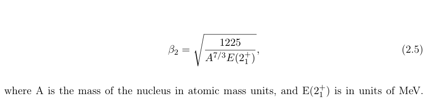

【未转写LaTeX；该裁图按式号定位，可能含邻近文字或需扩大边界，请以原PDF核定完整公式。】

本页其余原生块：标题、页眉、数学碎片、图中标签、表格与前/后置正文；完整保留，中文待译或不适用

**Source:** PDF34 P034B001; bbox [99.21, 46.25, 524.41, 57.16]

**Original:** Chapter 2. Theoretical Background
16

**中文:** 【待译/版式碎片未作独立语义解释；不得视为已完成双语正文。】

**Source:** PDF34 P034B002; bbox [116.15, 81.25, 216.23, 94.46]

**Original:** The energy of the 2+

**中文:** 【待译/版式碎片未作独立语义解释；不得视为已完成双语正文。】

**Source:** PDF34 P034B003; bbox [209.65, 83.55, 524.32, 97.58]

**Original:** 1 state can also be used to determine the quadrupole deformation

**中文:** 【待译/版式碎片未作独立语义解释；不得视为已完成双语正文。】

**Source:** PDF34 P034B005; bbox [290.83, 155.97, 301.74, 166.88]

**Original:** s

**中文:** 【待译/版式碎片未作独立语义解释；不得视为已完成双语正文。】

**Source:** PDF34 P034B006; bbox [265.38, 166.62, 287.8, 179.17]

**Original:** β2 =

**中文:** 【待译/版式碎片未作独立语义解释；不得视为已完成双语正文。】

**Source:** PDF34 P034B007; bbox [302.93, 159.24, 349.28, 185.73]

**Original:** 1225
A7/3E(2+

**中文:** 【待译/版式碎片未作独立语义解释；不得视为已完成双语正文。】

**Source:** PDF34 P034B008; bbox [342.69, 166.62, 524.41, 188.86]

**Original:** 1 ),
(2.5)

**中文:** 【待译/版式碎片未作独立语义解释；不得视为已完成双语正文。】

**Source:** PDF34 P034B010; bbox [418.56, 208.48, 524.37, 222.51]

**Original:** 1 ) is in units of MeV.

**中文:** 【待译/版式碎片未作独立语义解释；不得视为已完成双语正文。】

**Source:** PDF34 P034B013; bbox [118.67, 274.69, 501.35, 533.35]

**Original:** 【embedded image block；回看原PDF】

**中文:** 【待译/版式碎片未作独立语义解释；不得视为已完成双语正文。】

**Source:** PDF34 P034B020; bbox [99.21, 687.48, 201.39, 698.39]

**Original:** further shape change.

**中文:** 【待译/版式碎片未作独立语义解释；不得视为已完成双语正文。】

**Source:** PDF34 P034B021; bbox [116.15, 706.99, 139.81, 720.2]

**Original:** E(2+

**中文:** 【待译/版式碎片未作独立语义解释；不得视为已完成双语正文。】

**Source:** PDF34 P034B022; bbox [133.22, 705.34, 523.91, 723.31]

**Original:** 1 ) can also be used in conjunction with the lifetime of the 2+ state to calculate β2

**中文:** 【待译/版式碎片未作独立语义解释；不得视为已完成双语正文。】

## PDF 35 / 印刷p17

**Source:** PDF35 S0045; native P035B008

**Original:** where B(E2)↑is in units of e2b2, E is the energy of the 2+

**中文:** 【待译；保留原文，本块未完成中文翻译。】

**Source:** PDF35 S0046; native P035B012

**Original:** number, and R0 = 1.25A1/3 fm [20, p. 122].

**中文:** 【待译；保留原文，本块未完成中文翻译。】

**Source:** PDF35 S0047; native P035B015, P035B016, P035B017, P035B018, P035B019, P035B020, P035B021

**Original:** Figure 2.11 shows how the β2 values calculated using Equation 2.7 vary across four isotopic chains Mo, Ru, Sr and Zr. Although there are many similarities between the trends observed in Figures 2.9, 2.10 and 2.11, there are some clear differences. Most notably the β2 values calculated for Mo and Ru, using Raman’s equation 2.7, are much higher than the values obtained using Grodzin’s equation 2.5. Furthermore, above N=62 the deformation parameter calculated for Mo increases, whereas previously it decreased. Also at N=62 the deformation parameter calculated for Zr is now much closer to the value

**中文:** 【待译；保留原文，本块未完成中文翻译。】

### Figure 2.11
**Source:** PDF35 P035B014

【图/表图像尚未裁取，回看原PDF；不得将标签提取当作图像审读。】

**Original caption:** Figure 2.11: Deformation calculated using Raman’s relation 2.7 [33]

**中文图注:** 【待译；图像状态见source_map。】

### Eq. (2.6) 原页区域回退
**Source:** PDF35 P035B003
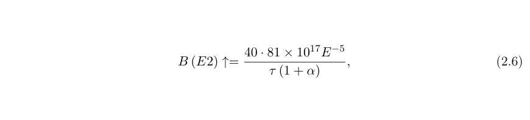

【未转写LaTeX；该裁图按式号定位，可能含邻近文字或需扩大边界，请以原PDF核定完整公式。】

### Eq. (2.7) 原页区域回退
**Source:** PDF35 P035B005
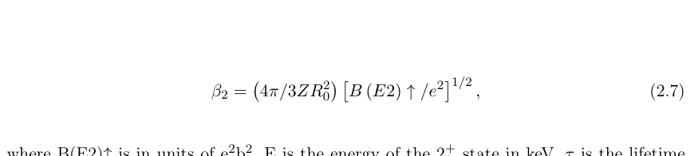

【未转写LaTeX；该裁图按式号定位，可能含邻近文字或需扩大边界，请以原PDF核定完整公式。】

本页其余原生块：标题、页眉、数学碎片、图中标签、表格与前/后置正文；完整保留，中文待译或不适用

**Source:** PDF35 P035B001; bbox [99.21, 46.25, 524.41, 57.16]

**Original:** Chapter 2. Theoretical Background
17

**中文:** 【待译/版式碎片未作独立语义解释；不得视为已完成双语正文。】

**Source:** PDF35 P035B002; bbox [241.02, 113.85, 377.88, 133.9]

**Original:** B (E2) ↑= 40 · 81 × 1017E−5

**中文:** 【待译/版式碎片未作独立语义解释；不得视为已完成双语正文。】

**Source:** PDF35 P035B003; bbox [315.87, 122.99, 524.41, 141.39]

**Original:** τ (1 + α)
,
(2.6)

**中文:** 【待译/版式碎片未作独立语义解释；不得视为已完成双语正文。】

**Source:** PDF35 P035B004; bbox [252.88, 200.92, 257.88, 211.83]

**Original:** �

**中文:** 【待译/版式碎片未作独立语义解释；不得视为已完成双语正文。】

**Source:** PDF35 P035B005; bbox [313.55, 195.42, 524.41, 212.83]

**Original:** B (E2) ↑/e2�1/2 ,
(2.7)

**中文:** 【待译/版式碎片未作独立语义解释；不得视为已完成双语正文。】

**Source:** PDF35 P035B006; bbox [227.44, 201.91, 249.86, 214.46]

**Original:** β2 =

**中文:** 【待译/版式碎片未作独立语义解释；不得视为已完成双语正文。】

**Source:** PDF35 P035B007; bbox [257.88, 199.7, 313.55, 214.87]

**Original:** 4π/3ZR2
0
� �

**中文:** 【待译/版式碎片未作独立语义解释；不得视为已完成双语正文。】

**Source:** PDF35 P035B009; bbox [373.97, 241.37, 524.39, 255.41]

**Original:** 1 state in keV, τ is the lifetime

**中文:** 【待译/版式碎片未作独立语义解释；不得视为已完成双语正文。】

**Source:** PDF35 P035B010; bbox [99.21, 260.89, 142.22, 274.1]

**Original:** of the 2+

**中文:** 【待译/版式碎片未作独立语义解释；不得视为已完成双语正文。】

**Source:** PDF35 P035B011; bbox [135.64, 263.18, 524.32, 277.23]

**Original:** 1 state in ps and α is the total internal conversion coefficient [36], Z is the proton

**中文:** 【待译/版式碎片未作独立语义解释；不得视为已完成双语正文。】

**Source:** PDF35 P035B013; bbox [118.67, 307.61, 501.34, 566.94]

**Original:** 【embedded image block；回看原PDF】

**中文:** 【待译/版式碎片未作独立语义解释；不得视为已完成双语正文。】

**Source:** PDF35 P035B022; bbox [99.21, 763.5, 180.25, 774.41]

**Original:** calculated for Sr.

**中文:** 【待译/版式碎片未作独立语义解释；不得视为已完成双语正文。】

## PDF 36 / 印刷p18

**Source:** PDF36 S0048; native P036B004, P036B005, P036B006

**Original:** Table 2.1 lists the deformation parameters for zirconium nuclei (Z=40) calculated using Equation 2.5 and Equation 2.7. There are clearly some discrepancies between these different models, but the sudden change in deformation at N=59 is consistent.

**中文:** 【待译；保留原文，本块未完成中文翻译。】

**Source:** PDF36 S0049; native P036B008, P036B009, P036B010, P036B011, P036B012, P036B013

**Original:** The focus of this thesis is to investigate the shape and structure of 102Y, and to make comparisons with theoretical calculations using BCS codes and with previous experimental work. In 2007, B. Cheal conducted a systematic study of the ground and isomeric states for yttrium isotopes between N = 47 to 63 using laser spectroscopy techniques [10]. In this work Cheal calculated the difference in the mean square radius to investigate the shape of these nuclei more directly. The difference in the mean square radius is given by [10]:

**中文:** 【待译；保留原文，本块未完成中文翻译。】

**Source:** PDF36 S0050; native P036B036, P036B037

**Original:** is the change in the mean-square radius of a spherical nucleus and i denotes the multipole order. The results of these calculations are presented in Figure 2.12.

**中文:** 【待译；保留原文，本块未完成中文翻译。】

**Source:** PDF36 S0051; native P036B038, P036B039, P036B040

**Original:** In Figure 2.12, as expected, at N=50 the nuclear shape is spherical, with both the ground and isomeric state in good agreement with a spherical system. Between N = 50 and 59 the nuclear shape becomes increasingly oblate and soft, and at N = 59 it rapidly

**中文:** 【待译；保留原文，本块未完成中文翻译。】

### Table 2.1
**Source:** PDF36 P036B003

【图/表图像尚未裁取，回看原PDF；不得将标签提取当作图像审读。】

**Original caption:** Table 2.1: The deformation parameters calculated for the zirconium iso- topic chain using two different relationships to highlight their differences. Errors have not been quoted for calculations using Grodzin’s relation as they are smaller than the next significant figure.

**中文图注:** 【待译；图像状态见source_map。】

### Eq. (2.8) 原页区域回退
**Source:** PDF36 P036B024
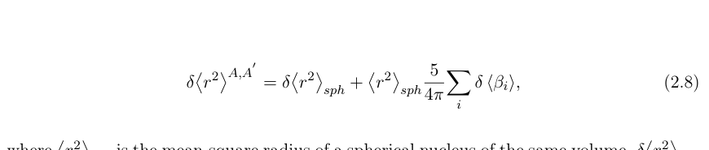

【未转写LaTeX；该裁图按式号定位，可能含邻近文字或需扩大边界，请以原PDF核定完整公式。】

本页其余原生块：标题、页眉、数学碎片、图中标签、表格与前/后置正文；完整保留，中文待译或不适用

**Source:** PDF36 P036B001; bbox [99.21, 46.25, 524.41, 57.16]

**Original:** Chapter 2. Theoretical Background
18

**中文:** 【待译/版式碎片未作独立语义解释；不得视为已完成双语正文。】

**Source:** PDF36 P036B002; bbox [117.13, 82.47, 506.46, 229.27]

**Original:** Mass
Energy (keV)
Lifetime (ps)
Grodzin’s relation
Raman’s relation
[33]
[33]
[34]
[35]
88
1057.03(4)
3.6(4)
0.184
0.108(6)
90
2186.27(2)
0.130(4)
0.124
0.092(2)
92
934.51(4)
7.2(6)
0.185
0.100(4)
94
918.75(5)
10(2)
0.182
0.088(10)
96
1750.50(2)
0.8(1)
0.129
0.060(4)
98
1222.9(1)
< 15.87
0.150
> 0.033
100
212.530(9)
851(43)
0.353
0.343(9)
102
151.8(1)
2597(577)
0.408
0.417(46)
104
139.3(3)
2885(433)
0.416
0.468(35)

**中文:** 【待译/版式碎片未作独立语义解释；不得视为已完成双语正文。】

**Source:** PDF36 P036B007; bbox [99.21, 395.95, 241.11, 412.09]

**Original:** 2.5
A study of 102Y

**中文:** 【待译/版式碎片未作独立语义解释；不得视为已完成双语正文。】

**Source:** PDF36 P036B014; bbox [249.77, 595.34, 251.96, 601.32]

**Original:** ′

**中文:** 【待译/版式碎片未作独立语义解释；不得视为已完成双语正文。】

**Source:** PDF36 P036B015; bbox [368.68, 600.85, 384.44, 611.76]

**Original:** X

**中文:** 【待译/版式碎片未作独立语义解释；不得视为已完成双语正文。】

**Source:** PDF36 P036B019; bbox [209.21, 603.37, 214.06, 614.28]

**Original:** δ

**中文:** 【待译/版式碎片未作独立语义解释；不得视为已完成双语正文。】

**Source:** PDF36 P036B020; bbox [219.63, 599.19, 249.78, 614.28]

**Original:** r2�A,A

**中文:** 【待译/版式碎片未作独立语义解释；不得视为已完成双语正文。】

**Source:** PDF36 P036B021; bbox [256.49, 603.37, 272.84, 614.28]

**Original:** = δ

**中文:** 【待译/版式碎片未作独立语义解释；不得视为已完成双语正文。】

**Source:** PDF36 P036B022; bbox [278.41, 601.17, 293.52, 614.28]

**Original:** r2

**中文:** 【待译/版式碎片未作独立语义解释；不得视为已完成双语正文。】

**Source:** PDF36 P036B023; bbox [325.56, 601.17, 340.67, 614.28]

**Original:** r2

**中文:** 【待译/版式碎片未作独立语义解释；不得视为已完成双语正文。】

**Source:** PDF36 P036B024; bbox [386.26, 603.23, 524.41, 615.28]

**Original:** δ ⟨βi⟩,
(2.8)

**中文:** 【待译/版式碎片未作独立语义解释；不得视为已完成双语正文。】

**Source:** PDF36 P036B025; bbox [340.67, 609.99, 353.73, 617.96]

**Original:** sph

**中文:** 【待译/版式碎片未作独立语义解释；不得视为已完成双语正文。】

**Source:** PDF36 P036B026; bbox [293.52, 603.37, 317.99, 618.6]

**Original:** sph +

**中文:** 【待译/版式碎片未作独立语义解释；不得视为已完成双语正文。】

**Source:** PDF36 P036B027; bbox [355.42, 595.99, 367.1, 621.77]

**Original:** 5
4π

**中文:** 【待译/版式碎片未作独立语义解释；不得视为已完成双语正文。】

**Source:** PDF36 P036B028; bbox [375.12, 618.76, 378.01, 626.73]

**Original:** i

**中文:** 【待译/版式碎片未作独立语义解释；不得视为已完成双语正文。】

**Source:** PDF36 P036B031; bbox [134.87, 643.8, 149.98, 656.37]

**Original:** r2

**中文:** 【待译/版式碎片未作独立语义解释；不得视为已完成双语正文。】

**Source:** PDF36 P036B032; bbox [495.74, 643.8, 510.85, 656.37]

**Original:** r2

**中文:** 【待译/版式碎片未作独立语义解释；不得视为已完成双语正文。】

**Source:** PDF36 P036B033; bbox [99.21, 645.48, 126.93, 656.39]

**Original:** where

**中文:** 【待译/版式碎片未作独立语义解释；不得视为已完成双语正文。】

**Source:** PDF36 P036B034; bbox [510.85, 652.08, 523.91, 660.05]

**Original:** sph

**中文:** 【待译/版式碎片未作独立语义解释；不得视为已完成双语正文。】

**Source:** PDF36 P036B035; bbox [149.98, 645.47, 490.17, 660.7]

**Original:** sph is the mean-square radius of a spherical nucleus of the same volume, δ

**中文:** 【待译/版式碎片未作独立语义解释；不得视为已完成双语正文。】

## PDF 37 / 印刷p19

**Source:** PDF37 S0052; native P037B004, P037B005, P037B006, P037B007, P037B008, P037B009, P037B010, P037B011, P037B012, P037B013

**Original:** changes to a prolate configuration which continues to N=63. This rapid shape change at N=59 is consistent with the sharp increases observed for neighbouring nuclei (Mo, Ru, Sr, and Zr) in Figures 2.11, 2.10. At N = 63 (102Y) only one state was measured during the experiment by Cheal, for which two possible spin values were assigned. If a spin of I=2 is correct then the nuclear shape will also exhibit a prolate configuration. However, if a spin of I=3 is correct it would suggest that the nuclear shape of higher-N isotopes could return to an oblate configuration. It is therefore important to confirm the spin of this state in 102Y. In this work BCS calculations were performed to investigate the structure of 102Y assuming a prolate deformation, and a comparison will be made with experimental data to show whether this assumption is suitable.

**中文:** 【待译；保留原文，本块未完成中文翻译。】

**Source:** PDF37 S0053; native P037B014, P037B015, P037B016

**Original:** The structure of 102Y was investigated more directly by Shizuma [9] in 1983 and Hill [8] in 1991, through observing the γ rays emitted following β decay of 102Y. At the JOSEF recoil separator, at the research reactor DIDO of the Kernforschungsanlage (KFA) J¨ulich,

**中文:** 【待译；保留原文，本块未完成中文翻译。】

### Figure 2.12
**Source:** PDF37 P037B003

【图/表图像尚未裁取，回看原PDF；不得将标签提取当作图像审读。】

**Original caption:** Figure 2.12: Calculated values for the mean square radius of yttrium isotopes between N=47 to 63 using laser spectroscopy. Figure taken from [10], dashed lines represent isodeformation lines for βrms = 0 and βrms = 0.43.

**中文图注:** 【待译；图像状态见source_map。】

本页其余原生块：标题、页眉、数学碎片、图中标签、表格与前/后置正文；完整保留，中文待译或不适用

**Source:** PDF37 P037B001; bbox [99.21, 46.25, 524.41, 57.16]

**Original:** Chapter 2. Theoretical Background
19

**中文:** 【待译/版式碎片未作独立语义解释；不得视为已完成双语正文。】

**Source:** PDF37 P037B002; bbox [182.44, 81.1, 437.57, 405.1]

**Original:** 【embedded image block；回看原PDF】

**中文:** 【待译/版式碎片未作独立语义解释；不得视为已完成双语正文。】

## PDF 38 / 印刷p20

**Source:** PDF38 S0054; native P038B004, P038B005, P038B006, P038B007, P038B008, P038B009

**Original:** Shizuma created A=102 ions from the thermal fission of 235U [9]. At JOSEF no ion source was used, and the fission yields of 102Sr and 102Y were estimated at 5 × 10−5% and 1.3 × 10−1% respectively. However, at the TRISTAN facility at Brookhaven National Laboratory A=102 ions were produced in the thermal fission of 238U, using a thermal ion source. Due to the characteristics of the ion source it was thought that primarily 102Sr ions were produced, which β-decayed into 102Y and then into 102Zr.

**中文:** 【待译；保留原文，本块未完成中文翻译。】

**Source:** PDF38 S0055; native P038B010, P038B011, P038B012, P038B013, P038B014, P038B015, P038B016, P038B017, P038B018, P038B019, P038B020

**Original:** In comparing the results obtained at each experiment it was clear that following the β decay of 102Y, excited states in 102Zr were populated with different intensity ratios in each experiment. At the JOSEF recoil separator gamma rays populating predominantly high-spin states in 102Zr were observed. Whereas, at the TRISTAN facility gamma rays populating primarily low-spin states were observed. In order to explain these results the existence of a β-decaying isomeric state in 102Y was proposed. Using the data collected at TRISTAN and JOSEF it was understood that β decay from a high-spin state in 102Y was measured at JOSEF; and β decay from a low-spin state in 102Y was measured at TRISTAN. These experiments provided relative intensities for the gamma rays observed following the β decay of the high-spin and low-spin states in 102Y, the results are presented in Table 2.2 and illustrated in Figure 2.13.

**中文:** 【待译；保留原文，本块未完成中文翻译。】

**Source:** PDF38 S0056; native P038B021, P038B022, P038B023, P038B024

**Original:** During the experiments conducted at TRISTAN and JOSEF it was not possible to identify which of these β-decaying states is the ground and which is an excited state in 102Y. This was primarily due to the half-lives of the ground and isomeric states, 300 ms and 360 ms respectively [37], which are very similar. The main aim of the experimental

**中文:** 【待译；保留原文，本块未完成中文翻译。】

### Figure 2.13
**Source:** PDF38 P038B003

【图/表图像尚未裁取，回看原PDF；不得将标签提取当作图像审读。】

**Original caption:** Figure 2.13: A simplified level scheme showing the dominant decay paths from the high and low spin states measured at JOSEF [9] and TRISTAN [8] respectively.

**中文图注:** 【待译；图像状态见source_map。】

本页其余原生块：标题、页眉、数学碎片、图中标签、表格与前/后置正文；完整保留，中文待译或不适用

**Source:** PDF38 P038B001; bbox [99.21, 46.25, 524.41, 57.16]

**Original:** Chapter 2. Theoretical Background
20

**中文:** 【待译/版式碎片未作独立语义解释；不得视为已完成双语正文。】

**Source:** PDF38 P038B002; bbox [205.83, 81.1, 414.17, 256.3]

**Original:** 【embedded image block；回看原PDF】

**中文:** 【待译/版式碎片未作独立语义解释；不得视为已完成双语正文。】

## PDF 39 / 印刷p21

**Source:** PDF39 S0057; native P039B004, P039B005, P039B006, P039B007, P039B008, P039B009, P039B010, P039B011, P039B012

**Original:** work presented in this thesis was to confirm and expand on the work published by Hill and Shizuma. To achieve this, data has been analysed from two experimental facilities, the IGISOL facility at the University of Jyvaskyla, in Finland, and the RIKEN laboratory in Japan. At the IGISOL facility the aim was to create 102Y in both its ground and isomeric states, and investigate whether the Ramsey cleaning technique [12] can be used to separate the two states so that their subsequent decay can be measured independently. At RIKEN the decay of 102Y was investigated via two criteria, in criterion 1 excited states in 102Zr were measured following the decay of 102Sr into 102Zr, whereas in criterion 2 excited states in 102Zr were measured following the decay of 102Y only.

**中文:** 【待译；保留原文，本块未完成中文翻译。】

**Source:** PDF39 S0058; native P039B013, P039B014, P039B015, P039B016, P039B017, P039B018, P039B019, P039B020, P039B021, P039B022

**Original:** The Ramsey cleaning technique, described in more detail in Section 3.2, is used regularly at the IGISOL facility to perform high-precision mass measurements for a variety of nuclei, ranging from carbon to neodymium (a full table of measurements performed is provided in [11]). In 2012 this technique was used for the first time, in conjunction with post-trap spectroscopy, to provide high-resolution separation of ground and isomeric states in 100Nb [38]. It was possible to observe clear separation of the two states in 100Nb, which have an energy difference of 313 keV, and therefore select the individual states for post-trap spectroscopy. Due to the successful application to 100Nb, this technique will also be used in this work. However, it is expected that the two states in 102Y are separated by <200 keV which will provide an additional challenge.

**中文:** 【待译；保留原文，本块未完成中文翻译。】

**Source:** PDF39 S0059; native P039B023, P039B024

**Original:** A study of the systematics for neutron-rich nuclei in the A∼100 region shows that this is clearly a region of rapid shape change. Understanding this phenomenon is a key

**中文:** 【待译；保留原文，本块未完成中文翻译。】

### Table 2.2
**Source:** PDF39 P039B003

【图/表图像尚未裁取，回看原PDF；不得将标签提取当作图像审读。】

**Original caption:** Table 2.2: The gamma-ray intensities relative to the 2+ →0+ state. The low spin state in 102Y was measured at TRISTAN, and the high spin state was measured using JOSEF. Table adapted from Ref [8].

**中文图注:** 【待译；图像状态见source_map。】

本页其余原生块：标题、页眉、数学碎片、图中标签、表格与前/后置正文；完整保留，中文待译或不适用

**Source:** PDF39 P039B001; bbox [99.21, 46.25, 524.41, 57.16]

**Original:** Chapter 2. Theoretical Background
21

**中文:** 【待译/版式碎片未作独立语义解释；不得视为已完成双语正文。】

**Source:** PDF39 P039B002; bbox [154.84, 82.47, 465.14, 242.82]

**Original:** Gamma-ray energy (keV)
Gamma-ray intensities
Low spin state
High spin state
151.7(1)
100(4)
79(10)
159.8
< 1.1
8.0(8)
326.6(2)
8.6(9)
42(3)
486.8
< 1.9
6.7(11)
579.4
< 1.1
28(3)
743.0(1)
17(4)
1059.2(2)
29(3)
8(3)
1091.3
< 1.3
33(3)
1159.5(2)
16(2)
1211.1(2)
40(4)
11(4)

**中文:** 【待译/版式碎片未作独立语义解释；不得视为已完成双语正文。】

## PDF 40 / 印刷p22

**Source:** PDF40 S0060; native P040B002, P040B003, P040B004, P040B005, P040B006

**Original:** step required to develop a unified theory of nuclear structure. Fundamental to the development of this theory are experimental data. In order to extend the current knowledge of the A∼100 region this work will focus on the characterisation of 102Y. Using nuclear spectroscopy techniques the ground and isomeric states of 102Y will be studied through measurement of their decay into 102Zr. The experimental set-up will be discussed in more

**中文:** 【待译；保留原文，本块未完成中文翻译。】

本页其余原生块：标题、页眉、数学碎片、图中标签、表格与前/后置正文；完整保留，中文待译或不适用

**Source:** PDF40 P040B001; bbox [99.21, 46.25, 524.41, 57.16]

**Original:** Chapter 2. Theoretical Background
22

**中文:** 【待译/版式碎片未作独立语义解释；不得视为已完成双语正文。】

**Source:** PDF40 P040B007; bbox [99.21, 192.62, 192.59, 203.53]

**Original:** detail in Chapter 3.

**中文:** 【待译/版式碎片未作独立语义解释；不得视为已完成双语正文。】

## PDF 41 / 印刷p23

**Source:** PDF41 S0061; native P041B003

**Original:** Experimental Details at IGISOL

**中文:** 【待译；保留原文，本块未完成中文翻译。】

**Source:** PDF41 S0062; native P041B004, P041B005, P041B006, P041B007, P041B008, P041B009, P041B010

**Original:** To investigate the structure of 102Y two experiments were carried out using the double Penning trap system at the IGISOL facility at the University of Jyv¨askyl¨a, JYFLTRAP [11]. A schematic of the IGISOL facility is shown in Figure 3.1. The aim of the first experiment was to identify whether the two long-lived states in 102Y could be cleanly separated using the Ramsey cleaning technique [12]. Following this, a second experiment was performed with the aim of measuring the decay of 102Y into 102Zr to confirm the claim made by Hill [8] and Shizuma [9] that there exist two β decaying states in 102Y, which populate states in

**中文:** 【待译；保留原文，本块未完成中文翻译。】

### Figure 3.1
**Source:** PDF41 P041B013

【图/表图像尚未裁取，回看原PDF；不得将标签提取当作图像审读。】

**Original caption:** Figure 3.1: The IGISOL facility at the University of Jyv¨askyl¨a [39].

**中文图注:** 【待译；图像状态见source_map。】

本页其余原生块：标题、页眉、数学碎片、图中标签、表格与前/后置正文；完整保留，中文待译或不适用

**Source:** PDF41 P041B001; bbox [513.56, 46.25, 524.41, 57.16]

**Original:** 23

**中文:** 【待译/版式碎片未作独立语义解释；不得视为已完成双语正文。】

**Source:** PDF41 P041B002; bbox [99.21, 126.0, 195.95, 146.66]

**Original:** Chapter 3

**中文:** 【待译/版式碎片未作独立语义解释；不得视为已完成双语正文。】

**Source:** PDF41 P041B011; bbox [99.21, 414.35, 267.99, 426.93]

**Original:** 102Zr with differing intensity ratios.

**中文:** 【待译/版式碎片未作独立语义解释；不得视为已完成双语正文。】

**Source:** PDF41 P041B012; bbox [120.47, 438.61, 503.15, 745.59]

**Original:** 【embedded image block；回看原PDF】

**中文:** 【待译/版式碎片未作独立语义解释；不得视为已完成双语正文。】

## PDF 42 / 印刷p24

**Source:** PDF42 S0063; native P042B003, P042B004, P042B005, P042B006, P042B007, P042B008, P042B009, P042B010, P042B011, P042B012

**Original:** H−ions, from the light ion source LIISA [40], were injected into the K130 cyclotron and stripped (electrons are removed from the ion) before extraction to provide a 30 MeV proton beam, with an average beam current of 14 µA. The high-energy protons were guided to the IGISOL target chamber where the beam was directed onto a 15 mg/cm2 thick 238U target. The target is tilted by 7◦to increase the effective thickness [41]. The ion guide technique was used to ionise and accelerate reaction products. The SPIG (SextuPole Ion Guide), shown in Figure 3.2, was used to implement this technique. Helium gas slowed the recoiling products, typically 1-10% [42] reach a singly-charged state. The fast-flowing gas guided this fraction of ions out of the ion guide, while skimming away the helium, and the ions were accelerated to between 30-40 keV [42] towards the dipole magnet.

**中文:** 【待译；保留原文，本块未完成中文翻译。】

**Source:** PDF42 S0064; native P042B015, P042B016, P042B017, P042B018, P042B019, P042B020, P042B021, P042B022, P042B023, P042B024

**Original:** The reaction products from the SPIG then passed through a 55◦dipole magnet, which separates ions by their mass-to-charge ratio, with mass resolving power (M/∆M) around 500 [11]. Following separation the beam reached the switchyard and at this point it can be directed down one of two lines, the spectroscopic line and the trap line. The spectroscopic line is used primarily for yield measurements. In this set up the ions were directed down the trap line, the ions were decelerated using an electrostatic lens and injected into the radio-frequency quadrupole (RFQ) cooler. Inside the cooler the ions were confined in the x-y plane, and cooled through collisions with the helium buffer gas. Once the ions reach thermal equilibrium with the gas they sit in the centre of the x-y plane of the cooler and can be transported to the miniature RFQ from which they were released in bunches to the

**中文:** 【待译；保留原文，本块未完成中文翻译。】

### Figure 3.2
**Source:** PDF42 P042B014

【图/表图像尚未裁取，回看原PDF；不得将标签提取当作图像审读。】

**Original caption:** Figure 3.2: This photograph shows the SPIG, a device used to im- plement the ion guide technique at the University of Jyv¨askyl¨a, taken from [42].

**中文图注:** 【待译；图像状态见source_map。】

本页其余原生块：标题、页眉、数学碎片、图中标签、表格与前/后置正文；完整保留，中文待译或不适用

**Source:** PDF42 P042B001; bbox [99.21, 46.25, 524.41, 57.16]

**Original:** Chapter 3. Experimental Details at IGISOL
24

**中文:** 【待译/版式碎片未作独立语义解释；不得视为已完成双语正文。】

**Source:** PDF42 P042B002; bbox [99.21, 80.86, 267.98, 95.21]

**Original:** 3.1
Isotope Production

**中文:** 【待译/版式碎片未作独立语义解释；不得视为已完成双语正文。】

**Source:** PDF42 P042B013; bbox [214.33, 335.69, 405.67, 456.96]

**Original:** 【embedded image block；回看原PDF】

**中文:** 【待译/版式碎片未作独立语义解释；不得视为已完成双语正文。】

**Source:** PDF42 P042B025; bbox [99.21, 743.46, 188.87, 754.37]

**Original:** Penning traps [43].

**中文:** 【待译/版式碎片未作独立语义解释；不得视为已完成双语正文。】

## PDF 43 / 印刷p25

**Source:** PDF43 S0065; native P043B003, P043B004, P043B005, P043B006, P043B007, P043B008, P043B009, P043B010

**Original:** At the University of Jyv¨askyl¨a, JYFLTRAP consists of two adjacent Penning traps in one superconducting 7 T magnet, a purification and a precision trap as shown in Figure 3.3. Ions of A≈102 were accepted from the RFQ into the trap in bunches. Once inside, the first trap uses the superposition of a strong magnetic field and a weak electrostatic quadrupole field to confine the ions. As shown in Figure 3.4a, when trapped the ions exhibit three eigenmotions, two radial motions (magnetron and reduced cyclotron) and axial motion. Through manipulation of these motions the first trap is able to remove isobaric components and the second trap uses the Ramsey cleaning technique to separate states within the same

**中文:** 【待译；保留原文，本块未完成中文翻译。】

### Figure 3.3
**Source:** PDF43 P043B013

【图/表图像尚未裁取，回看原PDF；不得将标签提取当作图像审读。】

**Original caption:** Figure 3.3: An illustration of the double Penning trap system used at the IGISOL facility, at the University of Jyv¨askyl¨a [11]

**中文图注:** 【待译；图像状态见source_map。】

### Figure 3.4
**Source:** PDF43 P043B018

【图/表图像尚未裁取，回看原PDF；不得将标签提取当作图像审读。】

**Original caption:** Figure 3.4: (a) Inside the Penning trap the ions exhibit a three eigen- motions, an axial motion and two magnetron motions, cyclotron and mag- netron. (b) A schematic diagram of the Penning trap electrodes at the IGISOL facility [11].

**中文图注:** 【待译；图像状态见source_map。】

本页其余原生块：标题、页眉、数学碎片、图中标签、表格与前/后置正文；完整保留，中文待译或不适用

**Source:** PDF43 P043B001; bbox [99.21, 46.25, 524.41, 57.16]

**Original:** Chapter 3. Experimental Details at IGISOL
25

**中文:** 【待译/版式碎片未作独立语义解释；不得视为已完成双语正文。】

**Source:** PDF43 P043B002; bbox [99.21, 80.86, 274.08, 95.21]

**Original:** 3.2
Penning Trap Setup

**中文:** 【待译/版式碎片未作独立语义解释；不得视为已完成双语正文。】

**Source:** PDF43 P043B011; bbox [99.21, 290.68, 135.71, 301.59]

**Original:** isotope.

**中文:** 【待译/版式碎片未作独立语义解释；不得视为已完成双语正文。】

**Source:** PDF43 P043B012; bbox [120.47, 313.27, 503.16, 405.85]

**Original:** 【embedded image block；回看原PDF】

**中文:** 【待译/版式碎片未作独立语义解释；不得视为已完成双语正文。】

**Source:** PDF43 P043B014; bbox [116.86, 463.63, 286.93, 638.24]

**Original:** 【embedded image block；回看原PDF】

**中文:** 【待译/版式碎片未作独立语义解释；不得视为已完成双语正文。】

**Source:** PDF43 P043B015; bbox [316.64, 467.51, 529.23, 638.24]

**Original:** 【embedded image block；回看原PDF】

**中文:** 【待译/版式碎片未作独立语义解释；不得视为已完成双语正文。】

**Source:** PDF43 P043B016; bbox [415.7, 650.5, 430.17, 660.47]

**Original:** (b)

**中文:** 【待译/版式碎片未作独立语义解释；不得视为已完成双语正文。】

**Source:** PDF43 P043B017; bbox [198.11, 651.13, 212.91, 661.09]

**Original:** (a)

**中文:** 【待译/版式碎片未作独立语义解释；不得视为已完成双语正文。】

## PDF 44 / 印刷p26

**Source:** PDF44 S0066; native P044B002, P044B003

**Original:** The magnetron motion, ν−, is almost mass independent, whereas the reduced cyclotron motion, ν+, is mass dependent. The sum of these two radial frequencies is given by the

**中文:** 【待译；保留原文，本块未完成中文翻译。】

**Source:** PDF44 S0067; native P044B007

**Original:** where q is the charge of the ion and m is the mass of the ion, and B is the magnetic field.

**中文:** 【待译；保留原文，本块未完成中文翻译。】

**Source:** PDF44 S0068; native P044B009, P044B010, P044B011, P044B012, P044B013, P044B014, P044B015, P044B016, P044B017, P044B018, P044B019, P044B020, P044B021, P044B022, P044B023, P044B024, P044B025, P044B026, P044B027

**Original:** The purification trap [44] is filled with helium gas (at a pressure of ≈10−4 mbar [45]), the ions lose kinetic energy through collisions with He ions in the gas and eventually cool to the bottom of the potential well. This causes the amplitude of the axial motion and the radius of the cyclotron motion to decrease, and the radius of the magnetron motion to increase [45]. The motions are then further modified through application of dipolar or quadrupolar radio-frequencies to the trap electrodes, illustrated in Figure 3.4b. Typically, dipolar frequency is applied at the mass-independent magnetron frequency to increase the radius and force all ions away from the centre of the trap. A quadrupolar frequency is then applied at the mass-dependent cyclotron frequency, and due to the strong mass dependency of the cyclotron motion only ions of the desired mass will return to the centre of the trap, which in this work is 102Y. The 102Y ions were then extracted through a tube (2 mm in diameter) into the precision trap. Isobaric contaminants will have too large a radius to be accepted through the extraction tube, and are thus removed. Typically the dipolar frequency is switched on for 10 ms, at 300 mV, to ensure all ions are orbiting a path with a radius greater than the 2 mm, and the quadrupolar frequency is switched on for ∼40 ms, depending on the half-life of the isotope of interest [45]. In total ∼300 ms is needed for high-resolution isobaric cleaning, but particularly in the case of 102Y where the half-life of the ground state is 300 ms, total cleaning time in the purification trap was ∼110 ms, providing a mass resolving power M/∆M ≈43000 [45].

**中文:** 【待译；保留原文，本块未完成中文翻译。】

### Eq. (3.1) 原页区域回退
**Source:** PDF44 P044B006
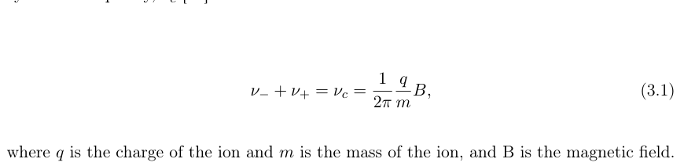

【未转写LaTeX；该裁图按式号定位，可能含邻近文字或需扩大边界，请以原PDF核定完整公式。】

本页其余原生块：标题、页眉、数学碎片、图中标签、表格与前/后置正文；完整保留，中文待译或不适用

**Source:** PDF44 P044B001; bbox [99.21, 46.25, 524.41, 57.16]

**Original:** Chapter 3. Experimental Details at IGISOL
26

**中文:** 【待译/版式碎片未作独立语义解释；不得视为已完成双语正文。】

**Source:** PDF44 P044B004; bbox [99.21, 127.16, 230.8, 139.72]

**Original:** cyclotron frequency, νc [11]:

**中文:** 【待译/版式碎片未作独立语义解释；不得视为已完成双语正文。】

**Source:** PDF44 P044B005; bbox [254.21, 181.06, 341.09, 200.98]

**Original:** ν−+ ν+ = νc = 1

**中文:** 【待译/版式碎片未作独立语义解释；不得视为已完成双语正文。】

**Source:** PDF44 P044B006; bbox [332.33, 181.06, 524.41, 206.83]

**Original:** 2π
q
mB,
(3.1)

**中文:** 【待译/版式碎片未作独立语义解释；不得视为已完成双语正文。】

**Source:** PDF44 P044B008; bbox [99.21, 264.81, 241.49, 276.76]

**Original:** 3.2.1
Purification Trap

**中文:** 【待译/版式碎片未作独立语义解释；不得视为已完成双语正文。】

## PDF 45 / 印刷p27

**Source:** PDF45 S0069; native P045B003, P045B004, P045B005, P045B006, P045B007, P045B008, P045B009, P045B010, P045B011, P045B012, P045B013

**Original:** Unlike the purification trap there is no buffer gas, and the trap is at vacuum (at a pressure of ≈10−7 mbar [45]). The 2 mm diameter tube connecting the two traps suppresses the flow of helium from the purification trap to the precision trap, in addition to preventing the transfer of isobaric contaminants. By operating at vacuum the effects of damping are minimised. Therefore, ions trapped within the precision trap have to be excited using different methods to those employed in the purification trap in order to provide isomeric cleaning. Dipolar excitation at the reduced cyclotron frequency can be used to push contaminant ions into an orbit of a larger radius within the trap where they collide with the trap electrodes, while the ions of interest remain at the centre of the precision trap. To achieve high-precision mass measurement, or the separation of isomeric states, the resonance frequency, νc, must first be identified.

**中文:** 【待译；保留原文，本块未完成中文翻译。】

**Source:** PDF45 S0070; native P045B014, P045B015, P045B016, P045B017, P045B018

**Original:** There are currently two methods employed at IGISOL to identify the resonance frequency. In the first method ions are released from the precision trap and are allowed to drift towards a detector. The ions which arrive first at the detector have more cyclotron motion. The time-of-flight can be calculated by integrating over the electric and magnetic fields from the traps to the detector, as shown by Equation 3.2 [45].

**中文:** 【待译；保留原文，本块未完成中文翻译。】

**Source:** PDF45 S0071; native P045B026, P045B027, P045B028

**Original:** where m is the mass of the ion, q is the electric charge, V (z) and B(z) are the electric and magnetic field along the path of the ions from the traps (z0) to the detector (z1), and E0 is the total kinetic energy of the ions. µ(ωRF ) is the magnetic moment,

**中文:** 【待译；保留原文，本块未完成中文翻译。】

**Source:** PDF45 S0072; native P045B031, P045B032

**Original:** where Er(ωRF ) is the total kinetic energy of the ions, which is dominated by the energy of the cyclotron motion and can be approximated as,

**中文:** 【待译；保留原文，本块未完成中文翻译。】

### Eq. (3.2) 原页区域回退
**Source:** PDF45 P045B024
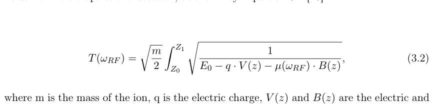

【未转写LaTeX；该裁图按式号定位，可能含邻近文字或需扩大边界，请以原PDF核定完整公式。】

### Eq. (3.3) 原页区域回退
**Source:** PDF45 P045B030
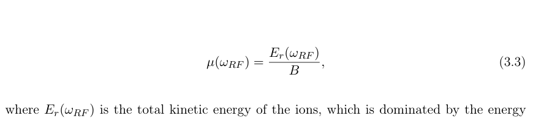

【未转写LaTeX；该裁图按式号定位，可能含邻近文字或需扩大边界，请以原PDF核定完整公式。】

本页其余原生块：标题、页眉、数学碎片、图中标签、表格与前/后置正文；完整保留，中文待译或不适用

**Source:** PDF45 P045B001; bbox [99.21, 46.25, 524.41, 57.16]

**Original:** Chapter 3. Experimental Details at IGISOL
27

**中文:** 【待译/版式碎片未作独立语义解释；不得视为已完成双语正文。】

**Source:** PDF45 P045B002; bbox [99.21, 82.73, 226.23, 94.69]

**Original:** 3.2.2
Precision Trap

**中文:** 【待译/版式碎片未作独立语义解释；不得视为已完成双语正文。】

**Source:** PDF45 P045B019; bbox [282.4, 489.67, 293.31, 500.58]

**Original:** s

**中文:** 【待译/版式碎片未作独立语义解释；不得视为已完成双语正文。】

**Source:** PDF45 P045B020; bbox [234.59, 492.75, 256.28, 504.41]

**Original:** rm

**中文:** 【待译/版式碎片未作独立语义解释；不得视为已完成双语正文。】

**Source:** PDF45 P045B021; bbox [259.29, 488.33, 279.59, 504.78]

**Original:** Z Z1

**中文:** 【待译/版式碎片未作独立语义解释；不得视为已完成双语正文。】

**Source:** PDF45 P045B022; bbox [183.42, 500.88, 231.57, 513.48]

**Original:** T(ωRF ) =

**中文:** 【待译/版式碎片未作独立语义解释；不得视为已完成双语正文。】

**Source:** PDF45 P045B023; bbox [248.76, 508.36, 254.21, 519.27]

**Original:** 2

**中文:** 【待译/版式碎片未作独立语义解释；不得视为已完成双语正文。】

**Source:** PDF45 P045B024; bbox [294.51, 493.5, 524.41, 520.96]

**Original:** 1
E0 −q · V (z) −µ(ωRF ) · B(z),
(3.2)

**中文:** 【待译/版式碎片未作独立语义解释；不得视为已完成双语正文。】

**Source:** PDF45 P045B025; bbox [265.35, 513.07, 274.74, 521.71]

**Original:** Z0

**中文:** 【待译/版式碎片未作独立语义解释；不得视为已完成双语正文。】

**Source:** PDF45 P045B029; bbox [263.5, 637.86, 355.9, 657.84]

**Original:** µ(ωRF ) = Er(ωRF )

**中文:** 【待译/版式碎片未作独立语义解释；不得视为已完成双语正文。】

**Source:** PDF45 P045B030; bbox [330.81, 645.24, 524.41, 663.63]

**Original:** B
,
(3.3)

**中文:** 【待译/版式碎片未作独立语义解释；不得视为已完成双语正文。】

## PDF 46 / 印刷p28

**Source:** PDF46 S0073; native P046B004, P046B005, P046B006

**Original:** where ρ+(ωRF ) is the cyclotron radius. The frequency which results in the shorted timeof-flight measurement is the resonance frequency, νc. This process is known as the timeof-flight ion-cyclotron resonance (TOF-ICR) technique [46, 47].

**中文:** 【待译；保留原文，本块未完成中文翻译。】

**Source:** PDF46 S0074; native P046B007, P046B008, P046B009, P046B010, P046B011, P046B012, P046B013, P046B014, P046B015, P046B016, P046B017, P046B018, P046B019, P046B020, P046B021, P046B022, P046B023, P046B024

**Original:** More recently, excitations with time-separated oscillatory fields have been introduced at IGISOL, known as the Ramsey TOF-ICR technique. The basis of this technique was invented by N. F. Ramsey in 1949 [12] as a way of improving the molecular beam magnetic resonance method developed by I. I. Rabi [48]. At IGISOL this technique was developed by T. Eronen [45]. Previously, when using TOF-ICR technique ions were excessively excited in the precision trap, to drive unwanted ions into the electrodes. However, with the Ramsey TOF-ICR ions are extracted back into the purification trap. This means excitation can be less excessive, as smaller excitations will still cause the radius of the orbit of unwanted ions to exceed the 2 mm diameter of the tube connecting the two traps, removing them from the sample as they hit the electrode wall between the traps. The cleaned ion sample is now trapped in the purification trap where the ions are re-cooled and re-centred before they are transferred back to the precision trap. To enhance the separation of the ground and isomeric states in the cleaned sample a final excitation at the magnetron frequency and quadrupole frequency is applied before ions in the desired isomeric state are extracted to the post-trap spectroscopic station. By using this technique a mass resolving power (M/∆M) of at least 106 can be achieved [11]. It is therefore possible to separate ground and isomeric states of the same isotope and to measure their subsequent decay paths independently, provided the energy separation is greater than the resolution of the Penning traps.

**中文:** 【待译；保留原文，本块未完成中文翻译。】

**Source:** PDF46 S0075; native P046B026, P046B027, P046B028, P046B029, P046B030

**Original:** The use of post-trap γ-ray spectroscopy in combination with the Ramsey TOF-ICR technique was first employed at the IGISOL facility by C. Rodríguez Triguero [38]. The ground and isomeric states in 102Nb are known to have a small energy difference (∆E ∼313 keV), and similar β decay half-lives (∆t1/2 ∼1.5 seconds), making their decay paths difficult to distinguish using conventional experimental methods. Rodríguez Triguero extended the

**中文:** 【待译；保留原文，本块未完成中文翻译。】

### Eq. (3.4) 原页区域回退
**Source:** PDF46 P046B003
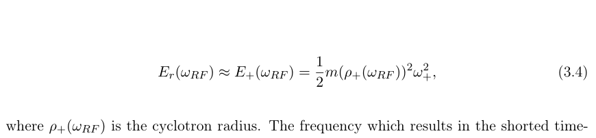

【未转写LaTeX；该裁图按式号定位，可能含邻近文字或需扩大边界，请以原PDF核定完整公式。】

本页其余原生块：标题、页眉、数学碎片、图中标签、表格与前/后置正文；完整保留，中文待译或不适用

**Source:** PDF46 P046B001; bbox [99.21, 46.25, 524.41, 57.16]

**Original:** Chapter 3. Experimental Details at IGISOL
28

**中文:** 【待译/版式碎片未作独立语义解释；不得视为已完成双语正文。】

**Source:** PDF46 P046B002; bbox [210.15, 115.61, 331.11, 135.59]

**Original:** Er(ωRF ) ≈E+(ωRF ) = 1

**中文:** 【待译/版式碎片未作独立语义解释；不得视为已完成双语正文。】

**Source:** PDF46 P046B003; bbox [325.66, 120.79, 524.41, 141.39]

**Original:** 2m(ρ+(ωRF ))2ω2
+,
(3.4)

**中文:** 【待译/版式碎片未作独立语义解释；不得视为已完成双语正文。】

**Source:** PDF46 P046B025; bbox [99.21, 640.94, 258.66, 655.29]

**Original:** 3.3
Proof of Principle

**中文:** 【待译/版式碎片未作独立语义解释；不得视为已完成双语正文。】

## PDF 47 / 印刷p29

**Source:** PDF47 S0076; native P047B002, P047B003, P047B004, P047B005

**Original:** Ramsey TOF-ICR technique to incorporate techniques of γ-ray spectroscopy to independently measure the decay paths of the low-spin ground state (Jπ = 1+) and high-spin (Jπ = 5+) isomeric state in 100Nb. Figure 3.5 shows the separation achieved using the Ramsey TOF-ICR technique for 100Nb.

**中文:** 【待译；保留原文，本块未完成中文翻译。】

**Source:** PDF47 S0077; native P047B006, P047B007, P047B008, P047B009, P047B010, P047B011, P047B012, P047B013

**Original:** In Figure 3.5 the isomeric and ground states in 100Nb are shown with a separation in precision trap frequency of 3.6 Hz, the isomeric state is identified with an asterix. The two isomeric states in 100Nb were then extracted independently and implanted in tape at the centre of the γ-ray spectroscopy system, which consisted of a β detector and three germanium detectors [38]. Figure 3.6 shows the β-gated γ-ray spectra measured for the ground and isomeric states in 100Nb. From Figure 3.6 it can be seen that combining γ- ray spectroscopy with the Ramsey TOF-ICR technique has successfully identified differing γ-ray patterns from the two decay paths in 100Nb.

**中文:** 【待译；保留原文，本块未完成中文翻译。】

### Figure 3.5
**Source:** PDF47 P047B015

【图/表图像尚未裁取，回看原PDF；不得将标签提取当作图像审读。】

**Original caption:** Figure 3.5: The number of A=100 ions transmitted as a function of precision trap frequency, where the isomeric state in 100Nb is indicated with an asterix. Taken from [38].

**中文图注:** 【待译；图像状态见source_map。】

本页其余原生块：标题、页眉、数学碎片、图中标签、表格与前/后置正文；完整保留，中文待译或不适用

**Source:** PDF47 P047B001; bbox [99.21, 46.25, 524.41, 57.16]

**Original:** Chapter 3. Experimental Details at IGISOL
29

**中文:** 【待译/版式碎片未作独立语义解释；不得视为已完成双语正文。】

**Source:** PDF47 P047B014; bbox [139.92, 346.09, 480.09, 597.11]

**Original:** 【embedded image block；回看原PDF】

**中文:** 【待译/版式碎片未作独立语义解释；不得视为已完成双语正文。】

## PDF 48 / 印刷p30

**Source:** PDF48 S0078; native P048B004

**Original:** 3.4 Separation of Isomeric States in 102Y

**中文:** 【待译；保留原文，本块未完成中文翻译。】

**Source:** PDF48 S0079; native P048B005, P048B006, P048B007, P048B008, P048B009, P048B010, P048B011, P048B012, P048B013, P048B014

**Original:** In this work the Ramsey TOF-ICR technique was used to separate the ground and isomeric states in 102Y. However, the energy separation of the ground and isomeric states was not known and therefore could be less than the resolution of the Penning traps. The half-life of the ground and isomeric states is also short, 300 ms and 360 ms respectively, which means the length of the cleaning cycle within the Penning traps was limited and a compromise was required between the resolution and the number of counts at the post-trap spectroscopic station. Figure 3.7 shows the mass scan obtained during the first experiment at IGISOL by scanning the quadrupole frequency in the purification trap. The beam contaminants, 102Zr, 102Nb and 102Mo, were clearly separated from the isotope of interest, 102Y, and were easily removed by fixing the quadrupole frequency at ∼1054225 Hz. 102Y ions were then

**中文:** 【待译；保留原文，本块未完成中文翻译。】

**Source:** PDF48 S0080; native P048B016, P048B017, P048B018, P048B019, P048B020

**Original:** In the precision trap the dipole frequency scan, presented in Figure 3.8, did not show a clear separation of the ground and isomeric state in 102Y. It was therefore difficult to select a suitable frequency for studying these two states independently. As mentioned in Section 2.5, the two isomeric states in 102Y are expected to have a separation of less than 200 keV. It is then possible that the single, wide peak observed in the precision trap was

**中文:** 精密阱中的偶极频率扫描如图3.8所示，未显示102Y基态与异能态的清晰分离。因此，难以选择合适频率来独立研究两态。如2.5节所述，预期102Y两异能态的间隔小于200keV。因而，精密阱中观察到的单个宽峰有可能由以下成分构成：

### Figure 3.6
**Source:** PDF48 P048B003

【图/表图像尚未裁取，回看原PDF；不得将标签提取当作图像审读。】

**Original caption:** Figure 3.6: β-gated γ-ray spectra measured at precision trap frequencies 1075391 Hz for the isomeric state in 100Nb and at 1075395 Hz for the ground state in 100Nb. Taken from [38].

**中文图注:** 【待译；图像状态见source_map。】

本页其余原生块：标题、页眉、数学碎片、图中标签、表格与前/后置正文；完整保留，中文待译或不适用

**Source:** PDF48 P048B001; bbox [99.21, 46.25, 524.41, 57.16]

**Original:** Chapter 3. Experimental Details at IGISOL
30

**中文:** 【待译/版式碎片未作独立语义解释；不得视为已完成双语正文。】

**Source:** PDF48 P048B002; bbox [108.04, 81.1, 511.97, 296.86]

**Original:** 【embedded image block；回看原PDF】

**中文:** 【待译/版式碎片未作独立语义解释；不得视为已完成双语正文。】

**Source:** PDF48 P048B015; bbox [99.21, 640.07, 258.1, 650.98]

**Original:** transported to the precision trap.

**中文:** 【待译/版式碎片未作独立语义解释；不得视为已完成双语正文。】

## PDF 49 / 印刷p31

**Source:** PDF49 S0081; native P049B002, P049B003

**Original:** constructed from two individual and overlapping peaks, one for the ground state and one for the isomeric state. This is investigated further in Chapter 4.

**中文:** 两个各自独立但相互重叠的峰，一个来自基态，另一个来自异能态。第4章将进一步研究这一点。

### Figure 3.7
**Source:** PDF49 P049B028

【图/表图像尚未裁取，回看原PDF；不得将标签提取当作图像审读。】

**Original caption:** Figure 3.7: A scan over the quadrupole frequency in the purification trap for the A=102 ions, for the first IGISOL experiment (the inset shows the data in log-scale).

**中文图注:** 【待译；图像状态见source_map。】

### Figure 3.8
**Source:** PDF49 P049B041

【图/表图像尚未裁取，回看原PDF；不得将标签提取当作图像审读。】

**Original caption:** Figure 3.8: A scan over dipole frequency close to 102Y, for Ramsey cleaning.

**中文图注:** 【待译；图像状态见source_map。】

本页其余原生块：标题、页眉、数学碎片、图中标签、表格与前/后置正文；完整保留，中文待译或不适用

**Source:** PDF49 P049B001; bbox [99.21, 46.25, 524.41, 57.16]

**Original:** Chapter 3. Experimental Details at IGISOL
31

**中文:** 【待译/版式碎片未作独立语义解释；不得视为已完成双语正文。】

**Source:** PDF49 P049B004; bbox [155.74, 128.07, 171.67, 136.26]

**Original:** 800

**中文:** 【待译/版式碎片未作独立语义解释；不得视为已完成双语正文。】

**Source:** PDF49 P049B005; bbox [177.01, 143.73, 194.35, 150.66]

**Original:** 1000

**中文:** 【待译/版式碎片未作独立语义解释；不得视为已完成双语正文。】

**Source:** PDF49 P049B006; bbox [155.74, 144.48, 171.67, 152.67]

**Original:** 700

**中文:** 【待译/版式碎片未作独立语义解释；不得视为已完成双语正文。】

**Source:** PDF49 P049B007; bbox [249.33, 140.8, 292.99, 153.85]

**Original:** 102Nb
102Mo

**中文:** 【待译/版式碎片未作独立语义解释；不得视为已完成双语正文。】

**Source:** PDF49 P049B008; bbox [421.99, 141.73, 447.73, 154.07]

**Original:** 102Mo

**中文:** 【待译/版式碎片未作独立语义解释；不得视为已完成双语正文。】

**Source:** PDF49 P049B009; bbox [235.38, 149.71, 252.6, 159.59]

**Original:** 102Zr

**中文:** 【待译/版式碎片未作独立语义解释；不得视为已完成双语正文。】

**Source:** PDF49 P049B010; bbox [155.74, 160.92, 171.67, 169.11]

**Original:** 600

**中文:** 【待译/版式碎片未作独立语义解释；不得视为已完成双语正文。】

**Source:** PDF49 P049B011; bbox [180.87, 166.69, 194.35, 173.62]

**Original:** 100

**中文:** 【待译/版式碎片未作独立语义解释；不得视为已完成双语正文。】

**Source:** PDF49 P049B012; bbox [362.96, 169.66, 387.64, 182.01]

**Original:** 102Nb

**中文:** 【待译/版式碎片未作独立语义解释；不得视为已完成双语正文。】

**Source:** PDF49 P049B013; bbox [155.74, 177.33, 171.67, 185.52]

**Original:** 500

**中文:** 【待译/版式碎片未作独立语义解释；不得视为已完成双语正文。】

**Source:** PDF49 P049B014; bbox [203.26, 181.84, 218.39, 191.71]

**Original:** 102Y

**中文:** 【待译/版式碎片未作独立语义解释；不得视为已完成双语正文。】

**Source:** PDF49 P049B015; bbox [184.72, 189.66, 194.35, 196.59]

**Original:** 10

**中文:** 【待译/版式碎片未作独立语义解释；不得视为已完成双语正文。】

**Source:** PDF49 P049B016; bbox [155.74, 193.74, 171.67, 201.93]

**Original:** 400

**中文:** 【待译/版式碎片未作独立语义解释；不得视为已完成双语正文。】

**Source:** PDF49 P049B017; bbox [144.71, 184.88, 152.9, 213.08]

**Original:** Counts

**中文:** 【待译/版式碎片未作独立语义解释；不得视为已完成双语正文。】

**Source:** PDF49 P049B018; bbox [323.62, 205.79, 345.15, 218.13]

**Original:** 102Zr

**中文:** 【待译/版式碎片未作独立语义解释；不得视为已完成双语正文。】

**Source:** PDF49 P049B019; bbox [155.74, 210.18, 171.67, 218.37]

**Original:** 300

**中文:** 【待译/版式碎片未作独立语义解释；不得视为已完成双语正文。】

**Source:** PDF49 P049B020; bbox [188.57, 212.62, 194.35, 219.55]

**Original:** 1

**中文:** 【待译/版式碎片未作独立语义解释；不得视为已完成双语正文。】

**Source:** PDF49 P049B021; bbox [195.65, 217.03, 297.84, 223.96]

**Original:** 200
    300
    400
    500

**中文:** 【待译/版式碎片未作独立语义解释；不得视为已完成双语正文。】

**Source:** PDF49 P049B022; bbox [155.74, 226.59, 171.67, 234.78]

**Original:** 200

**中文:** 【待译/版式碎片未作独立语义解释；不得视为已完成双语正文。】

**Source:** PDF49 P049B023; bbox [155.74, 243.03, 171.67, 251.22]

**Original:** 100

**中文:** 【待译/版式碎片未作独立语义解释；不得视为已完成双语正文。】

**Source:** PDF49 P049B024; bbox [235.57, 245.19, 254.48, 257.54]

**Original:** 102Y

**中文:** 【待译/版式碎片未作独立语义解释；不得视为已完成双语正文。】

**Source:** PDF49 P049B025; bbox [164.84, 259.44, 171.67, 267.63]

**Original:** 0

**中文:** 【待译/版式碎片未作独立语义解释；不得视为已完成双语正文。】

**Source:** PDF49 P049B026; bbox [185.27, 263.85, 468.58, 272.04]

**Original:** 150
    200
    250
    300
    350
    400
    450
    500

**中文:** 【待译/版式碎片未作独立语义解释；不得视为已完成双语正文。】

**Source:** PDF49 P049B027; bbox [248.35, 276.49, 398.06, 284.68]

**Original:** (Quadrupole frequency - 1054000) [Hz]

**中文:** 【待译/版式碎片未作独立语义解释；不得视为已完成双语正文。】

**Source:** PDF49 P049B029; bbox [160.29, 344.6, 171.67, 352.79]

**Original:** 80

**中文:** 【待译/版式碎片未作独立语义解释；不得视为已完成双语正文。】

**Source:** PDF49 P049B030; bbox [160.29, 361.01, 171.67, 369.2]

**Original:** 70

**中文:** 【待译/版式碎片未作独立语义解释；不得视为已完成双语正文。】

**Source:** PDF49 P049B031; bbox [160.29, 377.45, 171.67, 385.64]

**Original:** 60

**中文:** 【待译/版式碎片未作独立语义解释；不得视为已完成双语正文。】

**Source:** PDF49 P049B032; bbox [160.29, 393.86, 171.67, 402.05]

**Original:** 50

**中文:** 【待译/版式碎片未作独立语义解释；不得视为已完成双语正文。】

**Source:** PDF49 P049B033; bbox [160.29, 410.27, 171.67, 418.46]

**Original:** 40

**中文:** 【待译/版式碎片未作独立语义解释；不得视为已完成双语正文。】

**Source:** PDF49 P049B034; bbox [147.36, 401.41, 155.55, 429.61]

**Original:** Counts

**中文:** 【待译/版式碎片未作独立语义解释；不得视为已完成双语正文。】

**Source:** PDF49 P049B035; bbox [160.29, 426.72, 171.67, 434.9]

**Original:** 30

**中文:** 【待译/版式碎片未作独立语义解释；不得视为已完成双语正文。】

**Source:** PDF49 P049B036; bbox [160.29, 443.13, 171.67, 451.32]

**Original:** 20

**中文:** 【待译/版式碎片未作独立语义解释；不得视为已完成双语正文。】

**Source:** PDF49 P049B037; bbox [160.29, 459.57, 171.67, 467.76]

**Original:** 10

**中文:** 【待译/版式碎片未作独立语义解释；不得视为已完成双语正文。】

**Source:** PDF49 P049B038; bbox [164.84, 475.98, 171.67, 484.17]

**Original:** 0

**中文:** 【待译/版式碎片未作独立语义解释；不得视为已完成双语正文。】

**Source:** PDF49 P049B039; bbox [194.87, 480.39, 451.54, 488.58]

**Original:** 72.0
    72.5
    73.0
    73.5
    74.0
    74.5
    75.0
    75.5

**中文:** 【待译/版式碎片未作独立语义解释；不得视为已完成双语正文。】

**Source:** PDF49 P049B040; bbox [258.81, 493.02, 387.6, 501.21]

**Original:** (Dipole frequency - 1054000) [Hz]

**中文:** 【待译/版式碎片未作独立语义解释；不得视为已完成双语正文。】

## PDF 50 / 印刷p32

**Source:** PDF50 S0082; native P050B002, P050B003, P050B004, P050B005, P050B006, P050B007, P050B008, P050B009, P050B010, P050B011, P050B012, P050B013, P050B014

**Original:** During the second experiment the beamline transmission was much higher and provided 10 ions/second post-trap, a factor of 10 times higher than the first experiment. Figure 3.9 shows the mass scan produced in purification trap during the second experiment. However, even with an increased beam intensity the two isomeric states in 102Y were inseparable in the precision trap using the Ramsey TOF-ICR technique. Figure 3.10 shows the quadrupole frequency scan at the reduced cyclotron frequency in the precision trap, as the two peaks were not clearly separated in the quadrupole frequency scan it was not possible to conduct a dipole frequency scan (like the one presented in Figure 4.1). As the two isomeric states were not separated in the precision trap during this second experiment only the purification trap was used, in order to retain as many ions as possible and maintain a high count rate at the post-trap spectroscopic station. In the purification trap neighbouring isobars were clearly separated from 102Y and were easily removed by setting the quadrupole frequency at ∼1054225 Hz, before ions were transported to the post-trap spectroscopic station.

**中文:** 第二次实验期间，束线传输显著提高，阱后达到10离子/秒，是第一次实验的10倍。图3.9给出了第二次实验在净化阱取得的质量扫描。然而，即使束流强度提高，仍无法在精密阱中通过Ramsey TOF-ICR技术分开102Y的两个异能态。图3.10展示精密阱约化回旋频率处的四极频率扫描；由于两个峰在该扫描中未清晰分离，无法进行类似图4.1的偶极频率扫描。第二次实验未在精密阱分开两态，因此只使用净化阱，以尽量保留离子，并维持阱后谱学站的高计数率。净化阱内相邻同量异位素与102Y清晰分离，可将四极频率设为约1054225Hz将其去除，然后把离子输送到阱后谱学站。

### Figure 3.9
**Source:** PDF50 P050B033

【图/表图像尚未裁取，回看原PDF；不得将标签提取当作图像审读。】

**Original caption:** Figure 3.9: A scan over the quadrupole frequency in the purification trap for the A=102 ions, for the second IGISOL experiment.

**中文图注:** 【待译；图像状态见source_map。】

### Figure 3.10
**Source:** PDF50 P050B048

【图/表图像尚未裁取，回看原PDF；不得将标签提取当作图像审读。】

**Original caption:** Figure 3.10: A scan over the quadrupole frequency in the precision trap for 102Y, for the second IGISOL experiment.

**中文图注:** 【待译；图像状态见source_map。】

本页其余原生块：标题、页眉、数学碎片、图中标签、表格与前/后置正文；完整保留，中文待译或不适用

**Source:** PDF50 P050B001; bbox [99.21, 46.25, 524.41, 57.16]

**Original:** Chapter 3. Experimental Details at IGISOL
32

**中文:** 【待译/版式碎片未作独立语义解释；不得视为已完成双语正文。】

**Source:** PDF50 P050B015; bbox [151.18, 368.02, 171.67, 376.21]

**Original:** 1800

**中文:** 【待译/版式碎片未作独立语义解释；不得视为已完成双语正文。】

**Source:** PDF50 P050B016; bbox [151.18, 382.61, 171.67, 390.8]

**Original:** 1600

**中文:** 【待译/版式碎片未作独立语义解释；不得视为已完成双语正文。】

**Source:** PDF50 P050B017; bbox [357.58, 382.79, 414.57, 395.13]

**Original:** 102Mo +102Tc

**中文:** 【待译/版式碎片未作独立语义解释；不得视为已完成双语正文。】

**Source:** PDF50 P050B018; bbox [151.18, 397.22, 171.67, 405.41]

**Original:** 1400

**中文:** 【待译/版式碎片未作独立语义解释；不得视为已完成双语正文。】

**Source:** PDF50 P050B019; bbox [301.22, 394.47, 365.03, 406.81]

**Original:** 102Nb +102mNb

**中文:** 【待译/版式碎片未作独立语义解释；不得视为已完成双语正文。】

**Source:** PDF50 P050B020; bbox [151.18, 411.8, 171.67, 419.99]

**Original:** 1200

**中文:** 【待译/版式碎片未作独立语义解释；不得视为已完成双语正文。】

**Source:** PDF50 P050B021; bbox [285.98, 416.36, 307.51, 428.7]

**Original:** 102Zr

**中文:** 【待译/版式碎片未作独立语义解释；不得视为已完成双语正文。】

**Source:** PDF50 P050B022; bbox [151.18, 426.42, 171.67, 434.61]

**Original:** 1000

**中文:** 【待译/版式碎片未作独立语义解释；不得视为已完成双语正文。】

**Source:** PDF50 P050B023; bbox [155.74, 441.0, 171.67, 449.19]

**Original:** 800

**中文:** 【待译/版式碎片未作独立语义解释；不得视为已完成双语正文。】

**Source:** PDF50 P050B024; bbox [142.07, 424.83, 150.25, 453.04]

**Original:** Counts

**中文:** 【待译/版式碎片未作独立语义解释；不得视为已完成双语正文。】

**Source:** PDF50 P050B025; bbox [155.74, 455.62, 171.67, 463.81]

**Original:** 600

**中文:** 【待译/版式碎片未作独立语义解释；不得视为已完成双语正文。】

**Source:** PDF50 P050B026; bbox [155.74, 470.2, 171.67, 478.39]

**Original:** 400

**中文:** 【待译/版式碎片未作独立语义解释；不得视为已完成双语正文。】

**Source:** PDF50 P050B027; bbox [413.42, 469.65, 438.1, 482.0]

**Original:** 102Ru

**中文:** 【待译/版式碎片未作独立语义解释；不得视为已完成双语正文。】

**Source:** PDF50 P050B028; bbox [155.74, 484.81, 171.67, 493.0]

**Original:** 200

**中文:** 【待译/版式碎片未作独立语义解释；不得视为已完成双语正文。】

**Source:** PDF50 P050B029; bbox [207.89, 484.96, 226.8, 497.3]

**Original:** 102Y

**中文:** 【待译/版式碎片未作独立语义解释；不得视为已完成双语正文。】

**Source:** PDF50 P050B030; bbox [164.84, 499.4, 171.67, 507.59]

**Original:** 0

**中文:** 【待译/版式碎片未作独立语义解释；不得视为已完成双语正文。】

**Source:** PDF50 P050B031; bbox [196.01, 503.81, 450.4, 512.0]

**Original:** 200
    250
    300
    350
    400
    450
    500
    550

**中文:** 【待译/版式碎片未作独立语义解释；不得视为已完成双语正文。】

**Source:** PDF50 P050B032; bbox [248.35, 516.45, 398.06, 524.64]

**Original:** (Quadrupole frequency - 1054000) [Hz]

**中文:** 【待译/版式碎片未作独立语义解释；不得视为已完成双语正文。】

**Source:** PDF50 P050B034; bbox [157.59, 574.67, 173.5, 582.84]

**Original:** 190

**中文:** 【待译/版式碎片未作独立语义解释；不得视为已完成双语正文。】

**Source:** PDF50 P050B035; bbox [157.59, 587.78, 173.5, 595.95]

**Original:** 180

**中文:** 【待译/版式碎片未作独立语义解释；不得视为已完成双语正文。】

**Source:** PDF50 P050B036; bbox [157.59, 600.89, 173.5, 609.06]

**Original:** 170

**中文:** 【待译/版式碎片未作独立语义解释；不得视为已完成双语正文。】

**Source:** PDF50 P050B037; bbox [157.59, 614.0, 173.5, 622.17]

**Original:** 160

**中文:** 【待译/版式碎片未作独立语义解释；不得视为已完成双语正文。】

**Source:** PDF50 P050B038; bbox [157.59, 627.11, 173.5, 635.28]

**Original:** 150

**中文:** 【待译/版式碎片未作独立语义解释；不得视为已完成双语正文。】

**Source:** PDF50 P050B039; bbox [157.59, 640.22, 173.5, 648.39]

**Original:** 140

**中文:** 【待译/版式碎片未作独立语义解释；不得视为已完成双语正文。】

**Source:** PDF50 P050B040; bbox [146.59, 631.49, 154.76, 659.64]

**Original:** Counts

**中文:** 【待译/版式碎片未作独立语义解释；不得视为已完成双语正文。】

**Source:** PDF50 P050B041; bbox [157.59, 653.36, 173.5, 661.53]

**Original:** 130

**中文:** 【待译/版式碎片未作独立语义解释；不得视为已完成双语正文。】

**Source:** PDF50 P050B042; bbox [157.59, 666.47, 173.5, 674.64]

**Original:** 120

**中文:** 【待译/版式碎片未作独立语义解释；不得视为已完成双语正文。】

**Source:** PDF50 P050B043; bbox [157.59, 679.58, 173.5, 687.75]

**Original:** 110

**中文:** 【待译/版式碎片未作独立语义解释；不得视为已完成双语正文。】

**Source:** PDF50 P050B044; bbox [157.59, 692.69, 173.5, 700.86]

**Original:** 100

**中文:** 【待译/版式碎片未作独立语义解释；不得视为已完成双语正文。】

**Source:** PDF50 P050B045; bbox [162.14, 705.8, 173.5, 713.97]

**Original:** 90

**中文:** 【待译/版式碎片未作独立语义解释；不得视为已完成双语正文。】

**Source:** PDF50 P050B046; bbox [194.23, 710.2, 473.1, 718.37]

**Original:** 24
 25
 26
 27
 28
 29
 30
 31
 32
 33

**中文:** 【待译/版式碎片未作独立语义解释；不得视为已完成双语正文。】

**Source:** PDF50 P050B047; bbox [250.04, 722.93, 399.48, 731.11]

**Original:** (Quadrupole frequency - 1054200) [Hz]

**中文:** 【待译/版式碎片未作独立语义解释；不得视为已完成双语正文。】

## PDF 51 / 印刷p33

**Source:** PDF51 S0083; native P051B003, P051B004, P051B005, P051B006, P051B007, P051B008, P051B009, P051B010, P051B011, P051B012

**Original:** Following extraction from the Penning traps, ions were implanted onto tape at the centre of a γ-ray spectroscopy station. In the first experiment at IGISOL the tape moved every 60 seconds to reduce background from unwanted decays in 102Nb and 102Mo, whereas in the second experiment the tape moved every 10 seconds. In both the first and second experiment a plastic β detector was inside the vacuum and surrounded the implantation point on the tape, and was used to detect β electrons. The β detector has three windows through which γ-rays can escape. In the first experiment two germanium detectors were used, one was placed in-front of the window on the beam axis, and the second detector was placed at one of the windows 90◦to the beam axis, both detectors were ∼1.8 cm from the implantation point. The experimental setup for the first experiment is shown in

**中文:** 【待译；保留原文，本块未完成中文翻译。】

**Source:** PDF51 S0084; native P051B016, P051B017, P051B018, P051B019, P051B020, P051B021

**Original:** In the second experiment three high-purity germanium detectors were used in combination with a beta detector. The position of the beta detector remained consistent with the first experiment, one germanium detector was placed in-front of the β detector window in the beam axis, whereas the other two germanium detectors were placed in-front of the remaining two β detector windows 90◦to the beam axis. Each of the germanium detectors were placed ∼1.8 cm from the implantation point. Figure 3.12 shows the experimental

**中文:** 【待译；保留原文，本块未完成中文翻译。】

### Figure 3.11
**Source:** PDF51 P051B015

【图/表图像尚未裁取，回看原PDF；不得将标签提取当作图像审读。】

**Original caption:** Figure 3.11: Detector arrangement for the first experiment.

**中文图注:** 【待译；图像状态见source_map。】

本页其余原生块：标题、页眉、数学碎片、图中标签、表格与前/后置正文；完整保留，中文待译或不适用

**Source:** PDF51 P051B001; bbox [99.21, 46.25, 524.41, 57.16]

**Original:** Chapter 3. Experimental Details at IGISOL
33

**中文:** 【待译/版式碎片未作独立语义解释；不得视为已完成双语正文。】

**Source:** PDF51 P051B002; bbox [99.21, 80.86, 248.6, 95.21]

**Original:** 3.5
Post-Trap Setup

**中文:** 【待译/版式碎片未作独立语义解释；不得视为已完成双语正文。】

**Source:** PDF51 P051B013; bbox [99.21, 334.31, 155.69, 345.21]

**Original:** Figure 3.11.

**中文:** 【待译/版式碎片未作独立语义解释；不得视为已完成双语正文。】

**Source:** PDF51 P051B014; bbox [150.55, 356.9, 469.45, 525.02]

**Original:** 【embedded image block；回看原PDF】

**中文:** 【待译/版式碎片未作独立语义解释；不得视为已完成双语正文。】

**Source:** PDF51 P051B022; bbox [99.21, 700.96, 254.18, 711.87]

**Original:** setup for the second experiment.

**中文:** 【待译/版式碎片未作独立语义解释；不得视为已完成双语正文。】

## PDF 52 / 印刷p34

**Source:** PDF52 S0085; native P052B005, P052B006, P052B007, P052B008, P052B009, P052B010

**Original:** During the first experiment, the energy calibration of the two germanium detectors was performed using a mixed 152Eu 133Ba calibration source. The measured gamma-ray energy spectrum of this source is provided in Figure 3.13. The 80-, 121-, 244-, 276-, 303-, 344-, 356-, 383-, 411-, 444-, 778-, 867-, 964-, 1086-, 1112-, and 1408 keV peaks were fitted in the uncalibrated spectrum, and a linear fit was applied for converting channel number to energy. To accumulate sufficient statistics data with the calibration source were collected

**中文:** 第一次实验用混合152Eu、133Ba校准源对两个锗探测器作能量校准。图3.13给出了该源的γ能谱。在未校准谱中拟合80、121、244、276、303、344、356、383、411、444、778、867、964、1086、1112及1408keV峰，再用线性拟合把道址转换为能量。为了积累足够统计量，校准源数据采集了40分钟。

**Source:** PDF52 S0086; native P052B027, P052B028

**Original:** For the second experiment at IGISOL the mixed 152Eu 133Ba calibration source was also used to provide an energy calibration. As before, the 80-, 121-, 244-, 276-, 303-, 344-,

**中文:** 【待译；保留原文，本块未完成中文翻译。】

### Figure 3.12
**Source:** PDF52 P052B003

【图/表图像尚未裁取，回看原PDF；不得将标签提取当作图像审读。】

**Original caption:** Figure 3.12: Detector arrangement for the second experiment.

**中文图注:** 【待译；图像状态见source_map。】

### Figure 3.13
**Source:** PDF52 P052B026

【图/表图像尚未裁取，回看原PDF；不得将标签提取当作图像审读。】

**Original caption:** Figure 3.13: Calibrated gamma-ray energy spectrum for a combined 152Eu and 133Ba source.

**中文图注:** 【待译；图像状态见source_map。】

本页其余原生块：标题、页眉、数学碎片、图中标签、表格与前/后置正文；完整保留，中文待译或不适用

**Source:** PDF52 P052B001; bbox [99.21, 46.25, 524.41, 57.16]

**Original:** Chapter 3. Experimental Details at IGISOL
34

**中文:** 【待译/版式碎片未作独立语义解释；不得视为已完成双语正文。】

**Source:** PDF52 P052B002; bbox [161.18, 81.1, 458.83, 266.43]

**Original:** 【embedded image block；回看原PDF】

**中文:** 【待译/版式碎片未作独立语义解释；不得视为已完成双语正文。】

**Source:** PDF52 P052B004; bbox [99.21, 309.91, 252.85, 321.86]

**Original:** 3.5.1
Energy Calibration

**中文:** 【待译/版式碎片未作独立语义解释；不得视为已完成双语正文。】

**Source:** PDF52 P052B011; bbox [99.21, 470.47, 170.36, 481.38]

**Original:** for 40 minutes.

**中文:** 【待译/版式碎片未作独立语义解释；不得视为已完成双语正文。】

**Source:** PDF52 P052B012; bbox [300.17, 498.0, 323.96, 510.7]

**Original:** 65000

**中文:** 【待译/版式碎片未作独立语义解释；不得视为已完成双语正文。】

**Source:** PDF52 P052B013; bbox [158.29, 499.87, 186.84, 512.57]

**Original:** 550000

**中文:** 【待译/版式碎片未作独立语义解释；不得视为已完成双语正文。】

**Source:** PDF52 P052B014; bbox [299.4, 517.16, 323.19, 529.86]

**Original:** 45000

**中文:** 【待译/版式碎片未作独立语义解释；不得视为已完成双语正文。】

**Source:** PDF52 P052B015; bbox [157.93, 521.71, 186.48, 534.41]

**Original:** 450000

**中文:** 【待译/版式碎片未作独立语义解释；不得视为已完成双语正文。】

**Source:** PDF52 P052B016; bbox [299.77, 536.28, 323.56, 548.98]

**Original:** 25000

**中文:** 【待译/版式碎片未作独立语义解释；不得视为已完成双语正文。】

**Source:** PDF52 P052B017; bbox [158.54, 543.27, 187.09, 555.96]

**Original:** 350000

**中文:** 【待译/版式碎片未作独立语义解释；不得视为已完成双语正文。】

**Source:** PDF52 P052B018; bbox [141.17, 545.48, 153.86, 572.45]

**Original:** Counts

**中文:** 【待译/版式碎片未作独立语义解释；不得视为已完成双语正文。】

**Source:** PDF52 P052B019; bbox [158.29, 565.43, 186.84, 578.13]

**Original:** 250000

**中文:** 【待译/版式碎片未作独立语义解释；不得视为已完成双语正文。】

**Source:** PDF52 P052B020; bbox [305.0, 555.12, 469.41, 578.37]

**Original:** 800
1000
1200
1400
5000

**中文:** 【待译/版式碎片未作独立语义解释；不得视为已完成双语正文。】

**Source:** PDF52 P052B021; bbox [160.65, 587.31, 189.2, 600.01]

**Original:** 150000

**中文:** 【待译/版式碎片未作独立语义解释；不得视为已完成双语正文。】

**Source:** PDF52 P052B022; bbox [163.53, 609.15, 187.32, 621.85]

**Original:** 50000

**中文:** 【待译/版式碎片未作独立语义解释；不得视为已完成双语正文。】

**Source:** PDF52 P052B023; bbox [198.69, 636.39, 461.03, 649.41]

**Original:** 50
150
250
350
450

**中文:** 【待译/版式碎片未作独立语义解释；不得视为已完成双语正文。】

**Source:** PDF52 P052B024; bbox [228.6, 636.8, 430.14, 649.49]

**Original:** 100
200
300
400

**中文:** 【待译/版式碎片未作独立语义解释；不得视为已完成双语正文。】

**Source:** PDF52 P052B025; bbox [316.9, 653.72, 351.22, 666.42]

**Original:** E (keV)

**中文:** 【待译/版式碎片未作独立语义解释；不得视为已完成双语正文。】

## PDF 53 / 印刷p35

**Source:** PDF53 S0087; native P053B002, P053B003, P053B004

**Original:** 356-, 383-, 411-, 444-, 778-, 867-, 964-, 1086-, 1112-, and 1408 keV peaks were fitted in the uncalibrated spectrum, and a linear fit was applied for converting channel number to energy. To accumulate sufficient statistics data with the calibration source were collected

**中文:** 356、383、411、444、778、867、964、1086、1112及1408keV峰在未校准谱中得到拟合，并通过线性拟合把道址转换为能量。为积累足够统计量，校准源数据采集了两小时。

**Source:** PDF53 S0088; native P053B024, P053B025, P053B026, P053B027, P053B028, P053B029, P053B030

**Original:** As the highest energy gamma-ray known in the level scheme of 102Zr is 1211 keV it was sufficient to use the combined 152Eu and 133Ba source to characterise the relative efficiency of the germanium detectors. Due to time constraints during the first experiment it was not possible to vent the tape station in order to place the source on the implantation point, and therefore the source was positioned on the outside of the beta-detector, ∼1 cm from the two germanium detectors. The relative efficiency curve, presented in Figure 3.15, was calculated using the formula presented in Equation 3.5 [49]. The efficiency of the β

**中文:** 由于102Zr已知能级纲图中最高γ能量为1211keV，混合152Eu、133Ba源已足以表征锗探测器的相对效率。第一次实验受时间限制，无法将磁带站放气以把源放到植入点，因此把源放在β探测器外侧，距两个锗探测器约1cm。图3.15所示相对效率曲线用式3.5[49]计算。β探测器效率约为50%。

**Source:** PDF53 S0089; native P053B040, P053B041, P053B042

**Original:** where x = ln(Eγ/100) and y = ln(Eγ/1000), where Eγ is in units of keV. A, B, and C describe the efficiency at low energies, whereas D, E, and F describe high energies. G is an interaction parameter between the two regions defining the sharpness of the turnover.

**中文:** 其中x=ln(Eγ/100)，y=ln(Eγ/1000)，Eγ以keV为单位。A、B、C描述低能效率，D、E、F描述高能效率。G是两个能区之间的相互作用参数，决定转折的陡峭程度。

### Figure 3.14
**Source:** PDF53 P053B022

【图/表图像尚未裁取，回看原PDF；不得将标签提取当作图像审读。】

**Original caption:** Figure 3.14: Second experiment Calibrated gamma-ray energy spectrum for a com- bined 152Eu and 133Ba source.

**中文图注:** 【待译；图像状态见source_map。】

### Eq. (3.5) 原页区域回退
**Source:** PDF53 P053B039
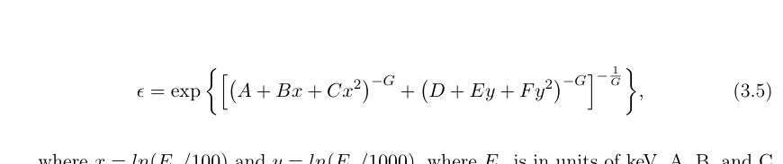

【未转写LaTeX；该裁图按式号定位，可能含邻近文字或需扩大边界，请以原PDF核定完整公式。】

本页其余原生块：标题、页眉、数学碎片、图中标签、表格与前/后置正文；完整保留，中文待译或不适用

**Source:** PDF53 P053B001; bbox [99.21, 46.25, 524.41, 57.16]

**Original:** Chapter 3. Experimental Details at IGISOL
35

**中文:** 【待译/版式碎片未作独立语义解释；不得视为已完成双语正文。】

**Source:** PDF53 P053B005; bbox [99.21, 148.99, 165.25, 159.9]

**Original:** for two hours.

**中文:** 【待译/版式碎片未作独立语义解释；不得视为已完成双语正文。】

**Source:** PDF53 P053B006; bbox [301.39, 178.38, 320.87, 191.37]

**Original:** 5500

**中文:** 【待译/版式碎片未作独立语义解释；不得视为已完成双语正文。】

**Source:** PDF53 P053B007; bbox [155.61, 183.66, 179.96, 196.65]

**Original:** 40000

**中文:** 【待译/版式碎片未作独立语义解释；不得视为已完成双语正文。】

**Source:** PDF53 P053B008; bbox [301.64, 198.45, 321.12, 211.44]

**Original:** 3500

**中文:** 【待译/版式碎片未作独立语义解释；不得视为已完成双语正文。】

**Source:** PDF53 P053B009; bbox [155.86, 199.44, 180.21, 212.43]

**Original:** 35000

**中文:** 【待译/版式碎片未作独立语义解释；不得视为已完成双语正文。】

**Source:** PDF53 P053B010; bbox [156.28, 215.44, 180.62, 228.43]

**Original:** 30000

**中文:** 【待译/版式碎片未作独立语义解释；不得视为已完成双语正文。】

**Source:** PDF53 P053B011; bbox [303.55, 218.55, 323.03, 231.55]

**Original:** 1500

**中文:** 【待译/版式碎片未作独立语义解释；不得视为已完成双语正文。】

**Source:** PDF53 P053B012; bbox [155.61, 231.76, 179.96, 244.76]

**Original:** 25000

**中文:** 【待译/版式碎片未作独立语义解释；不得视为已完成双语正文。】

**Source:** PDF53 P053B013; bbox [329.68, 238.7, 467.19, 252.36]

**Original:** 1400
1200
1000
800

**中文:** 【待译/版式碎片未作独立语义解释；不得视为已完成双语正文。】

**Source:** PDF53 P053B014; bbox [141.53, 233.36, 154.53, 260.96]

**Original:** Counts

**中文:** 【待译/版式碎片未作独立语义解释；不得视为已完成双语正文。】

**Source:** PDF53 P053B015; bbox [155.53, 248.17, 179.88, 261.17]

**Original:** 20000

**中文:** 【待译/版式碎片未作独立语义解释；不得视为已完成双语正文。】

**Source:** PDF53 P053B016; bbox [158.02, 264.04, 182.37, 277.04]

**Original:** 15000

**中文:** 【待译/版式碎片未作独立语义解释；不得视为已完成双语正文。】

**Source:** PDF53 P053B017; bbox [157.9, 280.62, 182.24, 293.61]

**Original:** 10000

**中文:** 【待译/版式碎片未作独立语义解释；不得视为已完成双语正文。】

**Source:** PDF53 P053B018; bbox [161.22, 296.37, 180.7, 309.36]

**Original:** 5000

**中文:** 【待译/版式碎片未作独立语义解释；不得视为已完成双语正文。】

**Source:** PDF53 P053B019; bbox [204.8, 318.01, 472.75, 331.34]

**Original:** 50
150
250
350
450

**中文:** 【待译/版式碎片未作独立语义解释；不得视为已完成双语正文。】

**Source:** PDF53 P053B020; bbox [235.25, 318.01, 441.13, 331.34]

**Original:** 100
200
300
400

**中文:** 【待译/版式碎片未作独立语义解释；不得视为已完成双语正文。】

**Source:** PDF53 P053B021; bbox [307.46, 333.13, 342.58, 346.13]

**Original:** E (keV)

**中文:** 【待译/版式碎片未作独立语义解释；不得视为已完成双语正文。】

**Source:** PDF53 P053B023; bbox [99.21, 427.72, 267.53, 439.68]

**Original:** 3.5.2
Efficiency Calibration

**中文:** 【待译/版式碎片未作独立语义解释；不得视为已完成双语正文。】

**Source:** PDF53 P053B031; bbox [99.21, 609.95, 193.69, 621.01]

**Original:** detector was ∼50%.

**中文:** 【待译/版式碎片未作独立语义解释；不得视为已完成双语正文。】

**Source:** PDF53 P053B032; bbox [441.55, 663.82, 449.73, 674.73]

**Original:** �

**中文:** 【待译/版式碎片未作独立语义解释；不得视为已完成双语正文。】

**Source:** PDF53 P053B033; bbox [434.16, 668.95, 439.86, 674.93]

**Original:** G

**中文:** 【待译/版式碎片未作独立语义解释；不得视为已完成双语正文。】

**Source:** PDF53 P053B034; bbox [208.32, 663.82, 226.65, 681.28]

**Original:** �h�

**中文:** 【待译/版式碎片未作独立语义解释；不得视为已完成双语正文。】

**Source:** PDF53 P053B035; bbox [328.12, 670.37, 333.11, 681.28]

**Original:** �

**中文:** 【待译/版式碎片未作独立语义解释；不得视为已完成双语正文。】

**Source:** PDF53 P053B036; bbox [170.86, 671.36, 206.51, 682.27]

**Original:** ϵ = exp

**中文:** 【待译/版式碎片未作独立语义解释；不得视为已完成双语正文。】

**Source:** PDF53 P053B037; bbox [226.65, 664.87, 325.7, 682.27]

**Original:** A + Bx + Cx2�−G +

**中文:** 【待译/版式碎片未作独立语义解释；不得视为已完成双语正文。】

**Source:** PDF53 P053B038; bbox [333.12, 662.57, 438.83, 682.27]

**Original:** D + Ey + Fy2�−Gi−1

**中文:** 【待译/版式碎片未作独立语义解释；不得视为已完成双语正文。】

**Source:** PDF53 P053B039; bbox [449.73, 671.36, 524.41, 682.28]

**Original:** ,
(3.5)

**中文:** 【待译/版式碎片未作独立语义解释；不得视为已完成双语正文。】

## PDF 54 / 印刷p36

**Source:** PDF54 S0090; native P054B014, P054B015, P054B016, P054B017

**Original:** During the second experiment it was possible to vent the tape station and place the 152Eu-133Ba calibration source inside the β detector, to provide a more representative efficiency curve. The relative efficiency curve, presented in Figure 3.16, was calculated using the formula presented in Equation 3.5 [49].

**中文:** 第二次实验时得以将磁带站放气，把152Eu–133Ba校准源置于β探测器内部，从而获得更能代表实验条件的效率曲线。图3.16所示相对效率曲线采用式3.5[49]计算。

**Source:** PDF54 S0091; native P054B033, P054B034, P054B035

**Original:** During the first experiment an IGISOL analog data acquisition system (IDA) was used to collect singles data measured from the three detectors. Timing information was also obtained by passing a second signal from each of the three detectors through timing filter

**中文:** 【待译；保留原文，本块未完成中文翻译。】

### Figure 3.15
**Source:** PDF54 P054B013

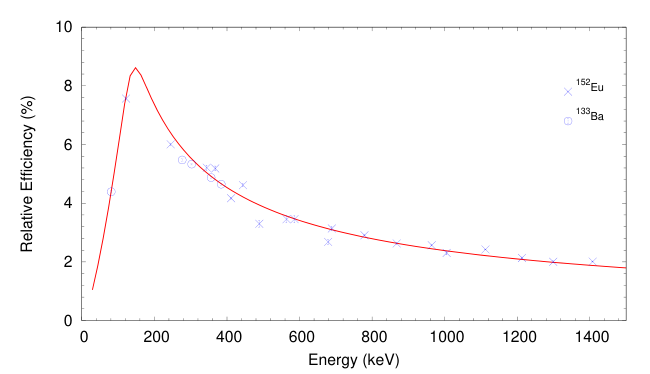

**Original caption:** Figure 3.15: The efficiency of the post-trap spectroscopic setup used for the first IGISOL experiment, measured using a combined 152Eu-133Ba calibration source lo- cated near the implantation point, ∼1 cm from the two detectors.

**中文图注:** 第一次IGISOL实验阱后谱学装置的效率，用置于植入点附近、距两个探测器约1cm的152Eu–133Ba混合源测量。

### Figure 3.16
**Source:** PDF54 P054B031

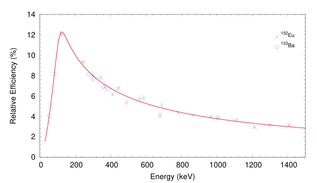

**Original caption:** Figure 3.16: The efficiency of the post-trap spectroscopic setup used for the sec- ond IGISOL experiment, measured using a combined 152Eu-133Ba calibration source located at the implantation point.

**中文图注:** 第二次IGISOL实验阱后谱学装置的效率，用位于植入点的152Eu–133Ba混合源测量。

本页其余原生块：标题、页眉、数学碎片、图中标签、表格与前/后置正文；完整保留，中文待译或不适用

**Source:** PDF54 P054B001; bbox [99.21, 46.25, 524.41, 57.16]

**Original:** Chapter 3. Experimental Details at IGISOL
36

**中文:** 【待译/版式碎片未作独立语义解释；不得视为已完成双语正文。】

**Source:** PDF54 P054B002; bbox [175.28, 84.73, 186.22, 95.54]

**Original:** 10

**中文:** 【待译/版式碎片未作独立语义解释；不得视为已完成双语正文。】

**Source:** PDF54 P054B003; bbox [437.87, 114.81, 451.96, 123.96]

**Original:** 152Eu

**中文:** 【待译/版式碎片未作独立语义解释；不得视为已完成双语正文。】

**Source:** PDF54 P054B004; bbox [179.66, 114.08, 186.22, 124.9]

**Original:** 8

**中文:** 【待译/版式碎片未作独立语义解释；不得视为已完成双语正文。】

**Source:** PDF54 P054B005; bbox [437.87, 129.49, 451.96, 138.63]

**Original:** 133Ba

**中文:** 【待译/版式碎片未作独立语义解释；不得视为已完成双语正文。】

**Source:** PDF54 P054B006; bbox [179.66, 143.43, 186.22, 154.25]

**Original:** 6

**中文:** 【待译/版式碎片未作独立语义解释；不得视为已完成双语正文。】

**Source:** PDF54 P054B007; bbox [179.66, 172.77, 186.22, 183.59]

**Original:** 4

**中文:** 【待译/版式碎片未作独立语义解释；不得视为已完成双语正文。】

**Source:** PDF54 P054B008; bbox [157.55, 124.57, 168.37, 203.33]

**Original:** Relative Efficiency (%)

**中文:** 【待译/版式碎片未作独立语义解释；不得视为已完成双语正文。】

**Source:** PDF54 P054B009; bbox [179.66, 202.13, 186.22, 212.95]

**Original:** 2

**中文:** 【待译/版式碎片未作独立语义解释；不得视为已完成双语正文。】

**Source:** PDF54 P054B010; bbox [179.66, 231.48, 186.22, 242.3]

**Original:** 0

**中文:** 【待译/版式碎片未作独立语义解释；不得视为已完成双语正文。】

**Source:** PDF54 P054B011; bbox [187.66, 239.35, 454.76, 250.17]

**Original:** 0
 200
 400
 600
 800
 1000
 1200
 1400

**中文:** 【待译/版式碎片未作独立语义解释；不得视为已完成双语正文。】

**Source:** PDF54 P054B012; bbox [304.02, 251.17, 349.97, 261.98]

**Original:** Energy (keV)

**中文:** 【待译/版式碎片未作独立语义解释；不得视为已完成双语正文。】

**Source:** PDF54 P054B018; bbox [175.28, 422.98, 186.22, 433.8]

**Original:** 14

**中文:** 【待译/版式碎片未作独立语义解释；不得视为已完成双语正文。】

**Source:** PDF54 P054B019; bbox [437.87, 444.67, 451.96, 453.81]

**Original:** 152Eu

**中文:** 【待译/版式碎片未作独立语义解释；不得视为已完成双语正文。】

**Source:** PDF54 P054B020; bbox [175.28, 443.94, 186.22, 454.76]

**Original:** 12

**中文:** 【待译/版式碎片未作独立语义解释；不得视为已完成双语正文。】

**Source:** PDF54 P054B021; bbox [437.87, 455.16, 451.96, 464.3]

**Original:** 133Ba

**中文:** 【待译/版式碎片未作独立语义解释；不得视为已完成双语正文。】

**Source:** PDF54 P054B022; bbox [175.28, 464.91, 186.22, 475.73]

**Original:** 10

**中文:** 【待译/版式碎片未作独立语义解释；不得视为已完成双语正文。】

**Source:** PDF54 P054B023; bbox [179.66, 485.87, 186.22, 496.69]

**Original:** 8

**中文:** 【待译/版式碎片未作独立语义解释；不得视为已完成双语正文。】

**Source:** PDF54 P054B024; bbox [179.66, 506.84, 186.22, 517.65]

**Original:** 6

**中文:** 【待译/版式碎片未作独立语义解释；不得视为已完成双语正文。】

**Source:** PDF54 P054B025; bbox [179.66, 527.8, 186.22, 538.61]

**Original:** 4

**中文:** 【待译/版式碎片未作独立语义解释；不得视为已完成双语正文。】

**Source:** PDF54 P054B026; bbox [157.55, 462.82, 168.37, 541.58]

**Original:** Relative Efficiency (%)

**中文:** 【待译/版式碎片未作独立语义解释；不得视为已完成双语正文。】

**Source:** PDF54 P054B027; bbox [179.66, 548.77, 186.22, 559.59]

**Original:** 2

**中文:** 【待译/版式碎片未作独立语义解释；不得视为已完成双语正文。】

**Source:** PDF54 P054B028; bbox [179.66, 569.73, 186.22, 580.55]

**Original:** 0

**中文:** 【待译/版式碎片未作独立语义解释；不得视为已完成双语正文。】

**Source:** PDF54 P054B029; bbox [187.66, 577.61, 454.76, 588.43]

**Original:** 0
 200
 400
 600
 800
 1000
 1200
 1400

**中文:** 【待译/版式碎片未作独立语义解释；不得视为已完成双语正文。】

**Source:** PDF54 P054B030; bbox [304.02, 589.42, 349.97, 600.24]

**Original:** Energy (keV)

**中文:** 【待译/版式碎片未作独立语义解释；不得视为已完成双语正文。】

**Source:** PDF54 P054B032; bbox [99.21, 684.21, 239.6, 696.17]

**Original:** 3.5.3
Data Acquisition

**中文:** 【待译/版式碎片未作独立语义解释；不得视为已完成双语正文。】

## PDF 55 / 印刷p37

**Source:** PDF55 S0092; native P055B002, P055B003, P055B004, P055B005, P055B006

**Original:** amplifiers, followed by a constant fraction discriminator and finally to a gate and delay generator. These three signals were used as an input to a logic box providing "or" conditions, therefore making a count in any of the detectors the master trigger, which was set with an 11 µs window, providing coincidence information. The spectra presented in this work were created using three energy conditions, β > 150keV, β < 4000keV and γ > 10keV, to

**中文:** 【待译；保留原文，本块未完成中文翻译。】

**Source:** PDF55 S0093; native P055B008, P055B009, P055B010, P055B011, P055B012

**Original:** In the second experiment a digital data acquisition (DAQ) system was employed, developed at the University of Warsaw. The DAQ had a timing resolution of 25 ns, and was operated in a triggerless mode, collecting all the events from each detector in a separate Digital Gamma Finder (DGF) module. Every event is time stamped using a master clock. Conditions were then applied while sorting the data collected.

**中文:** 第二次实验采用华沙大学研制的数字化数据获取系统（DAQ）。其时间分辨率为25ns，以无触发模式运行，每个探测器的全部事件分别由数字γ查找器（DGF）模块采集。每个事件用主时钟加时间戳，再在数据排序时施加条件。

本页其余原生块：标题、页眉、数学碎片、图中标签、表格与前/后置正文；完整保留，中文待译或不适用

**Source:** PDF55 P055B001; bbox [99.21, 46.25, 524.41, 57.16]

**Original:** Chapter 3. Experimental Details at IGISOL
37

**中文:** 【待译/版式碎片未作独立语义解释；不得视为已完成双语正文。】

**Source:** PDF55 P055B007; bbox [99.21, 192.62, 210.07, 203.53]

**Original:** reduce the background.

**中文:** 【待译/版式碎片未作独立语义解释；不得视为已完成双语正文。】

## PDF 56 / 印刷p38

**Source:** PDF56 S0094; native P056B003

**Original:** IGISOL Data Analysis and Results

**中文:** 【待译；保留原文，本块未完成中文翻译。】

**Source:** PDF56 S0095; native P056B004, P056B005, P056B006, P056B007, P056B008, P056B009, P056B010, P056B011, P056B012, P056B013, P056B014

**Original:** In this chapter the data analysis and results for the first and the second experiment conducted at the IGISOL facility will be treated separately. The aim of these two experiments was to use the Ramsey cleaning technique to confirm the claim made by Hill and Shizuma [8] that there are two β decaying states in 102Y that populate states in 102Zr with differing intensity ratios. In the first experiment the precision trap was set to a range of frequencies and techniques of β-γ spectroscopy were applied to determine whether both states in 102Y were present and identifiable. In the second experiment it was not possible to achieve any separation of the ground or isomeric state in 102Y using the Ramsey cleaning technique, therefore the ion sample was cleaned using the purification trap and then transported to the spectroscopic station. Techniques of β-γ spectroscopy were applied to identify the γ-ray intensity ratios observed, and to make a comparison with the intensities

**中文:** 【待译；保留原文，本块未完成中文翻译。】

**Source:** PDF56 S0096; native P056B017, P056B018, P056B019, P056B020, P056B021, P056B022, P056B023, P056B024, P056B025

**Original:** In the first experiment at IGISOL it was not possible to identify two distinct peaks using the Ramsey cleaning technique, instead one wide peak was observed in the frequency scan for the precision trap, presented in Figure 3.8. It is however possible that two overlapping peaks, one for the ground state and one for the isomeric state, contributed to the wide peak observed in the frequency scan. Figure 3.8 shows an indication of the likely position of two peaks, with a suggested peak separation of ∼100 keV. According to the work by Hill and Shizuma [8] the high-spin and low-spin states in 102Y are expected to have a relative strength in the ratio 4:1, in this work a ratio of ∼3:1 was found, see Figure 4.1. Previous work carried out at TRISTAN [8] and JOSEF [9] suggests a 4:1 ratio between

**中文:** 【待译；保留原文，本块未完成中文翻译。】

本页其余原生块：标题、页眉、数学碎片、图中标签、表格与前/后置正文；完整保留，中文待译或不适用

**Source:** PDF56 P056B001; bbox [513.56, 46.25, 524.41, 57.16]

**Original:** 38

**中文:** 【待译/版式碎片未作独立语义解释；不得视为已完成双语正文。】

**Source:** PDF56 P056B002; bbox [99.21, 126.0, 195.95, 146.66]

**Original:** Chapter 4

**中文:** 【待译/版式碎片未作独立语义解释；不得视为已完成双语正文。】

**Source:** PDF56 P056B015; bbox [99.21, 503.28, 248.34, 514.19]

**Original:** published by Hill and Shizuma.

**中文:** 【待译/版式碎片未作独立语义解释；不得视为已完成双语正文。】

**Source:** PDF56 P056B016; bbox [99.21, 545.9, 254.11, 560.25]

**Original:** 4.1
First Experiment

**中文:** 【待译/版式碎片未作独立语义解释；不得视为已完成双语正文。】

## PDF 57 / 印刷p39

**Source:** PDF57 S0097; native P057B002, P057B003

**Original:** the high-spin and low-spin states respectively. Figure 4.2 shows the beta-gated gamma-ray spectra measured at the extremes of the frequency range in the precision trap.

**中文:** 【待译；保留原文，本块未完成中文翻译。】

**Source:** PDF57 S0098; native P057B006, P057B007, P057B008, P057B009, P057B010, P057B011, P057B012, P057B013, P057B014, P057B015, P057B016

**Original:** In Figure 4.2, a strong transition at 618 keV from 112Cd can be seen. At IGISOL, prior to this experiment, 112Ag was used for beamline tuning. 112Ag β-decays, with a half-life of 3.1 hours, into 112Cd populating a 618 keV state which produced a 618 keV γ ray. This contaminant was likely implanted into the walls of the beamline, and the frame which supports the tape, during beam tuning. In Figure 4.2a the observed 152-, 326-, 579-, 1059-, and 1090 keV peaks suggests that the high-spin state is at the upper end of the frequency range. Whereas in Figure 4.2b the additional observation of the 1211 keV transition suggests the low-spin state may be more dominant at the lower end of the frequency range in the precision trap. However, it is necessary to investigate the intensity ratios for each transition relative to the 152 keV peak to quantitatively investigate whether the two isomeric states in 102Y have been separated in this experiment.

**中文:** 【待译；保留原文，本块未完成中文翻译。】

### Figure 4.1
**Source:** PDF57 P057B005

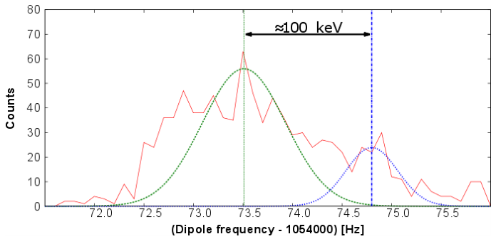

**Original caption:** Figure 4.1: The dipole frequency scan with two superimposed Gaussian peaks to indicate a possible position for the high-spin and low-spin isomeric states, which are expected to have a relative strength in the ratio 4:1 respectively [8]. The energy separation is expected to be close to 100 keV.

**中文图注:** 偶极频率扫描，叠加两个Gaussian峰以示意高、低自旋异能态可能的位置；此前预期两者相对强度为4:1[8]，能差预期接近100keV。

本页其余原生块：标题、页眉、数学碎片、图中标签、表格与前/后置正文；完整保留，中文待译或不适用

**Source:** PDF57 P057B001; bbox [99.21, 46.25, 524.41, 57.16]

**Original:** Chapter 4. IGISOL Data Analysis and Results
39

**中文:** 【待译/版式碎片未作独立语义解释；不得视为已完成双语正文。】

**Source:** PDF57 P057B004; bbox [139.92, 127.95, 480.08, 289.86]

**Original:** 【embedded image block；回看原PDF】

**中文:** 【待译/版式碎片未作独立语义解释；不得视为已完成双语正文。】

## PDF 58 / 印刷p40

**Source:** PDF58 S0099; native P058B036, P058B037, P058B038, P058B039, P058B040, P058B041, P058B042, P058B043, P058B044, P058B045

**Original:** To investigate whether the ground and isomeric states in 102Y were separated in this experiment, the intensity ratio between the six most intense peaks, at 160-, 326-, 579-, 1059-, 1090- and 1211 keV, and the 152 keV transition was measured as a function of the dipole frequency in the precision trap. The dipole frequency was set to a range of values between 1054072.5 Hz and 1054075 Hz, in steps of 0.5 Hz. At each frequency step the ions were released from the precision trap and implanted onto tape at the centre of the post-trap spectroscopic station. If both the ground and isomeric states had been produced during the first experiment it should be possible to identify a difference in the gamma-ray intensity patterns observed using the post-trap spectroscopy setup. However, an additional challenge is presented by the low beam intensity, at RF5 = 1054073 Hz 1.3 ions/second are

**中文:** 【待译；保留原文，本块未完成中文翻译。】

### Figure 4.2
**Source:** PDF58 P058B035

【图/表图像尚未裁取，回看原PDF；不得将标签提取当作图像审读。】

**Original caption:** Figure 4.2: The gamma rays observed when the dipole frequency in the precision trap is set to (a) 1054075 Hz and (b) 1054073 Hz. Note the change in the scale on the y-axis between (a) and (b). Peaks originating from 102Zr have been labelled with Eγ, whereas peaks from daughter nuclei have been labelled by the nucleus.

**中文图注:** 【待译；图像状态见source_map。】

本页其余原生块：标题、页眉、数学碎片、图中标签、表格与前/后置正文；完整保留，中文待译或不适用

**Source:** PDF58 P058B001; bbox [99.21, 46.25, 524.41, 57.16]

**Original:** Chapter 4. IGISOL Data Analysis and Results
40

**中文:** 【待译/版式碎片未作独立语义解释；不得视为已完成双语正文。】

**Source:** PDF58 P058B002; bbox [472.23, 91.16, 486.78, 108.65]

**Original:** (a)

**中文:** 【待译/版式碎片未作独立语义解释；不得视为已完成双语正文。】

**Source:** PDF58 P058B003; bbox [139.2, 94.19, 156.06, 109.18]

**Original:** 110

**中文:** 【待译/版式碎片未作独立语义解释；不得视为已完成双语正文。】

**Source:** PDF58 P058B004; bbox [144.81, 122.14, 156.05, 137.13]

**Original:** 90

**中文:** 【待译/版式碎片未作独立语义解释；不得视为已完成双语正文。】

**Source:** PDF58 P058B005; bbox [144.67, 150.13, 155.91, 165.13]

**Original:** 70

**中文:** 【待译/版式碎片未作独立语义解释；不得视为已完成双语正文。】

**Source:** PDF58 P058B006; bbox [327.6, 95.05, 458.03, 171.41]

**Original:** 1060
1140
1220
2
6
10
14

**中文:** 【待译/版式碎片未作独立语义解释；不得视为已完成双语正文。】

**Source:** PDF58 P058B007; bbox [469.57, 160.16, 484.88, 185.07]

**Original:** 112Cd

**中文:** 【待译/版式碎片未作独立语义解释；不得视为已完成双语正文。】

**Source:** PDF58 P058B008; bbox [144.67, 178.08, 155.91, 193.07]

**Original:** 50

**中文:** 【待译/版式碎片未作独立语义解释；不得视为已完成双语正文。】

**Source:** PDF58 P058B009; bbox [144.67, 206.08, 155.91, 221.07]

**Original:** 30

**中文:** 【待译/版式碎片未作独立语义解释；不得视为已完成双语正文。】

**Source:** PDF58 P058B010; bbox [145.63, 233.35, 156.87, 248.35]

**Original:** 10

**中文:** 【待译/版式碎片未作独立语义解释；不得视为已完成双语正文。】

**Source:** PDF58 P058B011; bbox [121.18, 237.9, 138.67, 275.05]

**Original:** Counts

**中文:** 【待译/版式碎片未作独立语义解释；不得视为已完成双语正文。】

**Source:** PDF58 P058B012; bbox [472.18, 265.03, 487.47, 282.52]

**Original:** (b)

**中文:** 【待译/版式碎片未作独立语义解释；不得视为已完成双语正文。】

**Source:** PDF58 P058B013; bbox [138.44, 268.97, 155.3, 283.96]

**Original:** 700

**中文:** 【待译/版式碎片未作独立语义解释；不得视为已完成双语正文。】

**Source:** PDF58 P058B014; bbox [359.34, 104.88, 390.29, 294.47]

**Original:** 1059
1090

**中文:** 【待译/版式碎片未作独立语义解释；不得视为已完成双语正文。】

**Source:** PDF58 P058B015; bbox [138.82, 290.54, 155.68, 305.53]

**Original:** 600

**中文:** 【待译/版式碎片未作独立语义解释；不得视为已完成双语正文。】

**Source:** PDF58 P058B016; bbox [360.06, 106.94, 389.19, 310.77]

**Original:** 1090
1059

**中文:** 【待译/版式碎片未作独立语义解释；不得视为已完成双语正文。】

**Source:** PDF58 P058B017; bbox [431.97, 290.21, 446.96, 312.68]

**Original:** 1211

**中文:** 【待译/版式碎片未作独立语义解释；不得视为已完成双语正文。】

**Source:** PDF58 P058B018; bbox [293.59, 180.1, 309.18, 321.65]

**Original:** 102Mo
102Mo

**中文:** 【待译/版式碎片未作独立语义解释；不得视为已完成双语正文。】

**Source:** PDF58 P058B019; bbox [138.73, 310.25, 155.58, 325.24]

**Original:** 500

**中文:** 【待译/版式碎片未作独立语义解释；不得视为已完成双语正文。】

**Source:** PDF58 P058B020; bbox [321.42, 262.12, 457.74, 337.84]

**Original:** 1060
1140
1220
20
60
100
140

**中文:** 【待译/版式碎片未作独立语义解释；不得视为已完成双语正文。】

**Source:** PDF58 P058B021; bbox [138.77, 332.01, 155.63, 347.0]

**Original:** 400

**中文:** 【待译/版式碎片未作独立语义解释；不得视为已完成双语正文。】

**Source:** PDF58 P058B022; bbox [139.01, 352.86, 155.87, 367.85]

**Original:** 300

**中文:** 【待译/版式碎片未作独立语义解释；不得视为已完成双语正文。】

**Source:** PDF58 P058B023; bbox [311.45, 199.28, 326.44, 375.0]

**Original:** 326
326

**中文:** 【待译/版式碎片未作独立语义解释；不得视为已完成双语正文。】

**Source:** PDF58 P058B024; bbox [210.21, 131.45, 237.66, 382.53]

**Original:** 160
152
152

**中文:** 【待译/版式碎片未作独立语义解释；不得视为已完成双语正文。】

**Source:** PDF58 P058B025; bbox [138.97, 374.1, 155.82, 389.09]

**Original:** 200

**中文:** 【待译/版式碎片未作独立语义解释；不得视为已完成双语正文。】

**Source:** PDF58 P058B026; bbox [352.7, 366.96, 368.0, 394.37]

**Original:** 102Mo

**中文:** 【待译/版式碎片未作独立语义解释；不得视为已完成双语正文。】

**Source:** PDF58 P058B027; bbox [470.86, 374.15, 486.17, 399.07]

**Original:** 112Cd

**中文:** 【待译/版式碎片未作独立语义解释；不得视为已完成双语正文。】

**Source:** PDF58 P058B028; bbox [448.55, 210.88, 476.58, 405.59]

**Original:** 579
579
102Nb
102Nb

**中文:** 【待译/版式碎片未作独立语义解释；不得视为已完成双语正文。】

**Source:** PDF58 P058B029; bbox [433.57, 211.35, 451.13, 406.59]

**Original:** 102Mo
102Mo

**中文:** 【待译/版式碎片未作独立语义解释；不得视为已完成双语正文。】

**Source:** PDF58 P058B030; bbox [425.08, 382.79, 440.39, 408.32]

**Original:** 102Nb

**中文:** 【待译/版式碎片未作独立语义解释；不得视为已完成双语正文。】

**Source:** PDF58 P058B031; bbox [139.68, 395.48, 156.54, 410.47]

**Original:** 100

**中文:** 【待译/版式碎片未作独立语义解释；不得视为已完成双语正文。】

**Source:** PDF58 P058B032; bbox [188.34, 422.27, 476.86, 437.27]

**Original:** 600
500
400
100
200
300

**中文:** 【待译/版式碎片未作独立语义解释；不得视为已完成双语正文。】

**Source:** PDF58 P058B033; bbox [162.12, 422.8, 449.1, 437.84]

**Original:** 50
150
250
350
450
550

**中文:** 【待译/版式碎片未作独立语义解释；不得视为已完成双语正文。】

**Source:** PDF58 P058B034; bbox [306.46, 443.65, 346.99, 458.65]

**Original:** E (keV)

**中文:** 【待译/版式碎片未作独立语义解释；不得视为已完成双语正文。】

## PDF 59 / 印刷p41

**Source:** PDF59 S0100; native P059B002, P059B003, P059B004, P059B005, P059B006, P059B007, P059B008

**Original:** measured post-trap, whereas at RF5 = 1054075 Hz the rate reduces to 0.6 ions/second. As the beam intensity was relatively low, measurements at each frequency were taken for ∼4 hours. The results are presented in Figure 4.3. In Figure 4.3 the expected intensity ratios for each γ-ray transition, relative to the 152 keV transition, taken from the previous work [8] for the high-spin and low-spin states are represented by the horizontal solid blue and dashed green lines respectively. The γ-ray intensities published in previous work by Hill and Shizuma are presented in Table 2.2.

**中文:** 【待译；保留原文，本块未完成中文翻译。】

**Source:** PDF59 S0101; native P059B009, P059B010, P059B011, P059B012, P059B013, P059B014, P059B015, P059B016

**Original:** It was expected that at the lower end of the frequency range the ratios measured would agree with the high-spin state, and at the higher end of the frequency range the ratios would agree with the low-spin state, or vice versa. However, the intensity ratios presented in Figure 4.3 do not show either trend. Although there are some variations in the intensity ratio as the RF5 frequency was increased the large error bars mean any variations are inconclusive. In general, the intensity ratios tend to be in better agreement with those measured at JOSEF [9], for the high-spin state in 102Y, and therefore it was assumed that only the high-spin state had been measured.

**中文:** 原先预期在频率范围较低端测得的强度比应与高自旋态相符，而较高端应与低自旋态相符，或反过来。然而图4.3的强度比未显示这两种趋势。尽管随RF5频率升高有一些变化，大误差棒使这些变化无法得出明确结论。总体上，强度比倾向于更符合JOSEF[9]测得的102Y高自旋态，因此假定本实验主要测到了高自旋态。

**Source:** PDF59 S0102; native P059B017, P059B018, P059B019, P059B020, P059B021, P059B022, P059B023, P059B024, P059B025, P059B026, P059B027, P059B028

**Original:** Considering the precision trap frequency scan published by Rodríguez Triguero, presented in Figure 3.5, a typical peak width for isomeric states is on the order of a few Hz. In Figure 4.1, the combined width of the two possible peaks for 102Y is ∼3 Hz. Therefore, it is unlikely that two peaks separated by 100 keV were observed in this experiment. The measured intensity ratios, presented in Figure 4.3, also provide little indication that the two isomeric states in 102Y have been separated using the Ramsey cleaning technique in this experiment. However, the high-spin and low-spin isomeric states in 102Y are expected to have a 4:1 ratio [8], it is therefore possible that both states were created in this work but were much closer in energy than 100 keV and the γ-ray intensities observed were dominated by the decay of the high-spin isomeric state in 102Y. Only two-thirds of the data points in Figure 4.3 agree with the expected intensity ratio for the high-spin, this may result from a small contribution of the low-spin state.

**中文:** Rodríguez Triguero发表的精密阱频率扫描见图3.5，其中异能态的典型峰宽约为几Hz。图4.1中102Y两个可能峰的合并宽度约3Hz。因此，本实验不太可能观察到了两个相隔100keV的峰。图4.3的强度比也几乎未表明Ramsey清洗在本实验分开了102Y两个异能态。然而，预期高、低自旋态的比例为4:1[8]，因而本工作也可能产生了两态，只是两者能差远小于100keV，观察到的γ强度以102Y高自旋异能态的衰变为主。图4.3中仅三分之二的数据点与高自旋态预期强度比相符，这可能源于低自旋态的一小部分贡献。

本页其余原生块：标题、页眉、数学碎片、图中标签、表格与前/后置正文；完整保留，中文待译或不适用

**Source:** PDF59 P059B001; bbox [99.21, 46.25, 524.41, 57.16]

**Original:** Chapter 4. IGISOL Data Analysis and Results
41

**中文:** 【待译/版式碎片未作独立语义解释；不得视为已完成双语正文。】

## PDF 60 / 印刷p42

### Figure 4.3
**Source:** PDF60 P060B074

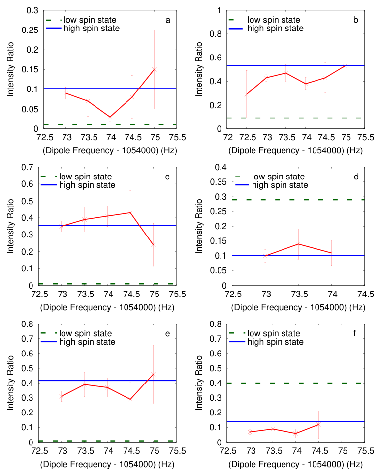

**Original caption:** Figure 4.3: These plots show the intensity ratio between six peaks at (a) 160 keV (b) 326 keV (c) 579 keV (d) 1059 keV (e) 1090 keV and (f) 1211 keV, and the 2+ →0+ transition as a function of RF5 frequency. The dotted green line represents the expected intensity ratio calculated from the data collected at TRISTAN for the low-spin [8] state. The solid blue line represented the expected intensity ratio calculated from the data collected at JOSEF for the high-spin [9] state.

**中文图注:** 六条峰(a)160、(b)326、(c)579、(d)1059、(e)1090、(f)1211keV与2+→0+跃迁的强度比随RF5频率变化。绿色虚线为TRISTAN低自旋态[8]的预期比，蓝色实线为JOSEF高自旋态[9]的预期比。

本页其余原生块：标题、页眉、数学碎片、图中标签、表格与前/后置正文；完整保留，中文待译或不适用

**Source:** PDF60 P060B001; bbox [99.21, 46.25, 524.41, 57.16]

**Original:** Chapter 4. IGISOL Data Analysis and Results
42

**中文:** 【待译/版式碎片未作独立语义解释；不得视为已完成双语正文。】

**Source:** PDF60 P060B002; bbox [139.32, 141.87, 154.1, 154.04]

**Original:** 0.3

**中文:** 【待译/版式碎片未作独立语义解释；不得视为已完成双语正文。】

**Source:** PDF60 P060B003; bbox [332.74, 141.87, 340.12, 154.04]

**Original:** 1

**中文:** 【待译/版式碎片未作独立语义解释；不得视为已完成双语正文。】

**Source:** PDF60 P060B004; bbox [179.61, 151.51, 288.2, 172.12]

**Original:** a
low spin state
high spin state

**中文:** 【待译/版式碎片未作独立语义解释；不得视为已完成双语正文。】

**Source:** PDF60 P060B005; bbox [366.43, 151.51, 479.1, 172.12]

**Original:** b
low spin state
high spin state

**中文:** 【待译/版式碎片未作独立语义解释；不得视为已完成双语正文。】

**Source:** PDF60 P060B006; bbox [134.4, 161.93, 154.1, 174.11]

**Original:** 0.25

**中文:** 【待译/版式碎片未作独立语义解释；不得视为已完成双语正文。】

**Source:** PDF60 P060B007; bbox [325.35, 165.97, 340.13, 178.14]

**Original:** 0.8

**中文:** 【待译/版式碎片未作独立语义解释；不得视为已完成双语正文。】

**Source:** PDF60 P060B008; bbox [139.32, 182.02, 154.1, 194.2]

**Original:** 0.2

**中文:** 【待译/版式碎片未作独立语义解释；不得视为已完成双语正文。】

**Source:** PDF60 P060B009; bbox [325.35, 190.06, 340.13, 202.23]

**Original:** 0.6

**中文:** 【待译/版式碎片未作独立语义解释；不得视为已完成双语正文。】

**Source:** PDF60 P060B010; bbox [134.4, 202.09, 154.1, 214.26]

**Original:** 0.15

**中文:** 【待译/版式碎片未作独立语义解释；不得视为已完成双语正文。】

**Source:** PDF60 P060B011; bbox [325.35, 214.14, 340.13, 226.31]

**Original:** 0.4

**中文:** 【待译/版式碎片未作独立语义解释；不得视为已完成双语正文。】

**Source:** PDF60 P060B012; bbox [139.32, 222.17, 154.1, 234.35]

**Original:** 0.1

**中文:** 【待译/版式碎片未作独立语义解释；不得视为已完成双语正文。】

**Source:** PDF60 P060B013; bbox [119.18, 180.62, 131.35, 236.74]

**Original:** Intensity Ratio

**中文:** 【待译/版式碎片未作独立语义解释；不得视为已完成双语正文。】

**Source:** PDF60 P060B014; bbox [310.52, 180.62, 322.69, 236.74]

**Original:** Intensity Ratio

**中文:** 【待译/版式碎片未作独立语义解释；不得视为已完成双语正文。】

**Source:** PDF60 P060B015; bbox [325.35, 238.23, 340.13, 250.4]

**Original:** 0.2

**中文:** 【待译/版式碎片未作独立语义解释；不得视为已完成双语正文。】

**Source:** PDF60 P060B016; bbox [134.4, 242.24, 154.1, 254.41]

**Original:** 0.05

**中文:** 【待译/版式碎片未作独立语义解释；不得视为已完成双语正文。】

**Source:** PDF60 P060B017; bbox [146.71, 262.33, 154.1, 274.5]

**Original:** 0

**中文:** 【待译/版式碎片未作独立语义解释；不得视为已完成双语正文。】

**Source:** PDF60 P060B018; bbox [332.74, 262.33, 340.12, 274.5]

**Original:** 0

**中文:** 【待译/版式碎片未作独立语义解释；不得视为已完成双语正文。】

**Source:** PDF60 P060B019; bbox [149.56, 271.18, 303.89, 283.35]

**Original:** 72.5 73 73.5 74 74.5 75 75.5

**中文:** 【待译/版式碎片未作独立语义解释；不得视为已完成双语正文。】

**Source:** PDF60 P060B020; bbox [339.28, 271.18, 495.23, 283.35]

**Original:** 72 72.5 73 73.5 74 74.5 75 75.5

**中文:** 【待译/版式碎片未作独立语义解释；不得视为已完成双语正文。】

**Source:** PDF60 P060B021; bbox [158.29, 284.47, 295.14, 296.64]

**Original:** (Dipole Frequency - 1054000) (Hz)

**中文:** 【待译/版式碎片未作独立语义解释；不得视为已完成双语正文。】

**Source:** PDF60 P060B022; bbox [346.97, 284.47, 483.83, 296.64]

**Original:** (Dipole Frequency - 1054000) (Hz)

**中文:** 【待译/版式碎片未作独立语义解释；不得视为已完成双语正文。】

**Source:** PDF60 P060B023; bbox [134.01, 301.32, 148.78, 313.5]

**Original:** 0.7

**中文:** 【待译/版式碎片未作独立语义解释；不得视为已完成双语正文。】

**Source:** PDF60 P060B024; bbox [330.66, 301.32, 345.44, 313.5]

**Original:** 0.4

**中文:** 【待译/版式碎片未作独立语义解释；不得视为已完成双语正文。】

**Source:** PDF60 P060B025; bbox [325.74, 316.38, 345.44, 328.55]

**Original:** 0.35

**中文:** 【待译/版式碎片未作独立语义解释；不得视为已完成双语正文。】

**Source:** PDF60 P060B026; bbox [134.01, 318.53, 148.78, 330.7]

**Original:** 0.6

**中文:** 【待译/版式碎片未作独立语义解释；不得视为已完成双语正文。】

**Source:** PDF60 P060B027; bbox [175.09, 310.96, 287.26, 331.57]

**Original:** c
low spin state
high spin state

**中文:** 【待译/版式碎片未作独立语义解释；不得视为已完成双语正文。】

**Source:** PDF60 P060B028; bbox [370.95, 310.96, 479.54, 331.57]

**Original:** d
low spin state
high spin state

**中文:** 【待译/版式碎片未作独立语义解释；不得视为已完成双语正文。】

**Source:** PDF60 P060B029; bbox [330.66, 331.44, 345.44, 343.61]

**Original:** 0.3

**中文:** 【待译/版式碎片未作独立语义解释；不得视为已完成双语正文。】

**Source:** PDF60 P060B030; bbox [134.01, 335.74, 148.78, 347.91]

**Original:** 0.5

**中文:** 【待译/版式碎片未作独立语义解释；不得视为已完成双语正文。】

**Source:** PDF60 P060B031; bbox [325.74, 346.5, 345.44, 358.67]

**Original:** 0.25

**中文:** 【待译/版式碎片未作独立语义解释；不得视为已完成双语正文。】

**Source:** PDF60 P060B032; bbox [134.01, 352.95, 148.78, 365.12]

**Original:** 0.4

**中文:** 【待译/版式碎片未作独立语义解释；不得视为已完成双语正文。】

**Source:** PDF60 P060B033; bbox [330.66, 361.54, 345.44, 373.71]

**Original:** 0.2

**中文:** 【待译/版式碎片未作独立语义解释；不得视为已完成双语正文。】

**Source:** PDF60 P060B034; bbox [134.01, 370.15, 148.78, 382.33]

**Original:** 0.3

**中文:** 【待译/版式碎片未作独立语义解释；不得视为已完成双语正文。】

**Source:** PDF60 P060B035; bbox [325.74, 376.6, 345.44, 388.77]

**Original:** 0.15

**中文:** 【待译/版式碎片未作独立语义解释；不得视为已完成双语正文。】

**Source:** PDF60 P060B036; bbox [119.18, 340.07, 131.35, 396.19]

**Original:** Intensity Ratio

**中文:** 【待译/版式碎片未作独立语义解释；不得视为已完成双语正文。】

**Source:** PDF60 P060B037; bbox [310.52, 340.07, 322.69, 396.19]

**Original:** Intensity Ratio

**中文:** 【待译/版式碎片未作独立语义解释；不得视为已完成双语正文。】

**Source:** PDF60 P060B038; bbox [134.01, 387.36, 148.78, 399.53]

**Original:** 0.2

**中文:** 【待译/版式碎片未作独立语义解释；不得视为已完成双语正文。】

**Source:** PDF60 P060B039; bbox [330.66, 391.66, 345.44, 403.83]

**Original:** 0.1

**中文:** 【待译/版式碎片未作独立语义解释；不得视为已完成双语正文。】

**Source:** PDF60 P060B040; bbox [134.01, 404.57, 148.78, 416.74]

**Original:** 0.1

**中文:** 【待译/版式碎片未作独立语义解释；不得视为已完成双语正文。】

**Source:** PDF60 P060B041; bbox [325.74, 406.72, 345.44, 418.89]

**Original:** 0.05

**中文:** 【待译/版式碎片未作独立语义解释；不得视为已完成双语正文。】

**Source:** PDF60 P060B042; bbox [141.4, 421.78, 148.78, 433.95]

**Original:** 0

**中文:** 【待译/版式碎片未作独立语义解释；不得视为已完成双语正文。】

**Source:** PDF60 P060B043; bbox [338.05, 421.78, 345.44, 433.95]

**Original:** 0

**中文:** 【待译/版式碎片未作独立语义解释；不得视为已完成双语正文。】

**Source:** PDF60 P060B044; bbox [144.25, 430.63, 303.89, 442.81]

**Original:** 72.5
 73
 73.5
 74
 74.5
 75
 75.5

**中文:** 【待译/版式碎片未作独立语义解释；不得视为已完成双语正文。】

**Source:** PDF60 P060B045; bbox [340.9, 430.63, 495.23, 442.81]

**Original:** 72.5
 73
 73.5
 74
 74.5

**中文:** 【待译/版式碎片未作独立语义解释；不得视为已完成双语正文。】

**Source:** PDF60 P060B046; bbox [155.63, 443.92, 292.49, 456.09]

**Original:** (Dipole Frequency - 1054000) (Hz)

**中文:** 【待译/版式碎片未作独立语义解释；不得视为已完成双语正文。】

**Source:** PDF60 P060B047; bbox [349.63, 443.92, 486.48, 456.09]

**Original:** (Dipole Frequency - 1054000) (Hz)

**中文:** 【待译/版式碎片未作独立语义解释；不得视为已完成双语正文。】

**Source:** PDF60 P060B048; bbox [134.01, 460.75, 148.78, 472.92]

**Original:** 0.8

**中文:** 【待译/版式碎片未作独立语义解释；不得视为已完成双语正文。】

**Source:** PDF60 P060B049; bbox [325.35, 460.75, 340.13, 472.92]

**Original:** 0.8

**中文:** 【待译/版式碎片未作独立语义解释；不得视为已完成双语正文。】

**Source:** PDF60 P060B050; bbox [134.01, 475.81, 148.78, 487.98]

**Original:** 0.7

**中文:** 【待译/版式碎片未作独立语义解释；不得视为已完成双语正文。】

**Source:** PDF60 P060B051; bbox [325.35, 475.81, 340.13, 487.98]

**Original:** 0.7

**中文:** 【待译/版式碎片未作独立语义解释；不得视为已完成双语正文。】

**Source:** PDF60 P060B052; bbox [175.09, 470.39, 287.76, 491.0]

**Original:** e
low spin state
high spin state

**中文:** 【待译/版式碎片未作独立语义解释；不得视为已完成双语正文。】

**Source:** PDF60 P060B053; bbox [366.43, 470.39, 476.64, 491.0]

**Original:** f
low spin state
high spin state

**中文:** 【待译/版式碎片未作独立语义解释；不得视为已完成双语正文。】

**Source:** PDF60 P060B054; bbox [134.01, 490.87, 148.78, 503.04]

**Original:** 0.6

**中文:** 【待译/版式碎片未作独立语义解释；不得视为已完成双语正文。】

**Source:** PDF60 P060B055; bbox [325.35, 490.87, 340.13, 503.04]

**Original:** 0.6

**中文:** 【待译/版式碎片未作独立语义解释；不得视为已完成双语正文。】

**Source:** PDF60 P060B056; bbox [134.01, 505.93, 148.78, 518.1]

**Original:** 0.5

**中文:** 【待译/版式碎片未作独立语义解释；不得视为已完成双语正文。】

**Source:** PDF60 P060B057; bbox [325.35, 505.93, 340.13, 518.1]

**Original:** 0.5

**中文:** 【待译/版式碎片未作独立语义解释；不得视为已完成双语正文。】

**Source:** PDF60 P060B058; bbox [134.01, 520.99, 148.78, 533.16]

**Original:** 0.4

**中文:** 【待译/版式碎片未作独立语义解释；不得视为已完成双语正文。】

**Source:** PDF60 P060B059; bbox [325.35, 520.99, 340.13, 533.16]

**Original:** 0.4

**中文:** 【待译/版式碎片未作独立语义解释；不得视为已完成双语正文。】

**Source:** PDF60 P060B060; bbox [134.01, 536.05, 148.78, 548.22]

**Original:** 0.3

**中文:** 【待译/版式碎片未作独立语义解释；不得视为已完成双语正文。】

**Source:** PDF60 P060B061; bbox [325.35, 536.05, 340.13, 548.22]

**Original:** 0.3

**中文:** 【待译/版式碎片未作独立语义解释；不得视为已完成双语正文。】

**Source:** PDF60 P060B062; bbox [119.18, 499.5, 131.35, 555.62]

**Original:** Intensity Ratio

**中文:** 【待译/版式碎片未作独立语义解释；不得视为已完成双语正文。】

**Source:** PDF60 P060B063; bbox [310.52, 499.5, 322.69, 555.62]

**Original:** Intensity Ratio

**中文:** 【待译/版式碎片未作独立语义解释；不得视为已完成双语正文。】

**Source:** PDF60 P060B064; bbox [134.01, 551.11, 148.78, 563.28]

**Original:** 0.2

**中文:** 【待译/版式碎片未作独立语义解释；不得视为已完成双语正文。】

**Source:** PDF60 P060B065; bbox [325.35, 551.11, 340.13, 563.28]

**Original:** 0.2

**中文:** 【待译/版式碎片未作独立语义解释；不得视为已完成双语正文。】

**Source:** PDF60 P060B066; bbox [134.01, 566.17, 148.78, 578.34]

**Original:** 0.1

**中文:** 【待译/版式碎片未作独立语义解释；不得视为已完成双语正文。】

**Source:** PDF60 P060B067; bbox [325.35, 566.17, 340.13, 578.34]

**Original:** 0.1

**中文:** 【待译/版式碎片未作独立语义解释；不得视为已完成双语正文。】

**Source:** PDF60 P060B068; bbox [141.4, 581.23, 148.78, 593.4]

**Original:** 0

**中文:** 【待译/版式碎片未作独立语义解释；不得视为已完成双语正文。】

**Source:** PDF60 P060B069; bbox [332.74, 581.23, 340.12, 593.4]

**Original:** 0

**中文:** 【待译/版式碎片未作独立语义解释；不得视为已完成双语正文。】

**Source:** PDF60 P060B070; bbox [144.25, 590.09, 303.89, 602.26]

**Original:** 72.5
 73
 73.5
 74
 74.5
 75
 75.5

**中文:** 【待译/版式碎片未作独立语义解释；不得视为已完成双语正文。】

**Source:** PDF60 P060B071; bbox [335.59, 590.09, 495.23, 602.26]

**Original:** 72.5
 73
 73.5
 74
 74.5
 75
 75.5

**中文:** 【待译/版式碎片未作独立语义解释；不得视为已完成双语正文。】

**Source:** PDF60 P060B072; bbox [155.63, 603.37, 292.49, 615.54]

**Original:** (Dipole Frequency - 1054000) (Hz)

**中文:** 【待译/版式碎片未作独立语义解释；不得视为已完成双语正文。】

**Source:** PDF60 P060B073; bbox [346.97, 603.37, 483.83, 615.54]

**Original:** (Dipole Frequency - 1054000) (Hz)

**中文:** 【待译/版式碎片未作独立语义解释；不得视为已完成双语正文。】

## PDF 61 / 印刷p43

**Source:** PDF61 S0103; native P061B003, P061B004, P061B005, P061B006

**Original:** During the second experiment Ramsey cleaning was not performed, and only the purifi- cation trap was used to remove isobaric contamination from the beam, as described in Section 3.4. In addition to an improved beam transmission pre-trap, by only using the purification trap 10 ions/second were obtained post-trap, which is a factor of 10 times

**中文:** 第二次实验没有进行Ramsey清洗，而只用净化阱去除束流的同量异位素污染，详见3.4节。除阱前传输改善外，仅使用净化阱使阱后达到10离子/秒，是第一次实验的10倍。

**Source:** PDF61 S0104; native P061B009, P061B010, P061B011, P061B012, P061B013, P061B014

**Original:** During the first experiment at IGISOL the intensity ratio of the 160-, 326-, 579-, 1059-, 1090- and 1211 keV, and the 152 keV transition was measured as a function of the dipole frequency in the precision trap. The results showed that only two-thirds of the data points agreed with the intensity ratio for the high-spin state obtained from the previous work conducted by Hill and Shizuma [8]. To investigate whether the low-spin state is also produced using proton-induced fission of 238U at IGISOL relative intensities were measured

**中文:** 【待译；保留原文，本块未完成中文翻译。】

**Source:** PDF61 S0105; native P061B016, P061B017, P061B018, P061B019, P061B020, P061B021, P061B022

**Original:** In the second IGISOL experiment a digital data acquisition system was used, which recorded all events with a timestamp. This information was then used while sorting the data to provide a β-γ coincidence time distribution, shown in Figure 4.4. Using this distribution a β-γ time gate of 1.5 µs was used to maximise the peak-to-background ratio in the γ-ray spectra. In Figure 4.4 the horizontal black line indicates the upper limit on the β-γ coincidence time. It was not possible to set a lower limit on the coincidence time for this analysis, as this was not available in the software used for data sorting.

**中文:** 第二次IGISOL实验采用数字化获取系统，为全部事件记录了时间戳。排序时用这些信息得到β–γ符合时间分布，见图4.4。由该分布选取1.5µs的β–γ时间门，以提高γ谱的峰背比。图4.4水平黑线表示β–γ符合时间上限。由于所用排序软件没有相应功能，本分析无法设定符合时间下限。

**Source:** PDF61 S0106; native P061B023, P061B024, P061B025, P061B026, P061B027, P061B028, P061B029

**Original:** Figure 4.5 shows the beta-gated γ-ray spectrum for the second experiment at IGISOL. Peaks originating from 102Zr have been labelled with the energy of the γ ray, whereas peaks originating from daughter nuclei have been labelled with the nucleus. Comparing Figure 4.5 with the β-gated γ-ray spectra measured in the first experiment, Figure 4.2, it is clear the contaminant 112Cd was not present during the second experiment as alternative isotopes were used before the experiment for beam tuning. During the second experiment A=100 isotopes, 100Zr and 100Nb were used for beamline tuning, which have a half-life of

**中文:** 【待译；保留原文，本块未完成中文翻译。】

本页其余原生块：标题、页眉、数学碎片、图中标签、表格与前/后置正文；完整保留，中文待译或不适用

**Source:** PDF61 P061B001; bbox [99.21, 46.25, 524.41, 57.16]

**Original:** Chapter 4. IGISOL Data Analysis and Results
43

**中文:** 【待译/版式碎片未作独立语义解释；不得视为已完成双语正文。】

**Source:** PDF61 P061B002; bbox [99.21, 80.86, 269.42, 95.21]

**Original:** 4.2
Second Experiment

**中文:** 【待译/版式碎片未作独立语义解释；不得视为已完成双语正文。】

**Source:** PDF61 P061B007; bbox [99.21, 203.42, 254.43, 214.33]

**Original:** higher than the first experiment.

**中文:** 【待译/版式碎片未作独立语义解释；不得视为已完成双语正文。】

**Source:** PDF61 P061B008; bbox [99.21, 240.32, 253.38, 252.27]

**Original:** 4.2.1
Relative Intensities

**中文:** 【待译/版式碎片未作独立语义解释；不得视为已完成双语正文。】

**Source:** PDF61 P061B015; bbox [99.21, 400.88, 271.79, 411.79]

**Original:** without the use of Ramsey cleaning.

**中文:** 【待译/版式碎片未作独立语义解释；不得视为已完成双语正文。】

**Source:** PDF61 P061B030; bbox [99.21, 728.09, 258.75, 739.0]

**Original:** 7.1-, and 1.5 seconds respectively.

**中文:** 【待译/版式碎片未作独立语义解释；不得视为已完成双语正文。】

## PDF 62 / 印刷p44

**Source:** PDF62 S0107; native P062B033, P062B034, P062B035, P062B036, P062B037, P062B038, P062B039, P062B040, P062B041

**Original:** The relative intensities of the 152-, 160-, 283-, 326-, 486-, 579-, 743-, 764-, 1059-, 1090-, 1159-, and 1211 keV peaks in Figure 4.5 are listed in the second column of Table 4.1. The third and fourth columns list the relative intensities for the low-spin and high-spin states observed at TRISTAN and JOSEF, respectively. In Table 4.1 the relative γ-ray intensity for each transition has been normalised to the 152 keV transition. In this work the 160 keV transition was observed with a relative intensity of 8%, which agrees to within one standard deviation of the relative intensity of 10% measured previously for the high-spin state. A 283 keV transition was observed in this work with a relative intensity of 1%, but was not seen in previous work by Hill and Shizuma possibly due to higher levels of background. A

**中文:** 【待译；保留原文，本块未完成中文翻译。】

### Figure 4.4
**Source:** PDF62 P062B012

【图/表图像尚未裁取，回看原PDF；不得将标签提取当作图像审读。】

**Original caption:** Figure 4.4: β-γ coincidence time distribution for the second experiment performed at the IGISOL facility.

**中文图注:** 【待译；图像状态见source_map。】

### Figure 4.5
**Source:** PDF62 P062B032

【图/表图像尚未裁取，回看原PDF；不得将标签提取当作图像审读。】

**Original caption:** Figure 4.5: β-gated γ-ray spectrum produced for the second IGISOL experiment following the application of a β-γ time gate of 1.5 µs.

**中文图注:** 【待译；图像状态见source_map。】

本页其余原生块：标题、页眉、数学碎片、图中标签、表格与前/后置正文；完整保留，中文待译或不适用

**Source:** PDF62 P062B001; bbox [99.21, 46.25, 524.41, 57.16]

**Original:** Chapter 4. IGISOL Data Analysis and Results
44

**中文:** 【待译/版式碎片未作独立语义解释；不得视为已完成双语正文。】

**Source:** PDF62 P062B002; bbox [157.77, 84.73, 186.22, 95.54]

**Original:** 300000

**中文:** 【待译/版式碎片未作独立语义解释；不得视为已完成双语正文。】

**Source:** PDF62 P062B003; bbox [157.77, 108.63, 186.22, 119.45]

**Original:** 250000

**中文:** 【待译/版式碎片未作独立语义解释；不得视为已完成双语正文。】

**Source:** PDF62 P062B004; bbox [157.77, 132.54, 186.22, 143.36]

**Original:** 200000

**中文:** 【待译/版式碎片未作独立语义解释；不得视为已完成双语正文。】

**Source:** PDF62 P062B005; bbox [157.77, 156.43, 186.22, 167.24]

**Original:** 150000

**中文:** 【待译/版式碎片未作独立语义解释；不得视为已完成双语正文。】

**Source:** PDF62 P062B006; bbox [157.77, 180.33, 186.22, 191.15]

**Original:** 100000

**中文:** 【待译/版式碎片未作独立语义解释；不得视为已完成双语正文。】

**Source:** PDF62 P062B007; bbox [138.65, 131.57, 149.47, 196.33]

**Original:** Counts (arb. units)

**中文:** 【待译/版式碎片未作独立语义解释；不得视为已完成双语正文。】

**Source:** PDF62 P062B008; bbox [162.14, 204.24, 186.22, 215.06]

**Original:** 50000

**中文:** 【待译/版式碎片未作独立语义解释；不得视为已完成双语正文。】

**Source:** PDF62 P062B009; bbox [179.66, 228.14, 186.22, 238.96]

**Original:** 0

**中文:** 【待译/版式碎片未作独立语义解释；不得视为已完成双语正文。】

**Source:** PDF62 P062B010; bbox [187.66, 239.35, 472.91, 250.17]

**Original:** 0
 200
 400
 600
 800
 1000
 1200
 1400
 1600
 1800
 2000

**中文:** 【待译/版式碎片未作独立语义解释；不得视为已完成双语正文。】

**Source:** PDF62 P062B011; bbox [281.43, 251.17, 372.56, 261.98]

**Original:** β-γ Coincidence Time (ns)

**中文:** 【待译/版式碎片未作独立语义解释；不得视为已完成双语正文。】

**Source:** PDF62 P062B013; bbox [141.16, 322.27, 168.46, 336.83]

**Original:** 18000

**中文:** 【待译/版式碎片未作独立语义解释；不得视为已完成双语正文。】

**Source:** PDF62 P062B014; bbox [398.51, 322.92, 413.07, 344.75]

**Original:** 1090

**中文:** 【待译/版式碎片未作独立语义解释；不得视为已完成双语正文。】

**Source:** PDF62 P062B015; bbox [342.25, 331.07, 364.08, 345.63]

**Original:** 1400

**中文:** 【待译/版式碎片未作独立语义解释；不得视为已完成双语正文。】

**Source:** PDF62 P062B016; bbox [342.38, 349.47, 364.22, 364.03]

**Original:** 1000

**中文:** 【待译/版式碎片未作独立语义解释；不得视为已完成双语正文。】

**Source:** PDF62 P062B017; bbox [140.74, 354.87, 168.04, 369.43]

**Original:** 14000

**中文:** 【待译/版式碎片未作独立语义解释；不得视为已完成双语正文。】

**Source:** PDF62 P062B018; bbox [387.56, 356.64, 402.13, 378.47]

**Original:** 1059

**中文:** 【待译/版式碎片未作独立语义解释；不得视为已完成双语正文。】

**Source:** PDF62 P062B019; bbox [345.88, 367.91, 362.25, 382.47]

**Original:** 600

**中文:** 【待译/版式碎片未作独立语义解释；不得视为已完成双语正文。】

**Source:** PDF62 P062B020; bbox [440.23, 361.15, 454.8, 382.99]

**Original:** 1211

**中文:** 【待译/版式碎片未作独立语义解释；不得视为已完成双语正文。】

**Source:** PDF62 P062B021; bbox [141.16, 387.79, 168.46, 402.35]

**Original:** 10000

**中文:** 【待译/版式碎片未作独立语义解释；不得视为已完成双语正文。】

**Source:** PDF62 P062B022; bbox [119.6, 379.12, 136.59, 415.21]

**Original:** Counts

**中文:** 【待译/版式碎片未作独立语义解释；不得视为已完成双语正文。】

**Source:** PDF62 P062B023; bbox [345.69, 385.42, 490.84, 415.63]

**Original:** 1000
1100
1200
1300
200

**中文:** 【待译/版式碎片未作独立语义解释；不得视为已完成双语正文。】

**Source:** PDF62 P062B024; bbox [144.89, 420.06, 166.72, 434.63]

**Original:** 6000

**中文:** 【待译/版式碎片未作独立语义解释；不得视为已完成双语正文。】

**Source:** PDF62 P062B025; bbox [297.66, 400.6, 328.22, 437.47]

**Original:** 102Mo
326

**中文:** 【待译/版式碎片未作独立语义解释；不得视为已完成双语正文。】

**Source:** PDF62 P062B026; bbox [224.85, 316.97, 250.17, 458.8]

**Original:** 152
160

**中文:** 【待译/版式碎片未作独立语义解释；不得视为已完成双语正文。】

**Source:** PDF62 P062B027; bbox [348.37, 437.67, 363.24, 464.3]

**Original:** 102Mo

**中文:** 【待译/版式碎片未作独立语义解释；不得视为已完成双语正文。】

**Source:** PDF62 P062B028; bbox [144.47, 452.71, 166.3, 467.27]

**Original:** 2000

**中文:** 【待译/版式碎片未作独立语义解释；不得视为已完成双语正文。】

**Source:** PDF62 P062B029; bbox [390.03, 453.88, 404.59, 470.26]

**Original:** 486

**中文:** 【待译/版式碎片未作独立语义解释；不得视为已完成双语正文。】

**Source:** PDF62 P062B030; bbox [413.43, 440.56, 459.73, 470.58]

**Original:** 102Nb
102Mo
579
102Nb

**中文:** 【待译/版式碎片未作独立语义解释；不得视为已完成双语正文。】

**Source:** PDF62 P062B031; bbox [183.03, 475.25, 485.05, 503.92]

**Original:** 50
150
250
350
450
550
650
E (keV)

**中文:** 【待译/版式碎片未作独立语义解释；不得视为已完成双语正文。】

## PDF 63 / 印刷p45

**Source:** PDF63 S0108; native P063B002, P063B003

**Original:** γ ray singles spectrum from the TRISTAN experiment is presented in Figure 4.6, which shows the high levels of contamination from daughter nuclei and Ge neutron-capture γ

**中文:** 【待译；保留原文，本块未完成中文翻译。】

**Source:** PDF63 S0109; native P063B007, P063B008, P063B009, P063B010, P063B011, P063B012, P063B013, P063B014, P063B015, P063B016

**Original:** The 326 keV transition was measured with a relative intensity of 41% in this work, which agrees to within three standard deviations of the relative intensity of 53% measured previously for the high-spin state. Similarly, the 486 keV transition was measured in this work with a relative intensity of 6%, which agrees with the relative intensity measured previously for the high-spin state to within three standard deviations. However, the 579 keV transition was measured with a relative intensity of 32% in this work, which agrees to within one standard deviation of the relative intensity measured previously for the high-spin state. The 743 keV transition was not measured previously for the high-spin state, but was measured in this work with a relative intensity of 2%. This agrees to within four standard deviations of the relative intensity measured at TRISTAN for the low-spin state.

**中文:** 【待译；保留原文，本块未完成中文翻译。】

**Source:** PDF63 S0110; native P063B017, P063B018, P063B019, P063B020, P063B021

**Original:** A 763 keV transition was observed in this work with a relative intensity of 3%, but was not seen in previous work by Hill or Shizuma, possibly due to the higher levels of background, as shown in Figure 4.6. The 1059 keV transition was observed in this work with a relative intensity of 12%, which agrees to within one standard deviation of the relative intensity measured previously for the high-spin state. In this work, the 1090 keV

**中文:** 【待译；保留原文，本块未完成中文翻译。】

### Figure 4.6
**Source:** PDF63 P063B006

【图/表图像尚未裁取，回看原PDF；不得将标签提取当作图像审读。】

**Original caption:** Figure 4.6: β-gated γ-ray spectrum produced in previous work conducted at the TRISTAN facility, taken from [8].

**中文图注:** 【待译；图像状态见source_map。】

本页其余原生块：标题、页眉、数学碎片、图中标签、表格与前/后置正文；完整保留，中文待译或不适用

**Source:** PDF63 P063B001; bbox [99.21, 46.25, 524.41, 57.16]

**Original:** Chapter 4. IGISOL Data Analysis and Results
45

**中文:** 【待译/版式碎片未作独立语义解释；不得视为已完成双语正文。】

**Source:** PDF63 P063B004; bbox [99.21, 127.18, 121.57, 138.09]

**Original:** rays.

**中文:** 【待译/版式碎片未作独立语义解释；不得视为已完成双语正文。】

**Source:** PDF63 P063B005; bbox [118.67, 149.76, 501.33, 388.76]

**Original:** 【embedded image block；回看原PDF】

**中文:** 【待译/版式碎片未作独立语义解释；不得视为已完成双语正文。】

## PDF 64 / 印刷p46

**Source:** PDF64 S0111; native P064B002, P064B003, P064B004, P064B005, P064B006, P064B007, P064B008

**Original:** transition was measured with a relative intensity of 33%, which agrees to within two standard deviations of the relative intensity measured previously for the high-spin state. The 1159 keV transition was not observed previously for the high-spin state, but was measured in this work with a relative intensity of 4%. This agrees to within six standard deviations of the relative intensity measured at TRISTAN for the low-spin state. Finally, the 1211 keV transition was measured in this work with a relative intensity of 8%, which agrees to within two standard deviations of the relative intensity measured previously for

**中文:** 【待译；保留原文，本块未完成中文翻译。】

**Source:** PDF64 S0112; native P064B012, P064B013, P064B014, P064B015, P064B016, P064B017, P064B018, P064B019

**Original:** The intensities measured in this experiment are intermediate between the intensities measured at TRISTAN and JOSEF. Analysis of the data collected at IGISOL shows a 18% contribution from the low-spin state measured previously at TRISTAN [8], and a 82% contribution from the high-spin state deduced in Ref [8] by combining the studies at TRISTAN and JOSEF. In the work conducted by Hill and Shizuma, a 21% contribution was calculated for the low-spin state and a 79% contribution was calculated for the high-spin state [8]. The percentage contribution measured at IGISOL for the high-spin and low-spin states was calculated using Equation 4.1,

**中文:** 本次实验测得的强度介于TRISTAN和JOSEF测得的强度之间。IGISOL数据分析表明，约18%来自此前TRISTAN[8]测得的低自旋态，约82%来自文献[8]结合TRISTAN与JOSEF研究推得的高自旋态。Hill与Shizuma的工作给出低自旋态21%、高自旋态79%的贡献[8]。本次IGISOL测量中两态的百分比贡献由式4.1计算。

### Table 4.1
**Source:** PDF64 P064B011

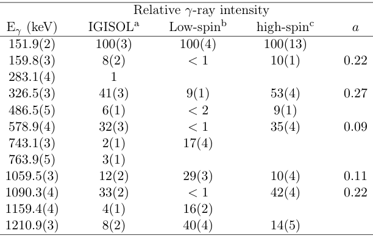

**Original caption:** Table 4.1: The energies and uncertainties listed in the first column are from the IGISOL analysis. The remaining three columns show the relative intensities (a) measured at IGISOL (b) measured at TRISTAN [8] from the low-spin isomeric state in 102Y and (c) deduced for the high-spin state in 102Y by combining TRISTAN and JOSEF studies, as described in [8]. The a values in column 5 were calculated using Equation 4.1.

**中文图注:** 第一列能量及误差来自IGISOL分析。随后三列依次为(a)IGISOL相对强度，(b)TRISTAN[8]测得的102Y低自旋异能态衰变强度，(c)按文献[8]结合TRISTAN及JOSEF推得的高自旋态强度。第五列a按式4.1计算。

本页其余原生块：标题、页眉、数学碎片、图中标签、表格与前/后置正文；完整保留，中文待译或不适用

**Source:** PDF64 P064B001; bbox [99.21, 46.25, 524.41, 57.16]

**Original:** Chapter 4. IGISOL Data Analysis and Results
46

**中文:** 【待译/版式碎片未作独立语义解释；不得视为已完成双语正文。】

**Source:** PDF64 P064B009; bbox [99.21, 236.25, 190.9, 247.16]

**Original:** the high-spin state.

**中文:** 【待译/版式碎片未作独立语义解释；不得视为已完成双语正文。】

**Source:** PDF64 P064B010; bbox [163.21, 260.19, 460.41, 448.0]

**Original:** Relative γ-ray intensity
Eγ (keV)
IGISOLa
Low-spinb
high-spinc
a
151.9(2)
100(3)
100(4)
100(13)
159.8(3)
8(2)
< 1
10(1)
0.22
283.1(4)
1
326.5(3)
41(3)
9(1)
53(4)
0.27
486.5(5)
6(1)
< 2
9(1)
578.9(4)
32(3)
< 1
35(4)
0.09
743.1(3)
2(1)
17(4)
763.9(5)
3(1)
1059.5(3)
12(2)
29(3)
10(4)
0.11
1090.3(4)
33(2)
< 1
42(4)
0.22
1159.4(4)
4(1)
16(2)
1210.9(3)
8(2)
40(4)
14(5)

**中文:** 【待译/版式碎片未作独立语义解释；不得视为已完成双语正文。】

## PDF 65 / 印刷p47

**Source:** PDF65 S0113; native P065B003, P065B004, P065B005, P065B006, P065B007, P065B008, P065B009, P065B010, P065B011

**Original:** where Imeas is the intensity measured at IGISOL, presented in column 2 in Table 4.1, and Ils and Ihs are the intensities measured previously for the low-spin and high-spin states respectively, presented in columns 3 and 4 in Table 4.1. Column 5 in Table 4.1 shows the a values calculated using Equation 4.1 for the 159-, 326-, 579-, 1059-, and 1090 keV transitions, the average of these a values provided the percentage contribution for the low-spin and high-spin states in 102Y. It is possible that both the low-spin and high-spin states in 102Y were produced at IGISOL, but were too close in energy to separate using the Ramsey cleaning technique. Therefore, more work is required to separate the two states using the Ramsey cleaning technique, such that the independent decay of the two isomeric

**中文:** 其中I_meas为IGISOL测得的强度，列于表4.1第二列；I_ls和I_hs分别为此前测得的低、高自旋态强度，列于第三、第四列。第五列给出159、326、579、1059及1090keV跃迁按式4.1算出的a值，对这些a值取平均，得到102Y低、高自旋态的百分比贡献。IGISOL可能同时产生了两态，但它们能量过近，无法用Ramsey清洗分开。因此，还需要进一步工作实现分离，以独立测量两异能态的衰变。

**Source:** PDF65 S0114; native P065B014, P065B015, P065B016

**Original:** Using the timestamped data, recorded in the second experiment using the digital data acquisition system, a γ-γ coincidence time distribution was produced, and is presented in Figure 4.7. Using this distribution a γ-γ time gate of 650 ns was used to provide γ

**中文:** 使用第二次实验数字化系统记录的带时间戳数据，得到图4.7所示γ–γ符合时间分布。根据该分布，采用650ns的γ–γ时间门获取γ符合信息。

### Figure 4.7
**Source:** PDF65 P065B030

【图/表图像尚未裁取，回看原PDF；不得将标签提取当作图像审读。】

**Original caption:** Figure 4.7: γ-γ coincidence time distribution for the second experiment conducted at the IGISOL facility.

**中文图注:** 【待译；图像状态见source_map。】

### Eq. (4.1) 原页区域回退
**Source:** PDF65 P065B002
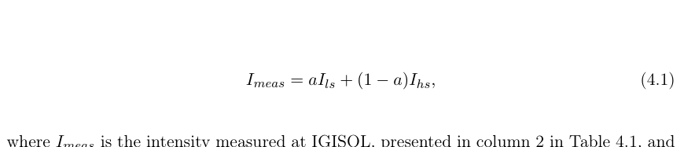

【未转写LaTeX；该裁图按式号定位，可能含邻近文字或需扩大边界，请以原PDF核定完整公式。】

本页其余原生块：标题、页眉、数学碎片、图中标签、表格与前/后置正文；完整保留，中文待译或不适用

**Source:** PDF65 P065B001; bbox [99.21, 46.25, 524.41, 57.16]

**Original:** Chapter 4. IGISOL Data Analysis and Results
47

**中文:** 【待译/版式碎片未作独立语义解释；不得视为已完成双语正文。】

**Source:** PDF65 P065B002; bbox [251.43, 122.85, 524.41, 135.68]

**Original:** Imeas = aIls + (1 −a)Ihs,
(4.1)

**中文:** 【待译/版式碎片未作独立语义解释；不得视为已完成双语正文。】

**Source:** PDF65 P065B012; bbox [99.21, 358.79, 212.36, 369.7]

**Original:** states can be measured.

**中文:** 【待译/版式碎片未作独立语义解释；不得视为已完成双语正文。】

**Source:** PDF65 P065B013; bbox [99.21, 395.69, 243.89, 407.65]

**Original:** 4.2.2
Coincidence Data

**中文:** 【待译/版式碎片未作独立语义解释；不得视为已完成双语正文。】

**Source:** PDF65 P065B017; bbox [99.21, 490.81, 214.58, 501.72]

**Original:** coincidence information.

**中文:** 【待译/版式碎片未作独立语义解释；不得视为已完成双语正文。】

**Source:** PDF65 P065B018; bbox [131.34, 525.83, 159.99, 535.65]

**Original:** 160000

**中文:** 【待译/版式碎片未作独立语义解释；不得视为已完成双语正文。】

**Source:** PDF65 P065B019; bbox [131.34, 546.27, 159.99, 556.09]

**Original:** 140000

**中文:** 【待译/版式碎片未作独立语义解释；不得视为已完成双语正文。】

**Source:** PDF65 P065B020; bbox [131.34, 566.74, 159.99, 576.55]

**Original:** 120000

**中文:** 【待译/版式碎片未作独立语义解释；不得视为已完成双语正文。】

**Source:** PDF65 P065B021; bbox [131.34, 587.18, 159.99, 596.99]

**Original:** 100000

**中文:** 【待译/版式碎片未作独立语义解释；不得视为已完成双语正文。】

**Source:** PDF65 P065B022; bbox [135.74, 607.61, 159.99, 617.43]

**Original:** 80000

**中文:** 【待译/版式碎片未作独立语义解释；不得视为已完成双语正文。】

**Source:** PDF65 P065B023; bbox [135.74, 628.08, 159.99, 637.89]

**Original:** 60000

**中文:** 【待译/版式碎片未作独立语义解释；不得视为已完成双语正文。】

**Source:** PDF65 P065B024; bbox [115.05, 574.66, 124.86, 639.87]

**Original:** Counts (arb. units)

**中文:** 【待译/版式碎片未作独立语义解释；不得视为已完成双语正文。】

**Source:** PDF65 P065B025; bbox [135.74, 648.52, 159.99, 658.33]

**Original:** 40000

**中文:** 【待译/版式碎片未作独立语义解释；不得视为已完成双语正文。】

**Source:** PDF65 P065B026; bbox [135.74, 668.98, 159.99, 678.79]

**Original:** 20000

**中文:** 【待译/版式碎片未作独立语义解释；不得视为已完成双语正文。】

**Source:** PDF65 P065B027; bbox [153.38, 689.42, 159.99, 699.23]

**Original:** 0

**中文:** 【待译/版式碎片未作独立语义解释；不得视为已完成双语正文。】

**Source:** PDF65 P065B028; bbox [161.09, 699.23, 507.65, 709.04]

**Original:** 0
 100
 200
 300
 400
 500
 600
 700
 800
 900
 1000

**中文:** 【待译/版式碎片未作独立语义解释；不得视为已完成双语正文。】

**Source:** PDF65 P065B029; bbox [284.31, 713.81, 377.81, 723.62]

**Original:** γ-γ Coincidence Time (ns)

**中文:** 【待译/版式碎片未作独立语义解释；不得视为已完成双语正文。】

## PDF 66 / 印刷p48

**Source:** PDF66 S0115; native P066B002, P066B003, P066B004, P066B005, P066B006, P066B007, P066B008, P066B009, P066B010, P066B011, P066B012, P066B013, P066B014, P066B015, P066B016, P066B017, P066B018, P066B019, P066B020, P066B021, P066B022, P066B023

**Original:** The coincidences measured in this work for the 152-, 160-, 283-, 326-, 486-, 579-, 743-, 764-, 1059-, and 1090 keV transitions are presented in the second column of Table 4.2. The third and fourth columns list the coincidences observed at TRISTAN [8] and JOSEF [9] respectively. In this work the 152 keV transition was observed in coincidence with the 160-, 283-, 326-, 486-, 579-, 743-, 764-, 1059-, and 1090 keV transitions. At TRISTAN the 152 keV transition was only seen in coincidence with the 326-, 743-, and 1059 keV transitions, whereas at JOSEF the 152 keV transition was observed in coincidence with the 160-, 326-, 486-, 579-, 743-, 1059-, and 1090 keV transitions. The coincidences observed in this work for the 152 keV transition are in agreement with those observed at TRISTAN and JOSEF, however the 160-, 486-, 579-, 743-, and 1090 keV transitions were not observed at TRISTAN, and the 283-, and 764 keV transitions were not observed at TRISTAN or JOSEF. The coincidences which were not observed at TRISTAN are likely due to differences in the decay paths of the high-spin and low-spin states in 102Y. At TRISTAN the decay of the low-spin state in 102Y was investigated, therefore the 326-, 743-, and 1059 keV transitions are observed more strongly, while the other transitions are observed much more weakly. In this work higher statistics were collected, as was previously presented in Table 4.1, the relative intensities of the 283-, and 764 keV transitions are 1% and 3% respectively. Therefore, due to low statistics the 283-, and 764 keV transitions were not observed in previous work by Hill and Shizuma, Figure 4.8 shows the coincidence spectrum measured in this work, with an expanded view between the 160-, and 326 keV transitions, and 743-, and 764 keV transitions. Figure 4.9 shows the coincidence spectrum for the 152 keV transition published by Hill [8], highlighting the difference in statistics between

**中文:** 【待译；保留原文，本块未完成中文翻译。】

本页其余原生块：标题、页眉、数学碎片、图中标签、表格与前/后置正文；完整保留，中文待译或不适用

**Source:** PDF66 P066B001; bbox [99.21, 46.25, 524.41, 57.16]

**Original:** Chapter 4. IGISOL Data Analysis and Results
48

**中文:** 【待译/版式碎片未作独立语义解释；不得视为已完成双语正文。】

**Source:** PDF66 P066B024; bbox [99.21, 563.46, 237.01, 574.37]

**Original:** this work and previous work.

**中文:** 【待译/版式碎片未作独立语义解释；不得视为已完成双语正文。】

## PDF 67 / 印刷p49

### Figure 4.8
**Source:** PDF67 P067B033

【图/表图像尚未裁取，回看原PDF；不得将标签提取当作图像审读。】

**Original caption:** Figure 4.8: Coincidence spectra following the application of a γ coinci- dence time gate on the 152 keV transition for data analysed in this work from the second experiment conducted at the IGISOL facility. Figure (a) shows the full energy range, whereas (b) shows an expanded energy range.

**中文图注:** 【待译；图像状态见source_map。】

### Table 4.2
**Source:** PDF67 P067B005

【图/表图像尚未裁取，回看原PDF；不得将标签提取当作图像审读。】

**Original caption:** Table 4.2: Coincidences observed in the decay of 102Zr at IGISOL, com- pared with coincidences observed at TRISTAN [8] and JOSEF [9].

**中文图注:** 【待译；图像状态见source_map。】

本页其余原生块：标题、页眉、数学碎片、图中标签、表格与前/后置正文；完整保留，中文待译或不适用

**Source:** PDF67 P067B001; bbox [99.21, 46.25, 524.41, 57.16]

**Original:** Chapter 4. IGISOL Data Analysis and Results
49

**中文:** 【待译/版式碎片未作独立语义解释；不得视为已完成双语正文。】

**Source:** PDF67 P067B002; bbox [121.63, 82.47, 475.22, 108.57]

**Original:** Coincidences
Eγ (keV)
IGISOL
TRISTAN
JOSEF

**中文:** 【待译/版式碎片未作独立语义解释；不得视为已完成双语正文。】

**Source:** PDF67 P067B003; bbox [134.57, 109.97, 501.86, 161.53]

**Original:** 152
160, 283, 326, 486, 579,
326, 743, 1059
160, 326, 486, 579,
743, 764, 1059, 1090
743, 1059, 1090
160
152, 326, 579, 1090
152, 579
283
152, 326

**中文:** 【待译/版式碎片未作独立语义解释；不得视为已完成双语正文。】

**Source:** PDF67 P067B004; bbox [131.84, 164.17, 488.98, 269.92]

**Original:** 326
152, 160, 283, 486, 579,
152
152, 486
1059
486
152, 326
152, 326
579
152, 160, 326, 1090
152, 160
743
152
152
764
152, 326, 579
1059
152, 326
152
152
1090
152, 160, 579
152, 160, 579

**中文:** 【待译/版式碎片未作独立语义解释；不得视为已完成双语正文。】

**Source:** PDF67 P067B006; bbox [483.84, 367.29, 495.56, 377.34]

**Original:** (b)

**中文:** 【待译/版式碎片未作独立语义解释；不得视为已完成双语正文。】

**Source:** PDF67 P067B007; bbox [139.59, 371.52, 154.62, 381.5]

**Original:** 220

**中文:** 【待译/版式碎片未作独立语义解释；不得视为已完成双语正文。】

**Source:** PDF67 P067B008; bbox [327.62, 371.52, 337.64, 381.5]

**Original:** 14

**中文:** 【待译/版式碎片未作独立语义解释；不得视为已完成双语正文。】

**Source:** PDF67 P067B009; bbox [383.89, 379.91, 393.88, 394.84]

**Original:** 764

**中文:** 【待译/版式碎片未作独立语义解释；不得视为已完成双语正文。】

**Source:** PDF67 P067B010; bbox [327.34, 386.61, 337.36, 396.59]

**Original:** 10

**中文:** 【待译/版式碎片未作独立语义解释；不得视为已完成双语正文。】

**Source:** PDF67 P067B011; bbox [140.24, 387.0, 155.27, 396.99]

**Original:** 180

**中文:** 【待译/版式碎片未作独立语义解释；不得视为已完成双语正文。】

**Source:** PDF67 P067B012; bbox [349.27, 390.04, 359.26, 404.98]

**Original:** 743

**中文:** 【待译/版式碎片未作独立语义解释；不得视为已完成双语正文。】

**Source:** PDF67 P067B013; bbox [462.68, 392.96, 472.67, 407.89]

**Original:** 326

**中文:** 【待译/版式碎片未作独立语义解释；不得视为已完成双语正文。】

**Source:** PDF67 P067B014; bbox [332.32, 401.72, 337.33, 411.71]

**Original:** 6

**中文:** 【待译/版式碎片未作独立语义解释；不得视为已完成双语正文。】

**Source:** PDF67 P067B015; bbox [140.1, 402.85, 155.13, 412.84]

**Original:** 140

**中文:** 【待译/版式碎片未作独立语义解释；不得视为已完成双语正文。】

**Source:** PDF67 P067B016; bbox [140.24, 418.71, 155.27, 428.69]

**Original:** 100

**中文:** 【待译/版式碎片未作独立语义解释；不得视为已完成双语正文。】

**Source:** PDF67 P067B017; bbox [332.18, 417.18, 396.93, 439.96]

**Original:** 745
765
2

**中文:** 【待译/版式碎片未作独立语义解释；不得视为已完成双语正文。】

**Source:** PDF67 P067B018; bbox [191.33, 426.0, 201.31, 440.93]

**Original:** 160

**中文:** 【待译/版式碎片未作独立语义解释；不得视为已完成双语正文。】

**Source:** PDF67 P067B019; bbox [145.23, 434.56, 155.25, 444.55]

**Original:** 60

**中文:** 【待译/版式碎片未作独立语义解释；不得视为已完成双语正文。】

**Source:** PDF67 P067B020; bbox [145.09, 450.41, 430.47, 473.22]

**Original:** 180
220
260
300
20

**中文:** 【待译/版式碎片未作独立语义解释；不得视为已完成双语正文。】

**Source:** PDF67 P067B021; bbox [483.92, 466.02, 495.08, 476.08]

**Original:** (a)

**中文:** 【待译/版式碎片未作独立语义解释；不得视为已完成双语正文。】

**Source:** PDF67 P067B022; bbox [120.35, 449.8, 130.34, 478.01]

**Original:** Counts

**中文:** 【待译/版式碎片未作独立语义解释；不得视为已完成双语正文。】

**Source:** PDF67 P067B023; bbox [140.1, 476.17, 155.13, 486.16]

**Original:** 140

**中文:** 【待译/版式碎片未作独立语义解释；不得视为已完成双语正文。】

**Source:** PDF67 P067B024; bbox [242.65, 481.65, 252.63, 496.58]

**Original:** 326

**中文:** 【待译/版式碎片未作独立语义解释；不得视为已完成双语正文。】

**Source:** PDF67 P067B025; bbox [140.24, 499.5, 155.27, 509.48]

**Original:** 100

**中文:** 【待译/版式碎片未作独立语义解释；不得视为已完成双语正文。】

**Source:** PDF67 P067B026; bbox [323.83, 508.0, 333.81, 522.94]

**Original:** 579

**中文:** 【待译/版式碎片未作独立语义解释；不得视为已完成双语正文。】

**Source:** PDF67 P067B027; bbox [196.91, 516.47, 206.9, 531.4]

**Original:** 160

**中文:** 【待译/版式碎片未作独立语义解释；不得视为已完成双语正文。】

**Source:** PDF67 P067B028; bbox [145.23, 523.5, 155.25, 533.49]

**Original:** 60

**中文:** 【待译/版式碎片未作独立语义解释；不得视为已完成双语正文。】

**Source:** PDF67 P067B029; bbox [295.56, 533.79, 305.55, 548.72]

**Original:** 486

**中文:** 【待译/版式碎片未作独立语义解释；不得视为已完成双语正文。】

**Source:** PDF67 P067B030; bbox [469.03, 524.82, 488.17, 553.65]

**Original:** 1059
1090

**中文:** 【待译/版式碎片未作独立语义解释；不得视为已完成双语正文。】

**Source:** PDF67 P067B031; bbox [145.09, 545.75, 155.11, 555.74]

**Original:** 20

**中文:** 【待译/版式碎片未作独立语义解释；不得视为已完成双语正文。】

**Source:** PDF67 P067B032; bbox [177.0, 562.31, 497.54, 585.29]

**Original:** 100
300
500
700
900
1100
E (keV)

**中文:** 【待译/版式碎片未作独立语义解释；不得视为已完成双语正文。】

## PDF 68 / 印刷p50

**Source:** PDF68 S0116; native P068B004, P068B005, P068B006, P068B007, P068B008, P068B009

**Original:** In this work the 160 keV transition was observed in coincidence with the 152-, 326-, 579-, and 1090 keV transitions, the γ-gated spectrum for the 160 keV transition is presented in Figure 4.10a. The 160 keV transition was not observed at TRISTAN, however, at JOSEF the 160 keV transition was observed in coincidence with the 152-, and 579 keV transitions. In this work, the 326-, and 1090 keV transitions were only weakly observed (with < 10 counts) and may not have been observed at JOSEF due to less statistics.

**中文:** 【待译；保留原文，本块未完成中文翻译。】

**Source:** PDF68 S0117; native P068B010, P068B011, P068B012, P068B013, P068B014, P068B015, P068B016, P068B017, P068B018, P068B019, P068B020, P068B021, P068B022, P068B023

**Original:** The 283 keV transition was not observed in previous work by Hill and Shizuma, possibly due to low statistics, but was observed in this work to be coincident with the 152-, and 326 keV transitions. Figure 4.11 shows the coincidence spectrum for the 283 keV transition, as well an expanded coincidence spectrum for the 326 keV transition to show the 283 keV coincidence peak. In this work the 326 keV transition was observed in coincidence with the 152-, 160-, 283-, 486-, 579-, and 1059 keV transitions, the γ-gated spectrum for the 326 keV transition is presented in Figure 4.10b. At TRISTAN the 326 keV transition was only found to be in coincidence with the 152 keV transition, whereas at JOSEF the 326 keV transition was observed to be in coincidence with the 152-, and 486 keV transitions. The 160-, 486-, 579-, and 1059 keV transitions may not have been observed at TRISTAN as these states were only weakly populated in the decay of the low-spin state in 102Y. The 283 keV transition was not observed at TRISTAN or JOSEF, which may be due to low statistics. The 1059 keV transition was also not observed at TRISTAN or JOSEF, this may also be due to low statistics however the coincidence between the 326-, and 1059 keV

**中文:** 【待译；保留原文，本块未完成中文翻译。】

### Figure 4.9
**Source:** PDF68 P068B003

【图/表图像尚未裁取，回看原PDF；不得将标签提取当作图像审读。】

**Original caption:** Figure 4.9: Coincidence spectra following the application of a γ coin- cidence time gate on the 152 keV transition for data published by Hill, taken from Ref [8].

**中文图注:** 【待译；图像状态见source_map。】

本页其余原生块：标题、页眉、数学碎片、图中标签、表格与前/后置正文；完整保留，中文待译或不适用

**Source:** PDF68 P068B001; bbox [99.21, 46.25, 524.41, 57.16]

**Original:** Chapter 4. IGISOL Data Analysis and Results
50

**中文:** 【待译/版式碎片未作独立语义解释；不得视为已完成双语正文。】

**Source:** PDF68 P068B002; bbox [118.67, 81.1, 501.34, 263.94]

**Original:** 【embedded image block；回看原PDF】

**中文:** 【待译/版式碎片未作独立语义解释；不得视为已完成双语正文。】

## PDF 69 / 印刷p51

**Source:** PDF69 S0118; native P069B002

**Original:** transitions is discussed in more detail in Chapter 8.

**中文:** 【待译；保留原文，本块未完成中文翻译。】

### Figure 4.10
**Source:** PDF69 P069B046

【图/表图像尚未裁取，回看原PDF；不得将标签提取当作图像审读。】

**Original caption:** Figure 4.10: γ-γ coincidence spectra for the second experiment conducted at the IGISOL facility for (a) the 160 keV transition (b) the 326 keV transition and (c) the 579 keV transition.

**中文图注:** 【待译；图像状态见source_map。】

本页其余原生块：标题、页眉、数学碎片、图中标签、表格与前/后置正文；完整保留，中文待译或不适用

**Source:** PDF69 P069B001; bbox [99.21, 46.25, 524.41, 57.16]

**Original:** Chapter 4. IGISOL Data Analysis and Results
51

**中文:** 【待译/版式碎片未作独立语义解释；不得视为已完成双语正文。】

**Source:** PDF69 P069B003; bbox [145.17, 115.38, 156.14, 130.02]

**Original:** 90

**中文:** 【待译/版式碎片未作独立语义解释；不得视为已完成双语正文。】

**Source:** PDF69 P069B004; bbox [427.76, 115.68, 491.77, 130.32]

**Original:** Gate: 579 keV

**中文:** 【待译/版式碎片未作独立语义解释；不得视为已完成双语正文。】

**Source:** PDF69 P069B005; bbox [161.38, 118.24, 172.34, 131.42]

**Original:** (c)

**中文:** 【待译/版式碎片未作独立语义解释；不得视为已完成双语正文。】

**Source:** PDF69 P069B006; bbox [330.89, 119.31, 336.38, 133.95]

**Original:** 9

**中文:** 【待译/版式碎片未作独立语义解释；不得视为已完成双语正文。】

**Source:** PDF69 P069B007; bbox [144.78, 134.17, 155.75, 148.81]

**Original:** 70

**中文:** 【待译/版式碎片未作独立语义解释；不得视为已完成双语正文。】

**Source:** PDF69 P069B008; bbox [330.97, 140.85, 336.46, 155.49]

**Original:** 5

**中文:** 【待译/版式碎片未作独立语义解释；不得视为已完成双语正文。】

**Source:** PDF69 P069B009; bbox [145.0, 154.25, 155.98, 168.89]

**Original:** 50

**中文:** 【待译/版式碎片未作独立语义解释；不得视为已完成双语正文。】

**Source:** PDF69 P069B010; bbox [332.01, 163.8, 337.5, 178.44]

**Original:** 1

**中文:** 【待译/版式碎片未作独立语义解释；不得视为已完成双语正文。】

**Source:** PDF69 P069B011; bbox [145.0, 173.49, 155.98, 188.13]

**Original:** 30

**中文:** 【待译/版式碎片未作独立语义解释；不得视为已完成双语正文。】

**Source:** PDF69 P069B012; bbox [350.1, 176.41, 402.74, 191.05]

**Original:** 315
335

**中文:** 【待译/版式碎片未作独立语义解释；不得视为已完成双语正文。】

**Source:** PDF69 P069B013; bbox [145.96, 193.15, 156.93, 207.79]

**Original:** 10

**中文:** 【待译/版式碎片未作独立语义解释；不得视为已完成双语正文。】

**Source:** PDF69 P069B014; bbox [139.75, 210.4, 156.21, 225.04]

**Original:** 140

**中文:** 【待译/版式碎片未作独立语义解释；不得视为已完成双语正文。】

**Source:** PDF69 P069B015; bbox [161.21, 215.06, 172.72, 228.24]

**Original:** (b)

**中文:** 【待译/版式碎片未作独立语义解释；不得视为已完成双语正文。】

**Source:** PDF69 P069B016; bbox [427.26, 215.34, 491.26, 229.98]

**Original:** Gate: 326 keV

**中文:** 【待译/版式碎片未作独立语义解释；不得视为已完成双语正文。】

**Source:** PDF69 P069B017; bbox [325.83, 218.09, 336.81, 232.73]

**Original:** 11

**中文:** 【待译/版式碎片未作独立语义解释；不得视为已完成双语正文。】

**Source:** PDF69 P069B018; bbox [140.14, 223.21, 156.6, 237.85]

**Original:** 120

**中文:** 【待译/版式碎片未作独立语义解释；不得视为已完成双语正文。】

**Source:** PDF69 P069B019; bbox [369.13, 134.09, 385.23, 247.23]

**Original:** 326
1059

**中文:** 【待译/版式碎片未作独立语义解释；不得视为已完成双语正文。】

**Source:** PDF69 P069B020; bbox [140.11, 236.63, 156.57, 251.27]

**Original:** 100

**中文:** 【待译/版式碎片未作独立语义解释；不得视为已完成双语正文。】

**Source:** PDF69 P069B021; bbox [329.99, 237.76, 335.48, 252.4]

**Original:** 7

**中文:** 【待译/版式碎片未作独立语义解释；不得视为已完成双语正文。】

**Source:** PDF69 P069B022; bbox [145.31, 249.41, 156.28, 264.05]

**Original:** 80

**中文:** 【待译/版式碎片未作独立语义解释；不得视为已完成双语正文。】

**Source:** PDF69 P069B023; bbox [330.24, 256.94, 335.73, 271.58]

**Original:** 3

**中文:** 【待译/版式碎片未作独立语义解释；不得视为已完成双语正文。】

**Source:** PDF69 P069B024; bbox [121.62, 246.68, 134.8, 274.68]

**Original:** Counts

**中文:** 【待译/版式碎片未作独立语义解释；不得视为已完成双语正文。】

**Source:** PDF69 P069B025; bbox [145.62, 262.39, 156.59, 277.03]

**Original:** 60

**中文:** 【待译/版式碎片未作独立语义解释；不得视为已完成双语正文。】

**Source:** PDF69 P069B026; bbox [144.92, 275.62, 155.89, 290.26]

**Original:** 40

**中文:** 【待译/版式碎片未作独立语义解释；不得视为已完成双语正文。】

**Source:** PDF69 P069B027; bbox [334.74, 275.34, 421.2, 290.43]

**Original:** 1040
1060
1080

**中文:** 【待译/版式碎片未作独立语义解释；不得视为已完成双语正文。】

**Source:** PDF69 P069B028; bbox [290.85, 285.82, 305.49, 302.29]

**Original:** 486

**中文:** 【待译/版式碎片未作独立语义解释；不得视为已完成双语正文。】

**Source:** PDF69 P069B029; bbox [196.11, 286.25, 210.75, 302.71]

**Original:** 160

**中文:** 【待译/版式碎片未作独立语义解释；不得视为已完成双语正文。】

**Source:** PDF69 P069B030; bbox [229.22, 286.78, 243.86, 303.24]

**Original:** 283

**中文:** 【待译/版式碎片未作独立语义解释；不得视为已完成双语正文。】

**Source:** PDF69 P069B031; bbox [145.0, 288.62, 155.97, 303.26]

**Original:** 20

**中文:** 【待译/版式碎片未作独立语义解释；不得视为已完成双语正文。】

**Source:** PDF69 P069B032; bbox [319.31, 290.28, 332.48, 305.09]

**Original:** 579

**中文:** 【待译/版式碎片未作独立语义解释；不得视为已完成双语正文。】

**Source:** PDF69 P069B033; bbox [427.34, 313.14, 491.35, 327.78]

**Original:** Gate: 160 keV

**中文:** 【待译/版式碎片未作独立语义解释；不得视为已完成双语正文。】

**Source:** PDF69 P069B034; bbox [160.81, 317.08, 171.78, 330.26]

**Original:** (a)

**中文:** 【待译/版式碎片未作独立语义解释；不得视为已完成双语正文。】

**Source:** PDF69 P069B035; bbox [186.67, 119.99, 210.5, 337.65]

**Original:** 152
152
152
160

**中文:** 【待译/版式碎片未作独立语义解释；不得视为已完成双语正文。】

**Source:** PDF69 P069B036; bbox [365.03, 329.7, 379.67, 346.16]

**Original:** 326

**中文:** 【待译/版式碎片未作独立语义解释；不得视为已完成双语正文。】

**Source:** PDF69 P069B037; bbox [325.13, 315.0, 336.78, 374.1]

**Original:** 2
6
10
14

**中文:** 【待译/版式碎片未作独立语义解释；不得视为已完成双语正文。】

**Source:** PDF69 P069B038; bbox [350.1, 372.94, 402.74, 387.58]

**Original:** 315
335

**中文:** 【待译/版式碎片未作独立语义解释；不得视为已完成双语正文。】

**Source:** PDF69 P069B039; bbox [317.67, 373.29, 332.31, 389.75]

**Original:** 579

**中文:** 【待译/版式碎片未作独立语义解释；不得视为已完成双语正文。】

**Source:** PDF69 P069B040; bbox [243.24, 380.23, 257.88, 396.69]

**Original:** 326

**中文:** 【待译/版式碎片未作独立语义解释；不得视为已完成双语正文。】

**Source:** PDF69 P069B041; bbox [470.16, 179.39, 485.54, 397.42]

**Original:** 1090
1090

**中文:** 【待译/版式碎片未作独立语义解释；不得视为已完成双语正文。】

**Source:** PDF69 P069B042; bbox [144.38, 308.73, 156.71, 407.22]

**Original:** 5
15
25
35
45
55
65

**中文:** 【待译/版式碎片未作独立语义解释；不得视为已完成双语正文。】

**Source:** PDF69 P069B043; bbox [176.88, 406.37, 494.65, 421.01]

**Original:** 100
300
500
700
900
1100

**中文:** 【待译/版式碎片未作独立语义解释；不得视为已完成双语正文。】

**Source:** PDF69 P069B044; bbox [203.65, 406.23, 464.43, 421.32]

**Original:** 200
400
600
800
1000

**中文:** 【待译/版式碎片未作独立语义解释；不得视为已完成双语正文。】

**Source:** PDF69 P069B045; bbox [317.32, 431.25, 356.9, 445.89]

**Original:** E (keV)

**中文:** 【待译/版式碎片未作独立语义解释；不得视为已完成双语正文。】

## PDF 70 / 印刷p52

**Source:** PDF70 S0119; native P070B019, P070B020, P070B021, P070B022, P070B023, P070B024, P070B025, P070B026, P070B027, P070B028, P070B029, P070B030, P070B031, P070B032, P070B033, P070B034, P070B035, P070B036

**Original:** In this work, the 486 keV transition was observed to be coincident with the 152-, and 326 keV transitions. Coincidences with the 486 keV transition were not observed at TRISTAN, as this transition was only observed in the β-gated γ-ray spectra with a relative intensity of <2%. However, at JOSEF the same coincidences of 152-, and 326 keV were observed. The 579 keV transition was observed in coincidence with the 152-, 160-, 326-, and 1090 keV transitions, the γ-gated spectrum for the 579 keV gate is presented in Figure 4.10c. Coincidences with the 579 keV transition were not observed at TRISTAN, as this transition was only observed in the β-gated γ-ray spectra with a relative intensity of <1%. However, at JOSEF the 579 keV transition was observed in coincidence with the 152-, and 160 keV transitions. The 326-, and 1090 keV transitions may not have been observed at JOSEF due to low statistics. The 743 keV transition was observed in coincidence with the 152 keV transition, the 743 keV transition was not observed at JOSEF, but at TRISTAN the 743 keV transition was also observed in coincidence with the 152 keV transition. The 764 keV transition was not observed at TRISTAN or JOSEF, but in this work the 764 keV transition was observed in coincidence with the 152-, 326-, and 579 keV transitions. Figure 4.12 shows the γ-gated spectrum for the 764 keV transition. A 764 keV coincidence peak was not observed in the coincidence spectra for the 326-, and 579 keV transitions, possibly due to the cleanliness of the coincidence gates.

**中文:** 【待译；保留原文，本块未完成中文翻译。】

### Figure 4.11
**Source:** PDF70 P070B018

【图/表图像尚未裁取，回看原PDF；不得将标签提取当作图像审读。】

**Original caption:** Figure 4.11: γ-γ coincidence spectra for the second experiment conducted at the IGISOL facility for (a) the 283 keV transition and (b) the 326 keV transition.

**中文图注:** 【待译；图像状态见source_map。】

本页其余原生块：标题、页眉、数学碎片、图中标签、表格与前/后置正文；完整保留，中文待译或不适用

**Source:** PDF70 P070B001; bbox [99.21, 46.25, 524.41, 57.16]

**Original:** Chapter 4. IGISOL Data Analysis and Results
52

**中文:** 【待译/版式碎片未作独立语义解释；不得视为已完成双语正文。】

**Source:** PDF70 P070B002; bbox [135.38, 85.82, 150.46, 99.24]

**Original:** 180

**中文:** 【待译/版式碎片未作独立语义解释；不得视为已完成双语正文。】

**Source:** PDF70 P070B003; bbox [157.97, 90.17, 492.94, 104.3]

**Original:** (b)
Gate: 326 keV

**中文:** 【待译/版式碎片未作独立语义解释；不得视为已完成双语正文。】

**Source:** PDF70 P070B004; bbox [135.26, 105.82, 150.35, 119.24]

**Original:** 140

**中文:** 【待译/版式碎片未作独立语义解释；不得视为已完成双语正文。】

**Source:** PDF70 P070B005; bbox [373.58, 105.75, 387.0, 120.84]

**Original:** 283

**中文:** 【待译/版式碎片未作独立语义解释；不得视为已完成双语正文。】

**Source:** PDF70 P070B006; bbox [135.41, 126.9, 150.49, 140.32]

**Original:** 100

**中文:** 【待译/版式碎片未作独立语义解释；不得视为已完成双语正文。】

**Source:** PDF70 P070B007; bbox [139.98, 147.98, 150.04, 161.4]

**Original:** 60

**中文:** 【待译/版式碎片未作独立语义解释；不得视为已完成双语正文。】

**Source:** PDF70 P070B008; bbox [328.42, 93.78, 415.19, 163.97]

**Original:** 260
280
300
1
3
5
7
9

**中文:** 【待译/版式碎片未作独立语义解释；不得视为已完成双语正文。】

**Source:** PDF70 P070B009; bbox [168.12, 97.37, 194.24, 181.42]

**Original:** 152
160

**中文:** 【待译/版式碎片未作独立语义解释；不得视为已完成双语正文。】

**Source:** PDF70 P070B010; bbox [139.84, 169.4, 149.9, 182.82]

**Original:** 20

**中文:** 【待译/版式碎片未作独立语义解释；不得视为已完成双语正文。】

**Source:** PDF70 P070B011; bbox [120.67, 172.97, 134.08, 201.48]

**Original:** Counts

**中文:** 【待译/版式碎片未作独立语义解释；不得视为已完成双语正文。】

**Source:** PDF70 P070B012; bbox [155.6, 188.08, 492.0, 201.84]

**Original:** (a)
Gate: 283 keV

**中文:** 【待译/版式碎片未作独立语义解释；不得视为已完成双语正文。】

**Source:** PDF70 P070B013; bbox [168.89, 221.2, 182.31, 236.29]

**Original:** 152

**中文:** 【待译/版式碎片未作独立语义解释；不得视为已完成双语正文。】

**Source:** PDF70 P070B014; bbox [424.83, 252.09, 438.25, 267.18]

**Original:** 326

**中文:** 【待译/版式碎片未作独立语义解释；不得视为已完成双语正文。】

**Source:** PDF70 P070B015; bbox [140.9, 186.74, 152.13, 271.29]

**Original:** 3
5
7
9
11
13

**中文:** 【待译/版式碎片未作独立语义解释；不得视为已完成双语正文。】

**Source:** PDF70 P070B016; bbox [145.7, 275.06, 150.73, 288.48]

**Original:** 1

**中文:** 【待译/版式碎片未作独立语义解释；不得视为已完成双语正文。】

**Source:** PDF70 P070B017; bbox [151.59, 284.65, 459.87, 310.85]

**Original:** 140
180
220
260
300
340
E (keV)

**中文:** 【待译/版式碎片未作独立语义解释；不得视为已完成双语正文。】

## PDF 71 / 印刷p53

**Source:** PDF71 S0120; native P071B015, P071B016, P071B017, P071B018, P071B019, P071B020, P071B021, P071B022, P071B023, P071B024, P071B025, P071B026

**Original:** In this work the 1059 keV transition was observed in coincidence with the 152-, and 326 keV transitions, whereas at TRISTAN and JOSEF the 1059 keV transition was only observed in coincidence with the 152 keV transition. As previously stated a detailed discussion of the coincidence between the 326-, and 1059 keV transition is provided in Chapter 8. Finally, the 1090 keV transition was observed to be coincident with the 152-, 160-, and 579 keV transitions in this work. Coincidences with the 1090 keV transition was not observed at TRISTAN, as this transition was only observed in the β-gated γ-ray spectra with a relative intensity of <1%. However, at JOSEF the 1090 keV transition was also observed in coincidence with the 152-, 160-, and 579 keV transitions. Coincidences were not observed for the 1159-, and 1211 keV γ transitions either in this work nor at TRISTAN or JOSEF. A detailed comparison between the level scheme produced from the coincidences observed in this work, and the level schemes published by Hill and Shizuma is provided in Chapter 8.

**中文:** 【待译；保留原文，本块未完成中文翻译。】

### Figure 4.12
**Source:** PDF71 P071B014

【图/表图像尚未裁取，回看原PDF；不得将标签提取当作图像审读。】

**Original caption:** Figure 4.12: γ-γ coincidence spectra for the second experiment conducted at the IGISOL facility for the 764 keV transition.

**中文图注:** 【待译；图像状态见source_map。】

本页其余原生块：标题、页眉、数学碎片、图中标签、表格与前/后置正文；完整保留，中文待译或不适用

**Source:** PDF71 P071B001; bbox [99.21, 46.25, 524.41, 57.16]

**Original:** Chapter 4. IGISOL Data Analysis and Results
53

**中文:** 【待译/版式碎片未作独立语义解释；不得视为已完成双语正文。】

**Source:** PDF71 P071B002; bbox [134.83, 98.06, 143.38, 109.46]

**Original:** 22

**中文:** 【待译/版式碎片未作独立语义解释；不得视为已完成双语正文。】

**Source:** PDF71 P071B003; bbox [150.43, 107.12, 163.72, 122.07]

**Original:** 152

**中文:** 【待译/版式碎片未作独立语义解释；不得视为已完成双语正文。】

**Source:** PDF71 P071B004; bbox [135.78, 121.38, 144.32, 132.78]

**Original:** 18

**中文:** 【待译/版式碎片未作独立语义解释；不得视为已完成双语正文。】

**Source:** PDF71 P071B005; bbox [135.71, 144.7, 144.25, 156.1]

**Original:** 14

**中文:** 【待译/版式碎片未作独立语义解释；不得视为已完成双语正文。】

**Source:** PDF71 P071B006; bbox [121.17, 147.93, 132.57, 172.14]

**Original:** Counts

**中文:** 【待译/版式碎片未作独立语义解释；不得视为已完成双语正文。】

**Source:** PDF71 P071B007; bbox [313.89, 93.91, 428.34, 177.38]

**Original:** 1070 1080 1090 1100 1110
0.5
1.5
2.5
3.5
4.5
5.5

**中文:** 【待译/版式碎片未作独立语义解释；不得视为已完成双语正文。】

**Source:** PDF71 P071B008; bbox [135.78, 168.02, 144.32, 179.42]

**Original:** 10

**中文:** 【待译/版式碎片未作独立语义解释；不得视为已完成双语正文。】

**Source:** PDF71 P071B009; bbox [139.42, 191.34, 143.7, 202.74]

**Original:** 6

**中文:** 【待译/版式碎片未作独立语义解释；不得视为已完成双语正文。】

**Source:** PDF71 P071B010; bbox [285.91, 192.68, 299.2, 207.63]

**Original:** 326

**中文:** 【待译/版式碎片未作独立语义解释；不得视为已完成双语正文。】

**Source:** PDF71 P071B011; bbox [479.76, 197.56, 493.06, 212.51]

**Original:** 579

**中文:** 【待译/版式碎片未作独立语义解释；不得视为已完成双语正文。】

**Source:** PDF71 P071B012; bbox [139.28, 214.67, 143.55, 226.06]

**Original:** 2

**中文:** 【待译/版式碎片未作独立语义解释；不得视为已完成双语正文。】

**Source:** PDF71 P071B013; bbox [151.01, 231.57, 471.73, 251.71]

**Original:** 150
250
350
450
550
E (keV)

**中文:** 【待译/版式碎片未作独立语义解释；不得视为已完成双语正文。】

## PDF 72 / 印刷p54

**Source:** PDF72 S0121; native P072B003

**Original:** Experimental Details at RIBF

**中文:** 【待译；保留原文，本块未完成中文翻译。】

**Source:** PDF72 S0122; native P072B004, P072B005, P072B006, P072B007, P072B008

**Original:** In 2013 an investigation was carried out in the neutron-rich zirconium region, focussing on 104,108Zr, at the Radioactive Isotope Beam Factory (RIBF), which is jointly operated by the RIKEN Nishina Center (RNC) and the University of Tokyo’s Center of Nuclear Study (CNS). Although not the focus of the experiment 102Y and 102Sr were also produced, and the following two chapters detail the experimental set-up and analysis of the decay of 102Y

**中文:** 【待译；保留原文，本块未完成中文翻译。】

**Source:** PDF72 S0123; native P072B011, P072B012, P072B013, P072B014, P072B015, P072B016

**Original:** The 28 GHz ECR Ion Source (ECRIS) [50], RIKEN Heavy Ion LINAC (RILAC) and subsequent four cyclotrons were used to accelerate the 238U primary beam to 345 MeV/u. A schematic of the accelerator system is shown in Figure 5.1. As the beam passes through the accelerator system it also passes through a series of strippers, a helium gas stripper [51] after the RRC and a beryllium disk stripper [52] after the fRC. The first stripper strips the ions to 238U71+ and the second strips them to 238U88+ [53].

**中文:** 【待译；保留原文，本块未完成中文翻译。】

**Source:** PDF72 S0124; native P072B019, P072B020

**Original:** To provide the neutron-rich isotopes required for the focus of this experiment it was necessary to use an in-flight abrasion fission reaction [54–57]. Following acceleration by

**中文:** 【待译；保留原文，本块未完成中文翻译。】

### Figure 5.1
**Source:** PDF72 P072B018

【图/表图像尚未裁取，回看原PDF；不得将标签提取当作图像审读。】

**Original caption:** Figure 5.1: A schematic of the system of accelerators used to accelerate 238U to 345 MeV/nucleon. .

**中文图注:** 【待译；图像状态见source_map。】

本页其余原生块：标题、页眉、数学碎片、图中标签、表格与前/后置正文；完整保留，中文待译或不适用

**Source:** PDF72 P072B001; bbox [513.56, 46.25, 524.41, 57.16]

**Original:** 54

**中文:** 【待译/版式碎片未作独立语义解释；不得视为已完成双语正文。】

**Source:** PDF72 P072B002; bbox [99.21, 126.0, 195.95, 146.66]

**Original:** Chapter 5

**中文:** 【待译/版式碎片未作独立语义解释；不得视为已完成双语正文。】

**Source:** PDF72 P072B009; bbox [99.21, 370.72, 146.76, 383.3]

**Original:** and 102Sr.

**中文:** 【待译/版式碎片未作独立语义解释；不得视为已完成双语正文。】

**Source:** PDF72 P072B010; bbox [99.21, 415.01, 257.08, 429.36]

**Original:** 5.1
Beam Production

**中文:** 【待译/版式碎片未作独立语义解释；不得视为已完成双语正文。】

**Source:** PDF72 P072B017; bbox [108.04, 582.58, 511.97, 673.06]

**Original:** 【embedded image block；回看原PDF】

**中文:** 【待译/版式碎片未作独立语义解释；不得视为已完成双语正文。】

## PDF 73 / 印刷p55

**Source:** PDF73 S0125; native P073B002, P073B003, P073B004, P073B005, P073B006

**Original:** the SRC the 345 MeV/u 238U primary beam energy impinged on a thick, 555 mg/cm2, 9Be production target at the F0 focal plane. Following the fission reaction, the cocktail secondary beam of fission fragments was transported to the F8 focal plane by the Big RIKEN Projectile Fragment Separator (BigRIPS) [58]. Figure 5.2 shows a schematic of the BigRIPS and the ZeroDegree Spectrometer (ZDS) [59], F indicates the focal plane

**中文:** 【待译；保留原文，本块未完成中文翻译。】

**Source:** PDF73 S0126; native P073B011, P073B012, P073B013, P073B014, P073B015, P073B016, P073B017, P073B018, P073B019

**Original:** BigRIPS operates between the F0 and F7 focal planes, and works as a two-stage separator, while the ZDS is between the F8 and F11 focal planes. In the first stage of BigRIPS, F0-F2, isotopes are produced at the primary target at F0 and are then separated using the Bρ −∆E −Bρ technique, which uses two dipoles (D1 and D2) and an aluminium wedge degrader [59]. The second stage of BigRIPS, F3-F7, provides identification of the beam species through use of the Bρ −∆E −TOF method. Following BigRIPS, the ZDS provides identification of projectile residues produced in reactions with radioactive isotope beams [59]. The ZDS also utilises the Bρ −∆E −TOF technique to determine proton number, Z, and mass-to-charge ratio, A/q, where A is the mass number and q is the

**中文:** 【待译；保留原文，本块未完成中文翻译。】

### Figure 5.2
**Source:** PDF73 P073B009

【图/表图像尚未裁取，回看原PDF；不得将标签提取当作图像审读。】

**Original caption:** Figure 5.2: A schematic of the BigRIPS spectrometer used to separate fission frag- ments, taken from [60]. Dipole magnets are indicated with "D" and "F" shows the focal plane positions.

**中文图注:** 【待译；图像状态见source_map。】

本页其余原生块：标题、页眉、数学碎片、图中标签、表格与前/后置正文；完整保留，中文待译或不适用

**Source:** PDF73 P073B001; bbox [99.21, 46.25, 524.41, 57.16]

**Original:** Chapter 5. Experimental Details at RIBF
55

**中文:** 【待译/版式碎片未作独立语义解释；不得视为已完成双语正文。】

**Source:** PDF73 P073B007; bbox [99.21, 192.62, 144.2, 203.53]

**Original:** positions.

**中文:** 【待译/版式碎片未作独立语义解释；不得视为已完成双语正文。】

**Source:** PDF73 P073B008; bbox [118.67, 215.21, 501.34, 414.59]

**Original:** 【embedded image block；回看原PDF】

**中文:** 【待译/版式碎片未作独立语义解释；不得视为已完成双语正文。】

**Source:** PDF73 P073B010; bbox [99.21, 498.64, 268.19, 510.59]

**Original:** 5.1.1
Particle Identification

**中文:** 【待译/版式碎片未作独立语义解释；不得视为已完成双语正文。】

**Source:** PDF73 P073B020; bbox [99.21, 724.64, 207.13, 735.55]

**Original:** charge of the particles.

**中文:** 【待译/版式碎片未作独立语义解释；不得视为已完成双语正文。】

## PDF 74 / 印刷p56

**Source:** PDF74 S0127; native P074B003, P074B004, P074B005, P074B006

**Original:** At the end of the focal plane of the ZDS ions were deposited in WAS3ABi, an array of 5 double-sided silicon-strip detectors (DSSSDs). WAS3ABi acted as an active stopper, which detected ion implantations and subsequent β decay. EURICA, an array of 84 HPGe detectors surrounding WAS3ABi, then provided γ-ray detection.

**中文:** ZDS末端焦平面处，离子沉积到由5片双面硅条探测器（DSSSD）组成的WAS3ABi阵列。WAS3ABi作为有源阻停器，探测离子植入及随后β衰变。包围WAS3ABi、由84个高纯锗探测器组成的EURICA阵列探测γ射线。

**Source:** PDF74 S0128; native P074B008, P074B009, P074B010, P074B011

**Original:** Prior to data collection, energy and efficiency calibrations of EURICA were required. Energy calibrations were performed using a 152Eu source, whereas efficiency calibrations were taken using 152Eu and 133Ba sources. The efficiency curve, presented in Figure 5.3, was produced using the following formula [49]:

**中文:** 采集数据前需要对EURICA作能量和效率校准。能量校准采用152Eu源，效率校准采用152Eu及133Ba源。图5.3效率曲线通过以下公式[49]得到。

**Source:** PDF74 S0129; native P074B020, P074B021, P074B022, P074B023

**Original:** where x = ln(Eγ/100) and y = ln(Eγ/1000), and Eγ is in units of keV. A, B, and C describe the efficiency at low energies, whereas D, E, and F describe high energies. G is an interaction parameter between the two regions defining the sharpness of the turnover. The data points included in Figure 5.3 indicate the location of γ ray energies from the 152Eu

**中文:** 【待译；保留原文，本块未完成中文翻译。】

**Source:** PDF74 S0130; native P074B025, P074B026, P074B027, P074B028, P074B029, P074B030, P074B031

**Original:** Due to the close-packed configuration of the EURICA array Compton scattering can result in a single γ ray interacting with two or more HPGe crystals. This means the charge collected only represents a portion of the full energy of the incident γ ray. This leads to a higher Compton background and a lower detection efficiency, as shown in Figure 5.3. However, through incorporating an addback algorithm the full energy of the γ ray was reconstructed. The algorithm required two HPGe crystals to detect a γ ray, with a deposited energy above 120 keV, within a 105 ns time window.

**中文:** EURICA阵列排列紧密，Compton散射可使同一γ射线与两个或更多HPGe晶体相互作用，从而每个晶体收集的电荷只代表入射γ能量的一部分。这会增加Compton本底并降低探测效率，见图5.3。采用addback算法可重建γ射线全能量；算法要求两个HPGe晶体在105ns时间窗内各探测到沉积能量超过120keV的信号。

### Eq. (5.1) 原页区域回退
**Source:** PDF74 P074B019
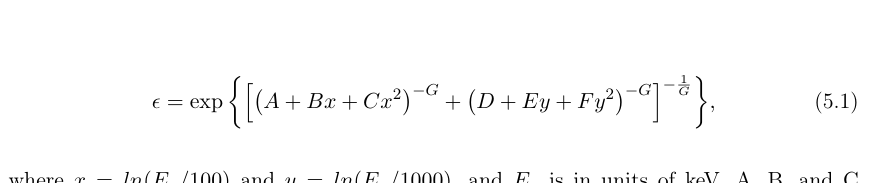

【未转写LaTeX；该裁图按式号定位，可能含邻近文字或需扩大边界，请以原PDF核定完整公式。】

本页其余原生块：标题、页眉、数学碎片、图中标签、表格与前/后置正文；完整保留，中文待译或不适用

**Source:** PDF74 P074B001; bbox [99.21, 46.25, 524.41, 57.16]

**Original:** Chapter 5. Experimental Details at RIBF
56

**中文:** 【待译/版式碎片未作独立语义解释；不得视为已完成双语正文。】

**Source:** PDF74 P074B002; bbox [99.21, 80.86, 201.42, 95.21]

**Original:** 5.2
Detectors

**中文:** 【待译/版式碎片未作独立语义解释；不得视为已完成双语正文。】

**Source:** PDF74 P074B007; bbox [99.21, 218.5, 274.07, 230.46]

**Original:** 5.2.1
EURICA HPGe Array

**中文:** 【待译/版式碎片未作独立语义解释；不得视为已完成双语正文。】

**Source:** PDF74 P074B012; bbox [441.55, 367.35, 449.73, 378.25]

**Original:** �

**中文:** 【待译/版式碎片未作独立语义解释；不得视为已完成双语正文。】

**Source:** PDF74 P074B013; bbox [434.16, 372.47, 439.86, 378.45]

**Original:** G

**中文:** 【待译/版式碎片未作独立语义解释；不得视为已完成双语正文。】

**Source:** PDF74 P074B014; bbox [208.32, 367.35, 226.65, 384.8]

**Original:** �h�

**中文:** 【待译/版式碎片未作独立语义解释；不得视为已完成双语正文。】

**Source:** PDF74 P074B015; bbox [328.12, 373.89, 333.11, 384.8]

**Original:** �

**中文:** 【待译/版式碎片未作独立语义解释；不得视为已完成双语正文。】

**Source:** PDF74 P074B016; bbox [170.86, 374.88, 206.51, 385.79]

**Original:** ϵ = exp

**中文:** 【待译/版式碎片未作独立语义解释；不得视为已完成双语正文。】

**Source:** PDF74 P074B017; bbox [226.65, 368.4, 325.7, 385.79]

**Original:** A + Bx + Cx2�−G +

**中文:** 【待译/版式碎片未作独立语义解释；不得视为已完成双语正文。】

**Source:** PDF74 P074B018; bbox [333.12, 366.09, 438.83, 385.79]

**Original:** D + Ey + Fy2�−Gi−1

**中文:** 【待译/版式碎片未作独立语义解释；不得视为已完成双语正文。】

**Source:** PDF74 P074B019; bbox [449.73, 374.88, 524.41, 385.81]

**Original:** ,
(5.1)

**中文:** 【待译/版式碎片未作独立语义解释；不得视为已完成双语正文。】

**Source:** PDF74 P074B024; bbox [99.21, 499.94, 207.58, 512.52]

**Original:** and 133Ba sources [61].

**中文:** 【待译/版式碎片未作独立语义解释；不得视为已完成双语正文。】

## PDF 75 / 印刷p57

**Source:** PDF75 S0131; native P075B016, P075B017, P075B018, P075B019, P075B020, P075B021

**Original:** Three separate readout systems from BigRIPS, WAS3ABi and EURICA formed the dataacquisition system. In WAS3ABi there are two types of events which initiate data taking, implantation of fragments and their subsequent β decay. An implantation event required a coincident signal between the F11 focal plane and WAS3ABi. Whereas a β event required a signal in the x and y strips of WAS3ABi [62]. For each trigger an acquisition window of 100 µs was opened in the data-acquisition (DAQ) for γ-ray detection in the EURICA

**中文:** BigRIPS、WAS3ABi与EURICA三个独立读出系统构成数据获取系统。WAS3ABi有两类启动采集的事件：碎片植入及随后β衰变。植入事件要求F11焦平面与WAS3ABi同时有信号；β事件要求WAS3ABi的x、y条均有信号[62]。每次触发在EURICA的γ获取系统中打开100µs窗口。

### Figure 5.3
**Source:** PDF75 P075B014

【图/表图像尚未裁取，回看原PDF；不得将标签提取当作图像审读。】

**Original caption:** Figure 5.3: The relative efficiency curve of the EURICA Cluster de- tector array, the fit was performed using Equation 5.1.

**中文图注:** 【待译；图像状态见source_map。】

本页其余原生块：标题、页眉、数学碎片、图中标签、表格与前/后置正文；完整保留，中文待译或不适用

**Source:** PDF75 P075B001; bbox [99.21, 46.25, 524.41, 57.16]

**Original:** Chapter 5. Experimental Details at RIBF
57

**中文:** 【待译/版式碎片未作独立语义解释；不得视为已完成双语正文。】

**Source:** PDF75 P075B002; bbox [143.41, 85.64, 157.09, 99.16]

**Original:** 35

**中文:** 【待译/版式碎片未作独立语义解释；不得视为已完成双语正文。】

**Source:** PDF75 P075B003; bbox [143.41, 111.84, 157.09, 125.36]

**Original:** 30

**中文:** 【待译/版式碎片未作独立语义解释；不得视为已完成双语正文。】

**Source:** PDF75 P075B004; bbox [143.41, 138.06, 157.09, 151.58]

**Original:** 25

**中文:** 【待译/版式碎片未作独立语义解释；不得视为已完成双语正文。】

**Source:** PDF75 P075B005; bbox [414.69, 97.59, 498.72, 160.81]

**Original:** fitting without addback
fitting with addback
133Ba, with addback
152Eu, with addback
133Ba, without addback
152Eu, without addback

**中文:** 【待译/版式碎片未作独立语义解释；不得视为已完成双语正文。】

**Source:** PDF75 P075B006; bbox [143.41, 164.26, 157.09, 177.78]

**Original:** 20

**中文:** 【待译/版式碎片未作独立语义解释；不得视为已完成双语正文。】

**Source:** PDF75 P075B007; bbox [143.41, 190.46, 157.09, 203.98]

**Original:** 15

**中文:** 【待译/版式碎片未作独立语义解释；不得视为已完成双语正文。】

**Source:** PDF75 P075B008; bbox [143.41, 216.66, 157.09, 230.18]

**Original:** 10

**中文:** 【待译/版式碎片未作独立语义解释；不得视为已完成双语正文。】

**Source:** PDF75 P075B009; bbox [121.24, 134.07, 134.77, 235.26]

**Original:** Absolute Efficiency (%)

**中文:** 【待译/版式碎片未作独立语义解释；不得视为已完成双语正文。】

**Source:** PDF75 P075B010; bbox [148.88, 242.88, 157.09, 256.4]

**Original:** 5

**中文:** 【待译/版式碎片未作独立语义解释；不得视为已完成双语正文。】

**Source:** PDF75 P075B011; bbox [148.88, 269.08, 157.09, 282.61]

**Original:** 0

**中文:** 【待译/版式碎片未作独立语义解释；不得视为已完成双语正文。】

**Source:** PDF75 P075B012; bbox [158.89, 278.92, 492.77, 292.45]

**Original:** 0
 200
 400
 600
 800
 1000
 1200
 1400

**中文:** 【待译/版式碎片未作独立语义解释；不得视为已完成双语正文。】

**Source:** PDF75 P075B013; bbox [304.34, 293.69, 361.77, 307.21]

**Original:** Energy (keV)

**中文:** 【待译/版式碎片未作独立语义解释；不得视为已完成双语正文。】

**Source:** PDF75 P075B015; bbox [99.21, 399.24, 239.49, 413.59]

**Original:** 5.3
Data collection

**中文:** 【待译/版式碎片未作独立语义解释；不得视为已完成双语正文。】

**Source:** PDF75 P075B022; bbox [99.21, 565.43, 126.03, 576.34]

**Original:** array.

**中文:** 【待译/版式碎片未作独立语义解释；不得视为已完成双语正文。】

## PDF 76 / 印刷p58

**Source:** PDF76 S0132; native P076B003

**Original:** RIBF Data Analysis and Results

**中文:** 【待译；保留原文，本块未完成中文翻译。】

**Source:** PDF76 S0133; native P076B004, P076B005, P076B006, P076B007, P076B008, P076B009

**Original:** The primary aim of the RIKEN analysis was to confirm the claim made by Hill and Shizuma that the decay path from 102Sr to 102Y to 102Zr differs from 102Y to 102Zr, see Section 2.5 for details. To investigate this claim, the data was analysed under two criteria. Criterion 1 involved an ion selection in WAS3ABi on 102Sr, whereas criterion 2 involved an ion selection on 102Y in WAS3ABi. This chapter details the work carried out to provide comparison with the work conducted at TRISTAN [8] and JOSEF [9].

**中文:** RIKEN分析的主要目标是检验Hill和Shizuma的主张：102Sr→102Y→102Zr与102Y→102Zr的衰变路径不同，详见2.5节。数据按两种条件分析：条件1在WAS3ABi中选择102Sr离子，条件2选择102Y离子。本章说明与TRISTAN[8]和JOSEF[9]研究进行比较的分析工作。

**Source:** PDF76 S0134; native P076B010

**Original:** 6.1 Particle Identification

**中文:** 【待译；保留原文，本块未完成中文翻译。】

**Source:** PDF76 S0135; native P076B011, P076B012, P076B013, P076B014

**Original:** Two sets of data were collected at RIKEN, one set was optimised for 104,106Zr, these runs produced data for 102Sr, whereas a second set was focused on 102Y. Figures 6.1, and 6.2 show particle identification plots for criterion 1 and 2 respectively, in these plots A/Q and Z were measured as described in Section 5.1.1.

**中文:** RIKEN采集了两组数据：一组针对104,106Zr优化，其中包含102Sr数据；另一组针对102Y。图6.1和6.2分别给出条件1和2的粒子鉴别图，其中A/Q与Z按5.1.1节方法测得。

**Source:** PDF76 S0136; native P076B015, P076B016, P076B017, P076B018

**Original:** Figure 6.1A shows all ion implantations in WAS3ABi for 2.65≤A/Q≤2.72 and 36≤Z≤40 for the first set of runs, which were optimised for 104,106Zr. In Figure 6.1B the conditions Z=38 and 2.67≤A/Q≤2.69 were applied to make a selection on 102Sr, satisfying criterion 1. 451754 detected implantations in WAS3ABi fulfilled criterion 1.

**中文:** 图6.1A展示第一组针对104,106Zr优化运行中，WAS3ABi内满足2.65≤A/Q≤2.72及36≤Z≤40的全部植入事件。图6.1B施加Z=38及2.67≤A/Q≤2.69以选择102Sr，满足条件1。共451754次WAS3ABi探测到的植入满足条件1。

**Source:** PDF76 S0137; native P076B019, P076B020, P076B021, P076B022, P076B023, P076B024

**Original:** Figure 6.2A shows all ion implantations in WAS3ABi for the second set of runs, which were focused on 102Y, for 2.59≤A/Q≤2.63 and 37≤Z≤41. In Figure 6.2B the conditions 38.3 < Z < 39.7 and 2.602 < A/Q < 2.620 were applied to make a selection on 102Y, satisfying criterion 2. In WAS3ABi 2130924 implantations satisfied criterion 2. It can be seen in Figures 6.1B, and 6.2B that applying Z and A/Q conditions has significantly reduced contamination from other nuclear species and background counts.

**中文:** 图6.2A展示第二组针对102Y的运行中，WAS3ABi内满足2.59≤A/Q≤2.63及37≤Z≤41的全部植入。图6.2B施加38.3<Z<39.7及2.602<A/Q<2.620以选择102Y，满足条件2。共2130924次植入满足条件2。图6.1B和6.2B表明，Z和A/Q条件显著降低其它核素及背景计数的污染。

本页其余原生块：标题、页眉、数学碎片、图中标签、表格与前/后置正文；完整保留，中文待译或不适用

**Source:** PDF76 P076B001; bbox [513.56, 46.25, 524.41, 57.16]

**Original:** 58

**中文:** 【待译/版式碎片未作独立语义解释；不得视为已完成双语正文。】

**Source:** PDF76 P076B002; bbox [99.21, 126.0, 195.95, 146.66]

**Original:** Chapter 6

**中文:** 【待译/版式碎片未作独立语义解释；不得视为已完成双语正文。】

## PDF 77 / 印刷p59

### Figure 6.1
**Source:** PDF77 P077B003

【图/表图像尚未裁取，回看原PDF；不得将标签提取当作图像审读。】

**Original caption:** Figure 6.1: PID plot for runs optimised for 104,106Zr (A) All ion implantations within the A/Q and Z region are shown (B) Ion implantations following application of A/Q and Z conditions to gate on 102Sr.

**中文图注:** 【待译；图像状态见source_map。】

本页其余原生块：标题、页眉、数学碎片、图中标签、表格与前/后置正文；完整保留，中文待译或不适用

**Source:** PDF77 P077B001; bbox [99.21, 46.25, 524.41, 57.16]

**Original:** Chapter 6. RIBF Data Analysis and Results
59

**中文:** 【待译/版式碎片未作独立语义解释；不得视为已完成双语正文。】

**Source:** PDF77 P077B002; bbox [118.14, 81.1, 501.87, 548.83]

**Original:** 【embedded image block；回看原PDF】

**中文:** 【待译/版式碎片未作独立语义解释；不得视为已完成双语正文。】

## PDF 78 / 印刷p60

### Figure 6.2
**Source:** PDF78 P078B003

【图/表图像尚未裁取，回看原PDF；不得将标签提取当作图像审读。】

**Original caption:** Figure 6.2: PID plot for runs optimised for 102Y (A) All ion implantations within the A/Q and Z region are shown (B) Ion implantations following application of A/Q and Z conditions to gate on 102Y.

**中文图注:** 【待译；图像状态见source_map。】

本页其余原生块：标题、页眉、数学碎片、图中标签、表格与前/后置正文；完整保留，中文待译或不适用

**Source:** PDF78 P078B001; bbox [99.21, 46.25, 524.41, 57.16]

**Original:** Chapter 6. RIBF Data Analysis and Results
60

**中文:** 【待译/版式碎片未作独立语义解释；不得视为已完成双语正文。】

**Source:** PDF78 P078B002; bbox [112.62, 81.1, 507.38, 548.84]

**Original:** 【embedded image block；回看原PDF】

**中文:** 【待译/版式碎片未作独立语义解释；不得视为已完成双语正文。】

## PDF 79 / 印刷p61

**Source:** PDF79 S0138; native P079B003, P079B004, P079B005, P079B006, P079B007, P079B008, P079B009, P079B010, P079B011, P079B012, P079B013

**Original:** The application of particle gates in WAS3ABi selected data for the first set of runs, which met the conditions Z=38 and 2.67≤A/Q≤2.69, satisfying criterion 1. Whereas, the second set of runs was narrowed to just ion implantations which met the conditions Z=39 and 2.602 < A/Q < 2.62, satisfying criterion 2. As mentioned in Section 5.3, two types of events were recorded in WAS3ABi, implantations and β decay. The ions in the particle gate satisfying criterion 1 will undergo two β decays before reaching 102Zr, whereas the ions in the particle gate satisfying criterion 2 will undergo only a single β decay to reach 102Zr. The β-decay half-life of 102Sr into 102Y is 69 ms [63], whereas the β-decay half-life of the high-spin isomeric state in 102Y into 102Zr is 360 ms [37] and of the low-spin isomeric state into 102Zr is 300 ms [37]. Before relative γ-ray intensities in 102Zr were identified an ion-β time gate was applied to maximise the peak-to-background ratio.

**中文:** 【待译；保留原文，本块未完成中文翻译。】

**Source:** PDF79 S0139; native P079B014

**Original:** 6.2.1 Ion-β Coincidence Time

**中文:** 【待译；保留原文，本块未完成中文翻译。】

**Source:** PDF79 S0140; native P079B015, P079B016, P079B017, P079B018, P079B019, P079B020, P079B021, P079B022, P079B023, P079B024, P079B025, P079B026

**Original:** The time between ion implantation and subsequent β decay was measured in WAS3ABi, as described in Section 5.2, and is shown in Figure 6.3. Figure 6.3(b) shows the time distribution for criterion 2, following the implementation of a particle gate on 102Y, whereas Figure 6.3(a) shows the time distribution for criterion 1, following a particle gate on 102Sr. Using this information a time window of 1.5 seconds was used as an additional condition for both criterion 1 and criterion 2. A time window of 1.5 seconds allows 102Sr to β decay into 102Y, and for four β-decay half-lives of 102Y to pass. To further improve the peak-to-background ratio random events were removed by subtracting counts within the 2-3.5 second ion-β coincidence time window. The β-gated γ-ray spectra presented in Figure 6.4 show the effect of including ion-β coincidence time condition. Figure 6.4(a) has no ion-β condition applied, (b) includes the condition ion-β time <1.5 seconds, and (c) includes the condition ion-β time <1.5 seconds, and subtracts counts in the 2-3.5 second

**中文:** 离子植入与随后β衰变的时间差由WAS3ABi测量，方法见5.2节，结果见图6.3。其中(b)是选102Y后条件2的分布，(a)是选102Sr后条件1的分布。据此，两种条件都增加1.5s时间窗。该窗口允许102Sr衰变到102Y，并经过约四个102Y的β半衰期。为了进一步改善峰背比，从中减去2–3.5s离子–β时间窗内的计数。图6.4展示时间条件的影响：(a)无离子–β时间条件；(b)时间<1.5s；(c)时间<1.5s并扣除2–3.5s窗的计数。

本页其余原生块：标题、页眉、数学碎片、图中标签、表格与前/后置正文；完整保留，中文待译或不适用

**Source:** PDF79 P079B001; bbox [99.21, 46.25, 524.41, 57.16]

**Original:** Chapter 6. RIBF Data Analysis and Results
61

**中文:** 【待译/版式碎片未作独立语义解释；不得视为已完成双语正文。】

**Source:** PDF79 P079B002; bbox [99.21, 80.86, 267.94, 95.21]

**Original:** 6.2
Relative Intensities

**中文:** 【待译/版式碎片未作独立语义解释；不得视为已完成双语正文。】

**Source:** PDF79 P079B027; bbox [99.21, 662.64, 191.21, 673.56]

**Original:** ion-β time window.

**中文:** 【待译/版式碎片未作独立语义解释；不得视为已完成双语正文。】

## PDF 80 / 印刷p62

### Figure 6.3
**Source:** PDF80 P080B018

【图/表图像尚未裁取，回看原PDF；不得将标签提取当作图像审读。】

**Original caption:** Figure 6.3: Ion-β coincidence time distributions for (a) runs optimised for 104,106Zr, following a particle gate on 102Sr (b) runs optimised for 102Y, following a particle gate on 102Y.

**中文图注:** 【待译；图像状态见source_map。】

### Figure 6.4
**Source:** PDF80 P080B020

【图/表图像尚未裁取，回看原PDF；不得将标签提取当作图像审读。】

**Original caption:** Figure 6.4: β-gated γ-ray spectra following application of a particle gate on 102Sr with (a) no ion-β time gate, (b) an ion-β time gate of ≤1.5 seconds, and (c) an ion-β time gate of ≤1.5 seconds as well as the subtraction of an ion-β time gate of 2-3.5 seconds.

**中文图注:** 【待译；图像状态见source_map。】

本页其余原生块：标题、页眉、数学碎片、图中标签、表格与前/后置正文；完整保留，中文待译或不适用

**Source:** PDF80 P080B001; bbox [99.21, 46.25, 524.41, 57.16]

**Original:** Chapter 6. RIBF Data Analysis and Results
62

**中文:** 【待译/版式碎片未作独立语义解释；不得视为已完成双语正文。】

**Source:** PDF80 P080B002; bbox [139.52, 89.65, 154.01, 102.54]

**Original:** 450

**中文:** 【待译/版式碎片未作独立语义解释；不得视为已完成双语正文。】

**Source:** PDF80 P080B003; bbox [470.26, 89.65, 480.99, 102.54]

**Original:** (a)

**中文:** 【待译/版式碎片未作独立语义解释；不得视为已完成双语正文。】

**Source:** PDF80 P080B004; bbox [139.66, 108.56, 154.15, 121.45]

**Original:** 350

**中文:** 【待译/版式碎片未作独立语义解释；不得视为已完成双语正文。】

**Source:** PDF80 P080B005; bbox [139.66, 128.15, 154.15, 141.04]

**Original:** 250

**中文:** 【待译/版式碎片未作独立语义解释；不得视为已完成双语正文。】

**Source:** PDF80 P080B006; bbox [139.05, 148.08, 153.55, 160.97]

**Original:** 150

**中文:** 【待译/版式碎片未作独立语义解释；不得视为已完成双语正文。】

**Source:** PDF80 P080B007; bbox [144.63, 166.27, 154.29, 179.16]

**Original:** 50

**中文:** 【待译/版式碎片未作独立语义解释；不得视为已完成双语正文。】

**Source:** PDF80 P080B008; bbox [120.93, 169.31, 133.82, 196.7]

**Original:** Counts

**中文:** 【待译/版式碎片未作独立语义解释；不得视为已完成双语正文。】

**Source:** PDF80 P080B009; bbox [140.21, 185.51, 154.7, 198.4]

**Original:** 900

**中文:** 【待译/版式碎片未作独立语义解释；不得视为已完成双语正文。】

**Source:** PDF80 P080B010; bbox [470.26, 186.8, 481.53, 199.69]

**Original:** (b)

**中文:** 【待译/版式碎片未作独立语义解释；不得视为已完成双语正文。】

**Source:** PDF80 P080B011; bbox [139.66, 203.7, 154.15, 216.59]

**Original:** 700

**中文:** 【待译/版式碎片未作独立语义解释；不得视为已完成双语正文。】

**Source:** PDF80 P080B012; bbox [139.66, 224.31, 154.15, 237.2]

**Original:** 500

**中文:** 【待译/版式碎片未作独立语义解释；不得视为已完成双语正文。】

**Source:** PDF80 P080B013; bbox [139.66, 242.17, 154.15, 255.06]

**Original:** 300

**中文:** 【待译/版式碎片未作独立语义解释；不得视为已完成双语正文。】

**Source:** PDF80 P080B014; bbox [139.82, 262.45, 154.32, 275.35]

**Original:** 100

**中文:** 【待译/版式碎片未作独立语义解释；不得视为已完成双语正文。】

**Source:** PDF80 P080B015; bbox [195.03, 276.83, 495.64, 289.72]

**Original:** 500
1500
2500
3500

**中文:** 【待译/版式碎片未作独立语义解释；不得视为已完成双语正文。】

**Source:** PDF80 P080B016; bbox [240.95, 276.72, 447.27, 289.97]

**Original:** 2000
3000
1000

**中文:** 【待译/版式碎片未作独立语义解释；不得视为已完成双语正文。】

**Source:** PDF80 P080B017; bbox [257.8, 292.22, 372.19, 305.11]

**Original:** ion- Coincidence Time (ms)

**中文:** 【待译/版式碎片未作独立语义解释；不得视为已完成双语正文。】

**Source:** PDF80 P080B019; bbox [118.67, 363.11, 501.35, 704.83]

**Original:** 【embedded image block；回看原PDF】

**中文:** 【待译/版式碎片未作独立语义解释；不得视为已完成双语正文。】

## PDF 81 / 印刷p63

**Source:** PDF81 S0141; native P081B003, P081B004, P081B005, P081B006, P081B007, P081B008, P081B009, P081B010, P081B011, P081B012, P081B013, P081B014, P081B015, P081B016, P081B017, P081B018, P081B019

**Original:** Criterion 1 provided information about the decay of 102Sr into 102Y and then into 102Zr. This provided spectra containing γ ray peaks associated with 102Y and 102Zr, and possibly some counts for γ rays observed in the decay of 102Zr to 102Nb and of 102Nb to 102Mo, and are shown in Figure 6.5a. The aim of this analysis is to confirm the claim made by Hill and Shizuma, that the γ ray intensity pattern observed in 102Zr in the decay path 102Sr to 102Y to 102Zr differs from the pattern observed in the path 102Y to 102Zr. However, the overlapping 150 keV γ ray peak in 102Y and 152 keV peak in 102Zr make it difficult to identify the γ-ray intensities in 102Zr. Therefore, to remove the γ rays associated with 102Y, a 20 ms ion-β time window was used to produce a spectrum containing just 102Y γ rays. A time window of 20 ms was chosen as the β-decay half-life of 102Sr into 102Y is 69 ms, so this short window reduces the probability that 102Y has β decayed into 102Zr, thus providing γ-ray peaks for 102Y only. Figure 6.5b shows the β-gated γ-ray spectrum following the application of this short ion-β time gate. The spectrum presented in Figure 6.5b was then normalised, so that it could be subtracted from Figure 6.5a to leave just the γ rays associated with 102Zr. The 244 keV γ ray peak in 102Y was used to normalise this data because it is the strongest observed transition, the normalised β-gated γ-ray spectrum for the 20 ms ion-β time gate is presented in Figure 6.5c.

**中文:** 条件1提供102Sr衰变到102Y、再到102Zr的信息，因此谱中含102Y和102Zr的γ峰，也可能含少量102Zr→102Nb及102Nb→102Mo的γ计数，见图6.5a。本分析旨在检验Hill和Shizuma所称的两条路径中102Zr的γ强度图样差别。然而102Y的150keV峰与102Zr的152keV峰重叠，难以确定102Zr的γ强度。因此，先使用20ms的离子–β时间窗取得仅包含102Y γ射线的谱，用以去除102Y成分。选择20ms是因为102Sr→102Y的β半衰期为69ms；短窗降低102Y已衰变到102Zr的概率，从而仅留下102Y的γ峰。图6.5b展示施加该短窗后的β门γ谱。随后归一化该谱，并从图6.5a扣除，留下102Zr γ成分。由于244keV是102Y最强的跃迁，采用该峰进行归一；归一后的20ms谱见图6.5c。

**Source:** PDF81 S0142; native P081B020, P081B021, P081B022, P081B023, P081B024, P081B025, P081B026, P081B027, P081B028, P081B029, P081B030, P081B031

**Original:** In a separate experiment, conducted by Hill at the TRISTAN facility, which measured the β decay of 102Sr into 102Y, the 150 keV transition in 102Y was measured to be 34% of the intensity of the 244 keV transition [37]. However, in this work, the 150 keV transition in 102Y was found to be 41% of the intensity of the 244 keV transition, which lies within two standard deviations of the previous measurement by Hill [37]. Further analysis of the structure of 102Y is presented in Section 6.4. In Figures 6.5a and 6.5b a clear difference can be seen in the ratio of the 151:244 keV transitions when the 20 ms ion-β time gate was applied. Furthermore, at γ-ray energies >1 MeV γ-ray peaks associated with 102Zr, at 1059-, 1160-, and 1211 keV, are removed showing that in the 20 ms time window only γ-ray transitions associated with 102Y are observed. The subtraction of Figures 6.5c from 6.5a provided a β-gated γ-ray spectrum for criterion 1 containing just the γ rays associated with 102Zr, and is presented in Figure 6.6b.

**中文:** 【待译；保留原文，本块未完成中文翻译。】

**Source:** PDF81 S0143; native P081B032

**Original:** For criterion 2, a particle gate was set on 102Y in WAS3ABi, which provided information

**中文:** 【待译；保留原文，本块未完成中文翻译。】

本页其余原生块：标题、页眉、数学碎片、图中标签、表格与前/后置正文；完整保留，中文待译或不适用

**Source:** PDF81 P081B001; bbox [99.21, 46.25, 524.41, 57.16]

**Original:** Chapter 6. RIBF Data Analysis and Results
63

**中文:** 【待译/版式碎片未作独立语义解释；不得视为已完成双语正文。】

**Source:** PDF81 P081B002; bbox [99.21, 82.72, 267.75, 94.69]

**Original:** 6.2.2
β-gated γ-ray Spectra

**中文:** 【待译/版式碎片未作独立语义解释；不得视为已完成双语正文。】

## PDF 82 / 印刷p64

**Source:** PDF82 S0144; native P082B045, P082B046

**Original:** about the decay of 102Y into 102Zr producing only the γ rays of interest. Therefore, no correction was required in this case and the β-gated γ-ray spectrum is presented in

**中文:** 【待译；保留原文，本块未完成中文翻译。】

**Source:** PDF82 S0145; native P082B048, P082B049, P082B050, P082B051, P082B052, P082B053

**Original:** The energy spectra presented in Figure 6.6 have a very low level of background contamination, primarily due to the particle gates applied using information obtained by WAS3ABi. The β-gated singles spectrum for criterion 2 is shown in Figure 6.6b, and the spectrum for criterion 1 is shown in Figure 6.6a. For criterion 2 the 160-, 326-, 486-, 579-, and 1090 keV transitions were observed with a higher intensity relative to the 152 keV peak compared to implanting with criterion 1. For criterion 1 the 743-, 1059-, 1160-, and

**中文:** 【待译；保留原文，本块未完成中文翻译。】

### Figure 6.5
**Source:** PDF82 P082B044

【图/表图像尚未裁取，回看原PDF；不得将标签提取当作图像审读。】

**Original caption:** Figure 6.5: β-gated γ-ray energy spectra using an ion-β coincidence time gate of (a) ≤1.5 seconds, subtracting events in the 2-3.5 second ion-β time window, (b) ≤20 ms, subtracting events in the 2-2.02 second ion-β time window, and (c) ≤20 ms, subtract- ing events in the 2-2.02 second ion-β time window, and normalising the 244 keV γ ray peak to the 244 keV peak in Figure (a).

**中文图注:** 【待译；图像状态见source_map。】

本页其余原生块：标题、页眉、数学碎片、图中标签、表格与前/后置正文；完整保留，中文待译或不适用

**Source:** PDF82 P082B001; bbox [99.21, 46.25, 524.41, 57.16]

**Original:** Chapter 6. RIBF Data Analysis and Results
64

**中文:** 【待译/版式碎片未作独立语义解释；不得视为已完成双语正文。】

**Source:** PDF82 P082B002; bbox [499.54, 91.68, 511.73, 106.33]

**Original:** (a)

**中文:** 【待译/版式碎片未作独立语义解释；不得视为已完成双语正文。】

**Source:** PDF82 P082B003; bbox [123.67, 91.99, 140.14, 106.64]

**Original:** 900

**中文:** 【待译/版式碎片未作独立语义解释；不得视为已完成双语正文。】

**Source:** PDF82 P082B004; bbox [389.43, 94.77, 405.9, 109.42]

**Original:** 140

**中文:** 【待译/版式碎片未作独立语义解释；不得视为已完成双语正文。】

**Source:** PDF82 P082B005; bbox [123.51, 113.85, 139.99, 128.5]

**Original:** 700

**中文:** 【待译/版式碎片未作独立语义解释；不得视为已完成双语正文。】

**Source:** PDF82 P082B006; bbox [404.22, 101.26, 462.47, 134.94]

**Original:** 1211
1192
1160
1104
1059
1036

**中文:** 【待译/版式碎片未作独立语义解释；不得视为已完成双语正文。】

**Source:** PDF82 P082B007; bbox [395.02, 128.09, 406.0, 142.74]

**Original:** 60

**中文:** 【待译/版式碎片未作独立语义解释；不得视为已完成双语正文。】

**Source:** PDF82 P082B008; bbox [123.51, 135.71, 139.99, 150.36]

**Original:** 500

**中文:** 【待译/版式碎片未作独立语义解释；不得视为已完成双语正文。】

**Source:** PDF82 P082B009; bbox [123.51, 156.98, 139.99, 171.63]

**Original:** 300

**中文:** 【待译/版式碎片未作独立语义解释；不得视为已完成双语正文。】

**Source:** PDF82 P082B010; bbox [431.65, 158.04, 491.28, 172.69]

**Original:** 1150
1350

**中文:** 【待译/版式碎片未作独立语义解释；不得视为已完成双语正文。】

**Source:** PDF82 P082B011; bbox [123.86, 179.43, 140.33, 194.08]

**Original:** 100

**中文:** 【待译/版式碎片未作独立语义解释；不得视为已完成双语正文。】

**Source:** PDF82 P082B012; bbox [124.17, 200.04, 140.64, 214.69]

**Original:** 110

**中文:** 【待译/版式碎片未作独立语义解释；不得视为已完成双语正文。】

**Source:** PDF82 P082B013; bbox [499.54, 201.23, 512.35, 215.88]

**Original:** (b)

**中文:** 【待译/版式碎片未作独立语义解释；不得视为已完成双语正文。】

**Source:** PDF82 P082B014; bbox [440.39, 210.13, 455.04, 232.09]

**Original:** 1192

**中文:** 【待译/版式碎片未作独立语义解释；不得视为已完成双语正文。】

**Source:** PDF82 P082B015; bbox [129.26, 217.69, 140.24, 232.34]

**Original:** 90

**中文:** 【待译/版式碎片未作独立语义解释；不得视为已完成双语正文。】

**Source:** PDF82 P082B016; bbox [395.52, 218.03, 406.5, 232.68]

**Original:** 14

**中文:** 【待译/版式碎片未作独立语义解释；不得视为已完成双语正文。】

**Source:** PDF82 P082B017; bbox [129.1, 235.3, 140.09, 249.95]

**Original:** 70

**中文:** 【待译/版式碎片未作独立语义解释；不得视为已完成双语正文。】

**Source:** PDF82 P082B018; bbox [400.7, 243.01, 406.2, 257.66]

**Original:** 6

**中文:** 【待译/版式碎片未作独立语义解释；不得视为已完成双语正文。】

**Source:** PDF82 P082B019; bbox [129.1, 253.54, 140.09, 268.19]

**Original:** 50

**中文:** 【待译/版式碎片未作独立语义解释；不得视为已完成双语正文。】

**Source:** PDF82 P082B020; bbox [102.58, 238.16, 117.23, 269.29]

**Original:** Counts

**中文:** 【待译/版式碎片未作独立语义解释；不得视为已完成双语正文。】

**Source:** PDF82 P082B021; bbox [430.78, 267.75, 490.69, 282.4]

**Original:** 1150
1350

**中文:** 【待译/版式碎片未作独立语义解释；不得视为已完成双语正文。】

**Source:** PDF82 P082B022; bbox [129.1, 271.74, 140.09, 286.39]

**Original:** 30

**中文:** 【待译/版式碎片未作独立语义解释；不得视为已完成双语正文。】

**Source:** PDF82 P082B023; bbox [128.98, 289.39, 139.96, 304.04]

**Original:** 10

**中文:** 【待译/版式碎片未作独立语义解释；不得视为已完成双语正文。】

**Source:** PDF82 P082B024; bbox [123.92, 310.78, 140.39, 325.43]

**Original:** 900

**中文:** 【待译/版式碎片未作独立语义解释；不得视为已完成双语正文。】

**Source:** PDF82 P082B025; bbox [499.73, 312.03, 511.92, 326.68]

**Original:** (c)

**中文:** 【待译/版式碎片未作独立语义解释；不得视为已完成双语正文。】

**Source:** PDF82 P082B026; bbox [388.96, 313.37, 405.44, 328.02]

**Original:** 140

**中文:** 【待译/版式碎片未作独立语义解释；不得视为已完成双语正文。】

**Source:** PDF82 P082B027; bbox [123.29, 331.99, 139.77, 346.64]

**Original:** 700

**中文:** 【待译/版式碎片未作独立语义解释；不得视为已完成双语正文。】

**Source:** PDF82 P082B028; bbox [426.62, 325.8, 441.27, 347.77]

**Original:** 1104

**中文:** 【待译/版式碎片未作独立语义解释；不得视为已完成双语正文。】

**Source:** PDF82 P082B029; bbox [446.26, 326.27, 460.91, 348.23]

**Original:** 1192

**中文:** 【待译/版式碎片未作独立语义解释；不得视为已完成双语正文。】

**Source:** PDF82 P082B030; bbox [406.38, 212.19, 436.3, 348.64]

**Original:** 1104
1036
1036

**中文:** 【待译/版式碎片未作独立语义解释；不得视为已完成双语正文。】

**Source:** PDF82 P082B031; bbox [395.02, 346.69, 406.0, 361.34]

**Original:** 60

**中文:** 【待译/版式碎片未作独立语义解释；不得视为已完成双语正文。】

**Source:** PDF82 P082B032; bbox [257.7, 96.39, 276.72, 366.85]

**Original:** 150
150
151

**中文:** 【待译/版式碎片未作独立语义解释；不得视为已完成双语正文。】

**Source:** PDF82 P082B033; bbox [123.29, 354.5, 139.77, 369.15]

**Original:** 500

**中文:** 【待译/版式碎片未作独立语义解释；不得视为已完成双语正文。】

**Source:** PDF82 P082B034; bbox [473.55, 131.77, 489.48, 370.38]

**Original:** 1378
1378
1378

**中文:** 【待译/版式碎片未作独立语义解释；不得视为已完成双语正文。】

**Source:** PDF82 P082B035; bbox [188.81, 256.24, 203.45, 375.53]

**Original:** 68
68

**中文:** 【待译/版式碎片未作独立语义解释；不得视为已完成双语正文。】

**Source:** PDF82 P082B036; bbox [211.48, 137.01, 226.56, 377.43]

**Original:** 94
94
94

**中文:** 【待译/版式碎片未作独立语义解释；不得视为已完成双语正文。】

**Source:** PDF82 P082B037; bbox [338.36, 107.41, 367.85, 385.18]

**Original:** 254
244
254
244
254
244

**中文:** 【待译/版式碎片未作独立语义解释；不得视为已完成双语正文。】

**Source:** PDF82 P082B038; bbox [123.29, 376.36, 139.77, 391.01]

**Original:** 300

**中文:** 【待译/版式碎片未作独立语义解释；不得视为已完成双语正文。】

**Source:** PDF82 P082B039; bbox [430.78, 376.42, 490.69, 391.07]

**Original:** 1150
1350

**中文:** 【待译/版式碎片未作独立语义解释；不得视为已完成双语正文。】

**Source:** PDF82 P082B040; bbox [123.67, 398.85, 140.14, 413.5]

**Original:** 100

**中文:** 【待译/版式碎片未作独立语义解释；不得视为已完成双语正文。】

**Source:** PDF82 P082B041; bbox [175.51, 414.12, 453.59, 428.77]

**Original:** 50
150
250
350

**中文:** 【待译/版式碎片未作独立语义解释；不得视为已完成双语正文。】

**Source:** PDF82 P082B042; bbox [217.98, 414.03, 494.03, 429.3]

**Original:** 100
200
300
400

**中文:** 【待译/版式碎片未作独立语义解释；不得视为已完成双语正文。】

**Source:** PDF82 P082B043; bbox [310.14, 437.67, 349.75, 452.32]

**Original:** E (keV)

**中文:** 【待译/版式碎片未作独立语义解释；不得视为已完成双语正文。】

**Source:** PDF82 P082B047; bbox [99.21, 611.36, 155.69, 622.27]

**Original:** Figure 6.6a.

**中文:** 【待译/版式碎片未作独立语义解释；不得视为已完成双语正文。】

## PDF 83 / 印刷p65

**Source:** PDF83 S0146; native P083B034

**Original:** 1211 keV transitions were observed with a higher intensity relative to the 152 keV transition

**中文:** 【待译；保留原文，本块未完成中文翻译。】

### Figure 6.6
**Source:** PDF83 P083B033

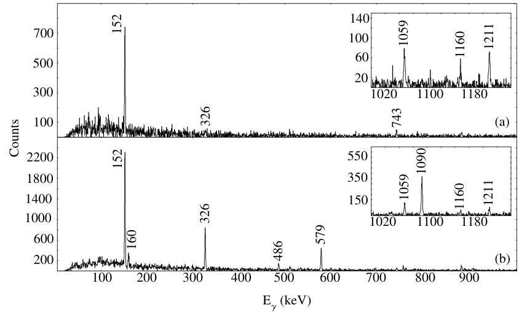

**Original caption:** Figure 6.6: β-gated γ-ray energy spectra using ion-β coincidence time of 1.5 seconds (a) peaks in 102Zr following implantation of 102Sr and subtraction of γ-ray peaks in 102Y (b) peaks in 102Zr following implantation of 102Y in WAS3ABi.

**中文图注:** 离子–β符合时间取1.5s的β门γ能谱：(a)植入102Sr并扣除102Y γ峰后的102Zr峰；(b)WAS3ABi中植入102Y后出现的102Zr峰。

### Table 6.1
**Source:** PDF83 P083B038

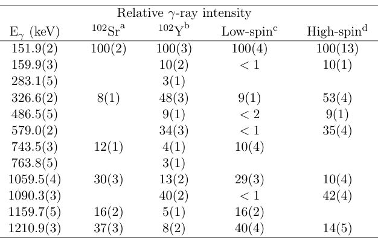

**Original caption:** Table 6.1: The energies and uncertainties listed in the first column are from the RIKEN analysis. The remaining four columns show the relative intensities (a) measured at RIKEN for criterion 1, (b) measured at RIKEN for criterion 2, (c) measured at TRISTAN [8] from the low-spin isomeric state in 102Y and (d) deduced by combining TRISTAN and JOSEF studies, as described in [8].

**中文图注:** 第一列能量及误差来自RIKEN分析。后四列相对强度依次为(a)RIKEN条件1，(b)RIKEN条件2，(c)TRISTAN[8]测得的102Y低自旋异能态衰变，(d)按文献[8]结合TRISTAN及JOSEF研究推得的结果。

本页其余原生块：标题、页眉、数学碎片、图中标签、表格与前/后置正文；完整保留，中文待译或不适用

**Source:** PDF83 P083B001; bbox [99.21, 46.25, 524.41, 57.16]

**Original:** Chapter 6. RIBF Data Analysis and Results
65

**中文:** 【待译/版式碎片未作独立语义解释；不得视为已完成双语正文。】

**Source:** PDF83 P083B002; bbox [184.79, 96.45, 199.39, 112.87]

**Original:** 152

**中文:** 【待译/版式碎片未作独立语义解释；不得视为已完成双语正文。】

**Source:** PDF83 P083B003; bbox [125.22, 104.02, 141.64, 118.62]

**Original:** 700

**中文:** 【待译/版式碎片未作独立语义解释；不得视为已完成双语正文。】

**Source:** PDF83 P083B004; bbox [487.29, 103.68, 501.9, 125.57]

**Original:** 1211

**中文:** 【待译/版式碎片未作独立语义解释；不得视为已完成双语正文。】

**Source:** PDF83 P083B005; bbox [463.95, 110.34, 478.55, 132.23]

**Original:** 1160

**中文:** 【待译/版式碎片未作独立语义解释；不得视为已完成双语正文。】

**Source:** PDF83 P083B006; bbox [381.31, 92.07, 398.51, 138.27]

**Original:** 60
100
140

**中文:** 【待译/版式碎片未作独立语义解释；不得视为已完成双语正文。】

**Source:** PDF83 P083B007; bbox [124.78, 128.24, 141.2, 142.84]

**Original:** 500

**中文:** 【待译/版式碎片未作独立语义解释；不得视为已完成双语正文。】

**Source:** PDF83 P083B008; bbox [124.78, 152.05, 141.2, 166.65]

**Original:** 300

**中文:** 【待译/版式碎片未作独立语义解释；不得视为已完成双语正文。】

**Source:** PDF83 P083B009; bbox [386.23, 140.25, 494.47, 167.96]

**Original:** 1020
1100
1180
20

**中文:** 【待译/版式碎片未作独立语义解释；不得视为已完成双语正文。】

**Source:** PDF83 P083B010; bbox [256.76, 171.56, 271.36, 187.98]

**Original:** 326

**中文:** 【待译/版式碎片未作独立语义解释；不得视为已完成双语正文。】

**Source:** PDF83 P083B011; bbox [412.59, 101.28, 432.7, 189.1]

**Original:** 743
1059

**中文:** 【待译/版式碎片未作独立语义解释；不得视为已完成双语正文。】

**Source:** PDF83 P083B012; bbox [500.22, 176.02, 512.37, 190.62]

**Original:** (a)

**中文:** 【待译/版式碎片未作独立语义解释；不得视为已完成双语正文。】

**Source:** PDF83 P083B013; bbox [124.97, 176.67, 141.39, 191.28]

**Original:** 100

**中文:** 【待译/版式碎片未作独立语义解释；不得视为已完成双语正文。】

**Source:** PDF83 P083B014; bbox [101.49, 182.02, 116.09, 213.04]

**Original:** Counts

**中文:** 【待译/版式碎片未作独立语义解释；不得视为已完成双语正文。】

**Source:** PDF83 P083B015; bbox [380.53, 204.01, 396.95, 218.61]

**Original:** 550

**中文:** 【待译/版式碎片未作独立语义解释；不得视为已完成双语正文。】

**Source:** PDF83 P083B016; bbox [119.62, 204.75, 141.51, 219.35]

**Original:** 2200

**中文:** 【待译/版式碎片未作独立语义解释；不得视为已完成双语正文。】

**Source:** PDF83 P083B017; bbox [380.53, 221.65, 396.95, 236.26]

**Original:** 350

**中文:** 【待译/版式碎片未作独立语义解释；不得视为已完成双语正文。】

**Source:** PDF83 P083B018; bbox [418.56, 205.53, 446.92, 248.53]

**Original:** 1059
1090

**中文:** 【待译/版式碎片未作独立语义解释；不得视为已完成双语正文。】

**Source:** PDF83 P083B019; bbox [486.86, 231.02, 501.46, 252.92]

**Original:** 1211

**中文:** 【待译/版式碎片未作独立语义解释；不得视为已完成双语正文。】

**Source:** PDF83 P083B020; bbox [380.84, 240.08, 397.26, 254.69]

**Original:** 150

**中文:** 【待译/版式碎片未作独立语义解释；不得视为已完成双语正文。】

**Source:** PDF83 P083B021; bbox [463.48, 234.11, 478.08, 256.0]

**Original:** 1160

**中文:** 【待译/版式碎片未作独立语义解释；不得视为已完成双语正文。】

**Source:** PDF83 P083B022; bbox [256.29, 250.75, 270.89, 267.17]

**Original:** 326

**中文:** 【待译/版式碎片未作独立语义解释；不得视为已完成双语正文。】

**Source:** PDF83 P083B023; bbox [117.97, 222.68, 141.29, 268.85]

**Original:** 1000
1400
1800

**中文:** 【待译/版式碎片未作独立语义解释；不得视为已完成双语正文。】

**Source:** PDF83 P083B024; bbox [398.15, 257.64, 494.47, 272.24]

**Original:** 1020
1100
1180

**中文:** 【待译/版式碎片未作独立语义解释；不得视为已完成双语正文。】

**Source:** PDF83 P083B025; bbox [350.27, 267.87, 364.87, 284.29]

**Original:** 579

**中文:** 【待译/版式碎片未作独立语义解释；不得视为已完成双语正文。】

**Source:** PDF83 P083B026; bbox [125.34, 271.4, 141.76, 286.0]

**Original:** 600

**中文:** 【待译/版式碎片未作独立语义解释；不得视为已完成双语正文。】

**Source:** PDF83 P083B027; bbox [185.26, 206.27, 211.78, 288.59]

**Original:** 152
160

**中文:** 【待译/版式碎片未作独立语义解释；不得视为已完成双语正文。】

**Source:** PDF83 P083B028; bbox [315.9, 281.17, 330.5, 297.59]

**Original:** 486

**中文:** 【待译/版式碎片未作独立语义解释；不得视为已完成双语正文。】

**Source:** PDF83 P083B029; bbox [125.22, 288.55, 141.64, 303.15]

**Original:** 200

**中文:** 【待译/版式碎片未作独立语义解释；不得视为已完成双语正文。】

**Source:** PDF83 P083B030; bbox [209.08, 287.43, 512.98, 317.56]

**Original:** (b)
200
400
600
800

**中文:** 【待译/版式碎片未作独立语义解释；不得视为已完成双语正文。】

**Source:** PDF83 P083B031; bbox [172.66, 302.77, 487.72, 317.69]

**Original:** 100
300
500
700
900

**中文:** 【待译/版式碎片未作独立语义解释；不得视为已完成双语正文。】

**Source:** PDF83 P083B032; bbox [311.61, 321.64, 351.09, 336.24]

**Original:** E (keV)

**中文:** 【待译/版式碎片未作独立语义解释；不得视为已完成双语正文。】

**Source:** PDF83 P083B035; bbox [99.21, 448.69, 213.69, 459.6]

**Original:** compared to criterion 2.

**中文:** 【待译/版式碎片未作独立语义解释；不得视为已完成双语正文。】

**Source:** PDF83 P083B036; bbox [163.71, 472.64, 460.41, 500.69]

**Original:** Relative γ-ray intensity
Eγ (keV)
102Sra
102Yb
Low-spinc
High-spind

**中文:** 【待译/版式碎片未作独立语义解释；不得视为已完成双语正文。】

**Source:** PDF83 P083B037; bbox [162.71, 502.08, 453.42, 662.03]

**Original:** 151.9(2)
100(2)
100(3)
100(4)
100(13)
159.9(3)
10(2)
< 1
10(1)
283.1(5)
3(1)
326.6(2)
8(1)
48(3)
9(1)
53(4)
486.5(5)
9(1)
< 2
9(1)
579.0(2)
34(3)
< 1
35(4)
743.5(3)
12(1)
4(1)
10(4)
763.8(5)
3(1)
1059.5(4)
30(3)
13(2)
29(3)
10(4)
1090.3(3)
40(2)
< 1
42(4)
1159.7(5)
16(2)
5(1)
16(2)
1210.9(3)
37(3)
8(2)
40(4)
14(5)

**中文:** 【待译/版式碎片未作独立语义解释；不得视为已完成双语正文。】

## PDF 84 / 印刷p66

**Source:** PDF84 S0147; native P084B002, P084B003, P084B004, P084B005, P084B006, P084B007, P084B008, P084B009, P084B010, P084B011, P084B012, P084B013, P084B014, P084B015, P084B016, P084B017, P084B018, P084B019, P084B020, P084B021, P084B022, P084B023, P084B024, P084B025, P084B026, P084B027, P084B028

**Original:** Table 6.1 details the relative intensities measured for 102Zr for criterion 1 and criterion 2, compared to the relative intensities found at TRISTAN [8] and JOSEF [9] for the decay of the low-spin and high spin isomeric state in 102Y. The decay of the low-spin isomer in 102Y was investigated at TRISTAN, however, the relative intensities given for the decay of the high-spin isomer in 102Y were deduced by combining the TRISTAN [8] and JOSEF [9] studies. Comparing the relative intensities observed for criterion 1 and 2, there is a stark difference in the intensity of the γ rays produced. The intensities measured for criterion 1 and criterion 2 have both been normalised to the 152 keV γ ray transition, the same is true for the previous results from TRISTAN and JOSEF. The 160 keV γ ray was seen at RIKEN with a relative intensity of 10% for criterion 2, which lies within one standard deviation of the intensity measured for the decay of the high-spin isomer in 102Y. For criterion 1 the 160 keV transition was not seen at all, which is in-line with the relative intensity of <1% observed at TRISTAN. The 283 keV transition was not observed at TRISTAN or JOSEF, and was only observed in this data with a 3% intensity for criterion 2. The 326 keV transition shows a clear difference between the relative intensity measured when implanting with 102Sr and 102Y. For criterion 1 the measured relative intensity of 8% lies within one standard deviation of the intensity measured at TRISTAN. Whereas, for criterion 2 the relative intensity of 48% lies within one standard deviation of the intensity measured for the decay of the high-spin isomeric state in 102Y. The 486 keV transition was observed with a relative intensity of 9% when implanting with 102Y, which agrees with the intensity measured for the decay of the high-spin isomeric state of 102Y to within one standard deviation. However, this transition was not seen when implanting with 102Sr, which is in-line with the intensity of <2% measured at TRISTAN. Similarly, the 579 keV transition was not seen when implanting with 102Sr, which is in-line with the intensity of <1% measured at TRISTAN. Whereas, this transition was seen when implanting with 102Y with a relative intensity of 34%, which lies within one standard deviation of the intensity measured for the decay of the high-spin isomeric state of 102Y.

**中文:** 【待译；保留原文，本块未完成中文翻译。】

**Source:** PDF84 S0148; native P084B029, P084B030, P084B031, P084B032, P084B033

**Original:** The 743 keV transition was observed with a relative intensity of 12% when implanting with 102Sr, and 4% when implanting with 102Y. The intensity measured when implanting with 102Sr lies within one standard deviation of the intensity measured at TRISTAN, however, this transition was not measured for the decay of the high-spin isomeric state in 102Y. The 763 keV transition was not measured at TRISTAN or JOSEF, and was only

**中文:** 【待译；保留原文，本块未完成中文翻译。】

本页其余原生块：标题、页眉、数学碎片、图中标签、表格与前/后置正文；完整保留，中文待译或不适用

**Source:** PDF84 P084B001; bbox [99.21, 46.25, 524.41, 57.16]

**Original:** Chapter 6. RIBF Data Analysis and Results
66

**中文:** 【待译/版式碎片未作独立语义解释；不得视为已完成双语正文。】

## PDF 85 / 印刷p67

**Source:** PDF85 S0149; native P085B002, P085B003, P085B004, P085B005, P085B006, P085B007, P085B008, P085B009, P085B010, P085B011, P085B012, P085B013, P085B014, P085B015, P085B016, P085B017, P085B018, P085B019

**Original:** measured in this data with a relative intensity of 3% for criterion 2. The 1059 keV transition was measured with an intensity of 30% when implanting with 102Sr, which agrees with the intensity measured at TRISTAN to within one standard deviation. When implanting with 102Y the intensity was 13%, which agrees with the intensity measured for the highspin isomeric state in 102Y to within one standard deviation. The 1090 keV transition was not observed when implanting with 102Sr, which is in-line with the intensity of less than 1% measured at TRISTAN. When implanting with 102Y the intensity was measured at 40%, which agrees with the intensity measured for the decay of the high-spin state in 102Y to within one standard deviation. The 1160 keV transition was measured with a relative intensity of 16% when implanting with 102Sr, which agrees with the intensity measured at TRISTAN to within one standard deviation. When implanting with 102Y the 1160 keV transition was measured with a relative intensity of 5%, but this transition was not measured for the decay of the high-spin state in 102Y in previous work. Finally, the 1211 keV transition was measured with a relative intensity of 37% when implanting with 102Sr, which agrees with the intensity measured at TRISTAN to within one standard deviation. Whereas, when implanting with 102Y the 1211 keV transition was measured with a relative intensity of 8%, which agrees with the intensity measured for the decay of the high-spin state in 102Y to within two standard deviations.

**中文:** 【待译；保留原文，本块未完成中文翻译。】

**Source:** PDF85 S0150; native P085B020, P085B021, P085B022, P085B023, P085B024

**Original:** From the β-gated γ-ray singles spectra it is clear that the γ-ray intensity pattern observed when gating on 102Sr implantations in WAS3ABi (criterion 1) differs from the γ-ray pattern observed when gating on 102Y implantations in WAS3ABi (criterion 2). This observation supports the claim previously made by Hill [8] and Shizuma [9], and provides further evidence for the existence of a second β-decaying isomeric state in 102Y.

**中文:** β门γ单谱清楚表明，在WAS3ABi中选102Sr植入（条件1）所见的γ强度图样，与选102Y植入（条件2）所见图样不同。该观测支持Hill[8]和Shizuma[9]此前的主张，并为102Y存在第二个β衰变异能态提供了进一步证据。

**Source:** PDF85 S0151; native P085B026, P085B027, P085B028

**Original:** Further to making a comparison between the relative intensities measured in this work and at TRISTAN and JOSEF, γ-γ coincidences were also investigated. Before the coincidences could be identified it was necessary to include a γ-γ coincidence time condition for both

**中文:** 【待译；保留原文，本块未完成中文翻译。】

本页其余原生块：标题、页眉、数学碎片、图中标签、表格与前/后置正文；完整保留，中文待译或不适用

**Source:** PDF85 P085B001; bbox [99.21, 46.25, 524.41, 57.16]

**Original:** Chapter 6. RIBF Data Analysis and Results
67

**中文:** 【待译/版式碎片未作独立语义解释；不得视为已完成双语正文。】

**Source:** PDF85 P085B025; bbox [99.21, 606.08, 257.16, 620.43]

**Original:** 6.3
Coincidence Data

**中文:** 【待译/版式碎片未作独立语义解释；不得视为已完成双语正文。】

**Source:** PDF85 P085B029; bbox [99.21, 706.83, 181.15, 717.73]

**Original:** criterion 1 and 2.

**中文:** 【待译/版式碎片未作独立语义解释；不得视为已完成双语正文。】

## PDF 86 / 印刷p68

**Source:** PDF86 S0152; native P086B003, P086B004, P086B005, P086B006, P086B007, P086B008, P086B009, P086B010, P086B011

**Original:** The time between two γ ray emissions was measured using the EURICA array, as described in Section 5.2. The γ-γ coincidence time distribution for criterion 1 and 2 is shown in Figure 6.7. In this figure, (a) shows the time distribution for criterion 1, and (b) shows the time distribution for criterion 2. Using this information a coincidence time window of ±300 ns was used to create a γ-γ matrix. True γ-γ coincidences should occur in the nanosecond range, therefore, by limiting the accepted coincidence time to 300 ns, background contamination is reduced. In contrast to the ion-β coincidence time gate, the number of random coincidences that lie within the 300 ns time window were too low to subtract and provide any clear benefit.

**中文:** 两个γ发射之间的时间差由EURICA阵列测量，见5.2节。图6.7给出条件1、2的γ–γ符合时间分布，分别为(a)、(b)。由此选择±300ns的符合窗口构建γ–γ矩阵。真正的γ–γ符合应发生在纳秒尺度，因此把接受时间限制到300ns可降低背景。与离子–β时间门不同，300ns内的随机符合太少，扣除不能带来明显益处。

**Source:** PDF86 S0153; native P086B028, P086B029, P086B030, P086B031

**Original:** Following the application of a γ-γ coincidence time gate of <300 ns a symmetrical γ-γ matrix was produced. From this matrix coincidence gates were applied to each of the γ-ray peaks listed in Table 6.1. Observed coincidences are presented in Table 6.2 for both criterion 1 and 2, and compared to the coincidences observed at TRISTAN [8] and

**中文:** 施加<300ns的γ–γ符合时间门后，得到对称γ–γ矩阵。再对表6.1所列每个γ峰施加符合门。表6.2列出条件1、2所见的符合，并与TRISTAN[8]及JOSEF[9]所见符合比较。

### Figure 6.7
**Source:** PDF86 P086B026

【图/表图像尚未裁取，回看原PDF；不得将标签提取当作图像审读。】

**Original caption:** Figure 6.7: γ-γ coincidence time distribution for (a) criterion 1 (b) criterion 2.

**中文图注:** 【待译；图像状态见source_map。】

本页其余原生块：标题、页眉、数学碎片、图中标签、表格与前/后置正文；完整保留，中文待译或不适用

**Source:** PDF86 P086B001; bbox [99.21, 46.25, 524.41, 57.16]

**Original:** Chapter 6. RIBF Data Analysis and Results
68

**中文:** 【待译/版式碎片未作独立语义解释；不得视为已完成双语正文。】

**Source:** PDF86 P086B002; bbox [99.21, 82.72, 268.13, 94.69]

**Original:** 6.3.1
γ-γ Coincidence Time

**中文:** 【待译/版式碎片未作独立语义解释；不得视为已完成双语正文。】

**Source:** PDF86 P086B012; bbox [485.07, 318.45, 496.59, 332.29]

**Original:** (a)

**中文:** 【待译/版式碎片未作独立语义解释；不得视为已完成双语正文。】

**Source:** PDF86 P086B013; bbox [134.12, 318.48, 149.68, 332.32]

**Original:** 900

**中文:** 【待译/版式碎片未作独立语义解释；不得视为已完成双语正文。】

**Source:** PDF86 P086B014; bbox [134.38, 338.37, 149.95, 352.21]

**Original:** 700

**中文:** 【待译/版式碎片未作独立语义解释；不得视为已完成双语正文。】

**Source:** PDF86 P086B015; bbox [133.97, 359.4, 149.53, 373.25]

**Original:** 500

**中文:** 【待译/版式碎片未作独立语义解释；不得视为已完成双语正文。】

**Source:** PDF86 P086B016; bbox [133.56, 380.06, 149.12, 393.9]

**Original:** 300

**中文:** 【待译/版式碎片未作独立语义解释；不得视为已完成双语正文。】

**Source:** PDF86 P086B017; bbox [133.32, 400.71, 148.88, 414.56]

**Original:** 100

**中文:** 【待译/版式碎片未作独立语义解释；不得视为已完成双语正文。】

**Source:** PDF86 P086B018; bbox [110.24, 404.63, 124.08, 434.04]

**Original:** Counts

**中文:** 【待译/版式碎片未作独立语义解释；不得视为已完成双语正文。】

**Source:** PDF86 P086B019; bbox [484.66, 425.0, 496.76, 438.84]

**Original:** (b)

**中文:** 【待译/版式碎片未作独立语义解释；不得视为已完成双语正文。】

**Source:** PDF86 P086B020; bbox [128.24, 428.24, 149.0, 442.09]

**Original:** 2500

**中文:** 【待译/版式碎片未作独立语义解释；不得视为已完成双语正文。】

**Source:** PDF86 P086B021; bbox [128.63, 445.8, 149.38, 459.64]

**Original:** 2000

**中文:** 【待译/版式碎片未作独立语义解释；不得视为已完成双语正文。】

**Source:** PDF86 P086B022; bbox [128.04, 462.68, 148.79, 476.52]

**Original:** 1500

**中文:** 【待译/版式碎片未作独立语义解释；不得视为已完成双语正文。】

**Source:** PDF86 P086B023; bbox [127.98, 480.32, 148.73, 494.17]

**Original:** 1000

**中文:** 【待译/版式碎片未作独立语义解释；不得视为已完成双语正文。】

**Source:** PDF86 P086B024; bbox [133.56, 497.85, 149.12, 511.69]

**Original:** 500

**中文:** 【待译/版式碎片未作独立语义解释；不得视为已完成双语正文。】

**Source:** PDF86 P086B025; bbox [186.28, 519.42, 465.88, 547.54]

**Original:** 50
150
250
350
- Coincidence Time (ns)

**中文:** 【待译/版式碎片未作独立语义解释；不得视为已完成双语正文。】

**Source:** PDF86 P086B027; bbox [99.21, 613.04, 245.21, 625.0]

**Original:** 6.3.2
Coincidence gates

**中文:** 【待译/版式碎片未作独立语义解释；不得视为已完成双语正文。】

**Source:** PDF86 P086B032; bbox [99.21, 729.98, 151.76, 740.88]

**Original:** JOSEF [9].

**中文:** 【待译/版式碎片未作独立语义解释；不得视为已完成双语正文。】

## PDF 87 / 印刷p69

**Source:** PDF87 S0154; native P087B002

**Original:** Coincidences Eγ (keV) 102Sra 102Yb TRISTAN JOSEF

**中文:** 【待译；保留原文，本块未完成中文翻译。】

**Source:** PDF87 S0155; native P087B008, P087B009, P087B010, P087B011, P087B012, P087B013

**Original:** In this work, gating on the 152 keV transition in the γ-γ matrix created for criterion 1 showed coincidences with the 326-, 743-, and 1059 keV transitions, which agrees with the coincidences observed at TRISTAN. The same gate made for criterion 2, however, identified coincidences with the 160-, 326-, 486, 579-, 743, 763, 1059-, and 1090 keV transitions, which agrees with the coincidences observed at JOSEF. A comparison between the 152 keV coincidence gates for criterion 1 and 2 is illustrated in Figure 6.8.

**中文:** 【待译；保留原文，本块未完成中文翻译。】

**Source:** PDF87 S0156; native P087B014, P087B015, P087B016, P087B017, P087B018, P087B019, P087B020, P087B021, P087B022, P087B023, P087B024, P087B025, P087B026

**Original:** As shown in Table 6.1, the 160 keV transition was not observed for criterion 1. However, for criterion 2, the 160 keV transition was coincident with the 152-, 326-, 579-, and 1090 keV transitions. At JOSEF only the 152-, and 579 keV transitions were observed in coincidence spectra, due to comparatively low statistics obtained in previous work. The 283 keV transition identified in Table 6.1 was only observed for criterion 2 with a relative intensity of 3%, and was therefore too weak to identify coincidences. The 326 keV transition was only coincident with the 152 keV transition for criterion 1, which agrees with the TRISTAN measurements. Whereas, for criterion 2 the 326 keV transition was found to be coincident with the 152-, 160-, 486-, 579-, 764-, and 1059 keV transitions. At JOSEF only the 152-, and 486 keV transitions were found to be coincident with the 326 keV transition. At JOSEF, the 160- and 1059 keV transitions were likely not seen in this coincidence gate due to low statistics. As shown in Table 6.1 the 764 keV transition was observed in the previous work at TRISTAN or JOSEF. A comparison between the 326 keV coincidence

**中文:** 【待译；保留原文，本块未完成中文翻译。】

### Table 6.2
**Source:** PDF87 P087B007

【图/表图像尚未裁取，回看原PDF；不得将标签提取当作图像审读。】

**Original caption:** Table 6.2: Coincidences observed in the decay of 102Zr at RIKEN for (a) criterion 1 and (b) criterion 2, compared with coincidences observed at TRISTAN [8] and JOSEF [9].

**中文图注:** 【待译；图像状态见source_map。】

本页其余原生块：标题、页眉、数学碎片、图中标签、表格与前/后置正文；完整保留，中文待译或不适用

**Source:** PDF87 P087B001; bbox [99.21, 46.25, 524.41, 57.16]

**Original:** Chapter 6. RIBF Data Analysis and Results
69

**中文:** 【待译/版式碎片未作独立语义解释；不得视为已完成双语正文。】

**Source:** PDF87 P087B003; bbox [124.15, 111.9, 512.54, 136.36]

**Original:** 152
326, 743,
160, 326, 486, 579,
326, 743,
160, 326, 486, 579,
1059
743, 764, 1059, 1090
1059
743, 1059, 1090

**中文:** 【待译/版式碎片未作独立语义解释；不得视为已完成双语正文。】

**Source:** PDF87 P087B004; bbox [124.15, 139.0, 489.81, 163.46]

**Original:** 160
152, 326, 579,
152, 579
1090

**中文:** 【待译/版式碎片未作独立语义解释；不得视为已完成双语正文。】

**Source:** PDF87 P087B005; bbox [124.11, 166.1, 489.81, 204.11]

**Original:** 326
152
152, 160, 486,
152
152, 486
579, 764, 1059
486
152, 326
152, 326

**中文:** 【待译/版式碎片未作独立语义解释；不得视为已完成双语正文。】

**Source:** PDF87 P087B006; bbox [121.38, 206.75, 500.42, 285.4]

**Original:** 579
152, 160, 326,
152, 160
764, 1090
743
152
152
764
152, 326, 579
1059
152
152, 326
152
152
1090
152, 160, 579
152, 160, 579

**中文:** 【待译/版式碎片未作独立语义解释；不得视为已完成双语正文。】

## PDF 88 / 印刷p70

**Source:** PDF88 S0157; native P088B002

**Original:** gates for criterion 1 and 2 is illustrated in Figure 6.9.

**中文:** 【待译；保留原文，本块未完成中文翻译。】

### Figure 6.8
**Source:** PDF88 P088B034

【图/表图像尚未裁取，回看原PDF；不得将标签提取当作图像审读。】

**Original caption:** Figure 6.8: γ-γ coincidence spectra for 102Zr gated on the 152 keV transition fol- lowing implantation of (a) 102Sr and (b) 102Y.

**中文图注:** 【待译；图像状态见source_map。】

### Figure 6.9
**Source:** PDF88 P088B059

【图/表图像尚未裁取，回看原PDF；不得将标签提取当作图像审读。】

**Original caption:** Figure 6.9: γ-γ coincidence spectra for 102Zr gated on the 326 keV transition fol- lowing implantation of (a) 102Sr and (b) 102Y.

**中文图注:** 【待译；图像状态见source_map。】

本页其余原生块：标题、页眉、数学碎片、图中标签、表格与前/后置正文；完整保留，中文待译或不适用

**Source:** PDF88 P088B001; bbox [99.21, 46.25, 524.41, 57.16]

**Original:** Chapter 6. RIBF Data Analysis and Results
70

**中文:** 【待译/版式碎片未作独立语义解释；不得视为已完成双语正文。】

**Source:** PDF88 P088B003; bbox [125.65, 113.19, 136.74, 127.98]

**Original:** 55

**中文:** 【待译/版式碎片未作独立语义解释；不得视为已完成双语正文。】

**Source:** PDF88 P088B004; bbox [147.47, 115.52, 159.78, 130.32]

**Original:** (a)

**中文:** 【待译/版式碎片未作独立语义解释；不得视为已完成双语正文。】

**Source:** PDF88 P088B005; bbox [409.5, 120.57, 420.59, 135.36]

**Original:** 35

**中文:** 【待译/版式碎片未作独立语义解释；不得视为已完成双语正文。】

**Source:** PDF88 P088B006; bbox [125.49, 131.2, 136.58, 145.99]

**Original:** 45

**中文:** 【待译/版式碎片未作独立语义解释；不得视为已完成双语正文。】

**Source:** PDF88 P088B007; bbox [436.14, 131.32, 450.94, 153.5]

**Original:** 1059

**中文:** 【待译/版式碎片未作独立语义解释；不得视为已完成双语正文。】

**Source:** PDF88 P088B008; bbox [409.28, 142.68, 420.37, 157.47]

**Original:** 15

**中文:** 【待译/版式碎片未作独立语义解释；不得视为已完成双语正文。】

**Source:** PDF88 P088B009; bbox [126.09, 149.58, 137.18, 164.38]

**Original:** 35

**中文:** 【待译/版式碎片未作独立语义解释；不得视为已完成双语正文。】

**Source:** PDF88 P088B010; bbox [435.77, 167.06, 515.32, 181.85]

**Original:** 1060 1140 1220

**中文:** 【待译/版式碎片未作独立语义解释；不得视为已完成双语正文。】

**Source:** PDF88 P088B011; bbox [126.09, 169.61, 137.18, 184.41]

**Original:** 25

**中文:** 【待译/版式碎片未作独立语义解释；不得视为已完成双语正文。】

**Source:** PDF88 P088B012; bbox [154.88, 130.85, 183.2, 188.98]

**Original:** 102Y
102Y

**中文:** 【待译/版式碎片未作独立语义解释；不得视为已完成双语正文。】

**Source:** PDF88 P088B013; bbox [232.37, 142.37, 254.1, 192.17]

**Original:** 102Y
102Y

**中文:** 【待译/版式碎片未作独立语义解释；不得视为已完成双语正文。】

**Source:** PDF88 P088B014; bbox [125.9, 186.8, 136.99, 201.59]

**Original:** 15

**中文:** 【待译/版式碎片未作独立语义解释；不得视为已完成双语正文。】

**Source:** PDF88 P088B015; bbox [272.33, 185.18, 287.12, 201.82]

**Original:** 326

**中文:** 【待译/版式碎片未作独立语义解释；不得视为已完成双语正文。】

**Source:** PDF88 P088B016; bbox [131.77, 204.4, 137.31, 219.19]

**Original:** 5

**中文:** 【待译/版式碎片未作独立语义解释；不得视为已完成双语正文。】

**Source:** PDF88 P088B017; bbox [101.42, 208.02, 116.21, 239.45]

**Original:** Counts

**中文:** 【待译/版式碎片未作独立语义解释；不得视为已完成双语正文。】

**Source:** PDF88 P088B018; bbox [147.47, 227.36, 160.41, 242.15]

**Original:** (b)

**中文:** 【待译/版式碎片未作独立语义解释；不得视为已完成双语正文。】

**Source:** PDF88 P088B019; bbox [119.97, 233.98, 136.61, 248.78]

**Original:** 250

**中文:** 【待译/版式碎片未作独立语义解释；不得视为已完成双语正文。】

**Source:** PDF88 P088B020; bbox [271.89, 248.33, 286.68, 264.96]

**Original:** 326

**中文:** 【待译/版式碎片未作独立语义解释；不得视为已完成双语正文。】

**Source:** PDF88 P088B021; bbox [119.44, 252.4, 136.07, 267.19]

**Original:** 200

**中文:** 【待译/版式碎片未作独立语义解释；不得视为已完成双语正文。】

**Source:** PDF88 P088B022; bbox [403.44, 230.01, 420.59, 273.44]

**Original:** 30
70
110

**中文:** 【待译/版式碎片未作独立语义解释；不得视为已完成双语正文。】

**Source:** PDF88 P088B023; bbox [119.78, 269.59, 136.42, 284.38]

**Original:** 150

**中文:** 【待译/版式碎片未作独立语义解释；不得视为已完成双语正文。】

**Source:** PDF88 P088B024; bbox [384.61, 274.91, 399.4, 291.55]

**Original:** 579

**中文:** 【待译/版式碎片未作独立语义解释；不得视为已完成双语正文。】

**Source:** PDF88 P088B025; bbox [435.33, 276.59, 516.24, 291.83]

**Original:** 1060 1140 1220

**中文:** 【待译/版式碎片未作独立语义解释；不得视为已完成双语正文。】

**Source:** PDF88 P088B026; bbox [196.13, 277.94, 210.93, 294.58]

**Original:** 160

**中文:** 【待译/版式碎片未作独立语义解释；不得视为已完成双语正文。】

**Source:** PDF88 P088B027; bbox [120.29, 288.45, 136.92, 303.24]

**Original:** 100

**中文:** 【待译/版式碎片未作独立语义解释；不得视为已完成双语正文。】

**Source:** PDF88 P088B028; bbox [342.79, 302.45, 357.58, 319.08]

**Original:** 486

**中文:** 【待译/版式碎片未作独立语义解释；不得视为已完成双语正文。】

**Source:** PDF88 P088B029; bbox [125.65, 306.77, 136.74, 321.57]

**Original:** 50

**中文:** 【待译/版式碎片未作独立语义解释；不得视为已完成双语正文。】

**Source:** PDF88 P088B030; bbox [436.58, 190.67, 480.46, 327.94]

**Original:** 1059
1090
743
743
764

**中文:** 【待译/版式碎片未作独立语义解释；不得视为已完成双语正文。】

**Source:** PDF88 P088B031; bbox [213.8, 330.84, 495.78, 346.11]

**Original:** 200
400
600
800

**中文:** 【待译/版式碎片未作独立语义解释；不得视为已完成双语正文。】

**Source:** PDF88 P088B032; bbox [172.26, 330.65, 452.06, 346.26]

**Original:** 100
300
500
700

**中文:** 【待译/版式碎片未作独立语义解释；不得视为已完成双语正文。】

**Source:** PDF88 P088B033; bbox [305.39, 348.06, 345.39, 362.85]

**Original:** E (keV)

**中文:** 【待译/版式碎片未作独立语义解释；不得视为已完成双语正文。】

**Source:** PDF88 P088B035; bbox [148.72, 452.97, 161.0, 467.72]

**Original:** (a)

**中文:** 【待译/版式碎片未作独立语义解释；不得视为已完成双语正文。】

**Source:** PDF88 P088B036; bbox [127.34, 453.78, 138.4, 468.54]

**Original:** 18

**中文:** 【待译/版式碎片未作独立语义解释；不得视为已完成双语正文。】

**Source:** PDF88 P088B037; bbox [415.28, 463.19, 420.81, 477.94]

**Original:** 7

**中文:** 【待译/版式碎片未作独立语义解释；不得视为已完成双语正文。】

**Source:** PDF88 P088B038; bbox [127.63, 474.26, 138.68, 489.01]

**Original:** 14

**中文:** 【待译/版式碎片未作独立语义解释；不得视为已完成双语正文。】

**Source:** PDF88 P088B039; bbox [416.16, 482.84, 421.69, 497.59]

**Original:** 3

**中文:** 【待译/版式碎片未作独立语义解释；不得视为已完成双语正文。】

**Source:** PDF88 P088B040; bbox [127.34, 496.61, 138.4, 511.36]

**Original:** 10

**中文:** 【待译/版式碎片未作独立语义解释；不得视为已完成双语正文。】

**Source:** PDF88 P088B041; bbox [435.31, 502.81, 516.83, 517.97]

**Original:** 1060 1140 1220

**中文:** 【待译/版式碎片未作独立语义解释；不得视为已完成双语正文。】

**Source:** PDF88 P088B042; bbox [133.32, 518.22, 138.85, 532.97]

**Original:** 6

**中文:** 【待译/版式碎片未作独立语义解释；不得视为已完成双语正文。】

**Source:** PDF88 P088B043; bbox [133.6, 539.44, 139.13, 554.19]

**Original:** 2

**中文:** 【待译/版式碎片未作独立语义解释；不得视为已完成双语正文。】

**Source:** PDF88 P088B044; bbox [121.71, 557.02, 138.3, 571.77]

**Original:** 180

**中文:** 【待译/版式碎片未作独立语义解释；不得视为已完成双语正文。】

**Source:** PDF88 P088B045; bbox [101.45, 544.27, 116.2, 575.61]

**Original:** Counts

**中文:** 【待译/版式碎片未作独立语义解释；不得视为已完成双语正文。】

**Source:** PDF88 P088B046; bbox [148.25, 561.7, 161.15, 576.45]

**Original:** (b)

**中文:** 【待译/版式碎片未作独立语义解释；不得视为已完成双语正文。】

**Source:** PDF88 P088B047; bbox [437.0, 571.26, 451.75, 593.38]

**Original:** 1059

**中文:** 【待译/版式碎片未作独立语义解释；不得视为已完成双语正文。】

**Source:** PDF88 P088B048; bbox [121.56, 580.6, 138.14, 595.35]

**Original:** 140

**中文:** 【待译/版式碎片未作独立语义解释；不得视为已完成双语正文。】

**Source:** PDF88 P088B049; bbox [410.35, 584.28, 421.4, 599.03]

**Original:** 15

**中文:** 【待译/版式碎片未作独立语义解释；不得视为已完成双语正文。】

**Source:** PDF88 P088B050; bbox [121.71, 603.4, 138.3, 618.15]

**Original:** 100

**中文:** 【待译/版式碎片未作独立语义解释；不得视为已完成双语正文。】

**Source:** PDF88 P088B051; bbox [435.75, 613.65, 515.95, 628.4]

**Original:** 1060 1140 1220

**中文:** 【待译/版式碎片未作独立语义解释；不得视为已完成双语正文。】

**Source:** PDF88 P088B052; bbox [127.22, 627.33, 138.27, 642.08]

**Original:** 60

**中文:** 【待译/版式碎片未作独立语义解释；不得视为已完成双语正文。】

**Source:** PDF88 P088B053; bbox [188.56, 460.85, 216.99, 647.81]

**Original:** 152
152
160

**中文:** 【待译/版式碎片未作独立语义解释；不得视为已完成双语正文。】

**Source:** PDF88 P088B054; bbox [385.21, 639.46, 399.96, 656.05]

**Original:** 579

**中文:** 【待译/版式碎片未作独立语义解释；不得视为已完成双语正文。】

**Source:** PDF88 P088B055; bbox [343.05, 640.69, 357.8, 657.27]

**Original:** 486

**中文:** 【待译/版式碎片未作独立语义解释；不得视为已完成双语正文。】

**Source:** PDF88 P088B056; bbox [127.94, 650.09, 139.0, 664.85]

**Original:** 20

**中文:** 【待译/版式碎片未作独立语义解释；不得视为已完成双语正文。】

**Source:** PDF88 P088B057; bbox [215.23, 666.57, 501.05, 681.32]

**Original:** 200
400
600
800

**中文:** 【待译/版式碎片未作独立语义解释；不得视为已完成双语正文。】

**Source:** PDF88 P088B058; bbox [173.03, 666.32, 454.23, 695.54]

**Original:** 100
300
500
700
E (keV)

**中文:** 【待译/版式碎片未作独立语义解释；不得视为已完成双语正文。】

## PDF 89 / 印刷p71

**Source:** PDF89 S0158; native P089B002, P089B003, P089B004, P089B005, P089B006, P089B007, P089B008, P089B009, P089B010, P089B011, P089B012, P089B013, P089B014, P089B015, P089B016, P089B017, P089B018

**Original:** As presented in Table 6.1 both the 486- and 579 keV transitions were not observed for criterion 1. However, for criterion 2, the 486 keV transition was coincident with the 152-, and 326 keV transitions, which agrees with the results obtained at JOSEF. Whereas, the 579 keV transition was coincident with the 152-, 160-, 326-, 764-, and 1090 keV transitions. However, at JOSEF only the 152-, and 160 keV coincidences were found to be coincident with the 579 keV transition due to low statistics. The 743 keV transition was only found to be coincident with the 152 keV transition in criterion 1, which agrees with the previous work at TRISTAN. However, for criterion 2, the 743 keV transition was only observed with a relative intensity of 4% and was therefore too weak to identify coincidences. In Table 6.1 it was shown that the 764 keV transtion was only observed for criterion 2 with a relative intensity of 3%, and not seen for criterion 1 or in previous work at TRISTAN and JOSEF. For criterion 2 the 764 keV transition was found to be coincident with the 152-, 326-, and 579 keV transitions. The 1059 keV transition was only coincident with the 152 keV transition in criterion 1 in this work, which agrees with the previous work at TRISTAN. For criterion 2 the 1059 keV transition was coincident with the 152-, and 326 keV transitions, whereas at JOSEF only the 152 keV coincidence was observed, possibly due to low statistics. A comparison between the 1059 keV coincidence gates for criterion

**中文:** 【待译；保留原文，本块未完成中文翻译。】

**Source:** PDF89 S0159; native P089B020, P089B021, P089B022, P089B023, P089B024, P089B025, P089B026, P089B027, P089B028, P089B029, P089B030

**Original:** Finally, Table 6.1 shows that the 1090 keV transition was not observed for criterion 1. However, for criterion 2 the 1090 keV transition was found to be coincident with the 152-, 160-, and 579 keV transitions, which agrees with the results obtained at JOSEF. In this work, for both criterion 1 and 2, and also in the previous studies at TRISTAN and JOSEF no coincidences were observed for the 1160- and 1211 keV transitions, even though for criterion 1 both transitions were observed with a high relative intensity of 16% and 37%, respectively. It is concluded that both of these transitions directly feed the ground state in 102Zr, and any transitions feeding 1160- and 1211 keV transitions were too weak to observe in this work. Further to the work of Hill and Shizuma, an additional 764 keV γ-ray transition was observed in this work, coincidence spectra for the 579- and 764 keV transitions are shown in Figure 6.11. This 764 keV transition is discussed in more detail

**中文:** 【待译；保留原文，本块未完成中文翻译。】

本页其余原生块：标题、页眉、数学碎片、图中标签、表格与前/后置正文；完整保留，中文待译或不适用

**Source:** PDF89 P089B001; bbox [99.21, 46.25, 524.41, 57.16]

**Original:** Chapter 6. RIBF Data Analysis and Results
71

**中文:** 【待译/版式碎片未作独立语义解释；不得视为已完成双语正文。】

**Source:** PDF89 P089B019; bbox [99.21, 454.39, 270.28, 465.3]

**Original:** 1 and 2 is illustrated in Figure 6.10.

**中文:** 【待译/版式碎片未作独立语义解释；不得视为已完成双语正文。】

**Source:** PDF89 P089B031; bbox [99.21, 716.16, 162.47, 727.07]

**Original:** in Chapter 8.

**中文:** 【待译/版式碎片未作独立语义解释；不得视为已完成双语正文。】

## PDF 90 / 印刷p72

**Source:** PDF90 S0160; native P090B043, P090B044

**Original:** Table 6.2 shows strong similarities between the coincidences observed for criterion 1 and those observed at TRISTAN, and between the coincidences observed for criterion 2

**中文:** 【待译；保留原文，本块未完成中文翻译。】

### Figure 6.10
**Source:** PDF90 P090B022

【图/表图像尚未裁取，回看原PDF；不得将标签提取当作图像审读。】

**Original caption:** Figure 6.10: γ-γ coincidence spectra for 102Zr gated on the 1059 keV transition following implantation of (a) 102Sr and (b) 102Y.

**中文图注:** 【待译；图像状态见source_map。】

### Figure 6.11
**Source:** PDF90 P090B042

【图/表图像尚未裁取，回看原PDF；不得将标签提取当作图像审读。】

**Original caption:** Figure 6.11: γ-γ coincidence spectra for 102Zr following implantation of 102Y, gated on (a) the 764 keV transition and (b) the 579 keV transition.

**中文图注:** 【待译；图像状态见source_map。】

本页其余原生块：标题、页眉、数学碎片、图中标签、表格与前/后置正文；完整保留，中文待译或不适用

**Source:** PDF90 P090B001; bbox [99.21, 46.25, 524.41, 57.16]

**Original:** Chapter 6. RIBF Data Analysis and Results
72

**中文:** 【待译/版式碎片未作独立语义解释；不得视为已完成双语正文。】

**Source:** PDF90 P090B002; bbox [144.37, 91.41, 156.74, 106.28]

**Original:** (a)

**中文:** 【待译/版式碎片未作独立语义解释；不得视为已完成双语正文。】

**Source:** PDF90 P090B003; bbox [124.28, 92.49, 135.42, 107.36]

**Original:** 22

**中文:** 【待译/版式碎片未作独立语义解释；不得视为已完成双语正文。】

**Source:** PDF90 P090B004; bbox [192.6, 97.02, 207.47, 113.73]

**Original:** 152

**中文:** 【待译/版式碎片未作独立语义解释；不得视为已完成双语正文。】

**Source:** PDF90 P090B005; bbox [413.87, 101.74, 419.45, 116.61]

**Original:** 7

**中文:** 【待译/版式碎片未作独立语义解释；不得视为已完成双语正文。】

**Source:** PDF90 P090B006; bbox [122.72, 109.92, 133.87, 124.79]

**Original:** 18

**中文:** 【待译/版式碎片未作独立语义解释；不得视为已完成双语正文。】

**Source:** PDF90 P090B007; bbox [413.87, 121.55, 419.45, 136.42]

**Original:** 3

**中文:** 【待译/版式碎片未作独立语义解释；不得视为已完成双语正文。】

**Source:** PDF90 P090B008; bbox [122.57, 126.78, 133.71, 141.65]

**Original:** 14

**中文:** 【待译/版式碎片未作独立语义解释；不得视为已完成双语正文。】

**Source:** PDF90 P090B009; bbox [434.51, 141.68, 516.23, 156.55]

**Original:** 1060 1140 1220

**中文:** 【待译/版式碎片未作独立语义解释；不得视为已完成双语正文。】

**Source:** PDF90 P090B010; bbox [123.17, 145.39, 134.31, 160.26]

**Original:** 10

**中文:** 【待译/版式碎片未作独立语义解释；不得视为已完成双语正文。】

**Source:** PDF90 P090B011; bbox [130.11, 162.28, 135.97, 193.69]

**Original:** 2
6

**中文:** 【待译/版式碎片未作独立语义解释；不得视为已完成双语正文。】

**Source:** PDF90 P090B012; bbox [101.35, 183.06, 116.22, 214.65]

**Original:** Counts

**中文:** 【待译/版式碎片未作独立语义解释；不得视为已完成双语正文。】

**Source:** PDF90 P090B013; bbox [144.37, 203.1, 157.37, 217.97]

**Original:** (b)

**中文:** 【待译/版式碎片未作独立语义解释；不得视为已完成双语正文。】

**Source:** PDF90 P090B014; bbox [414.32, 213.06, 419.89, 227.92]

**Original:** 7

**中文:** 【待译/版式碎片未作独立语义解释；不得视为已完成双语正文。】

**Source:** PDF90 P090B015; bbox [192.16, 216.66, 207.03, 233.38]

**Original:** 152

**中文:** 【待译/版式碎片未作独立语义解释；不得视为已完成双语正文。】

**Source:** PDF90 P090B016; bbox [124.28, 197.62, 136.03, 243.39]

**Original:** 45
55
65

**中文:** 【待译/版式碎片未作独立语义解释；不得视为已完成双语正文。】

**Source:** PDF90 P090B017; bbox [414.32, 231.69, 419.89, 246.56]

**Original:** 3

**中文:** 【待译/版式碎片未作独立语义解释；不得视为已完成双语正文。】

**Source:** PDF90 P090B018; bbox [435.36, 252.61, 515.78, 267.48]

**Original:** 1060 1140 1220

**中文:** 【待译/版式碎片未作独立语义解释；不得视为已完成双语正文。】

**Source:** PDF90 P090B019; bbox [271.43, 276.82, 286.3, 293.54]

**Original:** 326

**中文:** 【待译/版式碎片未作独立语义解释；不得视为已完成双语正文。】

**Source:** PDF90 P090B020; bbox [123.17, 245.96, 135.97, 306.78]

**Original:** 5
15
25
35

**中文:** 【待译/版式碎片未作独立语义解释；不得视为已完成双语正文。】

**Source:** PDF90 P090B021; bbox [170.14, 306.08, 452.27, 335.94]

**Original:** 100
300
500
700
E (keV)

**中文:** 【待译/版式碎片未作独立语义解释；不得视为已完成双语正文。】

**Source:** PDF90 P090B023; bbox [495.9, 414.87, 508.03, 429.44]

**Original:** (a)

**中文:** 【待译/版式碎片未作独立语义解释；不得视为已完成双语正文。】

**Source:** PDF90 P090B024; bbox [132.73, 415.64, 143.66, 430.22]

**Original:** 35

**中文:** 【待译/版式碎片未作独立语义解释；不得视为已完成双语正文。】

**Source:** PDF90 P090B025; bbox [132.08, 442.77, 143.0, 457.35]

**Original:** 25

**中文:** 【待译/版式碎片未作独立语义解释；不得视为已完成双语正文。】

**Source:** PDF90 P090B026; bbox [183.68, 449.48, 198.25, 465.87]

**Original:** 152

**中文:** 【待译/版式碎片未作独立语义解释；不得视为已完成双语正文。】

**Source:** PDF90 P090B027; bbox [133.01, 471.39, 143.93, 485.96]

**Original:** 15

**中文:** 【待译/版式碎片未作独立语义解释；不得视为已完成双语正文。】

**Source:** PDF90 P090B028; bbox [323.44, 489.4, 338.02, 505.79]

**Original:** 579

**中文:** 【待译/版式碎片未作独立语义解释；不得视为已完成双语正文。】

**Source:** PDF90 P090B029; bbox [137.79, 497.18, 143.26, 511.75]

**Original:** 5

**中文:** 【待译/版式碎片未作独立语义解释；不得视为已完成双语正文。】

**Source:** PDF90 P090B030; bbox [126.67, 518.56, 143.06, 533.13]

**Original:** 130

**中文:** 【待译/版式碎片未作独立语义解释；不得视为已完成双语正文。】

**Source:** PDF90 P090B031; bbox [101.52, 504.5, 116.1, 535.47]

**Original:** Counts

**中文:** 【待译/版式碎片未作独立语义解释；不得视为已完成双语正文。】

**Source:** PDF90 P090B032; bbox [496.43, 524.93, 509.17, 539.5]

**Original:** (b)

**中文:** 【待译/版式碎片未作独立语义解释；不得视为已完成双语正文。】

**Source:** PDF90 P090B033; bbox [176.34, 531.85, 204.53, 595.38]

**Original:** 152
160

**中文:** 【待译/版式碎片未作独立语义解释；不得视为已完成双语正文。】

**Source:** PDF90 P090B034; bbox [490.36, 575.6, 504.94, 597.46]

**Original:** 1090

**中文:** 【待译/版式碎片未作独立语义解释；不得视为已完成双语正文。】

**Source:** PDF90 P090B035; bbox [126.58, 535.46, 143.34, 610.32]

**Original:** 30
50
70
90
110

**中文:** 【待译/版式碎片未作独立语义解释；不得视为已完成双语正文。】

**Source:** PDF90 P090B036; bbox [241.66, 481.82, 256.23, 615.63]

**Original:** 326
326

**中文:** 【待译/版式碎片未作独立语义解释；不得视为已完成双语正文。】

**Source:** PDF90 P090B037; bbox [384.5, 600.08, 399.07, 616.47]

**Original:** 764

**中文:** 【待译/版式碎片未作独立语义解释；不得视为已完成双语正文。】

**Source:** PDF90 P090B038; bbox [131.02, 612.27, 141.95, 626.85]

**Original:** 10

**中文:** 【待译/版式碎片未作独立语义解释；不得视为已完成双语正文。】

**Source:** PDF90 P090B039; bbox [167.0, 625.79, 515.83, 640.8]

**Original:** 100
300
500
700
900
1100

**中文:** 【待译/版式碎片未作独立语义解释；不得视为已完成双语正文。】

**Source:** PDF90 P090B040; bbox [197.08, 625.91, 479.44, 640.95]

**Original:** 200
400
600
800
1000

**中文:** 【待译/版式碎片未作独立语义解释；不得视为已完成双语正文。】

**Source:** PDF90 P090B041; bbox [306.45, 646.08, 345.86, 660.65]

**Original:** E (keV)

**中文:** 【待译/版式碎片未作独立语义解释；不得视为已完成双语正文。】

## PDF 91 / 印刷p73

**Source:** PDF91 S0161; native P091B002, P091B003

**Original:** and those observed at JOSEF. The observations in this work support the claim made by Hill and Shizuma that there are differences in the decay path from 102Sr to 102Zr and from

**中文:** 【待译；保留原文，本块未完成中文翻译。】

**Source:** PDF91 S0162; native P091B005

**Original:** 6.4 γ-ray transitions in 102Y

**中文:** 【待译；保留原文，本块未完成中文翻译。】

**Source:** PDF91 S0163; native P091B006, P091B007, P091B008, P091B009, P091B010

**Original:** Currently there is very little known about the structure of 102Y. Previous work conducted at the TRISTAN facility [37] (separate to the TRISTAN experiment mentioned previously in this chapter), identified a number of γ-ray transitions from low-spin states in 102Y, following the β decay of 102Sr. A direct comparison between the transitions observed in this work has been made with the previous work conducted at TRISTAN [37].

**中文:** 【待译；保留原文，本块未完成中文翻译。】

**Source:** PDF91 S0164; native P091B012, P091B013, P091B014

**Original:** Using the β-gated singles spectrum, presented in Figure 6.5c, relative intensities were obtained for each of the observed γ-ray peaks. Table 6.3 shows the relative intensities for each γ-ray transition observed, compared to the values observed at TRISTAN.

**中文:** 【待译；保留原文，本块未完成中文翻译。】

**Source:** PDF91 S0165; native P091B017, P091B018, P091B019, P091B020

**Original:** The 68 keV transition was observed with a relative γ-ray intensity of 18%, which lies within two standard deviations of the intensity measured at TRISTAN. The 94 keV transition was observed with a relative intensity of 29%, which also lies within two standard deviations of the intensity measured at TRISTAN. The 115 keV transition was measured in

**中文:** 【待译；保留原文，本块未完成中文翻译。】

### Table 6.3
**Source:** PDF91 P091B016

【图/表图像尚未裁取，回看原PDF；不得将标签提取当作图像审读。】

**Original caption:** Table 6.3: Relative intensities for gamma-rays assigned to 102Y obtained from this work, compared to values obtained at TRISTAN [37].

**中文图注:** 【待译；图像状态见source_map。】

本页其余原生块：标题、页眉、数学碎片、图中标签、表格与前/后置正文；完整保留，中文待译或不适用

**Source:** PDF91 P091B001; bbox [99.21, 46.25, 524.41, 57.16]

**Original:** Chapter 6. RIBF Data Analysis and Results
73

**中文:** 【待译/版式碎片未作独立语义解释；不得视为已完成双语正文。】

**Source:** PDF91 P091B004; bbox [99.21, 125.5, 164.49, 138.09]

**Original:** 102Y to 102Zr.

**中文:** 【待译/版式碎片未作独立语义解释；不得视为已完成双语正文。】

**Source:** PDF91 P091B011; bbox [99.21, 327.82, 253.38, 339.78]

**Original:** 6.4.1
Relative Intensities

**中文:** 【待译/版式碎片未作独立语义解释；不得视为已完成双语正文。】

**Source:** PDF91 P091B015; bbox [205.54, 423.55, 418.06, 638.1]

**Original:** Relative γ-ray intensity
Eγ (keV)
This Work
Previous Work
67.9(3)
18(2)
15(1)
94.0(1)
29(2)
25(1)
114.9(4)
5(1)
5(1)
150.4(1)
41(2)
34(2)
186.4(2)
11(2)
7(1)
208.5(2)
15(1)
15(1)
217.8(2)
10(2)
7(1)
244.0(1)
100(4)
100(5)
254.2(2)
28(2)
24(2)
804.7(3)
4(2)
4(1)
1036.1(3)
15(1)
14(2)
1104.0(2)
21(2)
19(2)
1192.3(1)
23(2)
17(2)
1378.5(5)
3(2)
7(2)

**中文:** 【待译/版式碎片未作独立语义解释；不得视为已完成双语正文。】

## PDF 92 / 印刷p74

**Source:** PDF92 S0166; native P092B002, P092B003, P092B004, P092B005, P092B006, P092B007, P092B008, P092B009, P092B010, P092B011, P092B012, P092B013, P092B014, P092B015, P092B016, P092B017, P092B018, P092B019, P092B020

**Original:** this work with a relative intensity of 5%, which is the same as that measured at TRISTAN. The 150 keV transtion was measured with a relative intensity of 41%, which lies within three standard deviations of the intensity measured at TRISTAN. The 186 keV transition was measured to have a relative intensity of 11%, which also lies to within two standard deviations of the intensity measured at TRISTAN. The 209 keV transition was measured to have a relative intensity of 15%, which is the same as that measured at TRISTAN. The 218 keV transition was measured with a relative intensity of 10%, which lies within two standard deviations of the intensity measured at TRISTAN. The 244 keV transition is the strongest γ-ray transition and was normalised to 100%. The 254 keV transition was measured to have a relative intensity of 28%, which lies within two standard deviations of the intensity measured at TRISTAN. The 805 keV transition was measured to have a relative intensity of 4%, which is the same as that measured at TRISTAN. The 1037 keV transition was measured with a relative intensity of 15%, which lies within one standard deviation of the intensity measured at TRISTAN. The 1105 keV transition was measured in this work to have a relative intensity of 21%, which lies within one standard deviations of the intensity measured at TRISTAN. The 1193 keV transition was measured to have a relative intensity of 23%, which also lies within three standard deviations of the intensity measured at TRISTAN. Finally, the 1378 keV transition was measured to have a relative intensity of 3%, which lies within two standard deviations of the intensity measured at

**中文:** 【待译；保留原文，本块未完成中文翻译。】

**Source:** PDF92 S0167; native P092B022, P092B023, P092B024, P092B025, P092B026, P092B027

**Original:** A number of transitions identified in the experiment at TRISTAN were not observed in this work due to reduced statistics in this work compared to TRISTAN. At TRISTAN the 36-, 103-, 128-, 312-, 404-, 437-, 498-, 655-, 814-, 850-, 1446-, and 1689 keV transitions were all observed with a relative intensity of <7%, and were not observed in this work. However, the relative intensities measured for the transitions observed in this work are in good agreement with the intensities measured at the TRISTAN facility [37].

**中文:** 由于本工作相对于TRISTAN统计量较低，一些在TRISTAN辨认出的跃迁未在本工作观察到。TRISTAN中36、103、128、312、404、437、498、655、814、850、1446及1689keV跃迁的相对强度均小于7%，本工作未见这些跃迁。不过，本工作实际观察到的各跃迁相对强度，与TRISTAN[37]结果符合良好。

**Source:** PDF92 S0168; native P092B029, P092B030, P092B031

**Original:** Although the statistics in this work were limited, it was possible to obtain some coincidence information for the γ-ray transitions observed. The observed coincidences, along with those observed at TRISTAN, are presented in Table 6.4.

**中文:** 【待译；保留原文，本块未完成中文翻译。】

本页其余原生块：标题、页眉、数学碎片、图中标签、表格与前/后置正文；完整保留，中文待译或不适用

**Source:** PDF92 P092B001; bbox [99.21, 46.25, 524.41, 57.16]

**Original:** Chapter 6. RIBF Data Analysis and Results
74

**中文:** 【待译/版式碎片未作独立语义解释；不得视为已完成双语正文。】

**Source:** PDF92 P092B021; bbox [99.21, 498.02, 151.16, 508.93]

**Original:** TRISTAN.

**中文:** 【待译/版式碎片未作独立语义解释；不得视为已完成双语正文。】

**Source:** PDF92 P092B028; bbox [99.21, 665.8, 249.06, 677.76]

**Original:** 6.4.2
Coincidence Gates

**中文:** 【待译/版式碎片未作独立语义解释；不得视为已完成双语正文。】

## PDF 93 / 印刷p75

**Source:** PDF93 S0169; native P093B005, P093B006, P093B007, P093B008, P093B009, P093B010, P093B011, P093B012, P093B013, P093B014, P093B015, P093B016

**Original:** In general, there is good agreement between the coincidences observed in this work and at TRISTAN. The 68 keV transition was coincident with the 150-, 186-, 244-, 1037-, and 1378 keV transitions. However, in this work, a coincidence was not observed with the 94 keV transition, which was observed at TRISTAN. The 94 keV transition was not observed due to low statistics. Figure 6.12 shows the 68 keV gate for this experiment, whereas Figure 6.13 shows the same gate in the TRISTAN experiment, taken from [37]. Comparing Figures 6.12 and 6.13 the height of the coincidence peaks clearly differ. At TRISTAN the 244 keV transition was the highest peak observed, whereas in this work the 150 keV transition was the strongest, and the 186-, and 244 keV transitions were measured with roughly the same peak height. These difference are due to the detector efficiency, the detectors used during the TRISTAN experiment appear to have an efficiency curve which peaks slightly higher than the detectors used at RIKEN.

**中文:** 【待译；保留原文，本块未完成中文翻译。】

**Source:** PDF93 S0170; native P093B017, P093B018, P093B019, P093B020, P093B021, P093B022

**Original:** For the 94 keV transition clear coincidences were observed with the 150-, and 218 keV transitions, which is in agreement with the results from TRISTAN. Tentative coincidences with the 244-, 805-, and 1105 keV transitions were also identified. Due to low statistics, coincidences with the 69-, 115-, and 254 keV transitions, as well as tentative coincidences with the 186-, 404-, 1193-, and 1378 keV transitions, observed at TRISTAN were not identified in this work. The 115 keV transition was only observed with a relative intensity

**中文:** 【待译；保留原文，本块未完成中文翻译。】

### Table 6.4
**Source:** PDF93 P093B004

【图/表图像尚未裁取，回看原PDF；不得将标签提取当作图像审读。】

**Original caption:** Table 6.4: Coincidences measured in 102Y at RIKEN, following the decay of 102Sr, compared with coincidences observed at TRISTAN [37].

**中文图注:** 【待译；图像状态见source_map。】

本页其余原生块：标题、页眉、数学碎片、图中标签、表格与前/后置正文；完整保留，中文待译或不适用

**Source:** PDF93 P093B001; bbox [99.21, 46.25, 524.41, 57.16]

**Original:** Chapter 6. RIBF Data Analysis and Results
75

**中文:** 【待译/版式碎片未作独立语义解释；不得视为已完成双语正文。】

**Source:** PDF93 P093B002; bbox [125.27, 82.47, 487.15, 147.96]

**Original:** Coincidences
Eγ (keV)
This Work
Previous Work
68
150, 186, 244, 1037, 1378
94, 150, 186, 244, 1037, 1378
94
150, 218, (254), (805), (1105)
68, 115, 150, (186), 218, 254,
(404), (805), (1105), (1193),

**中文:** 【待译/版式碎片未作独立语义解释；不得视为已完成双语正文。】

**Source:** PDF93 P093B003; bbox [135.48, 150.6, 498.36, 310.55]

**Original:** (1378)
115
94, 103, 437
150
68, 94, 254, 1105
68, 94, 254, (1037), 1105, (1193)
186
(68)
68, (94), (150), (218), 244, (1193)
209
(103), 254, 437
218
94, (186)
244
68, 186, 254, 1037,
68, 254, (655), (850), (1105),
1105, 1193
(1193), (1378), (1445)
254
150, 244, 1193
94, 150, 244, 1193
1037
68, 244
68
1105
94, 150, 244
94, 150, 244
1193
94, 150, 186, 244, 254
94, (150), 186, (244), 254

**中文:** 【待译/版式碎片未作独立语义解释；不得视为已完成双语正文。】

## PDF 94 / 印刷p76

**Source:** PDF94 S0171; native P094B022, P094B023, P094B024, P094B025, P094B026

**Original:** of 5% in the singles spectra, and was too weak to gate on in this work. Therefore, the 94-, 103-, and 437 keV coincidences observed at TRISTAN were not identified in this work. The 150 keV transition was observed to be coincident with the 68-, 94-, 254-, and 1105 keV transitions in this work, which agreed with the work at TRISTAN. Tentative coincidences with the 1037-, and 1193 keV transitions observed at TRISTAN were not

**中文:** 【待译；保留原文，本块未完成中文翻译。】

### Figure 6.12
**Source:** PDF94 P094B019

【图/表图像尚未裁取，回看原PDF；不得将标签提取当作图像审读。】

**Original caption:** Figure 6.12: γ-γ coincidence spectra for 102Y following implantation of 102Sr, gated on 68 keV transition.

**中文图注:** 【待译；图像状态见source_map。】

### Figure 6.13
**Source:** PDF94 P094B021

【图/表图像尚未裁取，回看原PDF；不得将标签提取当作图像审读。】

**Original caption:** Figure 6.13: TRISTAN gated on 68 keV transition, taken from [37].

**中文图注:** 【待译；图像状态见source_map。】

本页其余原生块：标题、页眉、数学碎片、图中标签、表格与前/后置正文；完整保留，中文待译或不适用

**Source:** PDF94 P094B001; bbox [99.21, 46.25, 524.41, 57.16]

**Original:** Chapter 6. RIBF Data Analysis and Results
76

**中文:** 【待译/版式碎片未作独立语义解释；不得视为已完成双语正文。】

**Source:** PDF94 P094B002; bbox [331.43, 93.62, 340.44, 105.65]

**Original:** 14

**中文:** 【待译/版式碎片未作独立语义解释；不得视为已完成双语正文。】

**Source:** PDF94 P094B003; bbox [224.51, 102.92, 236.53, 116.44]

**Original:** 150

**中文:** 【待译/版式碎片未作独立语义解释；不得视为已完成双语正文。】

**Source:** PDF94 P094B004; bbox [346.59, 102.16, 358.61, 120.18]

**Original:** 1037

**中文:** 【待译/版式碎片未作独立语义解释；不得视为已完成双语正文。】

**Source:** PDF94 P094B005; bbox [136.16, 110.18, 145.18, 122.2]

**Original:** 25

**中文:** 【待译/版式碎片未作独立语义解释；不得视为已完成双语正文。】

**Source:** PDF94 P094B006; bbox [331.53, 117.87, 340.54, 129.89]

**Original:** 10

**中文:** 【待译/版式碎片未作独立语义解释；不得视为已完成双语正文。】

**Source:** PDF94 P094B007; bbox [136.47, 140.67, 145.48, 152.69]

**Original:** 20

**中文:** 【待译/版式碎片未作独立语义解释；不得视为已完成双语正文。】

**Source:** PDF94 P094B008; bbox [335.43, 142.11, 339.93, 154.13]

**Original:** 6

**中文:** 【待译/版式碎片未作独立语义解释；不得视为已完成双语正文。】

**Source:** PDF94 P094B009; bbox [457.86, 148.54, 469.88, 166.56]

**Original:** 1378

**中文:** 【待译/版式碎片未作独立语义解释；不得视为已完成双语正文。】

**Source:** PDF94 P094B010; bbox [334.86, 166.35, 339.37, 178.37]

**Original:** 2

**中文:** 【待译/版式碎片未作独立语义解释；不得视为已完成双语正文。】

**Source:** PDF94 P094B011; bbox [137.24, 169.63, 146.25, 181.65]

**Original:** 15

**中文:** 【待译/版式碎片未作独立语义解释；不得视为已完成双语正文。】

**Source:** PDF94 P094B012; bbox [110.69, 163.99, 122.71, 189.52]

**Original:** Counts

**中文:** 【待译/版式碎片未作独立语义解释；不得视为已完成双语正文。】

**Source:** PDF94 P094B013; bbox [280.28, 179.8, 292.3, 193.32]

**Original:** 244

**中文:** 【待译/版式碎片未作独立语义解释；不得视为已完成双语正文。】

**Source:** PDF94 P094B014; bbox [349.93, 182.7, 495.52, 195.03]

**Original:** 1050
1150
1250
1350
1450

**中文:** 【待译/版式碎片未作独立语义解释；不得视为已完成双语正文。】

**Source:** PDF94 P094B015; bbox [246.91, 183.34, 258.93, 196.85]

**Original:** 186

**中文:** 【待译/版式碎片未作独立语义解释；不得视为已完成双语正文。】

**Source:** PDF94 P094B016; bbox [136.63, 200.48, 145.64, 212.5]

**Original:** 10

**中文:** 【待译/版式碎片未作独立语义解释；不得视为已完成双语正文。】

**Source:** PDF94 P094B017; bbox [140.98, 229.44, 145.49, 241.46]

**Original:** 5

**中文:** 【待译/版式碎片未作独立语义解释；不得视为已完成双语正文。】

**Source:** PDF94 P094B018; bbox [166.4, 264.7, 476.51, 289.53]

**Original:** 50
150
250
350
450
550
E (keV)

**中文:** 【待译/版式碎片未作独立语义解释；不得视为已完成双语正文。】

**Source:** PDF94 P094B020; bbox [108.04, 343.2, 511.97, 610.62]

**Original:** 【embedded image block；回看原PDF】

**中文:** 【待译/版式碎片未作独立语义解释；不得视为已完成双语正文。】

## PDF 95 / 印刷p77

**Source:** PDF95 S0172; native P095B002, P095B003, P095B004, P095B005, P095B006, P095B007, P095B008, P095B009, P095B010, P095B011, P095B012, P095B013, P095B014, P095B015, P095B016, P095B017, P095B018, P095B019, P095B020

**Original:** observed in this work due to low statistics. The 186 keV transition was only observed with a relative intensity of 11% in the singles spectra, and only a tentative coincidence with the 68 keV transition was identified in this work. At TRISTAN coincidences with the 244 keV transition, as well as tentative coincidences with the 94-, 150-, 218-, and 1193 keV transitions, were observed, which were not seen in this work due to low statistics. The 209 keV transition was observed with a relative intensity of 15% in the singles spectra, but was too weak to gate on in this work. Coincidences with the 254-, and 437 keV transitions, as well as tentative coincidences with the 103 keV transition, were observed at TRISTAN but were not identified in this work due to low statistics. Similarly, the 218 keV transition was observed with a relative intensity of 10% in the singles spectra, but was too weak to gate on in this work. At TRISTAN coincidences with the 94 keV transition, as well as tentative coincidences with the 186 keV transition were observed, but low statistics meant they were too weak to observe in this work. The 244 keV transition was the strongest transition observed in this work, and was observed in coincidence with the 68-, 186-, 254-, 1037-, 1105-, and 1193 keV transitions. Figure 6.14a shows the coincidence gate for the 244 keV transition. This agrees with the transitions observed at TRISTAN, however, additional tentative coincidences with the 655-, 850-, 1378-, and 1445 keV transitions were not observed due to low statistics. The 186 keV coincidence was not previously observed at TRISTAN, however, a coincidence with the 244 keV transition was observed at TRISTAN

**中文:** 【待译；保留原文，本块未完成中文翻译。】

**Source:** PDF95 S0173; native P095B022, P095B023, P095B024, P095B025, P095B026, P095B027, P095B028, P095B029, P095B030, P095B031, P095B032, P095B033

**Original:** The 254 keV transition was observed in coincidence with the 150-, 244-, and 1193 keV transitions, which agrees with the coincidences observed at TRISTAN. However, at TRIS- TAN an additional coincidence was observed with the 94 keV transition, which was not identified in this work due to low statistics. The 1037 keV transition was observed in coincidence with the 68-, and 244 keV transitions in this work. However, at TRISTAN a coincidence was only observed with the 68 keV transition. The 1037 keV gate obtained for this work is presented in Figure 6.14b. The 1105 keV transition was observed in coincidence with the 94-, 150-, and 244 keV transitions, which agrees with the coincidences observed at TRISTAN. Finally, the 1193 keV transition was observed in coincidence with the 94-, 150-, 186-, 244-, and 254 keV transitions, which agrees with the coincidences observed at TRISTAN. However, at TRISTAN the 150-, and 244 keV transitions were only assigned as tentative coincidences. The data collected in this work has a very low level of background,

**中文:** 【待译；保留原文，本块未完成中文翻译。】

本页其余原生块：标题、页眉、数学碎片、图中标签、表格与前/后置正文；完整保留，中文待译或不适用

**Source:** PDF95 P095B001; bbox [99.21, 46.25, 524.41, 57.16]

**Original:** Chapter 6. RIBF Data Analysis and Results
77

**中文:** 【待译/版式碎片未作独立语义解释；不得视为已完成双语正文。】

**Source:** PDF95 P095B021; bbox [99.21, 498.02, 194.41, 508.93]

**Original:** in the 186 keV gate.

**中文:** 【待译/版式碎片未作独立语义解释；不得视为已完成双语正文。】

## PDF 96 / 印刷p78

**Source:** PDF96 S0174; native P096B002, P096B003, P096B004, P096B005, P096B006, P096B007

**Original:** as a result of the gates applied in WAS3ABi, it is possible that as a result these transitions were more clear in this work. The 1193 keV gate obtained for this work is presented in Figure 6.14c. It was not possible to make a coincidence gate for the 1378 keV transition in this work as the statistics were too low. The 209 keV transition was not observed to have any coincident transitions in this work. At TRISTAN, the 209 keV transition was observed to have coincidences with the 254-, and 437 keV transitions and a tentative coincidence

**中文:** 【待译；保留原文，本块未完成中文翻译。】

### Figure 6.14
**Source:** PDF96 P096B051

【图/表图像尚未裁取，回看原PDF；不得将标签提取当作图像审读。】

**Original caption:** Figure 6.14: γ-γ coincidence spectra for 102Y following implantation of 102Sr, gated on (a) the 244 keV transition and (b) the 1037 keV transition and (c) the 1193 keV transition.

**中文图注:** 【待译；图像状态见source_map。】

本页其余原生块：标题、页眉、数学碎片、图中标签、表格与前/后置正文；完整保留，中文待译或不适用

**Source:** PDF96 P096B001; bbox [99.21, 46.25, 524.41, 57.16]

**Original:** Chapter 6. RIBF Data Analysis and Results
78

**中文:** 【待译/版式碎片未作独立语义解释；不得视为已完成双语正文。】

**Source:** PDF96 P096B008; bbox [99.21, 214.43, 232.42, 225.34]

**Original:** with the 103 keV transition.

**中文:** 【待译/版式碎片未作独立语义解释；不得视为已完成双语正文。】

**Source:** PDF96 P096B009; bbox [489.67, 246.54, 501.29, 260.49]

**Original:** (a)

**中文:** 【待译/版式碎片未作独立语义解释；不得视为已完成双语正文。】

**Source:** PDF96 P096B010; bbox [388.06, 253.02, 398.53, 266.98]

**Original:** 25

**中文:** 【待译/版式碎片未作独立语义解释；不得视为已完成双语正文。】

**Source:** PDF96 P096B011; bbox [135.16, 257.34, 145.62, 271.29]

**Original:** 35

**中文:** 【待译/版式碎片未作独立语义解释；不得视为已完成双语正文。】

**Source:** PDF96 P096B012; bbox [242.29, 265.48, 256.25, 281.18]

**Original:** 254

**中文:** 【待译/版式碎片未作独立语义解释；不得视为已完成双语正文。】

**Source:** PDF96 P096B013; bbox [459.17, 262.1, 473.12, 283.02]

**Original:** 1193

**中文:** 【待译/版式碎片未作独立语义解释；不得视为已完成双语正文。】

**Source:** PDF96 P096B014; bbox [388.33, 271.8, 398.79, 285.75]

**Original:** 15

**中文:** 【待译/版式碎片未作独立语义解释；不得视为已完成双语正文。】

**Source:** PDF96 P096B015; bbox [429.17, 265.19, 443.13, 286.12]

**Original:** 1105

**中文:** 【待译/版式碎片未作独立语义解释；不得视为已完成双语正文。】

**Source:** PDF96 P096B016; bbox [164.07, 281.84, 178.03, 292.31]

**Original:** 68

**中文:** 【待译/版式碎片未作独立语义解释；不得视为已完成双语正文。】

**Source:** PDF96 P096B017; bbox [135.16, 279.92, 145.62, 293.88]

**Original:** 25

**中文:** 【待译/版式碎片未作独立语义解释；不得视为已完成双语正文。】

**Source:** PDF96 P096B018; bbox [214.06, 279.38, 228.01, 295.07]

**Original:** 186

**中文:** 【待译/版式碎片未作独立语义解释；不得视为已完成双语正文。】

**Source:** PDF96 P096B019; bbox [405.7, 275.31, 419.66, 296.23]

**Original:** 1037

**中文:** 【待译/版式碎片未作独立语义解释；不得视为已完成双语正文。】

**Source:** PDF96 P096B020; bbox [393.81, 291.58, 399.04, 305.54]

**Original:** 5

**中文:** 【待译/版式碎片未作独立语义解释；不得视为已完成双语正文。】

**Source:** PDF96 P096B021; bbox [134.56, 304.17, 145.02, 318.13]

**Original:** 15

**中文:** 【待译/版式碎片未作独立语义解释；不得视为已完成双语正文。】

**Source:** PDF96 P096B022; bbox [411.93, 308.42, 487.81, 322.98]

**Original:** 1060 1140 1220

**中文:** 【待译/版式碎片未作独立语义解释；不得视为已完成双语正文。】

**Source:** PDF96 P096B023; bbox [140.48, 325.65, 145.71, 339.61]

**Original:** 5

**中文:** 【待译/版式碎片未作独立语义解释；不得视为已完成双语正文。】

**Source:** PDF96 P096B024; bbox [134.98, 349.3, 145.44, 363.26]

**Original:** 18

**中文:** 【待译/版式碎片未作独立语义解释；不得视为已完成双语正文。】

**Source:** PDF96 P096B025; bbox [489.67, 353.11, 501.87, 367.07]

**Original:** (b)

**中文:** 【待译/版式碎片未作独立语义解释；不得视为已完成双语正文。】

**Source:** PDF96 P096B026; bbox [393.39, 365.67, 398.62, 379.63]

**Original:** 7

**中文:** 【待译/版式碎片未作独立语义解释；不得视为已完成双语正文。】

**Source:** PDF96 P096B027; bbox [135.28, 369.0, 145.74, 382.96]

**Original:** 14

**中文:** 【待译/版式碎片未作独立语义解释；不得视为已完成双语正文。】

**Source:** PDF96 P096B028; bbox [237.95, 374.59, 251.9, 390.28]

**Original:** 244

**中文:** 【待译/版式碎片未作独立语义解释；不得视为已完成双语正文。】

**Source:** PDF96 P096B029; bbox [111.05, 372.35, 125.0, 402.01]

**Original:** Counts

**中文:** 【待译/版式碎片未作独立语义解释；不得视为已完成双语正文。】

**Source:** PDF96 P096B030; bbox [393.39, 388.91, 398.62, 402.86]

**Original:** 3

**中文:** 【待译/版式碎片未作独立语义解释；不得视为已完成双语正文。】

**Source:** PDF96 P096B031; bbox [135.42, 389.83, 145.89, 403.79]

**Original:** 10

**中文:** 【待译/版式碎片未作独立语义解释；不得视为已完成双语正文。】

**Source:** PDF96 P096B032; bbox [164.51, 398.51, 178.47, 408.97]

**Original:** 68

**中文:** 【待译/版式碎片未作独立语义解释；不得视为已完成双语正文。】

**Source:** PDF96 P096B033; bbox [139.77, 411.22, 145.0, 425.18]

**Original:** 6

**中文:** 【待译/版式碎片未作独立语义解释；不得视为已完成双语正文。】

**Source:** PDF96 P096B034; bbox [411.51, 411.97, 488.67, 426.19]

**Original:** 1060 1140 1220

**中文:** 【待译/版式碎片未作独立语义解释；不得视为已完成双语正文。】

**Source:** PDF96 P096B035; bbox [140.48, 432.61, 145.71, 446.57]

**Original:** 2

**中文:** 【待译/版式碎片未作独立语义解释；不得视为已完成双语正文。】

**Source:** PDF96 P096B036; bbox [489.85, 457.91, 501.46, 471.86]

**Original:** (c)

**中文:** 【待译/版式碎片未作独立语义解释；不得视为已完成双语正文。】

**Source:** PDF96 P096B037; bbox [135.57, 459.27, 146.04, 473.23]

**Original:** 25

**中文:** 【待译/版式碎片未作独立语义解释；不得视为已完成双语正文。】

**Source:** PDF96 P096B038; bbox [135.48, 468.65, 399.04, 491.08]

**Original:** 7
20

**中文:** 【待译/版式碎片未作独立语义解释；不得视为已完成双语正文。】

**Source:** PDF96 P096B039; bbox [235.36, 472.75, 258.0, 499.84]

**Original:** 244
254

**中文:** 【待译/版式碎片未作独立语义解释；不得视为已完成双语正文。】

**Source:** PDF96 P096B040; bbox [393.39, 493.58, 398.62, 507.54]

**Original:** 3

**中文:** 【待译/版式碎片未作独立语义解释；不得视为已完成双语正文。】

**Source:** PDF96 P096B041; bbox [135.87, 494.53, 146.33, 508.49]

**Original:** 15

**中文:** 【待译/版式碎片未作独立语义解释；不得视为已完成双语正文。】

**Source:** PDF96 P096B042; bbox [198.4, 495.66, 212.36, 511.35]

**Original:** 150

**中文:** 【待译/版式碎片未作独立语义解释；不得视为已完成双语正文。】

**Source:** PDF96 P096B043; bbox [214.5, 499.05, 228.46, 514.74]

**Original:** 186

**中文:** 【待译/版式碎片未作独立语义解释；不得视为已完成双语正文。】

**Source:** PDF96 P096B044; bbox [135.75, 513.75, 146.21, 527.71]

**Original:** 10

**中文:** 【待译/版式碎片未作独立语义解释；不得视为已完成双语正文。】

**Source:** PDF96 P096B045; bbox [411.51, 516.37, 487.39, 530.86]

**Original:** 1060 1140 1220

**中文:** 【待译/版式碎片未作独立语义解释；不得视为已完成双语正文。】

**Source:** PDF96 P096B046; bbox [174.51, 523.59, 188.47, 534.05]

**Original:** 94

**中文:** 【待译/版式碎片未作独立语义解释；不得视为已完成双语正文。】

**Source:** PDF96 P096B047; bbox [140.9, 528.69, 146.13, 542.65]

**Original:** 5

**中文:** 【待译/版式碎片未作独立语义解释；不得视为已完成双语正文。】

**Source:** PDF96 P096B048; bbox [219.54, 552.02, 491.11, 565.97]

**Original:** 200
400
400
800

**中文:** 【待译/版式碎片未作独立语义解释；不得视为已完成双语正文。】

**Source:** PDF96 P096B049; bbox [178.63, 552.08, 445.53, 566.03]

**Original:** 100
300
500
700

**中文:** 【待译/版式碎片未作独立语义解释；不得视为已完成双语正文。】

**Source:** PDF96 P096B050; bbox [319.6, 570.08, 357.34, 584.03]

**Original:** E (keV)

**中文:** 【待译/版式碎片未作独立语义解释；不得视为已完成双语正文。】

## PDF 97 / 印刷p79

**Source:** PDF97 S0175; native P097B004, P097B005, P097B006, P097B007, P097B008, P097B009

**Original:** The Bardeen-Cooper-Schrieffer (BCS) theory [64] was originally developed in 1957 to describe the superconductivity in metals in terms of a weak attraction between two electrons forming a Cooper pair. During the same year D. Pines, A. Bohr and B.R. Mottelson [65] observed similarities between descriptions of superconductivity in metals and of nucleon interactions. Since applying BCS theory to atomic nuclei, pairing correlations have played a major role in resolving an outstanding problem of nuclear physics, namely the energy

**中文:** 【待译；保留原文，本块未完成中文翻译。】

**Source:** PDF97 S0176; native P097B011, P097B012, P097B013, P097B014, P097B015, P097B016

**Original:** Figure 7.1 shows the excitation spectra of seven tin isotopes, normalised relative to 116Sn [67]. In this figure it is clear to see that for even-A nuclei the energy levels are much more spread out compared to odd-A nuclei, resulting in a much larger energy gap for even-even and odd-odd nuclei, than odd-even nuclei. This large energy gap can be described in terms of paired particles. For even-even nuclei all particles are paired and energy is required to break a pair and form multi-quasiparticle states, which are explained

**中文:** 【待译；保留原文，本块未完成中文翻译。】

**Source:** PDF97 S0177; native P097B018, P097B019, P097B020, P097B021

**Original:** In Figure 7.1 it can also be seen that for odd-even nuclei the lowest energy level sits above 1.5 MeV, relative to the ground state of 116Sn. This is due to the odd-even effect [67]. The total binding energy of an odd-even nucleus is smaller than the mean of the binding energies of neighbouring nuclei, resulting in the following relation for the masses

**中文:** 【待译；保留原文，本块未完成中文翻译。】

### Eq. (7.1) 原页区域回退
**Source:** PDF97 P097B024
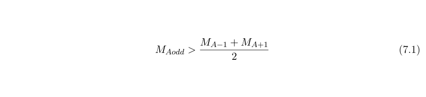

【未转写LaTeX；该裁图按式号定位，可能含邻近文字或需扩大边界，请以原PDF核定完整公式。】

本页其余原生块：标题、页眉、数学碎片、图中标签、表格与前/后置正文；完整保留，中文待译或不适用

**Source:** PDF97 P097B001; bbox [513.56, 46.25, 524.41, 57.16]

**Original:** 79

**中文:** 【待译/版式碎片未作独立语义解释；不得视为已完成双语正文。】

**Source:** PDF97 P097B002; bbox [99.21, 126.0, 195.95, 146.66]

**Original:** Chapter 7

**中文:** 【待译/版式碎片未作独立语义解释；不得视为已完成双语正文。】

**Source:** PDF97 P097B003; bbox [99.21, 190.82, 299.52, 215.61]

**Original:** BCS Calculations

**中文:** 【待译/版式碎片未作独立语义解释；不得视为已完成双语正文。】

**Source:** PDF97 P097B010; bbox [99.21, 394.21, 139.57, 405.12]

**Original:** gap [66].

**中文:** 【待译/版式碎片未作独立语义解释；不得视为已完成双语正文。】

**Source:** PDF97 P097B017; bbox [99.21, 546.91, 266.47, 557.81]

**Original:** in more detail later in this chapter.

**中文:** 【待译/版式碎片未作独立语义解释；不得视为已完成双语正文。】

**Source:** PDF97 P097B022; bbox [99.21, 655.98, 259.43, 666.89]

**Original:** of neighbouring nuclei [67, p.219]:

**中文:** 【待译/版式碎片未作独立语义解释；不得视为已完成双语正文。】

**Source:** PDF97 P097B023; bbox [253.31, 709.86, 368.61, 729.92]

**Original:** MAodd > MA−1 + MA+1

**中文:** 【待译/版式碎片未作独立语义解释；不得视为已完成双语正文。】

**Source:** PDF97 P097B024; bbox [331.47, 717.25, 524.41, 735.63]

**Original:** 2
(7.1)

**中文:** 【待译/版式碎片未作独立语义解释；不得视为已完成双语正文。】

## PDF 98 / 印刷p80

**Source:** PDF98 S0178; native P098B004

**Original:** As the mass of the odd-A nucleus increases, the ground state energy becomes higher,

**中文:** 【待译；保留原文，本块未完成中文翻译。】

**Source:** PDF98 S0179; native P098B006, P098B007

**Original:** The energy gap, ∆, is defined by the strength of the pairing force, denoted as G, and the probability for the kth Nilsson orbital being occupied or unoccupied, denoted as uk

**中文:** 【待译；保留原文，本块未完成中文翻译。】

### Figure 7.1
**Source:** PDF98 P098B003

【图/表图像尚未裁取，回看原PDF；不得将标签提取当作图像审读。】

**Original caption:** Figure 7.1: Low-lying levels in tin isotopes between A=115-121, taken from Ref [67, p.218].

**中文图注:** 【待译；图像状态见source_map。】

### Eq. (7.2) 原页区域回退
**Source:** PDF98 P098B011
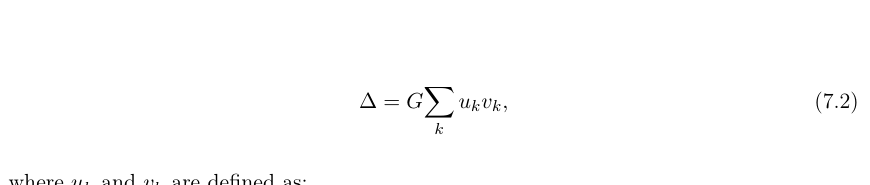

【未转写LaTeX；该裁图按式号定位，可能含邻近文字或需扩大边界，请以原PDF核定完整公式。】

### Eq. (7.3a) 原页区域回退
**Source:** PDF98 P098B016
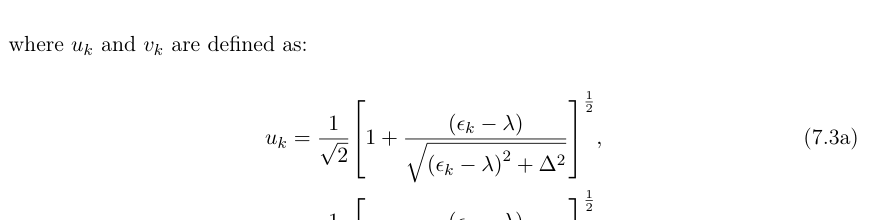

【未转写LaTeX；该裁图按式号定位，可能含邻近文字或需扩大边界，请以原PDF核定完整公式。】

### Eq. (7.3b) 原页区域回退
**Source:** PDF98 P098B024
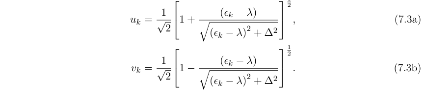

【未转写LaTeX；该裁图按式号定位，可能含邻近文字或需扩大边界，请以原PDF核定完整公式。】

本页其余原生块：标题、页眉、数学碎片、图中标签、表格与前/后置正文；完整保留，中文待译或不适用

**Source:** PDF98 P098B001; bbox [99.21, 46.25, 524.41, 57.16]

**Original:** Chapter 7. BCS Calculations
80

**中文:** 【待译/版式碎片未作独立语义解释；不得视为已完成双语正文。】

**Source:** PDF98 P098B002; bbox [99.21, 81.1, 524.41, 366.1]

**Original:** 【embedded image block；回看原PDF】

**中文:** 【待译/版式碎片未作独立语义解释；不得视为已完成双语正文。】

**Source:** PDF98 P098B005; bbox [99.21, 441.15, 256.89, 452.06]

**Original:** relative to its even-A neighbours.

**中文:** 【待译/版式碎片未作独立语义解释；不得视为已完成双语正文。】

**Source:** PDF98 P098B008; bbox [99.21, 506.58, 241.56, 518.62]

**Original:** and vk, defined by [67, p.232]:

**中文:** 【待译/版式碎片未作独立语义解释；不得视为已完成双语正文。】

**Source:** PDF98 P098B009; bbox [306.73, 565.33, 322.48, 576.24]

**Original:** X

**中文:** 【待译/版式碎片未作独立语义解释；不得视为已完成双语正文。】

**Source:** PDF98 P098B010; bbox [274.52, 567.85, 306.73, 578.76]

**Original:** ∆= G

**中文:** 【待译/版式碎片未作独立语义解释；不得视为已完成双语正文。】

**Source:** PDF98 P098B011; bbox [324.3, 567.85, 524.41, 579.9]

**Original:** ukvk,
(7.2)

**中文:** 【待译/版式碎片未作独立语义解释；不得视为已完成双语正文。】

**Source:** PDF98 P098B012; bbox [312.3, 583.5, 316.7, 591.47]

**Original:** k

**中文:** 【待译/版式碎片未作独立语义解释；不得视为已完成双语正文。】

**Source:** PDF98 P098B013; bbox [99.21, 608.45, 248.8, 621.15]

**Original:** where uk and vk are defined as:

**中文:** 【待译/版式碎片未作独立语义解释；不得视为已完成双语正文。】

**Source:** PDF98 P098B014; bbox [270.32, 641.1, 277.6, 652.01]

**Original:** 

**中文:** 【待译/版式碎片未作独立语义解释；不得视为已完成双语正文。】

**Source:** PDF98 P098B015; bbox [379.3, 641.1, 386.58, 652.01]

**Original:** 

**中文:** 【待译/版式碎片未作独立语义解释；不得视为已完成双语正文。】

**Source:** PDF98 P098B016; bbox [387.77, 636.57, 524.41, 666.11]

**Original:** 1
2
,
(7.3a)

**中文:** 【待译/版式碎片未作独立语义解释；不得视为已完成双语正文。】

**Source:** PDF98 P098B017; bbox [227.48, 647.81, 264.58, 667.87]

**Original:** uk =
1
√

**中文:** 【待译/版式碎片未作独立语义解释；不得视为已完成双语正文。】

**Source:** PDF98 P098B018; bbox [379.3, 660.74, 386.58, 671.65]

**Original:** 

**中文:** 【待译/版式碎片未作独立语义解释；不得视为已完成双语正文。】

**Source:** PDF98 P098B019; bbox [270.32, 647.67, 356.71, 673.61]

**Original:** 1 +
(ϵk −λ)
q

**中文:** 【待译/版式碎片未作独立语义解释；不得视为已完成双语正文。】

**Source:** PDF98 P098B020; bbox [263.67, 663.88, 269.13, 674.79]

**Original:** 2

**中文:** 【待译/版式碎片未作独立语义解释；不得视为已完成双语正文。】

**Source:** PDF98 P098B021; bbox [308.49, 663.42, 377.61, 681.0]

**Original:** (ϵk −λ)2 + ∆2

**中文:** 【待译/版式碎片未作独立语义解释；不得视为已完成双语正文。】

**Source:** PDF98 P098B022; bbox [270.32, 690.28, 277.6, 701.19]

**Original:** 

**中文:** 【待译/版式碎片未作独立语义解释；不得视为已完成双语正文。】

**Source:** PDF98 P098B023; bbox [379.3, 690.28, 386.58, 701.19]

**Original:** 

**中文:** 【待译/版式碎片未作独立语义解释；不得视为已完成双语正文。】

**Source:** PDF98 P098B024; bbox [387.77, 685.75, 524.4, 715.29]

**Original:** 1
2
.
(7.3b)

**中文:** 【待译/版式碎片未作独立语义解释；不得视为已完成双语正文。】

**Source:** PDF98 P098B025; bbox [228.43, 696.98, 264.58, 717.05]

**Original:** vk =
1
√

**中文:** 【待译/版式碎片未作独立语义解释；不得视为已完成双语正文。】

**Source:** PDF98 P098B026; bbox [379.3, 709.92, 386.58, 720.83]

**Original:** 

**中文:** 【待译/版式碎片未作独立语义解释；不得视为已完成双语正文。】

**Source:** PDF98 P098B027; bbox [270.32, 696.84, 356.71, 722.79]

**Original:** 1 −
(ϵk −λ)
q

**中文:** 【待译/版式碎片未作独立语义解释；不得视为已完成双语正文。】

**Source:** PDF98 P098B028; bbox [263.67, 713.06, 269.13, 723.97]

**Original:** 2

**中文:** 【待译/版式碎片未作独立语义解释；不得视为已完成双语正文。】

**Source:** PDF98 P098B029; bbox [308.49, 712.6, 377.61, 730.17]

**Original:** (ϵk −λ)2 + ∆2

**中文:** 【待译/版式碎片未作独立语义解释；不得视为已完成双语正文。】

## PDF 99 / 印刷p81

**Source:** PDF99 S0180; native P099B002

**Original:** and ϵk is the single-particle energy and λ is the Fermi surface, defined as the highest

**中文:** 【待译；保留原文，本块未完成中文翻译。】

**Source:** PDF99 S0181; native P099B004

**Original:** Common definitions for the pairing strength for protons (Gp) and neutrons (Gn) are [26,

**中文:** 【待译；保留原文，本块未完成中文翻译。】

**Source:** PDF99 S0182; native P099B010, P099B011, P099B012

**Original:** However, it has been highlighted in previous work [68] that varying the strength of the pairing force optimises the BCS calculation for the mass region of interest. Therefore, in this work Gp and Gn were chosen as [69]:

**中文:** 此前研究[68]指出，改变配对力强度可使BCS计算更适于所关心质量区。因此，本工作将Gp和Gn选为文献[69]所给形式：

**Source:** PDF99 S0183; native P099B019, P099B020, P099B021, P099B022, P099B023, P099B024, P099B025

**Original:** These pairing force strengths, taken from [69], were calculated for N=63, A∼100 nuclei. In these definitions it can be seen that Gp is only dependent on the mass number. Whereas Gn also depends on the neutron number (N) and the proton number (Z) of the nucleus. From Equation 7.3b it can be seen that as (ϵk −λ) << 0, vk →1. Whereas for Equation 7.3a, as (ϵk −λ) >> 0, uk →1. If there were no pairing the Fermi surface would sit at precisely the same energy of the last filled orbit. However, by introducing pairing the single-particle excitation energy (ϵk −λ) is replaced by a quasiparticle energy Ek, given by:

**中文:** 【待译；保留原文，本块未完成中文翻译。】

**Source:** PDF99 S0184; native P099B029, P099B030

**Original:** Changing from particles to quasiparticles provides a useful simplification. Only quasiparticle excitations close to the Fermi surface are considered in calculations, and all other states

**中文:** 【待译；保留原文，本块未完成中文翻译。】

### Eq. (7.4a) 原页区域回退
**Source:** PDF99 P099B007
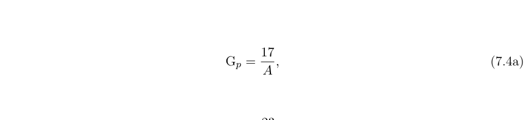

【未转写LaTeX；该裁图按式号定位，可能含邻近文字或需扩大边界，请以原PDF核定完整公式。】

### Eq. (7.4b) 原页区域回退
**Source:** PDF99 P099B009
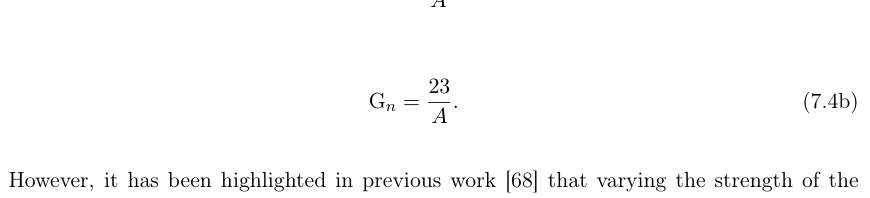

【未转写LaTeX；该裁图按式号定位，可能含邻近文字或需扩大边界，请以原PDF核定完整公式。】

### Eq. (7.5a) 原页区域回退
**Source:** PDF99 P099B013
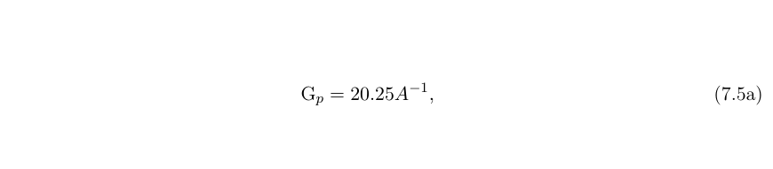

【未转写LaTeX；该裁图按式号定位，可能含邻近文字或需扩大边界，请以原PDF核定完整公式。】

### Eq. (7.5b) 原页区域回退
**Source:** PDF99 P099B016
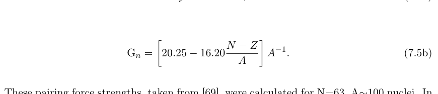

【未转写LaTeX；该裁图按式号定位，可能含邻近文字或需扩大边界，请以原PDF核定完整公式。】

### Eq. (7.6) 原页区域回退
**Source:** PDF99 P099B027
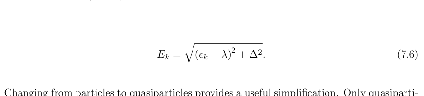

【未转写LaTeX；该裁图按式号定位，可能含邻近文字或需扩大边界，请以原PDF核定完整公式。】

本页其余原生块：标题、页眉、数学碎片、图中标签、表格与前/后置正文；完整保留，中文待译或不适用

**Source:** PDF99 P099B001; bbox [99.21, 46.25, 524.41, 57.16]

**Original:** Chapter 7. BCS Calculations
81

**中文:** 【待译/版式碎片未作独立语义解释；不得视为已完成双语正文。】

**Source:** PDF99 P099B003; bbox [99.21, 105.36, 207.65, 116.27]

**Original:** occupied nucleon level.

**中文:** 【待译/版式碎片未作独立语义解释；不得视为已完成双语正文。】

**Source:** PDF99 P099B005; bbox [99.21, 148.99, 130.53, 159.9]

**Original:** p.132],

**中文:** 【待译/版式碎片未作独立语义解释；不得视为已完成双语正文。】

**Source:** PDF99 P099B006; bbox [279.78, 202.87, 319.7, 222.8]

**Original:** Gp = 17

**中文:** 【待译/版式碎片未作独立语义解释；不得视为已完成双语正文。】

**Source:** PDF99 P099B007; bbox [310.15, 210.25, 524.41, 228.64]

**Original:** A ,
(7.4a)

**中文:** 【待译/版式碎片未作独立语义解释；不得视为已完成双语正文。】

**Source:** PDF99 P099B008; bbox [279.34, 261.05, 320.13, 280.97]

**Original:** Gn = 23

**中文:** 【待译/版式碎片未作独立语义解释；不得视为已完成双语正文。】

**Source:** PDF99 P099B009; bbox [310.59, 268.43, 524.4, 286.82]

**Original:** A .
(7.4b)

**中文:** 【待译/版式碎片未作独立语义解释；不得视为已完成双语正文。】

**Source:** PDF99 P099B013; bbox [264.25, 410.48, 524.41, 425.33]

**Original:** Gp = 20.25A−1,
(7.5a)

**中文:** 【待译/版式碎片未作独立语义解释；不得视为已完成双语正文。】

**Source:** PDF99 P099B014; bbox [352.49, 462.35, 358.25, 473.26]

**Original:** �

**中文:** 【待译/版式碎片未作独立语义解释；不得视为已完成双语正文。】

**Source:** PDF99 P099B015; bbox [249.79, 462.35, 255.55, 473.26]

**Original:** �

**中文:** 【待译/版式碎片未作独立语义解释；不得视为已完成双语正文。】

**Source:** PDF99 P099B016; bbox [360.06, 467.58, 524.4, 480.81]

**Original:** A−1.
(7.5b)

**中文:** 【待译/版式碎片未作独立语义解释；不得视为已完成双语正文。】

**Source:** PDF99 P099B017; bbox [221.1, 469.89, 246.77, 482.43]

**Original:** Gn =

**中文:** 【待译/版式碎片未作独立语义解释；不得视为已完成双语正文。】

**Source:** PDF99 P099B018; bbox [255.55, 462.37, 350.52, 488.28]

**Original:** 20.25 −16.20N −Z
A

**中文:** 【待译/版式碎片未作独立语义解释；不得视为已完成双语正文。】

**Source:** PDF99 P099B026; bbox [283.89, 695.23, 294.8, 706.13]

**Original:** q

**中文:** 【待译/版式碎片未作独立语义解释；不得视为已完成双语正文。】

**Source:** PDF99 P099B027; bbox [294.8, 696.48, 524.41, 714.05]

**Original:** (ϵk −λ)2 + ∆2.
(7.6)

**中文:** 【待译/版式碎片未作独立语义解释；不得视为已完成双语正文。】

**Source:** PDF99 P099B028; bbox [256.17, 701.5, 280.86, 714.19]

**Original:** Ek =

**中文:** 【待译/版式碎片未作独立语义解释；不得视为已完成双语正文。】

## PDF 100 / 印刷p82

**Source:** PDF100 S0185; native P100B002

**Original:** much lower in energy are defined as an inert core.

**中文:** 【待译；保留原文，本块未完成中文翻译。】

**Source:** PDF100 S0186; native P100B003

**Original:** 7.1 Calculating Quasiparticle Energies

**中文:** 【待译；保留原文，本块未完成中文翻译。】

**Source:** PDF100 S0187; native P100B004, P100B005

**Original:** The BCS calculations employed in this work, developed by Jain, et al. [68], calculate the single particle energies (ϵ) from the Nilsson Hamiltonian [67, p.70], given as:

**中文:** 【待译；保留原文，本块未完成中文翻译。】

**Source:** PDF100 S0188; native P100B012

**Original:** where m is the mass of the particles, l is the orbital angular momentum and s is the spin

**中文:** 【待译；保留原文，本块未完成中文翻译。】

**Source:** PDF100 S0189; native P100B016, P100B017, P100B018, P100B019

**Original:** C gives the strength of the spin-orbit force, which acts to separate orbits of the same angular momentum but opposite spin, whereas D gives the magnitude of the energy shift exhibited by orbits of the same angular momentum. κ and µ are constants that allow the correct energies to be calculated. In Equation 7.7 the z-axis was chosen as the symmetry

**中文:** 【待译；保留原文，本块未完成中文翻译。】

**Source:** PDF100 S0190; native P100B024

**Original:** oscillator. ω⊥and ωz are related to the quadrupole deformation parameter (ϵ2) by [24]:

**中文:** 【待译；保留原文，本块未完成中文翻译。】

**Source:** PDF100 S0191; native P100B028

**Original:** The quadrupole deformation parameter (ϵ2) is related to the hexadecapole deformation

**中文:** 【待译；保留原文，本块未完成中文翻译。】

### Eq. (7.7) 原页区域回退
**Source:** PDF100 P100B011
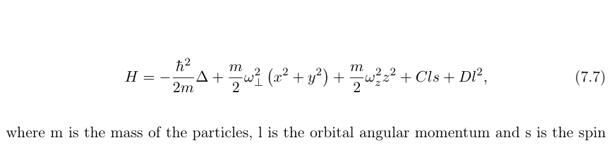

【未转写LaTeX；该裁图按式号定位，可能含邻近文字或需扩大边界，请以原PDF核定完整公式。】

### Eq. (7.8a) 原页区域回退
**Source:** PDF100 P100B014
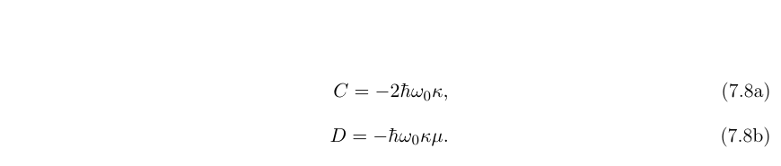

【未转写LaTeX；该裁图按式号定位，可能含邻近文字或需扩大边界，请以原PDF核定完整公式。】

### Eq. (7.8b) 原页区域回退
**Source:** PDF100 P100B015
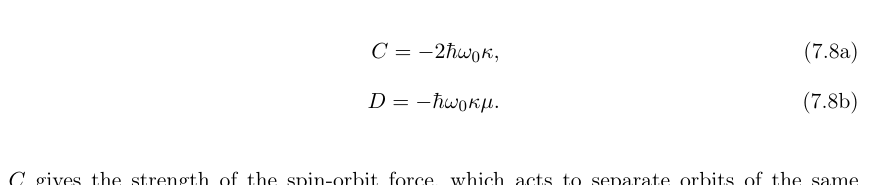

【未转写LaTeX；该裁图按式号定位，可能含邻近文字或需扩大边界，请以原PDF核定完整公式。】

### Eq. (7.9a) 原页区域回退
**Source:** PDF100 P100B025
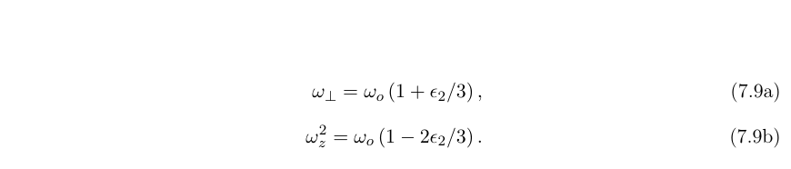

【未转写LaTeX；该裁图按式号定位，可能含邻近文字或需扩大边界，请以原PDF核定完整公式。】

### Eq. (7.9b) 原页区域回退
**Source:** PDF100 P100B027
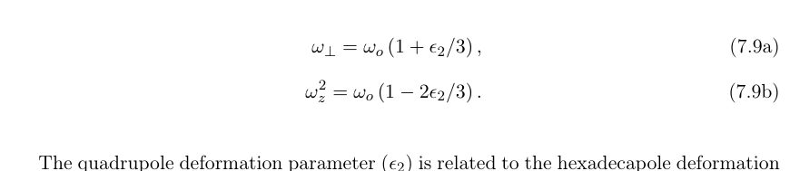

【未转写LaTeX；该裁图按式号定位，可能含邻近文字或需扩大边界，请以原PDF核定完整公式。】

### Eq. (7.10a) 原页区域回退
**Source:** PDF100 P100B031
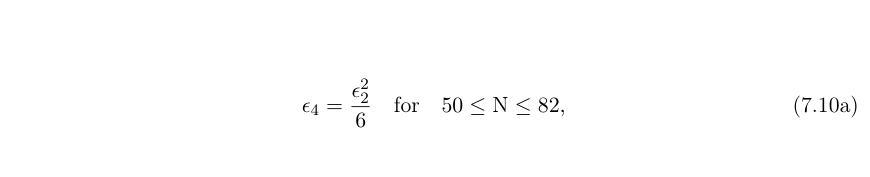

【未转写LaTeX；该裁图按式号定位，可能含邻近文字或需扩大边界，请以原PDF核定完整公式。】

本页其余原生块：标题、页眉、数学碎片、图中标签、表格与前/后置正文；完整保留，中文待译或不适用

**Source:** PDF100 P100B001; bbox [99.21, 46.25, 524.41, 57.16]

**Original:** Chapter 7. BCS Calculations
82

**中文:** 【待译/版式碎片未作独立语义解释；不得视为已完成双语正文。】

**Source:** PDF100 P100B006; bbox [283.72, 243.55, 288.72, 254.46]

**Original:** �

**中文:** 【待译/版式碎片未作独立语义解释；不得视为已完成双语正文。】

**Source:** PDF100 P100B007; bbox [183.23, 235.04, 229.93, 255.45]

**Original:** H = −¯h2

**中文:** 【待译/版式碎片未作独立语义解释；不得视为已完成双语正文。】

**Source:** PDF100 P100B008; bbox [288.72, 240.04, 328.49, 255.45]

**Original:** x2 + y2�

**中文:** 【待译/版式碎片未作独立语义解释；不得视为已完成双语正文。】

**Source:** PDF100 P100B009; bbox [330.92, 237.16, 352.6, 255.45]

**Original:** + m

**中文:** 【待译/版式碎片未作独立语义解释；不得视为已完成双语正文。】

**Source:** PDF100 P100B010; bbox [217.41, 237.16, 281.4, 262.94]

**Original:** 2m∆+ m
2 ω2
⊥

**中文:** 【待译/版式碎片未作独立语义解释；不得视为已完成双语正文。】

**Source:** PDF100 P100B011; bbox [345.09, 240.04, 524.41, 262.94]

**Original:** 2 ω2
zz2 + Cls + Dl2,
(7.7)

**中文:** 【待译/版式碎片未作独立语义解释；不得视为已完成双语正文。】

**Source:** PDF100 P100B013; bbox [99.21, 305.83, 194.68, 316.74]

**Original:** angular momentum.

**中文:** 【待译/版式碎片未作独立语义解释；不得视为已完成双语正文。】

**Source:** PDF100 P100B014; bbox [280.66, 366.95, 524.41, 378.99]

**Original:** C = −2¯hω0κ,
(7.8a)

**中文:** 【待译/版式碎片未作独立语义解释；不得视为已完成双语正文。】

**Source:** PDF100 P100B015; bbox [278.78, 391.75, 524.4, 403.8]

**Original:** D = −¯hω0κµ.
(7.8b)

**中文:** 【待译/版式碎片未作独立语义解释；不得视为已完成双语正文。】

**Source:** PDF100 P100B020; bbox [99.21, 516.94, 147.77, 529.53]

**Original:** axis, so ω2

**中文:** 【待译/版式碎片未作独立语义解释；不得视为已完成双语正文。】

**Source:** PDF100 P100B021; bbox [198.16, 518.61, 524.34, 531.57]

**Original:** y, where ωx ωy, and ωz are the frequencies of an anisotropic harmonic

**中文:** 【待译/版式碎片未作独立语义解释；不得视为已完成双语正文。】

**Source:** PDF100 P100B022; bbox [143.14, 516.94, 176.19, 532.09]

**Original:** ⊥= ω2

**中文:** 【待译/版式碎片未作独立语义解释；不得视为已完成双语正文。】

**Source:** PDF100 P100B023; bbox [171.56, 516.94, 202.79, 532.21]

**Original:** x = ω2

**中文:** 【待译/版式碎片未作独立语义解释；不得视为已完成双语正文。】

**Source:** PDF100 P100B025; bbox [266.65, 601.69, 524.41, 614.24]

**Original:** ω⊥= ωo (1 + ϵ2/3) ,
(7.9a)

**中文:** 【待译/版式碎片未作独立语义解释；不得视为已完成双语正文。】

**Source:** PDF100 P100B026; bbox [263.16, 624.29, 274.57, 637.4]

**Original:** ω2

**中文:** 【待译/版式碎片未作独立语义解释；不得视为已完成双语正文。】

**Source:** PDF100 P100B027; bbox [269.95, 626.35, 524.4, 640.1]

**Original:** z = ωo (1 −2ϵ2/3) .
(7.9b)

**中文:** 【待译/版式碎片未作独立语义解释；不得视为已完成双语正文。】

**Source:** PDF100 P100B029; bbox [99.21, 687.78, 185.97, 698.69]

**Original:** parameter by [24]:

**中文:** 【待译/版式碎片未作独立语义解释；不得视为已完成双语正文。】

**Source:** PDF100 P100B030; bbox [245.82, 740.0, 279.38, 761.59]

**Original:** ϵ4 = ϵ2

**中文:** 【待译/版式碎片未作独立语义解释；不得视为已完成双语正文。】

**Source:** PDF100 P100B031; bbox [272.58, 746.88, 524.4, 767.43]

**Original:** 2
6
for
50 ≤N ≤82,
(7.10a)

**中文:** 【待译/版式碎片未作独立语义解释；不得视为已完成双语正文。】

## PDF 101 / 印刷p83

**Source:** PDF101 S0192; native P101B003, P101B004, P101B005, P101B006, P101B007, P101B008, P101B009, P101B010, P101B011, P101B012, P101B013, P101B014, P101B015, P101B016

**Original:** To visualise how the single-particle states vary with deformation a Nilsson diagram for protons in the range 28 < Z < 50 and a Nilsson diagram for neutrons in the range 50 < N < 82 was produced. To achieve this input parameters for ϵ2 and ϵ4; the number of protons and neutrons; the nucleon core; and the pairing force for protons and neutrons (Equations 7.5a and 7.5b) were provided. Additionally, the optimisation of κ and µ was investigated. In Equations 7.8a and 7.8b C is related only to κ, whereas D is related to both κ and µ. Table 7.1 shows relationships between ∆κ, the spin-orbit term (l.s) and ∆E, as well as relationships between µ and ∆E. From this table it can be seen that the relationships vary depending on the angular momentum, l. The equations listed in Table 7.1 provide a way of predicting the change in energy of a state of a certain l-value as a result of changing κ or µ. Each of these equations was obtained by making changes independently to the κ and µ values read by the BCS code [68] and observing the effect on the energy of the orbitals. It was important to ensure both κ and µ were optimised for the A∼100 region to ensure the orbitals were correctly ordered in the Nilsson diagram.

**中文:** 【待译；保留原文，本块未完成中文翻译。】

### Table 7.1
**Source:** PDF101 P101B027

【图/表图像尚未裁取，回看原PDF；不得将标签提取当作图像审读。】

**Original caption:** Table 7.1: Relationships defining how the energy of an orbital changes when κ or µ is varied, for specific l-values.

**中文图注:** 【待译；图像状态见source_map。】

### Eq. (7.10b) 原页区域回退
**Source:** PDF101 P101B002
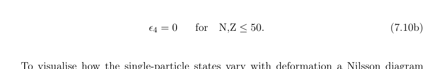

【未转写LaTeX；该裁图按式号定位，可能含邻近文字或需扩大边界，请以原PDF核定完整公式。】

本页其余原生块：标题、页眉、数学碎片、图中标签、表格与前/后置正文；完整保留，中文待译或不适用

**Source:** PDF101 P101B001; bbox [99.21, 46.25, 524.41, 57.16]

**Original:** Chapter 7. BCS Calculations
83

**中文:** 【待译/版式碎片未作独立语义解释；不得视为已完成双语正文。】

**Source:** PDF101 P101B002; bbox [245.82, 87.71, 524.4, 100.39]

**Original:** ϵ4 = 0
for
N,Z ≤50.
(7.10b)

**中文:** 【待译/版式碎片未作独立语义解释；不得视为已完成双语正文。】

**Source:** PDF101 P101B017; bbox [201.87, 498.72, 414.91, 518.18]

**Original:** l=1
∆E
=
[−28.75(l.s) + 37.08]∆κ

**中文:** 【待译/版式碎片未作独立语义解释；不得视为已完成双语正文。】

**Source:** PDF101 P101B018; bbox [243.76, 517.83, 336.93, 528.74]

**Original:** ∆E
=
4.29∆µ

**中文:** 【待译/版式碎片未作独立语义解释；不得视为已完成双语正文。】

**Source:** PDF101 P101B019; bbox [201.87, 542.14, 414.91, 561.6]

**Original:** l=2
∆E
=
[−23.95(l.s) + 41.70]∆κ

**中文:** 【待译/版式碎片未作独立语义解释；不得视为已完成双语正文。】

**Source:** PDF101 P101B020; bbox [243.76, 561.25, 336.93, 572.15]

**Original:** ∆E
=
4.91∆µ

**中文:** 【待译/版式碎片未作独立语义解释；不得视为已完成双语正文。】

**Source:** PDF101 P101B021; bbox [201.87, 585.55, 413.08, 605.01]

**Original:** l=3
∆E
=
[−22.37(l.s) −9.05]∆κ

**中文:** 【待译/版式碎片未作独立语义解释；不得视为已完成双语正文。】

**Source:** PDF101 P101B022; bbox [243.76, 604.52, 345.41, 615.57]

**Original:** ∆E
=
−1.84∆µ

**中文:** 【待译/版式碎片未作独立语义解释；不得视为已完成双语正文。】

**Source:** PDF101 P101B023; bbox [201.87, 628.96, 414.91, 648.43]

**Original:** l=4
∆E
=
[−21.56(l.s) −22.88]∆κ

**中文:** 【待译/版式碎片未作独立语义解释；不得视为已完成双语正文。】

**Source:** PDF101 P101B024; bbox [243.76, 647.93, 345.41, 658.98]

**Original:** ∆E
=
−3.67∆µ

**中文:** 【待译/版式碎片未作独立语义解释；不得视为已完成双语正文。】

**Source:** PDF101 P101B025; bbox [201.87, 672.38, 414.91, 691.84]

**Original:** l=5
∆E
=
[−21.09(l.s) −41.33]∆κ

**中文:** 【待译/版式碎片未作独立语义解释；不得视为已完成双语正文。】

**Source:** PDF101 P101B026; bbox [243.76, 691.35, 345.41, 702.4]

**Original:** ∆E
=
−6.13∆µ

**中文:** 【待译/版式碎片未作独立语义解释；不得视为已完成双语正文。】

## PDF 102 / 印刷p84

### Figure 7.2
**Source:** PDF102 P102B026

【图/表图像尚未裁取，回看原PDF；不得将标签提取当作图像审读。】

**Original caption:** Figure 7.2: Single particle energies calculated for 101Y for protons 28<Z<50 ϵ4 = ϵ22/6, where λ represents the Fermi surface.

**中文图注:** 【待译；图像状态见source_map。】

本页其余原生块：标题、页眉、数学碎片、图中标签、表格与前/后置正文；完整保留，中文待译或不适用

**Source:** PDF102 P102B001; bbox [99.21, 46.25, 524.41, 57.16]

**Original:** Chapter 7. BCS Calculations
84

**中文:** 【待译/版式碎片未作独立语义解释；不得视为已完成双语正文。】

**Source:** PDF102 P102B002; bbox [190.05, 144.39, 201.0, 157.92]

**Original:** 50

**中文:** 【待译/版式碎片未作独立语义解释；不得视为已完成双语正文。】

**Source:** PDF102 P102B003; bbox [398.89, 148.92, 431.03, 176.79]

**Original:** 9/2[404]

**中文:** 【待译/版式碎片未作独立语义解释；不得视为已完成双语正文。】

**Source:** PDF102 P102B004; bbox [138.51, 179.77, 155.61, 196.68]

**Original:** 5.0

**中文:** 【待译/版式碎片未作独立语义解释；不得视为已完成双语正文。】

**Source:** PDF102 P102B005; bbox [354.64, 254.82, 387.71, 273.83]

**Original:** 7/2[413]

**中文:** 【待译/版式碎片未作独立语义解释；不得视为已完成双语正文。】

**Source:** PDF102 P102B006; bbox [424.85, 275.85, 457.95, 300.52]

**Original:** 5/2[303]

**中文:** 【待译/版式碎片未作独立语义解释；不得视为已完成双语正文。】

**Source:** PDF102 P102B007; bbox [372.12, 277.69, 405.22, 302.37]

**Original:** 1/2[301]

**中文:** 【待译/版式碎片未作独立语义解释；不得视为已完成双语正文。】

**Source:** PDF102 P102B008; bbox [170.23, 295.23, 192.66, 307.57]

**Original:** 1g9/2

**中文:** 【待译/版式碎片未作独立语义解释；不得视为已完成双语正文。】

**Source:** PDF102 P102B009; bbox [267.41, 302.1, 299.45, 316.6]

**Original:** 5/2[422]

**中文:** 【待译/版式碎片未作独立语义解释；不得视为已完成双语正文。】

**Source:** PDF102 P102B010; bbox [460.04, 298.53, 493.0, 323.97]

**Original:** 3/2[301]

**中文:** 【待译/版式碎片未作独立语义解释；不得视为已完成双语正文。】

**Source:** PDF102 P102B011; bbox [104.52, 302.93, 131.81, 353.9]

**Original:** Es.p. (-hω)

**中文:** 【待译/版式碎片未作独立语义解释；不得视为已完成双语正文。】

**Source:** PDF102 P102B012; bbox [186.33, 345.09, 192.41, 359.52]

**Original:** λ

**中文:** 【待译/版式碎片未作独立语义解释；不得视为已完成双语正文。】

**Source:** PDF102 P102B013; bbox [170.23, 354.76, 192.66, 367.1]

**Original:** 2p1/2

**中文:** 【待译/版式碎片未作独立语义解释；不得视为已完成双语正文。】

**Source:** PDF102 P102B014; bbox [138.51, 365.78, 155.61, 382.68]

**Original:** 4.5

**中文:** 【待译/版式碎片未作独立语义解释；不得视为已完成双语正文。】

**Source:** PDF102 P102B015; bbox [416.34, 363.79, 449.62, 385.12]

**Original:** 3/2[431]

**中文:** 【待译/版式碎片未作独立语义解释；不得视为已完成双语正文。】

**Source:** PDF102 P102B016; bbox [171.6, 380.79, 191.3, 393.13]

**Original:** 1f5/2

**中文:** 【待译/版式碎片未作独立语义解释；不得视为已完成双语正文。】

**Source:** PDF102 P102B017; bbox [381.29, 373.51, 414.45, 397.79]

**Original:** 1/2[440]

**中文:** 【待译/版式碎片未作独立语义解释；不得视为已完成双语正文。】

**Source:** PDF102 P102B018; bbox [355.14, 406.0, 387.33, 421.02]

**Original:** 3/2[312]

**中文:** 【待译/版式碎片未作独立语义解释；不得视为已完成双语正文。】

**Source:** PDF102 P102B019; bbox [399.58, 425.92, 430.91, 438.29]

**Original:** 1/2[310]

**中文:** 【待译/版式碎片未作独立语义解释；不得视为已完成双语正文。】

**Source:** PDF102 P102B020; bbox [170.23, 445.9, 192.66, 458.24]

**Original:** 2p3/2

**中文:** 【待译/版式碎片未作独立语义解释；不得视为已完成双语正文。】

**Source:** PDF102 P102B021; bbox [398.75, 499.38, 432.04, 521.14]

**Original:** 1/2[321]

**中文:** 【待译/版式碎片未作独立语义解释；不得视为已完成双语正文。】

**Source:** PDF102 P102B022; bbox [190.05, 516.42, 201.0, 529.94]

**Original:** 28

**中文:** 【待译/版式碎片未作独立语义解释；不得视为已完成双语正文。】

**Source:** PDF102 P102B023; bbox [138.51, 551.8, 155.61, 568.71]

**Original:** 4.0

**中文:** 【待译/版式碎片未作独立语义解释；不得视为已完成双语正文。】

**Source:** PDF102 P102B024; bbox [190.39, 564.1, 516.81, 581.01]

**Original:** 0
 0.05
 0.1
 0.15
 0.2
 0.25
 0.3
 0.35

**中文:** 【待译/版式碎片未作独立语义解释；不得视为已完成双语正文。】

**Source:** PDF102 P102B025; bbox [327.61, 582.13, 338.49, 601.19]

**Original:** ε2

**中文:** 【待译/版式碎片未作独立语义解释；不得视为已完成双语正文。】

## PDF 103 / 印刷p85

### Figure 7.3
**Source:** PDF103 P103B029

【图/表图像尚未裁取，回看原PDF；不得将标签提取当作图像审读。】

**Original caption:** Figure 7.3: Single particle energies calculated for 101Sr for neutrons 50<N<82 ϵ4 = ϵ22/6, where λ respresents the Fermi surface.

**中文图注:** 【待译；图像状态见source_map。】

本页其余原生块：标题、页眉、数学碎片、图中标签、表格与前/后置正文；完整保留，中文待译或不适用

**Source:** PDF103 P103B001; bbox [99.21, 46.25, 524.41, 57.16]

**Original:** Chapter 7. BCS Calculations
85

**中文:** 【待译/版式碎片未作独立语义解释；不得视为已完成双语正文。】

**Source:** PDF103 P103B002; bbox [266.63, 116.88, 299.46, 151.48]

**Original:** 11/2[505]

**中文:** 【待译/版式碎片未作独立语义解释；不得视为已完成双语正文。】

**Source:** PDF103 P103B003; bbox [329.41, 123.16, 359.79, 153.53]

**Original:** 3/2[402]

**中文:** 【待译/版式碎片未作独立语义解释；不得视为已完成双语正文。】

**Source:** PDF103 P103B004; bbox [399.6, 132.57, 430.21, 162.71]

**Original:** 7/2[404]

**中文:** 【待译/版式碎片未作独立语义解释；不得视为已完成双语正文。】

**Source:** PDF103 P103B005; bbox [443.78, 164.43, 473.91, 195.04]

**Original:** 5/2[402]

**中文:** 【待译/版式碎片未作独立语义解释；不得视为已完成双语正文。】

**Source:** PDF103 P103B006; bbox [329.2, 165.25, 360.03, 195.13]

**Original:** 1/2[400]

**中文:** 【待译/版式碎片未作独立语义解释；不得视为已完成双语正文。】

**Source:** PDF103 P103B007; bbox [138.51, 179.77, 155.61, 196.68]

**Original:** 6.5

**中文:** 【待译/版式碎片未作独立语义解释；不得视为已完成双语正文。】

**Source:** PDF103 P103B008; bbox [240.25, 180.99, 273.41, 205.27]

**Original:** 9/2[514]

**中文:** 【待译/版式碎片未作独立语义解释；不得视为已完成双语正文。】

**Source:** PDF103 P103B009; bbox [293.9, 213.79, 325.6, 227.24]

**Original:** 7/2[523]

**中文:** 【待译/版式碎片未作独立语义解释；不得视为已完成双语正文。】

**Source:** PDF103 P103B010; bbox [167.16, 220.82, 193.97, 233.16]

**Original:** 1h11/2

**中文:** 【待译/版式碎片未作独立语义解释；不得视为已完成双语正文。】

**Source:** PDF103 P103B011; bbox [171.12, 239.43, 193.55, 251.77]

**Original:** 1d3/2

**中文:** 【待译/版式碎片未作独立语义解释；不得视为已完成双语正文。】

**Source:** PDF103 P103B012; bbox [442.46, 255.19, 475.64, 275.15]

**Original:** 1/2[411]

**中文:** 【待译/版式碎片未作独立语义解释；不得视为已完成双语正文。】

**Source:** PDF103 P103B013; bbox [310.85, 256.85, 344.13, 278.18]

**Original:** 5/2[532]

**中文:** 【待译/版式碎片未作独立语义解释；不得视为已完成双语正文。】

**Source:** PDF103 P103B014; bbox [171.39, 276.63, 193.28, 288.97]

**Original:** 3s1/2

**中文:** 【待译/版式碎片未作独立语义解释；不得视为已完成双语正文。】

**Source:** PDF103 P103B015; bbox [187.19, 309.29, 193.27, 323.71]

**Original:** λ

**中文:** 【待译/版式碎片未作独立语义解释；不得视为已完成双语正文。】

**Source:** PDF103 P103B016; bbox [171.12, 330.1, 193.55, 342.44]

**Original:** 1g7/2

**中文:** 【待译/版式碎片未作独立语义解释；不得视为已完成双语正文。】

**Source:** PDF103 P103B017; bbox [104.52, 302.93, 131.81, 353.9]

**Original:** Es.p. (-hω)

**中文:** 【待译/版式碎片未作独立语义解释；不得视为已完成双语正文。】

**Source:** PDF103 P103B018; bbox [293.1, 336.02, 325.97, 361.83]

**Original:** 5/2[413]

**中文:** 【待译/版式碎片未作独立语义解释；不得视为已完成双语正文。】

**Source:** PDF103 P103B019; bbox [311.36, 356.97, 343.4, 371.47]

**Original:** 3/2[411]

**中文:** 【待译/版式碎片未作独立语义解释；不得视为已完成双语正文。】

**Source:** PDF103 P103B020; bbox [443.31, 376.1, 475.59, 403.64]

**Original:** 3/2[541]

**中文:** 【待译/版式碎片未作独立语义解释；不得视为已完成双语正文。】

**Source:** PDF103 P103B021; bbox [138.51, 412.28, 155.61, 429.19]

**Original:** 6.0

**中文:** 【待译/版式碎片未作独立语义解释；不得视为已完成双语正文。】

**Source:** PDF103 P103B022; bbox [302.94, 402.14, 334.75, 430.63]

**Original:** 1/2[420]

**中文:** 【待译/版式碎片未作独立语义解释；不得视为已完成双语正文。】

**Source:** PDF103 P103B023; bbox [171.12, 418.46, 193.55, 430.8]

**Original:** 2d5/2

**中文:** 【待译/版式碎片未作独立语义解释；不得视为已完成双语正文。】

**Source:** PDF103 P103B024; bbox [443.97, 417.89, 475.02, 447.51]

**Original:** 1/2[550]

**中文:** 【待译/版式碎片未作独立语义解释；不得视为已完成双语正文。】

**Source:** PDF103 P103B025; bbox [381.5, 436.17, 413.97, 452.22]

**Original:** 3/2[422]

**中文:** 【待译/版式碎片未作独立语义解释；不得视为已完成双语正文。】

**Source:** PDF103 P103B026; bbox [302.94, 481.2, 334.75, 509.69]

**Original:** 1/2[431]

**中文:** 【待译/版式碎片未作独立语义解释；不得视为已完成双语正文。】

**Source:** PDF103 P103B027; bbox [190.39, 564.1, 516.81, 581.01]

**Original:** 0
 0.05
 0.1
 0.15
 0.2
 0.25
 0.3
 0.35

**中文:** 【待译/版式碎片未作独立语义解释；不得视为已完成双语正文。】

**Source:** PDF103 P103B028; bbox [327.61, 582.13, 338.49, 601.19]

**Original:** ε2

**中文:** 【待译/版式碎片未作独立语义解释；不得视为已完成双语正文。】

## PDF 104 / 印刷p86

**Source:** PDF104 S0193; native P104B002, P104B003, P104B004, P104B005, P104B006, P104B007, P104B008, P104B009, P104B010, P104B011, P104B012, P104B013, P104B014, P104B015, P104B016, P104B017, P104B018, P104B019, P104B020, P104B021

**Original:** In Figures 7.2 and 7.3 the red line, labelled with λ indicates the energy of the Fermi surface as a function of deformation. The Nilsson orbitals are labelled as Kπ [N nz Λ]. N is the principal quantum number of the major shell, nz defines the number of nodes in the wave function in the z-direction, and Λ is the component of the orbital angular momentum along the z-axis. The Nilsson diagrams presented in Figures 7.2 and 7.3 show only prolate deformation, as previous work suggests 102Y is more likely to have prolate deformation [70] than oblate deformation, or to be spherical. In the work by J. Skalski, et al. [70], the shapes of nuclei in the region Z ∼40, N > 56 were calculated using the Nilsson-Strutinsky method with the cranked Woods-Saxon average potential and a monopole pairing residual interaction. These calculations looked at the oblate-prolate energy difference, defined as ∆Eop = Eo −Ep, where Eo is the lowest energy for negative β2 and Ep is the lowest energy with zero or positive β2, which is related to ϵ2 by Equation 7.11. Negative values of ∆Eop indicate an oblate deformation (ϵ2 < 0), whereas positive values of ∆Eop indicate a prolate deformation (ϵ2 > 0). In the work by J. Skalski [70], et al., calculations were only performed for even-even nuclei. Therefore, to predict the deformation of 102Y, an odd-odd nucleus (N=63, Z=39), a comparison was made between neighbouring even-even nuclei, namely 100Sr (N=62, Z=38), 102Sr (N=64, Z=38), 102Zr (N=62, Z=40), and 104Zr (N=64, Z=40). All neighbouring even-even nuclei were predicted by J. Skalski [70], et al., to have prolate deformation, with β2 = 0.35, 0.36, 0.36 and 0.37 respectively, leading to the conclusion that 102Y is likely to also have a prolate deformation.

**中文:** 图7.2和7.3中标为λ的红线表示Fermi能随形变的变化。Nilsson轨道记为Kπ[N nz Λ]；N为主壳量子数，nz为波函数沿z方向的节点数，Λ为轨道角动量在z轴上的分量。两图只给prolate形变，因为此前工作[70]提示102Y更可能是prolate，而非oblate或球形。Skalski等[70]用Nilsson–Strutinsky方法、推转Woods–Saxon平均势和单极配对残余相互作用，计算Z∼40、N>56核的形状。其oblate–prolate能差定义为ΔEop=Eo−Ep，Eo为负β2最低能量，Ep为零或正β2最低能量；β2与ε2的关系见式7.11。负ΔEop表示oblate，正值表示prolate。该研究只计算偶偶核，因此对odd–odd的102Y（N=63、Z=39），本工作比较相邻偶偶100Sr、102Sr、102Zr及104Zr。这些邻核均被Skalski等预测为prolate，β2依次为0.35、0.36、0.36、0.37，因此推断102Y也可能呈prolate形变。

**Source:** PDF104 S0194; native P104B022, P104B023, P104B024, P104B025, P104B026, P104B027, P104B028, P104B029

**Original:** On the prolate side of the Nilsson diagram the lowest-lying orbit from each spherical single-particle orbit has the highest nz value, where the maximum value of nz is N. This can be seen in the Nilsson diagram presented in Figure 2.7, in Chapter 2. Furthermore, the sum of nz and Λ must be even if N is even, indicating even parity, and their sum must be odd if N is odd, indicating odd parity. In the Nilsson diagrams presented in Figures 7.2 and 7.3 an even parity orbital is indicated using a solid line, whereas an odd parity orbital is indicated using a dashed line. On the y-axis of the Nilsson diagram, the single particle energies are presented in units of ¯hω, calculated using [30]:

**中文:** 【待译；保留原文，本块未完成中文翻译。】

### Eq. (7.11) 原页区域回退
**Source:** PDF104 P104B031
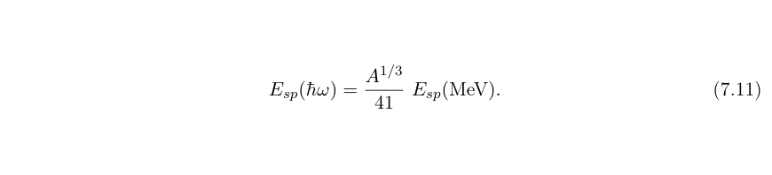

【未转写LaTeX；该裁图按式号定位，可能含邻近文字或需扩大边界，请以原PDF核定完整公式。】

本页其余原生块：标题、页眉、数学碎片、图中标签、表格与前/后置正文；完整保留，中文待译或不适用

**Source:** PDF104 P104B001; bbox [99.21, 46.25, 524.41, 57.16]

**Original:** Chapter 7. BCS Calculations
86

**中文:** 【待译/版式碎片未作独立语义解释；不得视为已完成双语正文。】

**Source:** PDF104 P104B030; bbox [246.39, 724.75, 321.69, 745.7]

**Original:** Esp(¯hω) = A1/3

**中文:** 【待译/版式碎片未作独立语义解释；不得视为已完成双语正文。】

**Source:** PDF104 P104B031; bbox [306.05, 733.79, 524.41, 752.18]

**Original:** 41
Esp(MeV).
(7.11)

**中文:** 【待译/版式碎片未作独立语义解释；不得视为已完成双语正文。】

## PDF 105 / 印刷p87

**Source:** PDF105 S0195; native P105B002, P105B003, P105B004, P105B005, P105B006, P105B007, P105B008, P105B009, P105B010, P105B011, P105B012

**Original:** To produce the Nilsson diagrams presented in Figures 7.2 and 7.3 values for κ and µ were obtained from previous calculations by T. Bengtsson and I. Ragnarsson [71]. These calculations were performed within the cranked Nilsson-Strutinsky framework to predict the high-spin states of nuclei. In the work by T. Bengtsson and I. Ragnarsson the values of κ and µ used in calculations for various values of N, the principal quantum number, were stated. For this work N=4 was most appropriate, considering the position of the Fermi surface. For N=4, T. Bengtsson and I. Ragnarsson used the values κ = 0.065 and µ = 0.57, for protons, and κ = 0.07 and µ = 0.39 for neutrons. However, the BCS calculations performed in this work did not converge when using µ = 0.57 for protons, and this parameter was lowered to µ = 0.32. This resulted in a downward shift of orbitals by ≈0.05 ¯hω, which does not affect the ordering of the levels in the Nilsson diagram.

**中文:** 图7.2和7.3采用Bengtsson及Ragnarsson[71]此前计算的κ、μ值。那些计算在推转Nilsson–Strutinsky框架下预测高自旋态，并给出不同主量子数N所用的参数。考虑Fermi能位置，本工作采用N=4最合适。文献对N=4的质子取κ=0.065、μ=0.57，中子取κ=0.07、μ=0.39。然而本工作在质子μ=0.57时BCS不收敛，因此将其降至0.32。这使轨道整体约下降0.05ħω，但未改变Nilsson图的能级排序。

**Source:** PDF105 S0196; native P105B014, P105B015, P105B016, P105B017, P105B018, P105B019

**Original:** From the single particle energies, quasiparticle energies were calculated in the BCS code using Equation 7.6. However, some of these quasiparticle states may already be occupied. According to Pauli’s exclusion principle, which states that two or more identical fermions cannot occupy the same state simultaneously [72], these occupied states need to be blocked from further calculations. The inclusion of blocking is highly important in reproducing the correct energy spectrum. This blocking effect leads to a reduction in the pair gap, and so

**中文:** BCS代码由单粒子能按式7.6计算准粒子能。然而某些准粒子态可能已被占据；依据Pauli不相容原理，相同费米子不能同时占据同一状态[72]，因此后续计算须阻塞这些已占据态。阻塞对重现正确能谱很重要，会降低配对能隙，于是式7.2改为以下形式[67,p238]：

**Source:** PDF105 S0197; native P105B025, P105B026, P105B027, P105B028, P105B029, P105B030, P105B031

**Original:** The implementation of blocking and the correct assignment of κ and µ provide the correct ordering of states. However, in order to obtain more reliable assignments for the energy of the states a further correction to the quasiparticle energies was required. In order to identify this correction factor for 102Y, initial calculations were performed for the odd-Z nucleus 101Y [73], and odd-N nuclei 101Sr [74] and 103Zr [75]. 103Y was not included in these calculations as very little is currently known about the structure of this nucleus. For this initial calculation the input parameters ϵ2 = 0.3 [70], κ = 0.065 and µ = 0.32, for

**中文:** 加入阻塞并恰当选择κ、μ可得到正确能级排序，但要获得更可靠的态能量，还需要修正准粒子能。为确定102Y的修正，本工作先计算odd-Z核101Y[73]及odd-N核101Sr[74]和103Zr[75]。由于103Y结构所知很少，没有把它纳入。初次计算取ε2=0.3[70]，质子κ=0.065、μ=0.32，

### Eq. (7.12) 原页区域回退
**Source:** PDF105 P105B023
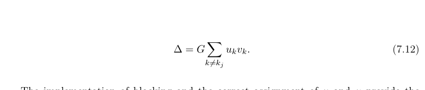

【未转写LaTeX；该裁图按式号定位，可能含邻近文字或需扩大边界，请以原PDF核定完整公式。】

本页其余原生块：标题、页眉、数学碎片、图中标签、表格与前/后置正文；完整保留，中文待译或不适用

**Source:** PDF105 P105B001; bbox [99.21, 46.25, 524.41, 57.16]

**Original:** Chapter 7. BCS Calculations
87

**中文:** 【待译/版式碎片未作独立语义解释；不得视为已完成双语正文。】

**Source:** PDF105 P105B013; bbox [99.21, 344.31, 281.07, 358.66]

**Original:** 7.2
Blocking calculations

**中文:** 【待译/版式碎片未作独立语义解释；不得视为已完成双语正文。】

**Source:** PDF105 P105B020; bbox [99.21, 510.5, 268.09, 521.41]

**Original:** Equation 7.2 changes to [p.238][67],

**中文:** 【待译/版式碎片未作独立语义解释；不得视为已完成双语正文。】

**Source:** PDF105 P105B021; bbox [306.73, 569.24, 322.48, 580.15]

**Original:** X

**中文:** 【待译/版式碎片未作独立语义解释；不得视为已完成双语正文。】

**Source:** PDF105 P105B022; bbox [272.63, 571.76, 304.84, 582.67]

**Original:** ∆= G

**中文:** 【待译/版式碎片未作独立语义解释；不得视为已完成双语正文。】

**Source:** PDF105 P105B023; bbox [326.19, 571.76, 524.41, 583.8]

**Original:** ukvk.
(7.12)

**中文:** 【待译/版式碎片未作独立语义解释；不得视为已完成双语正文。】

**Source:** PDF105 P105B024; bbox [304.85, 587.3, 323.53, 596.16]

**Original:** k̸=kj

**中文:** 【待译/版式碎片未作独立语义解释；不得视为已完成双语正文。】

## PDF 106 / 印刷p88

**Source:** PDF106 S0198; native P106B002, P106B003, P106B004

**Original:** protons, and κ = 0.07 and µ = 0.39 for neutrons [71] were used. The energy calculated using these parameters for the low-lying excited states in 101Y, 101Sr, and 103Zr is presented in Table 7.2, under 1st calculation, and compared with literature values for each of these

**中文:** 【待译；保留原文，本块未完成中文翻译。】

**Source:** PDF106 S0199; native P106B018, P106B019, P106B020, P106B021, P106B022, P106B023, P106B024

**Original:** It can be seen from Table 7.2 that the BCS calculation has produced the correct ordering for the known Nilsson orbitals for each nucleus. However, the energies are quite different from the measured values. To improve the agreement between the calculated energies and the measured values modifications were made to the quasiparticle energies, as shown in Table 7.3. In Table 7.2 the column labelled 2nd calculation shows the energies calculated using the blocked BCS calculations after implementing the changes to the quasiparticle energies, ϵ2, κ, and µ were kept the same as in the 1st calculation.

**中文:** 表7.2显示BCS已对各核已知Nilsson轨道给出正确排序，但计算能量与测量能量差别很大。为改善符合，对准粒子能作了表7.3所列修改。表7.2的第二次计算列为施加准粒子能修改后的blocked BCS结果，ε2、κ、μ仍与第一次计算相同。

### Table 7.2
**Source:** PDF106 P106B017

【图/表图像尚未裁取，回看原PDF；不得将标签提取当作图像审读。】

**Original caption:** Table 7.2: A comparison between calculated and literature values for the energies of the low-lying excited states in the neighbouring isotopes and isotones of 102Y.

**中文图注:** 【待译；图像状态见source_map。】

本页其余原生块：标题、页眉、数学碎片、图中标签、表格与前/后置正文；完整保留，中文待译或不适用

**Source:** PDF106 P106B001; bbox [99.21, 46.25, 524.41, 57.16]

**Original:** Chapter 7. BCS Calculations
88

**中文:** 【待译/版式碎片未作独立语义解释；不得视为已完成双语正文。】

**Source:** PDF106 P106B005; bbox [99.21, 148.99, 197.09, 159.9]

**Original:** nuclei [73], [74], [75].

**中文:** 【待译/版式碎片未作独立语义解释；不得视为已完成双语正文。】

**Source:** PDF106 P106B006; bbox [159.13, 180.88, 513.15, 200.19]

**Original:** Nilsson Orbital
Literature
1st Calculation
2nd Calculation

**中文:** 【待译/版式碎片未作独立语义解释；不得视为已完成双语正文。】

**Source:** PDF106 P106B007; bbox [255.17, 199.85, 507.11, 210.76]

**Original:** Energy (keV)
Energy (keV)
Energy (keV)

**中文:** 【待译/版式碎片未作独立语义解释；不得视为已完成双语正文。】

**Source:** PDF106 P106B008; bbox [112.53, 222.62, 478.3, 235.2]

**Original:** 101Y
5/2+[422]
0
0
0

**中文:** 【待译/版式碎片未作独立语义解释；不得视为已完成双语正文。】

**Source:** PDF106 P106B009; bbox [172.26, 241.48, 490.72, 254.16]

**Original:** 3/2−[301]
510.75(5)
351(2)
509(4)

**中文:** 【待译/版式碎片未作独立语义解释；不得视为已完成双语正文。】

**Source:** PDF106 P106B010; bbox [172.26, 260.45, 490.72, 273.13]

**Original:** 5/2−[303]
666.61(7)
1601(5)
667(4)

**中文:** 【待译/版式碎片未作独立语义解释；不得视为已完成双语正文。】

**Source:** PDF106 P106B011; bbox [172.26, 279.42, 490.72, 292.09]

**Original:** 1/2−[301]
890.64(10)
1903(8)
889(6)

**中文:** 【待译/版式碎片未作独立语义解释；不得视为已完成双语正文。】

**Source:** PDF106 P106B012; bbox [111.47, 303.87, 478.3, 316.55]

**Original:** 101Sr
5/2−[532]
0
0
0

**中文:** 【待译/版式碎片未作独立语义解释；不得视为已完成双语正文。】

**Source:** PDF106 P106B013; bbox [172.26, 322.94, 490.72, 335.51]

**Original:** 3/2+[411]
271.1(7)
97(2)
270(3)

**中文:** 【待译/版式碎片未作独立语义解释；不得视为已完成双语正文。】

**Source:** PDF106 P106B014; bbox [172.26, 341.91, 490.72, 354.48]

**Original:** 1/2+[411]
363.9(13)
1234(8)
364(4)

**中文:** 【待译/版式碎片未作独立语义解释；不得视为已完成双语正文。】

**Source:** PDF106 P106B015; bbox [111.17, 366.25, 478.3, 378.94]

**Original:** 103Zr
5/2−[532]
0
0
0

**中文:** 【待译/版式碎片未作独立语义解释；不得视为已完成双语正文。】

**Source:** PDF106 P106B016; bbox [172.26, 385.32, 490.72, 397.89]

**Original:** 3/2+[411]
258.9(3)
91(2)
250(3)

**中文:** 【待译/版式碎片未作独立语义解释；不得视为已完成双语正文。】

## PDF 107 / 印刷p89

**Source:** PDF107 S0200; native P107B010, P107B011, P107B012

**Original:** Using the input parameters ϵ2 = 0.3 [70], κ = 0.065 and µ = 0.32, for protons, and κ = 0.07 and µ = 0.39 for neutrons [71], as well as modifying the quasiparticle energies as per Table 7.3 calculations were performed for 102Y. The results of this calculation are

**中文:** 采用ε2=0.3[70]、质子κ=0.065和μ=0.32、中子κ=0.07和μ=0.39[71]，并按表7.3修改准粒子能，计算了102Y。结果见表7.4。

**Source:** PDF107 S0201; native P107B014

**Original:** Possible States Neutron State Proton State Energy (keV) Lower Energy State

**中文:** 【待译；保留原文，本块未完成中文翻译。】

**Source:** PDF107 S0202; native P107B022, P107B023, P107B024, P107B025, P107B026, P107B027, P107B028

**Original:** Table 7.4 shows the neutron and proton configurations calculated for the last uncoupled proton and neutron for 102Y. The ground state calculated for 102Y is a coupling of a 5/2[532] neutron and a 5/2[422] proton. This is expected as the ground state for the odd- Z neighbour 101Y is 5/2[422] and the ground state of the odd-N neighbours 101Sr and 103Zr is 5/2[532]. The first excited state calculated for 102Y is acoupling of a 3/2[411] neutron and a 5/2[422] proton. This is the same proton state as was calculated for the ground state, and the neutron state is the first excited state of the odd-N neighbours of 102Y. The

**中文:** 【待译；保留原文，本块未完成中文翻译。】

### Table 7.3
**Source:** PDF107 P107B008

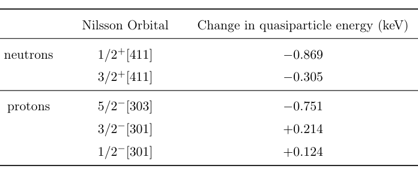

**Original caption:** Table 7.3: The change in quasiparticle energy required to reproduce en- ergies in agreement with literature values for the low-lying states in neigh- bouring isotopes and isotones of 102Y.

**中文图注:** 为使低能态能量符合102Y相邻同位素、同中子素文献值，所需的准粒子能修改。

### Table 7.4
**Source:** PDF107 P107B021

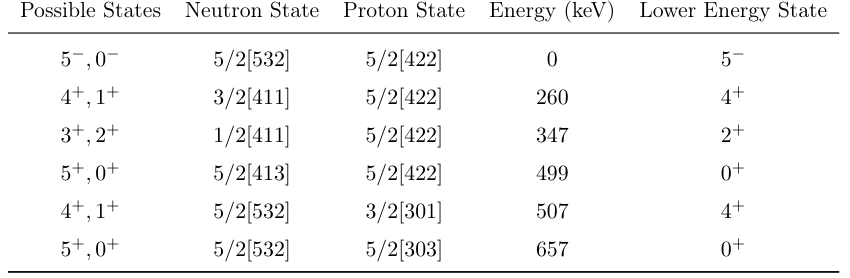

**Original caption:** Table 7.4: The spin, parity and energy of low-lying states in 102Y calcu- lated using blocked BCS codes.

**中文图注:** 使用包含阻塞的BCS代码，计算102Y低能态的自旋、宇称和能量。

本页其余原生块：标题、页眉、数学碎片、图中标签、表格与前/后置正文；完整保留，中文待译或不适用

**Source:** PDF107 P107B001; bbox [99.21, 46.25, 524.41, 57.16]

**Original:** Chapter 7. BCS Calculations
89

**中文:** 【待译/版式碎片未作独立语义解释；不得视为已完成双语正文。】

**Source:** PDF107 P107B002; bbox [208.24, 89.79, 480.25, 100.7]

**Original:** Nilsson Orbital
Change in quasiparticle energy (keV)

**中文:** 【待译/版式碎片未作独立语义解释；不得视为已完成双语正文。】

**Source:** PDF107 P107B003; bbox [143.29, 112.57, 408.98, 125.15]

**Original:** neutrons
1/2+[411]
−0.869

**中文:** 【待译/版式碎片未作独立语义解释；不得视为已完成双语正文。】

**Source:** PDF107 P107B004; bbox [221.38, 131.53, 408.98, 144.1]

**Original:** 3/2+[411]
−0.305

**中文:** 【待译/版式碎片未作独立语义解释；不得视为已完成双语正文。】

**Source:** PDF107 P107B005; bbox [146.01, 155.88, 408.98, 168.56]

**Original:** protons
5/2−[303]
−0.751

**中文:** 【待译/版式碎片未作独立语义解释；不得视为已完成双语正文。】

**Source:** PDF107 P107B006; bbox [221.38, 174.84, 408.98, 187.52]

**Original:** 3/2−[301]
+0.214

**中文:** 【待译/版式碎片未作独立语义解释；不得视为已完成双语正文。】

**Source:** PDF107 P107B007; bbox [221.38, 193.81, 408.98, 206.49]

**Original:** 1/2−[301]
+0.124

**中文:** 【待译/版式碎片未作独立语义解释；不得视为已完成双语正文。】

**Source:** PDF107 P107B009; bbox [99.21, 300.52, 252.89, 316.66]

**Original:** 7.3
102Y Calculations

**中文:** 【待译/版式碎片未作独立语义解释；不得视为已完成双语正文。】

**Source:** PDF107 P107B013; bbox [99.21, 403.06, 207.11, 413.97]

**Original:** presented in Table 7.4.

**中文:** 【待译/版式碎片未作独立语义解释；不得视为已完成双语正文。】

**Source:** PDF107 P107B015; bbox [130.27, 459.84, 472.43, 472.52]

**Original:** 5−, 0−
5/2[532]
5/2[422]
0
5−

**中文:** 【待译/版式碎片未作独立语义解释；不得视为已完成双语正文。】

**Source:** PDF107 P107B016; bbox [130.27, 478.92, 472.43, 491.49]

**Original:** 4+, 1+
3/2[411]
5/2[422]
260
4+

**中文:** 【待译/版式碎片未作独立语义解释；不得视为已完成双语正文。】

**Source:** PDF107 P107B017; bbox [130.27, 497.88, 472.43, 510.45]

**Original:** 3+, 2+
1/2[411]
5/2[422]
347
2+

**中文:** 【待译/版式碎片未作独立语义解释；不得视为已完成双语正文。】

**Source:** PDF107 P107B018; bbox [130.27, 516.85, 472.43, 529.42]

**Original:** 5+, 0+
5/2[413]
5/2[422]
499
0+

**中文:** 【待译/版式碎片未作独立语义解释；不得视为已完成双语正文。】

**Source:** PDF107 P107B019; bbox [130.27, 535.82, 472.43, 548.39]

**Original:** 4+, 1+
5/2[532]
3/2[301]
507
4+

**中文:** 【待译/版式碎片未作独立语义解释；不得视为已完成双语正文。】

**Source:** PDF107 P107B020; bbox [130.27, 554.79, 472.43, 567.36]

**Original:** 5+, 0+
5/2[532]
5/2[303]
657
0+

**中文:** 【待译/版式碎片未作独立语义解释；不得视为已完成双语正文。】

## PDF 108 / 印刷p90

**Source:** PDF108 S0203; native P108B002, P108B003, P108B004, P108B005, P108B006, P108B007, P108B008, P108B009, P108B010, P108B011, P108B012, P108B013, P108B014, P108B015, P108B016, P108B017, P108B018, P108B019, P108B020, P108B021

**Original:** second excited state is a coupling of a 1/2[411] neutron and a 5/2[422] proton. This is the same proton state as was calculated for the ground and first excited state of 102Y, and the neutron state is the second excited state of the odd-N neighbour 101Sr. The fourth excited state for 102Y is a coupling of a 5/2[413] neutron and a 5/2[422] proton. As before this is the same proton state as calculated for the ground, first, and second excited states, but the neutron state was not calculated or found in the literature for odd-N neighbours. However, in Figure 7.3, the 5/2[413] state is found between the 5/2[532] and 1/2[411] states for ϵ2 = 0.3, so it is expected to have an appropriate energy to contribute to a low-lying state in 102Y. The fifth excited state in 102Y is a coupling of a 5/2[532] neutron and a 3/2[301] proton. This is expected as the first excited state in the odd-Z neighbour 101Y is 3/2[301], the ground state in 101Y has exhausted pairings with neutron states close to the Fermi surface. The proton state is paired with the ground state of the odd-N neighbours 101Sr and 103Zr. Finally, the sixth excited state calculated for 102Y is a coupling of a 5/2[532] neutron and a 5/2[303] proton. The neutron state is the same as calculated for the fifth excited state of 102Y, and the proton state is the second excited state for the odd-Z neighbour 101Y. The neutron and proton state coupling calculated for 102Y produce the possible states listed in the first column of Table 7.4. These possible states come from the fact that the last odd neutron and the last odd proton can couple with their angular momentum parallel or anti-parallel. The Gallagher-Moszkowski rules [76] were used to calculate which of these possible states was the lowest energy state in 102Y.

**中文:** 【待译；保留原文，本块未完成中文翻译。】

**Source:** PDF108 S0204; native P108B022

**Original:** 7.3.1 Gallagher-Moszkowski Coupling Rules

**中文:** 【待译；保留原文，本块未完成中文翻译。】

**Source:** PDF108 S0205; native P108B023, P108B024, P108B025, P108B026, P108B027

**Original:** The Gallagher-Moszkowski coupling rules, presented in Equation 7.13 [76] provide conditions for coupling the last odd proton and last odd neutron to provide the lowest energy configuration. The coupling of the last odd proton and last odd neutron are known as residual nucleon-nucleon interactions, and are not included in the blocked BCS calculations. However, residual interactions can result in a difference of a few hundred keV in

**中文:** 式7.13所示Gallagher–Moszkowski耦合规则[76]给出奇质子与奇中子耦合形成最低能组态的条件。最后奇质子与奇中子的耦合称为残余核子–核子相互作用，blocked BCS计算未包含它。不过，残余相互作用可使激发能相差几百keV[26,p60]。

本页其余原生块：标题、页眉、数学碎片、图中标签、表格与前/后置正文；完整保留，中文待译或不适用

**Source:** PDF108 P108B001; bbox [99.21, 46.25, 524.41, 57.16]

**Original:** Chapter 7. BCS Calculations
90

**中文:** 【待译/版式碎片未作独立语义解释；不得视为已完成双语正文。】

**Source:** PDF108 P108B028; bbox [99.21, 673.67, 235.38, 684.58]

**Original:** excitation energy [26, p. 60].

**中文:** 【待译/版式碎片未作独立语义解释；不得视为已完成双语正文。】

## PDF 109 / 印刷p91

**Source:** PDF109 S0206; native P109B008, P109B009, P109B010, P109B011, P109B012, P109B013, P109B014, P109B015, P109B016

**Original:** It can be seen in Equation 7.13 that lower energy states are produced when particles with the same intrinsic spin projections couple their angular momenta parallel, and when particles with opposite intrinsic spin projections couple their angular momenta antiparallel [76]. Consider the ground state calculated for 102Y, from Table 7.4, which is a mixture of a 5/2[532] neutron state and 5/2[422] proton state. There are two ways in which these proton and neutron states can couple. If the proton and neutron states couple with aligned angular momentum this produces a 5−state, if the states couple with anti-aligned angular momentum this produces a 0−state. The proton and neutron states are both 5/2, and both have Λ = 2, and therefore both satisfy the condition Ω= Λ + 1

**中文:** 式7.13表明，两个粒子的内禀自旋投影相同，其角动量平行耦合时较低；内禀自旋投影相反，其角动量反平行耦合时较低[76]。表7.4中102Y计算基态由5/2[532]中子态与5/2[422]质子态组成。两者可有两种耦合：角动量同向产生5−，反向产生0−。两个轨道均为5/2且Λ=2，因此均满足式7.13a的Ω=Λ+1/2条件。

**Source:** PDF109 S0207; native P109B018, P109B019, P109B020

**Original:** lowest energy configuration for the ground state of 102Y is therefore with aligned angular momentum, to produce a 5−ground state. The states with the lowest energy found using the Gallagher-Moszkowski coupling rules are presented in the final column of Table 7.4.

**中文:** 所以102Y的最低能基态组态为角动量同向排列，产生5−基态。根据Gallagher–Moszkowski规则确定的各最低能态列于表7.4最后一列。

**Source:** PDF109 S0208; native P109B021

**Original:** Considering the electromagnetic transition selection rules [20, p.334],

**中文:** 【待译；保留原文，本块未完成中文翻译。】

**Source:** PDF109 S0209; native P109B026, P109B027, P109B028, P109B029, P109B030, P109B031, P109B032

**Original:** therefore, if there is no change in parity (π) then even electric transitions are possible (e.g. E2, E4) and odd magnetic transitions are possible (e.g. M1, M3). However, if there is a change in parity then odd electric transitions are possible (e.g. E1, E3) and even magnetic transitions are possible (e.g. M2, M4). Ii and If are the angular momentum of the initial and final states respectively and L is the multipolarity of the transition. The two possible ground state configurations for 102Y, shown in Table 7.4, are 5−and 0−. The lower energy state of this pair is the 5−state, and according to the final column in Table 7.4 all of the

**中文:** 【待译；保留原文，本块未完成中文翻译。】

### Eq. (7.13a) 原页区域回退
**Source:** PDF109 P109B004
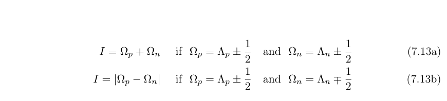

【未转写LaTeX；该裁图按式号定位，可能含邻近文字或需扩大边界，请以原PDF核定完整公式。】

### Eq. (7.13b) 原页区域回退
**Source:** PDF109 P109B007
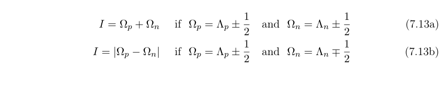

【未转写LaTeX；该裁图按式号定位，可能含邻近文字或需扩大边界，请以原PDF核定完整公式。】

### Eq. (7.14) 原页区域回退
**Source:** PDF109 P109B023
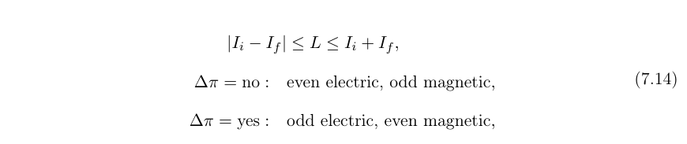

【未转写LaTeX；该裁图按式号定位，可能含邻近文字或需扩大边界，请以原PDF核定完整公式。】

本页其余原生块：标题、页眉、数学碎片、图中标签、表格与前/后置正文；完整保留，中文待译或不适用

**Source:** PDF109 P109B001; bbox [99.21, 46.25, 524.41, 57.16]

**Original:** Chapter 7. BCS Calculations
91

**中文:** 【待译/版式碎片未作独立语义解释；不得视为已完成双语正文。】

**Source:** PDF109 P109B002; bbox [191.63, 115.61, 338.85, 135.54]

**Original:** I = Ωp + Ωn
if Ωp = Λp ± 1

**中文:** 【待译/版式碎片未作独立语义解释；不得视为已完成双语正文。】

**Source:** PDF109 P109B003; bbox [333.39, 115.61, 436.86, 141.39]

**Original:** 2
and Ωn = Λn ± 1

**中文:** 【待译/版式碎片未作独立语义解释；不得视为已完成双语正文。】

**Source:** PDF109 P109B004; bbox [431.41, 123.01, 524.4, 141.39]

**Original:** 2
(7.13a)

**中文:** 【待译/版式碎片未作独立语义解释；不得视为已完成双语正文。】

**Source:** PDF109 P109B005; bbox [185.57, 142.35, 338.85, 162.28]

**Original:** I = |Ωp −Ωn|
if Ωp = Λp ± 1

**中文:** 【待译/版式碎片未作独立语义解释；不得视为已完成双语正文。】

**Source:** PDF109 P109B006; bbox [333.39, 142.35, 436.86, 168.12]

**Original:** 2
and Ωn = Λn ∓1

**中文:** 【待译/版式碎片未作独立语义解释；不得视为已完成双语正文。】

**Source:** PDF109 P109B007; bbox [431.41, 149.75, 524.4, 168.12]

**Original:** 2
(7.13b)

**中文:** 【待译/版式碎片未作独立语义解释；不得视为已完成双语正文。】

**Source:** PDF109 P109B017; bbox [392.48, 385.53, 524.37, 400.2]

**Original:** 2 from Equation 7.13a. The

**中文:** 【待译/版式碎片未作独立语义解释；不得视为已完成双语正文。】

**Source:** PDF109 P109B022; bbox [238.69, 528.36, 347.8, 541.04]

**Original:** |Ii −If| ≤L ≤Ii + If,

**中文:** 【待译/版式碎片未作独立语义解释；不得视为已完成双语正文。】

**Source:** PDF109 P109B023; bbox [496.69, 551.68, 524.41, 562.59]

**Original:** (7.14)

**中文:** 【待译/版式碎片未作独立语义解释；不得视为已完成双语正文。】

**Source:** PDF109 P109B024; bbox [217.9, 553.3, 408.8, 564.22]

**Original:** ∆π = no :
even electric, odd magnetic,

**中文:** 【待译/版式碎片未作独立语义解释；不得视为已完成双语正文。】

**Source:** PDF109 P109B025; bbox [214.82, 578.11, 408.8, 589.03]

**Original:** ∆π = yes :
odd electric, even magnetic,

**中文:** 【待译/版式碎片未作独立语义解释；不得视为已完成双语正文。】

## PDF 110 / 印刷p92

**Source:** PDF110 S0210; native P110B002, P110B003, P110B004, P110B005, P110B006

**Original:** excited states are of opposite parity to the 5−ground state. Using this, and considering Equation 7.14, Table 7.5 shows the types of transitions allowed for the γ decay of each excited state in the final column of Table 7.4 to the 5−ground state. Any transitions higher than E5, or M5 have not been included as these transitions are very unlikely to occur, this will be discussed in more detail later in this chapter.

**中文:** 【待译；保留原文，本块未完成中文翻译。】

**Source:** PDF110 S0211; native P110B007

**Original:** γ ray Energy (keV) Ii If Allowed transitions Weisskopf estimate (s−1)

**中文:** 【待译；保留原文，本块未完成中文翻译。】

**Source:** PDF110 S0212; native P110B014, P110B015, P110B016, P110B017

**Original:** In Table 7.5 a decay from the 4+ state to the 5−ground state can happen via an E1, M2, E3, M4, or E5 transition. The electromagnetic transition probabilities can be calculated using the Weisskopf estimates, presented in Table 7.6. For the 4+ to 5−transition, the Weisskopf estimates give the transition probabilities in the ratio:

**中文:** 【待译；保留原文，本块未完成中文翻译。】

**Source:** PDF110 S0213; native P110B018

**Original:** λ(E1) : λ(M2) : λ(E3) : λ(M4) : λ(E5) =

**中文:** 【待译；保留原文，本块未完成中文翻译。】

**Source:** PDF110 S0214; native P110B020, P110B021, P110B022, P110B023, P110B024

**Original:** From this ratio it can be seen that lower multipoles (E1 and M2) are more likely than higher multipoles. Therefore, in the calculation for the Weisskopf estimate in the final column of Table 7.5 only the electromagnetic transition with the lowest multipole was considered. The results presented in Table 7.5 show that transitions from the first 4+, first 2+ and the second 4+ states to the 5−ground state are the most likely.

**中文:** 【待译；保留原文，本块未完成中文翻译。】

### Table 7.5
**Source:** PDF110 P110B013

【图/表图像尚未裁取，回看原PDF；不得将标签提取当作图像审读。】

**Original caption:** Table 7.5: Allowed electromagnetic transitions for states calculated in 102Y.

**中文图注:** 【待译；图像状态见source_map。】

### Eq. (7.15) 原页区域回退
**Source:** PDF110 P110B019
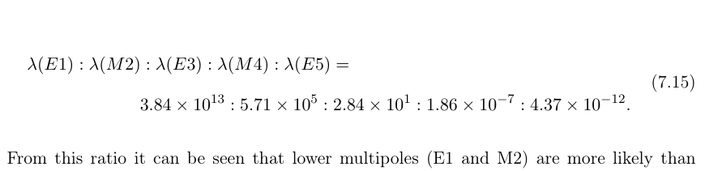

【未转写LaTeX；该裁图按式号定位，可能含邻近文字或需扩大边界，请以原PDF核定完整公式。】

本页其余原生块：标题、页眉、数学碎片、图中标签、表格与前/后置正文；完整保留，中文待译或不适用

**Source:** PDF110 P110B001; bbox [99.21, 46.25, 524.41, 57.16]

**Original:** Chapter 7. BCS Calculations
92

**中文:** 【待译/版式碎片未作独立语义解释；不得视为已完成双语正文。】

**Source:** PDF110 P110B008; bbox [148.82, 224.75, 505.02, 237.43]

**Original:** 260
4+
5−
E1, M2, E3, M4, E5
3.84 × 1013

**中文:** 【待译/版式碎片未作独立语义解释；不得视为已完成双语正文。】

**Source:** PDF110 P110B009; bbox [148.82, 243.72, 502.91, 256.4]

**Original:** 347
2+
5−
E3, M4, E5
2.14 × 102

**中文:** 【待译/版式碎片未作独立语义解释；不得视为已完成双语正文。】

**Source:** PDF110 P110B010; bbox [148.82, 262.69, 506.2, 275.37]

**Original:** 499
0+
5−
E5
5.68 × 10−9

**中文:** 【待译/版式碎片未作独立语义解释；不得视为已完成双语正文。】

**Source:** PDF110 P110B011; bbox [148.82, 281.66, 505.02, 294.33]

**Original:** 507
4+
5−
E1, M2, E3, M4, E5
2.85 × 1014

**中文:** 【待译/版式碎片未作独立语义解释；不得视为已完成双语正文。】

**Source:** PDF110 P110B012; bbox [148.82, 300.63, 506.2, 313.3]

**Original:** 657
0+
5−
E5
1.17 × 10−7

**中文:** 【待译/版式碎片未作独立语义解释；不得视为已完成双语正文。】

**Source:** PDF110 P110B019; bbox [181.34, 508.3, 524.41, 533.24]

**Original:** 3.84 × 1013 : 5.71 × 105 : 2.84 × 101 : 1.86 × 10−7 : 4.37 × 10−12.
(7.15)

**中文:** 【待译/版式碎片未作独立语义解释；不得视为已完成双语正文。】

## PDF 111 / 印刷p93

**Source:** PDF111 S0215; native P111B004, P111B005, P111B006, P111B007, P111B008

**Original:** The 0−state is the higher energy state of the 5−, 0−pair, and was assigned an excitation energy of 300 keV, because typically the coupling of the last odd nucleons results in an energy difference of a few hundred keV [26, p. 60], which places the 0−state between the 2+ and the 4+ state. The allowed transitions for the γ decay of higher-lying excited states to the 0−state, and from the 0−state to lower-lying states are presented in Table 7.7.

**中文:** 0−是5−、0−这一对中较高的态。本工作给它指定300keV激发能，因为最后两个奇核子的耦合通常造成几百keV能差[26,p60]；这使0−位于2+和4+态之间。表7.7列出较高激发态向0−、以及0−向较低态的γ衰变所允许的跃迁。

**Source:** PDF111 S0216; native P111B009

**Original:** γ ray Energy (keV) Ii If Allowed transitions Weisskopf estimate (s−1)

**中文:** 【待译；保留原文，本块未完成中文翻译。】

**Source:** PDF111 S0217; native P111B017, P111B018, P111B019, P111B020, P111B021, P111B022, P111B023

**Original:** A comparison between Tables 7.7 and 7.5 clearly shows that transitions to, and from, the 0−state are much less likely than transitions to the 5−state in 102Y. In Tables 7.7 transitions from the first and second 0+ states to the 0−state are forbidden to decay by γ emission, as L = 0 in Equation 7.14. In both of these cases internal conversion becomes a more likely decay path. Instead of producing a γ-ray photon, in the process of internal conversion the electromagnetic field interacts with atomic electrons causing one of the electrons to be emitted from the atom.

**中文:** 比较表7.7与7.5可见，涉及0−的跃迁远比向102Y 5−基态的跃迁不易发生。表7.7中第一个和第二个0+态到0−态因式7.14给L=0，不能通过γ发射衰变。在这两种情形下，内转换成为更可能的衰变方式。内转换不产生γ光子，而是核电磁场与原子电子相互作用，将一个电子从原子中发射出来。

### Table 7.6
**Source:** PDF111 P111B003

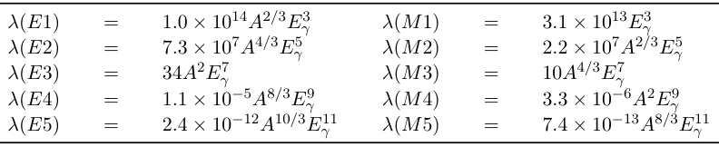

**Original caption:** Table 7.6: Weisskopf Estimates, taken from [77].

**中文图注:** Weisskopf估计，取自文献[77]。

### Table 7.7
**Source:** PDF111 P111B016

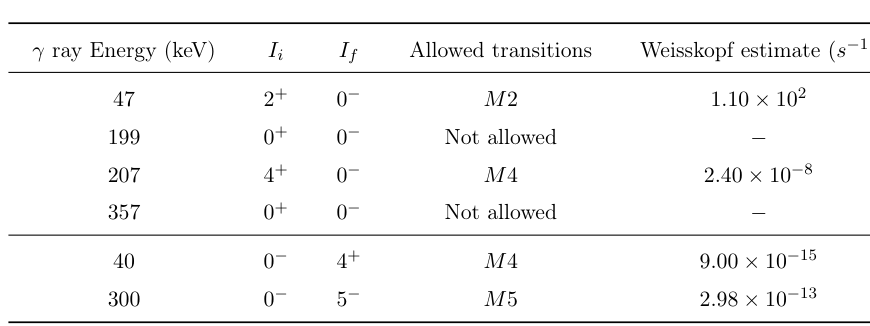

**Original caption:** Table 7.7: Electromagnetic transitions and Weisskopf estimates for the decay paths available in the γ-decay of the 0−state.

**中文图注:** 0−态γ衰变所能采取路径的电磁跃迁与Weisskopf估计。

本页其余原生块：标题、页眉、数学碎片、图中标签、表格与前/后置正文；完整保留，中文待译或不适用

**Source:** PDF111 P111B001; bbox [99.21, 46.25, 524.41, 57.16]

**Original:** Chapter 7. BCS Calculations
93

**中文:** 【待译/版式碎片未作独立语义解释；不得视为已完成双语正文。】

**Source:** PDF111 P111B002; bbox [118.14, 113.12, 504.98, 184.48]

**Original:** λ(E1)
=
1.0 × 1014A2/3E3
γ
λ(M1)
=
3.1 × 1013E3
γ
λ(E2)
=
7.3 × 107A4/3E5
γ
λ(M2)
=
2.2 × 107A2/3E5
γ
λ(E3)
=
34A2E7
γ
λ(M3)
=
10A4/3E7
γ
λ(E4)
=
1.1 × 10−5A8/3E9
γ
λ(M4)
=
3.3 × 10−6A2E9
γ
λ(E5)
=
2.4 × 10−12A10/3E11
γ
λ(M5)
=
7.4 × 10−13A8/3E11
γ

**中文:** 【待译/版式碎片未作独立语义解释；不得视为已完成双语正文。】

**Source:** PDF111 P111B010; bbox [151.55, 372.53, 498.08, 385.21]

**Original:** 47
2+
0−
M2
1.10 × 102

**中文:** 【待译/版式碎片未作独立语义解释；不得视为已完成双语正文。】

**Source:** PDF111 P111B011; bbox [148.82, 391.5, 478.64, 404.19]

**Original:** 199
0+
0−
Not allowed
−

**中文:** 【待译/版式碎片未作独立语义解释；不得视为已完成双语正文。】

**Source:** PDF111 P111B012; bbox [148.82, 410.47, 501.37, 423.15]

**Original:** 207
4+
0−
M4
2.40 × 10−8

**中文:** 【待译/版式碎片未作独立语义解释；不得视为已完成双语正文。】

**Source:** PDF111 P111B013; bbox [148.82, 429.44, 478.64, 442.13]

**Original:** 357
0+
0−
Not allowed
−

**中文:** 【待译/版式碎片未作独立语义解释；不得视为已完成双语正文。】

**Source:** PDF111 P111B014; bbox [151.55, 453.89, 503.48, 466.56]

**Original:** 40
0−
4+
M4
9.00 × 10−15

**中文:** 【待译/版式碎片未作独立语义解释；不得视为已完成双语正文。】

**Source:** PDF111 P111B015; bbox [148.82, 472.86, 503.48, 485.53]

**Original:** 300
0−
5−
M5
2.98 × 10−13

**中文:** 【待译/版式碎片未作独立语义解释；不得视为已完成双语正文。】

## PDF 112 / 印刷p94

**Source:** PDF112 S0218; native P112B005, P112B006, P112B007, P112B008, P112B009, P112B010, P112B011, P112B012, P112B013

**Original:** Chapter 4 detailed the analysis conducted on data from the IGISOL facility, at the University of Jyv¨askyl¨a, which consisted of two experiments. The first experiment utilised the Ramsey cleaning technique to separate the ground and isomeric state in 102Y. As described in Section 3.4, the two isomeric states in 102Y were not cleanly separated. Figure 4.3, in Chapter 4, shows a comparison between the intensity ratios of six transitions in 102Y relative to the 152 keV transition. When taking an average of these intensity ratios at each frequency step there is a general agreement with the intensity ratios measured for the high-spin state in 102Y in previous work by Hill and Shizuma. These results suggested the high-spin state was primarily produced in the first IGISOL experiment.

**中文:** 【待译；保留原文，本块未完成中文翻译。】

**Source:** PDF112 S0219; native P112B014, P112B015, P112B016, P112B017, P112B018, P112B019, P112B020, P112B021, P112B022, P112B023, P112B024, P112B025, P112B026

**Original:** The second experiment measured the decay of 102Y into 102Zr without implementing the Ramsey cleaning technique. The aim of this experiment was to confirm the transitions previously observed for the decay of 102Y into 102Zr by Hill and Shizuma, and to provide comparison with the published intensity ratios. In the second experiment at IGISOL γ ray intensities and γ-γ coincidences were identified. The γ-ray intensities measured for 102Zr in this work indicated a ∼22% contribution from the low-spin state in 102Y measured at TRISTAN [8] and a ∼78% contribution from the high-spin state measured at JOSEF [9]. From this experiment it is concluded that both the ground and isomeric states were produced at IGISOL, and further work is required to achieve the separation of these two states in 102Y for the independent measurement of their subsequent decay. Using the γ-γ coincidence information presented in Table 4.2 a level scheme was produced and compared with previous work by Hill [8] and Shizuma [9]. The final level scheme produced in this work is presented in Figure 8.1. The width of the arrows were determined from the

**中文:** 【待译；保留原文，本块未完成中文翻译。】

本页其余原生块：标题、页眉、数学碎片、图中标签、表格与前/后置正文；完整保留，中文待译或不适用

**Source:** PDF112 P112B001; bbox [513.56, 46.25, 524.41, 57.16]

**Original:** 94

**中文:** 【待译/版式碎片未作独立语义解释；不得视为已完成双语正文。】

**Source:** PDF112 P112B002; bbox [99.21, 126.0, 195.95, 146.66]

**Original:** Chapter 8

**中文:** 【待译/版式碎片未作独立语义解释；不得视为已完成双语正文。】

**Source:** PDF112 P112B003; bbox [99.21, 190.82, 217.6, 215.61]

**Original:** Discussion

**中文:** 【待译/版式碎片未作独立语义解释；不得视为已完成双语正文。】

**Source:** PDF112 P112B004; bbox [99.21, 267.69, 275.15, 282.04]

**Original:** 8.1
IGISOL Experiment

**中文:** 【待译/版式碎片未作独立语义解释；不得视为已完成双语正文。】

## PDF 113 / 印刷p95

**Source:** PDF113 S0220; native P113B002, P113B003

**Original:** intensity of each transition, relative to the 152 keV transition, presented in Table 4.1. The level schemes produced by Hill and Shizuma are presented in Figure 8.2.

**中文:** 【待译；保留原文，本块未完成中文翻译。】

**Source:** PDF113 S0221; native P113B023, P113B024, P113B025, P113B026, P113B027, P113B028, P113B029, P113B030, P113B031, P113B032, P113B033, P113B034, P113B035, P113B036

**Original:** Comparing Figures 8.1 and 8.2 there are a number of similarities. In both figures the 326 keV transition depopulates the first 4+ state in 102Zr, feeding the 2+ →0+ 152 keV transition to the ground state. In Figure 8.2a the 743 keV transition depopulates the tentatively assigned second 0+ state, feeding the first 2+ state, which agrees with the level scheme produced in this work. The 1211 keV transition in Figures 8.2a and b depopulates the tentatively assigned second 2+ state and directly feeds the ground state in 102Zr. This agrees with the placement of the 1211 keV transition in the level scheme produced in this work. The 1159 keV transition shown in Figure 8.2a also directly feeds the ground state, which agrees with the level scheme produced in this work. In Figure 8.2b, the 486 keV transition (incorrectly labelled as a 468 keV transition in the level scheme) depopulates the first 6+ state in 102Zr, feeding the first 4+ state. This placement agrees with the level scheme produced in this work. The 159 keV transition in Figure 8.2b feeds the 579 keV transition, which feeds the 1090 keV transition, which finally feeds the 152 keV transition to the ground state in 102Zr. This cascade of γ rays was also placed in the level scheme

**中文:** 【待译；保留原文，本块未完成中文翻译。】

### Figure 8.1
**Source:** PDF113 P113B022

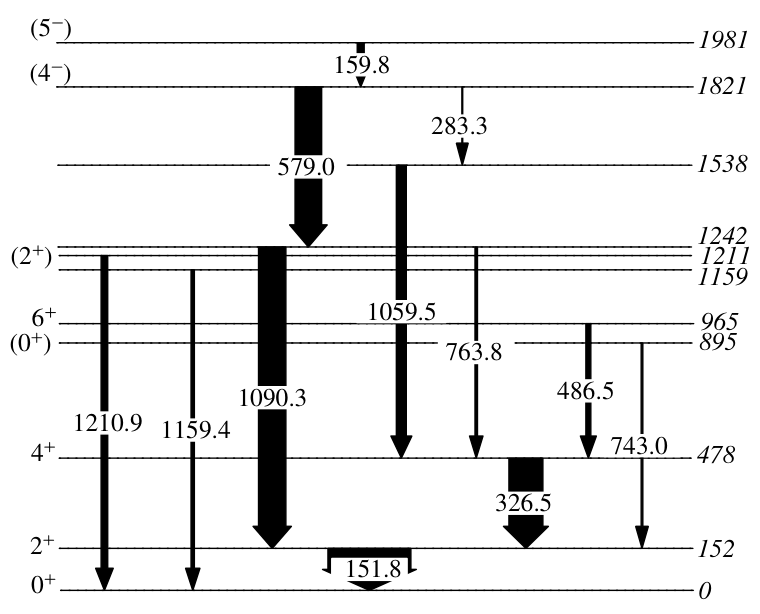

**Original caption:** Figure 8.1: The level scheme for 102Zr produced from coincidences measured in the second experiment at the IGISOL facility.

**中文图注:** 由第二次IGISOL实验测得的符合关系建立的102Zr能级纲图。

本页其余原生块：标题、页眉、数学碎片、图中标签、表格与前/后置正文；完整保留，中文待译或不适用

**Source:** PDF113 P113B001; bbox [99.21, 46.25, 524.41, 57.16]

**Original:** Chapter 8. Discussion
95

**中文:** 【待译/版式碎片未作独立语义解释；不得视为已完成双语正文。】

**Source:** PDF113 P113B004; bbox [135.08, 129.8, 494.54, 152.48]

**Original:** (5 )
1981

**中文:** 【待译/版式碎片未作独立语义解释；不得视为已完成双语正文。】

**Source:** PDF113 P113B005; bbox [286.54, 147.9, 315.23, 164.91]

**Original:** 159.8

**中文:** 【待译/版式碎片未作独立语义解释；不得视为已完成双语正文。】

**Source:** PDF113 P113B006; bbox [134.81, 151.89, 493.82, 175.3]

**Original:** (4 )
1821

**中文:** 【待译/版式碎片未作独立语义解释；不得视为已完成双语正文。】

**Source:** PDF113 P113B007; bbox [335.56, 178.53, 364.25, 195.54]

**Original:** 283.3

**中文:** 【待译/版式碎片未作独立语义解释；不得视为已完成双语正文。】

**Source:** PDF113 P113B008; bbox [468.37, 198.89, 493.88, 214.46]

**Original:** 1538

**中文:** 【待译/版式碎片未作独立语义解释；不得视为已完成双语正文。】

**Source:** PDF113 P113B009; bbox [258.79, 198.96, 287.49, 215.97]

**Original:** 579.0

**中文:** 【待译/版式碎片未作独立语义解释；不得视为已完成双语正文。】

**Source:** PDF113 P113B010; bbox [125.34, 234.68, 495.55, 271.13]

**Original:** 1159
(2 )
1211
1242

**中文:** 【待译/版式碎片未作独立语义解释；不得视为已完成双语正文。】

**Source:** PDF113 P113B011; bbox [303.25, 271.34, 338.32, 288.35]

**Original:** 1059.5

**中文:** 【待译/版式碎片未作独立语义解释；不得视为已完成双语正文。】

**Source:** PDF113 P113B012; bbox [124.69, 274.62, 489.46, 304.21]

**Original:** (0 )
895
6
965

**中文:** 【待译/版式碎片未作独立语义解释；不得视为已完成双语正文。】

**Source:** PDF113 P113B013; bbox [342.73, 291.77, 371.42, 308.78]

**Original:** 763.8

**中文:** 【待译/版式碎片未作独立语义解释；不得视为已完成双语正文。】

**Source:** PDF113 P113B014; bbox [398.59, 310.94, 427.28, 327.96]

**Original:** 486.5

**中文:** 【待译/版式碎片未作独立语义解释；不得视为已完成双语正文。】

**Source:** PDF113 P113B015; bbox [156.36, 314.34, 273.75, 347.56]

**Original:** 1090.3
1159.4
1210.9

**中文:** 【待译/版式碎片未作独立语义解释；不得视为已完成双语正文。】

**Source:** PDF113 P113B016; bbox [425.2, 338.34, 453.89, 355.35]

**Original:** 743.0

**中文:** 【待译/版式碎片未作独立语义解释；不得视为已完成双语正文。】

**Source:** PDF113 P113B017; bbox [135.38, 341.87, 487.57, 360.19]

**Original:** 4
478

**中文:** 【待译/版式碎片未作独立语义解释；不得视为已完成双语正文。】

**Source:** PDF113 P113B018; bbox [367.56, 367.14, 396.25, 384.15]

**Original:** 326.5

**中文:** 【待译/版式碎片未作独立语义解释；不得视为已完成双语正文。】

**Source:** PDF113 P113B019; bbox [134.92, 388.45, 487.63, 406.77]

**Original:** 2
152

**中文:** 【待译/版式碎片未作独立语义解释；不得视为已完成双语正文。】

**Source:** PDF113 P113B020; bbox [292.26, 400.19, 320.95, 417.2]

**Original:** 151.8

**中文:** 【待译/版式碎片未作独立语义解释；不得视为已完成双语正文。】

**Source:** PDF113 P113B021; bbox [135.57, 407.98, 475.51, 427.76]

**Original:** 0
0

**中文:** 【待译/版式碎片未作独立语义解释；不得视为已完成双语正文。】

## PDF 114 / 印刷p96

**Source:** PDF114 S0222; native P114B004, P114B005, P114B006

**Original:** produced in this work. The main discrepancy between this work and previous work by Hill and Shizuma is the placement of the 1059 keV transition, as well as the inclusion of two additional transitions of 283-, and 764 keV.

**中文:** 【待译；保留原文，本块未完成中文翻译。】

**Source:** PDF114 S0223; native P114B007, P114B008, P114B009, P114B010, P114B011, P114B012, P114B013, P114B014, P114B015, P114B016, P114B017, P114B018, P114B019, P114B020, P114B021

**Original:** In this work, the gate on the 326 keV transition (shown in Figure 4.10) shows a coincidence with the 1059 keV transition. In order to observe this coincidence the 1059 keV transition must feed the 326 keV transition, or vice versa. However, in the level schemes produced by Hill and Shizuma [8] the 1059 keV transition directly feeds the 152 keV transition, by-passing the 326 keV transition and indicating no possibility for a coincidence between the 326 keV and 1059 keV transitions. There are two possible explanations for why a coincidence was not observed between the 326 keV and 1059 keV transitions in previous work. Fewer statistics were obtained in the experiments conducted by Hill and Shizuma, Figures 4.8 and 4.9 show a comparison between the 152 keV gate applied in this work, and the 152 keV gate published by Hill [8]. Due to the lack of statistics the 1059 keV transition may not have been observed in the previous work by Hill and Shizuma. Alternatively, there may be two 1059 keV transitions in 102Zr, one which decays to the 326 keV transition and another which decays to the 152 keV transition. Depending on the spin of the β decaying state 102Y is decaying from, the intensity of the two 1059 keV transitions may change considerably. In this work the states populated in 102Zr were produced in the

**中文:** 本工作326keV门谱（图4.10）中可见1059keV符合。因此1059keV必须位于326keV之前，或反过来。然而Hill与Shizuma[8]的能级纲图把1059keV直接放到152keV跃迁上方，绕过326keV，因而不可能产生1059–326符合。旧工作未见该符合有两种解释。首先是统计量较少，图4.8与4.9对比本工作和Hill的152keV门谱；1059keV符合可能因统计不足未见。另一种可能是102Zr有两条1059keV跃迁，一条馈入326keV跃迁，另一条馈入152keV跃迁。这两条线的强度可能随102Y β母态自旋显著变化。本工作中的102Zr态来自：

### Figure 8.2
**Source:** PDF114 P114B003

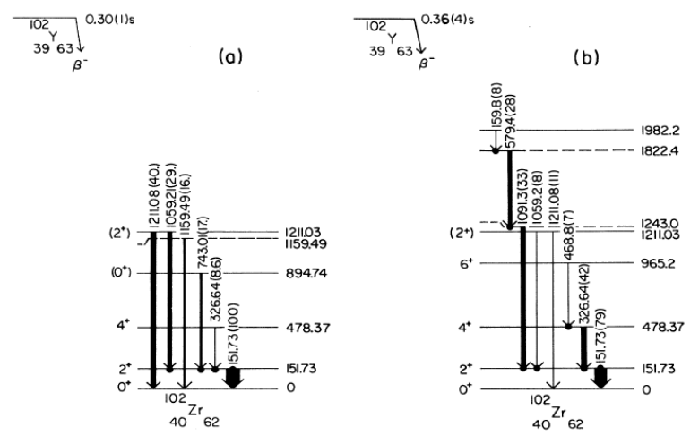

**Original caption:** Figure 8.2: The published level schemes, taken from [8], for (a) the decay of the low-spin isomer in 102Y (b) the decay of the high-spin isomer in 102Y. Note, the 468 keV transition is incorrectly labelled and should read 486 keV.

**中文图注:** 文献[8]发表的纲图：(a)102Y低自旋异能态的衰变；(b)102Y高自旋异能态的衰变。注意图中468keV标签有误，应为486keV。

本页其余原生块：标题、页眉、数学碎片、图中标签、表格与前/后置正文；完整保留，中文待译或不适用

**Source:** PDF114 P114B001; bbox [99.21, 46.25, 524.41, 57.16]

**Original:** Chapter 8. Discussion
96

**中文:** 【待译/版式碎片未作独立语义解释；不得视为已完成双语正文。】

**Source:** PDF114 P114B002; bbox [118.67, 81.1, 501.35, 322.58]

**Original:** 【embedded image block；回看原PDF】

**中文:** 【待译/版式碎片未作独立语义解释；不得视为已完成双语正文。】

## PDF 115 / 印刷p97

**Source:** PDF115 S0224; native P115B002, P115B003, P115B004, P115B005, P115B006, P115B007, P115B008, P115B009, P115B010, P115B011, P115B012, P115B013, P115B014, P115B015

**Original:** combined β decay of the low-spin and high-spin states in 102Y. Comparing the intensity ratios observed in this work with the ratios observed by Hill and Shizuma, 78% of the β decays observed originated from the high-spin state in 102Y. Therefore, it is possible that in the decay of the high-spin isomer of 102Y the intensity of the 1059 keV transition, which feeds the 326 keV transition dominates, and a 1059 keV transition just feeding the 152 keV transition is masked. In the previous work by Hill and Shizuma the level scheme produced for the decay of the high-spin isomeric state in 102Y, shown in Figure 8.2b, was deduced by combining the two studies at TRISTAN and JOSEF, the details are provided in Ref. [8]. In the level scheme a coincidence between the 1059 keV and 326 keV for the decay of the high-spin isomeric state in 102Y may not have been observed due to low statistics. Further work is required to measure the independent decay of the high-spin and low-spin states of 102Y and provide a conclusive answer to this problem. However, in this work due to the observed coincidence between the 1059-, and 326 keV transitions the 1059 keV transition was been placed feeding the 478 keV level.

**中文:** 102Y高、低自旋态的共同β衰变。与Hill和Shizuma强度比比较，所观察β衰变中78%来自102Y高自旋态。因此，高自旋异能态衰变中馈入326keV的1059keV线可能占优势，掩盖只馈入152keV的另一条1059keV线。旧高自旋能级纲图（图8.2b）由TRISTAN与JOSEF两研究合成，详见文献[8]；其中1059–326符合可能因低统计未见。仍需独立测量两态衰变才能作明确判断。本工作由于看到了1059–326符合，把1059keV跃迁置于478keV能级上方。

**Source:** PDF115 S0225; native P115B016, P115B017, P115B018, P115B019, P115B020, P115B021, P115B022, P115B023, P115B024, P115B025, P115B026, P115B027, P115B028, P115B029, P115B030, P115B031, P115B032

**Original:** At IGISOL two additional transitions were observed, which were not observed at TRIS- TAN or JOSEF. A weak 283 keV γ ray was observed in coincidence with the 152-, and 326 keV transitions. However, in Figure 8.1 the 283 keV transition was positioned feeding the 1059 keV transitions, even though a coincidence with the 1059 keV transition was not observed in this work. One reason to support this placement is the energy difference of the 1821-, and 1538 keV energy levels, which is 283 keV matching the energy of the observed γ ray. Another reason to support the placement of the 283 keV transition is the relative intensity ratio of the 579-, and 283 keV transitions. In the singles spectra the ratio I283/I579 = 0.03, in the 160 keV gate the 579 keV peak was measured with a relative intensity of 75%, therefore, a relative intensity of 2% (∼2 counts) was expected for the 283 keV peak which is consistent with the measured spectrum. Therefore, although a coincidence between the 283 keV and 1059 keV γ rays was not observed, the 283 keV transition has been placed feeding the 1538 keV level. The energy of the 1059 keV γ ray is relatively high, a coincidence between the 283 keV γ ray and the 1059 keV γ ray may not have been observed due to the reduced detection efficiency at this energy. In this work the efficiency at 1059 keV was ∼3.6%, whereas the efficiency at 326 keV (a transition which was observed in coincidence with the 283 keV γ ray) was ∼7.6%.

**中文:** 【待译；保留原文，本块未完成中文翻译。】

**Source:** PDF115 S0226; native P115B033

**Original:** A 764 keV transition was also observed in coincidence with the 152-, 326-, and 579 keV

**中文:** 【待译；保留原文，本块未完成中文翻译。】

本页其余原生块：标题、页眉、数学碎片、图中标签、表格与前/后置正文；完整保留，中文待译或不适用

**Source:** PDF115 P115B001; bbox [99.21, 46.25, 524.41, 57.16]

**Original:** Chapter 8. Discussion
97

**中文:** 【待译/版式碎片未作独立语义解释；不得视为已完成双语正文。】

## PDF 116 / 印刷p98

**Source:** PDF116 S0227; native P116B002, P116B003, P116B004, P116B005, P116B006, P116B007, P116B008

**Original:** transitions, and was not seen in previous work at TRISTAN and JOSEF. Due to the observed coincidences with the 764 keV transition it has been placed feeding the 478 keV level. To support the placement of the 764 keV transition the relative intensity ratios of the 1090-, and 764 keV transitions were compared. In the singles spectra the ratio I764/I1090 = 11(3), in the 579 keV gate the 1090 keV peak was measured with a relative intensity of 34%, therefore, a relative intensity of 3% (∼4 counts) was expected for the 764 keV peak which is consistent with the measured spectrum, shown previously in Figure 4.12.

**中文:** 这些跃迁此前在TRISTAN和JOSEF未见。根据764keV的符合关系，将其置于478keV能级上方。为检验放置，比较1090与764keV相对强度。单谱中I764/I1090=11(3)，579keV门中1090keV峰相对强度为34%，因而预期764keV峰约为3%（约4计数），与图4.12所示测量谱相容。

**Source:** PDF116 S0228; native P116B009, P116B010, P116B011, P116B012, P116B013, P116B014, P116B015, P116B016

**Original:** The placement of the 283-, and 764 keV gamma ray transitions in the level scheme is also confirmed by a level scheme published by Durell, et al. [78]. At Daresbury laboratory an investigation into the spontaneous fission of a 248Cm source was performed and a partial level scheme for 102Zr produced, and is presented in Figure 8.3. In the level scheme published by Durell [78] the placement of both the 283-, and 764 keV transitions agree with the level scheme produced in this work, shown in Figure 8.1. Furthermore, in the level scheme published by Durell [78] the 1059 keV transition has also been positioned feeding the 326 keV transition, which also agrees with the level scheme produced in this

**中文:** Durell等[78]的能级纲图也支持283与764keV的放置。该研究在Daresbury研究248Cm源自发裂变，建立图8.3所示102Zr部分能级纲图。其283和764keV放置与本工作图8.1一致；1059keV也被置于馈入326keV的位置，与本工作相符。

本页其余原生块：标题、页眉、数学碎片、图中标签、表格与前/后置正文；完整保留，中文待译或不适用

**Source:** PDF116 P116B001; bbox [99.21, 46.25, 524.41, 57.16]

**Original:** Chapter 8. Discussion
98

**中文:** 【待译/版式碎片未作独立语义解释；不得视为已完成双语正文。】

**Source:** PDF116 P116B017; bbox [99.21, 410.76, 125.12, 421.67]

**Original:** work.

**中文:** 【待译/版式碎片未作独立语义解释；不得视为已完成双语正文。】

## PDF 117 / 印刷p99

### Figure 8.3
**Source:** PDF117 P117B003

**Original caption:** Figure 8.3: A partial level scheme for 102Zr obtained following sponta- neous fission of a 248Cm source at Daresbury Laboratory [78].

**中文图注:** Daresbury实验室248Cm源自发裂变得到的102Zr部分能级纲图[78]。

本页其余原生块：标题、页眉、数学碎片、图中标签、表格与前/后置正文；完整保留，中文待译或不适用

**Source:** PDF117 P117B001; bbox [99.21, 46.25, 524.41, 57.16]

**Original:** Chapter 8. Discussion
99

**中文:** 【待译/版式碎片未作独立语义解释；不得视为已完成双语正文。】

**Source:** PDF117 P117B002; bbox [152.36, 81.1, 471.26, 588.44]

**Original:** 【embedded image block；回看原PDF】

**中文:** 【待译/版式碎片未作独立语义解释；不得视为已完成双语正文。】

## PDF 118 / 印刷p100

**Source:** PDF118 S0229; native P118B003, P118B004, P118B005, P118B006, P118B007, P118B008, P118B009

**Original:** Supplementary to the experiments conducted at the IGISOL facility, data collected at the RIBF, at the RIKEN Laboratory, was also analysed, as detailed in Chapter 6. In this work the data was analysed under two criteria. Criteria 1 gated on the implantation of 102Sr and its subsequent decay into 102Y and 102Zr. Whereas criteria 2 gated on the implantation of 102Y and its subsequent decay into 102Zr. The aim of this work was to confirm previous suggestions by Hill [8] and Shizuma [9] that there are two β decaying states in 102Y, which populate states in 102Zr with differing intensity ratios.

**中文:** 【待译；保留原文，本块未完成中文翻译。】

**Source:** PDF118 S0230; native P118B010, P118B011, P118B012, P118B013, P118B014, P118B015, P118B016

**Original:** In the analysis of the RIKEN data γ ray intensities and γ-γ coincidences were measured. The γ ray intensities observed in this work showed that following implantation of 102Sr predominantly low-spin states were populated in 102Zr, supporting the results obtained at TRISTAN. However, when 102Y is implanted high-spin states were populated in 102Zr, which supports the results obtained at JOSEF. Analysis of the RIKEN data therefore confirmed the assumptions previously made by Hill and Shizuma that states in 102Zr are populated with differing intensity ratios depending on how 102Y is created before it decays.

**中文:** RIKEN分析测定了γ强度及γ–γ符合。102Sr植入后主要布居102Zr低自旋态，支持TRISTAN结果；102Y植入后则布居高自旋态，支持JOSEF结果。因此RIKEN分析确认了Hill和Shizuma此前的推测：102Y产生方式不同，会导致102Zr态的布居强度比不同。

**Source:** PDF118 S0231; native P118B017, P118B018, P118B019, P118B020, P118B021, P118B022, P118B023, P118B024, P118B025, P118B026

**Original:** Using the γ-γ coincidence information, presented in Table 6.2, a level scheme was produced for criteria 1 and 2, and compared with the level schemes published by Hill [8] and Shizuma [9]. The final level schemes produced in this RIKEN analysis for criteria 1 and 2 are presented in Figures 8.4 and 8.5. The widths of the transition arrows are determined by the gamma-ray intensity of each transition, relative to the 152 keV transition, presented in Table 6.1. The spin and parity assignments for the two level schemes were taken partly from the previous work at TRISTAN [8] and JOSEF [8], and partly from the results of another experiment conducted by Durell, et al. at Daresbury Laboratory [78]. The level scheme published by Hill and Shizuma is presented in Figure 8.2, and the level scheme published by Durell is presented in Figure 8.3.

**中文:** 根据表6.2 γ–γ符合信息，分别建立条件1、2的能级纲图，并与Hill[8]、Shizuma[9]发表的纲图比较。最终纲图见图8.4、8.5，箭宽由表6.1各γ跃迁相对于152keV的强度确定。其中自旋宇称部分取自TRISTAN[8]及JOSEF[8]旧研究，部分取自Durell等在Daresbury的另一实验[78]。Hill与Shizuma纲图见图8.2，Durell纲图见图8.3。

本页其余原生块：标题、页眉、数学碎片、图中标签、表格与前/后置正文；完整保留，中文待译或不适用

**Source:** PDF118 P118B001; bbox [99.21, 46.25, 524.4, 57.16]

**Original:** Chapter 8. Discussion
100

**中文:** 【待译/版式碎片未作独立语义解释；不得视为已完成双语正文。】

**Source:** PDF118 P118B002; bbox [99.21, 80.86, 273.62, 95.21]

**Original:** 8.2
RIKEN Experiment

**中文:** 【待译/版式碎片未作独立语义解释；不得视为已完成双语正文。】

## PDF 119 / 印刷p101

**Source:** PDF119 S0232; native P119B025, P119B026, P119B027, P119B028, P119B029, P119B030, P119B031

**Original:** Comparing Figure 8.4 with Figure 8.2a, all γ ray transition placements in the level scheme produced in this work agree with the placements published by Hill. However, when comparing Figure 8.5 with Figure 8.2b there are a few discrepancies. In both Figure 8.5 and Figure 8.2b the 160 keV transition feeds the 579 keV transition, and from the 1242 keV energy state the 1090 keV transition feeds the 152 keV transition. The 1211 keV transition directly feeds the ground state, and the 486 keV transition feeds the 326 keV transition which feeds the 152 keV transition. In this work an additional 764 keV transition was

**中文:** 【待译；保留原文，本块未完成中文翻译。】

### Figure 8.4
**Source:** PDF119 P119B009

**Original caption:** Figure 8.4: Level scheme for 102Zr from coincidence and intensity information ob- tained following implantation of 102Sr. The arrow widths are determined by the relative intensities presented in Table 6.1.

**中文图注:** 植入102Sr后，由符合及强度信息建立的102Zr纲图。箭宽由表6.1相对强度决定。

### Figure 8.5
**Source:** PDF119 P119B024

**Original caption:** Figure 8.5: Level scheme for 102Zr from coincidence and intensity information ob- tained following implantation of 102Y. The arrow widths are determined by the relative intensities presented in Table 6.1.

**中文图注:** 植入102Y后，由符合及强度信息建立的102Zr纲图。箭宽由表6.1相对强度决定。

本页其余原生块：标题、页眉、数学碎片、图中标签、表格与前/后置正文；完整保留，中文待译或不适用

**Source:** PDF119 P119B001; bbox [99.21, 46.25, 524.4, 57.16]

**Original:** Chapter 8. Discussion
101

**中文:** 【待译/版式碎片未作独立语义解释；不得视为已完成双语正文。】

**Source:** PDF119 P119B002; bbox [166.33, 81.49, 454.55, 115.6]

**Original:** 1160
(2 )
1211

**中文:** 【待译/版式碎片未作独立语义解释；不得视为已完成双语正文。】

**Source:** PDF119 P119B003; bbox [166.33, 120.54, 447.42, 146.0]

**Original:** (0 )
895

**中文:** 【待译/版式碎片未作独立语义解释；不得视为已完成双语正文。】

**Source:** PDF119 P119B004; bbox [197.35, 150.0, 417.78, 191.48]

**Original:** 743.5
1159.7
1059.1
1210.9

**中文:** 【待译/版式碎片未作独立语义解释；不得视为已完成双语正文。】

**Source:** PDF119 P119B005; bbox [171.48, 171.06, 447.72, 196.51]

**Original:** 4
478

**中文:** 【待译/版式碎片未作独立语义解释；不得视为已完成双语正文。】

**Source:** PDF119 P119B006; bbox [281.01, 194.38, 318.73, 216.75]

**Original:** 326.5

**中文:** 【待译/版式碎片未作独立语义解释；不得视为已完成双语正文。】

**Source:** PDF119 P119B007; bbox [317.06, 223.36, 354.78, 245.73]

**Original:** 151.9

**中文:** 【待译/版式碎片未作独立语义解释；不得视为已完成双语正文。】

**Source:** PDF119 P119B008; bbox [172.13, 211.85, 445.54, 253.65]

**Original:** 0
0
2
152

**中文:** 【待译/版式碎片未作独立语义解释；不得视为已完成双语正文。】

**Source:** PDF119 P119B010; bbox [273.1, 333.16, 307.26, 349.97]

**Original:** 159.9

**中文:** 【待译/版式碎片未作独立语义解释；不得视为已完成双语正文。】

**Source:** PDF119 P119B011; bbox [123.08, 323.1, 465.87, 358.87]

**Original:** (4 )
1821
(5 )
1981

**中文:** 【待译/版式碎片未作独立语义解释；不得视为已完成双语正文。】

**Source:** PDF119 P119B012; bbox [329.9, 357.48, 364.06, 374.28]

**Original:** 283.2

**中文:** 【待译/版式碎片未作独立语义解释；不得视为已完成双语正文。】

**Source:** PDF119 P119B013; bbox [434.3, 372.4, 464.67, 389.2]

**Original:** 1538

**中文:** 【待译/版式碎片未作独立语义解释；不得视为已完成双语正文。】

**Source:** PDF119 P119B014; bbox [224.8, 373.69, 258.96, 390.5]

**Original:** 579.0

**中文:** 【待译/版式碎片未作独立语义解释；不得视为已完成双语正文。】

**Source:** PDF119 P119B015; bbox [434.82, 400.39, 465.18, 417.2]

**Original:** 1242

**中文:** 【待译/版式碎片未作独立语义解释；不得视为已完成双语正文。】

**Source:** PDF119 P119B016; bbox [124.15, 407.9, 497.68, 432.55]

**Original:** (2 )
1211
1160

**中文:** 【待译/版式碎片未作独立语义解释；不得视为已完成双语正文。】

**Source:** PDF119 P119B017; bbox [135.2, 434.14, 457.59, 451.32]

**Original:** 6
965

**中文:** 【待译/版式碎片未作独立语义解释；不得视为已完成双语正文。】

**Source:** PDF119 P119B018; bbox [260.26, 431.12, 381.99, 479.36]

**Original:** 486.5
763.8
1059.5

**中文:** 【待译/版式碎片未作独立语义解释；不得视为已完成双语正文。】

**Source:** PDF119 P119B019; bbox [159.16, 465.27, 434.12, 494.93]

**Original:** 1090.3
1210.9
1159.7

**中文:** 【待译/版式碎片未作独立语义解释；不得视为已完成双语正文。】

**Source:** PDF119 P119B020; bbox [134.51, 486.42, 458.37, 505.44]

**Original:** 4
478

**中文:** 【待译/版式碎片未作独立语义解释；不得视为已完成双语正文。】

**Source:** PDF119 P119B021; bbox [299.53, 507.17, 333.69, 523.97]

**Original:** 326.5

**中文:** 【待译/版式碎片未作独立语义解释；不得视为已完成双语正文。】

**Source:** PDF119 P119B022; bbox [273.26, 533.41, 307.42, 550.22]

**Original:** 151.9

**中文:** 【待译/版式碎片未作独立语义解释；不得视为已完成双语正文。】

**Source:** PDF119 P119B023; bbox [135.11, 522.24, 457.43, 557.56]

**Original:** 0
0
2
152

**中文:** 【待译/版式碎片未作独立语义解释；不得视为已完成双语正文。】

## PDF 120 / 印刷p102

**Source:** PDF120 S0233; native P120B002, P120B003

**Original:** identified that was not seen in previous work at TRISTAN or JOSEF, and for criteria 2, the position of the 1059 keV transition populated in the decay of the high-spin isomeric

**中文:** 【待译；保留原文，本块未完成中文翻译。】

**Source:** PDF120 S0234; native P120B005, P120B006, P120B007, P120B008, P120B009, P120B010, P120B011, P120B012, P120B013, P120B014, P120B015, P120B016, P120B017, P120B018, P120B019, P120B020, P120B021

**Original:** For criteria 1, when gating on the 326 keV transition (shown in Figure 6.9a) the 1059 keV transition was observed to directly feed the 152 keV transition. This agrees with the level schemes published by Hill [8] and Shizuma [9]. However, for criteria 2, when gating on the 326 keV transition (shown in Figure 6.9b) the 1059 keV transition was observed to feed the 326 keV transition, which then feeds the 152 keV transition. This observation may have been due to a lack of statistics. In Figure 6.9b the 1059 keV peak was observed with 14% intensity relative to the 152 keV peak. Comparing this intensity to Figure 6.9a, if a coincidence with the 1059 keV transition was measured there should exist a peak at 1059 keV with an area of 3 counts. According to Figure 6.9a this is was not observed, however, more statistics are required to confirm this conclusion. Alternatively, there may exist two 1059 keV transitions in the level scheme of 102Zr, as described in Section 8.1. A 1059 keV transition feeding the 326 keV transition was also observed in the IGISOL analysis. The IGISOL data was dominated by β decay from the high-spin state of 102Y. The RIKEN analysis also showed that following implantations of 102Y, which populated the high-spin states of 102Zr, a coincidence between the 1059-, and 326 keV transitions was observed. Previous work by Durell, detailed in Ref. [78], also supports the placement of the 1059 keV transition feeding the 326 keV transition.

**中文:** 【待译；保留原文，本块未完成中文翻译。】

**Source:** PDF120 S0235; native P120B022, P120B023, P120B024, P120B025, P120B026, P120B027, P120B028, P120B029, P120B030, P120B031, P120B032, P120B033

**Original:** In the RIKEN analysis an additional transition at 764 keV was also identified, which was not observed in the previous work by Hill and Shizuma. For criteria 2, the 764 keV transition was been placed above the 152- and 326 keV transitions in the level scheme presented in Figure 8.5. To confirm the placement of the 764 keV γ-ray transition the ratio of the relative intensity of the 764- and 1090- transitions in the singles spectrum, presented in Table 6.1 for criteria 2, was compared with the ratio of the 764- and 1090- transitions measured in the 579 keV coincidence spectrum for criteria 2. The ratio from the singles spectrum was I1090/I764=11(3), whereas the ratio from the coincidence spectrum was I1090/I764=7(3). The two obtained I1090/I764 ratios agree to within one standard deviation, supporting the placement of the 764 keV transition in this level scheme. This 764 keV transition, and its placement within the level scheme, is also supported by the IGISOL analysis and previous work by Durell, as shown in Figures 8.1 and 8.3.

**中文:** RIKEN分析还辨认出此前Hill与Shizuma未观察到的764keV跃迁。在条件2纲图8.5中，该线位于152及326keV跃迁上方。为检验放置，将表6.1条件2单谱中764与1090keV强度比，与条件2的579keV门谱中两线的强度比比较。单谱为I1090/I764=11(3)，门谱为7(3)；两者在一个标准差内相符，支持该放置。IGISOL分析和Durell旧研究也支持该线及其位置，见图8.1和8.3。

本页其余原生块：标题、页眉、数学碎片、图中标签、表格与前/后置正文；完整保留，中文待译或不适用

**Source:** PDF120 P120B001; bbox [99.21, 46.25, 524.4, 57.16]

**Original:** Chapter 8. Discussion
102

**中文:** 【待译/版式碎片未作独立语义解释；不得视为已完成双语正文。】

**Source:** PDF120 P120B004; bbox [99.21, 125.5, 249.59, 138.09]

**Original:** state in 102Y has been changed.

**中文:** 【待译/版式碎片未作独立语义解释；不得视为已完成双语正文。】

## PDF 121 / 印刷p103

**Source:** PDF121 S0236; native P121B003, P121B004, P121B005, P121B006, P121B007, P121B008

**Original:** As detailed in Chapter 7, BCS calculations were performed to provide a comparison with results obtained experimentally at RIKEN for the level scheme of 102Y. The BCS calculations, developed by Jain, et al. [68], were performed with the initial parameters ϵ2 = 0.3 [70], κ = 0.065 and µ = 0.32 for protons, and κ = 0.07 and µ = 0.39 for neutrons [71], and modificaions were made to the quasiparticle energies, as discussed in Section 7.2. The level scheme produced from these calculations is presented in Figure 8.6.

**中文:** 如第7章所述，本工作作了BCS计算，与RIKEN实验得到的102Y纲图比较。Jain等[68]开发的BCS程序采用初始ε2=0.3[70]、质子κ=0.065和μ=0.32、中子κ=0.07和μ=0.39[71]，并按7.2节修改准粒子能。所得纲图见图8.6。

**Source:** PDF121 S0237; native P121B009, P121B010, P121B011, P121B012, P121B013, P121B014, P121B015, P121B016, P121B017, P121B018, P121B019, P121B020, P121B021, P121B022, P121B023, P121B024, P121B025

**Original:** The BCS calculations assigned 5−or 0−to the ground state of 102Y, from the coupling of a 5/2[532] neutron and a 5/2[422] proton. According to the Gallagher-Moszkowski coupling rules [76], detailed in Section 7.3.1, the 5−state has the lowest excitation energy. 5−was therefore assigned as the ground state spin and parity for 102Y. When performing BCS calculations, doublets, like the 5−and 0−states, are often considered to have an energy separation of a few hundred keV [26, p. 60]. In this calculation, an excitation energy of 300 keV was assigned to the 0−state, and as a result the 0−state can only decay to the 4+ or 5−states. This resulted in an expected γ decay half-life of the 0−state of 3.26 × 1012 seconds for the 0−state, according to the Weisskopf estimates [77, p. 69]. By comparison, the γ decay half-life of the 4+ state to the 5−ground state was calculated as 2.6 × 10−14 seconds, as was presented in Table 7.5. These half-lives were calculated from the transition probabilities given by the Weisskopf estimates listed in Table 7.6. A shorter half-life reflects a higher transition probability, therefore making γ ray transitions from the 0−state to the ground state in 102Y are much less probable than from the 4+ state to the ground state. As γ decay from the 0−state is so unlikely, β decay becomes a more likely decay path for this state. This makes the 0−state a strong candidate for the low-spin isomeric state in 102Y predicted by Hill and Shizuma [8].

**中文:** BCS将102Y基态候选定为5−或0−，来自5/2[532]中子与5/2[422]质子耦合。按7.3.1节Gallagher–Moszkowski规则[76]，5−能量最低，因此指定其为102Y基态自旋宇称。BCS计算中，此类双态常按几百keV分隔[26,p60]。本计算给0−指定300keV，因而它只能向4+或5−态退激。Weisskopf估计[77,p69]给出0−的γ半衰期3.26×10^12s，相比之下4+→5−的γ半衰期为2.6×10^−14s（表7.5）。这些值由表7.6的Weisskopf跃迁概率计算，较短半衰期意味着较高概率，因此0−到基态γ跃迁远不及4+到基态可能。由于0−的γ衰变如此不易，β衰变更可能，使其成为Hill和Shizuma[8]预言的102Y低自旋异能态的有力候选。

本页其余原生块：标题、页眉、数学碎片、图中标签、表格与前/后置正文；完整保留，中文待译或不适用

**Source:** PDF121 P121B001; bbox [99.21, 46.25, 524.4, 57.16]

**Original:** Chapter 8. Discussion
103

**中文:** 【待译/版式碎片未作独立语义解释；不得视为已完成双语正文。】

**Source:** PDF121 P121B002; bbox [99.21, 79.74, 260.71, 95.88]

**Original:** 8.3
102Y Level Scheme

**中文:** 【待译/版式碎片未作独立语义解释；不得视为已完成双语正文。】

## PDF 122 / 印刷p104

### Figure 8.6
**Source:** PDF122 P122B017

【图/表图像尚未裁取，回看原PDF；不得将标签提取当作图像审读。】

**Original caption:** Figure 8.6: A partial level scheme for 102Y produced with the aid of BCS calculations.

**中文图注:** 【待译；图像状态见source_map。】

本页其余原生块：标题、页眉、数学碎片、图中标签、表格与前/后置正文；完整保留，中文待译或不适用

**Source:** PDF122 P122B001; bbox [99.21, 46.25, 524.4, 57.16]

**Original:** Chapter 8. Discussion
104

**中文:** 【待译/版式碎片未作独立语义解释；不得视为已完成双语正文。】

**Source:** PDF122 P122B002; bbox [408.1, 88.4, 413.18, 99.64]

**Original:** 5

**中文:** 【待译/版式碎片未作独立语义解释；不得视为已完成双语正文。】

**Source:** PDF122 P122B003; bbox [312.29, 199.99, 317.37, 211.23]

**Original:** 3

**中文:** 【待译/版式碎片未作独立语义解释；不得视为已完成双语正文。】

**Source:** PDF122 P122B004; bbox [383.83, 203.96, 399.59, 215.59]

**Original:** 300

**中文:** 【待译/版式碎片未作独立语义解释；不得视为已完成双语正文。】

**Source:** PDF122 P122B005; bbox [356.82, 259.8, 372.59, 271.44]

**Original:** 148

**中文:** 【待译/版式碎片未作独立语义解释；不得视为已完成双语正文。】

**Source:** PDF122 P122B006; bbox [297.66, 263.86, 302.74, 275.11]

**Original:** 1

**中文:** 【待译/版式碎片未作独立语义解释；不得视为已完成双语正文。】

**Source:** PDF122 P122B007; bbox [408.1, 308.64, 413.18, 319.89]

**Original:** 0

**中文:** 【待译/版式碎片未作独立语义解释；不得视为已完成双语正文。】

**Source:** PDF122 P122B008; bbox [328.44, 315.65, 344.21, 327.28]

**Original:** 300

**中文:** 【待译/版式碎片未作独立语义解释；不得视为已完成双语正文。】

**Source:** PDF122 P122B009; bbox [303.72, 347.23, 319.49, 358.87]

**Original:** 213

**中文:** 【待译/版式碎片未作独立语义解释；不得视为已完成双语正文。】

**Source:** PDF122 P122B010; bbox [273.51, 379.73, 289.28, 391.37]

**Original:** 300

**中文:** 【待译/版式碎片未作独立语义解释；不得视为已完成双语正文。】

**Source:** PDF122 P122B011; bbox [352.18, 420.23, 357.26, 431.48]

**Original:** 2

**中文:** 【待译/版式碎片未作独立语义解释；不得视为已完成双语正文。】

**Source:** PDF122 P122B012; bbox [202.17, 454.74, 207.25, 465.99]

**Original:** 0

**中文:** 【待译/版式碎片未作独立语义解释；不得视为已完成双语正文。】

**Source:** PDF122 P122B013; bbox [247.84, 474.9, 258.35, 486.53]

**Original:** 40

**中文:** 【待译/版式碎片未作独立语义解释；不得视为已完成双语正文。】

**Source:** PDF122 P122B014; bbox [296.25, 484.11, 301.33, 495.35]

**Original:** 4

**中文:** 【待译/版式碎片未作独立语义解释；不得视为已完成双语正文。】

**Source:** PDF122 P122B015; bbox [218.84, 570.62, 234.61, 582.26]

**Original:** 300

**中文:** 【待译/版式碎片未作独立语义解释；不得视为已完成双语正文。】

**Source:** PDF122 P122B016; bbox [201.22, 674.87, 206.47, 686.51]

**Original:** 5

**中文:** 【待译/版式碎片未作独立语义解释；不得视为已完成双语正文。】

## PDF 123 / 印刷p105

**Source:** PDF123 S0238; native P123B002, P123B003, P123B004, P123B005, P123B006, P123B007, P123B008, P123B009, P123B010, P123B011, P123B012, P123B013

**Original:** The level scheme in Figure 8.6 shows all the doublets calculated for 102Y. The Gallagher- Moszkowski coupling rules were applied to identify the lower energy states for each doublet. The higher energy state was given a default energy of ϵi+300 keV, where ϵi is the energy of the lower energy state of the doublet. A few hundred keV [26, p. 60] is a standard energy separation applied to the higher energy state of a doublet. However, in this case, if the 0−state is the low-spin isomeric state it cannot have an excitation energy of 300 keV, otherwise the two states in 102Y would not have been so difficult to separate using the Ramsey cleaning technique at the IGISOL facility. The experiment performed at the IGISOL facility suggests that the energy difference between the ground and isomeric state in 102Y must be less than 100 keV. Combining the experimental data collected at IGISOL and RIKEN, as well as the results from the BCS calculations a final level scheme for 102Y was produced, and is shown in Figure 8.7.

**中文:** 图8.6列出全部计算双态，并用Gallagher–Moszkowski规则确定每对较低者。较高者的默认能量取εi+300keV，εi为较低者能量。给双态较高者取几百keV间隔是常用做法[26,p60]。但这里如果0−是低自旋异能态，就不可能有300keV激发能，否则IGISOL的Ramsey清洗不应如此难以分离两态。IGISOL实验提示102Y基态与异能态的能差必须小于100keV。结合IGISOL、RIKEN数据与BCS结果，建立图8.7的最终102Y纲图。

**Source:** PDF123 S0239; native P123B035, P123B036, P123B037, P123B038, P123B039, P123B040, P123B041

**Original:** The arrow widths in Figure 8.7 were determined from the intensity of each transition relative to the 244 keV transition, presented in Table 4.1. The spin and parity assignments for excited states feeding the 0−state in Figure 8.7 were obtained from the level scheme published by Hill in another experiment conducted at TRISTAN [37]. This second experiment by Hill also focused on studying the decay of 102Sr into 102Y. The level scheme published by Hill for 102Y is presented in Figure 8.8. The spin and parities for excited states in 102Y published by Hill are all low-spin (1+) states, as expected. According to

**中文:** 图8.7箭宽根据各跃迁相对244keV的强度确定，原文指向表4.1。图中馈入0−态的各激发态自旋宇称，取自Hill在TRISTAN另一实验[37]发表的纲图。该实验同样研究102Sr→102Y。Hill的102Y纲图见图8.8，其中激发态自旋宇称均为低自旋1+，符合预期。根据：

### Figure 8.7
**Source:** PDF123 P123B034

**Original caption:** Figure 8.7: A final level scheme for 102Y created from information collected at RIKEN and IGISOL, and calculations using the BCS code.

**中文图注:** 由RIKEN与IGISOL收集的信息及BCS代码计算建立的最终102Y能级纲图。

本页其余原生块：标题、页眉、数学碎片、图中标签、表格与前/后置正文；完整保留，中文待译或不适用

**Source:** PDF123 P123B001; bbox [99.21, 46.25, 524.4, 57.16]

**Original:** Chapter 8. Discussion
105

**中文:** 【待译/版式碎片未作独立语义解释；不得视为已完成双语正文。】

**Source:** PDF123 P123B014; bbox [451.11, 352.0, 496.47, 367.29]

**Original:** 1691+X

**中文:** 【待译/版式碎片未作独立语义解释；不得视为已完成双语正文。】

**Source:** PDF123 P123B015; bbox [125.4, 351.1, 132.85, 367.59]

**Original:** 1

**中文:** 【待译/版式碎片未作独立语义解释；不得视为已完成双语正文。】

**Source:** PDF123 P123B016; bbox [451.89, 388.98, 497.25, 404.27]

**Original:** 1349+X

**中文:** 【待译/版式碎片未作独立语义解释；不得视为已完成双语正文。】

**Source:** PDF123 P123B017; bbox [125.76, 387.96, 133.21, 404.45]

**Original:** 1

**中文:** 【待译/版式碎片未作独立语义解释；不得视为已完成双语正文。】

**Source:** PDF123 P123B018; bbox [151.33, 416.25, 192.29, 432.73]

**Original:** 1193.3

**中文:** 【待译/版式碎片未作独立语义解释；不得视为已完成双语正文。】

**Source:** PDF123 P123B019; bbox [452.26, 438.62, 490.72, 453.91]

**Original:** 899+X

**中文:** 【待译/版式碎片未作独立语义解释；不得视为已完成双语正文。】

**Source:** PDF123 P123B020; bbox [224.91, 444.71, 265.87, 461.19]

**Original:** 1037.1

**中文:** 【待译/版式碎片未作独立语义解释；不得视为已完成双语正文。】

**Source:** PDF123 P123B021; bbox [255.85, 426.28, 425.26, 464.84]

**Original:** 1104.9
(1379.6)

**中文:** 【待译/版式碎片未作独立语义解释；不得视为已完成双语正文。】

**Source:** PDF123 P123B022; bbox [126.04, 478.79, 133.48, 495.28]

**Original:** 1

**中文:** 【待译/版式碎片未作独立语义解释；不得视为已完成双语正文。】

**Source:** PDF123 P123B023; bbox [181.99, 480.67, 225.42, 497.15]

**Original:** (804.7)

**中文:** 【待译/版式碎片未作独立语义解释；不得视为已完成双语正文。】

**Source:** PDF123 P123B024; bbox [453.22, 480.14, 491.71, 510.2]

**Original:** 312+X
498+X

**中文:** 【待译/版式碎片未作独立语义解释；不得视为已完成双语正文。】

**Source:** PDF123 P123B025; bbox [356.55, 490.49, 446.48, 510.63]

**Original:** 186.4
254.2

**中文:** 【待译/版式碎片未作独立语义解释；不得视为已完成双语正文。】

**Source:** PDF123 P123B026; bbox [125.94, 507.38, 133.39, 523.87]

**Original:** 1

**中文:** 【待译/版式碎片未作独立语义解释；不得视为已完成双语正文。】

**Source:** PDF123 P123B027; bbox [153.96, 494.61, 353.99, 533.65]

**Original:** 94.0
150.4
67.9

**中文:** 【待译/版式碎片未作独立语义解释；不得视为已完成双语正文。】

**Source:** PDF123 P123B028; bbox [216.49, 512.25, 391.21, 537.44]

**Original:** 244.0
217.8

**中文:** 【待译/版式碎片未作独立语义解释；不得视为已完成双语正文。】

**Source:** PDF123 P123B029; bbox [451.6, 505.22, 491.68, 541.15]

**Original:** 94+X
209+X
244+X

**中文:** 【待译/版式碎片未作独立语义解释；不得视为已完成双语正文。】

**Source:** PDF123 P123B030; bbox [120.94, 533.48, 460.29, 550.84]

**Original:** 0
X

**中文:** 【待译/版式碎片未作独立语义解释；不得视为已完成双语正文。】

**Source:** PDF123 P123B031; bbox [120.57, 544.61, 128.02, 561.1]

**Original:** 5

**中文:** 【待译/版式碎片未作独立语义解释；不得视为已完成双语正文。】

**Source:** PDF123 P123B032; bbox [126.01, 534.22, 133.83, 561.84]

**Original:** 05

**中文:** 【待译/版式碎片未作独立语义解释；不得视为已完成双语正文。】

**Source:** PDF123 P123B033; bbox [453.01, 546.76, 459.92, 562.05]

**Original:** 0

**中文:** 【待译/版式碎片未作独立语义解释；不得视为已完成双语正文。】

## PDF 124 / 印刷p106

**Source:** PDF124 S0240; native P124B002, P124B003, P124B004, P124B005, P124B006, P124B007, P124B008, P124B009, P124B010, P124B011, P124B012, P124B013, P124B014, P124B015, P124B016, P124B017, P124B018, P124B019, P124B020, P124B021, P124B022, P124B023, P124B024, P124B025, P124B026, P124B027

**Original:** the electromagnetic transition rules, Equation 7.14, each of the 1+ states can decay to the 0−isomeric state via an E1 transition, which has a high transition probability. The level scheme produced in this work includes three transitions to the 0−state, at 94-, 209-, and 244 keV, whereas at TRISTAN six transitions were observed feeding the β-decaying state, at 94-, 209-, 244-, 312-, 498-, and 1689 keV. The 312-, 498-, and 1689 keV transitions were observed at TRISTAN with a relative intensity of 2.7-, 1.6-, and 3.0%, respectively, and were not seen in this work due to low statistics. In this work there were no transitions observed feeding the 209 keV transition, however, at TRISTAN three transitions at 36-, 103-, and 437 keV were observed feeding the 209 keV transition with a relative intensity of 1.0-, 1.8-, and 1.6%, respectively. These transition were not observed feeding the 209 keV transition in this work due to low statistics. In this work four transitions were observed directly feeding the 94 keV transition, at 115-, 150-, 217-, and 805 keV. This agrees with the coincidences observed at TRISTAN. However, at TRISTAN an additional 404 keV transition was observed feeding the 94 keV transition with a relative intensity of 1.1%, which was not observed in this work due to low statistics. In this work three transitions were observed directly feeding the 244 keV transition, at 68-, 254-, and 1105 keV. This agrees with the transitions observed at TRISTAN feeding the 244 keV transition. However, at TRISTAN a further two transitions were found in coincidence with the 244 keV transition at 655-, and 1446 keV with an intensity of 3.6-, and 6.1%, respectively, which were not observed in this work due to low statistics. In this work two transitions at 186-, and 1037 keV were observed feeding the 68 keV transition, which agrees with the coincidences observed at TRISTAN. However, at TRISTAN an additional 1378 keV transition was observed feeding the 68 keV transition with an intensity of 6.5%, which was not observed in this work due to low statistics. Finally, a 1193 keV transition was observed feeding the 186-, and 254 keV transitions, which agrees with the coincidences observed at TRISTAN. However, at TRIS- TAN an additional 850 keV transition was also observed feeding the 186-, and 254 keV

**中文:** 【待译；保留原文，本块未完成中文翻译。】

**Source:** PDF124 S0241; native P124B029, P124B030, P124B031, P124B032, P124B033

**Original:** In the level scheme for 102Y, the 1193 keV transition feeds the 498 keV state, which is depopulated by the 186-, and 254 keV transitions. Therefore, in the 1193 keV gate the 186-, and 254 keV peaks should be seen with the same relative intensity as presented in Table 6.3. In the 1193 keV gate the ratio of the relative intensity of the 254 keV transition to the relative intensity of the 186 keV transition, I254/I186=1.7(5). In Table 6.3 I254/I186=2.6(5),

**中文:** 【待译；保留原文，本块未完成中文翻译。】

本页其余原生块：标题、页眉、数学碎片、图中标签、表格与前/后置正文；完整保留，中文待译或不适用

**Source:** PDF124 P124B001; bbox [99.21, 46.25, 524.4, 57.16]

**Original:** Chapter 8. Discussion
106

**中文:** 【待译/版式碎片未作独立语义解释；不得视为已完成双语正文。】

**Source:** PDF124 P124B028; bbox [99.21, 650.72, 152.35, 661.63]

**Original:** transitions.

**中文:** 【待译/版式碎片未作独立语义解释；不得视为已完成双语正文。】

## PDF 125 / 印刷p107

**Source:** PDF125 S0242; native P125B004, P125B005, P125B006, P125B007, P125B008, P125B009, P125B010, P125B011, P125B012, P125B013

**Original:** which lies within two standard deviations from the ratio measured for the 1193 keV gate. This difference is likely due to the low statistics obtained. In the level scheme published my Hill [37] two additional transitions of 498-, and 402 keV were observed with an intensity of <2%, which were not observed in this work. A similar comparison can be made for the 150-, and 244 keV transitions. In the 1193 keV gate the ratio of the relative intensity of the 244 keV transition to the relative intensity of the 150 keV transition, I244/I150=1.4(5). In Table 6.3 I244/I150=2.4(5), which also lies within two standard deviations from the ratio measured for the 1193 keV gate. This difference is also likely due to the low statistics. In the level scheme published by Hill [37] an additional 36 keV transition was observed depopulating the 244 keV state with an intensity of 1%, which was not observed in this

**中文:** 【待译；保留原文，本块未完成中文翻译。】

**Source:** PDF125 S0243; native P125B015

**Original:** The spin and parity of the ground state of 102Sr is 0+. The β-decay selection rules

**中文:** 102Sr基态自旋宇称为0+。β衰变选择规则：

### Figure 8.8
**Source:** PDF125 P125B003

**Original caption:** Figure 8.8: Published level scheme for 102Y, taken from [37].

**中文图注:** 此前发表的102Y能级纲图，取自文献[37]。

本页其余原生块：标题、页眉、数学碎片、图中标签、表格与前/后置正文；完整保留，中文待译或不适用

**Source:** PDF125 P125B001; bbox [99.21, 46.25, 524.4, 57.16]

**Original:** Chapter 8. Discussion
107

**中文:** 【待译/版式碎片未作独立语义解释；不得视为已完成双语正文。】

**Source:** PDF125 P125B002; bbox [118.67, 81.1, 501.36, 470.58]

**Original:** 【embedded image block；回看原PDF】

**中文:** 【待译/版式碎片未作独立语义解释；不得视为已完成双语正文。】

**Source:** PDF125 P125B014; bbox [99.21, 733.01, 125.12, 743.92]

**Original:** work.

**中文:** 【待译/版式碎片未作独立语义解释；不得视为已完成双语正文。】

## PDF 126 / 印刷p108

**Source:** PDF126 S0244; native P126B002, P126B003, P126B004, P126B005, P126B006, P126B007, P126B008, P126B009, P126B010, P126B011

**Original:** are presented in Equation 8.1 [20, p.289]. According to Equation 8.1a allowed transitions occur between states with the same parity and a maximum change in spin of one unit. First forbidden transitions occur between states with different parities and a maximum change in spin of two units, as shown in Equation 8.1b. Second forbidden transitions, shown in Equation 8.1c, occur between states with the same parity and a change in spin of two or three units only. When observing the decay path from 102Sr to 102Zr low-spin states are populated in 102Zr, which agrees with the β selection rules for allowed transitions. The order of forbiddenness of these decays is determined by the spin and parity of the state 102Y decays from. Although the spin and parity for the high-spin state in 102Y is not known, considering the β selection rules, allowed β decay from this high-spin state will

**中文:** 【待译；保留原文，本块未完成中文翻译。】

**Source:** PDF126 S0245; native P126B016, P126B017, P126B018, P126B019, P126B020, P126B021, P126B022, P126B023

**Original:** Predicting the β decay half-life is more complex. However, according to the β decay selection rules presented in Equation 8.1, and considering the levels populated in 102Zr, as shown in the level schemes in Figures 8.4 and 8.5, the two isomeric states in 102Y decay via a combination of allowed and first forbidden β decay. Assuming the assignments 0− and 5−for the low-, and high-spin isomers in 102Y are correct. The less forbidden a β decay transition, the shorter the β decay half-life. The half-lives published for the low-, and high-spin isomers are 300 ms and 360 ms, respectively, as these decays are likely a combination of allowed and first forbidden β decays.

**中文:** 预测β半衰期更复杂。不过按式8.1的选择规则及图8.4、8.5中102Zr被布居的能级，102Y两个异能态应通过允许和一级禁戒β衰变的组合退激，此处假定低、高自旋态分别为0−和5−的指认正确。β衰变禁戒程度越低，半衰期越短。文献给出的低、高自旋异能态半衰期分别为300ms与360ms，因为这些衰变很可能包含允许与一级禁戒分量。

**Source:** PDF126 S0246; native P126B025, P126B026, P126B027

**Original:** The main aim of this work was to support the previous claim made by Hill and Shizuma that there exists two β decaying states in 102Y, which populate states in 102Zr with differing intensity ratios in their decay. At the IGISOL facility both the high-spin and low-spin

**中文:** 【待译；保留原文，本块未完成中文翻译。】

### Eq. (8.1a) 原页区域回退
**Source:** PDF126 P126B013

【未转写LaTeX；该裁图按式号定位，可能含邻近文字或需扩大边界，请以原PDF核定完整公式。】

### Eq. (8.1b) 原页区域回退
**Source:** PDF126 P126B014

【未转写LaTeX；该裁图按式号定位，可能含邻近文字或需扩大边界，请以原PDF核定完整公式。】

### Eq. (8.1c) 原页区域回退
**Source:** PDF126 P126B015

【未转写LaTeX；该裁图按式号定位，可能含邻近文字或需扩大边界，请以原PDF核定完整公式。】

本页其余原生块：标题、页眉、数学碎片、图中标签、表格与前/后置正文；完整保留，中文待译或不适用

**Source:** PDF126 P126B001; bbox [99.21, 46.25, 524.4, 57.16]

**Original:** Chapter 8. Discussion
108

**中文:** 【待译/版式碎片未作独立语义解释；不得视为已完成双语正文。】

**Source:** PDF126 P126B012; bbox [99.21, 300.02, 261.76, 312.6]

**Original:** populate high-spin states in 102Zr.

**中文:** 【待译/版式碎片未作独立语义解释；不得视为已完成双语正文。】

**Source:** PDF126 P126B013; bbox [246.43, 362.95, 524.39, 373.87]

**Original:** ∆I = 0, 1
and
∆π = no
(8.1a)

**中文:** 【待译/版式碎片未作独立语义解释；不得视为已完成双语正文。】

**Source:** PDF126 P126B014; bbox [239.74, 387.75, 524.4, 398.68]

**Original:** ∆I = 0, 1, 2
and
∆π = yes
(8.1b)

**中文:** 【待译/版式碎片未作独立语义解释；不得视为已完成双语正文。】

**Source:** PDF126 P126B015; bbox [246.43, 412.56, 524.4, 423.48]

**Original:** ∆I = 2, 3
and
∆π = no
(8.1c)

**中文:** 【待译/版式碎片未作独立语义解释；不得视为已完成双语正文。】

**Source:** PDF126 P126B024; bbox [99.21, 669.16, 201.59, 683.51]

**Original:** 8.4
Summary

**中文:** 【待译/版式碎片未作独立语义解释；不得视为已完成双语正文。】

## PDF 127 / 印刷p109

**Source:** PDF127 S0247; native P127B002, P127B003, P127B004, P127B005, P127B006, P127B007

**Original:** isomeric states in 102Y were produced with a 78:22 ratio, which is in strong agreement with the ratio 79:21 observed in previous work at JOSEF [8]. The RIKEN analysis showed that different intensity ratios were measured for the γ transitions in 102Zr for the two decay paths investigated, 102Sr →102Zr and 102Y →102Zr. The level schemes established from the performed experiments confirm the existence of two β-decaying states in 102Y. In this work new γ-ray transitions have also been identified in 102Zr.

**中文:** 【待译；保留原文，本块未完成中文翻译。】

**Source:** PDF127 S0248; native P127B008, P127B009, P127B010, P127B011, P127B012, P127B013, P127B014, P127B015, P127B016

**Original:** Further to confirming the previous claim made my Hill and Shizuma, the experimental data collected at RIKEN and IGISOL has expanded the level schemes published for 102Zr and 102Y. The level scheme for 102Zr now includes a 283- and a 764 keV transition. These two transitions were observed in the RIKEN analysis, following the implantation and subsequent decay of 102Y which populated high-spin states in 102Zr. It is therefore concluded that the 283- and a 764 keV transitions are observed with a higher intensity following the decay of the high-spin isomer in 102Y. In addition, the results obtained in this work have suggested there may exist two 1059 keV γ ray transitions, which depopulate different states in 102Zr. The relative intensity of these 1059 keV transitions depends on which state 102Y

**中文:** 【待译；保留原文，本块未完成中文翻译。】

**Source:** PDF127 S0249; native P127B018, P127B019, P127B020, P127B021, P127B022, P127B023, P127B024, P127B025

**Original:** In the previous work by Hill and Shizuma it was not possible to provide spin or parity assignments for the long-lived states in 102Y. In this work, with the aid of BCS calculations, the ground and isomeric states in 102Y have been assigned a spin and parity value for the first time as 5−and 0−respectively. These spin and parity assignments arise from the coupling of a 5/2[532] neutron and 5/2[422] proton. Combining these results with the experimental data collected, it can be seen that the 5−ground state predominantly populates negative parity states via allowed transitions, while the 0−isomeric states populates primarily positive parity states via first-forbidden decays.

**中文:** 此前Hill和Shizuma无法给102Y长寿命态指定自旋宇称。本工作借助BCS首次把基态和异能态分别指定为5−及0−，来自5/2[532]中子与5/2[422]质子耦合。与实验数据结合，可见5−基态主要通过允许跃迁布居负宇称态，而0−异能态主要通过一级禁戒衰变布居正宇称态。

**Source:** PDF127 S0250; native P127B026, P127B027, P127B028, P127B029, P127B030, P127B031, P127B032

**Original:** The experimental data collected at RIKEN also provided the opportunity to identify γ rays in 102Y and compare with a previous level scheme published by Hill for 102Y [37]. In the decay path 102Sr →102Y →102Zr γ rays from low-spin states, likely feeding the 0− isomeric state in 102Y were identified. The level scheme produced in this work agrees with the level scheme for 102Y published previously by Hill. As the low- and high-spin isomeric states in 102Y were not separated using the Ramsey cleaning technique at IGISOL an upper limit on the excitation energy of the low-spin 0−state of 100 keV has been assigned.

**中文:** RIKEN数据也可辨认102Y γ射线，并与Hill此前发表的102Y纲图[37]比较。102Sr→102Y→102Zr路径中，辨认出可能馈入102Y 0−异能态的低自旋态γ射线。本工作纲图与Hill纲图一致。由于IGISOL Ramsey清洗未分开高、低自旋异能态，本工作给低自旋0−态激发能指定100keV上限。

本页其余原生块：标题、页眉、数学碎片、图中标签、表格与前/后置正文；完整保留，中文待译或不适用

**Source:** PDF127 P127B001; bbox [99.21, 46.25, 524.4, 57.16]

**Original:** Chapter 8. Discussion
109

**中文:** 【待译/版式碎片未作独立语义解释；不得视为已完成双语正文。】

**Source:** PDF127 P127B017; bbox [99.21, 410.76, 158.62, 421.67]

**Original:** decays from.

**中文:** 【待译/版式碎片未作独立语义解释；不得视为已完成双语正文。】

## PDF 128 / 印刷p110

**Source:** PDF128 S0251; native P128B005, P128B006, P128B007, P128B008, P128B009, P128B010, P128B011, P128B012

**Original:** By the early 1970s Cheifetz, et al. had identified the yrast bands in 102Zr [6], and Jared, et al., had determined the half-lives of the 2+ levels [79], and this was all that was known about the structure of 102Zr. To expand on this knowledge Shizuma, et al., conducted an experiment at the JOSEF recoil separator [9]. At the time of this experiment it was not possible to directly create 102Zr in conventional reaction experiments. Therefore, a study of the decay of 102Y was performed to obtain structural information for 102Zr. During this experiment γ singles and coincidences were measured and a level scheme for 102Zr was produced, which expanded on yrast states measured by Cheifetz.

**中文:** 【待译；保留原文，本块未完成中文翻译。】

**Source:** PDF128 S0252; native P128B013, P128B014, P128B015, P128B016, P128B017, P128B018, P128B019, P128B020

**Original:** In 1991 a second experiment, also focusing on the structure of 102Zr was performed at the TRISTAN facility [8]. During this experiment, rather than separating 102Y using an ISOL system, 102Y was produced in the β decay of 102Sr. γ intensities measured at TRISTAN differed considerably from those observed at JOSEF, as did γ coincidences. These observations are best explained if high-spin and low-spin β-decaying states were to exist in 102Y. It was suggested that at JOSEF, by observing the decay of 102Y to determine the structure of 102Zr, the high-spin isomer was produced in 102Y. By instead producing 102Y in the β decay of 102Sr to understand the structure of 102Zr the low-spin isomer in

**中文:** 【待译；保留原文，本块未完成中文翻译。】

**Source:** PDF128 S0253; native P128B022, P128B023, P128B024, P128B025, P128B026

**Original:** In the 25 years that followed, little was done to build on the work by Hill and Shizuma. The work presented in this thesis aimed to harness advancements in accelerator and detector technology, as well as the development of new separation techniques to understand more about the structure of both 102Y and 102Zr. In 2011 Rodr´ıguez Triguero [38], et al. demonstrated that by utilising the Ramsey cleaning technique it is possible to measure the

**中文:** 【待译；保留原文，本块未完成中文翻译。】

本页其余原生块：标题、页眉、数学碎片、图中标签、表格与前/后置正文；完整保留，中文待译或不适用

**Source:** PDF128 P128B001; bbox [508.14, 46.25, 524.4, 57.16]

**Original:** 110

**中文:** 【待译/版式碎片未作独立语义解释；不得视为已完成双语正文。】

**Source:** PDF128 P128B002; bbox [99.21, 126.0, 195.95, 146.66]

**Original:** Chapter 9

**中文:** 【待译/版式碎片未作独立语义解释；不得视为已完成双语正文。】

**Source:** PDF128 P128B003; bbox [99.21, 190.82, 336.05, 215.61]

**Original:** Concluding Remarks

**中文:** 【待译/版式碎片未作独立语义解释；不得视为已完成双语正文。】

**Source:** PDF128 P128B004; bbox [99.21, 267.69, 199.74, 282.04]

**Original:** 9.1
Overview

**中文:** 【待译/版式碎片未作独立语义解释；不得视为已完成双语正文。】

**Source:** PDF128 P128B021; bbox [99.21, 650.35, 191.69, 662.93]

**Original:** 102Y was produced.

**中文:** 【待译/版式碎片未作独立语义解释；不得视为已完成双语正文。】

## PDF 129 / 印刷p111

**Source:** PDF129 S0254; native P129B002, P129B003, P129B004

**Original:** decay of the ground and isomeric states independently using a standard γ-ray spectroscopy setup [38]. The Ramsey cleaning technique was employed in this work to try and separate the ground and isomeric states in 102Y, proposed in the work by Hill and Shizuma [8].

**中文:** 【待译；保留原文，本块未完成中文翻译。】

**Source:** PDF129 S0255; native P129B005, P129B006, P129B007, P129B008, P129B009, P129B010, P129B011

**Original:** At the IGISOL facility, at the University of Jyv¨askyl¨a, 102Y was created by protoninduced fission of a uranium target. The fission products were separated by mass using a dipole magnet, and injected into the double Penning trap system, known as JYFLTrap. The first trap provided purification, using a combination of electric and magnetic fields to remove isobaric contaminants. In the second trap the Ramsey cleaning technique was applied to separate 102Y and 102mY ions. However, during this first experiment it was not possible to cleanly separate 102Y ions in the ground and isomeric state using the Ramsey

**中文:** 【待译；保留原文，本块未完成中文翻译。】

**Source:** PDF129 S0256; native P129B013, P129B014, P129B015, P129B016, P129B017, P129B018, P129B019, P129B020, P129B021

**Original:** A second experiment at the IGISOL facility was conducted, without the implementation of the Ramsey cleaning technique. 102Y ions were extracted directly from the first Penning trap into a γ spectroscopy system. In this experiment all previously measured γ-ray transitions emitted in the decay of 102Y to 102Zr were identified, along with new transitions at 283-, and 764 keV. The γ-ray intensities measured in this work were found to be intermediate between the intensities measured previously by Hill and Shizuma [8]. This suggests that the decay of both the ground and isomeric states was measured in this experiment, and that the two states in 102Y were not successfully separated during the first experiment using the Ramsey cleaning technique because they lie too close in energy.

**中文:** 【待译；保留原文，本块未完成中文翻译。】

**Source:** PDF129 S0257; native P129B022, P129B023, P129B024, P129B025, P129B026, P129B027, P129B028, P129B029, P129B030, P129B031, P129B032

**Original:** Supplementary data collected at the RIKEN laboratory, in Japan, provided information about the decay of 102Y into 102Zr, and the decay of 102Sr into 102Y into 102Zr. These two methods showed a clear difference in the γ-ray intensities observed, which typically agreed with the intensities measured by Hill and Shizuma to within one standard deviation. The results indicated that by extracting 102Y from the beam components low-spin states are populated in 102Zr. However, by extracting 102Sr and measuring the decay to 102Y and 102Zr high-spin states in 102Y and 102Zr are populated. This agrees with the conclusions drawn from the experiments conducted by Hill and Shizuma, providing further evidence for the existence of two β-decaying states in 102Y. The data analysed from RIKEN also supported the existence of the two new transitions observed at IGISOL, at 283-, and 764 keV, which were observed following the extraction and subsequent decay of 102Y.

**中文:** 日本RIKEN补充数据提供了102Y→102Zr及102Sr→102Y→102Zr两路径信息。两者γ强度明显不同，通常与Hill和Shizuma测值在一个标准差内相符。结果表明，从束流中提取102Y会布居102Zr低自旋态；提取102Sr并观察其至102Y和102Zr的衰变，则布居102Y和102Zr高自旋态。这与Hill和Shizuma结论一致，进一步支持102Y存在两个β衰变态。RIKEN数据也支持IGISOL新见的283与764keV线，这些线在提取102Y并观察随后衰变时出现。

**Source:** PDF129 S0258; native P129B033

**Original:** In 2007, Cheal, et al. investigated the shape of yttrium isotopes, from 89Y to 101Y,

**中文:** 【待译；保留原文，本块未完成中文翻译。】

本页其余原生块：标题、页眉、数学碎片、图中标签、表格与前/后置正文；完整保留，中文待译或不适用

**Source:** PDF129 P129B001; bbox [99.21, 46.25, 524.4, 57.16]

**Original:** Chapter 9. Concluding Remarks
111

**中文:** 【待译/版式碎片未作独立语义解释；不得视为已完成双语正文。】

**Source:** PDF129 P129B012; bbox [99.21, 301.69, 189.57, 312.6]

**Original:** cleaning technique.

**中文:** 【待译/版式碎片未作独立语义解释；不得视为已完成双语正文。】

## PDF 130 / 印刷p112

**Source:** PDF130 S0259; native P130B002, P130B003, P130B004, P130B005, P130B006, P130B007, P130B008, P130B009, P130B010, P130B011, P130B012, P130B013, P130B014

**Original:** using laser spectroscopy techniques [10]. However, during this work it was not possible to assign a spin value for the ground or isomeric state of 102Y, tentative values of I=2,3 were given. In addition to the analysis of experimentally collected data, the work presented in this thesis also presented theoretical calculations for 102Y using BCS codes. The results of these theoretical calculations suggest that, when prolate deformations are considered, 102Y has a ground state with spin and parity of 5−, and an isomeric state with spin and parity 0−. The spin and parity assignments from this work do not agree with the values predicted by Cheal, showing a discrepancy between the predictions made from the experimental results obtained using laser spectroscopy and the BCS calculations. According to these spin and parity assignments the γ-ray transitions associated with the decay of 102Sr into 102Y decay to the low-spin isomeric state in 102Y. These results also suggest that, at TRISTAN, Hill, et al. measured the decay of the low-spin isomeric state in 102Y, whereas, at JOSEF, Shizuma, et al. measured the decay of the high-spin ground state in 102Y.

**中文:** 通过激光谱学技术[10]研究时，无法给102Y基态或异能态确定自旋，只给出I=2、3的暂定值。除实验数据分析，本论文还给出102Y的BCS理论计算。计算表明，在考虑prolate形变时，102Y基态为5−、异能态为0−。这些指认与Cheal的值不一致，反映激光谱实验结果推断与BCS计算之间的差别。依本工作Jπ指认，102Sr→102Y衰变的γ跃迁落到102Y低自旋异能态。这也提示TRISTAN的Hill等测到低自旋异能态衰变，而JOSEF的Shizuma等测到高自旋基态衰变。

**Source:** PDF130 S0260; native P130B016, P130B017, P130B018, P130B019, P130B020, P130B021, P130B022, P130B023, P130B024, P130B025, P130B026

**Original:** The introduction of the Ramsey TOF-ICR technique, discussed in Chapter 3, provided threefold gain in the precision of the cyclotron frequency determination. However, even with an improvement in precision this work has shown that for some ions the Ramsey technique still does not provide the precision required. Over the coming year at IGISOL a 2D multichannel plate detector (MCP) will be implemented after the traps. This will allow utilisation of the novel phase-imaging ion-cyclotron resonance (PI-ICR) technique, which will provide phase dependent trap cleaning, with a fivefold increase in precision of the cyclotron-frequency determination compared to the Ramsey TOF-ICR technique [80, 81]. In this method the ion motion is imaged using a spatially resolving ion detector, typically a microchannel plate (MCP) detector. This allows measurement of the phase of the radial ion motion from which the corresponding frequency can be obtained.

**中文:** 【待译；保留原文，本块未完成中文翻译。】

**Source:** PDF130 S0261; native P130B027, P130B028, P130B029, P130B030, P130B031

**Original:** This instrumentation has already been implemented at the SHIPTRAP Penning trap facility, at GSI in Germany [82]. At GSI this technique was compared with using just the Ramsey cleaning technique by determining the mass difference between 130Xe and 129Xe, as the mass difference for these stable xenon isotopes is known to be 0.9987u [83] with an uncertainty of about 10 eV [81]. With the addition of PI-ICR, which will be used in

**中文:** 【待译；保留原文，本块未完成中文翻译。】

本页其余原生块：标题、页眉、数学碎片、图中标签、表格与前/后置正文；完整保留，中文待译或不适用

**Source:** PDF130 P130B001; bbox [99.21, 46.25, 524.4, 57.16]

**Original:** Chapter 9. Concluding Remarks
112

**中文:** 【待译/版式碎片未作独立语义解释；不得视为已完成双语正文。】

**Source:** PDF130 P130B015; bbox [99.21, 387.94, 190.84, 402.29]

**Original:** 9.2
Outlook

**中文:** 【待译/版式碎片未作独立语义解释；不得视为已完成双语正文。】

## PDF 131 / 印刷p113

**Source:** PDF131 S0262; native P131B002, P131B003, P131B004

**Original:** conjunction with the Ramsey TOF-ICR technique at IGISOL, it may become possible to more cleanly separate the ground and isomeric states in 102Y and thus identify the energy separation of the two β-decaying states, and their subsequent decay.

**中文:** 未来在IGISOL将其与Ramsey TOF-ICR结合，可能更清晰分离102Y基态和异能态，从而确定两β衰变态的能差及随后衰变。

本页其余原生块：标题、页眉、数学碎片、图中标签、表格与前/后置正文；完整保留，中文待译或不适用

**Source:** PDF131 P131B001; bbox [99.21, 46.25, 524.4, 57.16]

**Original:** Chapter 9. Concluding Remarks
113

**中文:** 【待译/版式碎片未作独立语义解释；不得视为已完成双语正文。】

## PDF 132 / 印刷p114

本页其余原生块：标题、页眉、数学碎片、图中标签、表格与前/后置正文；完整保留，中文待译或不适用

**Source:** PDF132 P132B001; bbox [508.14, 46.25, 524.4, 57.16]

**Original:** 114

**中文:** 【待译/版式碎片未作独立语义解释；不得视为已完成双语正文。】

**Source:** PDF132 P132B002; bbox [99.21, 130.8, 219.68, 155.58]

**Original:** References

**中文:** 【待译/版式碎片未作独立语义解释；不得视为已完成双语正文。】

**Source:** PDF132 P132B003; bbox [104.64, 203.28, 524.38, 214.21]

**Original:** [1]
E. Rutherford. “The scattering of α and β particles by matter and the structure of

**中文:** 【待译/版式碎片未作独立语义解释；不得视为已完成双语正文。】

**Source:** PDF132 P132B004; bbox [127.0, 225.11, 404.42, 236.02]

**Original:** the atom”. In: Philos. Mag. Ser. 6 21 (1911), pp. 669–688.

**中文:** 【待译/版式碎片未作独立语义解释；不得视为已完成双语正文。】

**Source:** PDF132 P132B005; bbox [104.64, 251.41, 517.41, 262.32]

**Original:** [2]
M. G. Mayer. “On Closed Shells in Nuclei”. In: Phys. Rev. 74 (1948), pp. 235–239.

**中文:** 【待译/版式碎片未作独立语义解释；不得视为已完成双语正文。】

**Source:** PDF132 P132B006; bbox [104.64, 277.71, 524.25, 288.61]

**Original:** [3]
O. Haxel, J. H. D. Jensen, and H. E. Suess. “On the "Magic Numbers" in Nuclear

**中文:** 【待译/版式碎片未作独立语义解释；不得视为已完成双语正文。】

**Source:** PDF132 P132B007; bbox [127.0, 299.52, 374.09, 310.43]

**Original:** Structure”. In: Phys. Rev. 75 (1949), pp. 1766–1766.

**中文:** 【待译/版式碎片未作独立语义解释；不得视为已完成双语正文。】

**Source:** PDF132 P132B008; bbox [104.64, 325.82, 524.37, 336.73]

**Original:** [4]
M. G. Mayer. “On Closed Shells in Nuclei. II”. In: Phys. Rev. 75 (1949), pp. 1969–

**中文:** 【待译/版式碎片未作独立语义解释；不得视为已完成双语正文。】

**Source:** PDF132 P132B009; bbox [127.0, 347.63, 151.7, 358.54]

**Original:** 1970.

**中文:** 【待译/版式碎片未作独立语义解释；不得视为已完成双语正文。】

**Source:** PDF132 P132B010; bbox [104.64, 373.93, 524.28, 384.84]

**Original:** [5]
S. Takahara et al. “The role of spin-orbit potential in nuclear prolate-shape domi-

**中文:** 【待译/版式碎片未作独立语义解释；不得视为已完成双语正文。】

**Source:** PDF132 P132B011; bbox [127.0, 395.74, 364.91, 406.65]

**Original:** nance”. In: Phys. Lett. B 702 (2011), pp. 429–432.

**中文:** 【待译/版式碎片未作独立语义解释；不得视为已完成双语正文。】

**Source:** PDF132 P132B012; bbox [104.64, 422.04, 524.29, 432.95]

**Original:** [6]
E. Cheifetz et al. “Experimental Information Concerning Deformation of Neutron

**中文:** 【待译/版式碎片未作独立语义解释；不得视为已完成双语正文。】

**Source:** PDF132 P132B013; bbox [127.0, 443.7, 498.75, 454.76]

**Original:** Rich Nuclei in the A ∼100 Region”. In: Phys. Rev. Lett. 25 (1970), pp. 38–43.

**中文:** 【待译/版式碎片未作独立语义解释；不得视为已完成双语正文。】

**Source:** PDF132 P132B014; bbox [104.64, 470.15, 524.29, 481.06]

**Original:** [7]
R. Rodríguez-Guzmán et al. “Charge radii and structural evolution in Sr, Zr, and

**中文:** 【待译/版式碎片未作独立语义解释；不得视为已完成双语正文。】

**Source:** PDF132 P132B015; bbox [127.0, 491.97, 394.55, 502.87]

**Original:** Mo isotopes”. In: Phys. Lett. B 691 (2010), pp. 202–207.

**中文:** 【待译/版式碎片未作独立语义解释；不得视为已完成双语正文。】

**Source:** PDF132 P132B016; bbox [104.64, 516.59, 524.36, 529.17]

**Original:** [8]
J. C. Hill et al. “Structure of highly deformed 102Zr populated in decay of low- and

**中文:** 【待译/版式碎片未作独立语义解释；不得视为已完成双语正文。】

**Source:** PDF132 P132B017; bbox [127.0, 538.4, 462.47, 550.99]

**Original:** high-spin isomers of 102Y”. In: Phys. Rev. C 43 (1991), pp. 2591–2598.

**中文:** 【待译/版式碎片未作独立语义解释；不得视为已完成双语正文。】

**Source:** PDF132 P132B018; bbox [104.64, 564.7, 524.41, 577.28]

**Original:** [9]
K. Shizuma et al. “Levels in 102Zr populated in the decay of 102Y”. In: Phys. Rev. C

**中文:** 【待译/版式碎片未作独立语义解释；不得视为已完成双语正文。】

**Source:** PDF132 P132B019; bbox [127.0, 588.19, 248.69, 599.1]

**Original:** 27 (1983), pp. 2869–2878.

**中文:** 【待译/版式碎片未作独立语义解释；不得视为已完成双语正文。】

**Source:** PDF132 P132B020; bbox [99.21, 614.49, 524.27, 625.4]

**Original:** [10]
B. Cheal et al. “The shape transition in the neutron-rich yttrium isotopes and iso-

**中文:** 【待译/版式碎片未作独立语义解释；不得视为已完成双语正文。】

**Source:** PDF132 P132B021; bbox [127.0, 636.3, 383.81, 647.21]

**Original:** mers”. In: Physics Letters B 645 (2007), pp. 133 –137.

**中文:** 【待译/版式碎片未作独立语义解释；不得视为已完成双语正文。】

**Source:** PDF132 P132B022; bbox [99.21, 662.6, 524.28, 673.51]

**Original:** [11]
T. Eronen et al. “JYFLTRAP: A Penning trap for precision mass spectroscopy and

**中文:** 【待译/版式碎片未作独立语义解释；不得视为已完成双语正文。】

**Source:** PDF132 P132B023; bbox [127.0, 684.41, 421.67, 695.32]

**Original:** isobaric purification”. In: Eur. Phys. J. A 48 (2012), pp. 1–21.

**中文:** 【待译/版式碎片未作独立语义解释；不得视为已完成双语正文。】

**Source:** PDF132 P132B024; bbox [99.21, 710.71, 524.28, 721.62]

**Original:** [12]
N. F. Ramsey. “Experiments with separated oscillatory fields and hydrogen masers”.

**中文:** 【待译/版式碎片未作独立语义解释；不得视为已完成双语正文。】

**Source:** PDF132 P132B025; bbox [127.0, 732.52, 335.8, 743.43]

**Original:** In: Rev. Mod. Phys. 62 (1990), pp. 541–552.

**中文:** 【待译/版式碎片未作独立语义解释；不得视为已完成双语正文。】

**Source:** PDF132 P132B026; bbox [99.21, 758.82, 439.39, 769.73]

**Original:** [13]
J. H. Bartlett. “Nuclear Structure”. In: Nature 130 (1932), p. 165.

**中文:** 【待译/版式碎片未作独立语义解释；不得视为已完成双语正文。】

## PDF 133 / 印刷p115

本页其余原生块：标题、页眉、数学碎片、图中标签、表格与前/后置正文；完整保留，中文待译或不适用

**Source:** PDF133 P133B001; bbox [99.21, 46.25, 524.4, 57.16]

**Original:** REFERENCES
115

**中文:** 【待译/版式碎片未作独立语义解释；不得视为已完成双语正文。】

**Source:** PDF133 P133B002; bbox [99.21, 83.55, 522.95, 94.46]

**Original:** [14]
J. H. Bartlett. “Structure of Atomic Nuclei”. In: Phys. Rev. 41 (1932), pp. 370–371.

**中文:** 【待译/版式碎片未作独立语义解释；不得视为已完成双语正文。】

**Source:** PDF133 P133B003; bbox [99.21, 109.85, 524.37, 120.76]

**Original:** [15]
J. H. Bartlett. “Structure of Atomic Nuclei. II”. In: Phys. Rev. 42 (1932), pp. 145–

**中文:** 【待译/版式碎片未作独立语义解释；不得视为已完成双语正文。】

**Source:** PDF133 P133B004; bbox [127.0, 131.66, 146.27, 142.57]

**Original:** 146.

**中文:** 【待译/版式碎片未作独立语义解释；不得视为已完成双语正文。】

**Source:** PDF133 P133B005; bbox [99.21, 157.96, 524.41, 168.87]

**Original:** [16]
W. M. Elsasser. “Sur le principe de Pauli dans les noyaux”. In: J. Phys. Radium 4

**中文:** 【待译/版式碎片未作独立语义解释；不得视为已完成双语正文。】

**Source:** PDF133 P133B006; bbox [127.0, 179.77, 223.39, 190.68]

**Original:** (1933), pp. 549–556.

**中文:** 【待译/版式碎片未作独立语义解释；不得视为已完成双语正文。】

**Source:** PDF133 P133B007; bbox [99.21, 206.07, 524.4, 216.98]

**Original:** [17]
W. M. Elsasser. “Sur le principe de Pauli dans les noyaux - II.” In: J. Phys. Radium

**中文:** 【待译/版式碎片未作独立语义解释；不得视为已完成双语正文。】

**Source:** PDF133 P133B008; bbox [127.0, 227.88, 232.42, 238.79]

**Original:** 5 (1934), pp. 389–397.

**中文:** 【待译/版式碎片未作独立语义解释；不得视为已完成双语正文。】

**Source:** PDF133 P133B009; bbox [99.21, 254.18, 524.41, 265.09]

**Original:** [18]
W.M. Elsasser. “Sur le principe de Pauli dans les noyaux - III.” In: J. Phys. Radium

**中文:** 【待译/版式碎片未作独立语义解释；不得视为已完成双语正文。】

**Source:** PDF133 P133B010; bbox [127.0, 276.0, 232.42, 286.9]

**Original:** 5 (1934), pp. 635–639.

**中文:** 【待译/版式碎片未作独立语义解释；不得视为已完成双语正文。】

**Source:** PDF133 P133B011; bbox [99.21, 302.29, 524.29, 313.2]

**Original:** [19]
H. A. Bethe and R. F. Bacher. “Nuclear Physics A. Stationary States of Nuclei”. In:

**中文:** 【待译/版式碎片未作独立语义解释；不得视为已完成双语正文。】

**Source:** PDF133 P133B012; bbox [127.0, 324.11, 308.39, 335.02]

**Original:** Rev. Mod. Phys. 8 (1936), pp. 82–229.

**中文:** 【待译/版式碎片未作独立语义解释；不得视为已完成双语正文。】

**Source:** PDF133 P133B013; bbox [99.21, 350.4, 426.92, 361.31]

**Original:** [20]
K. S. Krane. Introductory Nuclear Physics. Third. Wiley, 1987.

**中文:** 【待译/版式碎片未作独立语义解释；不得视为已完成双语正文。】

**Source:** PDF133 P133B014; bbox [99.21, 376.7, 524.28, 387.61]

**Original:** [21]
G. T. Seaborg, W. Loveland, and D. J. Morrissey. “Superheavy Elements: A Cross-

**中文:** 【待译/版式碎片未作独立语义解释；不得视为已完成双语正文。】

**Source:** PDF133 P133B015; bbox [127.0, 398.52, 334.75, 409.43]

**Original:** roads”. In: Science 203 (1979), pp. 711–717.

**中文:** 【待译/版式碎片未作独立语义解释；不得视为已完成双语正文。】

**Source:** PDF133 P133B016; bbox [99.21, 424.81, 524.29, 435.72]

**Original:** [22]
E. M. Ramirez et al. “Direct Mapping of Nuclear Shell Effects in the Heaviest Ele-

**中文:** 【待译/版式碎片未作独立语义解释；不得视为已完成双语正文。】

**Source:** PDF133 P133B017; bbox [127.0, 446.63, 348.3, 457.54]

**Original:** ments”. In: Science 337 (2012), pp. 1207–1210.

**中文:** 【待译/版式碎片未作独立语义解释；不得视为已完成双语正文。】

**Source:** PDF133 P133B018; bbox [99.21, 472.93, 524.29, 483.83]

**Original:** [23]
A. N. Andreyev et al. “A triplet of differently shaped spin-zero states in the atomic

**中文:** 【待译/版式碎片未作独立语义解释；不得视为已完成双语正文。】

**Source:** PDF133 P133B019; bbox [127.0, 493.06, 371.43, 505.65]

**Original:** nucleus 186Pb”. In: Nature 405 (2000), pp. 430–433.

**中文:** 【待译/版式碎片未作独立语义解释；不得视为已完成双语正文。】

**Source:** PDF133 P133B020; bbox [99.21, 521.04, 524.4, 531.95]

**Original:** [24]
K. E. G. Löbner, M. Vetter, and V. Hönig. “Nuclear Data”. In: Nucl. Data Tables

**中文:** 【待译/版式碎片未作独立语义解释；不得视为已完成双语正文。】

**Source:** PDF133 P133B021; bbox [127.0, 542.85, 270.36, 553.76]

**Original:** Sect. A 7 (1970), pp. 495–564.

**中文:** 【待译/版式碎片未作独立语义解释；不得视为已完成双语正文。】

**Source:** PDF133 P133B022; bbox [99.21, 569.15, 524.35, 580.06]

**Original:** [25]
J. H. Hamilton. Structures of Nuclei Far From Stability. Ed. by D. Allan Bromley.

**中文:** 【待译/版式碎片未作独立语义解释；不得视为已完成双语正文。】

**Source:** PDF133 P133B023; bbox [127.0, 590.96, 327.19, 601.87]

**Original:** Boston, MA: Springer US, 1989, pp. 3–98.

**中文:** 【待译/版式碎片未作独立语义解释；不得视为已完成双语正文。】

**Source:** PDF133 P133B024; bbox [99.21, 617.26, 524.35, 628.17]

**Original:** [26]
R. Casten. Nuclear Structure from a Simple Perspective. Oxford science publications.

**中文:** 【待译/版式碎片未作独立语义解释；不得视为已完成双语正文。】

**Source:** PDF133 P133B025; bbox [127.0, 639.07, 272.23, 649.98]

**Original:** Oxford University Press, 2000.

**中文:** 【待译/版式碎片未作独立语义解释；不得视为已完成双语正文。】

**Source:** PDF133 P133B026; bbox [99.21, 665.22, 524.38, 676.28]

**Original:** [27]
F. R. Xu, P. Walker, and R. Wyss. “Oblate stability of A≈110 nuclei near the r-

**中文:** 【待译/版式碎片未作独立语义解释；不得视为已完成双语正文。】

**Source:** PDF133 P133B027; bbox [127.0, 687.19, 369.65, 698.09]

**Original:** process path”. In: Phys. Rev. C 65 (2002), pp. 1–5.

**中文:** 【待译/版式碎片未作独立语义解释；不得视为已完成双语正文。】

**Source:** PDF133 P133B028; bbox [99.21, 713.48, 524.23, 724.39]

**Original:** [28]
N. Tajima, Y. R. Shimizu, and N. Suzuki. “Origin of Prolate Dominance of Nuclear

**中文:** 【待译/版式碎片未作独立语义解释；不得视为已完成双语正文。】

**Source:** PDF133 P133B029; bbox [127.0, 735.3, 511.09, 746.21]

**Original:** Deformation”. In: Progress of Theoretical Physics Supplement 146 (2002), p. 628.

**中文:** 【待译/版式碎片未作独立语义解释；不得视为已完成双语正文。】

## PDF 134 / 印刷p116

本页其余原生块：标题、页眉、数学碎片、图中标签、表格与前/后置正文；完整保留，中文待译或不适用

**Source:** PDF134 P134B001; bbox [99.21, 46.25, 524.4, 57.16]

**Original:** REFERENCES
116

**中文:** 【待译/版式碎片未作独立语义解释；不得视为已完成双语正文。】

**Source:** PDF134 P134B002; bbox [99.21, 83.55, 524.28, 94.46]

**Original:** [29]
I. Hamamoto and B. R. Mottelson. “Further examination of prolate-shape dominance

**中文:** 【待译/版式碎片未作独立语义解释；不得视为已完成双语正文。】

**Source:** PDF134 P134B003; bbox [127.0, 105.36, 427.68, 116.27]

**Original:** in nuclear deformation”. In: Phys. Rev. C 79 (2009), p. 034317.

**中文:** 【待译/版式碎片未作独立语义解释；不得视为已完成双语正文。】

**Source:** PDF134 P134B004; bbox [99.21, 130.82, 524.35, 141.73]

**Original:** [30]
R.B. Firestone and V.S. Shirley. Table of Isotopes: A. Table of isotopes: A v. 2. John

**中文:** 【待译/版式碎片未作独立语义解释；不得视为已完成双语正文。】

**Source:** PDF134 P134B005; bbox [127.0, 152.63, 290.92, 163.54]

**Original:** Wiley & Sons, Incorporated, 1996.

**中文:** 【待译/版式碎片未作独立语义解释；不得视为已完成双语正文。】

**Source:** PDF134 P134B006; bbox [99.21, 178.09, 524.28, 189.0]

**Original:** [31]
F. Tondeur. “The subshell closure at N = 56 and the deformation of neutron-rich

**中文:** 【待译/版式碎片未作独立语义解释；不得视为已完成双语正文。】

**Source:** PDF134 P134B007; bbox [127.0, 199.9, 448.36, 210.81]

**Original:** isotopes from Ge to Zr”. In: Nucl. Phys. A 359 (1981), pp. 278–288.

**中文:** 【待译/版式碎片未作独立语义解释；不得视为已完成双语正文。】

**Source:** PDF134 P134B008; bbox [99.21, 225.36, 524.4, 236.27]

**Original:** [32]
G. Scharff-Goldhaber and J. Weneser. “System of even-even nuclei”. In: Phys. Rev.

**中文:** 【待译/版式碎片未作独立语义解释；不得视为已完成双语正文。】

**Source:** PDF134 P134B009; bbox [127.0, 247.17, 237.85, 258.08]

**Original:** 98 (1955), pp. 212–214.

**中文:** 【待译/版式碎片未作独立语义解释；不得视为已完成双语正文。】

**Source:** PDF134 P134B010; bbox [99.21, 272.63, 421.54, 284.05]

**Original:** [33]
http: // www. nndc. bnl. gov/ chart/ . Accessed: 15/05/2017.

**中文:** 【待译/版式碎片未作独立语义解释；不得视为已完成双语正文。】

**Source:** PDF134 P134B011; bbox [99.21, 298.08, 524.25, 308.99]

**Original:** [34]
L. Grodzins. “The uniform behaviour of electric quadrupole transition probabilities

**中文:** 【待译/版式碎片未作独立语义解释；不得视为已完成双语正文。】

**Source:** PDF134 P134B012; bbox [127.0, 319.9, 513.87, 330.81]

**Original:** from first 2+ states in even-even nuclei”. In: Physics Letters 2 (1962), pp. 88 –91.

**中文:** 【待译/版式碎片未作独立语义解释；不得视为已完成双语正文。】

**Source:** PDF134 P134B013; bbox [99.21, 345.35, 524.3, 356.26]

**Original:** [35]
S. Raman et al. “Transition probability, B(E2), from the ground to the first-excited

**中文:** 【待译/版式碎片未作独立语义解释；不得视为已完成双语正文。】

**Source:** PDF134 P134B014; bbox [127.0, 367.17, 524.37, 378.08]

**Original:** 2+ state of even-even nuclides”. In: At. Data Nucl. Data Tables 36 (1987), pp. 1–96.

**中文:** 【待译/版式碎片未作独立语义解释；不得视为已完成双语正文。】

**Source:** PDF134 P134B015; bbox [99.21, 392.62, 354.1, 403.53]

**Original:** [36]
http://bricc.anu.edu.au/. Accessed: 04/11/2016.

**中文:** 【待译/版式碎片未作独立语义解释；不得视为已完成双语正文。】

**Source:** PDF134 P134B016; bbox [99.21, 416.4, 524.38, 428.99]

**Original:** [37]
John C. Hill et al. “Identification and decay of neutron-rich 102Sr and level structure

**中文:** 【待译/版式碎片未作独立语义解释；不得视为已完成双语正文。】

**Source:** PDF134 P134B017; bbox [127.0, 439.74, 430.72, 450.8]

**Original:** of A∼100 Y nuclei”. In: Phys. Rev. C 33 (1986), pp. 1727–1735.

**中文:** 【待译/版式碎片未作独立语义解释；不得视为已完成双语正文。】

**Source:** PDF134 P134B018; bbox [99.21, 465.35, 524.31, 476.26]

**Original:** [38]
C Rodríguez-Triguero et al. “Trap-assisted separation of nuclear states for gamma-ray

**中文:** 【待译/版式碎片未作独立语义解释；不得视为已完成双语正文。】

**Source:** PDF134 P134B019; bbox [127.0, 485.49, 476.39, 498.07]

**Original:** spectroscopy: the example of 100Nb”. In: J. Phys. G 39 (2012), p. 015101.

**中文:** 【待译/版式碎片未作独立语义解释；不得视为已完成双语正文。】

**Source:** PDF134 P134B020; bbox [99.21, 512.62, 524.39, 523.53]

**Original:** [39]
I.D. Moore et al. “Towards commissioning the new IGISOL-4 facility”. In: Nuclear

**中文:** 【待译/版式碎片未作独立语义解释；不得视为已完成双语正文。】

**Source:** PDF134 P134B021; bbox [127.0, 534.43, 524.36, 545.34]

**Original:** Instruments and Methods in Physics Research Section B: Beam Interactions with

**中文:** 【待译/版式碎片未作独立语义解释；不得视为已完成双语正文。】

**Source:** PDF134 P134B022; bbox [127.0, 556.25, 524.34, 567.15]

**Original:** Materials and Atoms 317, Part B (2013). {XVIth} International Conference on Elec-

**中文:** 【待译/版式碎片未作独立语义解释；不得视为已完成双语正文。】

**Source:** PDF134 P134B023; bbox [127.0, 578.06, 524.3, 588.97]

**Original:** troMagnetic Isotope Separators and Techniques Related to their Applications, 2012

**中文:** 【待译/版式碎片未作独立语义解释；不得视为已完成双语正文。】

**Source:** PDF134 P134B024; bbox [127.0, 599.87, 279.92, 610.78]

**Original:** at Matsue, Japan, pp. 208 –213.

**中文:** 【待译/版式碎片未作独立语义解释；不得视为已完成双语正文。】

**Source:** PDF134 P134B025; bbox [99.21, 625.33, 522.73, 636.75]

**Original:** [40]
https: // www. jyu. fi/ fysiikka/ en/ research/ accelerator/ ionsources/

**中文:** 【待译/版式碎片未作独立语义解释；不得视为已完成双语正文。】

**Source:** PDF134 P134B026; bbox [127.0, 647.14, 318.13, 658.56]

**Original:** liisa$ _$ html/ . Accessed: 05/06/2015.

**中文:** 【待译/版式碎片未作独立语义解释；不得视为已完成双语正文。】

**Source:** PDF134 P134B027; bbox [99.21, 672.6, 524.4, 683.51]

**Original:** [41]
H. Penttilä et al. “Fission yield studies at the IGISOL facility”. In: The European

**中文:** 【待译/版式碎片未作独立语义解释；不得视为已完成双语正文。】

**Source:** PDF134 P134B028; bbox [127.0, 694.41, 268.57, 705.32]

**Original:** Physical Journal A 48 (2012).

**中文:** 【待译/版式碎片未作独立语义解释；不得视为已完成双语正文。】

**Source:** PDF134 P134B029; bbox [99.21, 719.87, 524.28, 730.78]

**Original:** [42]
P. Karvonen et al. “A sextupole ion beam guide to improve the efficiency and beam

**中文:** 【待译/版式碎片未作独立语义解释；不得视为已完成双语正文。】

**Source:** PDF134 P134B030; bbox [127.0, 741.68, 524.37, 752.59]

**Original:** quality at IGISOL”. In: Nuclear Instruments and Methods in Physics Research Section

**中文:** 【待译/版式碎片未作独立语义解释；不得视为已完成双语正文。】

**Source:** PDF134 P134B031; bbox [127.0, 763.5, 490.52, 774.41]

**Original:** B: Beam Interactions with Materials and Atoms 266 (2008), pp. 4794 –4807.

**中文:** 【待译/版式碎片未作独立语义解释；不得视为已完成双语正文。】

## PDF 135 / 印刷p117

本页其余原生块：标题、页眉、数学碎片、图中标签、表格与前/后置正文；完整保留，中文待译或不适用

**Source:** PDF135 P135B001; bbox [99.21, 46.25, 524.4, 57.16]

**Original:** REFERENCES
117

**中文:** 【待译/版式碎片未作独立语义解释；不得视为已完成双语正文。】

**Source:** PDF135 P135B002; bbox [99.21, 83.55, 524.41, 94.97]

**Original:** [43]
https: // www. jyu. fi/ fysiikka/ en/ research/ accelerator/ igisol/ cooler .

**中文:** 【待译/版式碎片未作独立语义解释；不得视为已完成双语正文。】

**Source:** PDF135 P135B003; bbox [127.0, 105.36, 232.53, 116.27]

**Original:** Accessed: 05/06/2015.

**中文:** 【待译/版式碎片未作独立语义解释；不得视为已完成双语正文。】

**Source:** PDF135 P135B004; bbox [99.21, 131.66, 524.26, 142.57]

**Original:** [44]
V.S. Kolhinen et al. “JYFLTRAP: a cylindrical Penning trap for isobaric beam purifi-

**中文:** 【待译/版式碎片未作独立语义解释；不得视为已完成双语正文。】

**Source:** PDF135 P135B005; bbox [127.0, 153.47, 524.37, 164.38]

**Original:** cation at {IGISOL}”. In: Nuclear Instruments and Methods in Physics Research Sec-

**中文:** 【待译/版式碎片未作独立语义解释；不得视为已完成双语正文。】

**Source:** PDF135 P135B006; bbox [127.0, 175.29, 524.39, 186.2]

**Original:** tion A: Accelerators, Spectrometers, Detectors and Associated Equipment 528 (2004),

**中文:** 【待译/版式碎片未作独立语义解释；不得视为已完成双语正文。】

**Source:** PDF135 P135B007; bbox [127.0, 197.1, 190.25, 208.01]

**Original:** pp. 776 –787.

**中文:** 【待译/版式碎片未作独立语义解释；不得视为已完成双语正文。】

**Source:** PDF135 P135B008; bbox [99.21, 219.29, 524.41, 236.0]

**Original:** [45]
T. Eronen. “High precision QEC value measurements of superallowed 0+ →0+ beta

**中文:** 【待译/版式碎片未作独立语义解释；不得视为已完成双语正文。】

**Source:** PDF135 P135B009; bbox [127.0, 245.21, 455.35, 256.12]

**Original:** decays with JYFLTRAP”. PhD thesis. University of Jyväskylä, 2008.

**中文:** 【待译/版式碎片未作独立语义解释；不得视为已完成双语正文。】

**Source:** PDF135 P135B010; bbox [99.21, 271.51, 524.3, 282.42]

**Original:** [46]
G. Gräff, H. Kalinowsky, and J. Traut. “A direct determination of the proton electron

**中文:** 【待译/版式碎片未作独立语义解释；不得视为已完成双语正文。】

**Source:** PDF135 P135B011; bbox [127.0, 293.33, 514.19, 304.24]

**Original:** mass ratio”. In: Zeitschrift für Physik A Atoms and Nuclei 297 (1980), pp. 35–39.

**中文:** 【待译/版式碎片未作独立语义解释；不得视为已完成双语正文。】

**Source:** PDF135 P135B012; bbox [99.21, 319.62, 524.3, 330.53]

**Original:** [47]
M. König et al. “Quadrupole excitation of stored ion motion at the true cyclotron

**中文:** 【待译/版式碎片未作独立语义解释；不得视为已完成双语正文。】

**Source:** PDF135 P135B013; bbox [127.0, 341.44, 524.4, 352.35]

**Original:** frequency”. In: International Journal of Mass Spectrometry and Ion Processes 142

**中文:** 【待译/版式碎片未作独立语义解释；不得视为已完成双语正文。】

**Source:** PDF135 P135B014; bbox [127.0, 363.25, 221.58, 374.16]

**Original:** (1995), pp. 95 –116.

**中文:** 【待译/版式碎片未作独立语义解释；不得视为已完成双语正文。】

**Source:** PDF135 P135B015; bbox [99.21, 389.55, 524.41, 400.46]

**Original:** [48]
I. I. Rabi et al. “A New Method of Measuring Nuclear Magnetic Moment”. In: Phys.

**中文:** 【待译/版式碎片未作独立语义解释；不得视为已完成双语正文。】

**Source:** PDF135 P135B016; bbox [127.0, 411.36, 262.08, 422.27]

**Original:** Rev. 53 (1938), pp. 318–318.

**中文:** 【待译/版式碎片未作独立语义解释；不得视为已完成双语正文。】

**Source:** PDF135 P135B017; bbox [99.21, 437.66, 481.7, 449.08]

**Original:** [49]
http: // radware. phy. ornl. gov/ gf3/ gf3. html . Accessed: 05/11/2016.

**中文:** 【待译/版式碎片未作独立语义解释；不得视为已完成双语正文。】

**Source:** PDF135 P135B018; bbox [99.21, 463.96, 524.25, 474.87]

**Original:** [50]
Y. Higurashi et al. “Production of a highly charged uranium ion beam with RIKEN

**中文:** 【待译/版式碎片未作独立语义解释；不得视为已完成双语正文。】

**Source:** PDF135 P135B019; bbox [127.0, 485.77, 524.37, 496.68]

**Original:** superconducting electron cyclotron resonance ion source”. In: Review of Scientific

**中文:** 【待译/版式碎片未作独立语义解释；不得视为已完成双语正文。】

**Source:** PDF135 P135B020; bbox [127.0, 507.59, 277.57, 518.5]

**Original:** Instruments 83 (2012), 02A333.

**中文:** 【待译/版式碎片未作独立语义解释；不得视为已完成双语正文。】

**Source:** PDF135 P135B021; bbox [99.21, 532.21, 524.41, 544.79]

**Original:** [51]
H. Imao et al. “Charge stripping of 238U ion beam by helium gas stripper”. In: Phys.

**中文:** 【待译/版式碎片未作独立语义解释；不得视为已完成双语正文。】

**Source:** PDF135 P135B022; bbox [127.0, 555.7, 335.24, 566.61]

**Original:** Rev. ST Accel. Beams 15 (2012), p. 123501.

**中文:** 【待译/版式碎片未作独立语义解释；不得视为已完成双语正文。】

**Source:** PDF135 P135B023; bbox [99.21, 582.0, 524.4, 592.91]

**Original:** [52]
H. Hasebe et al. “Development of rotating beryllium disk stripper”. In: Journal of

**中文:** 【待译/版式碎片未作独立语义解释；不得视为已完成双语正文。】

**Source:** PDF135 P135B024; bbox [127.0, 603.81, 432.52, 614.72]

**Original:** Radioanalytical and Nuclear Chemistry 305 (2015), pp. 825–829.

**中文:** 【待译/版式碎片未作独立语义解释；不得视为已完成双语正文。】

**Source:** PDF135 P135B025; bbox [99.21, 630.11, 524.39, 641.02]

**Original:** [53]
N Inabe et al. “Fixed-frequency ring cyclotron (fRC) in RIBF”. In: Proc. 17th Int.

**中文:** 【待译/版式碎片未作独立语义解释；不得视为已完成双语正文。】

**Source:** PDF135 P135B026; bbox [127.0, 651.92, 390.43, 662.83]

**Original:** Conf. Cyclotrons Their Appl. Tokyo, Japan 200 (2004).

**中文:** 【待译/版式碎片未作独立语义解释；不得视为已完成双语正文。】

**Source:** PDF135 P135B027; bbox [99.21, 678.22, 524.3, 689.13]

**Original:** [54]
M. Bernas et al. “Discovery and cross-section measurement of 58 new fission products

**中文:** 【待译/版式碎片未作独立语义解释；不得视为已完成双语正文。】

**Source:** PDF135 P135B028; bbox [127.0, 700.03, 524.38, 710.94]

**Original:** in projectile-fission of 750 A MeV 238U”. In: Physics Letters B 415 (1997), pp. 111–

**中文:** 【待译/版式碎片未作独立语义解释；不得视为已完成双语正文。】

**Source:** PDF135 P135B029; bbox [127.0, 721.85, 146.27, 732.76]

**Original:** 116.

**中文:** 【待译/版式碎片未作独立语义解释；不得视为已完成双语正文。】

## PDF 136 / 印刷p118

本页其余原生块：标题、页眉、数学碎片、图中标签、表格与前/后置正文；完整保留，中文待译或不适用

**Source:** PDF136 P136B001; bbox [99.21, 46.25, 524.4, 57.16]

**Original:** REFERENCES
118

**中文:** 【待译/版式碎片未作独立语义解释；不得视为已完成双语正文。】

**Source:** PDF136 P136B002; bbox [99.21, 81.87, 524.38, 94.46]

**Original:** [55]
T. Ohnishi et al. “Identification of New Isotopes 125Pd and 126Pd Produced by In-

**中文:** 【待译/版式碎片未作独立语义解释；不得视为已完成双语正文。】

**Source:** PDF136 P136B003; bbox [127.0, 103.69, 524.38, 116.27]

**Original:** Flight Fission of 345 MeV/nucleon 238U: First Results from the RIKEN RI Beam

**中文:** 【待译/版式碎片未作独立语义解释；不得视为已完成双语正文。】

**Source:** PDF136 P136B004; bbox [127.0, 127.18, 484.3, 138.09]

**Original:** Factory”. In: Journal of the Physical Society of Japan 77 (2008), p. 083201.

**中文:** 【待译/版式碎片未作独立语义解释；不得视为已完成双语正文。】

**Source:** PDF136 P136B005; bbox [99.21, 153.47, 524.3, 164.38]

**Original:** [56]
T. Ohnishi et al. “Identification of 45 New Neutron-Rich Isotopes Produced by In-

**中文:** 【待译/版式碎片未作独立语义解释；不得视为已完成双语正文。】

**Source:** PDF136 P136B006; bbox [127.0, 173.61, 524.41, 186.2]

**Original:** Flight Fission of a 238U Beam at 345 MeV/nucleon”. In: Journal of the Physical

**中文:** 【待译/版式碎片未作独立语义解释；不得视为已完成双语正文。】

**Source:** PDF136 P136B007; bbox [127.0, 197.1, 308.45, 208.01]

**Original:** Society of Japan 79 (2010), p. 073201.

**中文:** 【待译/版式碎片未作独立语义解释；不得视为已完成双语正文。】

**Source:** PDF136 P136B008; bbox [99.21, 223.4, 524.41, 234.31]

**Original:** [57]
D. J. Morrissey and B. M. Sherrill. In-Flight Separation of Projectile Fragments.

**中文:** 【待译/版式碎片未作独立语义解释；不得视为已完成双语正文。】

**Source:** PDF136 P136B009; bbox [127.0, 245.21, 440.55, 256.12]

**Original:** Berlin, Heidelberg: Springer Berlin Heidelberg, 2004, pp. 113–135.

**中文:** 【待译/版式碎片未作独立语义解释；不得视为已完成双语正文。】

**Source:** PDF136 P136B010; bbox [99.21, 271.51, 524.29, 282.42]

**Original:** [58]
T. Kubo et al. “Status and overview of superconducting radioactive isotope beam sep-

**中文:** 【待译/版式碎片未作独立语义解释；不得视为已完成双语正文。】

**Source:** PDF136 P136B011; bbox [127.0, 293.33, 524.38, 304.24]

**Original:** arator BigRIPS at RIKEN”. In: IEEE Trans. Appl. Supercond. 17 (2007), pp. 1069–

**中文:** 【待译/版式碎片未作独立语义解释；不得视为已完成双语正文。】

**Source:** PDF136 P136B012; bbox [127.0, 315.14, 151.7, 326.05]

**Original:** 1077.

**中文:** 【待译/版式碎片未作独立语义解释；不得视为已完成双语正文。】

**Source:** PDF136 P136B013; bbox [99.21, 341.44, 524.35, 352.35]

**Original:** [59]
T. Kubo et al. “BigRIPS separator and ZeroDegree spectrometer at RIKEN RI

**中文:** 【待译/版式碎片未作独立语义解释；不得视为已完成双语正文。】

**Source:** PDF136 P136B014; bbox [127.0, 363.25, 524.39, 374.16]

**Original:** Beam Factory”. In: Progress of Theoretical and Experimental Physics 2012 (2012),

**中文:** 【待译/版式碎片未作独立语义解释；不得视为已完成双语正文。】

**Source:** PDF136 P136B015; bbox [127.0, 385.07, 177.59, 395.98]

**Original:** p. 03C003.

**中文:** 【待译/版式碎片未作独立语义解释；不得视为已完成双语正文。】

**Source:** PDF136 P136B016; bbox [99.21, 411.36, 436.56, 422.78]

**Original:** [60]
http: // ribf. riken. jp/ BigRIPSInfo/ . Accessed: 18/01/2016.

**中文:** 【待译/版式碎片未作独立语义解释；不得视为已完成双语正文。】

**Source:** PDF136 P136B017; bbox [99.21, 437.66, 296.67, 448.57]

**Original:** [61]
F. Browne, Private communication.

**中文:** 【待译/版式碎片未作独立语义解释；不得视为已完成双语正文。】

**Source:** PDF136 P136B018; bbox [99.21, 463.96, 524.32, 474.87]

**Original:** [62]
Z. T. Xu. “Beta-decay spectroscopy on neutron-rich nuclei in a range of Z=26-32”.

**中文:** 【待译/版式碎片未作独立语义解释；不得视为已完成双语正文。】

**Source:** PDF136 P136B019; bbox [127.0, 485.77, 310.33, 496.68]

**Original:** PhD thesis. University of Tokyo, 2015.

**中文:** 【待译/版式碎片未作独立语义解释；不得视为已完成双语正文。】

**Source:** PDF136 P136B020; bbox [99.21, 508.11, 524.39, 522.98]

**Original:** [63]
G. Lhersonneau et al. “First Evidence for the 2+ Level in the Very Neutron-Rich

**中文:** 【待译/版式碎片未作独立语义解释；不得视为已完成双语正文。】

**Source:** PDF136 P136B021; bbox [127.0, 532.21, 354.14, 544.79]

**Original:** Nucleus 102Sr”. In: Z.Phys. A351 (1995), p. 357.

**中文:** 【待译/版式碎片未作独立语义解释；不得视为已完成双语正文。】

**Source:** PDF136 P136B022; bbox [99.21, 560.18, 524.3, 571.09]

**Original:** [64]
J. Bardeen, L. N. Cooper, and J. R. Schrieffer. “Theory of Superconductivity”. In:

**中文:** 【待译/版式碎片未作独立语义解释；不得视为已完成双语正文。】

**Source:** PDF136 P136B023; bbox [127.0, 582.0, 308.09, 592.91]

**Original:** Phys. Rev. 108 (1957), pp. 1175–1204.

**中文:** 【待译/版式碎片未作独立语义解释；不得视为已完成双语正文。】

**Source:** PDF136 P136B024; bbox [99.21, 608.29, 524.26, 619.2]

**Original:** [65]
A. Bohr, B. R. Mottelson, and D. Pines. “Possible Analogy between the Excitation

**中文:** 【待译/版式碎片未作独立语义解释；不得视为已完成双语正文。】

**Source:** PDF136 P136B025; bbox [127.0, 630.11, 524.41, 641.02]

**Original:** Spectra of Nuclei and Those of the Superconducting Metallic State”. In: Phys. Rev.

**中文:** 【待译/版式碎片未作独立语义解释；不得视为已完成双语正文。】

**Source:** PDF136 P136B026; bbox [127.0, 651.92, 243.27, 662.83]

**Original:** 110 (1958), pp. 936–938.

**中文:** 【待译/版式碎片未作独立语义解释；不得视为已完成双语正文。】

**Source:** PDF136 P136B027; bbox [99.21, 678.22, 524.29, 689.13]

**Original:** [66]
F. R. Xu, R. Wyss, and P. M. Walker. “Mean-field and blocking effects on odd-even

**中文:** 【待译/版式碎片未作独立语义解释；不得视为已完成双语正文。】

**Source:** PDF136 P136B028; bbox [127.0, 700.03, 520.39, 710.94]

**Original:** mass differences and rotational motion of nuclei”. In: Phys. Rev. C 60 (1999), p. 5.

**中文:** 【待译/版式碎片未作独立语义解释；不得视为已完成双语正文。】

**Source:** PDF136 P136B029; bbox [99.21, 726.33, 524.38, 737.24]

**Original:** [67]
P. Ring and P. Schuck. The Nuclear Many Body Problem. 1st ed. Springer-Verlag

**中文:** 【待译/版式碎片未作独立语义解释；不得视为已完成双语正文。】

**Source:** PDF136 P136B030; bbox [127.0, 748.15, 241.3, 759.05]

**Original:** Berlin Heidelberg, 1980.

**中文:** 【待译/版式碎片未作独立语义解释；不得视为已完成双语正文。】

## PDF 137 / 印刷p119

本页其余原生块：标题、页眉、数学碎片、图中标签、表格与前/后置正文；完整保留，中文待译或不适用

**Source:** PDF137 P137B001; bbox [99.21, 46.25, 524.4, 57.16]

**Original:** REFERENCES
119

**中文:** 【待译/版式碎片未作独立语义解释；不得视为已完成双语正文。】

**Source:** PDF137 P137B002; bbox [99.21, 83.55, 524.39, 94.46]

**Original:** [68]
K. Jain et al. “Multi-quasiparticle states in the mass-180 region”. In: Nuclear Physics

**中文:** 【待译/版式碎片未作独立语义解释；不得视为已完成双语正文。】

**Source:** PDF137 P137B003; bbox [127.0, 105.36, 244.08, 116.27]

**Original:** A 591 (1995), pp. 61–84.

**中文:** 【待译/版式碎片未作独立语义解释；不得视为已完成双语正文。】

**Source:** PDF137 P137B004; bbox [99.21, 131.12, 524.26, 142.03]

**Original:** [69]
S. Singh et al. “Projected shell model study of the yrast bands of some odd-mass

**中文:** 【待译/版式碎片未作独立语义解释；不得视为已完成双语正文。】

**Source:** PDF137 P137B005; bbox [127.0, 152.94, 480.03, 163.85]

**Original:** N=63 isotones”. In: Proc. DAE Symp. Nucl. Phys. 55 (2010), pp. 132–133.

**中文:** 【待译/版式碎片未作独立语义解释；不得视为已完成双语正文。】

**Source:** PDF137 P137B006; bbox [99.21, 178.7, 524.23, 189.6]

**Original:** [70]
J. Skalski, S. Mizutori, and W. Nazarewicz. “Equilibrium shapes and high-spin prop-

**中文:** 【待译/版式碎片未作独立语义解释；不得视为已完成双语正文。】

**Source:** PDF137 P137B007; bbox [127.0, 200.35, 524.38, 211.42]

**Original:** erties of the neutron-rich A ≈100 nuclei”. In: Nucl. Phys. A 617 (1997), pp. 282–

**中文:** 【待译/版式碎片未作独立语义解释；不得视为已完成双语正文。】

**Source:** PDF137 P137B008; bbox [127.0, 222.32, 146.27, 233.23]

**Original:** 315.

**中文:** 【待译/版式碎片未作独立语义解释；不得视为已完成双语正文。】

**Source:** PDF137 P137B009; bbox [99.21, 248.08, 524.28, 258.99]

**Original:** [71]
T. Bengtsson and I. Ragnarsson. “Rotational bands and particle-hole excitations at

**中文:** 【待译/版式碎片未作独立语义解释；不得视为已完成双语正文。】

**Source:** PDF137 P137B010; bbox [127.0, 269.9, 420.93, 280.81]

**Original:** very high spin”. In: Nuclear Physics A 436 (1985), pp. 14 –82.

**中文:** 【待译/版式碎片未作独立语义解释；不得视为已完成双语正文。】

**Source:** PDF137 P137B011; bbox [99.21, 292.83, 524.28, 306.56]

**Original:** [72]
W. Pauli. “ ¨Uber den Zusammenhang des Abschlusses der Elektronengruppen im

**中文:** 【待译/版式碎片未作独立语义解释；不得视为已完成双语正文。】

**Source:** PDF137 P137B012; bbox [127.0, 317.47, 522.28, 328.38]

**Original:** Atom mit der Komplexstruktur der Spektren”. In: Z. Phys. 31 (1925), pp. 765–783.

**中文:** 【待译/版式碎片未作独立语义解释；不得视为已完成双语正文。】

**Source:** PDF137 P137B013; bbox [99.21, 341.55, 524.41, 354.14]

**Original:** [73]
R. F. Petry et al. “Decay of 101Sr and the rotational structure of 101Y”. In: Phys.

**中文:** 【待译/版式碎片未作独立语义解释；不得视为已完成双语正文。】

**Source:** PDF137 P137B014; bbox [127.0, 365.04, 286.13, 375.95]

**Original:** Rev. C 37 (1988), pp. 2704–2721.

**中文:** 【待译/版式碎片未作独立语义解释；不得视为已完成双语正文。】

**Source:** PDF137 P137B015; bbox [99.21, 389.13, 524.38, 401.71]

**Original:** [74]
G. Lhersonneau et al. “Structure of the highly deformed nucleus 101Sr and evidence

**中文:** 【待译/版式碎片未作独立语义解释；不得视为已完成双语正文。】

**Source:** PDF137 P137B016; bbox [127.0, 412.62, 524.39, 423.53]

**Original:** for identical K=3/2 bands”. In: Zeitschrift fur Phys. A Hadron. Nucl. 352 (1995),

**中文:** 【待译/版式碎片未作独立语义解释；不得视为已完成双语正文。】

**Source:** PDF137 P137B017; bbox [127.0, 434.43, 186.63, 445.34]

**Original:** pp. 293–301.

**中文:** 【待译/版式碎片未作独立语义解释；不得视为已完成双语正文。】

**Source:** PDF137 P137B018; bbox [99.21, 458.51, 524.39, 471.1]

**Original:** [75]
G. Lhersonneau et al. “First observation of nonyrast levels in 103Zr and level sys-

**中文:** 【待译/版式碎片未作独立语义解释；不得视为已完成双语正文。】

**Source:** PDF137 P137B019; bbox [127.0, 482.0, 524.37, 492.91]

**Original:** tematics of N = 63 Sr, Zr, and Mo isotones”. In: Phys. Rev. C 54 (1996), pp. 1592–

**中文:** 【待译/版式碎片未作独立语义解释；不得视为已完成双语正文。】

**Source:** PDF137 P137B020; bbox [127.0, 503.82, 151.7, 514.73]

**Original:** 1597.

**中文:** 【待译/版式碎片未作独立语义解释；不得视为已完成双语正文。】

**Source:** PDF137 P137B021; bbox [99.21, 529.58, 524.25, 540.49]

**Original:** [76]
C. J. Gallagher and S. A. Moszkowski. “Coupling of Angular Momenta in Odd-Odd

**中文:** 【待译/版式碎片未作独立语义解释；不得视为已完成双语正文。】

**Source:** PDF137 P137B022; bbox [127.0, 551.39, 364.74, 562.3]

**Original:** Nuclei”. In: Phys. Rev. 111 (1958), pp. 1282–1290.

**中文:** 【待译/版式碎片未作独立语义解释；不得视为已完成双语正文。】

**Source:** PDF137 P137B023; bbox [99.21, 577.15, 524.36, 588.06]

**Original:** [77]
J. S. Lilley. Nuclear physics: principles and applications. Manchester physics series.

**中文:** 【待译/版式碎片未作独立语义解释；不得视为已完成双语正文。】

**Source:** PDF137 P137B024; bbox [127.0, 598.96, 198.23, 609.87]

**Original:** J. Wiley, 2001.

**中文:** 【待译/版式碎片未作独立语义解释；不得视为已完成双语正文。】

**Source:** PDF137 P137B025; bbox [99.21, 624.72, 524.4, 635.63]

**Original:** [78]
J. L. Durell et al. “Pairing strength in neutron-rich isotopes of Zr”. In: Phys. Rev. C

**中文:** 【待译/版式碎片未作独立语义解释；不得视为已完成双语正文。】

**Source:** PDF137 P137B026; bbox [127.0, 646.54, 245.99, 657.45]

**Original:** 52 (1995), R2306–R2309.

**中文:** 【待译/版式碎片未作独立语义解释；不得视为已完成双语正文。】

**Source:** PDF137 P137B027; bbox [99.21, 672.3, 524.29, 683.2]

**Original:** [79]
R. C. Jared, H. Nifenecker, and S. G. Thompson. “Measurement of prompt gamma-

**中文:** 【待译/版式碎片未作独立语义解释；不得视为已完成双语正文。】

**Source:** PDF137 P137B028; bbox [127.0, 692.44, 524.37, 705.02]

**Original:** ray lifetimes of fission fragments of 252Cf”. In: Proceedings of the Third International

**中文:** 【待译/版式碎片未作独立语义解释；不得视为已完成双语正文。】

**Source:** PDF137 P137B029; bbox [127.0, 715.92, 524.4, 726.83]

**Original:** Atomic Energy Agency Symposium of the Physics and Chemistry of Fission 2 (1973),

**中文:** 【待译/版式碎片未作独立语义解释；不得视为已完成双语正文。】

**Source:** PDF137 P137B030; bbox [127.0, 737.74, 158.92, 748.65]

**Original:** p. 211.

**中文:** 【待译/版式碎片未作独立语义解释；不得视为已完成双语正文。】

**Source:** PDF137 P137B031; bbox [99.21, 763.5, 295.98, 774.41]

**Original:** [80]
T. Eronen, Private communication.

**中文:** 【待译/版式碎片未作独立语义解释；不得视为已完成双语正文。】

## PDF 138 / 印刷p120

本页其余原生块：标题、页眉、数学碎片、图中标签、表格与前/后置正文；完整保留，中文待译或不适用

**Source:** PDF138 P138B001; bbox [99.21, 46.25, 524.4, 57.16]

**Original:** REFERENCES
120

**中文:** 【待译/版式碎片未作独立语义解释；不得视为已完成双语正文。】

**Source:** PDF138 P138B002; bbox [99.21, 83.55, 524.31, 94.46]

**Original:** [81]
S. Eliseev et al. “Phase-Imaging Ion-Cyclotron-Resonance Measurements for Short-

**中文:** 【待译/版式碎片未作独立语义解释；不得视为已完成双语正文。】

**Source:** PDF138 P138B003; bbox [127.0, 105.36, 408.04, 116.27]

**Original:** Lived Nuclides”. In: Phys. Rev. Lett. 110 (2013), p. 082501.

**中文:** 【待译/版式碎片未作独立语义解释；不得视为已完成双语正文。】

**Source:** PDF138 P138B004; bbox [99.21, 131.66, 524.29, 142.57]

**Original:** [82]
M. Block et al. “Towards direct mass measurements of nobelium at SHIPTRAP”. In:

**中文:** 【待译/版式碎片未作独立语义解释；不得视为已完成双语正文。】

**Source:** PDF138 P138B005; bbox [127.0, 153.47, 391.84, 164.38]

**Original:** The European Physical Journal D 45 (2007), pp. 39–45.

**中文:** 【待译/版式碎片未作独立语义解释；不得视为已完成双语正文。】

**Source:** PDF138 P138B006; bbox [99.21, 178.1, 524.41, 190.68]

**Original:** [83]
M. Redshaw et al. “Masses of 130Te and 130Xe and Double-β-Decay Q Value of 130Te”.

**中文:** 【待译/版式碎片未作独立语义解释；不得视为已完成双语正文。】

**Source:** PDF138 P138B007; bbox [127.0, 201.59, 327.98, 212.5]

**Original:** In: Phys. Rev. Lett. 102 (2009), p. 212502.

**中文:** 【待译/版式碎片未作独立语义解释；不得视为已完成双语正文。】

## 术语表

|原词|固定译法|边界|
|---|---|---|
|isomeric state|异能态|不把所有long-lived states都先指定为ground/isomer|
|Ramsey cleaning|Ramsey清洗|本论文未成功完全分离102Y两态|
|relative gamma-ray intensity|γ射线相对强度|Zr相对152keV，Y相对244keV|
|blocked BCS|包含阻塞的BCS计算|邻核经验校正与pn残余split分层|
|Gallagher–Moszkowski rules|Gallagher–Moszkowski耦合规则|GM双态不等于signature/chiral/wobbling双带|
|allowed beta decay|允许β衰变|给定Jπ下的选择规则|
|first-forbidden decay|一级禁戒衰变|不由half-life单独决定|
|log ft|比较半衰期对数log ft|Fig8.8继承旧图，不是本论文新测|
|addback|addback能量加和|two crystals >120keV within105ns为本实验算法|
|prolate|长轴形变（prolate）|模型仅取此分支，不等于排除oblate|

## 阅读提示

科学结论、来源依赖、内部矛盾及Day23方法边界见[notes.md](notes.md)。本文件原文中的错误未静默修正，译段保留原句，特别是S0217、S0227、S0257。

## 公式索引

- [Eq. (2.1)](#E001)，PDF24，原图回退、未转写。
- [Eq. (2.2)](#E002)，PDF24，原图回退、未转写。
- [Eq. (2.3)](#E003)，PDF27，原图回退、未转写。
- [Eq. (2.4)](#E004)，PDF27，原图回退、未转写。
- [Eq. (2.5)](#E005)，PDF34，原图回退、未转写。
- [Eq. (2.6)](#E006)，PDF35，原图回退、未转写。
- [Eq. (2.7)](#E007)，PDF35，原图回退、未转写。
- [Eq. (2.8)](#E008)，PDF36，原图回退、未转写。
- [Eq. (3.1)](#E009)，PDF44，原图回退、未转写。
- [Eq. (3.2)](#E010)，PDF45，原图回退、未转写。
- [Eq. (3.3)](#E011)，PDF45，原图回退、未转写。
- [Eq. (3.4)](#E012)，PDF46，原图回退、未转写。
- [Eq. (3.5)](#E013)，PDF53，原图回退、未转写。
- [Eq. (4.1)](#E014)，PDF65，原图回退、未转写。
- [Eq. (5.1)](#E015)，PDF74，原图回退、未转写。
- [Eq. (7.1)](#E016)，PDF97，原图回退、未转写。
- [Eq. (7.2)](#E017)，PDF98，原图回退、未转写。
- [Eq. (7.3a)](#E018)，PDF98，原图回退、未转写。
- [Eq. (7.3b)](#E019)，PDF98，原图回退、未转写。
- [Eq. (7.4a)](#E020)，PDF99，原图回退、未转写。
- [Eq. (7.4b)](#E021)，PDF99，原图回退、未转写。
- [Eq. (7.5a)](#E022)，PDF99，原图回退、未转写。
- [Eq. (7.5b)](#E023)，PDF99，原图回退、未转写。
- [Eq. (7.6)](#E024)，PDF99，原图回退、未转写。
- [Eq. (7.7)](#E025)，PDF100，原图回退、未转写。
- [Eq. (7.8a)](#E026)，PDF100，原图回退、未转写。
- [Eq. (7.8b)](#E027)，PDF100，原图回退、未转写。
- [Eq. (7.9a)](#E028)，PDF100，原图回退、未转写。
- [Eq. (7.9b)](#E029)，PDF100，原图回退、未转写。
- [Eq. (7.10a)](#E030)，PDF100，原图回退、未转写。
- [Eq. (7.10b)](#E031)，PDF101，原图回退、未转写。
- [Eq. (7.11)](#E032)，PDF104，原图回退、未转写。
- [Eq. (7.12)](#E033)，PDF105，原图回退、未转写。
- [Eq. (7.13a)](#E034)，PDF109，原图回退、未转写。
- [Eq. (7.13b)](#E035)，PDF109，原图回退、未转写。
- [Eq. (7.14)](#E036)，PDF109，原图回退、未转写。
- [Eq. (7.15)](#E037)，PDF110，原图回退、未转写。
- [Eq. (8.1a)](#E038)，PDF126，原图回退、未转写。
- [Eq. (8.1b)](#E039)，PDF126，原图回退、未转写。
- [Eq. (8.1c)](#E040)，PDF126，原图回退、未转写。
## 视觉核查诊断资产索引

以下是原页、contact sheet或放大诊断区域，只记录核查过程，不另算独立证据。

- [check-pdf107.png](assets/figures/check-pdf107.png)
- [check-pdf119.png](assets/figures/check-pdf119.png)
- [check-pdf125.png](assets/figures/check-pdf125.png)
- [check-pdf129.png](assets/figures/check-pdf129.png)
- [contact-1.jpg](assets/pages/contact-1.jpg)
- [contact-2.jpg](assets/pages/contact-2.jpg)
- [contact-3.jpg](assets/pages/contact-3.jpg)
- [contact-4.jpg](assets/pages/contact-4.jpg)
- [pdf054.png](assets/pages/pdf054.png)
- [pdf057.png](assets/pages/pdf057.png)
- [pdf059.png](assets/pages/pdf059.png)
- [pdf060.png](assets/pages/pdf060.png)
- [pdf064.png](assets/pages/pdf064.png)
- [pdf083.png](assets/pages/pdf083.png)
- [pdf107.png](assets/pages/pdf107.png)
- [pdf109.png](assets/pages/pdf109.png)
- [pdf111.png](assets/pages/pdf111.png)
- [pdf113.png](assets/pages/pdf113.png)
- [pdf114.png](assets/pages/pdf114.png)
- [pdf117.png](assets/pages/pdf117.png)
- [pdf119.png](assets/pages/pdf119.png)
- [pdf123.png](assets/pages/pdf123.png)
- [pdf125.png](assets/pages/pdf125.png)
- [pdf129.png](assets/pages/pdf129.png)

- [crop-contact-1.jpg](assets/pages/crop-contact-1.jpg)
- [crop-contact-2.jpg](assets/pages/crop-contact-2.jpg)
- [crop-contact-3.jpg](assets/pages/crop-contact-3.jpg)
