# 第3章 Nuclear Triaxiality：逐段中英对照读本

来源：用户提供的 Ignasio Wakudyanaye 学位论文。范围：PDF36–50／印刷页25–39。全部正文、标题、图注逐段对应；公式保留原图。本文译文不替代原文的科学证据审核。

## 页索引

- [PDF36／p.25](#page36)
- [PDF37／p.26](#page37)
- [PDF38／p.27](#page38)
- [PDF39／p.28](#page39)
- [PDF40／p.29](#page40)
- [PDF41／p.30](#page41)
- [PDF42／p.31](#page42)
- [PDF43／p.32](#page43)
- [PDF44／p.33](#page44)
- [PDF45／p.34](#page45)
- [PDF46／p.35](#page46)
- [PDF47／p.36](#page47)
- [PDF48／p.37](#page48)
- [PDF49／p.38](#page49)
- [PDF50／p.39](#page50)

## 公式索引

- [E001 · Eq.(3.1)](#E001) — PDF36
- [E002 · Eq.(3.2)](#E002) — PDF37
- [E003 · Eq.(3.3)](#E003) — PDF37
- [E004 · Eq.(3.4)](#E004) — PDF38
- [E005 · Eq.(3.5)](#E005) — PDF38
- [E006 · Eq.(3.6)](#E006) — PDF40
- [E007 · Eq.(3.7)](#E007) — PDF40
- [E008 · Eq.(3.8)](#E008) — PDF43
- [E009 · Eq.(3.9)](#E009) — PDF43
- [E010 · Eq.(3.10)](#E010) — PDF43
- [E011 · Eq.(3.11)](#E011) — PDF44
- [E012 · Eq.(3.12)](#E012) — PDF44
- [E013 · Eq.(3.13)](#E013) — PDF45
- [E014 · Eq.(3.14)](#E014) — PDF45
- [E015 · Eq.(3.15)](#E015) — PDF46
- [E016 · Eq.(3.16)](#E016) — PDF46
- [E017 · 未编号单粒子展开式](#E017) — PDF46
- [E018 · Eq.(3.17)](#E018) — PDF47
- [E019 · Eq.(3.18)](#E019) — PDF47
- [E020 · Eq.(3.19)](#E020) — PDF47
- [E021 · Eq.(3.20)](#E021) — PDF47
- [E022 · Eq.(3.21)](#E022) — PDF48
- [E023 · Eq.(3.22)](#E023) — PDF48
- [E024 · Eq.(3.23)](#E024) — PDF48
- [E025 · Eq.(3.24)](#E025) — PDF48
- [E026 · Eq.(3.25)](#E026) — PDF49

## 术语表

| Original | 中文 | 使用约定 |
|---|---|---|
| triaxiality | 三轴性 | 与γ形变和惯量合同一起解释 |
| particle-plus-rotor | 粒子加转子 | 本文模型框架 |
| quasiparticle-plus-triaxial rotor (QTR) | 准粒子加三轴转子 | 保留QTR缩写 |
| intermediate / short / long axis | 中轴／短轴／长轴 | 本章1/2/3轴依次对应 |
| irrotational-flow moments of inertia | 无旋流型转动惯量 | 作者采用的模型假设 |
| tilted-precession bands | 倾斜进动带 | 不自动等同摆动带 |
| yrast band | 晕带 | 给定自旋最低能态序列 |
| wobbling | 摆动 | 声子近似须保留高自旋适用条件 |
| longitudinal / transverse coupling | 纵向／横向耦合 | j相对中轴的理想取向 |
| pairing gap | 配对能隙 | Δ |
| time-reversal state | 时间反演态 | ν上横线按原图保留 |
| strong-coupling basis | 强耦合基 | D2对称化合同 |
| BCS vacuum | BCS真空 | 不补解出的u/v数值 |
| mixing ratio | 混合比 | δE2/M1 |
| quadrupole / hexadecapole deformation | 四极／十六极形变 | 原文quadruple按物理含义译四极 |
| GAMPN / ASYMO / PROBMO | GAMPN／ASYMO／PROBMO | 单粒子→耦合能级→电磁性质 |

## PDF36／印刷页25

[原页视觉核验图](visual-pages/pdf036.png)

**Source:** PDF36／p.25 · S001

**Original:** Chapter 3 Nuclear Triaxiality

**中文:** 第3章　原子核三轴性

**Source:** PDF36／p.25 · S002

**Original:** 3.1 Introduction

**中文:** 3.1　引言

**Source:** PDF36／p.25 · S003

**Original:** In the preceding chapter we looked at the axially symmetric rotor and the band structures arising from such nuclear rotations where K, the projection of the total nuclear spin I, was a good quantum number. When the nucleus is triaxial, there is no axis of symmetry and K is no longer a good quantum number. A triaxial nucleus can rotate around any one of its body-fixed axes simultaneously. The spectra of triaxial nuclei can exhibit complex patterns. This chapter is devoted to reviewing the current understanding of the rotational states in non-axially deformed nuclei.

**中文:** 上一章讨论了轴对称转子，以及这类核转动产生的能带结构；其中，总核自旋 $I$ 的投影 $K$ 是好量子数。当原子核呈三轴形变时，不存在对称轴，$K$ 也不再是好量子数。三轴原子核可以同时绕其体固连轴转动。三轴核的能谱可能呈现复杂图样。本章综述目前对非轴对称形变核中转动态的认识。

**Source:** PDF36／p.25 · S004

**Original:** 3.2 The Asymmetric Particle-Plus-Rotor Model

**中文:** 3.2　非对称粒子加转子模型

**Source:** PDF36／p.25 · S005

**Original:** Rotations of triaxially deformed even-even core is governed by:

**中文:** 三轴形变偶偶核芯的转动由下式支配：

**Source:** PDF36／p.25 · E001

**Original:** Eq.(3.1) · 原图回退

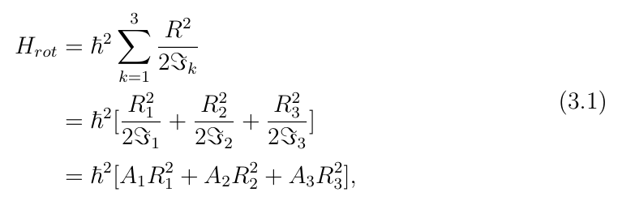

**中文:** 原式见上图；保留原符号、系数和单位写法，不在译文重写公式。

LaTeX transcription unavailable；公式以原图为准。

## PDF37／印刷页26

[原页视觉核验图](visual-pages/pdf037.png)

**Source:** PDF37／p.26 · S006

**Original:** where k = 1, 2, 3 are the intrinsic (body-fixed) axes, representing the intermediate, short and long axes respectively. The moments of inertia (MoI) ℑk, are usually described by the irrotational flow model and are defined as [20, 21]:

**中文:** 其中，$k=1,2,3$ 是内禀（体固连）轴，分别代表中轴、短轴和长轴。转动惯量（MoI）$\mathcal{J}_k$ 通常由无旋流模型描述，定义如下[20,21]：

**Source:** PDF37／p.26 · E002

**Original:** Eq.(3.2) · 原图回退

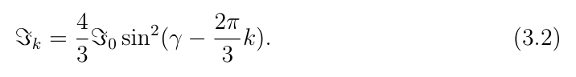

**中文:** 原式见上图；保留原符号、系数和单位写法，不在译文重写公式。

LaTeX transcription unavailable；公式以原图为准。

**Source:** PDF37／p.26 · S007

**Original:** Among them ℑ1 is the largest. For 0◦< γ < 30◦, ℑ1 > ℑ2 > ℑ3 and if 30◦< γ < 60◦, ℑ1 > ℑ3 > ℑ2. In this work irrotational-flow MoI’s are assumed as this choice is supported by experimental evidence [2]. The rotation proceeds mostly around the intermediate axis which is favored, as this axis has the largest MoI and thus rotation around this axis needs minimum energy. The Hamiltonian (equation 3.1) becomes:

**中文:** 其中 $\mathcal{J}_1$ 最大。在 $0^\circ<\gamma<30^\circ$ 时，$\mathcal{J}_1>\mathcal{J}_2>\mathcal{J}_3$；在 $30^\circ<\gamma<60^\circ$ 时，$\mathcal{J}_1>\mathcal{J}_3>\mathcal{J}_2$。本研究假定无旋流型转动惯量，因为这一选择得到实验证据支持[2]。转动主要绕有利的中轴进行：该轴转动惯量最大，因此绕该轴转动所需能量最低。哈密顿量（式3.1）变为：

**Source:** PDF37／p.26 · E003

**Original:** Eq.(3.3) · 原图回退

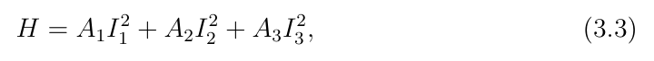

**中文:** 原式见上图；保留原符号、系数和单位写法，不在译文重写公式。

LaTeX transcription unavailable；公式以原图为准。

**Source:** PDF37／p.26 · S008

**Original:** where Ak = ℏ2/2ℑk. The solutions to the Hamiltonian presented in relation 3.3 is a series of rotational states, which include the ground-state band and several excited rotational bands. The excited bands are often termed γ−bands [74]. To distinguish these exited low-lying rotational states from the K = 2, K = 4, etc. γ−bands that result from the Bohr Hamiltonian [15], which are produced by coupling the rotational and vibration collective modes, the rotational bands in triaxial nuclei were called Tilted Precession Bands [42] as they represent the simultaneous precession of the nucleus around all three nuclear axes, see Section 3.2.1.

**中文:** 其中 $A_k=\hbar^2/(2\mathcal{J}_k)$。式3.3所示哈密顿量的解是一系列转动态，包括基态带和若干激发转动带。激发带常被称为 $\gamma$ 带[74]。为将这些激发的低能转动态与 Bohr 哈密顿量[15]中由转动、振动集体模式耦合产生的 $K=2$、$K=4$ 等 $\gamma$ 带区分开，三轴核中的这些转动带被称为倾斜进动带[42]，因为它们表征原子核同时绕三条核轴的进动，见3.2.1节。

**Source:** PDF37／p.26 · C001

### Figure 3.1

**Placed near:** PDF37 · C001

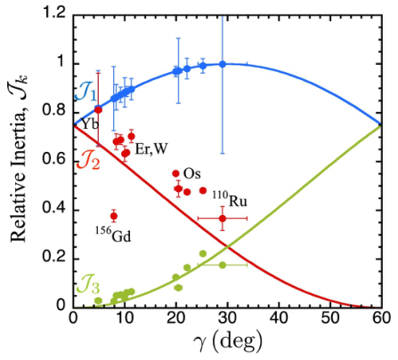

**Original:** Figure 3.1: Empirically measured MoIs for some nuclei as a function of the γ-deformation. Adapted from Ref. [2].

**中文:** 图3.1：若干原子核的经验测定转动惯量随 $\gamma$ 形变的变化。改编自文献[2]。

## PDF38／印刷页27

[原页视觉核验图](visual-pages/pdf038.png)

**Source:** PDF38／p.27 · S009

**Original:** The excited bands arise from the solutions of the 3D Hamiltonian. There is exactly one state with I = 0, no state with I = 1, two states with I = 2, one state with I = 3, three states with I = 4, two states with I = 5, four states with I = 6 etc. That is the spin sequence predicted by the model goes like: I = {0, 2, 2, 3, 4, 4, 4, 5, 5, 6, 6, 6, 6, ...}. These states can be organized in the following way to form rotational bands; the ground state band is formed by the lowest energy states with spin sequence I = 0, 2, 4, 6, ..., the first excited band consists of the sequence I = 2, 3, 4, 5, 6..., the next excited band is formed by I = 4, 5, 6, 7, 8.... The third excited band is made up of the spin sequence I = 6, 7, 8, ... with K = 6 etc. The arrangement of rotational states of a triaxial rotor is presented in Figure 3.2, and described in more details in the next section.

**中文:** 激发带来自三维哈密顿量的解。$I=0$ 恰有一个态，$I=1$ 没有态，$I=2$ 有两个态，$I=3$ 有一个态，$I=4$ 有三个态，$I=5$ 有两个态，$I=6$ 有四个态，依此类推。模型预言的自旋序列因而为 $I=\{0,2,2,3,4,4,4,5,5,6,6,6,6,\ldots\}$。这些态可以按如下方式组织成转动带：自旋 $I=0,2,4,6,\ldots$ 的最低能态构成基态带；第一激发带由 $I=2,3,4,5,6,\ldots$ 构成；下一激发带由 $I=4,5,6,7,8,\ldots$ 构成；第三激发带的自旋序列为 $I=6,7,8,\ldots$，$K=6$，等等。图3.2给出了三轴转子转动态的排列，下一节进一步讨论。

**Source:** PDF38／p.27 · S010

**Original:** 3.2.1 Tilted-precession bands

**中文:** 3.2.1　倾斜进动带

**Source:** PDF38／p.27 · S011

**Original:** Perhaps a better way to describe the excited rotational bands that result from the rotation of even-even triaxial nuclei is by modelling them as a consequence of the tilting of the total angular momentum vector⃗I away from the intermediate axis and precessing around this axis. As stated previously, the intermediate axis has the largest moment of inertia and rotation around this axis is preferred. At γ = 30◦the Hamiltonian (equation 3.3) exhibits a symmetry, and the moments of inertia along the short and long axes (2 and 3, respectively) are equal (ℑ2 = ℑ3). Thus one can write the Hamiltonian as [42]:

**中文:** 描述偶偶三轴核转动产生的激发转动带，一种也许更合适的方法，是把它们视为总角动量矢量 $\vec I$ 偏离中轴并绕中轴进动的结果。如前所述，中轴的转动惯量最大，绕它转动更有利。在 $\gamma=30^\circ$ 时，哈密顿量（式3.3）具有一种对称性：短轴和长轴（分别为2轴、3轴）的转动惯量相等，即 $\mathcal{J}_2=\mathcal{J}_3$。因此可以将哈密顿量写为[42]：

**Source:** PDF38／p.27 · E004

**Original:** Eq.(3.4) · 原图回退

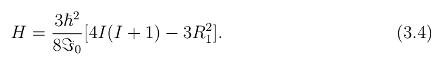

**中文:** 原式见上图；保留原符号、系数和单位写法，不在译文重写公式。

LaTeX transcription unavailable；公式以原图为准。

**Source:** PDF38／p.27 · S012

**Original:** The corresponding energy eigenvalues are:

**中文:** 相应的能量本征值为：

**Source:** PDF38／p.27 · E005

**Original:** Eq.(3.5) · 原图回退

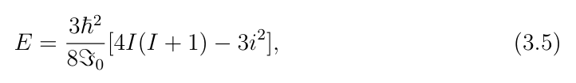

**中文:** 原式见上图；保留原符号、系数和单位写法，不在译文重写公式。

LaTeX transcription unavailable；公式以原图为准。

**Source:** PDF38／p.27 · S013

**Original:** where i is the projection of⃗I on the intermediate axis. When i = |I|, it corresponds to a full alignment of⃗I along the intermediate axis, see Figure 3.2 (d) and the resulting sequence of ∆I = 2 states forms the g.s. band as shown in Figure 3.2 (a). The excited bands are formed by tilting I away from the intermediate axis see panels (e) and (f) of Figure 3.2. When i = I −1 and i = I −2, the resulting

**中文:** 其中 $i$ 为 $\vec I$ 在中轴上的投影。当 $i=|I|$ 时，$\vec I$ 完全沿中轴排列，见图3.2(d)；所得 $\Delta I=2$ 态序列构成图3.2(a)所示基态带。激发带通过使 $I$ 偏离中轴而形成，见图3.2(e)、(f)。当 $i=I-1$ 和 $i=I-2$ 时，所得……〔原段下接PDF40〕

## PDF39／印刷页28

[原页视觉核验图](visual-pages/pdf039.png)

**Source:** PDF39／p.28 · C002

### Figure 3.2

**Placed near:** PDF39 · C002

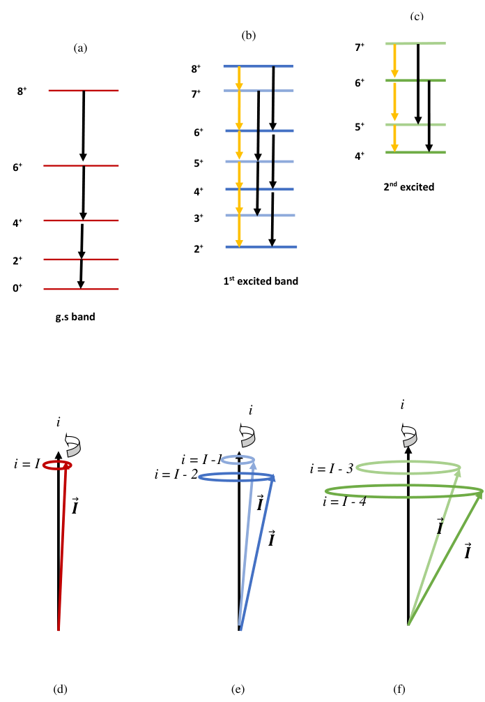

**Original:** Figure 3.2: Spectrum of a triaxial even-even rotor. Panel (a) shows the ground-state band, (i = I) (in red). Panel (b) shows the first excited band (blue states, i = I −2. light-blue states i = I −1). Panel (c) shows the second excited band (green states, i = I −4; light-green states, i = I −3). Black arrows denote E2 transitions, mixed M1+E2 transitions are represented by yellow arrows. Panels (d) −(f) show the corresponding tilting of the angular momentum vectors.

**中文:** 图3.2：三轴偶偶转子的能谱。(a)为基态带，$i=I$（红色）。(b)为第一激发带：蓝色态 $i=I-2$，浅蓝色态 $i=I-1$。(c)为第二激发带：绿色态 $i=I-4$，浅绿色态 $i=I-3$。黑色箭头表示E2跃迁，黄色箭头表示混合M1+E2跃迁。(d)至(f)为相应的角动量矢量倾斜。

## PDF40／印刷页29

[原页视觉核验图](visual-pages/pdf040.png)

**Source:** PDF40／p.29 · S014

**Original:** sequence of states are the ∆I = 2, odd- and even- spin sequences of the first excited band (shown in Figure 3.2 (b) in black), respectively. If i = I −3 and i = I −4, the corresponding rotational states form the odd- and even- spin sequences of the second excited band (shown in Figure 3.2 (c) in black). In fact, excited bands result when i < |I|, that is by tilting⃗I away from the intermediate axis.

**中文:** 〔续PDF38原段〕……态序列分别为第一激发带的 $\Delta I=2$ 奇自旋和偶自旋序列（图3.2(b)中以黑色显示）。如果 $i=I-3$ 和 $i=I-4$，对应转动态分别构成第二激发带的奇自旋和偶自旋序列（图3.2(c)中以黑色显示）。实际上，激发带出现在 $i<|I|$ 时，也就是 $\vec I$ 偏离中轴时。

**Source:** PDF40／p.29 · S015

**Original:** In odd-A nuclei, the rotational angular momentum of the core⃗R, is coupled to⃗j, the single-particle angular momentum of the nucleon (hole). Because the intermediate axis is the preferred axis of rotation for a triaxial rotor, generally⃗R points in this direction. The single-particle angular momentum⃗j can be coupled longitudinally (parallel) to⃗R or, transversely (perpendicular) to⃗R in the extreme limits [23]. The total angular momentum of a rotational state is the sum,⃗I =⃗R +⃗j. The Hamiltonian of the system for longitudinal and transverse coupling can be expressed as:

**中文:** 在奇质量核中，核芯的转动角动量 $\vec R$ 与核子（空穴）的单粒子角动量 $\vec j$ 耦合。中轴是三轴转子优先选择的转动轴，因此 $\vec R$ 一般指向该方向。在极限情况下，单粒子角动量 $\vec j$ 可与 $\vec R$ 纵向（平行）或横向（垂直）耦合[23]。一个转动态的总角动量为两者之和，$\vec I=\vec R+\vec j$。纵向和横向耦合系统的哈密顿量可写成：

**Source:** PDF40／p.29 · E006

**Original:** Eq.(3.6) · 原图回退

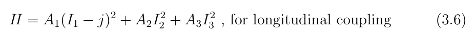

**中文:** 原式见上图；图中“for longitudinal coupling”意为“用于纵向耦合”。保留原符号与单位写法。

LaTeX transcription unavailable；公式以原图为准。

**Source:** PDF40／p.29 · S016

**Original:** and

**中文:** 以及

**Source:** PDF40／p.29 · E007

**Original:** Eq.(3.7) · 原图回退

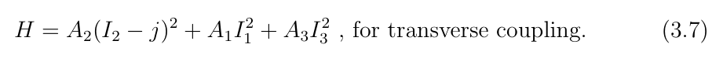

**中文:** 原式见上图；图中“for transverse coupling”意为“用于横向耦合”。保留原符号与单位写法。

LaTeX transcription unavailable；公式以原图为准。

**Source:** PDF40／p.29 · S017

**Original:** Longitudinal coupling results when the single-particle angular momentum⃗j is aligned along the intermediate axis. It occurs when the valence nucleon occupies an orbital near the middle of a given sub-shell. This results in a series of ∆I = 2 states that form the yrast rotational band starting offwith I = j and proceeds with I = j + 2, j + 4, j + 6, ... Excited bands result from tilting⃗I away from the intermediate axis. There are two distinct ways of doing this: (i) by tilting the collective angular momentum⃗R or, (ii) by tilting the single-particle angular momentum⃗j away from the intermediate axis.

**中文:** 当单粒子角动量 $\vec j$ 沿中轴排列时，形成纵向耦合。这出现在价核子占据给定子壳中部附近轨道的情形。它产生一系列 $\Delta I=2$ 态，构成从 $I=j$ 开始、随后为 $I=j+2,j+4,j+6,\ldots$ 的晕转动带。激发带由 $\vec I$ 偏离中轴形成。可以通过两种不同方式实现：(i)使集体角动量 $\vec R$ 偏离中轴，或(ii)使单粒子角动量 $\vec j$ 偏离中轴。

**Source:** PDF40／p.29 · S018

**Original:** When the single-particle angular momentum is transversely coupled to an even-even triaxial core,⃗R points mainly along the intermediate axis and⃗j points in a direction that is orthogonal to the intermediate axis, that is either along the short axis or along the long axis. In this case the valence nucleon occupies an orbital near the bottom (top) of a given sub-shell and points along the short (long) nuclear axis as it behaves as a particle (hole). The angular momentum in a transversely coupled rotational band can be generated in two ways; (i) by increasing R||, the component of the rotational angular momentum along the intermediate axis which

**中文:** 当单粒子角动量与偶偶三轴核芯横向耦合时，$\vec R$ 主要沿中轴，$\vec j$ 指向垂直于中轴的方向，即短轴或长轴。在此情形，价核子占据给定子壳底部（顶部）附近的轨道，作为粒子（空穴）而沿短（长）核轴取向。横向耦合转动带可通过两种方式产生角动量：(i)增大 $R_{\parallel}$，即沿中轴的转动角动量分量，这会……〔续下页〕

## PDF41／印刷页30

[原页视觉核验图](visual-pages/pdf041.png)

**Source:** PDF41／p.30 · S019

**Original:** results in bands of ∆I = 1 nature or, (ii) by increasing R⊥, the rotational angular momentum along the perpendicular axis, which results in bands of ∆I = 2 nature.

**中文:** 〔续上页原段〕……产生 $\Delta I=1$ 类型的能带；或(ii)增大 $R_{\perp}$，即沿垂直轴的转动角动量，产生 $\Delta I=2$ 类型的能带。

**Source:** PDF41／p.30 · S020

**Original:** For bands of ∆I = 1 type and when the nuclear shape is axially symmetric the projections on the symmetry axis of the total angular momentum, K, and the single-particle angular momentum, Ω, are good quantum numbers. The band is built on the I = Ω= K state, and proceeds with K + 1, K + 2, K + 3, ..., forming the yrast band shown in black in panel (a) of Figure 3.3. High spin states in the yrast band are formed by increasing the rotational angular momentum along the intermediate axis (R||). Due to triaxiality additional rotational bands are brought down in energy, shown in blue and red in panel (a) of Figure 3.3. K and Ωare not good quantum numbers in the triaxial case, however, it has been shown that for a nucleon in an i13/2 or h11/2 sub-shell and γ ≈30◦, K and Ωare approximately good quantum numbers, particularly near the bandhead [51].

**中文:** 对于 $\Delta I=1$ 类型的能带，当核形状轴对称时，总角动量及单粒子角动量在对称轴上的投影 $K$、$\Omega$ 都是好量子数。能带建立在 $I=\Omega=K$ 态上，随后为 $K+1,K+2,K+3,\ldots$，形成图3.3(a)中黑色的晕带。晕带中的高自旋态通过增大沿中轴的转动角动量 $R_{\parallel}$ 形成。三轴性使额外转动带的能量降低，图3.3(a)用蓝色和红色表示。在三轴情况下 $K$、$\Omega$ 不是好量子数；但已有研究表明，对处于 $i_{13/2}$ 或 $h_{11/2}$ 子壳、且 $\gamma\approx30^\circ$ 的核子而言，特别是在带头附近，$K$、$\Omega$ 近似为好量子数[51]。

**Source:** PDF41／p.30 · S021

**Original:** To generate excited bands of ∆I = 1 nature the nucleus increases its rotation along the orthogonal axis (long or short, depending on the orientation of⃗j) by R⊥≈2ℏ. Thus the first excited band must have a bandhead of I ≈Ω+ 2. For instance a first excited band built on the h11/2 orbital with Ω= 9/2 has a bandhead of I = 13/2. It consists of states with I = 13/2, 15/2, 17/2, 19/2..., shown in blue in panel (a) of Figure 3.3. A second excited band is created by a further increase of ≈2ℏin R⊥, shown in red in panel (a) of Figure 3.3. Panel (b) of Figure 3.3 shows the generation of angular momentum for the yrast band (black), the first excited band (blue), and the second excited band (red). The symbols || and ⊥ denote components along the intermediate axis and in a direction orthogonal to the intermediate axis, respectively.

**中文:** 要产生 $\Delta I=1$ 类型的激发带，原子核沿垂直轴（长轴或短轴，取决于 $\vec j$ 的方向）的转动增加约 $R_{\perp}\approx2\hbar$。因此第一激发带的带头应约为 $I\approx\Omega+2$。例如，建立在 $\Omega=9/2$ 的 $h_{11/2}$ 轨道上的第一激发带，其带头为 $I=13/2$；它包含 $I=13/2,15/2,17/2,19/2,\ldots$ 态，如图3.3(a)蓝色所示。$R_{\perp}$ 再增加约 $2\hbar$ 便形成第二激发带，如图3.3(a)红色所示。图3.3(b)给出了晕带（黑色）、第一激发带（蓝色）和第二激发带（红色）的角动量产生机制。符号 $\parallel$、$\perp$ 分别表示沿中轴和垂直于中轴方向的分量。

**Source:** PDF41／p.30 · S022

**Original:** The rotational bands can be classified by the projection of the single-particle angular momentum on the orthogonal axis Ω⊥, the projection of the total angular momentum on the orthogonal axis K⊥, and the projection of the rotational angular momentum on the orthogonal axis R⊥; (Ω⊥, K⊥, R⊥). The yrast band consists of states with (Ω⊥, K⊥, R⊥) = (9/2, 9/2, 0), the first excited band consists of states with (Ω⊥, K⊥, R⊥) = (9/2, 13/2, 2), and the second excited band consists of states with (Ω⊥, K⊥, R⊥) = (9/2, 17/2, 4).

**中文:** 可按单粒子角动量、总角动量及转动角动量在垂直轴上的投影 $\Omega_{\perp}$、$K_{\perp}$、$R_{\perp}$ 对转动带分类，记为 $(\Omega_{\perp},K_{\perp},R_{\perp})$。晕带由 $(9/2,9/2,0)$ 态构成；第一激发带由 $(9/2,13/2,2)$ 态构成；第二激发带由 $(9/2,17/2,4)$ 态构成。

**Source:** PDF41／p.30 · S023

**Original:** The bands of ∆I = 2 type can form when the strength of the Coriolis interaction is strong [44]. It is possible in some nuclei that the states with the same spin I and R⊥≈2 lie lower in energy than the states with R⊥≈0. For instance in 135Pr

**中文:** 当 Coriolis 相互作用较强时，可形成 $\Delta I=2$ 类型的能带[44]。在某些核中，同一自旋 $I$、$R_{\perp}\approx2$ 的态可能低于 $R_{\perp}\approx0$ 的态。例如在 $^{135}\mathrm{Pr}$ 中……〔续下页〕

## PDF42／印刷页31

[原页视觉核验图](visual-pages/pdf042.png)

**Source:** PDF42／p.31 · C003

### Figure 3.3

**Placed near:** PDF42 · C003

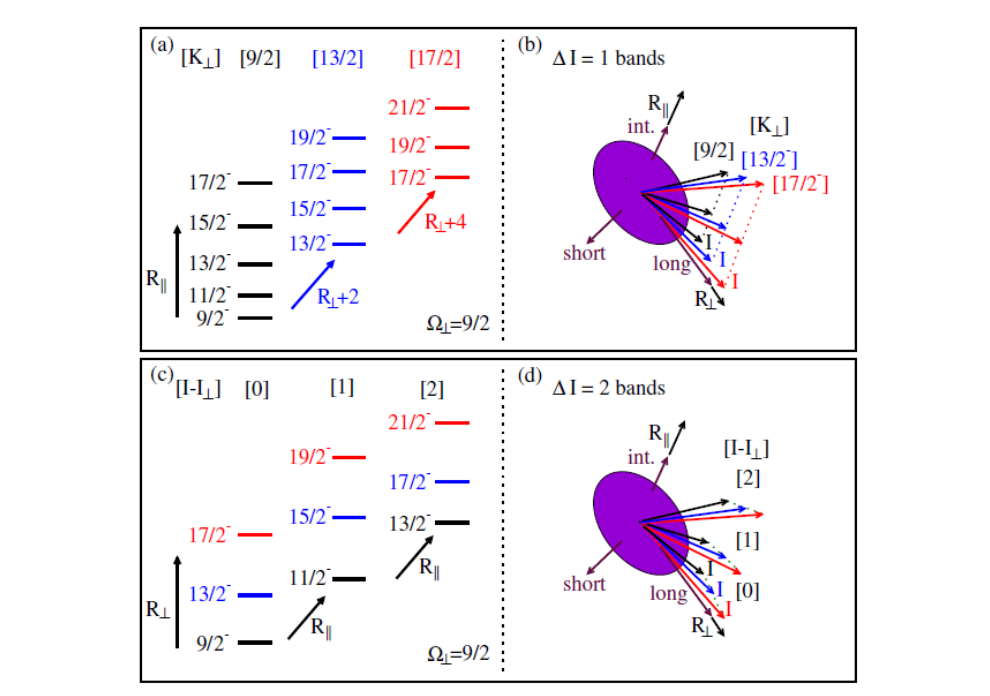

**Original:** Figure 3.3: An illustration of transversely coupled for bands in odd-A triaxial nuclei based on the h11/2 orbital with Ω= 9/2. Panel (a) shows ∆I = 1 bands and panel (b) illustrates the angular momentum generation mechanism. Panel (c) shows bands of ∆I = 2 nature and panel (c) shows the corresponding mechanism of angular momentum generation. Adapted from Ref. [44].

**中文:** 图3.3：基于 $\Omega=9/2$ 的 $h_{11/2}$ 轨道，示意奇质量三轴核中横向耦合的能带。(a)为 $\Delta I=1$ 带；(b)示意角动量产生机制。(c)为 $\Delta I=2$ 类型的带；图注接着仍写(c)，表示相应角动量产生机制。改编自文献[44]。

**Source:** PDF42／p.31 · S024

**Original:** the 13/2 state with the configuration (Ω⊥, K⊥, R⊥) = (9/2, 13/2, 2), lies lower in energy than the 13/2 state with configuration (Ω⊥, K⊥, R⊥) = (9/2, 13/2, 2) [45]. In this case the yrast rotational band consists of states with the lowest energy, which do not have the same (Ω⊥, K⊥, R⊥). In fact, each state in the rotational band with I > Ω⊥has an extra 2ℏof angular momentum than the immediately preceding state forming ∆I = 2 nature rotational states of the band, thus in such bands the rotation proceeds along the orthogonal axis. This is illustrated in panel (c) of Figure 3.3. Excited rotational bands are formed by increasing the rotational angular momentum along the intermediate axis. The first excited band has a bandhead spin of Ibandhead = Ω+ 1 and proceeds with the spin sequence; I = Ibandhead + 2, Ibandhead + 4, Ibandhead + 6, .... The next excited band is built on a state with extra 1ℏthan the bandhead spin of the immediately preceding rotational band. Panel (c) of Figure 3.3 illustrates the ∆I = 2 type rotational bands and panel (d) of Figure 3.3 represents the mechanisms of angular momentum generation.

**中文:** 〔续上页原段〕……组态 $(\Omega_{\perp},K_{\perp},R_{\perp})=(9/2,13/2,2)$ 的13/2态，低于组态同样写成 $(9/2,13/2,2)$ 的13/2态[45]。在此情况下，晕转动带由最低能态构成，它们不具有同一组 $(\Omega_{\perp},K_{\perp},R_{\perp})$。实际上，在 $I>\Omega_{\perp}$ 的转动带中，每个态相对紧邻的前一态多 $2\hbar$ 角动量，形成 $\Delta I=2$ 的转动态；因此这类能带沿垂直轴转动，如图3.3(c)所示。增大沿中轴的转动角动量会形成激发转动带。第一激发带带头自旋为 $I_{\mathrm{bandhead}}=\Omega+1$，随后为 $I=I_{\mathrm{bandhead}}+2,I_{\mathrm{bandhead}}+4,I_{\mathrm{bandhead}}+6,\ldots$。下一激发带建立在比前一带带头多 $1\hbar$ 的态上。图3.3(c)示意 $\Delta I=2$ 类型的转动带；(d)表示角动量产生机制。

## PDF43／印刷页32

[原页视觉核验图](visual-pages/pdf043.png)

**Source:** PDF43／p.32 · S025

**Original:** 3.2.2 Nuclear wobbling motion

**中文:** 3.2.2　原子核摆动运动

**Source:** PDF43／p.32 · S026

**Original:** Nuclear wobbling motion was proposed by Bohr and Mottelson for even-even nuclei in Ref. [15] as a collective mode of excitation which results when the nuclear density distribution along the three principle nuclear axes is unequal. For even-even triaxial rotors, the wobbling approximation replaces the 3D rotational Hamiltonian (equation 3.3) by simple 1D rotation coupled to wobbling phonon excitations,

**中文:** Bohr 和 Mottelson 在文献[15]中为偶偶核提出了核摆动运动：当核密度分布沿三条核主轴不相同时，产生这种集体激发模式。对偶偶三轴转子，摆动近似以简单一维转动耦合摆动声子激发，替代三维转动哈密顿量（式3.3）：

**Source:** PDF43／p.32 · E008

**Original:** Eq.(3.8) · 原图回退

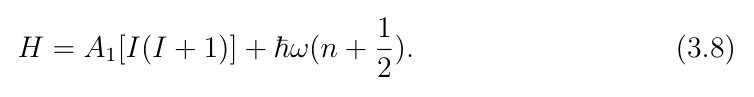

**中文:** 原式见上图；保留原符号、系数和单位写法，不在译文重写公式。

LaTeX transcription unavailable；公式以原图为准。

**Source:** PDF43／p.32 · S027

**Original:** The solutions of the wobbling Hamiltonian describe a set of rotational bands called wobbling bands, where ω is the wobbling frequency, n = 0, 1, 2, ... is the number of excited wobbling phonons, where n = 0 corresponds to the g.s. band, n = 1 and n = 2 correspond to the odd and even spin sequences of the first excited (γ-) band, respectively etc. In fact each phonon excitation corresponds to an excited rotational band. Within the wobbling approximation, each phonon excitation causes a tilt of the rotational angular momentum away from the intermediate axis.

**中文:** 摆动哈密顿量的解描述一组称为摆动带的转动带。其中 $\omega$ 为摆动频率，$n=0,1,2,\ldots$ 为被激发的摆动声子数；$n=0$ 对应基态带，$n=1$ 和 $n=2$ 分别对应第一激发（$\gamma$）带的奇自旋和偶自旋序列，依此类推。实际上，每一个声子激发对应一个激发转动带。在摆动近似内，每次声子激发都会使转动角动量偏离中轴。

**Source:** PDF43／p.32 · S028

**Original:** The wobbling frequency, ω is defined by the relation:

**中文:** 摆动频率 $\omega$ 由下式定义：

**Source:** PDF43／p.32 · E009

**Original:** Eq.(3.9) · 原图回退

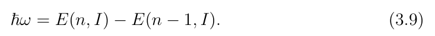

**中文:** 原式见上图；保留原符号、系数和单位写法，不在译文重写公式。

LaTeX transcription unavailable；公式以原图为准。

**Source:** PDF43／p.32 · S029

**Original:** Wobbling bands exhibit characteristic quantized behaviour for the excitation energies and transition probabilities. In particular:

**中文:** 摆动带的激发能和跃迁概率表现出特征性的量子化行为。具体而言：

**Source:** PDF43／p.32 · S030

**Original:** (i) the energy of a rotational band has a linear dependence on n as;

**中文:** (i)转动带的能量线性依赖于 $n$：

**Source:** PDF43／p.32 · E010

**Original:** Eq.(3.10) · 原图回退

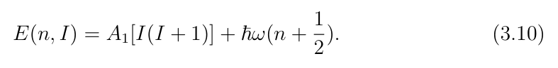

**中文:** 原式见上图；保留原符号、系数和单位写法，不在译文重写公式。

LaTeX transcription unavailable；公式以原图为准。

**Source:** PDF43／p.32 · S031

**Original:** This relationship is manifested as equal spacing of excitation energies between two successive wobbling bands, for instance the excitation energy plots of the wobbling bands corresponding to n = 0 and n = 1 have the same energy spacing as that between wobbling bands with n = 1 and n = 2.

**中文:** 这种关系表现为相邻两条摆动带的激发能等间隔。例如，$n=0$ 与 $n=1$ 摆动带激发能曲线之间的间距，与 $n=1$ 和 $n=2$ 摆动带之间的间距相同。

## PDF44／印刷页33

[原页视觉核验图](visual-pages/pdf044.png)

**Source:** PDF44／p.33 · S032

**Original:** (ii) the intraband B(E2) transition probabilities are identical for all wobbling bands, because they all correspond to rotations around the same axis−the intermediate axis;

**中文:** (ii)所有摆动带内的 $B(E2)$ 跃迁概率相同，因为它们都对应绕同一轴——中轴——的转动：

**Source:** PDF44／p.33 · E011

**Original:** Eq.(3.11) · 原图回退

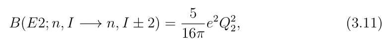

**中文:** 原式见上图；保留原符号、系数和单位写法，不在译文重写公式。

LaTeX transcription unavailable；公式以原图为准。

**Source:** PDF44／p.33 · S033

**Original:** (iii) the interband B(E2) transition probabilities are linearly dependent on n, as they link bands with different phonon excitations;

**中文:** (iii)带间 $B(E2)$ 跃迁概率线性依赖于 $n$，因为它们连接不同声子激发的能带：

**Source:** PDF44／p.33 · E012

**Original:** Eq.(3.12) · 原图回退

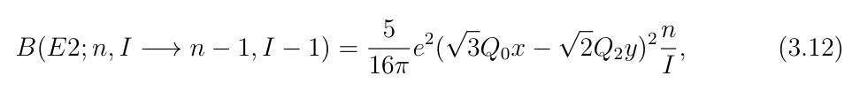

**中文:** 原式见上图；保留原符号、系数和单位写法，不在译文重写公式。

LaTeX transcription unavailable；公式以原图为准。

**Source:** PDF44／p.33 · S034

**Original:** where Q0 and Q2 denote the intrinsic and spectroscopic quadrupole moments, respectively. The wobbling approximation of the 3D rotational Hamiltonian is only valid at high spins [15]. Probably that is why wobbling had not been observed so far at low spins in even-even nuclei. Wobbling motion was observed experimentally in the A ≈160 mass region, in the odd-A, 161−167Lu and 167Ta isotopes, and the rotational bands corresponded to triaxial superdeformed nuclear shapes [4, 16, 31, 34, 55, 63].

**中文:** 其中 $Q_0$、$Q_2$ 分别表示内禀四极矩和谱学四极矩。三维转动哈密顿量的摆动近似仅在高自旋处有效[15]。这也许正是迄今尚未在偶偶核低自旋处观察到摆动的原因。在 $A\approx160$ 质量区的奇质量 $^{161\text{–}167}\mathrm{Lu}$ 和 $^{167}\mathrm{Ta}$ 中，已从实验观察到摆动运动；这些转动带对应三轴超形变核形状[4,16,31,34,55,63]。

**Source:** PDF44／p.33 · S035

**Original:** Recently nuclear wobbling was investigated in odd-mass nuclei by Frauendorf and D¨onau [23], and the concepts of transverse and longitudinal wobbling were proposed depending on whether the single-particle angular momentum was oriented perpendicular or parallel to the intermediate axis, respectively. Longitudinal (transverse) wobbling bands are expected to have (i) increasing (decreasing) wobbling frequency with increasing spin and, (ii) the B(E2; n, I −→n −1, I −1) and B(M1; n, I −→n−1, I−1) reduced transition probabilities should be proportional to n.

**中文:** 近期 Frauendorf 和 Dönau 研究了奇质量核中的摆动[23]，按单粒子角动量分别垂直或平行于中轴的情况，提出横向和纵向摆动的概念。预期纵向（横向）摆动带具有：(i)摆动频率随自旋增大而升高（降低）；(ii)约化跃迁概率 $B(E2;n,I\to n-1,I-1)$ 和 $B(M1;n,I\to n-1,I-1)$ 应正比于 $n$。

**Source:** PDF44／p.33 · S036

**Original:** In addition two wobbling bands based on the same one-quasiparticle configuration and differing by one wobbling phonon ∆n = 1, should be linked with ∆I = 1, M1 + E2 transitions with dominant E2 nature, that is with a mixing ratio |δ| > 1. Therefore, measuring mixing ratios with magnitudes larger than one is the necessary supporting experimental evidence for the wobbling interpretation. Mixing ratios with magnitudes larger than one were reported for several linking transitions in 135Pr, 105Pd, 183Au, 133La, 187Au, 130Ba and 127Xe [49, 65], [73], [53], [14], [64], [18, 58], [17]. However, recently these results were questioned [27, 29, 45]

**中文:** 此外，两条建立在同一单准粒子组态上、相差一个摆动声子 $\Delta n=1$ 的摆动带，应由以E2成分为主的 $\Delta I=1$ 混合M1+E2跃迁连接，即混合比 $|\delta|>1$。因此，测得模大于1的混合比，是支持摆动解释所必需的实验证据。已有报道在 $^{135}\mathrm{Pr}$、$^{105}\mathrm{Pd}$、$^{183}\mathrm{Au}$、$^{133}\mathrm{La}$、$^{187}\mathrm{Au}$、$^{130}\mathrm{Ba}$ 和 $^{127}\mathrm{Xe}$ 的若干连接跃迁中得到模大于1的混合比，引用依次为[49,65]、[73]、[53]、[14]、[64]、[18,58]、[17]。但近期这些结果受到质疑[27,29,45]……〔续下页〕

## PDF45／印刷页34

[原页视觉核验图](visual-pages/pdf045.png)

**Source:** PDF45／p.34 · S037

**Original:** and new experimental data suggesting that the mixing ratios are in fact less than one were shown for 135Pr [44].

**中文:** 〔续上页原段〕……并且 $^{135}\mathrm{Pr}$ 的新实验数据提示混合比实际上小于1[44]。

**Source:** PDF45／p.34 · S038

**Original:** 3.3 The Quasiparticle-Plus-Triaxial Rotor (QTR) Model Formalism

**中文:** 3.3　准粒子加三轴转子（QTR）模型形式体系

**Source:** PDF45／p.34 · S039

**Original:** The quasiparticle-plus-triaxial rotor (QTR) model has been used extensively to study triaxiality in odd-mass atomic nuclei [44, 52, 61]. The model Hamiltonian takes the form;

**中文:** 准粒子加三轴转子（QTR）模型已被广泛用于研究奇质量原子核的三轴性[44,52,61]。模型哈密顿量采用下列形式：

**Source:** PDF45／p.34 · E013

**Original:** Eq.(3.13) · 原图回退

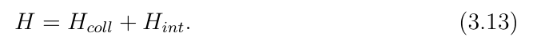

**中文:** 原式见上图；保留原符号、系数和单位写法，不在译文重写公式。

LaTeX transcription unavailable；公式以原图为准。

**Source:** PDF45／p.34 · S040

**Original:** The collective component of the Hamiltonian was discussed in Sections 2.4.2 and 3.2. In the presence of a valence nucleon, the Hamiltonian can be written down as:

**中文:** 哈密顿量的集体部分已在2.4.2和3.2节讨论。在存在一个价核子的情况下，哈密顿量可写为：

**Source:** PDF45／p.34 · E014

**Original:** Eq.(3.14) · 原图回退

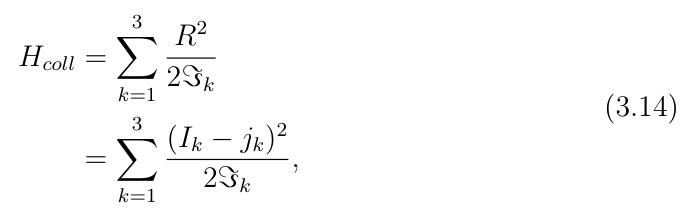

**中文:** 原式见上图；保留原符号、系数和单位写法，不在译文重写公式。

LaTeX transcription unavailable；公式以原图为准。

**Source:** PDF45／p.34 · S041

**Original:** where⃗I,⃗R,⃗j have their usual meaning as the total, collective core, and the singleparticle angular momentum vectors and⃗R =⃗I −⃗j. The ℑk are the moments of inertia along the k axis, with k = 1, 2, 3. Irrotational-flow type moments of inertia are assumed.

**中文:** 其中 $\vec I$、$\vec R$、$\vec j$ 分别按通常含义表示总角动量、集体核芯角动量及单粒子角动量，并有 $\vec R=\vec I-\vec j$。$\mathcal{J}_k$ 是沿 $k$ 轴的转动惯量，$k=1,2,3$。这里假定无旋流型转动惯量。

**Source:** PDF45／p.34 · S042

**Original:** 3.3.1 QTR energies and wavefunctions

**中文:** 3.3.1　QTR能量和波函数

**Source:** PDF45／p.34 · S043

**Original:** The intrinsic part of the Hamiltonian can be written down as,

**中文:** 哈密顿量的内禀部分可写为：

## PDF46／印刷页35

[原页视觉核验图](visual-pages/pdf046.png)

**Source:** PDF46／p.35 · E015

**Original:** Eq.(3.15) · 原图回退

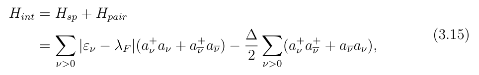

**中文:** 原式见上图；保留原符号、系数和单位写法，不在译文重写公式。

LaTeX transcription unavailable；公式以原图为准。

**Source:** PDF46／p.35 · S044

**Original:** where $\lambda_F$ denotes the Fermi energy, $\Delta$ is the pairing gap parameter and is calculated following particle conservation [51] and $|\bar\nu\rangle$ is the time-reversal state of $|\nu\rangle$. The single-particle states $|\nu\rangle$ and the corresponding energies are obtained by diagonalizing the Hamiltonian $H_{sp}$. Similar to Refs. [39, 62], a Nilsson type Hamiltonian is employed,

**中文:** 其中 $\lambda_F$ 为费米能，$\Delta$ 为配对能隙参数，按粒子数守恒条件计算[51]；$|\bar\nu\rangle$ 为 $|\nu\rangle$ 的时间反演态。单粒子态 $|\nu\rangle$ 及相应能量通过对角化 $H_{\mathrm{sp}}$ 得到。与文献[39,62]类似，这里采用 Nilsson 型哈密顿量：

**Source:** PDF46／p.35 · E016

**Original:** Eq.(3.16) · 原图回退

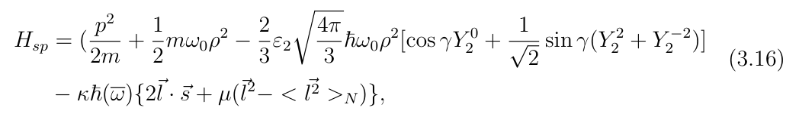

**中文:** 原式见上图；保留原符号、系数和单位写法，不在译文重写公式。

LaTeX transcription unavailable；公式以原图为准。

**Source:** PDF46／p.35 · S045

**Original:** with ρ as the radius in a stretched coordinate system, ε2 and γ are the usual Nilsson deformation parameters, Y ±2 2 and Y 0 2 are the second-order spherical harmonics, and κ and µ are the standard Nilsson parameters.

**中文:** 其中 $\rho$ 为拉伸坐标系中的半径，$\varepsilon_2$、$\gamma$ 是通常的 Nilsson 形变参数，$Y_2^{\pm2}$、$Y_2^0$ 为二阶球谐函数，$\kappa$、$\mu$ 为标准 Nilsson 参数。

**Source:** PDF46／p.35 · S046

**Original:** The single-particle states are written as;

**中文:** 单粒子态写为：

**Source:** PDF46／p.35 · E017

**Original:** Unnumbered single-particle expansion · 原图回退

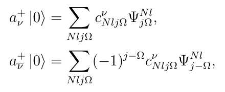

**中文:** 原式见上图；保留原符号、系数和单位写法，不在译文重写公式。

LaTeX transcription unavailable；公式以原图为准。

**Source:** PDF46／p.35 · S047

**Original:** where Ωis the projection of the single-particle angular momentum operator j on the 3-axis and is restricted to the values ..., −7/2, −3/2, +1/2, +5/2, ... due to time reversal degeneracy [51].

**中文:** 其中 $\Omega$ 为单粒子角动量算符 $j$ 在3轴上的投影；由于时间反演简并，它被限制为 $\ldots,-7/2,-3/2,+1/2,+5/2,\ldots$ [51]。

**Source:** PDF46／p.35 · S048

**Original:** The QTR model solutions can be obtained by diagonalizing the Hamiltonian (equation 3.13) in a complete basis space, which couples the inert core with the intrinsic wavefunctions of the valence nucleon. When the pairing interaction is ignored, a strong coupling basis can be constructed as;

**中文:** 将惰性核芯与价核子的内禀波函数耦合，在完整基空间中对角化哈密顿量（式3.13），可得到QTR模型的解。忽略配对相互作用时，可构造强耦合基：

## PDF47／印刷页36

[原页视觉核验图](visual-pages/pdf047.png)

**Source:** PDF47／p.36 · E018

**Original:** Eq.(3.17) · 原图回退

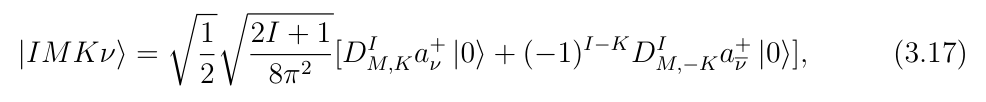

**中文:** 原式见上图；保留原符号、系数和单位写法，不在译文重写公式。

LaTeX transcription unavailable；公式以原图为准。

**Source:** PDF47／p.36 · S049

**Original:** where $D^I_{M,K}$ denote the rotational $D$ functions, which describe transformations between differently oriented coordinate systems. In the equation above, $K$ assumes the values of ..., $-7/2,-3/2,+1/2,+5/2$, ... and the restriction on $K$ is due to the fact that the basis states are symmetrized under the point group $D_2$, which requires the wave function to be invariant under a rotation of $180^\circ$ around the body-fixed $\hat1$-axis, this leads to $K-\Omega$ being an even integer [40]. The matrix elements of $H_{coll}$ and $H_{int}$ can be evaluated in this basis (equation 3.17), and the diagonalization yields the eigenenergies and eigenstates of the QTR model Hamiltonian.

**中文:** 其中 $D^I_{M,K}$ 表示转动D函数，描述不同取向坐标系之间的变换。上式中 $K$ 取 $\ldots,-7/2,-3/2,+1/2,+5/2,\ldots$。对 $K$ 的限制源自基态在点群 $D_2$ 下的对称化：该条件要求波函数绕体固连 $\hat1$ 轴转动180°后不变，由此得到 $K-\Omega$ 为偶整数[40]。可在这一基（式3.17）中计算 $H_{\mathrm{coll}}$、$H_{\mathrm{int}}$ 的矩阵元；对角化给出QTR模型哈密顿量的本征能和本征态。

**Source:** PDF47／p.36 · S050

**Original:** Pairing effects can be included in a straightforward manner in the QTR model by replacing the single-particle state $a_\nu^+|0\rangle$ in the basis state (equation 3.17) with BCS quasiparticle state $a_\nu^+|\tilde0\rangle$ to get a new expansion basis, where $|\tilde0\rangle$ is the BCS vacuum state. The quasiparticle operators $\alpha_\nu^+$ are given by;

**中文:** 在QTR模型中，可以直接纳入配对效应：把基态（式3.17）中的单粒子态 $a_\nu^+|0\rangle$ 替换成BCS准粒子态（本段原文写成 $a_\nu^+|\tilde0\rangle$），得到新的展开基，其中 $|\tilde0\rangle$ 是BCS真空态。准粒子算符 $\alpha_\nu^+$ 给为：

**Source:** PDF47／p.36 · E019

**Original:** Eq.(3.18) · 原图回退

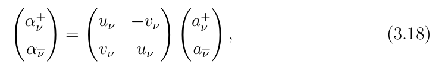

**中文:** 原式见上图；保留原符号、系数和单位写法，不在译文重写公式。

LaTeX transcription unavailable；公式以原图为准。

**Source:** PDF47／p.36 · S051

**Original:** where $u_\nu^2+v_\nu^2=1$. In this new basis, the wavefunctions of the QTR Hamiltonian can be written as;

**中文:** 其中 $u_\nu^2+v_\nu^2=1$。在新基中，QTR哈密顿量的波函数可写为：

**Source:** PDF47／p.36 · E020

**Original:** Eq.(3.19) · 原图回退

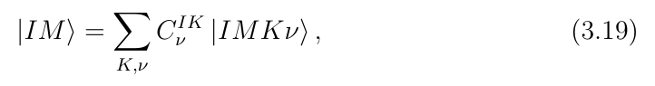

**中文:** 原式见上图；保留原符号、系数和单位写法，不在译文重写公式。

LaTeX transcription unavailable；公式以原图为准。

**Source:** PDF47／p.36 · S052

**Original:** here $\nu$ represents the quasiparticle states $\alpha_\nu^+|\tilde0\rangle$ instead of the single-particle states $a_\nu^+$. The single-particle energies $\varepsilon_\nu$ must be replaced by the quasiparticle energies $\varepsilon_\nu^{\prime}=\sqrt{(\varepsilon_\nu-\lambda_F)^2+\Delta^2}$. The total Hamiltonian is expressed as;

**中文:** 这里 $\nu$ 表示准粒子态 $\alpha_\nu^+|\tilde0\rangle$，而非单粒子态 $a_\nu^+$。单粒子能量 $\varepsilon_\nu$ 必须换成准粒子能量 $\varepsilon_\nu^{\prime}=\sqrt{(\varepsilon_\nu-\lambda_F)^2+\Delta^2}$。总哈密顿量写为：

**Source:** PDF47／p.36 · E021

**Original:** Eq.(3.20) · 原图回退

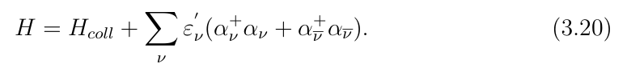

**中文:** 原式见上图；保留原符号、系数和单位写法，不在译文重写公式。

LaTeX transcription unavailable；公式以原图为准。

## PDF48／印刷页37

[原页视觉核验图](visual-pages/pdf048.png)

**Source:** PDF48／p.37 · S053

**Original:** The Hamiltonian in relation 3.14 possesses a particle-hole symmetry arising from the permutations of the intrinsic nuclear axes [51]. One consequence of this symmetry is that a particle coupled to a core with parameters (ε2, γ, λF) and a quasiparticle (hole) coupled to a core with parameters (ε2, 60◦−γ, −λF) have exactly same energy spectrum.

**中文:** 式3.14中的哈密顿量具有源自核内禀轴置换的粒子—空穴对称性[51]。一个结果是：与参数 $(\varepsilon_2,\gamma,\lambda_F)$ 核芯耦合的粒子，与参数 $(\varepsilon_2,60^\circ-\gamma,-\lambda_F)$ 核芯耦合的准粒子（空穴），具有完全相同的能谱。

**Source:** PDF48／p.37 · S054

**Original:** 3.3.2 QTR transitions probabilities

**中文:** 3.3.2　QTR跃迁概率

**Source:** PDF48／p.37 · S055

**Original:** Electromagnetic transition probabilities are given as in Ref. [15], and have the general form;

**中文:** 电磁跃迁概率按文献[15]给出，一般形式为：

**Source:** PDF48／p.37 · E022

**Original:** Eq.(3.21) · 原图回退

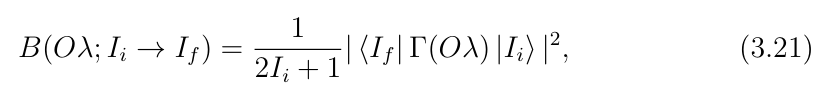

**中文:** 原式见上图；保留原符号、系数和单位写法，不在译文重写公式。

LaTeX transcription unavailable；公式以原图为准。

**Source:** PDF48／p.37 · S056

**Original:** where Γ(Oλ) is the electromagnetic operator, O stands for the type of operator (magnetic/electric), λ is the order of the transition, B is the reduced transition probability and |Ii⟩and ⟨If| stand for the initial state before the transition, and the Hermitian conjugate of the final state after the transition. The magnetic dipole (λ = 1) moment operator is defined as;

**中文:** 其中 $\Gamma(O\lambda)$ 是电磁算符，$O$ 代表算符类型（磁/电），$\lambda$ 为跃迁阶数，$B$ 为约化跃迁概率；$|I_i\rangle$ 和 $\langle I_f|$ 分别表示跃迁前的初态及跃迁后末态的厄米共轭。磁偶极（$\lambda=1$）矩算符定义为：

**Source:** PDF48／p.37 · E023

**Original:** Eq.(3.22) · 原图回退

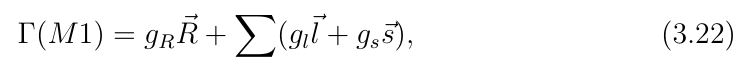

**中文:** 原式见上图；保留原符号、系数和单位写法，不在译文重写公式。

LaTeX transcription unavailable；公式以原图为准。

**Source:** PDF48／p.37 · S057

**Original:** the sum is performed over the odd particle(s), gR = Z/A is the core g-factor, gl and gs are the single-particle orbital angular momentum and spin g-factors, respectively [36].⃗R,⃗l and⃗s have their usual meanings. The electric quadruple (λ = 2) operator is defined as;

**中文:** 求和遍历奇粒子；$g_R=Z/A$ 为核芯g因子，$g_l$、$g_s$ 分别为单粒子轨道角动量及自旋g因子[36]。$\vec R$、$\vec l$、$\vec s$ 取通常含义。电四极（$\lambda=2$）算符定义为：

**Source:** PDF48／p.37 · E024

**Original:** Eq.(3.23) · 原图回退

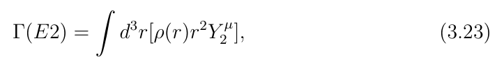

**中文:** 原式见上图；保留原符号、系数和单位写法，不在译文重写公式。

LaTeX transcription unavailable；公式以原图为准。

**Source:** PDF48／p.37 · S058

**Original:** which splits into a dominant core component and an odd particle(s) component. The mixing ratio, δE2/M1, is defined as;

**中文:** 它可分为占主导的核芯部分和奇粒子部分。混合比 $\delta_{E2/M1}$ 定义为：

**Source:** PDF48／p.37 · E025

**Original:** Eq.(3.24) · 原图回退

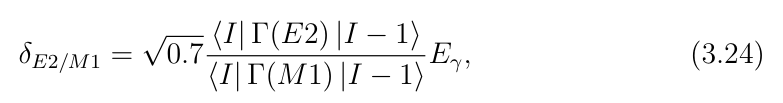

**中文:** 原式见上图；保留原符号、系数和单位写法，不在译文重写公式。

LaTeX transcription unavailable；公式以原图为准。

## PDF49／印刷页38

[原页视觉核验图](visual-pages/pdf049.png)

**Source:** PDF49／p.38 · S059

**Original:** where Γ(E2) and Γ(M1) are the electric quadruple and magnetic dipole operators and Eγ is the γ-ray energy, which corresponds to the usual definition of

**中文:** 其中 $\Gamma(E2)$、$\Gamma(M1)$ 分别为电四极和磁偶极算符，$E_\gamma$ 为γ射线能量。这与通常的下列定义对应：

**Source:** PDF49／p.38 · E026

**Original:** Eq.(3.25) · 原图回退

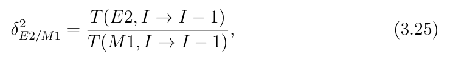

**中文:** 原式见上图；保留原符号、系数和单位写法，不在译文重写公式。

LaTeX transcription unavailable；公式以原图为准。

**Source:** PDF49／p.38 · S060

**Original:** where T(E2) and T(M1) are the corresponding electric and magnetic transition probabilities, respectively.

**中文:** 其中 $T(E2)$、$T(M1)$ 分别为相应的电跃迁和磁跃迁概率。

**Source:** PDF49／p.38 · S061

**Original:** 3.4 QTR Model Calculations

**中文:** 3.4　QTR模型计算

**Source:** PDF49／p.38 · S062

**Original:** In this work the QTR model codes of Ragnarson and Semmes [39, 40], the three programs called GAMPN, ASYMO and PROBMO, in this particular sequence, were run one after the other. GAMPN calculates the single-particle eigenstates and matrix elements. ASYMO calculates the triaxial rotor states and couples them to the single particle states produced by GAMPN. The last program PROBMO uses the outputs of the previous two programs to calculate electromagnetic transition properties of the nucleus [66].

**中文:** 本研究采用 Ragnarson 和 Semmes 的QTR模型代码[39,40]，依 GAMPN、ASYMO、PROBMO 的次序逐一运行三个程序。GAMPN计算单粒子本征态和矩阵元；ASYMO计算三轴转子态，并将其与GAMPN生成的单粒子态耦合；最后，PROBMO利用前两个程序的输出计算核电磁跃迁性质[66]。

**Source:** PDF49／p.38 · S063

**Original:** 3.4.1 GAMPN

**中文:** 3.4.1　GAMPN

**Source:** PDF49／p.38 · S064

**Original:** As stated previously, the program GAMPN calculates the single-particle states of the QTR model Hamiltonian. To run the calculations for a particular nucleus with a proton number Z and a mass number A, the program requires the quadruple deformation parameter ε2, the axial asymmetry deformation γ and the hexadecapole deformation parameter ε4, the valence nucleon(s) configuration, as well as the standard Nilsson parameters κ and µ. In these calculations the standard Nilsson parameters were adopted as in Ref. [11]. In general ε2 and γ can be deduced from potential energy surface (PES) calculations or from experimental data. In addition, the program requires one to specify the single-particle configuration space of interest, that is to specify the orbitals near the Fermi level that will be included in the calculations.

**中文:** 如前所述，GAMPN计算QTR模型哈密顿量的单粒子态。对质子数为 $Z$、质量数为 $A$ 的特定核进行计算时，程序需要四极形变参数 $\varepsilon_2$、轴不对称形变 $\gamma$、十六极形变参数 $\varepsilon_4$、价核子组态，以及标准 Nilsson 参数 $\kappa$、$\mu$。本计算采用文献[11]中的标准 Nilsson 参数。通常可由势能面（PES）计算或实验数据推得 $\varepsilon_2$、$\gamma$。此外还必须指定感兴趣的单粒子组态空间，即指定计算中纳入哪些费米面附近轨道。

**Source:** PDF49／p.38 · S065

**Original:** The program outputs the single particle energies εν, single-particle matrix element and the single-particle eigenstates |ν⟩, expanded in the basis |NLJΩ⟩. For an

**中文:** 程序输出单粒子能量 $\varepsilon_\nu$、单粒子矩阵元，以及在 $|NLJ\Omega\rangle$ 基中展开的单粒子本征态 $|\nu\rangle$。对……〔续下页〕

## PDF50／印刷页39

[原页视觉核验图](visual-pages/pdf050.png)

**Source:** PDF50／p.39 · S066

**Original:** axially symmetric nuclear shape the output of the program is a pure Nilsson state, while for the asymmetric nuclear shape, the output is a mixture of basis states with the same parity but differing in occupation probabilities. This information is passed down to the next program ASYMO.

**中文:** 〔续上页原段〕……轴对称核形状，程序输出为纯 Nilsson 态；对非对称核形状，输出则是宇称相同、占据概率不同的基态混合。该信息传给下一程序ASYMO。

**Source:** PDF50／p.39 · S067

**Original:** 3.4.2 ASYMO

**中文:** 3.4.2　ASYMO

**Source:** PDF50／p.39 · S068

**Original:** The program ASYMO couples the core rotation to the selected single-particle matrix elements and eigenstates |ν⟩that are passed down from the program GAMPN and constructs the quasiparticle+triaxial rotor sates. A maximum of 15 single-particle states can be used in the calculations, typically a subset of the single-particle states lying close to the Fermi level are included. The inputs to ASYMO comprise information on these single-particle states (the same states as in GAMPN or, fewer). The moments of inertia of the core can be extracted from the experimental energy of the first 2+ state [51] or can be parametrized by Harris parameters, which takes into account the spin dependence of the MoI’s [30, 48].

**中文:** ASYMO把核芯转动与从GAMPN传来的所选单粒子矩阵元和本征态 $|\nu\rangle$ 耦合，构造准粒子加三轴转子态。计算最多可使用15个单粒子态，通常只纳入靠近费米面的单粒子态子集。ASYMO输入包含这些单粒子态的信息（与GAMPN所用的态相同，或更少）。核芯转动惯量可以从第一 $2^+$ 态的实验能量提取[51]，也可用考虑转动惯量自旋依赖的Harris参数表示[30,48]。

**Source:** PDF50／p.39 · S069

**Original:** 3.4.3 PROBMO

**中文:** 3.4.3　PROBMO

**Source:** PDF50／p.39 · S070

**Original:** The results of GAMPN and ASYMO are passed down to the program PROBMO, which uses them to calculate the electromagnetic transition properties of all transitions that link all calculated nuclear states. That includes the B(E2) and B(M1) transition probabilities as well as the mixing ratios δE2/M1 for the M1+E2 transitions and the quadruple moment for each state.

**中文:** GAMPN和ASYMO的结果传给PROBMO，用于计算所有已算核态之间全部连接跃迁的电磁性质，包括 $B(E2)$、$B(M1)$ 跃迁概率、M1+E2跃迁的混合比 $\delta_{E2/M1}$，以及每个态的四极矩。

## 阅读提示与独立审计注记

正文保留作者原话及其语气。单位、轴、近似适用域、δ阈值和程序合同的独立审计集中见 [translation_notes.md](translation_notes.md)，不得把这些注记倒写成作者原结论。
