# 第6章逐段中英对照

来源为用户提供的Wakudyanaye 2022硕士论文。仅覆盖第6章PDF75–115（印刷64–104页）；不代表全论文翻译完成。Original保留原论断、引文及疑点；中文忠实翻译。独立审计集中在文末，不能当作原文结论。公式和表格采用原件裁图，图注逐条对照。

## 页码与章节索引

- [第6章：讨论](#chapter6) · PDF75–115 / 印64–104
- [第一部分：g7/2旋称劈裂](#part1) · PDF76–97
- [第二部分：h11/2负宇称带](#part2) · PDF98–115
- [术语表](#glossary) · [独立审计与使用边界](#audit)

本章没有新增编号的独立公式。表中公式与矩阵元按原图保留；正文中的行内数学按原意排版。

页面导航：[PDF75](#page75) · [PDF76](#page76) · [PDF77](#page77) · [PDF78](#page78) · [PDF79](#page79) · [PDF80](#page80) · [PDF81](#page81) · [PDF82](#page82) · [PDF83](#page83) · [PDF84](#page84) · [PDF85](#page85) · [PDF86](#page86) · [PDF87](#page87) · [PDF88](#page88) · [PDF89](#page89) · [PDF90](#page90) · [PDF91](#page91) · [PDF92](#page92) · [PDF93](#page93) · [PDF94](#page94) · [PDF95](#page95) · [PDF96](#page96) · [PDF97](#page97) · [PDF98](#page98) · [PDF99](#page99) · [PDF100](#page100) · [PDF101](#page101) · [PDF102](#page102) · [PDF103](#page103) · [PDF104](#page104) · [PDF105](#page105) · [PDF106](#page106) · [PDF107](#page107) · [PDF108](#page108) · [PDF109](#page109) · [PDF110](#page110) · [PDF111](#page111) · [PDF112](#page112) · [PDF113](#page113) · [PDF114](#page114) · [PDF115](#page115)

**页锚：PDF75 / 印64**

## 第6章 讨论

**Source:** PDF75 / 印64 · S001

**Original:** Chapter 6 Discussion

**中文:** 第6章 讨论

### 6.1 引言

**Source:** PDF75 / 印64 · S002

**Original:** 6.1 Introduction

**中文:** 6.1 引言

**Source:** PDF75 / 印64 · S003

**Original:** Odd-A neutron-deficient nuclei in the A ∼130 region exhibit a variety of nuclear shapes. Theoretical and experimental studies have shown that nuclei in this region can adopt prolate, oblate or triaxial nuclear shapes [26]. The neutron and proton Fermi surfaces lie between the 50 and 82 shell closures. Between these shell closures, there is only one unique-parity subshell, the h11/2 subshell, whereas four positive-parity subshells are available for positive-parity states, namely, d5/2, g7/2, d3/2 and s1/2. Observables in odd-N nuclei in the A ∼130 region provide information about the nuclear shape, since observables such as the features of the observed rotational bands, including band-head spin, moment of inertia, and signature splitting, depend sensitively on the nuclear deformation.

**中文:** $A\sim130$区的缺中子奇质量原子核表现出多种核形状。理论和实验研究表明，这一区域的原子核可以具有长椭、扁椭或三轴形状[26]。中子和质子的费米面都位于50与82壳层闭合之间。在这两个闭壳之间，只有一个独特宇称子壳层，即$h_{11/2}$；正宇称态则可以利用4个正宇称子壳层，分别为$d_{5/2}$、$g_{7/2}$、$d_{3/2}$和$s_{1/2}$。$A\sim130$区奇中子核的观测量能够提供核形状信息，因为已观测转动带的带头自旋、转动惯量和旋称劈裂等性质对核形变十分敏感。

**Source:** PDF75 / 印64 · S004

**Original:** The focus of the present investigation is two-fold, in the first part, the relationship between triaxiality and signature splitting is investigated in the newly observed positive-parity g7/2[404]7/2+ band structures of $^{131}$Ba and $^{133}$Ce (Band 2 in Section 5.3 and Band 2 in Section 5.2, respectively). In the second part of the investigation a new excited band in $^{133}$Ce, built on the I = 13/2−state (Band 4 in Section 5.2), is investigated. The observed properties of these bands are compared to QTR model calculations.

**中文:** 本研究分为两个方面。第一部分考察$^{131}$Ba和$^{133}$Ce中新观测到的正宇称$g_{7/2}[404]7/2^+$带结构中，三轴性与旋称劈裂的关系；它们分别对应§5.3和§5.2的Band 2。第二部分研究$^{133}$Ce中建立在$I=13/2^-$态上的一条新激发带，即§5.2的Band 4。将这些带的观测性质与准粒子加三轴转子（quasiparticle-plus-triaxial rotor，QTR）模型计算进行比较。

**页锚：PDF76 / 印65**

### 6.2 第一部分：133Ce与131Ba中g7/2[404]7/2+结构的解释

**Source:** PDF76 / 印65 · S005

**Original:** 6.2 Part I: Interpretation of the g7/2[404]7/2+ structures in $^{133}$Ce and $^{131}$Ba

**中文:** 6.2 第一部分：133Ce与131Ba中g7/2[404]7/2+结构的解释

**Source:** PDF76 / 印65 · S006

**Original:** The observed low-lying excited band structures in the N = 75 isotones of $^{133}$Ce and $^{131}$Ba built on the $I^\pi=7/2^+$ states correspond to one-quasiparticle configurations. These bands exhibit a remarkable similarity, for instance they both show intense intraband M1+E2 transitions which suggests that they have a strong coupling nature. The observed values of the signature splitting, measured by the energy staggering parameter S(I) (see equation 2.37 in Section 2.5) in both bands are larger than expected for a high-K band (where K̸ = 1/2). Inspecting the available intrinsic Nilsson orbitals for neutrons between the N = 50 and N = 82 shell closures, four positive-parity sub-shells are identified, the d5/2, g7/2, s1/2 , d3/2 subshells (see Figure 2.5). From the g7/2 sub-shell the available Nilsson orbitals are the g7/2[420]1/2+, g7/2[411]3/2+, g7/2[402]5/2+, and g7/2[404]7/2+ orbitals. The s1/2 subshell consists of one Nilsson orbital, s1/2[411]1/2+. The d3/2 subshell consists of the Nilsson orbitals d3/2[400]1/2+ and d3/2[402]3/2+. Among these Nilsson orbitals only the νg7/2[404]7/2+ configuration is consistent with the observed bandhead state of $I^\pi=7/2^+$. This orbital is also very close to the Fermi level.

**中文:** 在$N=75$同中子素$^{133}$Ce和$^{131}$Ba中观测到的低激发带结构都建立在$I^\pi=7/2^+$态上，对应单准粒子组态。这两条带具有显著相似性，例如都具有强的带内M1+E2跃迁，提示其强耦合性质。两条带的旋称劈裂用能量交错参数$S(I)$度量，定义见§2.5式2.37；其观测值都大于对高$K$带（$K\ne1/2$）的预期。考察$N=50$与$N=82$闭壳之间可用的中子内禀Nilsson轨道，可以识别出$d_{5/2}$、$g_{7/2}$、$s_{1/2}$、$d_{3/2}$四个正宇称子壳层，见图2.5。$g_{7/2}$子壳层提供$g_{7/2}[420]1/2^+$、$g_{7/2}[411]3/2^+$、$g_{7/2}[402]5/2^+$和$g_{7/2}[404]7/2^+$轨道。$s_{1/2}$子壳层只有$s_{1/2}[411]1/2^+$一个Nilsson轨道，$d_{3/2}$子壳层则包含$d_{3/2}[400]1/2^+$和$d_{3/2}[402]3/2^+$。在这些轨道中，只有$\nu g_{7/2}[404]7/2^+$组态与所观测$I^\pi=7/2^+$带头态相符，而且它也十分接近费米面。

**Source:** PDF76 / 印65 · S007

**Original:** It is known that in the N = 73 isotonic chain of $^{129}$Ba, $^{131}$Ce, and 133Nd, the νg7/2[404]7/2+ configuration is responsible for bands built on the $I^\pi=7/2^+$ state [3, 9, 25]. It becomes natural to suspect the existence of similar structures in the N = 75 isotones. However the observed bands in $^{133}$Ce and $^{131}$Ba exhibit significant signature staggering, which is not expected for a high-K configuration, such as g7/2[404]7/2+.

**中文:** 已知在$N=73$同中子素链$^{129}$Ba、$^{131}$Ce和$^{133}$Nd中，建立在$I^\pi=7/2^+$态上的带来自$\nu g_{7/2}[404]7/2^+$组态[3,9,25]。因此，很自然会预期$N=75$同中子素中也存在类似结构。然而，$^{133}$Ce和$^{131}$Ba中观测到的带表现出显著的旋称交错，而这并非对$g_{7/2}[404]7/2^+$这类高$K$组态的预期。

**Source:** PDF76 / 印65 · S008

**Original:** On the other hand, rigid triaxial and γ-soft nuclear shapes can induce large signature splitting. Therefore the signature splitting can be possibly understood as a direct consequence of triaxial deformation. The energy staggering parameter, S(I), is a useful measure to describe the extent of signature splitting and can be extracted as a function of nuclear spin. In addition to triaxiality, energy staggering can also be caused by K = 1/2 orbitals (see Section 2.5).

**中文:** 另一方面，刚性三轴形状和γ软形状均可以产生较大的旋称劈裂。因此，旋称劈裂也可能被理解为三轴形变的直接结果。能量交错参数$S(I)$是度量旋称劈裂程度的有用指标，可以将其提取为核自旋的函数。除三轴性之外，$K=1/2$轨道也可以产生能量交错，见§2.5。

**页锚：PDF77 / 印66**

#### 6.2.1 133Ce Band 2的旋称劈裂

**Source:** PDF77 / 印66 · S009

**Original:** 6.2.1 Signature splitting in Band 2 of $^{133}$Ce

**中文:** 6.2.1 133Ce Band 2的旋称劈裂

**Source:** PDF77 / 印66 · S010

**Original:** To gain insight on the influence of the triaxiality parameter γ on the signature splitting, calculations were performed using the QTR model (see Sections. 3.3 and 3.4). The calculated energy spectra E(I) and the signature splitting S(I) are compared with the experimental results. For the calculations, the included configuration space span ten positive-parity orbitals lying close to the Fermi level. Due to triaxiality, the QTR model single-particle orbital denoted by |ν⟩does not correspond to a pure Nilsson orbital and is rather expressed as a linear combination of orbitals with the same parity. In the case of axial symmetry, |ν⟩does correspond to a pure Nilsson orbital.

**中文:** 为了解三轴性参数γ对旋称劈裂的影响，使用QTR模型开展计算，见§3.3和§3.4，并将计算的能谱$E(I)$、旋称劈裂$S(I)$与实验结果比较。计算的组态空间包含费米面附近10个正宇称轨道。由于三轴性，记作$|\nu\rangle$的QTR模型单粒子轨道不对应某个纯Nilsson轨道，而是由具有相同宇称的轨道线性组合而成。轴对称情况下，$|\nu\rangle$才对应一个纯Nilsson轨道。

**Source:** PDF77 / 印66 · S011

**Original:** Constrained potential energy surface (PES) calculations [22] done within the collaboration, suggest a quadruple deformation of ε2 = 0.185 and a hexadecapole deformation of ε4 = 0.01 for the νg7/2 orbital with a projection on the long axis of 7/2+ in $^{133}$Ce (see Table 6.1). Information on the positive-parity single-particle neutron orbitals near the Fermi level, calculated with the QTR model is presented in Table 6.2. They are calculated with (ε2, γ) = (0.185, 15◦). The QTR model orbital |ν⟩is expanded in the basis |NLJΩ⟩, where N is the major oscillator shell number, L is the orbital angular momentum number, J is the total single-particle angular momentum number, and Ωis the projection of J on a chosen intrinsic axis (the long axis is the chosen axis of projection in this work, therefore Ωand Ωl are used interchangeably throughout this work). The corresponding approximate Nilsson quantum numbers are also listed in the table. The orbitals |ν⟩couple to the even-even triaxial core rotation to produce QTR model states.

**中文:** 合作组完成的约束势能面（potential energy surface，PES）计算[22]表明，对于$^{133}$Ce中角动量沿长轴投影为$7/2^+$的$\nu g_{7/2}$轨道，四极形变为$\varepsilon_2=0.185$、十六极形变为$\varepsilon_4=0.01$，见表6.1。表6.2给出了QTR模型计算得到的费米面附近正宇称中子单粒子轨道信息，计算采用$(\varepsilon_2,\gamma)=(0.185,15^\circ)$。QTR模型轨道$|\nu\rangle$在$|NLJ\Omega\rangle$基底下展开，其中$N$为主谐振子壳层量子数、$L$为轨道角动量量子数、$J$为单粒子总角动量量子数，$\Omega$为$J$在所选内禀轴上的投影。本工作选择长轴作为投影轴，因此文中$\Omega$与$\Omega_l$交替使用。表中还列出了相应的近似Nilsson量子数。这些轨道$|\nu\rangle$与偶偶三轴核芯的转动耦合，形成QTR模型态。

##### 表6.1 · PES计算给出的形变参数

**Placed near:** S011；原图/表来源PDF77 / 印66，裁图未改数字。

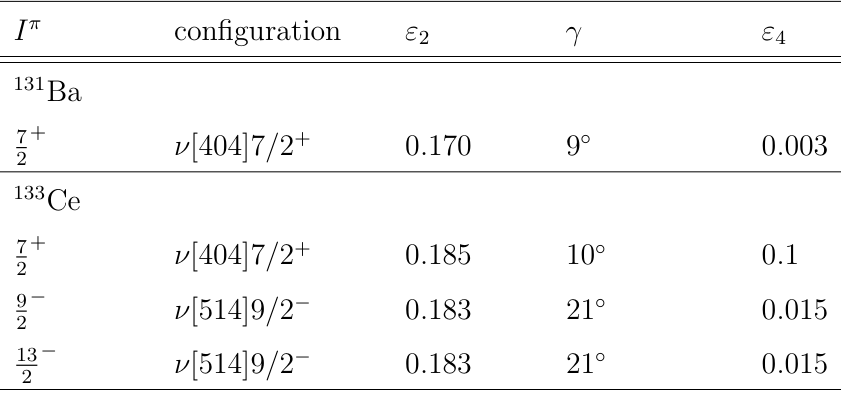

**Source:** PDF77 / 印66 · C001

**Original caption:** Table 6.1: Deformation parameters obtained from potential energy surface (PES) calculations [22].

**中文图注:** 表6.1：由势能面PES计算得到的形变参数[22]。

**表头对照：** 原数值、振幅符号、下标、空缺横线、单位和误差均以裁图为准。

##### 表6.2 · 133Ce正宇称单粒子轨道

**Placed near:** S011；原图/表来源PDF78 / 印67，裁图未改数字。

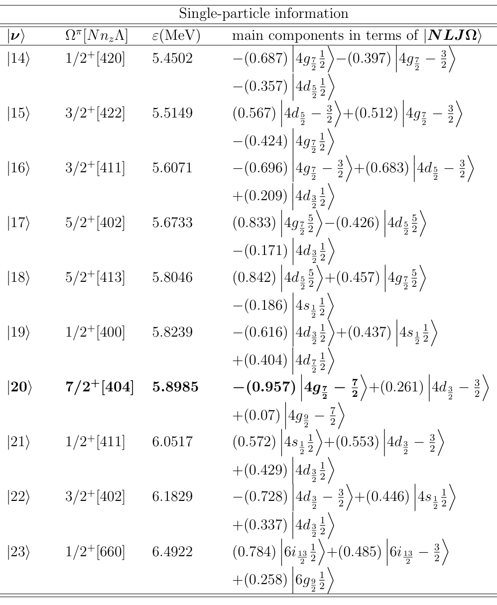

**Source:** PDF78 / 印67 · C002

**Original caption:** Table 6.2: QTR model neutron single-particle orbitals, |ν⟩with positiveparity lying close to the Fermi level for $^{133}$Ce. The orbitals are expanded in the |NLJΩ⟩basis. The corresponding single-particle energies (ε) and the corresponding Nilsson orbitals with largest contributions are also included for the deformation parameters listed in Table 6.1 and γ = 15◦.

**中文图注:** 表6.2：$^{133}$Ce中费米面附近的正宇称QTR中子单粒子轨道$|\nu\rangle$。这些轨道在$|NLJ\Omega\rangle$基底下展开。表中还列出了相应单粒子能量ε以及贡献最大的相应Nilsson轨道；计算采用表6.1的形变参数和$\gamma=15^\circ$。

**表头对照：** 原数值、振幅符号、下标、空缺横线、单位和误差均以裁图为准。

**页锚：PDF78 / 印67**

**Source:** PDF78 / 印67 · S012

**Original:** The MoI’s of the core were assumed to follow the irrotational-flow dependence with respect to the γ deformation [48]. Harris parametrization for the MoI of the core was used with J0 = 10.4 ħ2MeV−1 and J1 = 35.7 ħ4MeV−3 [48]. The calculations place the Fermi surface at λF = 50.6 MeV for the deformation parameters listed in Table 6.1 and γ = 15◦.

**中文:** 假定核芯转动惯量（moment of inertia，MoI）对γ形变的依赖遵从无旋流形式[48]。采用Harris参数化描述核芯转动惯量，参数为$J_0=10.4\hbar^2\mathrm{MeV}^{-1}$和$J_1=35.7\hbar^4\mathrm{MeV}^{-3}$[48]。对于表6.1列出的形变参数和$\gamma=15^\circ$，计算将费米面置于$\lambda_F=50.6$ MeV。

**页锚：PDF79 / 印68**

**Source:** PDF79 / 印68 · S013

**Original:** Firstly, the Harris parameters for the MoI were chosen to reproduce the excitation energies E(I) for the axially symmetric case (γ = 0◦). Then triaxiality was introduced, for γ = 10◦, 15◦, and 20◦. The calculated energy spectra for the νg7/2[404]7/2+ structure for γ = 0◦and γ = 10◦in comparison with experimental data are shown in panels (a) and (b) of Figure 6.1. At these γ values the calculated energy spectra and the experimentally measured values agree very well for low spins, while the calculations slightly underestimate the data at medium and high spins. Above the I = 13/2+ level the extracted values of S(I) show considerable staggering very similar to the experimental values for both the axially symmetric case and for γ = 10◦(see panels (c) and (d) in Figure 6.1).

**中文:** 首先，选择转动惯量的Harris参数，使其再现轴对称情况$\gamma=0^\circ$下的激发能$E(I)$，随后引入$\gamma=10^\circ$、$15^\circ$和$20^\circ$的三轴形变。图6.1(a)、(b)分别比较了$\gamma=0^\circ$和$10^\circ$时$\nu g_{7/2}[404]7/2^+$结构的计算能谱与实验数据。在这些γ值下，计算能谱与实验值在低自旋区符合很好，但在中高自旋区，计算值略低于实验。在$I=13/2^+$能级以上，不论轴对称情况还是$\gamma=10^\circ$，提取的$S(I)$均表现出明显交错，与实验值十分相似，见图6.1(c)、(d)。

##### 图6.1 · 133Ce：全强度Coriolis、γ=0°/10°

**Placed near:** S013；原图/表来源PDF80 / 印69，裁图未改数字。

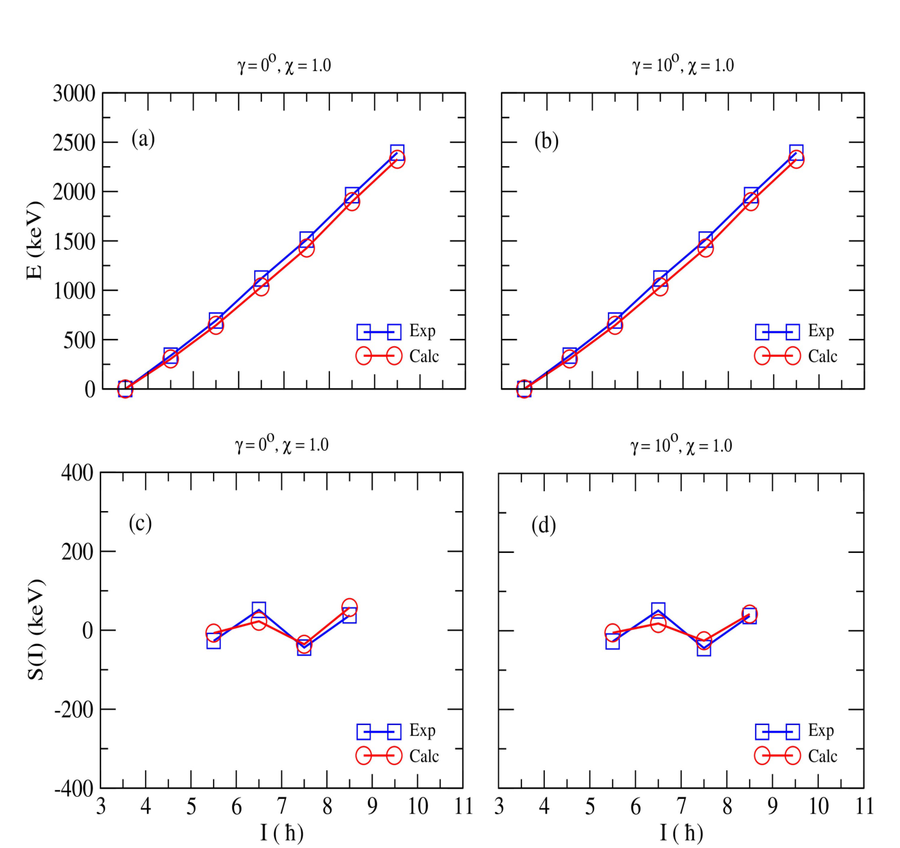

**Source:** PDF80 / 印69 · C003

**Original caption:** Figure 6.1: The energy spectra E(I) and signature splitting S(I) for Band 2 of $^{133}$Ce at γ = 0◦and 10◦, and Coriolis interaction (χ) at full strength.

**中文图注:** 图6.1：$^{133}$Ce Band 2在$\gamma=0^\circ$和$10^\circ$、Coriolis相互作用χ为全强度时的能谱$E(I)$和旋称劈裂$S(I)$。

**Source:** PDF79 / 印68 · S014

**Original:** To understand the impact of triaxiality, calculations with larger γ-values of γ = 15◦and γ = 20◦were carried out. Panels (a) and (b) of Figure 6.2 show a comparison between the QTR model excitation energies at γ = 15◦and γ = 20◦and the experimental values, respectively. There is an excellent agreement between the theory and the experimental energy spectra for γ = 15◦across the whole spin range. The agreement is even better than that obtained with γ = 0◦and γ = 10◦(see Figure 6.1). When γ = 20◦, the excitation energies of the 15/2+ and the 19/2+ are not so well reproduced by the QTR model. The energy staggering, S(I), extracted from the QTR model for γ = 15◦and γ = 20◦is compared to the experimental values in panels (c) and (d) of Figure 6.2, respectively. It can immediately be deduced that a γ deformation of γ = 15◦ reproduces the experimentally observed staggering very well. When γ = 20◦the amplitude of the calculated S(I) becomes larger than the experimental values. Thus the calculations support a moderate triaxial deformation, consistent with a γ deformation in the range of 0◦≤γ ≤15◦.

**中文:** 为了解三轴性的作用，还开展了较大γ值，即$\gamma=15^\circ$和$20^\circ$的计算。图6.2(a)、(b)分别将这两个γ值下的QTR激发能与实验值比较。在$\gamma=15^\circ$时，理论与实验能谱在整个自旋范围内符合极好，甚至优于$\gamma=0^\circ$和$10^\circ$的结果，见图6.1。$\gamma=20^\circ$时，QTR模型对$15/2^+$和$19/2^+$态激发能的再现不够好。图6.2(c)、(d)分别比较了$\gamma=15^\circ$和$20^\circ$时计算提取的能量交错$S(I)$与实验值。可以直接看出，$\gamma=15^\circ$很好地再现了实验交错；在$\gamma=20^\circ$时，计算$S(I)$的振幅则超过实验值。因此，这些计算支持适度的三轴形变，与$0^\circ\le\gamma\le15^\circ$的范围相符。

##### 图6.2 · 133Ce：全强度Coriolis、γ=15°/20°

**Placed near:** S014；原图/表来源PDF81 / 印70，裁图未改数字。

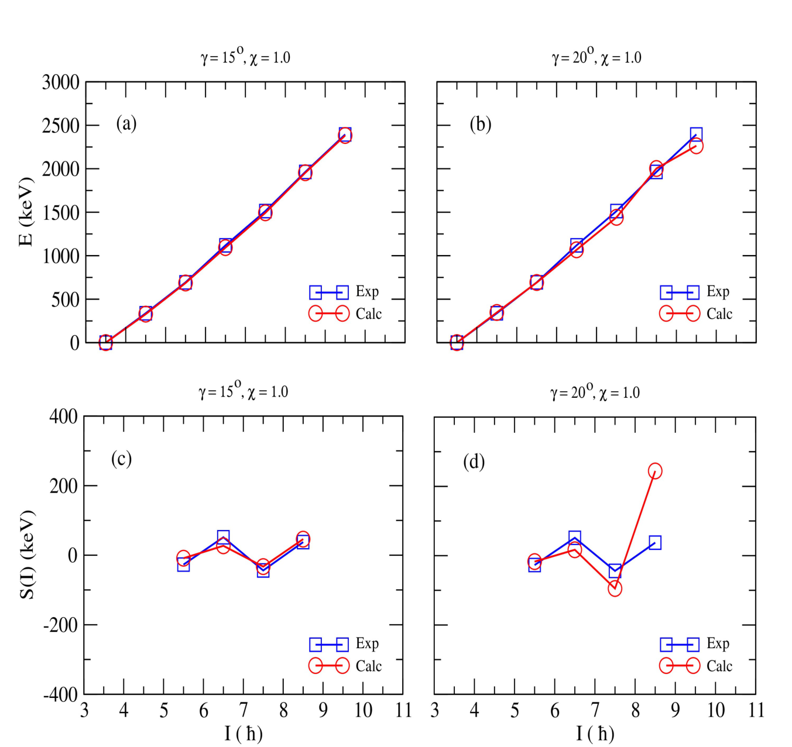

**Source:** PDF81 / 印70 · C004

**Original caption:** Figure 6.2: The energy spectra E(I) and signature splitting S(I) for Band 2 of $^{133}$Ce at γ = 15◦and 20◦, and Coriolis interaction (χ) at full strength.

**中文图注:** 图6.2：$^{133}$Ce Band 2在$\gamma=15^\circ$和$20^\circ$、Coriolis相互作用χ为全强度时的能谱$E(I)$和旋称劈裂$S(I)$。

**Source:** PDF79 / 印68 · S015

**Original:** The model wave functions provide further insights on the composition and nature of the states of Band 2. When the orbital |ν⟩is coupled to a triaxial core, each state Iπ is a mixture of different |NLJΩ⟩basis orbitals that have various projections on the chosen nuclear axis, with some having a projection of Ω= 1/2. This means that both the projection of the total angular momentum⃗I, K, and the projection of the single-particle angular momentum⃗j, Ω, are not good quantum numbers. However, it was shown that usually K and Ωare approximately good quantum numbers for a high-K band, in particular near the band head and when γ ≈30◦[51].

**中文:** 模型波函数可以进一步揭示Band 2各态的组成与性质。当轨道$|\nu\rangle$与三轴核芯耦合时，每个$I^\pi$态都是不同$|NLJ\Omega\rangle$基底轨道的混合，这些轨道在所选核轴上具有不同投影，其中一些的投影为$\Omega=1/2$。这意味着总角动量$\vec I$的投影$K$和单粒子角动量$\vec j$的投影$\Omega$都不是好量子数。不过，已有研究表明，对高$K$带，特别是在带头附近且$\gamma\approx30^\circ$时，$K$和$\Omega$通常仍近似为好量子数[51]。

**页锚：PDF80 / 印69**

**Source:** PDF80 / 印69 · S016

**Original:** Table 6.3 lists the three dominant components of the basis functions that contribute to each state. The basis functions are denoted as (Kl, |ν⟩), for short. For reasons discussed in Section 3.2.1, the axis of projection in this work is the long axis, that is K = Kl throughout the remainder of the text.

**中文:** 表6.3列出了对每个态贡献最大的3个基函数分量，简记为$(K_l,|\nu\rangle)$。基于§3.2.1讨论的原因，本工作选取长轴作为投影轴，因此在后文中均有$K=K_l$。

##### 表6.3 · 133Ce Band 2波函数的主要分量

**Placed near:** S016；原图/表来源PDF82 / 印71，裁图未改数字。

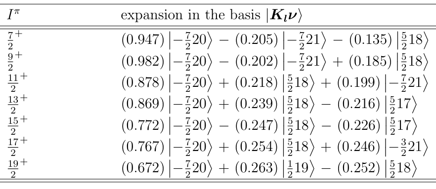

**Source:** PDF82 / 印71 · C005

**Original caption:** Table 6.3: The amplitude and main components of the QTR model wave functions for states in Band 2 of $^{133}$Ce expanded in a strong coupling basis |Klν⟩. The contribution of each |Klν⟩is the square of the amplitude.

**中文图注:** 表6.3：$^{133}$Ce Band 2各态的QTR波函数在强耦合基底$|K_l\nu\rangle$下展开的振幅和主要分量。每个$|K_l\nu\rangle$的贡献为其振幅的平方。

**表头对照：** 原数值、振幅符号、下标、空缺横线、单位和误差均以裁图为准。

**页锚：PDF81 / 印70**

**页锚：PDF82 / 印71**

**Source:** PDF81 / 印70, PDF82 / 印71 · S017

**Original:** The information on the wave functions of the states of Band 2 is visualized in Figure 6.3. Each grouping of columns represents the wave function of the state. The orbitals |ν⟩that are present are labelled from left to right on the x-axis of the plot by (#). The y-axis represents the value of Kl, the projection of the total angular momentum on the long nuclear axis. The different Kl values are also shown in different colors, see the legends of the figure. The z-axis (height of each column) represents the contribution of (Kl, |ν⟩) to the state wave function. For instance, the band head state, $I^\pi=7/2^+$, has the composition ∼89% (Kl, |ν⟩) = (7/2, |20⟩), shown as the tallest yellow column in Figure 6.3. It corresponds to orbital |20⟩ with a dominant g7/2[404]7/2 nature and Kl = Ωl = 7/2, see Table 6.3. Thus, the bandhead state has a dominant (Kl, Ωl) = (7/2, 7/2) nature. This illustrates the strong coupling nature of the band at the bandhead, where the single-particle angular momentum of the g7/2 neutron is mostly aligned along the long axis, because Ωl = 7/2, while the total angular momentum of I = 7/2 is also aligned along the long axis because Kl = 7/2. The rotational angular momentum along the long axis for the band head state is therefore negligible.

**中文:** 图6.3将Band 2各态的波函数信息可视化。每一组柱对应一个态的波函数。波函数中出现的轨道$|\nu\rangle$在横轴上从左到右以编号#标出；纵轴表示$K_l$，即总角动量沿核长轴的投影；不同$K_l$也用不同颜色表示，见图例。z轴，即各柱的高度，表示$(K_l,|\nu\rangle)$对该态波函数的贡献。例如，$I^\pi=7/2^+$带头态约有89%的组成为$(K_l,|\nu\rangle)=(7/2,|20\rangle)$，在图6.3中对应最高的黄色柱。它来自以$g_{7/2}[404]7/2$性质为主的20号轨道，且$K_l=\Omega_l=7/2$，见表6.3。因此，带头态主要具有$(K_l,\Omega_l)=(7/2,7/2)$性质。这体现了带头处的强耦合特征：$g_{7/2}$中子的单粒子角动量主要沿长轴对齐，因为$\Omega_l=7/2$；总角动量$I=7/2$也沿长轴对齐，因为$K_l=7/2$。所以带头态沿长轴的转动角动量可以忽略。

##### 图6.3 · 133Ce Band 2波函数沿长轴的投影

**Placed near:** S017；原图/表来源PDF83 / 印72，裁图未改数字。

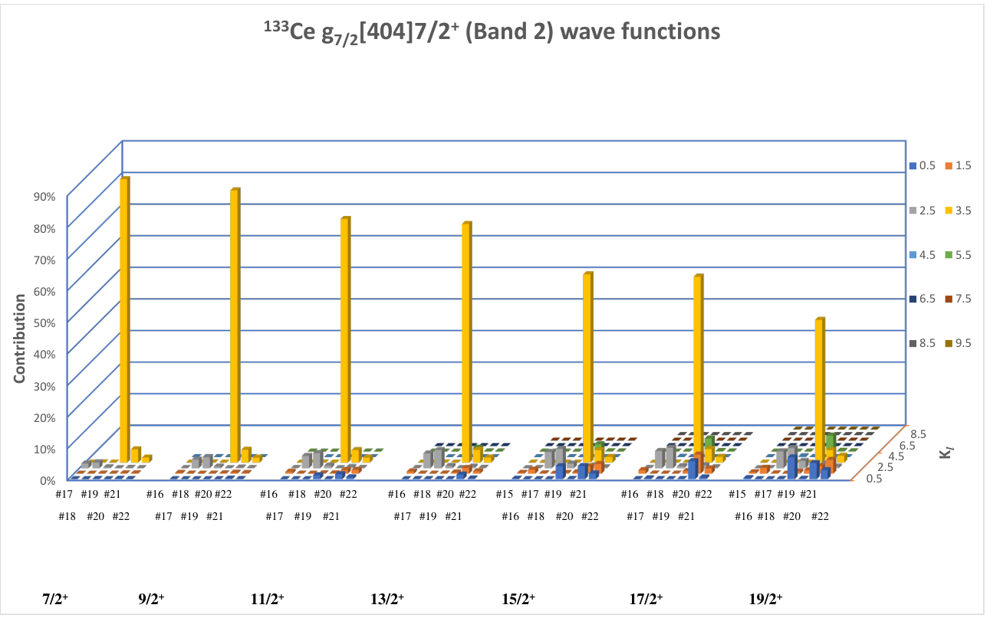

**Source:** PDF83 / 印72 · C006

**Original caption:** Figure 6.3: QTR model wave functions for the states in Band 2 of $^{133}$Ce projected onto the long nuclear axis.

**中文图注:** 图6.3：$^{133}$Ce Band 2各态的QTR模型波函数在核长轴上的投影。

**Source:** PDF82 / 印71 · S018

**Original:** As the spin increases, the contribution from orbital |20⟩with Ωl = 7/2, that is the contribution of the configuration (Kl, Ωl) = (7/2, 7/2) to the total wavefunction, begins to decrease, with the lowest contribution (∼45%) for the, $I^\pi=19/2^+$ state. However it remains the dominant contributor to the wave functions of the states in the band, see the tall yellow column for each state in Figure 6.3. This is in line with the observed nature of strongly coupled bands, where the higherspin states are generated by rotation, that is orthogonal to the direction of the single-particle angular momentum. In the present case the dominant rotation is around the intermediate axis, because it has largest MoI, as such rotation around this axis needs minimum energy.

**中文:** 随自旋升高，20号轨道、$\Omega_l=7/2$，即$(K_l,\Omega_l)=(7/2,7/2)$组态对总波函数的贡献开始下降，在$I^\pi=19/2^+$态达到约45%的最低值。然而，它仍然是该带各态波函数的主要贡献，见图6.3中每个态的高黄色柱。这与强耦合带的观测性质一致：高自旋态由垂直于单粒子角动量方向的转动产生。本例中主要绕中轴转动，因为中轴的转动惯量最大，绕此轴转动所需能量最低。

**页锚：PDF83 / 印72**

**页锚：PDF84 / 印73**

**Source:** PDF82 / 印71, PDF83 / 印72, PDF84 / 印73 · S019

**Original:** The gradual decrease in contribution of the (Kl, Ωl) = (7/2, 7/2) component can be understood as resulting from the particle-core coupling and the corresponding Coriolis interaction. The |19⟩and |21⟩orbitals, which are associated mostly with s1/2 and d3/2 components, see Table 6.2, come close to the Fermi level, and because they accidentally appear at similar energy to that of the g7/2 orbital they mix with it. These orbitals have strong Kl = 1/2 components. Such contributions affect the relative energy of the two signature branches of the band due to the decoupling parameter ′a′ (see Section 2.4.2.1). The decoupling for a K = 1/2 configuration is due to the Coriolis interaction thus we conclude that the presence of K = 1/2 components in the wave functions of the states in Band 2 is one of the important causes that generate the observed signature splitting. The wave functions of the states in Figure 6.3 also reveal small contributions from components with (Kl, |ν⟩) = (5/2, |17⟩) and (Kl, |ν⟩) = (5/2, |18⟩), shown as grey columns. Orbitals |17⟩and |18⟩correspond to a major g7/2 component with Ωl = 5/2 (see Table 6.2) and thus reflect re-alignment of the angular momentum of the valence g7/2 neutron away from the long axis due to the Coriolis interaction.

**中文:** $(K_l,\Omega_l)=(7/2,7/2)$分量贡献的逐渐下降，可以理解为粒子–核芯耦合及相应Coriolis相互作用的结果。19号和21号轨道主要与$s_{1/2}$、$d_{3/2}$分量相关，见表6.2；它们接近费米面，并因偶然地出现在与$g_{7/2}$轨道相近的能量而与其混合。这些轨道具有较强的$K_l=1/2$分量。这样的贡献通过退耦参数$a$影响带的两个旋称支的相对能量，见§2.4.2.1。$K=1/2$组态的退耦来自Coriolis相互作用，因此我们认为，Band 2各态波函数中的$K=1/2$分量是产生所观测旋称劈裂的重要原因之一。图6.3还显示波函数中存在少量$(K_l,|\nu\rangle)=(5/2,|17\rangle)$和$(5/2,|18\rangle)$分量，以灰色柱表示。17号和18号轨道对应主要具有$g_{7/2}$性质、$\Omega_l=5/2$的分量，见表6.2，因此反映了Coriolis相互作用使价$g_{7/2}$中子的角动量偏离长轴而重新对齐。

**Source:** PDF84 / 印73 · S020

**Original:** To gauge the influence of the Coriolis interaction in the states of Band 2 in $^{133}$Ce, the QTR model calculations were repeated with the Coriolis interaction (χ) attenuated to 70% of the usual strength, see Figure 6.4. The new set of calculations was able to reproduce the excitation energies across an extended spin range assuming the same deformation parameters as in the first case. When the assumed nuclear shape is axially symmetric with γ = 0◦, the QTR excitation energies reproduce the experimental excitation energies (see panel (a) of Figure 6.4), however the calculations reveal that the signature splitting is absent (see panel (c) of Figure 6.4).

**中文:** 为估计Coriolis相互作用对$^{133}$Ce Band 2各态的影响，将其强度χ衰减至通常强度的70%，重复QTR计算，见图6.4。在采用与前一种情况相同的形变参数时，这组新计算能够在较大的自旋范围内再现激发能。当假定核形状为轴对称，即$\gamma=0^\circ$时，QTR激发能再现实验激发能，见图6.4(a)；但计算表明旋称劈裂消失，见图6.4(c)。

##### 图6.4 · 133Ce：70%Coriolis、γ=0°/10°

**Placed near:** S020；原图/表来源PDF85 / 印74，裁图未改数字。

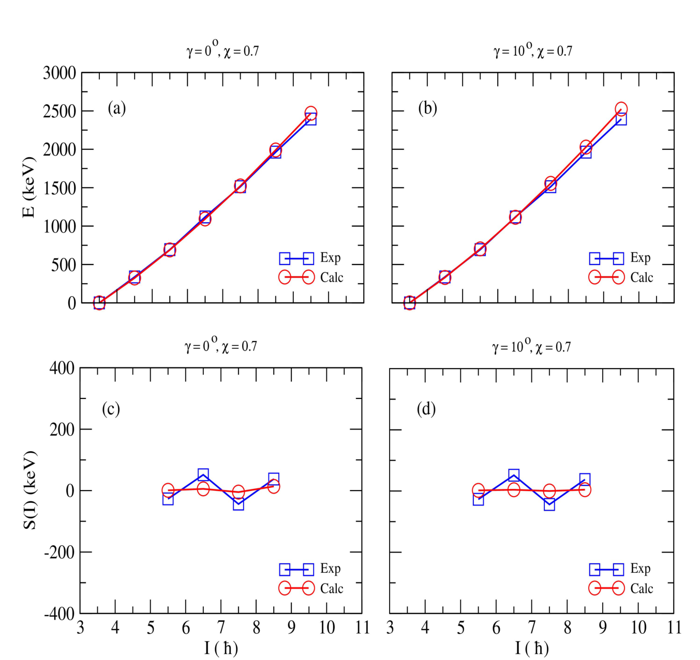

**Source:** PDF85 / 印74 · C007

**Original caption:** Figure 6.4: The energy spectra E(I) and signature splitting S(I) for Band 2 of $^{133}$Ce at γ = 0◦and 10◦, and Coriolis interaction (χ) at 70% of the usual strength.

**中文图注:** 图6.4：$^{133}$Ce Band 2在$\gamma=0^\circ$和$10^\circ$、Coriolis相互作用χ为通常强度70%时的能谱$E(I)$和旋称劈裂$S(I)$。

**Source:** PDF84 / 印73 · S021

**Original:** Triaxiality was introduced with γ = 10◦, 15◦and 20◦. The QTR model is able to reproduce the excitation energies at these values of the γ deformation, however the signature splitting remains vanishingly small for γ = 10◦and γ = 15◦(see panel (d) of Figure 6.4 and panel (c) of Figure 6.5, respectively). Only for γ > 15◦the amplitude of S(I) begins to rise (see panel (d) of Figure 6.5). Therefore when the Coriolis interaction is reduced to 70% a much larger γ deformation of γ ∼20◦is required to reproduce the observed energy staggering. This suggests that in these g7/2 bands there is a competition between the two modes of generating signature splitting namely; (i) nuclear triaxiality and (ii) Coriolis interaction due to K = 1/2 contributions associated with s1/2 and d3/2 configuration mixture.

**中文:** 接着引入$\gamma=10^\circ$、$15^\circ$和$20^\circ$的三轴形变。在这些γ值下，QTR模型都能再现激发能，但在$\gamma=10^\circ$和$15^\circ$时，旋称劈裂仍小到近乎消失，分别见图6.4(d)和图6.5(c)。只有在$\gamma>15^\circ$时，$S(I)$振幅才开始增大，见图6.5(d)。因此，当Coriolis相互作用降至70%时，需要大得多的三轴形变$\gamma\sim20^\circ$才能再现实验能量交错。这提示，在这些$g_{7/2}$带中存在两种产生旋称劈裂机制的竞争：其一是核三轴性，其二是与$s_{1/2}$、$d_{3/2}$组态混合所带来的$K=1/2$分量相关的Coriolis相互作用。

##### 图6.5 · 133Ce：70%Coriolis、γ=15°/20°

**Placed near:** S021；原图/表来源PDF86 / 印75，裁图未改数字。

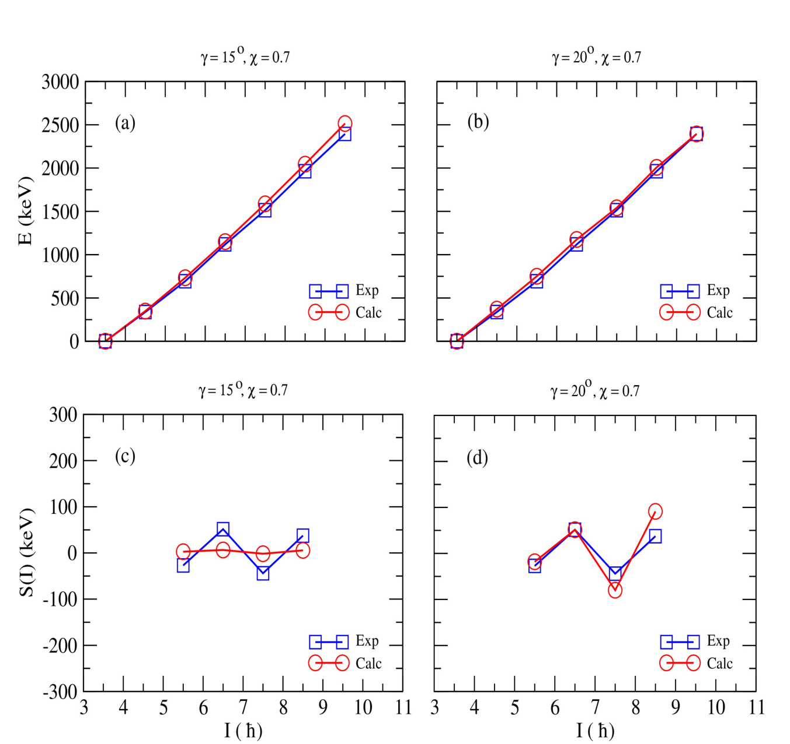

**Source:** PDF86 / 印75 · C008

**Original caption:** Figure 6.5: The energy spectra E(I) and signature splitting S(I) for Band 2 of $^{133}$Ce at γ = 15◦and 20◦, and Coriolis interaction at 70% of the usual strength.

**中文图注:** 图6.5：$^{133}$Ce Band 2在$\gamma=15^\circ$和$20^\circ$、Coriolis相互作用为通常强度70%时的能谱$E(I)$和旋称劈裂$S(I)$。

**页锚：PDF87 / 印76**

#### 6.2.2 131Ba Band 2的旋称劈裂

**Source:** PDF87 / 印76 · S022

**Original:** 6.2.2 Signature splitting in Band 2 of $^{131}$Ba

**中文:** 6.2.2 131Ba Band 2的旋称劈裂

**Source:** PDF87 / 印76 · S023

**Original:** QTR model calculations were performed to understand the interplay between triaxiality and signature splitting in Band 2 of $^{131}$Ba. The procedure followed for this analysis is the same as that presented for the corresponding structure (Band 2) of the $^{133}$Ce isotone in Section 6.2.1, that is a configuration space spanning ten positive-parity orbitals was utilized in the construction of the QTR model states. The deformation parameters used for the calculations are listed in Table 6.1. The Harris parameters used in the calculations are the same as those fitted for the corresponding structure in $^{133}$Ce, that is; J0 = 10.4 ħ2MeV−1 and J1= 35.7 ħ4MeV−3.

**中文:** 为理解$^{131}$Ba Band 2中三轴性与旋称劈裂的相互影响，进行了QTR模型计算。所采用的步骤与§6.2.1中$^{133}$Ce同中子素对应结构Band 2的分析相同，即在构建QTR态时使用包含10个正宇称轨道的组态空间。计算采用的形变参数列于表6.1。Harris参数与为$^{133}$Ce相应结构拟合的数值相同，即$J_0=10.4\hbar^2\mathrm{MeV}^{-1}$、$J_1=35.7\hbar^4\mathrm{MeV}^{-3}$。

**Source:** PDF87 / 印76 · S024

**Original:** Detailed single-particle information obtained from the QTR model calculations for the ten positive-parity orbitals closest to the Fermi surface (which is placed at λF = 51.0 MeV) is presented in Table 6.4. The information includes the QTR model orbitals |ν⟩, the single-particle energies ε, the corresponding Nilsson orbitals with largest contributions and the expansion of |ν⟩in the basis |NLJΩ⟩. The QTR model single-particle orbital that is the main contributor to the states of the I = 7/2+ band structure is |ν⟩= |20⟩and consists predominantly (93%) of the g7/2 orbital with a projection of Ωl = 7/2 on the long axis and is thus mainly related to the g7/2[404]7/2+ Nilsson orbital. In the case of axial symmetry, the orbitals |ν⟩corresponds directly to this Nilsson orbital.

**中文:** 表6.4给出了QTR计算所得、最接近费米面的10个正宇称轨道的详细单粒子信息，费米面位于$\lambda_F=51.0$ MeV。所列信息包括QTR轨道$|\nu\rangle$、单粒子能量ε、贡献最大的相应Nilsson轨道，以及$|\nu\rangle$在$|NLJ\Omega\rangle$基底中的展开。对$I=7/2^+$带结构各态贡献最大的QTR单粒子轨道是$|\nu\rangle=|20\rangle$。它主要由沿长轴投影$\Omega_l=7/2$的$g_{7/2}$轨道构成，占93%，因此主要与$g_{7/2}[404]7/2^+$ Nilsson轨道相关。在轴对称情况下，轨道$|\nu\rangle$直接对应于该Nilsson轨道。

##### 表6.4 · 131Ba正宇称单粒子轨道

**Placed near:** S024；原图/表来源PDF88 / 印77，裁图未改数字。

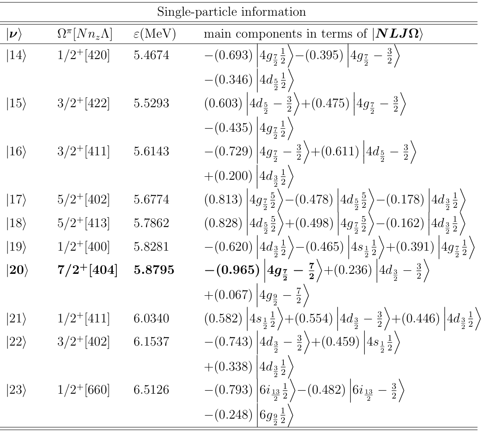

**Source:** PDF88 / 印77 · C009

**Original caption:** Table 6.4: QTR model neutron single-particle orbitals, |ν⟩with positiveparity lying close to the Fermi level for $^{131}$Ba. The orbitals are expanded in the |NLJΩ⟩basis. The corresponding single-particle energies (ε) and the corresponding Nilsson orbitals with largest contributions are also included for the deformation parameters listed in Table 6.1 and γ = 15◦.

**中文图注:** 表6.4：$^{131}$Ba中费米面附近的正宇称QTR中子单粒子轨道$|\nu\rangle$。这些轨道在$|NLJ\Omega\rangle$基底下展开。表中还列出了相应单粒子能量ε以及贡献最大的相应Nilsson轨道；计算采用表6.1的形变参数和$\gamma=15^\circ$。

**表头对照：** 原数值、振幅符号、下标、空缺横线、单位和误差均以裁图为准。

**Source:** PDF87 / 印76 · S025

**Original:** The single-particle orbitals are coupled to the triaxial rotor core to produce the QTR model states. At first the calculations were performed assuming an axially symmetric nuclear shape, then nuclear triaxiality was introduced for γ = 10◦, 15◦, and 20◦with the Coriolis interaction at full strength. The calculations were able to reproduce the excitation energies for axially symmetric deformation (see panel (a) of Figure 6.6), however the calculated S(I) shows an opposite phase at all spins to the experimentally extracted S(I) (see panel (c) of Figure 6.6).

**中文:** 将单粒子轨道与三轴转子核芯耦合，得到QTR模型态。首先假定轴对称核形状开展计算，然后在Coriolis相互作用保持全强度的情况下，引入$\gamma=10^\circ$、$15^\circ$和$20^\circ$的三轴性。轴对称形变下的计算能够再现激发能，见图6.6(a)，但计算$S(I)$在所有自旋处的相位都与实验提取值相反，见图6.6(c)。

##### 图6.6 · 131Ba：全强度Coriolis、γ=0°/10°

**Placed near:** S025；原图/表来源PDF89 / 印78，裁图未改数字。

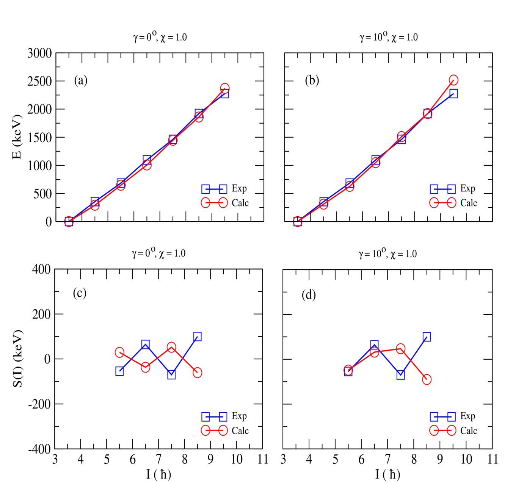

**Source:** PDF89 / 印78 · C010

**Original caption:** Figure 6.6: The energy spectra E(I) and signature splitting S(I) for Band 2 of $^{131}$Ba at γ = 0◦and 10◦, and Coriolis interaction (χ) at full strength.

**中文图注:** 图6.6：$^{131}$Ba Band 2在$\gamma=0^\circ$和$10^\circ$、Coriolis相互作用χ为全强度时的能谱$E(I)$和旋称劈裂$S(I)$。

**页锚：PDF88 / 印77**

**Source:** PDF87 / 印76, PDF88 / 印77 · S026

**Original:** The calculations reveal that the excitation energies are not very sensitive to the γ deformation for small values of γ as the good agreement between the calculated excitation energies and the experimental values persists at γ = 10◦(see panel (b) of Figure 6.6). However it is noticeable that the signature splitting is very sensitive to the γ deformation, and while at γ = 10◦, S(I) still exhibits opposite phases for the states with I = 15/2 and I = 17/2, the magnitudes and phases of the calculated and the experimental S(I) match for the states with I = 11/2 and I = 13/2. The best agreement between theory and experience is obtained at γ = 15◦(see panel (c) of Figure 6.7), where the phase and amplitude of the calculated S(I) and the experimentally extracted S(I) show very good agreement. In addition, at γ = 15◦, the QTR model excitation energies reproduce very well the experimental values (see panel (a) of Figure 6.6). Increasing the γ deformation past γ = 15◦increases the amplitude of S(I), and the agreement for both the excitation energies and S(I) worsens (see panels (b) and (d) of Figure 6.7).

**中文:** 计算表明，在γ较小时，激发能对γ形变并不十分敏感：$\gamma=10^\circ$时，计算与实验激发能仍保持良好符合，见图6.6(b)。但旋称劈裂对γ非常敏感。在$\gamma=10^\circ$时，$I=15/2$和$17/2$态的$S(I)$仍与实验反相，而$I=11/2$和$13/2$态的计算与实验$S(I)$在大小及相位上相符。$\gamma=15^\circ$时，理论与实验的符合最好，见图6.7(c)：计算与实验$S(I)$的相位、振幅均符合很好。此外，该γ值下QTR激发能也很好地再现实验值，见图6.6(a)。当γ继续增大、超过15°时，$S(I)$振幅增大，激发能和$S(I)$的符合都变差，见图6.7(b)、(d)。

##### 图6.7 · 131Ba：全强度Coriolis、γ=15°/20°

**Placed near:** S026；原图/表来源PDF90 / 印79，裁图未改数字。

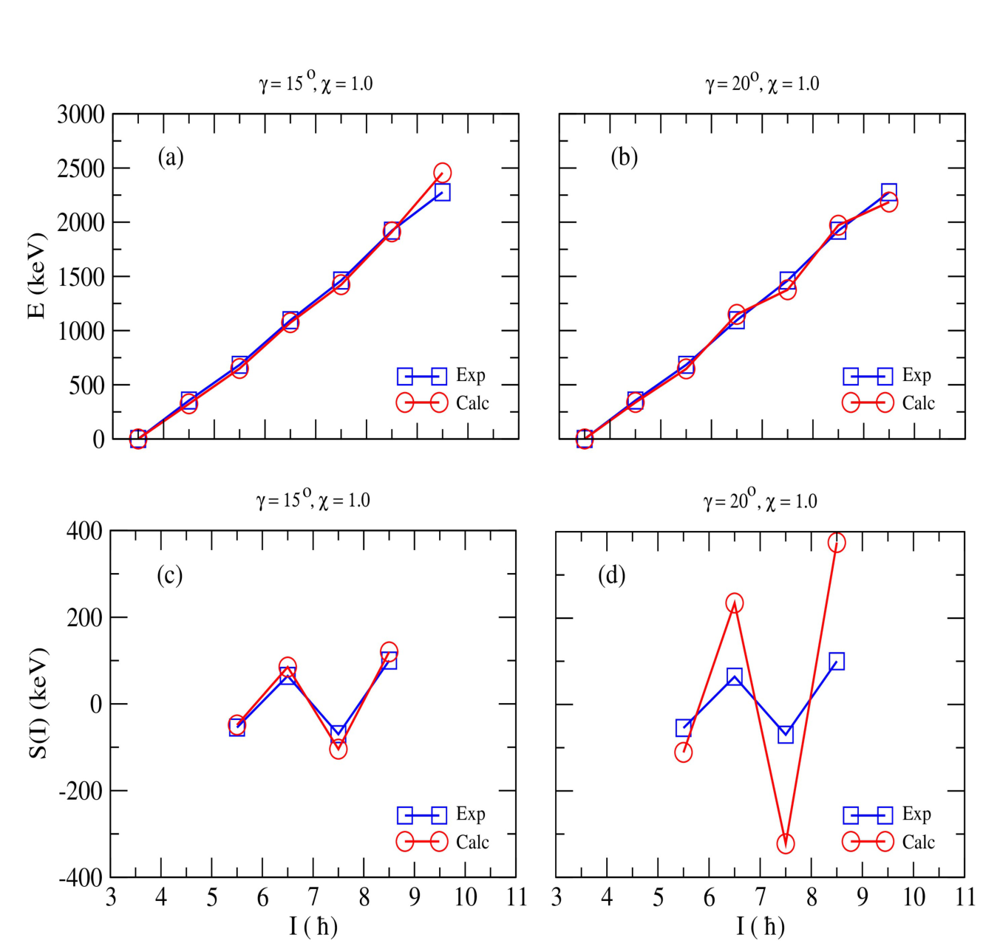

**Source:** PDF90 / 印79 · C011

**Original caption:** Figure 6.7: The energy spectra E(I) and signature splitting S(I) for Band 2 $^{131}$Ba at γ = 15◦and 20◦, and Coriolis interaction (χ) at full strength.

**中文图注:** 图6.7：$^{131}$Ba Band 2在$\gamma=15^\circ$和$20^\circ$、Coriolis相互作用χ为全强度时的能谱$E(I)$和旋称劈裂$S(I)$。

**Source:** PDF88 / 印77 · S027

**Original:** The QTR model calculations reproduce very well the experimentally observed values of S(I) when the adopted nuclear shape is triaxial with γ ≈15◦as well as the other experimentally observed band properties, such as excitation energies.

**中文:** 当所采用的核形状为三轴、$\gamma\approx15^\circ$时，QTR计算能够很好地再现实验$S(I)$，也能再现激发能等其它观测带性质。

**页锚：PDF90 / 印79**

**页锚：PDF91 / 印80**

**Source:** PDF90 / 印79, PDF91 / 印80 · S028

**Original:** Further insights can be gained by looking at the model wave functions. In Table 6.5 the three dominant contributors to the wave function for each state in the rotational band are presented, expanded in a strong coupling basis (Kl, Ωl). Orbital |20⟩with a projection on the long axis of Ωl = 7/2, and with (Kl, Ωl) = (7/2, 7/2) is the largest contributor to each wave function in the band. The bandhead state, $I^\pi=7/2^+$, has the composition ∼85% (Kl, Ωl) = (7/2, 7/2), and marks the highest contribution of any type in the rotational band. It corresponds to a dominant g7/2[404]7/2 nature of the type ((Kl, Ωl) = (7/2, 7/2). This confirms the strong coupling character of the rotational band at the bandhead.

**中文:** 模型波函数能够提供进一步认识。表6.5以强耦合基底$(K_l,\Omega_l)$展开，列出对转动带中每个态波函数贡献最大的3个分量。长轴投影为$\Omega_l=7/2$、具有$(K_l,\Omega_l)=(7/2,7/2)$性质的20号轨道，对该带每个态的波函数贡献最大。$I^\pi=7/2^+$带头态约有85%的组成为$(K_l,\Omega_l)=(7/2,7/2)$，是整条带中任一类型分量的最大贡献。它对应以$g_{7/2}[404]7/2$性质为主的$(K_l,\Omega_l)=(7/2,7/2)$分量，确认了转动带在带头处的强耦合特征。

##### 表6.5 · 131Ba Band 2波函数的主要分量

**Placed near:** S028；原图/表来源PDF91 / 印80，裁图未改数字。

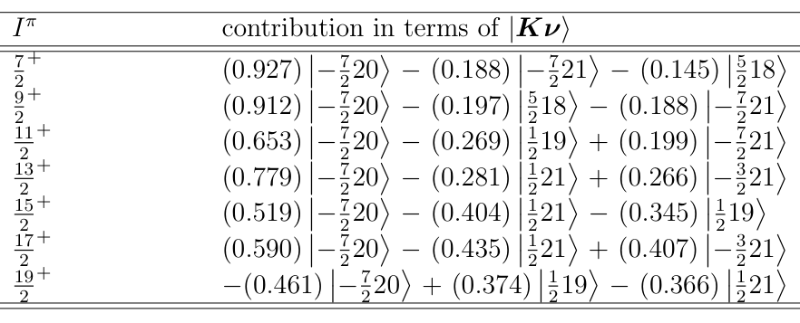

**Source:** PDF91 / 印80 · C012

**Original caption:** Table 6.5: The amplitude and main components of the QTR model wave functions for states in Band 2 of $^{131}$Ba expanded in a strong coupling basis |Klν⟩. The contribution of each |Klν⟩is the square of the amplitude.

**中文图注:** 表6.5：$^{131}$Ba Band 2各态的QTR波函数在强耦合基底$|K_l\nu\rangle$下展开的振幅和主要分量。每个$|K_l\nu\rangle$的贡献为其振幅的平方。

**表头对照：** 原数值、振幅符号、下标、空缺横线、单位和误差均以裁图为准。

**Source:** PDF91 / 印80 · S029

**Original:** Figure 6.8, is understood in a similar fashion to Figure 6.3. It shows the wave functions of the states in Band 2 of $^{131}$Ba. Each grouping of columns represents the state wave function. The orbitals |ν⟩that are present are labelled from left to right on the x-axis by (#). On the y-axis one obtains the value of Kl, the projection of the total angular momentum on the long nuclear axis, which is also reflected by color, see the legend of the figure. The height of each column represents the contribution (square of the amplitude) of the component (Kl, Ωl) to the state wave function.

**中文:** 图6.8的读法与图6.3相似，显示$^{131}$Ba Band 2各态的波函数。每一组柱对应一个态的波函数；波函数中出现的轨道$|\nu\rangle$在横轴上自左向右以#标识。纵轴为$K_l$，即总角动量在长轴上的投影，也通过颜色区分，见图例。各柱的高度表示$(K_l,\Omega_l)$分量对态波函数的贡献，即振幅的平方。

##### 图6.8 · 131Ba Band 2波函数

**Placed near:** S029；原图/表来源PDF92 / 印81，裁图未改数字。

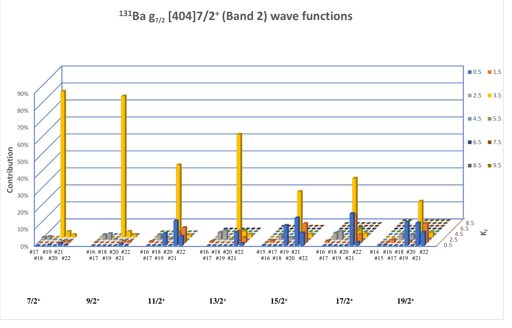

**Source:** PDF92 / 印81 · C013

**Original caption:** Figure 6.8: An illustration of the components of the QTR model wave functions for the states in Band 2 of $^{131}$Ba.

**中文图注:** 图6.8：$^{131}$Ba Band 2各态QTR模型波函数分量的示意。

**Source:** PDF91 / 印80 · S030

**Original:** From Figure 6.8 one can deduce that as the spin increases, the contribution of (Kl, Ωl) = (7/2, 7/2) type (yellow column) to the wave functions decreases as in the corresponding structure of $^{133}$Ce. However the decline in $^{131}$Ba is much more rapid when compared to the $^{133}$Ce structure. The model wave functions exhibit a strong oscillatory pattern for the states in the $^{131}$Ba structure, that is−while as a general trend the (7/2, 7/2) contributions to the total state wave function decrease with increasing spin, this decrease is not monotonic. The contribution of (7/2, 7/2) to a positive-signature state is noticeably greater when compared to the immediately preceding negative-signature state.

**中文:** 从图6.8可以看出，随自旋升高，$(K_l,\Omega_l)=(7/2,7/2)$类型分量，即黄色柱，对波函数的贡献减小，与$^{133}$Ce对应结构相似。但$^{131}$Ba中的下降比$^{133}$Ce迅速得多。$^{131}$Ba各态的模型波函数还表现出明显的振荡：虽然$(7/2,7/2)$分量总体随自旋升高而下降，这一下降却并非单调；正旋称态中的$(7/2,7/2)$贡献明显大于紧邻其下的负旋称态。

**页锚：PDF92 / 印81**

**Source:** PDF91 / 印80, PDF92 / 印81 · S031

**Original:** In addition, the odd-signature states have significantly greater contributions of components with Kl = 1/2 from orbitals |19⟩, |21⟩and |22⟩. The staggering behavior observed for the S(I) plots is thus reflected in the wave functions which have dominant g7/2 nature but also includes components with Ωl = 1/2 and their relative strengths oscillates for the positive and negative signature components of the band. At the deformation of ε2 = 0.170, the νs1/2[411]1/2+ orbital lies very close to the νg7/2[404]7/2+ orbital and as we discussed previously, the Coriolis interaction can cause significant staggering in K = 1/2 bands.

**中文:** 此外，奇旋称态从19号、21号和22号轨道获得显著更大的$K_l=1/2$分量贡献。$S(I)$图中的交错行为因此也反映在波函数中：波函数以$g_{7/2}$性质为主，但还包含$\Omega_l=1/2$分量，这些分量在带的正、负旋称态中的相对强度振荡。在$\varepsilon_2=0.170$形变下，$\nu s_{1/2}[411]1/2^+$轨道非常接近$\nu g_{7/2}[404]7/2^+$轨道；如前所述，Coriolis相互作用能够在$K=1/2$带中引起明显交错。

**页锚：PDF93 / 印82**

**Source:** PDF92 / 印81, PDF93 / 印82 · S032

**Original:** Furthermore, there are many contributions with different Kl in the state wave functions. In particular there are contributions from orbitals |17⟩and |18⟩with major g7/2 nature, but Ωl = 5/2, suggesting that the Coriolis interaction also realigns the single-particle angular momentum away from the long axis. Thus the wave functions for the states of Band 2 reveal a mixture of contributions with generally dominant g7/2 nature.

**中文:** 此外，态波函数还含有许多不同$K_l$的贡献。特别是，17号和18号轨道的分量主要具有$g_{7/2}$性质，但$\Omega_l=5/2$，提示Coriolis相互作用也使单粒子角动量偏离长轴并重新对齐。因此，Band 2各态的波函数表现为多种分量的混合，总体仍以$g_{7/2}$性质为主。

**Source:** PDF93 / 印82 · S033

**Original:** To gauge the impact of the Coriolis interaction in this band, the QTR model calculations were repeated with the Coriolis interaction (χ) attenuated to 70% of the usual strength. The calculations show that for χ = 0.7 a much larger value of triaxiality of γ ∼20◦is required to reproduce the amplitude and phase of the experimentally observed staggering (see panel (d) of Figure 6.10) as the absence of energy level staggering is evident for the entire range of 0◦≤γ < 20◦(see panels (c) and (d) of Figure 6.9 and panel (c) of Figure 6.10). In addition, there is worse agreement for the excitation energies, except for γ = 20◦.

**中文:** 为估计Coriolis相互作用对该带的影响，将强度χ衰减到通常强度的70%，重复QTR计算。结果表明，在$\chi=0.7$时，需要大得多的三轴性$\gamma\sim20^\circ$，才能再现实验交错的振幅与相位，见图6.10(d)；因为在整个$0^\circ\le\gamma<20^\circ$范围内，能级交错均明显缺失，见图6.9(c)、(d)和图6.10(c)。此外，除$\gamma=20^\circ$外，激发能的符合也变差。

##### 图6.9 · 131Ba：70%Coriolis、γ=0°/10°

**Placed near:** S033；原图/表来源PDF94 / 印83，裁图未改数字。

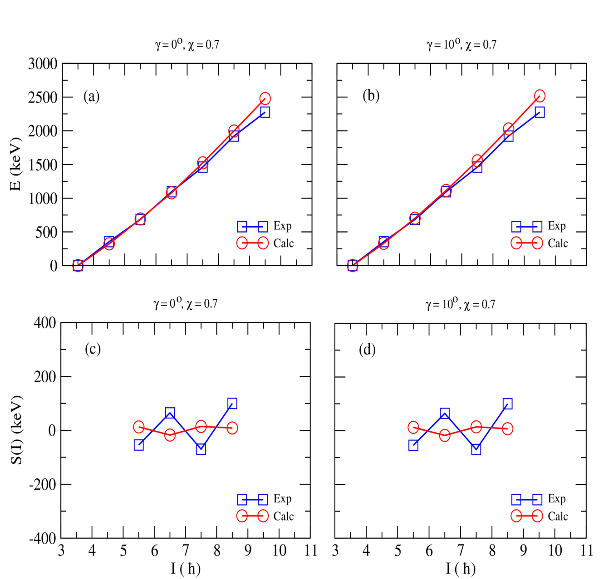

**Source:** PDF94 / 印83 · C014

**Original caption:** Figure 6.9: The energy spectra E(I) and signature splitting S(I) for Band 2 of $^{131}$Ba at γ = 0◦and 10◦, and Coriolis interaction (χ) at 70% of the usual strength.

**中文图注:** 图6.9：$^{131}$Ba Band 2在$\gamma=0^\circ$和$10^\circ$、Coriolis相互作用χ为通常强度70%时的能谱$E(I)$和旋称劈裂$S(I)$。

##### 图6.10 · 131Ba：70%Coriolis、γ=15°/20°

**Placed near:** S033；原图/表来源PDF95 / 印84，裁图未改数字。

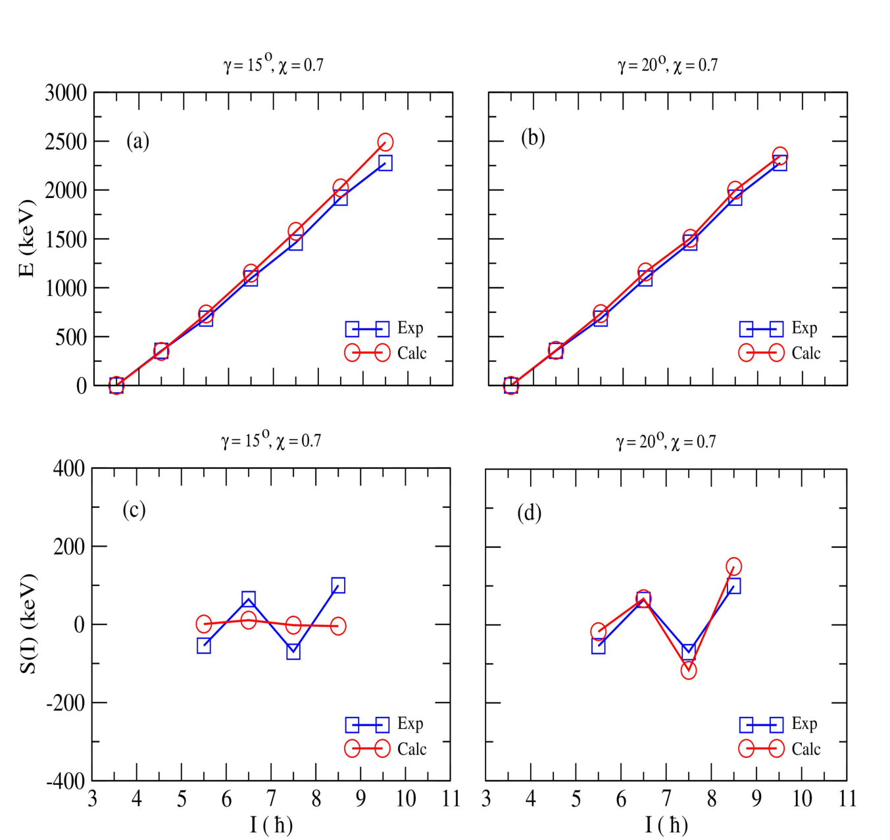

**Source:** PDF95 / 印84 · C015

**Original caption:** Figure 6.10: The energy spectra E(I) and signature splitting S(I) for Band 2 of $^{131}$Ba at γ = 15◦and 20◦, and Coriolis interaction (χ) at 70% of the usual strength.

**中文图注:** 图6.10：$^{131}$Ba Band 2在$\gamma=15^\circ$和$20^\circ$、Coriolis相互作用χ为通常强度70%时的能谱$E(I)$和旋称劈裂$S(I)$。

**Source:** PDF93 / 印82 · S034

**Original:** To summarize the discussion so far, there are two known modes of generating energy staggering in atomic nuclei; (i) nuclear non-axiality (triaxiality) and (ii) the Coriolis interaction. In this work and based on the presented QTR model calculation, the newly observed bands built on the $I^\pi=7/2^+$ states in both $^{131}$Ba and $^{133}$Ce isotones are associated with the νg7/2[404]7/2+ Nilsson configuration and with a moderate triaxiality of γ ≈15◦. The calculations reproduce well the excitation energies and the signature splitting in these bands. While the states in both bands were described as associated with a dominant g7/2[404]7/2+ nature, however, there are also admixture of other g7/2, s1/2 and d3/2 orbitals. The presence of some Kl = 1/2 contributions with s1/2 and d3/2 nature in the wave functions causes significant energy staggering due to the Coriolis interaction. Thus, in addition to triaxiality the energy staggering, S(I), in the band structures of $^{131}$Ba and $^{133}$Ce is also significantly affected by the Coriolis interaction.

**中文:** 总结以上讨论，原子核中有两种已知的能量交错产生机制：核非轴性，即三轴性，以及Coriolis相互作用。本工作依据所给QTR计算，将$^{131}$Ba与$^{133}$Ce这两个同中子素中新观测到、建立在$I^\pi=7/2^+$态上的带，联系到$\nu g_{7/2}[404]7/2^+$ Nilsson组态及$\gamma\approx15^\circ$的适度三轴性。计算很好地再现了这些带的激发能和旋称劈裂。虽然两条带均以$g_{7/2}[404]7/2^+$性质为主，也混有其它$g_{7/2}$、$s_{1/2}$和$d_{3/2}$轨道。波函数中具有$s_{1/2}$、$d_{3/2}$性质的部分$K_l=1/2$分量，通过Coriolis相互作用引起显著能量交错。因此，除三轴性外，Coriolis相互作用也显著影响$^{131}$Ba和$^{133}$Ce带结构中的能量交错$S(I)$。

**页锚：PDF96 / 印85**

#### 6.2.3 Z=75同位素πg7/2[404]7/2+带中的旋称劈裂

**Source:** PDF96 / 印85 · S035

**Original:** 6.2.3 Signature splitting in the πg7/2[404]7/2+ bands of the Z = 75 isotopes

**中文:** 6.2.3 Z=75同位素πg7/2[404]7/2+带中的旋称劈裂

**Source:** PDF96 / 印85 · S036

**Original:** It is interesting to compare the signature splitting S(I) in the N = 75 isotones and in the Z = 75 isotopes. When one looks at bands built on the πg7/2[404]7/2+ configuration in the Z = 75 isotopes, practically all nuclei have absent or vanishingly small signature splitting S(I). It should be noted that the nuclei in this mass region are predicted to have an axially symmetric nuclear shape. Furthermore, the πs1/2[411]1/2+ proton orbital lies far from the πg7/2[404]7/2+ orbital (see Figure 2.6). As there is a large energy gap the contributions of πs1/2 orbitals to the πg7/2 band would be small. Contrary to that the νs1/2[411]1/2+ neutron orbital lies very close to the νg7/2[404]7/2+ orbital, see Figure 2.5.

**中文:** 比较$N=75$同中子素和$Z=75$同位素中的旋称劈裂$S(I)$很有意义。对于$Z=75$同位素中建立在$\pi g_{7/2}[404]7/2^+$组态上的带，几乎所有原子核的$S(I)$都不存在或小到近乎消失。应指出，理论预言这一质量区的原子核具有轴对称形状。此外，$\pi s_{1/2}[411]1/2^+$质子轨道远离$\pi g_{7/2}[404]7/2^+$轨道，见图2.6。由于能隙很大，$\pi s_{1/2}$轨道对$\pi g_{7/2}$带的贡献应当很小。相反，$\nu s_{1/2}[411]1/2^+$中子轨道非常接近$\nu g_{7/2}[404]7/2^+$轨道，见图2.5。

**Source:** PDF96 / 印85 · S037

**Original:** This is confirmed by the experimental observations. For instance, the 7/2+ state of the νg7/2[404]7/2+ band structure in $^{131}$Ba lies only 18 keV below the 7/2+ state of the νs1/2[411]1/2+ ground state band and the 13/2+ state of the νg7/2[404]7/2+ band structure in $^{133}$Ce is nearly-degenerate (within 14 keV) with the 13/2+ state of the νs1/2[411]1/2+ ground state band. Contrary to that, bands associated with πs1/2[411]1/2+ configuration are not observed in any of the Z = 75 isotopes and are thus expected to appear at much higher excitation energy. Therefore the observed lack of energy staggering in the πg7/2 bands in the Z = 75 isotopes can be explained by the absence of the πs1/2 orbital contributions in the wave functions and by the axial deformation of the nuclear shapes.

**中文:** 实验观测确认了这一点。例如，$^{131}$Ba中$\nu g_{7/2}[404]7/2^+$带的$7/2^+$态，仅比$\nu s_{1/2}[411]1/2^+$基态带的$7/2^+$态低18 keV；$^{133}$Ce中$\nu g_{7/2}[404]7/2^+$带的$13/2^+$态，则与$\nu s_{1/2}[411]1/2^+$基态带的$13/2^+$态近简并，能差在14 keV以内。相反，在任何$Z=75$同位素中都未观测到与$\pi s_{1/2}[411]1/2^+$组态相关的带，因此预期它们出现在高得多的激发能处。所以，$Z=75$同位素的$\pi g_{7/2}$带中未出现能量交错，可以由波函数中缺少$\pi s_{1/2}$轨道贡献以及核形状的轴对称性来解释。

**页锚：PDF97 / 印86**

#### 6.2.4 第一部分小结

**Source:** PDF97 / 印86 · S038

**Original:** 6.2.4 Summary of Part I

**中文:** 6.2.4 第一部分小结

**Source:** PDF97 / 印86 · S039

**Original:** QTR model calculations were performed for two newly discovered rotational bands in the Z = 75 isotones of $^{133}$Ce and $^{131}$Ba. The bands are built on the $I^\pi=7/2^+$ states in both nuclei. A dominant Nilsson configuration of νg7/2[404]7/2+ was suggested with a quadruple deformation of ε2 = 0.185 for the structure in $^{133}$Ce and ε2 = 0.170 for the band in $^{131}$Ba. A modest triaxiality of ∼15◦was required to reproduce the observed band properties.

**中文:** 对$^{133}$Ce与$^{131}$Ba这两个$Z=75$同中子素中新发现的两条转动带，开展了QTR模型计算。两条带在各自原子核中都建立在$I^\pi=7/2^+$态上。所建议的主导Nilsson组态为$\nu g_{7/2}[404]7/2^+$，$^{133}$Ce中该结构的四极形变为$\varepsilon_2=0.185$，$^{131}$Ba中该带为$\varepsilon_2=0.170$。为再现所观测带性质，需要约15°的适度三轴性。

**Source:** PDF97 / 印86 · S040

**Original:** The calculations revealed that in addition to nuclear non-axiality (triaxiality), the observed band properties, including the excitation energies and energy staggering are strongly influenced by the Coriolis interaction which causes orbital mixing between the νg7/2 and the nearby νs1/2 and νd3/2 orbitals, such mixing has a significant K = 1/2 component in their wave functions and is one of the main contributors generating energy staggering in these g7/2 bands.

**中文:** 计算表明，除核非轴性（三轴性）外，观测带性质，包括激发能和能量交错，还受到Coriolis相互作用的强烈影响。它使$\nu g_{7/2}$与附近$\nu s_{1/2}$、$\nu d_{3/2}$轨道发生混合，而这些混合的波函数中含有显著的$K=1/2$分量，是在这些$g_{7/2}$带中产生能量交错的主要贡献之一。

**页锚：PDF98 / 印87**

### 6.3 第二部分：133Ce负宇称结构的解释

**Source:** PDF98 / 印87 · S041

**Original:** 6.3 Part II: Interpretation of the negative-parity structure in $^{133}$Ce

**中文:** 6.3 第二部分：133Ce负宇称结构的解释

#### 6.3.1 引言

**Source:** PDF98 / 印87 · S042

**Original:** 6.3.1 Introduction

**中文:** 6.3.1 引言

**Source:** PDF98 / 印87 · S043

**Original:** As we have seen in Chapter 3, triaxially deformed nuclei can access a variety of excitation modes including vibrations, three-dimensional rotational motion, nuclear wobbling motion as proposed in Ref. [15], and chirality. The last three modes necessarily being unique to triaxial nuclei. Nuclear chirality has been reported in the A = 130 mass region (see for instance works on chiral bands in $^{131}$Ba [28], 133La [57], and $^{133}$Ce [6]). Evidence for nuclear wobbling motion was reported in the A = 160 mass region where the observed bands were built on the πi13/2 configuration and corresponded to a large nuclear deformation of ε2 ≈0.40, see for instance published results for 161,163,165,167Lu [16, 34, 55, 63], and 167Ta [31]. The longitudinal wobbling bands reported in these Lu isotopes were later re-interpreted in terms of transverse wobbling motion in Ref. [23], but this new interpretation remains controversial [42, 71, 72].

**中文:** 如第3章所述，三轴形变核可以产生多种激发模式，包括振动、三维转动、文献[15]提出的核wobbling运动以及手征性。后三种模式必然为三轴核所特有。$A=130$质量区已有核手征现象的报道，例如$^{131}$Ba[28]、$^{133}$La[57]和$^{133}$Ce[6]中的手征带。$A=160$质量区已有核wobbling证据的报道，那些带建立在$\pi i_{13/2}$组态上，对应$\varepsilon_2\approx0.40$的大形变，例如$^{161,163,165,167}$Lu[16,34,55,63]和$^{167}$Ta[31]的已发表结果。这些Lu同位素最初报道的纵向wobbling带，后来在文献[23]中被重新解释为横向wobbling，但这一新解释仍有争议[42,71,72]。

**Source:** PDF98 / 印87 · S044

**Original:** The negative-parity structure, Band 1 of $^{133}$Ce (see Figure 5.1), forms the yrast rotational sequence. It was observed in previous works and a 1-quasineutron ν(h11/2)−1[514]9/2−configuration with a triaxiality of ∼20◦[33, 52, 56] was assigned to this band. Nuclei in the A = 130 mass region are predicted to exhibit large triaxiality at low to medium spins, while the valence protons from the bottom of the h11/2 shell favor prolate nuclear shapes, valence neutrons from the top of the h11/2 shell favour oblate shapes. It is this competing mechanisms that drives these nuclei to triaxial shapes [56].

**中文:** $^{133}$Ce的负宇称结构Band 1，见图5.1，构成yrast转动序列。此前工作已观测到该带，并将其指认为三轴性约20°的单准中子$\nu(h_{11/2})^{-1}[514]9/2^-$组态[33,52,56]。理论预言，$A=130$区的原子核在低、中自旋处具有较大三轴性：$h_{11/2}$壳层底部的价质子偏好长椭形状，壳层顶部的价中子则偏好扁椭形状。正是这些竞争机制将这些原子核驱向三轴形状[56]。

#### 6.3.2 133Ce h11/2带的倾斜进动（TiP）解释

**Source:** PDF98 / 印87 · S045

**Original:** 6.3.2 Tilted precession (TiP) interpretation for h11/2 bands in $^{133}$Ce

**中文:** 6.3.2 133Ce h11/2带的倾斜进动（TiP）解释

**页锚：PDF99 / 印88**

**Source:** PDF98 / 印87, PDF99 / 印88 · S046

**Original:** QTR model calculations were performed with the deformation parameters presented in Table 6.1. A single-particle configuration space spanning nine negativeparity orbitals close to the Fermi surface were used to account for the single-particle degrees of freedom. The MoI’s of the core were assumed to follow the irrotationalflow dependence with respect to the γ deformation [48]. Harris parametrization for the MoI’s of the core was used with J0 = 10 ħ2MeV−1 and J1 = 25 ħ4MeV−3. The electromagnetic transition probabilities were calculated with an effective gs factor of gs = 0.6gfree and a core g-factor of gR = Z/A = 0.44 was used [62].

**中文:** 使用表6.1给出的形变参数开展QTR计算。选取费米面附近9个负宇称轨道构成单粒子组态空间，以计入单粒子自由度。假定核芯转动惯量对γ形变的依赖遵从无旋流形式[48]，并采用Harris参数化，$J_0=10\hbar^2\mathrm{MeV}^{-1}$、$J_1=25\hbar^4\mathrm{MeV}^{-3}$。电磁跃迁几率计算采用有效自旋g因子$g_s=0.6g_{\mathrm{free}}$，核芯g因子取$g_R=Z/A=0.44$[62]。

**Source:** PDF99 / 印88 · S047

**Original:** Table 6.6 presents the nine negative-parity orbitals close to the Fermi surface used in the calculations and includes; the orbital, |ν⟩, the approximate Nilsson quantum numbers, the single-particle energies (ε) and the main components of |ν⟩ expanded in a basis |NLJΩ⟩, where N is the major oscillator shell number, L is the orbital angular momentum quantum number, J is the total single-particle angular momentum quantum and Ωl is the projection of J on the long axis. Orbitals |14⟩to |19⟩originate from the h11/2 sub-shell with projections on the long axis of Ωl = 1/2 to Ωl = 11/2, respectively (see Table 6.6).

**中文:** 表6.6列出了计算采用的费米面附近9个负宇称轨道，包括轨道$|\nu\rangle$、近似Nilsson量子数、单粒子能量ε，以及$|\nu\rangle$在$|NLJ\Omega\rangle$基底中展开的主要分量。这里$N$为主谐振子壳层量子数，$L$为轨道角动量量子数，$J$为单粒子总角动量量子数，$\Omega_l$为$J$在长轴上的投影。14号到19号轨道来自$h_{11/2}$子壳层，其长轴投影分别从$\Omega_l=1/2$到$11/2$，见表6.6。

##### 表6.6 · 133Ce负宇称单粒子轨道

**Placed near:** S047；原图/表来源PDF99 / 印88，裁图未改数字。

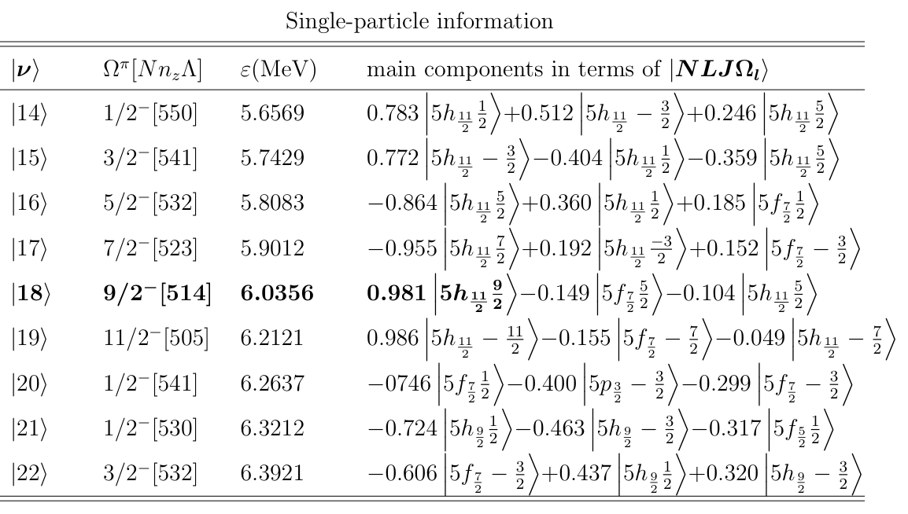

**Source:** PDF99 / 印88 · C016

**Original caption:** Table 6.6: Neutron single-particle orbitals, |ν⟩with negative-parity lying close to the Fermi level for $^{133}$Ce, expanded in the basis |NLJΩl⟩together with the single particle energies (ε) and approximate Nilsson quantum numbers at the deformation parameters listed in Table 6.1. The contribution of |NLJΩl⟩to |ν⟩ is the square of the amplitude of |NLJΩl⟩.

**中文图注:** 表6.6：$^{133}$Ce中费米面附近的负宇称中子单粒子轨道$|\nu\rangle$在$|NLJ\Omega_l\rangle$基底中的展开，同时列出单粒子能量ε和近似Nilsson量子数，采用的形变参数见表6.1。$|NLJ\Omega_l\rangle$对$|\nu\rangle$的贡献为相应振幅的平方。

**表头对照：** 原数值、振幅符号、下标、空缺横线、单位和误差均以裁图为准。

**页锚：PDF100 / 印89**

**Source:** PDF99 / 印88, PDF100 / 印89 · S048

**Original:** The orbital closest to the Fermi level is |ν⟩= |18⟩. The yrast band (Band 1) is thus mainly associated with orbital |18⟩which consists predominantly (96%) of the h11/2 orbital with a projection of 9/2 on the long axis. The projections K and Ωdo not have sharp values on any intrinsic nuclear axis. Each |ν⟩consists of contributions with different Ωon the long axis. The excited band (Band 4) has the same intrinsic configuration as Band 1, that is it is associated mainly with |ν⟩= |18⟩, however the states in this band have an extra ∼2ħof rotational angular momentum along the long axis (for more information, see the discussion in Chapter 3, Section 3.2.1).

**中文:** 最接近费米面的轨道为$|\nu\rangle=|18\rangle$。因此，yrast带Band 1主要与18号轨道相关；该轨道有96%的组成为长轴投影$9/2$的$h_{11/2}$轨道。投影$K$和$\Omega$在任何一个核内禀轴上都没有确定值，每个$|\nu\rangle$都含有长轴上不同$\Omega$的贡献。激发带Band 4与Band 1具有相同的内禀组态，即主要也与18号轨道相关；但该带各态沿长轴多出约$2\hbar$转动角动量，进一步讨论见第3章§3.2.1。

**Source:** PDF100 / 印89 · S049

**Original:** The excitation energies of the negative-parity bands are compared with the experimental data in panel (a) of Figure 6.11. The calculations are able to correctly predict the excitation energies of both Band 1 (shown in blue) and Band 4 (shown in red) across the whole spin range, although the agreement is moderate. The calculations have a shortcoming as they do not predict correctly the ordering of the 9/2−and 11/2−states in the yrast sequence, which results in an underprediction of the calculated excitation energy for Band 1. The QTR model achieves very good agreement with the experimental data for the signature splitting S(I) of Band 1 (see panel (b) of Figure 6.11). The experimental staggering for Band 4 is not reproduced very well, however the calculations do predict correctly that the S(I) has a smaller magnitude and undergoes a phase change.

**中文:** 图6.11(a)比较了负宇称带的激发能与实验数据。计算在整个自旋范围内都能正确预测Band 1（蓝色）和Band 4（红色）的激发能，尽管符合程度只是中等。计算存在一个不足：未能正确预测yrast序列中$9/2^-$与$11/2^-$态的顺序，导致对Band 1激发能的低估。对于Band 1的旋称劈裂$S(I)$，QTR模型与实验数据符合很好，见图6.11(b)。Band 4的实验交错并未被很好地再现，但计算正确预测了其$S(I)$振幅较小并发生相位变化。

##### 图6.11 · 133Ce负宇称带能量与旋称劈裂

**Placed near:** S049；原图/表来源PDF101 / 印90，裁图未改数字。

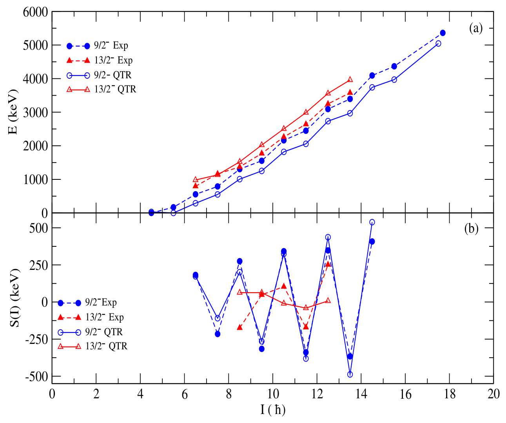

**Source:** PDF101 / 印90 · C017

**Original caption:** Figure 6.11: Panel (a) Excitation energy E(I) plot for Band 1 (shown in blue) and Band 4 (shown in red) in $^{133}$Ce. Panel (b) shows the corresponding signature splitting, S(I) for panel (a). The dashed lines denote the experimental data.

**中文图注:** 图6.11：(a)$^{133}$Ce Band 1（蓝色）和Band 4（红色）的激发能$E(I)$；(b)与(a)相应的旋称劈裂$S(I)$。虚线表示实验数据。

**Source:** PDF100 / 印89 · S050

**Original:** The calculated first excited band, Band 4, has the same intrinsic configuration as Band 1 with a band head at I = 13/2−. This state is generated when the total angular momentum vector tilts away from the intermediate axis, due to additional rotation of 2ħalong the long axis. It is also possible to develop a second excited band, being built on a state with ≈2ħgreater rotational angular momentum along the long axis than the band head of the first excited band. This second excited band would correspond to a further tilt of the total angular momentum vector away from the intermediate axis [42, 44]. For the current configuration, we have Ibandhead = 9/2ħfor the yrast band, thus the first excited band (Band 4) would have a spin of I = 13/2ħ. Indeed this is the measured spin of the band head of Band 4. Figure 3.3 illustrates the energy spectra and the angular momenta couplings of the yrast band and an excited band built on the h11/2 orbital with a projection of 9/2 on the long axis.

**中文:** 计算得到的第一激发带Band 4与Band 1具有相同内禀组态，其带头为$I=13/2^-$。沿长轴额外增加$2\hbar$转动，使总角动量矢量偏离中轴而倾斜，便产生了这一态。还可能形成第二激发带，其带头沿长轴的转动角动量比第一激发带带头再增加约$2\hbar$，对应总角动量矢量进一步偏离中轴[42,44]。对当前组态，yrast带有$I_{\mathrm{bandhead}}=9/2\hbar$，因此第一激发带Band 4的带头自旋应为$I=13/2\hbar$；这确实是测得的Band 4带头自旋。图3.3展示了基于长轴投影为$9/2$的$h_{11/2}$轨道的yrast带和一条激发带的能谱及角动量耦合。

##### Band 1的波函数

**Source:** PDF100 / 印89 · S051

**Original:** Wave functions for Band 1

**中文:** Band 1的波函数

**页锚：PDF101 / 印90**

**页锚：PDF102 / 印91**

**Source:** PDF100 / 印89, PDF101 / 印90, PDF102 / 印91 · S052

**Original:** The QTR model wave functions of the yrast band have been projected onto the long nuclear axis and the three dominant components for each of the states in the band are listed in Table 6.7 and the total wave functions for the states of Band 1 are plotted in Figure 6.12 (to be understood in a similar way to Figure 6.3 and Figure 6.8). The wave functions reveal that the band head state, $I^\pi=9/2^-$ of Band 1, is composed predominantly of orbital |18⟩with a dominant Ωl = 9/2 nature, with a contribution of 71.5% to the state wave function. In addition to the dominant (Kl, Ωl) = (9/2, 9/2) component, there is also a contribution of ∼20% from the (Kl, Ωl) = (7/2, 7/2) component. The presence of (7/2, 7/2) component suggests that already at the band head, the single-particle angular momentum is not fully aligned along the long axis.

**中文:** 将yrast带的QTR波函数投影到核长轴上，表6.7列出了每个态最主要的3个分量，图6.12绘出了Band 1各态的完整波函数，其读法与图6.3和图6.8类似。波函数表明，Band 1的$I^\pi=9/2^-$带头态主要由18号轨道构成，具有占主导的$\Omega_l=9/2$性质，对态波函数的贡献为71.5%。除了主要的$(K_l,\Omega_l)=(9/2,9/2)$分量，还存在约20%的$(7/2,7/2)$贡献。$(7/2,7/2)$分量的出现提示，即使在带头处，单粒子角动量也未完全沿长轴对齐。

##### 表6.7 · 133Ce yrast带波函数的主要分量

**Placed near:** S052；原图/表来源PDF102 / 印91，裁图未改数字。

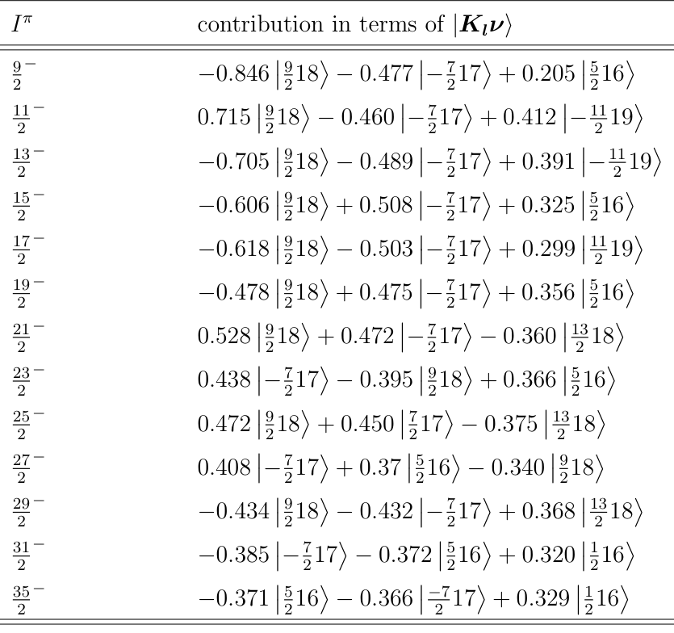

**Source:** PDF102 / 印91 · C018

**Original caption:** Table 6.7: The amplitudes and main components of the QTR model wave functions for states in the yrast band of $^{133}$Ce expanded in a strong coupling basis |Klν⟩. The contribution of each |Klν⟩is the square of the amplitude.

**中文图注:** 表6.7：$^{133}$Ce yrast带各态的QTR波函数在强耦合基底$|K_l\nu\rangle$下展开的振幅和主要分量。每个$|K_l\nu\rangle$的贡献为其振幅的平方。

**表头对照：** 原数值、振幅符号、下标、空缺横线、单位和误差均以裁图为准。

##### 图6.12 · 133Ce yrast带波函数沿长轴的投影

**Placed near:** S052；原图/表来源PDF103 / 印92，裁图未改数字。

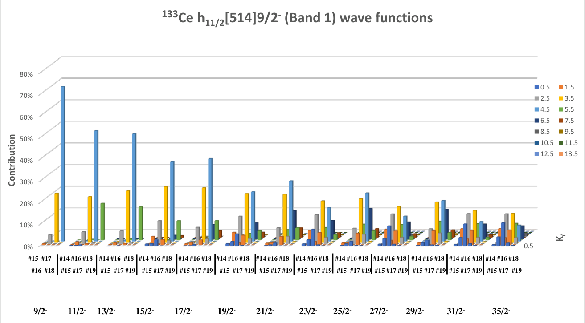

**Source:** PDF103 / 印92 · C019

**Original caption:** Figure 6.12: QTR model wave functions of the states in the yrast band projected onto the long nuclear axis.

**中文图注:** 图6.12：$^{133}$Ce yrast带各态的QTR模型波函数在核长轴上的投影。

**Source:** PDF102 / 印91 · S053

**Original:** The states with $I^\pi=9/2^-$to $I^\pi=17/2^-$in Band 1 have a dominant Ωl = 9/2 nature because the (Kl, Ωl) = (9/2, 9/2) component has the largest contributions to the wavefunctions of the states. While the (9/2, 9/2) component is dominant for these states, the magnitude of this contribution is decreasing with increasing spin (see the light-blue column in Figure 6.12). In fact, the (7/2, 7/2), (11/2, 11/2) and (5/2, 5/2) components are also present at low spins and their contributions to the wave functions increase with increasing spin (see the yellow, green, and grey columns, respectively in Figure 6.12). This is due to the Coriolis interaction which causes the misalignment of the single-particle angular momentum of the valence hole,⃗j, leading to components with Ωl = 7/2 and Ωl = 5/2.

**中文:** Band 1中$I^\pi=9/2^-$到$17/2^-$各态主要具有$\Omega_l=9/2$性质，因为$(K_l,\Omega_l)=(9/2,9/2)$分量对波函数的贡献最大。虽然该分量在这些态中占主导，其贡献大小却随自旋升高而下降，见图6.12的浅蓝色柱。实际上，低自旋处也存在$(7/2,7/2)$、$(11/2,11/2)$和$(5/2,5/2)$分量，且随自旋升高而增强，在图6.12中分别对应黄色、绿色和灰色柱。这是Coriolis相互作用的结果：它使价空穴的单粒子角动量$\vec j$偏离对齐方向，带来$\Omega_l=7/2$和$5/2$分量。

**Source:** PDF102 / 印91 · S054

**Original:** At spins $I^\pi=23/2^-$to $I^\pi=29/2^-$, the (7/2, 7/2), (11/2, 11/2), (13/2, 9/2) and (5/2, 5/2) components come so low in energy that for some states these components are favored and they become the dominant components in the wave functions.

**中文:** 在$I^\pi=23/2^-$到$29/2^-$，$(7/2,7/2)$、$(11/2,11/2)$、$(13/2,9/2)$与$(5/2,5/2)$分量的能量降得足够低，在某些态中成为更有利的分量，并主导相应波函数。

**页锚：PDF103 / 印92**

**Source:** PDF103 / 印92 · S055

**Original:** At higher spins, for I > 29/2, the (Kl, Ωl) = (9/2, 9/2) component, while still considerable in the wave functions of the states, becomes less important, while the (13/2, 9/2), (7/2, 7/2), and (5/2, 5/2) components are more significant.

**中文:** 在更高自旋$I>29/2$处，虽然$(K_l,\Omega_l)=(9/2,9/2)$仍有不可忽略的贡献，其重要性降低，而$(13/2,9/2)$、$(7/2,7/2)$和$(5/2,5/2)$分量更加重要。

**Source:** PDF103 / 印92 · S056

**Original:** The wave functions of the states in Band 1 do exhibit a staggering pattern. For instance the contribution of the (9/2, 9/2) component shown as a light-blue column in Figure 6.12 is consistently larger for the positive-signature ($\alpha=+1/2$) states of Band 1. The staggering in the wave functions is probably the cause for the staggering in the excitation energies shown in Figure 6.11 (b).

**中文:** Band 1各态的波函数确实表现出交错。例如，图6.12浅蓝色柱表示的$(9/2,9/2)$分量，对Band 1正旋称$\alpha=+1/2$各态的贡献始终较大。波函数的交错很可能是图6.11(b)中激发能交错的原因。

**页锚：PDF104 / 印93**

##### Band 4的波函数

**Source:** PDF104 / 印93 · S057

**Original:** Wave functions for Band 4

**中文:** Band 4的波函数

**Source:** PDF104 / 印93 · S058

**Original:** Band 4 is built on the same intrinsic configuration as the yrast band. It is generated by increasing the rotational angular momentum along the intermediate axis, and it also comprises 2ħof rotation around the long axis. All QTR model states that form Band 4 have Rl ≈2ħ, consequently, Kl ≈Ωl+2; thus at the bandhead of this band, is expected to have dominant components of (Ωl + 2, Ωl) = (13/2, 9/2); (11/2, 7/2); (9/2, 5/2);(15/2, 11/2) and so forth. Table 6.12 lists the three dominant components of the wave functions for each state in this band.

**中文:** Band 4建立在与yrast带相同的内禀组态上。它通过增加沿中轴的转动角动量而产生，同时还含有绕长轴的$2\hbar$转动。构成Band 4的全部QTR模型态均有$R_l\approx2\hbar$，因而$K_l\approx\Omega_l+2$。因此，在该带带头处，预期主要分量为$(\Omega_l+2,\Omega_l)=(13/2,9/2)$、$(11/2,7/2)$、$(9/2,5/2)$、$(15/2,11/2)$等。表6.12列出了该带每个态波函数的3个主要分量。

##### 表6.8 · 133Ce Band 4波函数的主要分量

**Placed near:** S058；原图/表来源PDF104 / 印93，裁图未改数字。

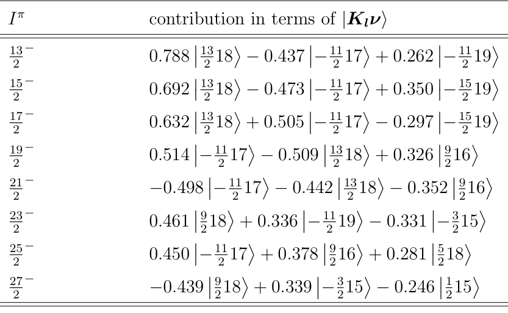

**Source:** PDF104 / 印93 · C020

**Original caption:** Table 6.8: Main components of the QTR model wave functions for states in Band 4 of $^{133}$Ce expanded in a strong coupling basis |Klν⟩.

**中文图注:** 表6.8：$^{133}$Ce Band 4各态的QTR波函数在强耦合基底$|K_l\nu\rangle$下展开的主要分量。

**表头对照：** 原数值、振幅符号、下标、空缺横线、单位和误差均以裁图为准。

**Source:** PDF104 / 印93 · S059

**Original:** In a similar fashion to Figure 6.12, Figure 6.13 shows the plot of the wave functions of the states in Band 4. The band head state, $I^\pi=13/2^-$, consists primarily (∼62%) of (Kl, Ωl) = (13/2, 9/2) component, (see the tall dark-blue column in Figure 6.13). There is also a presence of the (11/2, 7/2) component which corresponds to the h11/2 orbital with single-particle angular momentum projection of 7/2 on the long axis. This means that this state has the same |ν⟩= |18⟩ orbital as the band head state of the yrast band (h11/2 orbital with single-particle angular momentum projection of 9/2 on the long axis) and an additional ∼2ħof rotational angular momentum (Kl = Ωl + Rl). At the band head the dominant component corresponds to (13/2, 9/2), thus I = Kl, suggesting that the total angular momentum is aligned along the long axis.

**中文:** 与图6.12类似，图6.13绘出Band 4各态的波函数。$I^\pi=13/2^-$带头态主要由$(K_l,\Omega_l)=(13/2,9/2)$分量构成，约占62%，见图6.13中较高的深蓝色柱。此外还存在$(11/2,7/2)$分量，对应单粒子角动量沿长轴投影为$7/2$的$h_{11/2}$轨道。这意味着该态与yrast带带头具有相同的18号轨道，即单粒子角动量沿长轴投影为$9/2$的$h_{11/2}$轨道，同时还具有额外约$2\hbar$转动角动量，满足$K_l=\Omega_l+R_l$。带头主要分量为$(13/2,9/2)$，所以$I=K_l$，提示总角动量沿长轴对齐。

##### 图6.13 · 133Ce Band 4波函数沿长轴的投影

**Placed near:** S059；原图/表来源PDF105 / 印94，裁图未改数字。

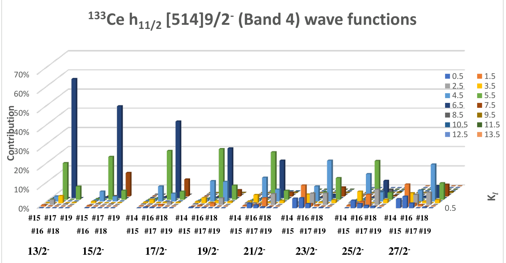

**Source:** PDF105 / 印94 · C021

**Original caption:** Figure 6.13: QTR model wave functions of the states in Band 4 projected onto the long nuclear axis.

**中文图注:** 图6.13：Band 4各态的QTR模型波函数在核长轴上的投影。

**页锚：PDF105 / 印94**

**Source:** PDF105 / 印94 · S060

**Original:** The states in Band 4 with $I^\pi=13/2^-$to 17/2−, have dominant (13/2, 9/2) components in the wave functions, contributing more than 40% to the wave function of each state. However, for these states there is also a significant presence of (9/2, 9/2) and (11/2, 7/2), components. As the spin of the rotational states increases the contribution of (13/2, 9/2) components to the wave function of the states decreases. This correlates with an increase in contribution from components with (9/2, 9/2) and (11/2, 7/2) nature in the wave functions, see Table 6.8. It is also illustrated in Figure 6.13 as an increase in the height of the light-blue, and green columns.

**中文:** Band 4中$I^\pi=13/2^-$到$17/2^-$各态的波函数以$(13/2,9/2)$分量为主，其贡献均超过40%。但这些态也包含显著的$(9/2,9/2)$和$(11/2,7/2)$分量。随转动态自旋升高，$(13/2,9/2)$分量的贡献降低，同时具有$(9/2,9/2)$和$(11/2,7/2)$性质的分量增强，见表6.8。图6.13中浅蓝色柱和绿色柱的高度增加也体现了这一点。

**页锚：PDF106 / 印95**

**Source:** PDF105 / 印94, PDF106 / 印95 · S061

**Original:** The states with $I^\pi=19/2^-$and 21/2−have a greater mixture of (13/2, 9/2), (9/2, 9/2) and (11/2, 7/2) components in the wave functions as the Coriolis interaction causes the single-particle angular momentum,⃗j, to align with the intermediate axis, and generates components with Ωl = 7/2. The wave functions of the higher spin states of 23/2−to 27/2−have greater contributions from (9/2, 9/2) and (11/2, 7/2) components than the lower-spin states. The contribution of (13/2, 9/2) components in the wave functions for the states with I > 21/2 is small.

**中文:** 在$I^\pi=19/2^-$和$21/2^-$态中，$(13/2,9/2)$、$(9/2,9/2)$与$(11/2,7/2)$分量发生更强混合：Coriolis相互作用促使单粒子角动量$\vec j$朝中轴对齐，并产生$\Omega_l=7/2$分量。更高自旋$23/2^-$到$27/2^-$各态的波函数，比低自旋态具有更大的$(9/2,9/2)$和$(11/2,7/2)$贡献。对于$I>21/2$各态，$(13/2,9/2)$分量的贡献很小。

**页锚：PDF107 / 印96**

#### 6.3.3 133Ce h11/2带的冻结对齐（FA）近似

**Source:** PDF107 / 印96 · S062

**Original:** 6.3.3 The frozen alignment (FA) approximation for h11/2 Bands in $^{133}$Ce

**中文:** 6.3.3 133Ce h11/2带的冻结对齐（FA）近似

**Source:** PDF107 / 印96 · S063

**Original:** In Ref. [23], Frauendorf and D ̈onau proposed transverse wobbling motion in 135Pr. They approximated the three-dimensional rotational Hamiltonian (simultaneous rotation around the three principle nuclear axes) by 1D rotation about the orthogonal (long/short) axis coupled with small-amplitude oscillations of this axis (or coupled with excitations of wobbling phonons). In order for the approximation to be valid it is necessary, (i) that the single-particle angular momentum,⃗j, is firmly aligned (’frozen’) along the orthogonal (long/short) axis. This is needed to exclude the tilting of⃗I due to mis-alignment of⃗j caused by the Coriolis interaction. Wobbling is a collective mode of excitation, therefore, the single-particle degrees of freedom have to be excluded. However, this is not sufficient to approximate 3D rotation with wobbling motion, thus in addition, (ii) the rotation along the wobbling axis should be much larger than the rotation orthogonal to it, i.e. the projection of the rotational angular momentum⃗R on the long axis, Rl, should be much larger than the projection of the rotational angular momentum⃗R on the intermediate axis, Ri, that is Rl >> Ri. This is needed because only if this is true one can approximate the rotation that is orthogonal to the long axis with excitations of wobbling phonons.

**中文:** Frauendorf与Dönau在文献[23]中提出$^{135}$Pr中的横向wobbling运动。他们用绕正交方向的长轴或短轴的一维转动，与该轴的小振幅振荡耦合，或与wobbling声子激发耦合，来近似绕三个核主轴同时转动的三维转动Hamiltonian。为了使近似成立，首先必须要求单粒子角动量$\vec j$牢固地沿正交方向的长轴或短轴对齐，即“冻结”。这样做是为了排除Coriolis相互作用引起$\vec j$失配、进而使$\vec I$倾斜的效应。wobbling是集体激发模式，因此必须排除单粒子自由度。但这仍不足以把三维转动近似为wobbling，还必须要求沿wobbling轴的转动远大于垂直于它的转动；也就是转动角动量$\vec R$沿长轴的投影$R_l$远大于沿中轴的投影$R_i$，即$R_l\gg R_i$。只有满足这一点，才可以把垂直于长轴的转动近似为wobbling声子激发。

**Source:** PDF107 / 印96 · S064

**Original:** The FA approximation is a valid approximation for wobbling motion if the two conditions outlined above are fulfilled. The last condition is not fulfilled in $^{133}$Ce, where the rotation along the intermediate axis is dominant. It had already been shown that this condition is in general not fulfilled for one-quasiparticle bands and transverse coupling of the angular momenta [42].

**中文:** 如果上述两个条件都满足，FA近似就是wobbling运动的有效近似。最后一个条件在$^{133}$Ce中不满足，因为沿中轴的转动占主导。此前工作已表明，对于单准粒子带和角动量的横向耦合，该条件一般不满足[42]。

**Source:** PDF107 / 印96 · S065

**Original:** Calculations were performed using the QTR model with the FA approximation as in Ref. [23], where it is assumed that the angular momentum of the odd neutron is firmly aligned with the long axis. This is equivalent to the calculations presented in Section 6.3.2, but with a restricted configurations space, that consists of only one orbital, (orbital |18⟩, listed in Table 6.6). The deformation parameters used in the calculations are presented in Table 6.1. The assumed MoIs are the same as those presented in Section 6.3.2, that is with J0 = 10 ħ2MeV−1 and J1 = 25 ħ4MeV−3.

**中文:** 按文献[23]的方式，使用带FA近似的QTR模型开展计算，假定奇中子的角动量牢固地沿长轴对齐。这相当于§6.3.2的计算，但组态空间受到限制，只包含一个轨道，即表6.6中的18号轨道。形变参数列于表6.1，所假定转动惯量与§6.3.2相同，$J_0=10\hbar^2\mathrm{MeV}^{-1}$、$J_1=25\hbar^4\mathrm{MeV}^{-3}$。

**页锚：PDF108 / 印97**

**Source:** PDF108 / 印97 · S066

**Original:** The results from the calculations are presented in Figure 6.14. Panel (a) of Figure 6.14 shows the excitation energies as a function of spin. For both, the yrast band (shown in blue), and Band 4 (shown in red) the calculations overestimates the experimental data. This indicates that if one restricts the configuration space, states that would naturally appear at lower energy are excluded from the calculations. Furthermore, contrary to the large energy staggering observed in the experimental data for both bands, the FA approximation produces bands with absent staggering, see panel (b) of Figure 6.14. As we have discussed previously in Section 6.2.1 and Section 6.2.2, bands based on a high-Ωconfiguration can exhibit signature splitting caused by nuclear triaxiality. Of course if⃗j is frozen along the long axis, it cannot re-align. This effectively means that the Coriolis interaction is excluded from the calculations, therefore components other than the (Kl, Ωl) = (9/2, 9/2), for the yrast band and (Kl, Ωl) = (13/2, 9/2), for Band 4 are left out. Therefore the lack of energy staggering in the calculated bands is a direct consequence of the FA approximation.

**中文:** 计算结果见图6.14，(a)展示激发能随自旋的变化。对yrast带（蓝色）和Band 4（红色），计算值都高于实验。这表明限制组态空间后，本来能够出现在较低能量处的态被排除在计算之外。此外，与两条带实验数据中较大的能量交错相反，FA近似得到的带不具有交错，见图6.14(b)。如§6.2.1和§6.2.2所述，基于高$\Omega$组态的带可以具有由核三轴性引起的旋称劈裂。当然，若$\vec j$沿长轴冻结，就不能重新对齐。这实际上意味着Coriolis相互作用被排除出计算，因而除了yrast带的$(K_l,\Omega_l)=(9/2,9/2)$以及Band 4的$(13/2,9/2)$之外，其它分量均被省略。因此，计算带中能量交错的缺失是FA近似的直接结果。

##### 图6.14 · FA近似的能量和旋称劈裂

**Placed near:** S066；原图/表来源PDF109 / 印98，裁图未改数字。

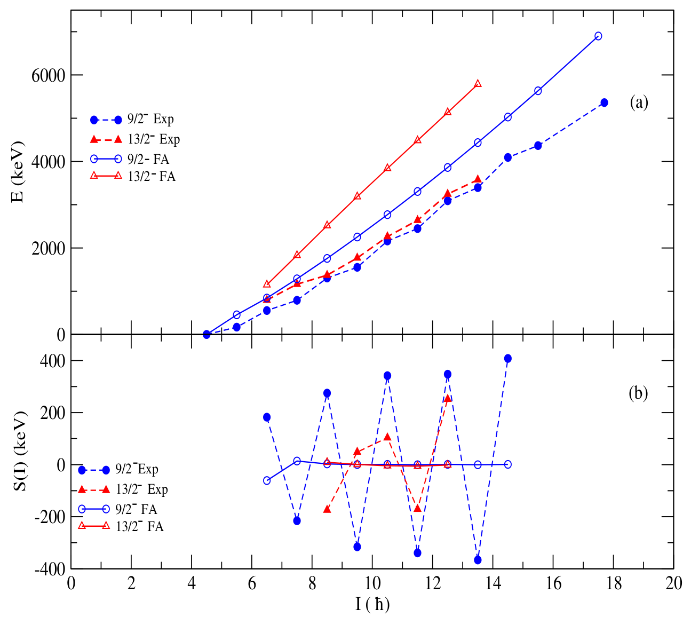

**Source:** PDF109 / 印98 · C022

**Original caption:** Figure 6.14: Panel (a) shows a comparison of the excitation energies, (E(I) extracted from the QTR model calculations assuming a frozen alignment (solid lines) with the experimental excitation energies (dashed lines) for Band 1 (shown in blue) and Band 4 (shown in red). The deformation parameters are those listed in Table 6.1. Panel (b) shows the corresponding signature splitting, (S(I) for panel (a).

**中文图注:** 图6.14：(a)比较假定冻结对齐时QTR计算所得激发能$E(I)$（实线）与Band 1（蓝色）、Band 4（红色）的实验激发能（虚线）。形变参数见表6.1。(b)给出与(a)相应的旋称劈裂$S(I)$。

**Source:** PDF108 / 印97 · S067

**Original:** In the preceding discussion we have seen the importance of including the singleparticle degrees of freedom and allowing⃗j to re-align due to the Coriolis interaction, as well as in general allowing contributions from the orbitals near the Fermi surface. It was shown that, while the (9/2, 9/2) component plays a major role for the states of Band 1, other components, such as (7/2, 7/2), ()13/2, 9/2, (11/2, 11/2) and (5/2, 5/2) also contribute significantly, particularly at high spins where the (9/2, 9/2) component is not dominant, see Figure 6.12.

**中文:** 前面的讨论显示了计入单粒子自由度、允许$\vec j$在Coriolis相互作用下重新对齐，以及一般性地允许费米面附近轨道参与的重要性。虽然$(9/2,9/2)$分量对Band 1各态起重要作用，$(7/2,7/2)$、“()13/2,9/2”、$(11/2,11/2)$和$(5/2,5/2)$等其它分量也具有显著贡献，特别是在$(9/2,9/2)$不再占主导的高自旋处，见图6.12。

**Source:** PDF108 / 印97 · S068

**Original:** In Band 4 components other than the (13/2, 9/2) component are favored for some states in the band, in particular the (9/2, 9/2), (11/2, 7/2), and (15/2, 11/2) components are largest for the $I^\pi=25/2^-$and 27/2−states as shown in Figure 6.13. These components are important in the construction of the rotational states as they come down in energy and become more favored than the (13/2, 9/2) component.

**中文:** 在Band 4的某些态中，除$(13/2,9/2)$之外的其它分量更加有利。尤其对$I^\pi=25/2^-$和$27/2^-$，$(9/2,9/2)$、$(11/2,7/2)$与$(15/2,11/2)$分量最大，见图6.13。这些分量降至较低能量，变得比$(13/2,9/2)$更加有利，因此对于构建转动态十分重要。

**页锚：PDF110 / 印99**

#### 6.3.4 电磁性质

**Source:** PDF110 / 印99 · S069

**Original:** 6.3.4 Electromagnetic Properties

**中文:** 6.3.4 电磁性质

**Source:** PDF110 / 印99 · S070

**Original:** The interpretation of the low-lying rotational structures found in the 135Pr as zero- , one-, and two-phonon transverse wobbling motion as described in Ref. [23], was questioned in Refs. [71, 72].

**中文:** 文献[23]将$^{135}$Pr低激发转动结构解释为零、一和二声子横向wobbling运动，这一观点受到文献[71,72]的质疑。

**Source:** PDF110 / 印99 · S071

**Original:** In Ref. [42] the transverse wobbling motion interpretation for low-lying yrare bands in odd-mass nuclei was examined. It was pointed out that the transverse wobbling Hamiltonian as given in Ref. [23] is not equivalent to the 3D quasiparticle-plus-triaxial rotor (QTR) model Hamiltonian. It was shown that the conditions necessary for harmonic frozen alignment (HFA) approximation at low and medium spins are not satisfied for transverse coupling. When the HFA approximation is not valid, the QTR calculations describe three-dimensional rotation tilted precession, TiP bands and not wobbling. This motion looks like precession similar to the precession of a rotating top with respect to the vertical axis.

**中文:** 文献[42]考察了将奇质量核低激发非晕带解释为横向wobbling的观点，指出文献[23]的横向wobbling Hamiltonian与三维QTR Hamiltonian不等价；对于横向耦合，低、中自旋处不满足谐性冻结对齐（harmonic frozen alignment，HFA）近似所需条件。当HFA近似不成立时，QTR计算描述的是三维转动的倾斜进动（tilted precession，TiP）带，而不是wobbling。这种运动类似于旋转陀螺相对于竖直轴的进动。

**Source:** PDF110 / 印99 · S072

**Original:** As we have seen in Section 6.3.3, the frozen alignment (FA) approximation can not reproduce the experimentally observed large magnitude signature splitting in the yrast band of $^{133}$Ce. In the following the predicted electromagnetic transition probabilities from the QTR model with FA and QTR model with a large configuration space are compared with the experimentally measured values.

**中文:** 如§6.3.3所示，冻结对齐（FA）近似不能再现$^{133}$Ce yrast带中实验观测到的较大旋称劈裂。下面将具有FA近似的QTR模型与大组态空间QTR模型预测的电磁跃迁几率，与实验测量值进行比较。

##### 表6.9 · Band 4的QTR电磁跃迁性质

**Placed near:** S072；原图/表来源PDF111 / 印100，裁图未改数字。

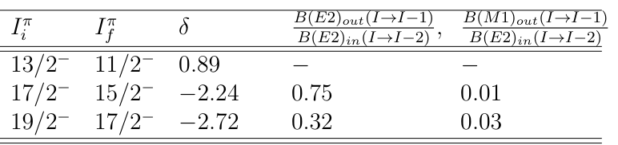

**Source:** PDF111 / 印100 · C023

**Original caption:** Table 6.9: QTR model electromagnetic transition properties for Band 4 of $^{133}$Ce.

**中文图注:** 表6.9：$^{133}$Ce Band 4的QTR模型电磁跃迁性质。

**表头对照：** 原数值、振幅符号、下标、空缺横线、单位和误差均以裁图为准。

##### 表6.10 · Band 4的FA电磁跃迁性质

**Placed near:** S072；原图/表来源PDF111 / 印100，裁图未改数字。

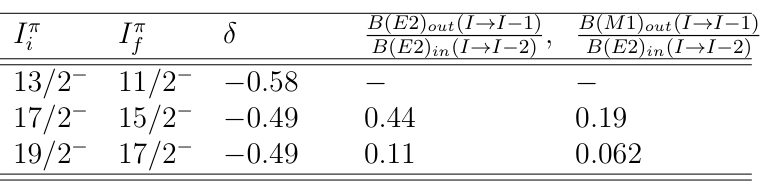

**Source:** PDF111 / 印100 · C024

**Original caption:** Table 6.10: QTR model electromagnetic transition properties for Band 4 of $^{133}$Ce assuming a frozen alignment approximation. The parameter employed are the same as those used for panel (a) of Figure 6.14.

**中文图注:** 表6.10：采用冻结对齐近似时，$^{133}$Ce Band 4的QTR模型电磁跃迁性质。使用的参数与图6.14(a)相同。

**表头对照：** 原数值、振幅符号、下标、空缺横线、单位和误差均以裁图为准。

**Source:** PDF110 / 印99 · S073

**Original:** An important feature of all wobbling bands is that two successive bands based on the same one-quasiparticle configuration and differing by one wobbling phonon (∆n = 1), should be linked with ∆I = 1, M1 + E2 transitions with dominant E2 nature, that is with mixing ratio |δE2/M1| > 1. Mixing ratios with magnitudes larger than one are associated with collective modes of excitation such as wobbling, TiP, and vibration motion. However, it is possible to measure mixing ratios less than one for TiP, because of the presence of single-particle degrees of freedom, while wobbling requires |δ| > 1 for such M1+E2 transitions. Therefore, measuring mixing ratios with magnitudes larger than one for M1+E2 transitions interconnecting two successive wobbling bands are necessary evidence to support the transverse wobbling interpretation [23].

**中文:** 所有wobbling带的一个重要特征是：基于同一单准粒子组态、相差一个wobbling声子，即$\Delta n=1$的两条相邻带，应由以E2为主的$\Delta I=1$、M1+E2跃迁相连，也就是混合比满足$|\delta_{E2/M1}|>1$。混合比绝对值大于1与wobbling、TiP和振动等集体激发模式相关。然而，由于存在单粒子自由度，TiP也可能测得小于1的混合比；而对这类M1+E2跃迁，wobbling要求$|\delta|>1$。因此，测得连接相邻两条wobbling带的M1+E2跃迁具有大于1的混合比绝对值，是支持横向wobbling解释所必需的证据[23]。

**Source:** PDF110 / 印99 · S074

**Original:** Recently, the wobbling interpretation of the oneand two-phonon wobbling bands in 135Pr was ruled out by new experimental data [45].

**中文:** 近期，新的实验数据排除了$^{135}$Pr中一声子、二声子带的wobbling解释[45]。

**页锚：PDF111 / 印100**

**Source:** PDF110 / 印99, PDF111 / 印100 · S075

**Original:** Electromagnetic properties were measured for the 625-, 582-, and 465- keV transitions linking Band 4 to Band 1 in $^{133}$Ce. The results from the experiment are presented in Table 6.11. The measured mixing ratio for the 625 keV transition linking the $13/2^-$ state from Band 4 to the $11/2^-$ state from the yrast band was $|\delta_{E2/M1}|\sim1.5^{+0.97}_{-5.7}$. The 582 keV transition linking the $17/2^-$ state to the $15/2^-$ state was well resolved in the data and a magnitude of the mixing ratio of $|\delta_{E2/M1}|\sim0.55^{+0.12}_{-0.25}$ was extracted. A magnitude of the mixing ratio of $|\delta_{E2/M1}|\sim0.17^{+0.09}_{-0.2}$ was extracted for the 465 keV transition linking the $19/2^-$ state to the $17/2^-$ state. The 582- and the 465- keV transitions have a dominant magnetic character as they have only $\sim30\%$ and $\sim3\%$ E2 fraction, respectively, while the mixing ratios for the 625- keV transition was measured with large uncertainty, which does not allow to determine which component (M1 or E2) is larger. Based on the measured mixing ratios the excited band (Band 4) in $^{133}$Ce cannot be associated with wobbling.

**中文:** 测量了$^{133}$Ce中将Band 4连接到Band 1的625、582和465 keV跃迁的电磁性质，实验结果见表6.11。625 keV跃迁连接Band 4的$13/2^-$态与yrast带的$11/2^-$态，其测得混合比在原文中以绝对值写为$|\delta_{E2/M1}|\sim1.5^{+0.97}_{-5.7}$。582 keV跃迁连接$17/2^-$与$15/2^-$态，在数据中能够清晰分辨，提取的混合比绝对值为$|\delta_{E2/M1}|\sim0.55^{+0.12}_{-0.25}$。465 keV跃迁连接$19/2^-$与$17/2^-$态，提取值为$|\delta_{E2/M1}|\sim0.17^{+0.09}_{-0.2}$。582和465 keV跃迁以磁性为主，其E2份额分别仅约30%和3%；625 keV的混合比测量不确定度较大，无法判断M1与E2哪个分量更大。依据这些测得混合比，$^{133}$Ce的激发带Band 4不能与wobbling联系起来。

##### 表6.11 · Band 4混合比及相对跃迁几率实验值

**Placed near:** S075；原图/表来源PDF112 / 印101，裁图未改数字。

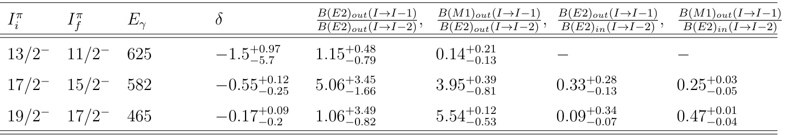

**Source:** PDF112 / 印101 · C025

**Original caption:** Table 6.11: Experimental data on the mixing ratios δ, and the measured reduced transition probabilities for Band 4 of $^{133}$Ce.

**中文图注:** 表6.11：$^{133}$Ce Band 4的混合比δ及所测约化跃迁几率实验数据。

**表头对照：** 原数值、振幅符号、下标、空缺横线、单位和误差均以裁图为准。

**Source:** PDF111 / 印100 · S076

**Original:** The calculations carried out with a large configuration space and with FA approximation were both able to reproduce the experimentally measured mixing ratios for both intraband transitions in the yrast band, see Figure 6.15.

**中文:** 使用大组态空间以及使用FA近似开展的计算，都能够再现yrast带内跃迁的实验混合比，见图6.15。

##### 图6.15 · 带内与带间混合比的逐项比较

**Placed near:** S076；原图/表来源PDF113 / 印102，裁图未改数字。

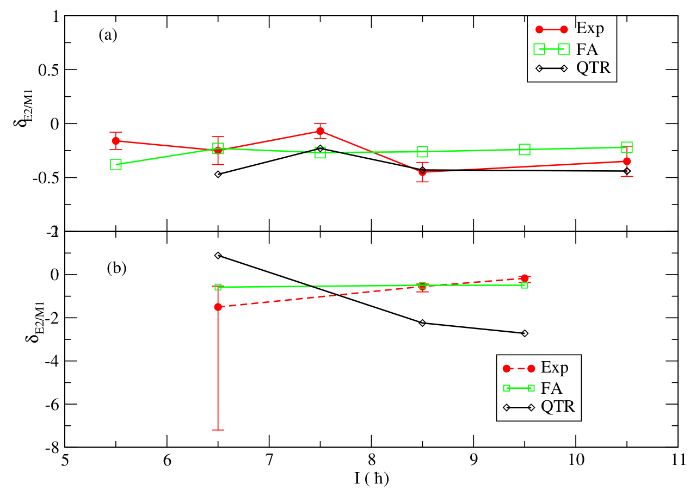

**Source:** PDF113 / 印102 · C026

**Original caption:** Figure 6.15: (a) Mixing ratios δE2/M1 for intraband transitions for the yrast band. The experimental values are shown in red, green denotes the harmonic frozen approximation, while standard QTR model calculation with full singleparticle degrees of freedom are shown in black. Experimental data for the intraband transitions in the yrast band from [56]. (b) Mixing ratios δE2/M1 for the connecting transitions from Band 4 to the yrast band. Experimental data deduced in this experiment.

**中文图注:** 图6.15：(a)yrast带内跃迁的混合比$\delta_{E2/M1}$。实验值为红色，绿色表示谐性冻结近似，黑色表示具有完整单粒子自由度的标准QTR计算。yrast带内跃迁实验数据来自文献[56]。(b)Band 4到yrast带连接跃迁的混合比$\delta_{E2/M1}$，实验数据由本实验得到。

**页锚：PDF113 / 印102**

**Source:** PDF113 / 印102 · S077

**Original:** The mixing ratios for the connecting transitions from Band 4 to Band 1 are shown in panel (b) of Figure 6.15. It can clearly be seen that the FA approximation (shown in green in panel (b) of Figure 6.15) shows better agreement with the experimentally measured mixing ratios.

**中文:** 图6.15(b)给出了Band 4连接到Band 1的跃迁混合比。可以清楚看到，绿色表示的FA近似与实验混合比符合得更好。

**页锚：PDF114 / 印103**

**页锚：PDF115 / 印104**

**Source:** PDF114 / 印103, PDF115 / 印104 · S078

**Original:** Figure 6.16 (a) shows the $B(M1)_{out}(I\to I-1)/B(E2)_{in}(I\to I-2)$ ratios, for the observed connecting transitions listed in Table 6.11. The values obtained from the QTR model with FA approximation and with full consideration of the single-particle degrees of freedom are about the same and show a decreasing trend with increasing spin, while the experimental data indicate an increasing trend with increasing spin. For the $B(E2)_{out}(I\to I-1)/B(E2)_{in}(I\to I-2)$ ratios, shown in Figure 6.16 (b) the QTR model calculations with full single-particle degrees of freedom reproduce the experimental $B(E2)_{out}(I\to I-1)/B(E2)_{in}(I\to I-2)$ ratios better than the FA approximation.

**中文:** 图6.16(a)给出表6.11所列连接跃迁的$B(M1)_{\mathrm{out}}(I\to I-1)/B(E2)_{\mathrm{in}}(I\to I-2)$。FA近似和完整计入单粒子自由度的QTR模型所得数值约略相近，并都随自旋升高而下降，而实验数据却随自旋升高而增大。对于图6.16(b)的$B(E2)_{\mathrm{out}}(I\to I-1)/B(E2)_{\mathrm{in}}(I\to I-2)$，完整计入单粒子自由度的QTR计算比FA近似更好地再现了实验比值。

##### 图6.16 · Band 4→Band 1相对电磁强度

**Placed near:** S078；原图/表来源PDF114 / 印103，裁图未改数字。

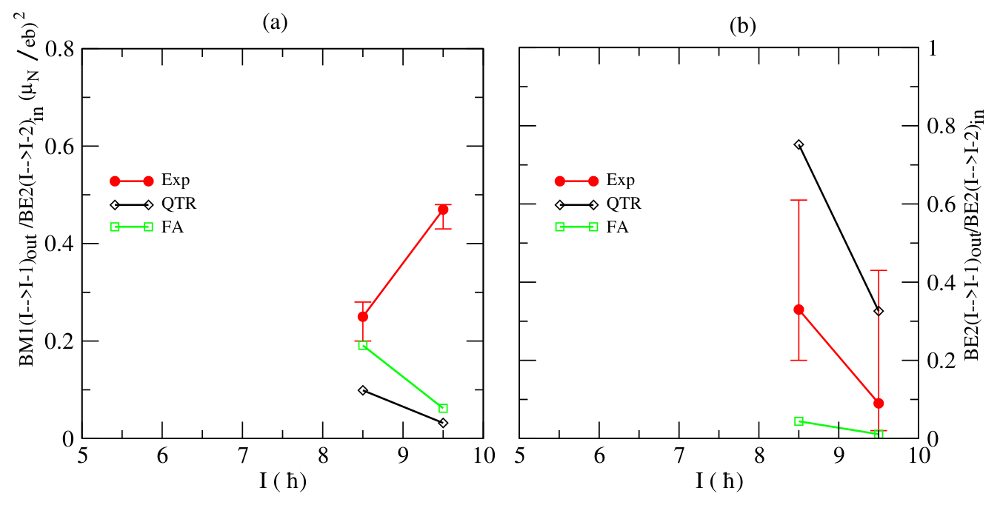

**Source:** PDF114 / 印103 · C027

**Original caption:** Figure 6.16: Electromagnetic ratios for connecting transitions from Band 4 to Band 1. The experimental values are shown in red. Green denotes the frozen approximation. The standard QTR model calculations with full single-particle degrees of freedom are shown in black. Panel (a) shows the $B(M1)_{out}(I\to I-1)/B(E2)_{in}(I\to I-2)$ ratios, panel (b) shows the $B(E2)_{in}(I\to I-1)/B(E2)_{out}(I\to I-2)$ ratios.

**中文图注:** 图6.16：Band 4到Band 1连接跃迁的电磁比值。实验值为红色，绿色表示冻结近似，黑色表示具有完整单粒子自由度的标准QTR计算。(a)展示$B(M1)_{\mathrm{out}}(I\to I-1)/B(E2)_{\mathrm{in}}(I\to I-2)$，(b)展示$B(E2)_{\mathrm{in}}(I\to I-1)/B(E2)_{\mathrm{out}}(I\to I-2)$。

#### 6.3.5 第二部分小结

**Source:** PDF115 / 印104 · S079

**Original:** 6.3.5 Summary of Part II

**中文:** 6.3.5 第二部分小结

**Source:** PDF115 / 印104 · S080

**Original:** The properties of the low lying negative-parity $h_{11/2}$ bands in $^{133}$Ce are investigated using the QTR model. In section 6.3.2, the calculations were performed with nine negative-parity orbitals to incorporate the single-particle degrees of freedom. The calculations describe a regular 3D precession of the angular momentum vector as described in Refs. [42, 44]. The calculations were able to reproduce the experimentally observed excitation energy and the signature splitting, as measured by the energy staggering index $S(I)$ for Band 1. The $B(E2)_{out}(I\to I-1)/B(E2)_{in}(I\to I-2)$ ratios for the connecting transitions between Band 4 and Band 1 are also well reproduced in the model. The calculations were also able to reproduce the mixing ratios, $\delta_{E2/M1}$, for intraband transitions in Band 1, while the calculated magnitudes of $\delta_{E2/M1}$ for the connecting transitions between Band 4 and Band 1 are a bit high.

**中文:** 使用QTR模型研究了$^{133}$Ce中低激发负宇称$h_{11/2}$带的性质。在§6.3.2中，计算采用9个负宇称轨道以计入单粒子自由度。这些计算描述了文献[42,44]所述的规则三维角动量矢量进动，能够再现Band 1的实验激发能，以及由能量交错指标$S(I)$度量的旋称劈裂。Band 4与Band 1间连接跃迁的$B(E2)_{\mathrm{out}}(I\to I-1)/B(E2)_{\mathrm{in}}(I\to I-2)$也得到较好再现。计算还能再现Band 1带内跃迁的混合比$\delta_{E2/M1}$，但对Band 4到Band 1连接跃迁预测的混合比绝对值略偏大。

**Source:** PDF115 / 印104 · S081

**Original:** QTR model calculations were also performed assuming the angular momentum of the valence neutron is firmly aligned with the long axis (frozen alignment). The model with this assumption was able to reproduce the mixing ratios for both the intraband transitions in Band 1 and the connecting transitions between Band 4 and Band 1. However, the calculations over-estimated the experimental excitation energies and predict an absent signature splitting in both Band 1 and Band 4, contrary to the experimentally observed considerable signature splitting. The predicted $B(E2)_{out}(I\to I-1)/B(E2)_{in}(I\to I-2)$ ratios from the FA approximation are small when compared to experimental data.

**中文:** 还假定价中子的角动量牢固地沿长轴对齐，即冻结对齐，开展了QTR计算。在这一假设下，模型能够再现Band 1带内以及Band 4到Band 1连接跃迁的混合比。然而，计算高估了实验激发能，并预言Band 1和Band 4都没有旋称劈裂，与实验观测到的显著劈裂相反。与实验数据相比，FA近似预测的$B(E2)_{\mathrm{out}}(I\to I-1)/B(E2)_{\mathrm{in}}(I\to I-2)$较小。

**页锚：PDF85 / 印74**；此页为已在首次讨论处插入的图表：[F004](#F004)。

**页锚：PDF86 / 印75**；此页为已在首次讨论处插入的图表：[F005](#F005)。

**页锚：PDF89 / 印78**；此页为已在首次讨论处插入的图表：[F006](#F006)。

**页锚：PDF94 / 印83**；此页为已在首次讨论处插入的图表：[F009](#F009)。

**页锚：PDF95 / 印84**；此页为已在首次讨论处插入的图表：[F010](#F010)。

**页锚：PDF109 / 印98**；此页为已在首次讨论处插入的图表：[F014](#F014)。

**页锚：PDF112 / 印101**；此页为已在首次讨论处插入的图表：[T011](#T011)。

## 术语表

| Original term | 中文统一译法 | 使用说明 |
|---|---|---|
| quasiparticle-plus-triaxial rotor (QTR) | 准粒子加三轴转子 | 模型态与实验态分开 |
| signature splitting / energy staggering | 旋称劈裂 / 能量交错 | S(I)沿用原式2.37，不与其它staggering定义混用 |
| Coriolis interaction / attenuation χ | Coriolis相互作用 / 强度衰减χ | χ为模型参数 |
| triaxiality / γ-soft / rigid triaxial | 三轴性 / γ软 / 刚性三轴 | 固定γ拟合不等于测得软硬 |
| potential energy surface (PES) | 势能面 | 计算极小值不是实验直接形变 |
| Nilsson orbital / configuration space | Nilsson轨道 / 组态空间 | 轨道号只在给定参数和空间下有意义 |
| strong coupling basis | 强耦合基底 | 保留K、Ω、ν及投影轴 |
| long / intermediate / short axis | 长轴 / 中轴 / 短轴 | 轴身份不等于任意1/2/3编号 |
| moment of inertia (MoI) / irrotational-flow | 转动惯量 / 无旋流 | 随γ和自旋的模型输入 |
| Harris parametrization | Harris参数化 | J0、J1按各组态单独记录 |
| tilted precession (TiP) | 倾斜进动 | 作者的三维转动解释 |
| wobbling / transverse / longitudinal | wobbling（摇摆运动）/ 横向 / 纵向 | 忠实保留作者术语与适用语境 |
| frozen alignment (FA) / harmonic frozen alignment (HFA) | 冻结对齐 / 谐性冻结对齐 | FA与HFA不可不加区分 |
| yrast / excited (yrare) band | yrast带 / 激发（非晕）带 | 带号与母末态须逐文对齐 |
| amplitude / contribution | 振幅 / 贡献 | 原文明确贡献为振幅平方 |
| mixing ratio δE2/M1 | E2/M1混合比 | 符号、单位、分支与误差必须保留 |
| intraband / interband, in / out | 带内 / 带间 | 强度比每项分母不同，不可互换 |

## 独立审计与使用边界

本节为独立审计，**不是原文译文，也不是已证明的模式裁决**。本reader完成第6章对照，不代表用户的长期深入学习或实际数据分析已完成。

1. **wobbling的δ硬门保留为作者主张。** §6.3.4说所有相邻wobbling带的Δn=1连接应有$|\delta|>1$，并说新数据排除135Pr及133Ce Band4的wobbling；译文忠实保留其措辞。它不自动成为本Wiki对所有完整非谐QTR态、拓扑或核区的普适充要条件。不能从小δ直接认定TiP、signature partner或MR。
2. **QTR与FA的比较是分项的。** §6.3.2/PDF100承认9/2−与11/2−排序错误、能量符合中等、Band4的S未很好再现。§6.3.4/PDF113明确FA跨带δ更接近实验；PDF114两种模型的BM1out/BE2in随spin下降，而实验上升。不能用“能量拟合较好”替代电磁向量，不能称TiP对全部观测通过。
3. **表6.1的ε4冲突。** PDF77正宇称Ce行在表内印0.1，邻近正文印0.01。两值都保留；负宇称行的0.015不因这个冲突自动改变。实际输入卡缺失，不能猜测哪个正确。
4. **表6.3归一不闭合。** PDF82的9/2+行振幅为0.982、−0.202、+0.185；在caption所述正交强耦合基底及贡献为平方的解释下，仅这3项平方和已为1.039353>1。不能用遗漏分量使部分和降回1，也不能擅改0.982或重归一。actual basis/producer须独立核。
5. **表–图内部不一致。** PDF111表6.10的FA BE2out/BE2in印0.44、0.11，而PDF114图6.16(b)绿色点约0.044、0.011；表6.9的QTR首个BM1out/BE2in印0.01，图6.16(a)黑点约0.10。图点为视觉量级读数，未精密数字化；原表/图分开保留，不选更合意版本。
6. **图6.16(b)caption分母标注倒置。** 原caption写BE2in(I→I−1)/BE2out(I→I−2)，图轴和正文却为BE2out(I→I−1)/BE2in(I→I−2)。本reader图注保留原caption中的in/out；正文译文保留正文中的out/in，不能静默统一。
7. **表6.11的分母与相依性。** out/out与out/in是不同出口比较。625的带内分母栏空缺，不补0；582的out/out ΔI=2分母线未由本章明确给出，仍待transition ledger核对。δ、E2 fraction及从同δ派生的两B比不是3项独立实验。绝对B还需τ、完整BR/ICC及实际response/Cov；不能从表格比值反演真实CI。
8. **中央值与散文近似分开。** 按−0.55中央δ算出的E2光子份额为23.2%，而PDF111正文说“约30%”；保留两个字面层，不把30%另算一项测量。625的不对称误差正文用绝对值写、表6.11用有号−1.5写，不能把前者的负端点解读成物理负的绝对值。
9. **模型代数核对不能偷换Eγ。** 表6.9/6.10的δ与B比闭合依赖模型自身的跃迁能量、算符及单位。actual模型Eγ未取得时，不能塞入实验582.7/464.4 keV宣判模型代数错误。
10. **原文交叉引用和核数标签保留。** PDF97第一段把两核称“Z=75 isotones”，正文翻译保留Z=75；两核实际是N=75，该处字面冲突需与标题/上下文分开。PDF104正文指“Table6.12”而实际表为6.8；PDF88在γ15°的讨论引用Fig6.6(a)，本reader不将其静默改成Fig6.7(a)。PDF108存在“()13/2,9/2”排版，译文显式保留。
11. **理论几何与实验观测分层。** 固定γ、Harris惯量、有效gs、gR、组态贡献、Rl≈2ħ均是作者模型/解释内容，不能直接当作测得三维角动量或γ刚性。正宇称g7/2的γ–χ退化是方法控制，不能把参数直接移入负宇称h11/2或用户的其它核素。

深入学习的下一步应是带身份→S的重算→实际AD/P/δ与校准→同parent强度/依赖→冻结模型的未定标量检验→真实输入卡和表图冲突核查。reader提供可逐段回源的基础，不以翻译结束来替代这些工作。
