# 第1–2章逐段中英对照

来源为用户提供的Wakudyanaye 2022硕士论文。仅覆盖第1、2章PDF12–35（印刷1–24页）；不代表全论文翻译完成。Original保留原论断、引文及疑点；中文忠实翻译。独立审计集中在文末，不能当作原文结论。公式和表格采用原件裁图，图注逐条对照。

## 页码与章节索引

- [第1章：引言](#chapter1) · PDF12–14 / 印1–3
- [第2章：理论基础](#chapter2) · PDF15–35 / 印4–24
- [术语表](#glossary) · [独立审计与使用边界](#audit)

## 公式索引

- [E001 · 式(2.1)](#E001) · PDF15 / 印4：定态Schrödinger方程
- [E002 · 式(2.2)](#E002) · PDF15 / 印4：多核子Hamiltonian
- [E003 · 式(2.3)](#E003) · PDF16 / 印5：原文列出的幻数
- [E004 · 式(2.4)](#E004) · PDF16 / 印5：平均场与剩余相互作用
- [E005 · 式(2.5)](#E005) · PDF17 / 印6：无限深方势阱
- [E006 · 式(2.6)](#E006) · PDF17 / 印6：谐振子势
- [E007 · 式(2.7)](#E007) · PDF17 / 印6：谐振子能级
- [E008 · 式(2.8)](#E008) · PDF17 / 印6：Woods–Saxon势
- [E009 · 式(2.9)](#E009) · PDF19 / 印8：自旋–轨道相互作用
- [E010 · 式(2.10)](#E010) · PDF19 / 印8：包含自旋–轨道项的W–S势
- [E011 · 式(2.11)](#E011) · PDF19 / 印8：修正谐振子势
- [E012 · 式(2.12)](#E012) · PDF21 / 印10：核表面球谐展开
- [E013 · 式(2.13)](#E013) · PDF21 / 印10：α20与β2、γ
- [E014 · 式(2.14)](#E014) · PDF21 / 印10：α22与β2、γ
- [E015 · 式(2.15)](#E015) · PDF22 / 印11：三个轴向半径偏离：保留原系数
- [E016 · 式(2.16)](#E016) · PDF23 / 印12：三轴修正谐振子Hamiltonian
- [E017 · 式(2.17)](#E017) · PDF24 / 印13：x方向振动频率
- [E018 · 式(2.18)](#E018) · PDF24 / 印13：y方向振动频率
- [E019 · 式(2.19)](#E019) · PDF24 / 印13：z方向振动频率
- [E020 · 式(2.20)](#E020) · PDF24 / 印13：轴对称形变Hamiltonian
- [E021 · 式(2.21)](#E021) · PDF28 / 印17：经典刚性转子能量
- [E022 · 式(2.22)](#E022) · PDF29 / 印18：量子转子能量
- [E023 · 式(2.23)](#E023) · PDF29 / 印18：总角动量的粒子–核芯耦合
- [E024 · 式(2.24)](#E024) · PDF30 / 印19：粒子–核芯Hamiltonian展开：保留交叉项
- [E025 · 式(2.25)](#E025) · PDF30 / 印19：升降算符表示的耦合项
- [E026 · 式(2.26)](#E026) · PDF32 / 印21：K不等于1/2时的能量
- [E027 · 式(2.27)](#E027) · PDF32 / 印21：K=1/2退耦能谱
- [E028 · 式(2.28)](#E028) · PDF32 / 印21：退耦参数a
- [E029 · 式(2.29)](#E029) · PDF33 / 印22：原文的转动对齐能量式
- [E030 · 式(2.30)](#E030) · PDF34 / 印23：原文的旋转算符
- [E031 · 式(2.31)](#E031) · PDF34 / 印23：r与α的原文定义
- [E032 · 式(2.32)](#E032) · PDF34 / 印23：α与自旋的模2关系
- [E033 · 式(2.33)](#E033) · PDF34 / 印23：偶质量核的α=0支
- [E034 · 式(2.34)](#E034) · PDF34 / 印23：偶质量核的α=1支
- [E035 · 式(2.35)](#E035) · PDF34 / 印23：奇质量核的正旋称支：保留原号
- [E036 · 式(2.36)](#E036) · PDF34 / 印23：奇质量核的负旋称支：保留原号
- [E037 · 式(2.37)](#E037) · PDF35 / 印24：能量交错参数S(I)
- [E038 · 式(2.38)](#E038) · PDF35 / 印24：高j单准粒子组态的有利旋称

页面导航：[PDF12](#page12) · [PDF13](#page13) · [PDF14](#page14) · [PDF15](#page15) · [PDF16](#page16) · [PDF17](#page17) · [PDF18](#page18) · [PDF19](#page19) · [PDF20](#page20) · [PDF21](#page21) · [PDF22](#page22) · [PDF23](#page23) · [PDF24](#page24) · [PDF25](#page25) · [PDF26](#page26) · [PDF27](#page27) · [PDF28](#page28) · [PDF29](#page29) · [PDF30](#page30) · [PDF31](#page31) · [PDF32](#page32) · [PDF33](#page33) · [PDF34](#page34) · [PDF35](#page35)

**页锚：PDF12 / 印1**

## 第1章 引言

**Source:** PDF12 / 印1 · S001

**Original:** Chapter 1 Introduction

**中文:** 第1章 引言

### 1.1 引言

**Source:** PDF12 / 印1 · S002

**Original:** 1.1 Introduction

**中文:** 1.1 引言

**Source:** PDF12 / 印1 · S003

**Original:** When an atomic nucleus is excited without changing its internal configuration, it emits γ rays (high-energy photons) to release the excess energy in the system and to reach the ground state (a state with minimum energy). This quantum mechanical process happens in accordance with various physical laws. There are two types of excitations that a nucleus can undergo, (i) single-particle excitations, which generate irregular sequences of γ-ray transitions and (ii) collective excitations, which involve all nucleons in the system behaving coherently, and produce regular sequences of γ-ray transitions. Collective excitations include vibrational and rotational motions.

**中文:** 当原子核在不改变内部组态的情况下被激发时，会发射γ射线，即高能光子，释放体系中的多余能量并达到基态，也就是能量最低的状态。这一量子力学过程遵从多种物理定律。原子核可以发生两类激发：一类是单粒子激发，产生不规则的γ跃迁序列；另一类是集体激发，涉及体系中全部核子的相干运动，产生规则的γ跃迁序列。集体激发包括振动和转动。

**Source:** PDF12 / 印1 · S004

**Original:** Nuclear vibrational motion was considered as a common de-excitation mechanism employed by spherical nuclei as they cannot rotate, however this has recently been questioned (see Ref. [24]). Most nuclei that exist in nature are not spherical, but rather have deformed shapes in their ground states. Deformed nuclei prefer rotational motion as this is a lower-energy excitation mode than vibration, although deformed nuclei can vibrate too. The axially deformed nuclear shape is the simplest deformed nuclear shape, which is a spheroid shape (like an egg or a pancake).

**中文:** 核振动曾被认为是球形核常用的退激机制，因为球形核不能转动；不过，这一观点近期受到质疑，见文献[24]。自然界多数原子核的基态并非球形，而具有形变。形变核偏好转动，因为其激发能低于振动；当然，形变核也可以振动。轴对称形变是最简单的形变核形状，呈旋转椭球体，类似鸡蛋或薄饼。

**页锚：PDF13 / 印2**

**Source:** PDF12 / 印1, PDF13 / 印2 · S005

**Original:** In addition to axially deformed nuclear shapes, it is also possible to have nonaxially deformed nuclei. These nuclei are known as triaxially deformed nuclei. Nuclear triaxiality has been observed in the A = 80, A = 100, A = 130 and A = 190 mass regions. In addition to rotations and vibrations, triaxial nuclei can access other modes of excitations including wobbling motion and chirality. Therefore, these regions present an exciting opportunity to test nuclear structure theories across the nuclear chart.

**中文:** 除轴对称形变核外，还可以存在非轴对称形变核，即三轴形变核。在$A=80$、100、130和190质量区已观测到核三轴性。除转动与振动外，三轴核还可以产生wobbling运动和手征性等激发模式。因此，这些区域为在核素图上检验核结构理论提供了有意义的机会。

**Source:** PDF13 / 印2 · S006

**Original:** Gamma spectroscopy involves the study of the γ rays emitted by nuclei as they de-excite. It provides important information such as the spins and parities of nuclear states and the energy of γ-ray transitions which can be compared with our theories of nuclear processes. Detailed spectroscopy was done in the N = 75 isotones (nuclei with the same number of neutrons) of $^{133}$Ce and $^{131}$Ba within a collaboration consisting of researchers from South Africa, China and France. The $^{133}$Ce experiment was conducted at the separated sector cyclotron of iThemba LABS in Cape Town, South Africa, while the $^{131}$Ba experiment was carried out at the XTU Tandem accelerator of Laborotori Nazionali di Legnaro, Italy. The data sets that were collected and analyzed revealed one new positive-parity band based on the g7/2 neutron orbital with a projection of 7/2 on the long axis in both $^{133}$Ce and $^{131}$Ba nuclei. In $^{133}$Ce a new strongly coupled negative-parity band based on the h11/2 neutron orbital with a projection of 9/2 on the long axis was also discovered.

**中文:** γ谱学研究原子核退激时发射的γ射线，提供核态自旋、宇称以及γ跃迁能量等重要信息，可以与核过程理论比较。由南非、中国和法国研究人员组成的合作组，对$N=75$同中子素$^{133}$Ce和$^{131}$Ba开展了详细谱学研究；同中子素是中子数相同的原子核。$^{133}$Ce实验在南非开普敦iThemba LABS的分离扇形回旋加速器上完成，$^{131}$Ba实验在意大利Legnaro国家实验室的XTU串列加速器上完成。所采集并分析的数据表明，在$^{133}$Ce和$^{131}$Ba中各有一条新的正宇称带，基于沿长轴投影为$7/2$的$g_{7/2}$中子轨道。在$^{133}$Ce中还发现一条新的强耦合负宇称带，基于沿长轴投影为$9/2$的$h_{11/2}$中子轨道。

**Source:** PDF13 / 印2 · S007

**Original:** In this work, γ-γ coincidences from the $^{133}$Ce data were studied. On the basis of this analysis a partial level scheme of $^{133}$Ce was constructed and two new rotational bands were discovered. The spins and parity assignments for the newly discovered bands in $^{133}$Ce, as well as the data analysis for the g7/2 band in $^{131}$Ba was done by our collaborators. Quasiparticle-plus-triaxial rotor (QTR) model calculations were performed as part of this work. The interpretation of the new g7/2 bands observed in $^{133}$Ce and $^{131}$Ba were based on these calculations. The results were recently published in Physical Review C [22]. The results on the h11/2 bands of $^{133}$Ce are in preparation for publication.

**中文:** 本工作研究了$^{133}$Ce数据的γ–γ符合关系，据此构建了部分能级纲图并发现两条新转动带。$^{133}$Ce新带的自旋宇称指定，以及$^{131}$Ba中$g_{7/2}$带的数据分析由合作人员完成。准粒子加三轴转子（quasiparticle-plus-triaxial rotor，QTR）模型计算属于本工作的一部分。$^{133}$Ce和$^{131}$Ba中新观测$g_{7/2}$带的解释基于这些计算，结果近期发表于Physical Review C[22]。$^{133}$Ce中$h_{11/2}$带的结果正在准备发表。

**Source:** PDF13 / 印2 · S008

**Original:** The remainder of the thesis is arranged as follows:

**中文:** 论文其余部分安排如下：

**Source:** PDF13 / 印2 · S009

**Original:** Chapter 2: Theoretical Framework: A general overview of the basics of nuclear physics is discussed. Emphasis is placed on nuclear deformations and the Nilsson model which is especially relevant for the understanding of single-particle degrees of freedom in nuclear rotational motion of the axially deformed nuclei.

**中文:** 第2章“理论基础”：概述核物理基础，重点介绍核形变和Nilsson模型；对于理解轴对称形变核转动中的单粒子自由度，这些内容尤其重要。

**页锚：PDF14 / 印3**

**Source:** PDF13 / 印2, PDF14 / 印3 · S010

**Original:** Chapter 3: Nuclear Triaxiality: Rotations of the non-axially deformed nuclear shape is considered. Two models of studying nuclear triaxiality are considered; (i) Tilted Precession (TiP) and, (ii) Nuclear Wobbling motion. They are discussed together with their respective model predictions.

**中文:** 第3章“核三轴性”：考察非轴对称形变核的转动，讨论研究核三轴性的两种模型，即倾斜进动（tilted precession，TiP）和核wobbling运动，以及各自的模型预言。

**Source:** PDF14 / 印3 · S011

**Original:** Chapter 4: Experimental Techniques: Some experimental techniques used to produce and study nuclei with high spins are discussed.

**中文:** 第4章“实验技术”：介绍用于产生和研究高自旋原子核的一些实验技术。

**Source:** PDF14 / 印3 · S012

**Original:** Chapter 5: Results: The results of two experiments for $^{133}$Ce and $^{131}$Ba are presented. The first experiment was conducted at the NRF iThemba LABS in Cape Town. In this experiment two new excited band structures are observed. The first band is a positive-parity band built on the $I^\pi=7/2^+$ state. The second band is a negative-parity structure built on a I = 13/2−state.

**中文:** 第5章“实验结果”：给出$^{133}$Ce和$^{131}$Ba两个实验的结果。第一个实验在开普敦NRF iThemba LABS完成，观测到两条新的激发带结构：第一条为建立在$I^\pi=7/2^+$态上的正宇称带，第二条为建立在$I=13/2^-$态上的负宇称结构。

**Source:** PDF14 / 印3 · S013

**Original:** A second experiment was conducted at the Laborotori Nazionali di Legnaro in Italy. In this experiment a new band structure was discovered. It is built on the I = 7/2+ state.

**中文:** 第二个实验在意大利Legnaro国家实验室完成，发现了一条建立在$I=7/2^+$态上的新带结构。

**Source:** PDF14 / 印3 · S014

**Original:** Chapter 6: Discussion: The results presented in Chapter 5 are interpreted using the QTR model. The two positive-parity structures in the Z = 75 isotones, $^{133}$Ce and $^{131}$Ba are assigned an approximate νg7/2[404]7/2+ Nilsson configuration based on the observed band properties. The bands exhibit signature splitting and the QTR model is used to investigate the influence of triaxiality and the Coriolis interaction on the experimentally observed signature splitting.

**中文:** 第6章“讨论”：使用QTR模型解释第5章结果。依据所观测带性质，将$Z=75$同中子素$^{133}$Ce与$^{131}$Ba的两条正宇称结构指认为近似的$\nu g_{7/2}[404]7/2^+$ Nilsson组态。这些带表现出旋称劈裂，使用QTR模型研究三轴性和Coriolis相互作用对实验劈裂的影响。

**Source:** PDF14 / 印3 · S015

**Original:** The quasiparticle-plus-triaxial rotor (QTR) model was used to investigate the yrast and the excited negative-parity bands in $^{133}$Ce associated with a a neutron h11/2 configuration. Alternative interpretations, in terms of TiP bands and as transverse wobbling bands were considered. The observed band properties including the excitation energy and the signature splitting support an interpretation of the observed bands as TiP bands. Further evidence from the experimentally observed electromagnetic transition properties support this interpretation.

**中文:** 使用QTR模型研究$^{133}$Ce中与中子$h_{11/2}$组态相关的yrast带和激发负宇称带，考虑了TiP带与横向wobbling带两种替代解释。包括激发能和旋称劈裂在内的观测带性质支持TiP解释，实验电磁跃迁性质提供的进一步证据也支持这一解释。

**Source:** PDF14 / 印3 · S016

**Original:** Chapter 7: Conclusion: The work done for the g7/2 bands in $^{133}$Ce and $^{131}$Ba and the work done for the h11/2 bands in $^{133}$Ce is summarized.

**中文:** 第7章“结论”：总结对$^{133}$Ce、$^{131}$Ba中$g_{7/2}$带，以及$^{133}$Ce中$h_{11/2}$带开展的工作。

**页锚：PDF15 / 印4**

## 第2章 理论基础

**Source:** PDF15 / 印4 · S017

**Original:** Chapter 2 Theoretical Framework

**中文:** 第2章 理论基础

### 2.1 引言

**Source:** PDF15 / 印4 · S018

**Original:** 2.1 Introduction

**中文:** 2.1 引言

**Source:** PDF15 / 印4 · S019

**Original:** The nucleus is a quantal system, at all times its behaviour is completely determined by the eigenstate Ψ, that solves the time-independent Schr ̈odinger equation:

**中文:** 原子核是量子体系，其行为在任何时刻都完全由求解定态Schrödinger方程得到的本征态Ψ确定：

**Source:** PDF15 / 印4 · E001 · 原式(2.1)

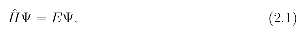

**中文说明:** 原式保留于上方裁图；译文不补写、改号或修正公式系数。

*原件裁图回退；未另作LaTeX转写，公式只显示一次。*

**Source:** PDF15 / 印4 · S020

**Original:** where E is an eigenvalue of ˆH, the Hamiltonian operator of the system and is defined as the sum of the kinetic and potential energy operators, ˆT and ˆV respectively, that is:

**中文:** 其中$E$是体系Hamiltonian算符$\hat H$的本征值；该算符定义为动能算符$\hat T$与势能算符$\hat V$之和，即：

**Source:** PDF15 / 印4 · E002 · 原式(2.2)

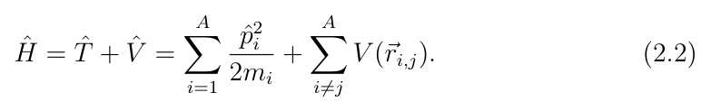

**中文说明:** 原式保留于上方裁图；译文不补写、改号或修正公式系数。

*原件裁图回退；未另作LaTeX转写，公式只显示一次。*

**Source:** PDF15 / 印4 · S021

**Original:** Here, ˆp = −iħ▽is the momentum operator, ħis the reduced Plank’s constant, A is the number of nucleons in the system, m is the nucleon mass and V (⃗ri,j) is the nucleon-nucleon interaction as a function of the ith and jth nucleons co-ordinates.

**中文:** 这里$\hat p=-i\hbar\nabla$为动量算符，$\hbar$为约化Planck常数，$A$为体系的核子数，$m$为核子质量，$V(\vec r_{i,j})$为依赖第$i$和第$j$个核子坐标的核子–核子相互作用。

**Source:** PDF15 / 印4 · S022

**Original:** Due to the fundamental elusiveness of the true nature of the nuclear potential that governs the interaction of nucleons inside atomic nuclei, nuclear models are employed to understand observables from nuclear experiments.

**中文:** 由于支配原子核内部核子相互作用的核势的真实本质难以把握，因此需要使用核模型来理解核实验的观测量。

**页锚：PDF16 / 印5**

### 2.2 核势与壳模型

**Source:** PDF16 / 印5 · S023

**Original:** 2.2 Nuclear Potentials and The Shell Model

**中文:** 2.2 核势与壳模型

**Source:** PDF16 / 印5 · S024

**Original:** In the 20th century, experimental evidence showed the existence of magic numbers for protons and neutrons in atomic nuclei. These nuclei were more tightly bound when compared to their immediately neighboring nuclei and they required significantly more energy to remove a nucleon from the nucleus. This indicated shell closures and led early nuclear physicists to postulate the existence of shell structures inside atomic nuclei, in direct analogy to the electronic shell structures observed in atomic physics. The magic numbers for protons and neutrons are:

**中文:** 20世纪的实验证据表明，原子核的质子数和中子数存在幻数。与相邻核相比，这些原子核结合得更紧，要从中移除一个核子，需要显著更多能量。这提示存在壳层闭合，使早期核物理学家类比原子物理中的电子壳结构，提出原子核内部也有壳结构。质子与中子的幻数为：

**Source:** PDF16 / 印5 · E003 · 原式(2.3)

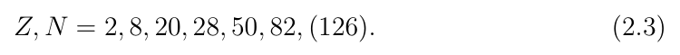

**中文说明:** 原式保留于上方裁图；译文不补写、改号或修正公式系数。

*原件裁图回退；未另作LaTeX转写，公式只显示一次。*

**Source:** PDF16 / 印5 · S025

**Original:** The last magic number belongs to neutrons alone. To account for these ”magic” numbers the shell model was devised. The shell model approach assumes that each nucleon inside an atomic nucleus is independent and moves in a mean-field central potential that is generated by the other (A −1) nucleons. This ingenious idea transforms our original intractable A-body problem (equation 2.2) into independent single-particle motion. This leads to A single-particle states and their related energy spectrum. Now the question arises−what is the appropriate mean-field central potential?

**中文:** 最后一个幻数仅属于中子。为解释这些“幻数”，人们建立了壳模型。壳模型假设，原子核中的每个核子都是独立的，运动在其它$A-1$个核子产生的平均场中心势中。这一巧妙想法把原先难以处理的$A$体问题，即式2.2，转化为独立的单粒子运动，得到$A$个单粒子态及其对应能谱。随之而来的问题是：怎样的平均场中心势才合适？

**Source:** PDF16 / 印5 · S026

**Original:** A mean central potential of v(⃗ri), which depends only on the coordinates of the ith nucleon can be added and subtracted in equation 2.2. This splits the Hamiltonian into a non-interacting part ˆH0 and a residual interaction, WRes, (which accounts for the two-body interactions between the nucleons). The Hamiltonian of the system can be written down as:

**中文:** 可以在式2.2中同时加入和减去一个仅依赖第$i$个核子坐标的平均中心势$v(\vec r_i)$。这样便把Hamiltonian分为无相互作用部分$\hat H_0$和剩余相互作用$W_{Res}$，后者计入核子之间的两体相互作用。体系Hamiltonian可写成：

**Source:** PDF16 / 印5 · E004 · 原式(2.4)

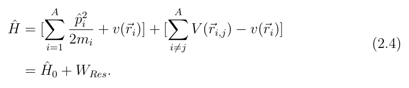

**中文说明:** 原式保留于上方裁图；译文不补写、改号或修正公式系数。

*原件裁图回退；未另作LaTeX转写，公式只显示一次。*

**Source:** PDF16 / 印5 · S027

**Original:** For the non-interacting shell model, WRes = 0. A first-order approximation to the central nuclear potential is the spherically symmetric infinite square well, that is v(⃗ri) →v(ri) (see also Figure 2.1):

**中文:** 在无相互作用壳模型中，$W_{Res}=0$。核中心势的一阶近似是球对称无限深方势阱，即$v(\vec r_i)\to v(r_i)$，另见图2.1：

##### 图2.1 · 不同核势的比较

**Placed near:** S027；原图/表来源PDF18 / 印7，裁图未改数字。

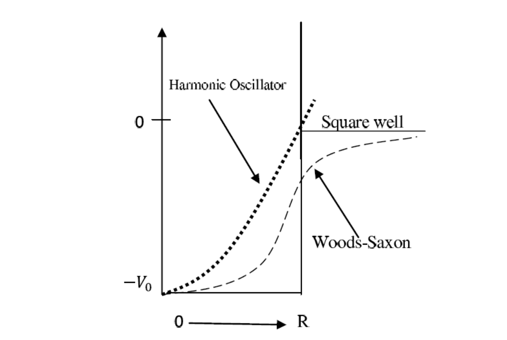

**Source:** PDF18 / 印7 · C001

**Original caption:** Figure 2.1: A comparison of different nuclear potentials. Adapted from Ref. [3].

**中文图注:** 图2.1：不同核势的比较。改编自文献[3]。

**页锚：PDF17 / 印6**

**Source:** PDF17 / 印6 · E005 · 原式(2.5)

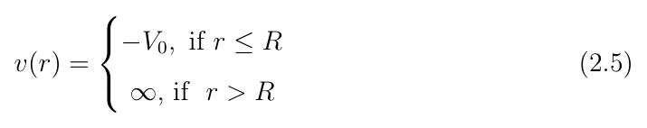

**中文说明:** 原式保留于上方裁图；译文不补写、改号或修正公式系数。

*原件裁图回退；未另作LaTeX转写，公式只显示一次。*

**Source:** PDF17 / 印6 · S028

**Original:** This potential is able to reproduce the first three magic numbers, (2, 8 and 20), see panel (a) of Figure 2.2. Each level can be occupied by a specific number of protons and neutrons, each nucleon type occupies its own potential well in accordance with the Pauli exclusion principle.

**中文:** 这一势可以再现前3个幻数2、8和20，见图2.2(a)。每个能级可以容纳一定数目的质子和中子；每一类核子都按照Pauli不相容原理，占据各自的势阱。

##### 图2.2 · 不同核势预言的壳结构

**Placed near:** S028；原图/表来源PDF20 / 印9，裁图未改数字。

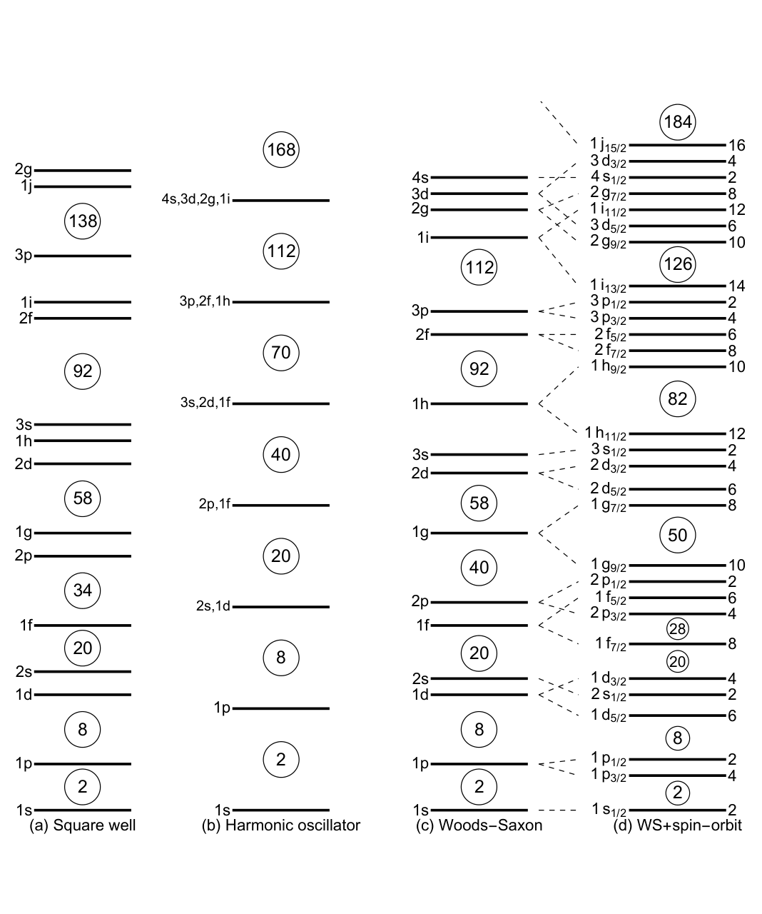

**Source:** PDF20 / 印9 · C002

**Original caption:** Figure 2.2: Nuclear shell structure predicted by (a) infinite square well potential, (b) harmonic oscillator potential, (c) Woods-Saxon potential, and (d) W-S potential with spin-orbit. The circled numbers represent magic numbers, while the numbers on the right in panel (d) represent the occupation numbers for those particular levels. Adapted from Krane [12, 36].

**中文图注:** 图2.2：由(a)无限深方势阱、(b)谐振子势、(c)Woods–Saxon势以及(d)含自旋–轨道项的W–S势预言的核壳结构。圆圈内数字为幻数；(d)中右侧数字为各相应能级的容纳数。改编自Krane[12,36]。

**Source:** PDF17 / 印6 · S029

**Original:** As a second approximation, the harmonic oscillator potential (Figure 2.1) is used [61]:

**中文:** 作为第二种近似，采用图2.1中的谐振子势[61]：

**Source:** PDF17 / 印6 · E006 · 原式(2.6)

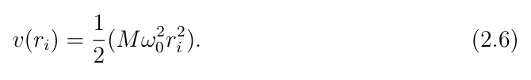

**中文说明:** 原式保留于上方裁图；译文不补写、改号或修正公式系数。

*原件裁图回退；未另作LaTeX转写，公式只显示一次。*

**Source:** PDF17 / 印6 · S030

**Original:** Here M is the nucleon mass and ω0 is the classical oscillator frequency. Solving for this potential in the time-independent Schrodinger equation (2.1) yields the energy levels:

**中文:** 其中$M$为核子质量，$\omega_0$为经典谐振子频率。把这一势代入定态Schrödinger方程2.1求解，得到以下能级：

**Source:** PDF17 / 印6 · E007 · 原式(2.7)

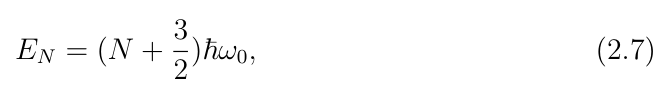

**中文说明:** 原式保留于上方裁图；译文不补写、改号或修正公式系数。

*原件裁图回退；未另作LaTeX转写，公式只显示一次。*

**Source:** PDF17 / 印6 · S031

**Original:** where $N=2(n-1)+l$ is the oscillator shell number, $N$ is defined in terms of the radial quantum number, $n=1,2,3,\ldots$, and the orbital angular momentum quantum number, $l=0,1,2,3,\ldots,(n-1)$. The oscillator shell number $N$, assumes the values of $N=0,1,2,3,\ldots$. Each $N$ shell has a degenerate group of levels with different $l$. The selection rule on $l$ is that $l$ is even (odd) when $N$ is even (odd). This potential is able to reproduce the first three magic numbers, see panel (b) of Figure 2.2.

**中文:** 其中$N=2(n-1)+l$为谐振子壳层量子数，由径向量子数$n=1,2,3,\ldots$和轨道角动量量子数$l=0,1,2,3,\ldots,(n-1)$定义。谐振子壳层量子数取$N=0,1,2,3,\ldots$。每个$N$壳层包含一组$l$不同的简并能级。对$l$的选择规则是：$N$为偶数时$l$为偶数，$N$为奇数时$l$为奇数。这个势能够再现前3个幻数，见图2.2(b)。

**Source:** PDF17 / 印6 · S032

**Original:** Both the harmonic oscillator (H.O.) and the infinite-square well potentials have the disadvantage that they require an infinite amount of energy to remove a nucleon from a nucleus, because both potentials tend to infinity as r tends to infinity. The W-S potential (see Figure 2.1) is a more realistic nuclear potential:

**中文:** 谐振子势（H.O.）和无限深方势阱都有一个缺点：要从核中移除核子，需要无限大的能量，因为当$r$趋于无穷时，这两种势都趋于无穷。Woods–Saxon（W–S）势是更实际的核势，见图2.1：

**Source:** PDF17 / 印6 · E008 · 原式(2.8)

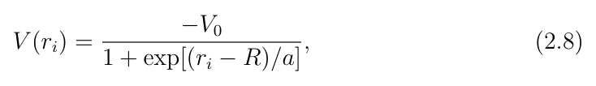

**中文说明:** 原式保留于上方裁图；译文不补写、改号或修正公式系数。

*原件裁图回退；未另作LaTeX转写，公式只显示一次。*

**页锚：PDF18 / 印7**

**Source:** PDF18 / 印7 · S033

**Original:** where V0 is the depth of the well, R = 1.25A 1 3 fm, is the mean nuclear radius and a = 0.524 fm is the skin thickness of the nucleus. This potential has the flat-bottom characteristic of the square-well potential and the parabolic rise of the H.O. potential, and it can reproduce the first three magic numbers, see panel (c) of Figure 2.2.

**中文:** 其中$V_0$为势阱深度，$R=1.25A^{1/3}$ fm为平均核半径，$a=0.524$ fm为核表皮厚度。该势兼有方势阱的平底特征和H.O.势的抛物线上升特征，能够再现前3个幻数，见图2.2(c)。

**Source:** PDF18 / 印7 · S034

**Original:** The addition of a term proportional to l2 in the harmonic oscillator potential (equation 2.6) has the effect of interpolating between the square-well and the H.O. potentials and becomes similar to the W-S potential. With the addition of a spin-orbit term to either the W-S potential or to the H.O. with l2 term, the magic numbers can be successfully reproduced [32, 50]. The Schrodinger equation with the W-S potential can only be solved numerically. The harmonic oscillator with l2 term does admit analytical solutions.

**中文:** 在谐振子势式2.6中加入一个正比于$l^2$的项，相当于在方势阱与H.O.势之间插值，使其接近W–S势。对W–S势，或者带$l^2$项的H.O.势，再加入自旋–轨道项，就可以成功再现幻数[32,50]。带W–S势的Schrödinger方程只能数值求解，而带$l^2$项的谐振子势允许解析解。

**页锚：PDF19 / 印8**

#### 2.2.1 自旋–轨道项

**Source:** PDF19 / 印8 · S035

**Original:** 2.2.1 The Spin-Orbit Term

**中文:** 2.2.1 自旋–轨道项

**Source:** PDF19 / 印8 · S036

**Original:** As previously stated, spin-orbit coupling is necessary to reproduce the correct magic numbers [32, 50]. The orbital angular momentum⃗l and the intrinsic angular momentum (spin,⃗s) are coupled to give the total angular momentum of the⃗j =⃗ l +⃗s. The spin-orbit term has the form:

**中文:** 如前所述，为再现正确的幻数，必须计入自旋–轨道耦合[32,50]。轨道角动量$\vec l$与内禀角动量，即自旋$\vec s$，耦合形成总角动量$\vec j=\vec l+\vec s$。自旋–轨道项具有如下形式：

**Source:** PDF19 / 印8 · E009 · 原式(2.9)

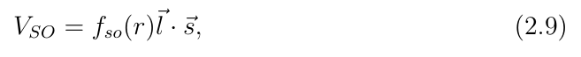

**中文说明:** 原式保留于上方裁图；译文不补写、改号或修正公式系数。

*原件裁图回退；未另作LaTeX转写，公式只显示一次。*

**Source:** PDF19 / 印8 · S037

**Original:** where fso(r) is the strength of the interaction. This interaction splits the degenerate energy levels into two components with j = l ± 1 2. The j = l + 1 2 lies lower in energy than the j = l −1 2 component. Each state of a given j can be filled by a maximum of 2j + 1 nucleons as shown in panel (d) of Figure 2.2.

**中文:** 其中$f_{so}(r)$是相互作用强度。该相互作用将简并能级劈裂为$j=l\pm1/2$的两个分量，$j=l+1/2$分量的能量低于$j=l-1/2$分量。对给定$j$，每个态最多可以填入$2j+1$个核子，见图2.2(d)。

**Source:** PDF19 / 印8 · S038

**Original:** With the inclusion of the above modifications, the W-S potential can be written down as:

**中文:** 计入上述修正后，W–S势可写为：

**Source:** PDF19 / 印8 · E010 · 原式(2.10)

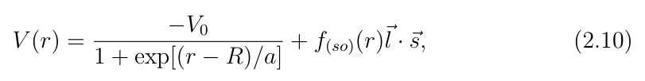

**中文说明:** 原式保留于上方裁图；译文不补写、改号或修正公式系数。

*原件裁图回退；未另作LaTeX转写，公式只显示一次。*

**Source:** PDF19 / 印8 · S039

**Original:** and the harmonic oscillator potential becomes:

**中文:** 谐振子势则变为：

**Source:** PDF19 / 印8 · E011 · 原式(2.11)

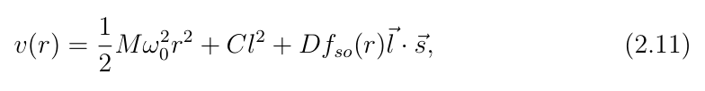

**中文说明:** 原式保留于上方裁图；译文不补写、改号或修正公式系数。

*原件裁图回退；未另作LaTeX转写，公式只显示一次。*

**Source:** PDF19 / 印8 · S040

**Original:** where C and D are proportionality constants and are fitted to reproduce the spherical shell model. The Coulomb potential Vc ∝e(Z −1) has been omitted in the preceding discussion because it only has the effect of reducing the binding energy of the system by making the proton well shallower and does not change the sequence of the magic numbers. It can easily be treated by including it in the potentials of equations 2.10 and 2.11 when the nucleons are protons.

**中文:** 其中$C$与$D$为比例常数，通过拟合使其再现球形壳模型。前面讨论省略了库仑势$V_c\propto e(Z-1)$，因为它只是通过使质子势阱变浅而降低体系结合能，并不改变幻数的顺序。当核子为质子时，很容易将其加入式2.10和式2.11的势中处理。

**Source:** PDF19 / 印8 · S041

**Original:** In Figure 2.2 each single particle state is labelled by the major shell number N, followed by the angular momentum quantum number l. In spectroscopic notation, l = 0 is labelled by s; l = 1 is labelled by p; l = 2 is labelled by d; l = 3 is labelled by f, thereafter the labels follow the alphabet. The parity of the levels is given by π = (−1)l. The shell model is very successful in predicting the ground-state properties of most nuclei that are close to magic numbers [36].

**中文:** 图2.2中，每个单粒子态先用主壳层量子数$N$标记，再写角动量量子数$l$。谱学记号中，$l=0$记为s，$l=1$记为p，$l=2$记为d，$l=3$记为f，其后按字母顺序命名。能级宇称为$\pi=(-1)^l$。壳模型在预言多数接近幻数原子核的基态性质方面十分成功[36]。

**页锚：PDF21 / 印10**

### 2.3 核形变

**Source:** PDF21 / 印10 · S042

**Original:** 2.3 Nuclear Deformations

**中文:** 2.3 核形变

**Source:** PDF21 / 印10 · S043

**Original:** With the exception of nuclei at or near closed shells, most nuclei that exist in nature are deformed in their ground states, that is most are not spherical [15]. The experimental evidence for this includes (i) the existence of rotational bands, and (ii) the large measured quadrupole moments. The nuclear surface deformations can be parameterized by an infinite series expansion in spherical harmonics as:

**中文:** 除闭壳及其附近的原子核外，自然界大多数原子核的基态都具有形变，即多数并非球形[15]。实验证据包括转动带的存在，以及测得的大四极矩。核表面形变可以用球谐函数的无限级数展开参数化：

**Source:** PDF21 / 印10 · E012 · 原式(2.12)

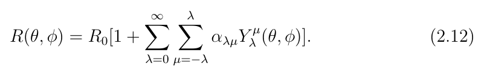

**中文说明:** 原式保留于上方裁图；译文不补写、改号或修正公式系数。

*原件裁图回退；未另作LaTeX转写，公式只显示一次。*

**Source:** PDF21 / 印10 · S044

**Original:** Here R(θ, φ) is the length of a radius vector from the origin to a point on the nuclear surface, R0 is the length of the radius vector of a sphere having the same volume as the nucleus, Y (θ, φ) are the spherical harmonics, αλμ are the expansion coefficients and λ is the multipole order of the expansion.

**中文:** 其中$R(\theta,\phi)$为从原点指向核表面某点的半径矢量长度，$R_0$为与该核等体积球的半径矢量长度，$Y(\theta,\phi)$为球谐函数，$\alpha_{\lambda\mu}$为展开系数，$\lambda$为展开的多极阶数。

**Source:** PDF21 / 印10 · S045

**Original:** In equation 2.12, λ = 2 corresponds to a static quadrupole deformation of the nucleus. In a coordinate frame that coincides with the nuclear axes the five expansion coefficients (α2μ) reduce to two independent coefficients α20 and α22 due to the reflection symmetry of the quadruple shape; α21 = α2−1 = 0 and α22 = α2−2. These expansion coefficients can be related to the deformation parameters β2 and γ by the relations:

**中文:** 式2.12中，$\lambda=2$对应核的静态四极形变。在与核主轴重合的坐标系中，由于四极形状的反射对称性，5个展开系数$\alpha_{2\mu}$约化为两个独立系数$\alpha_{20}$与$\alpha_{22}$，满足$\alpha_{21}=\alpha_{2,-1}=0$、$\alpha_{22}=\alpha_{2,-2}$。这些系数可通过下列关系与形变参数$\beta_2$和γ联系起来：

**Source:** PDF21 / 印10 · E013 · 原式(2.13)

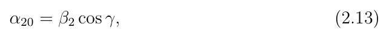

**中文说明:** 原式保留于上方裁图；译文不补写、改号或修正公式系数。

*原件裁图回退；未另作LaTeX转写，公式只显示一次。*

**Source:** PDF21 / 印10 · S046

**Original:** and

**中文:** 以及

**Source:** PDF21 / 印10 · E014 · 原式(2.14)

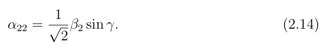

**中文说明:** 原式保留于上方裁图；译文不补写、改号或修正公式系数。

*原件裁图回退；未另作LaTeX转写，公式只显示一次。*

**页锚：PDF22 / 印11**

**Source:** PDF21 / 印10, PDF22 / 印11 · S047

**Original:** Now the nuclear shape is parameterized only in terms of the quadrupole deformation β2, which measures the extent of quadrupole deformation (elongation) and the asymmetry parameter γ, that indicates the deviation from axial symmetry. The parameters β2 and γ are defined in terms of the ratio δRi/R0 where δRi is the deviation of the radius vector along ith axis (x, y and z in the nuclear body-fixed coordinate system) with respect to a sphere having the same volume as the nucleus and R0 is the magnitude of the radius vector of the sphere. The ratio δRi/R0 is connected to β2 as:

**中文:** 这样，核形状只需用四极形变$\beta_2$和非对称参数γ描述；前者度量四极形变，即拉长程度，后者表示偏离轴对称的程度。$\beta_2$与γ通过比值$\delta R_i/R_0$定义，其中$\delta R_i$是在第$i$轴方向，即核内禀坐标系的x、y、z方向上，相对于等体积球的半径矢量偏离量，$R_0$为该球的半径矢量大小。比值$\delta R_i/R_0$与$\beta_2$的关系为：

**Source:** PDF22 / 印11 · E015 · 原式(2.15)

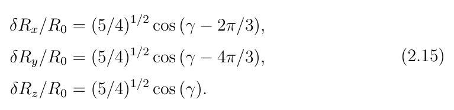

**中文说明:** 原式保留于上方裁图；译文不补写、改号或修正公式系数。

*原件裁图回退；未另作LaTeX转写，公式只显示一次。*

**Source:** PDF22 / 印11 · S048

**Original:** When β2 > 0 and γ = 0◦, the nuclear shape corresponds to an axially deformed prolate shape and when γ = 60◦, the nuclear shape corresponds to an axially deformed oblate shape. The combination of nuclear shape and rotational motion is best denoted using the Lund convention, Figure 2.3. At γ = 0◦the shape is prolate and the rotational motion is perpendicular to the symmetry axis (collective prolate), while it is collective oblate at γ = −60◦because the shape is oblate and the rotation is around an axis perpendicular to the symmetry axis. The noncollective nuclear shapes are observed at γ = −120◦and γ = 60◦for prolate and oblate shapes respectively, as the rotation occurs around the symmetry axis. A nucleus is triaxial if β2 > 0 and γ̸ = 0◦, ±60◦, −120◦.

**中文:** 当$\beta_2>0$且$\gamma=0^\circ$时，核形状对应轴对称长椭形变；当$\gamma=60^\circ$时，对应轴对称扁椭形变。核形状和转动的组合最好用Lund约定表示，见图2.3。$\gamma=0^\circ$时形状为长椭，转动方向垂直于对称轴，称为集体长椭；$\gamma=-60^\circ$时为集体扁椭，因为核形状为扁椭，且绕垂直对称轴的轴转动。非集体长椭与非集体扁椭分别出现在$\gamma=-120^\circ$和$60^\circ$，因为转动绕对称轴发生。若$\beta_2>0$，且γ不等于0°、±60°、−120°，原子核就是三轴的。

##### 图2.3 · Lund核形状与转动约定

**Placed near:** S048；原图/表来源PDF23 / 印12，裁图未改数字。

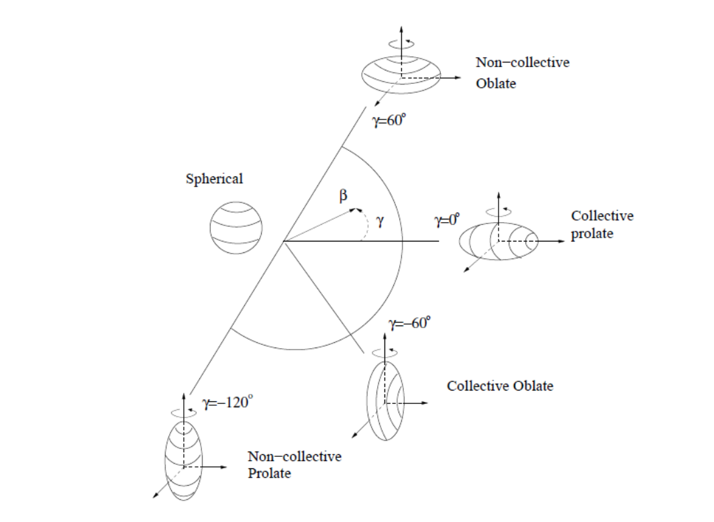

**Source:** PDF23 / 印12 · C003

**Original caption:** Figure 2.3: The Lund convention for parameterizing the nuclear shape in the (β2, γ)-plane [5].

**中文图注:** 图2.3：在$(\beta_2,\gamma)$平面参数化核形状的Lund约定[5]。

**Source:** PDF22 / 印11 · S049

**Original:** It should be mentioned that parametrizing the nuclear deformation in terms of (β2, γ) is not unique. Another way to do this is by using the Nilsson deformation parameters, (ε2, γ) parametrization, where γ is the same as before and ε2 is the Nilsson elongation parameter and has the same meaning as β2, albeit having a slightly different value of ε2 ≈0.95β2.

**中文:** 应指出，用$(\beta_2,\gamma)$参数化核形变并非唯一选择。另一种方法是采用Nilsson形变参数$(\varepsilon_2,\gamma)$；其中γ与前面相同，$\varepsilon_2$为Nilsson拉长参数，与$\beta_2$意义相同，但数值稍有差别，约有$\varepsilon_2\approx0.95\beta_2$。

**Source:** PDF22 / 印11 · S050

**Original:** In addition to quadruple deformations it is possible for the nucleus to have higherorder deformations, for example when λ = 3 in equation 2.12 it corresponds to an octupole deformed nuclear shape, and when λ = 4 it corresponds to a hexadecapole deformed nuclear shape. In general, these higher-order deformations are more rare compared to quadruple deformations.

**中文:** 除四极形变外，原子核也可能具有更高阶形变。例如式2.12中$\lambda=3$对应八极形变核形状，$\lambda=4$对应十六极形变核形状。一般说来，这些高阶形变比四极形变更少见。

#### 2.3.1 Nilsson模型

**Source:** PDF22 / 印11 · S051

**Original:** 2.3.1 The Nilsson Model

**中文:** 2.3.1 Nilsson模型

**页锚：PDF23 / 印12**

**Source:** PDF22 / 印11, PDF23 / 印12 · S052

**Original:** Most nuclei have stable quadruple deformations in their ground-state. The Nilsson model was developed to account for this. It is based on a modified harmonic oscillator. The potential of equation 2.10 assumed radial symmetry and homogeneity along all nuclear axes. Within the Nilsson model this needs not be the case. When a nucleus has an axially symmetric quadruple (λ = 2) deformation, it can either be prolate (ε2 > 0) or oblate (ε2 < 0) depending on whether the intrinsic-frame nuclear symmetry (z) axis is long (prolate, z > x = y) or short (oblate, z < x = y). The nuclear potential follows the nuclear matter distribution and extends further along the z axis if the nucleus is prolate deformed and is shortened with respect to the z axis if the nucleus has an oblate deformation.

**中文:** 多数原子核的基态具有稳定四极形变，Nilsson模型就是为解释这一点而建立的。它基于修正谐振子。式2.10的势假定径向对称且沿全部核轴均一；Nilsson模型不要求如此。当原子核具有轴对称四极形变，即$\lambda=2$时，若内禀对称轴z较长，$z>x=y$，则为长椭，$\varepsilon_2>0$；若z较短，$z<x=y$，则为扁椭，$\varepsilon_2<0$。核势随核物质分布变化：长椭形变时沿z轴延伸更远，扁椭形变时在z方向缩短。

**Source:** PDF23 / 印12 · S053

**Original:** For a deformed nuclear system, the Hamiltonian of the modified harmonic oscillator potential equation 2.11 takes the form:

**中文:** 对于形变核体系，修正谐振子势式2.11的Hamiltonian具有如下形式：

**Source:** PDF23 / 印12 · E016 · 原式(2.16)

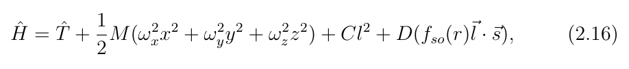

**中文说明:** 原式保留于上方裁图；译文不补写、改号或修正公式系数。

*原件裁图回退；未另作LaTeX转写，公式只显示一次。*

**Source:** PDF23 / 印12 · S054

**Original:** where ˆT is the kinetic energy operator as defined in section 2.1, ωx, ωy and ωz are related to the deformation parameters (ε2, γ) as in Ref. [39]. For the axially symmetric case, ω2 x = ω2 y = ω2 ⊥̸ = ω2 z, with ω⊥(ωz) as the oscillator frequency in a direction orthogonal (parallel) to the body-fixed symmetry (z) axis:

**中文:** 其中$\hat T$为§2.1定义的动能算符，$\omega_x$、$\omega_y$和$\omega_z$与形变参数$(\varepsilon_2,\gamma)$的关系见文献[39]。轴对称情况下，$\omega_x^2=\omega_y^2=\omega_\perp^2\ne\omega_z^2$；$\omega_\perp$与$\omega_z$分别是垂直和平行于内禀对称轴z方向的谐振子频率：

**页锚：PDF24 / 印13**

**Source:** PDF24 / 印13 · E017 · 原式(2.17)

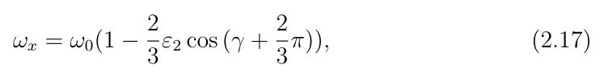

**中文说明:** 原式保留于上方裁图；译文不补写、改号或修正公式系数。

*原件裁图回退；未另作LaTeX转写，公式只显示一次。*

**Source:** PDF24 / 印13 · E018 · 原式(2.18)

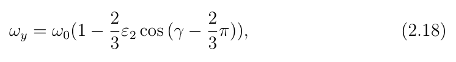

**中文说明:** 原式保留于上方裁图；译文不补写、改号或修正公式系数。

*原件裁图回退；未另作LaTeX转写，公式只显示一次。*

**Source:** PDF24 / 印13 · E019 · 原式(2.19)

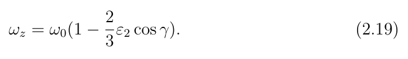

**中文说明:** 原式保留于上方裁图；译文不补写、改号或修正公式系数。

*原件裁图回退；未另作LaTeX转写，公式只显示一次。*

**Source:** PDF24 / 印13 · S055

**Original:** In the axially deformed case the Hamiltonian becomes:

**中文:** 在轴对称形变情况下，Hamiltonian变为：

**Source:** PDF24 / 印13 · E020 · 原式(2.20)

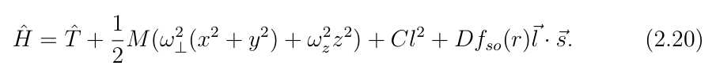

**中文说明:** 原式保留于上方裁图；译文不补写、改号或修正公式系数。

*原件裁图回退；未另作LaTeX转写，公式只显示一次。*

**Source:** PDF24 / 印13 · S056

**Original:** To ensure that the volume of the nucleus remains constant, a volume conservation condition is imposed, ωxωyωz = ω3 0 = const, where ω0 is the spherical oscillator frequency and is related to the mass number A by ħω0 = 41A−1 3MeV.

**中文:** 为保证核体积不变，施加体积守恒条件$\omega_x\omega_y\omega_z=\omega_0^3=\mathrm{const}$。其中$\omega_0$为球形谐振子频率，通过$\hbar\omega_0=41A^{-1/3}$ MeV与质量数$A$联系。

**Source:** PDF24 / 印13 · S057

**Original:** The presence of quadruple deformations splits the degenerate energy levels of the spherical shell model. While in the spherical shell model, all states with the same total angular momentum j in a sub-shell have the same energy, in the Nilsson model this sub-shell splits into states of differing energy, depending on the projections of the total single-particle angular momentum⃗j onto the nuclear symmetry axis.

**中文:** 四极形变使球形壳模型的简并能级劈裂。球形壳模型中，同一子壳层中总角动量$j$相同的全部态能量相同；Nilsson模型中，该子壳层按单粒子总角动量$\vec j$在核对称轴上的投影不同，劈裂为能量不同的态。

**Source:** PDF24 / 印13 · S058

**Original:** For instance, in the context of the spherical shell model, the sub-shell $1g_{7/2}$ can accommodate a total of $2(7/2)+1=8$ nucleons, all with the same energy. In the deformed Nilsson model, the $1g_{7/2}$ is split into $(2j+1)/2$ different orbitals with differing $j$ projections onto the symmetry axis ($\Omega=7/2,5/2,3/2,1/2$) (see Figure 2.5 and 2.6). The total occupation number of the sub-shell does not change. Each Nilsson orbital accommodates two nucleons, in accordance with the Pauli exclusion principle. In the prolate (oblate) case, the Nilsson orbital with projection of $\Omega=7/2$ lies highest (lowest) in energy, followed by the orbital with projection $\Omega=5/2$ and so forth, the Nilsson orbital with projection of $\Omega=1/2$ is lowest (highest) in energy. At $\varepsilon_2=0$ the degeneracy of the sub-shells into different orbitals disappears and the Nilsson model becomes equivalent to the spherical shell model.

**中文:** 例如，球形壳模型中的$1g_{7/2}$子壳层总共可以容纳$2(7/2)+1=8$个能量相同的核子。在形变Nilsson模型中，$1g_{7/2}$劈裂为$(2j+1)/2$个不同轨道，角动量在对称轴上的投影为$\Omega=7/2,5/2,3/2,1/2$，见图2.5和图2.6。子壳层的总容纳数不变；根据Pauli不相容原理，每个Nilsson轨道容纳两个核子。长椭情况下，$\Omega=7/2$轨道能量最高，其次为$5/2$，依此类推，$1/2$最低；扁椭情况下则相反，$7/2$最低，$1/2$最高。在$\varepsilon_2=0$时，子壳层劈裂为不同轨道的现象消失，Nilsson模型等同于球形壳模型。

##### 图2.5 · 中子Nilsson图

**Placed near:** S058；原图/表来源PDF26 / 印15，裁图未改数字。

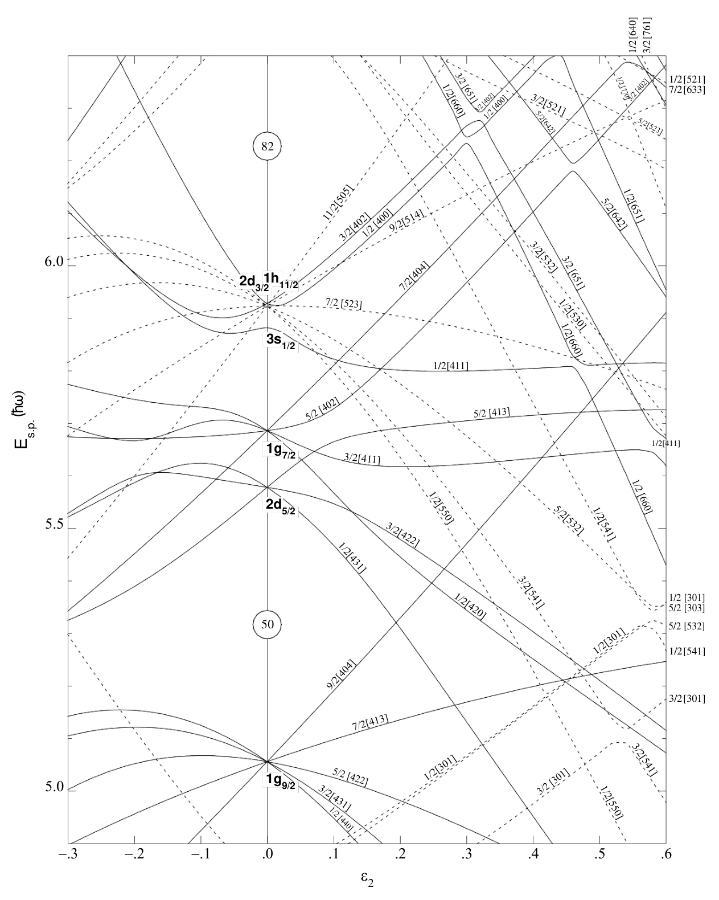

**Source:** PDF26 / 印15 · C004

**Original caption:** Figure 2.5: Nilsson diagram for neutrons, $50\le N\le82$ ($\varepsilon_4=\varepsilon_2^2/6$). The solid lines represent orbitals with positive parity, $\pi=+1$ and the dashed lines are orbitals with negative parity $\pi=-1$. Each orbital is labelled with the asymptotic Nilsson quantum numbers $\Omega[N,n_z,\Lambda]$. Adapted from Ref. [1].

**中文图注:** 图2.5：中子Nilsson图，$50\le N\le82$，$\varepsilon_4=\varepsilon_2^2/6$。实线表示正宇称轨道$\pi=+1$，虚线表示负宇称轨道$\pi=-1$。每个轨道以渐近Nilsson量子数$\Omega[N,n_z,\Lambda]$标识。改编自文献[1]。

##### 图2.6 · 质子Nilsson图

**Placed near:** S058；原图/表来源PDF27 / 印16，裁图未改数字。

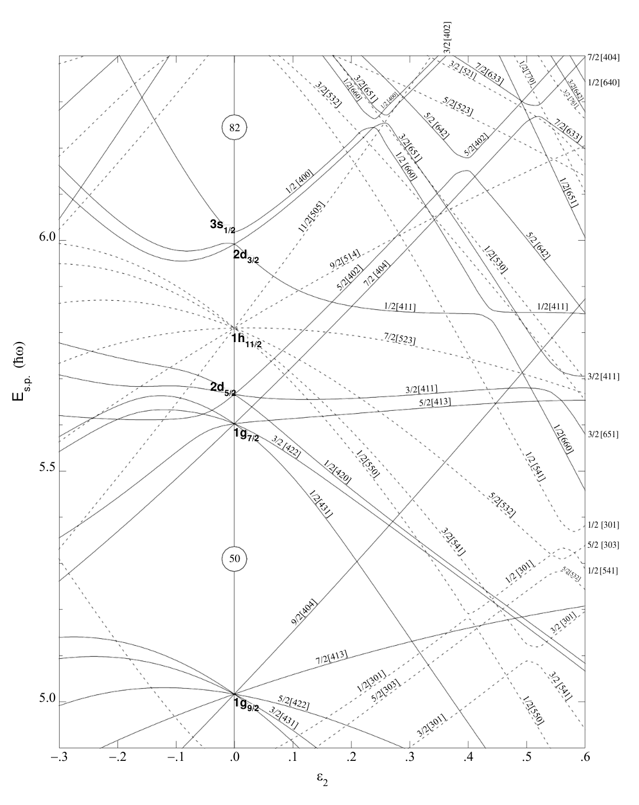

**Source:** PDF27 / 印16 · C005

**Original caption:** Figure 2.6: Nilsson diagram for protons, $50\le N\le82$ ($\varepsilon_4=\varepsilon_2^2/6$). The solid lines represent orbitals with positive parity, $\pi=+1$ and the dashed lines are orbitals with negative parity $\pi=-1$. Each orbital is labelled with the asymptotic Nilsson quantum numbers $\Omega[N,n_z,\Lambda]$. Adapted from Ref. [1].

**中文图注:** 图2.6：质子Nilsson图，$50\le N\le82$，$\varepsilon_4=\varepsilon_2^2/6$。实线表示正宇称轨道$\pi=+1$，虚线表示负宇称轨道$\pi=-1$。每个轨道以渐近Nilsson量子数$\Omega[N,n_z,\Lambda]$标识。改编自文献[1]。

**页锚：PDF25 / 印14**

**Source:** PDF24 / 印13, PDF25 / 印14 · S059

**Original:** Each Nilsson orbital can be uniquely identified by the Nilsson quantum numbers Ω[N, nz, Λ]. Ωis the projection of the single-particle angular momentum j onto the symmetry axis. N is the oscillator shell number and nz is the number of oscillator quanta in the direction of the symmetry axis. In this model Ω= Λ + Σ, where Λ represents the projection of the orbital angular momentum onto the symmetry axis, and Σ is the projection of the intrinsic spin angular momentum onto the symmetry axis.

**中文:** 每个Nilsson轨道可由量子数$\Omega[N,n_z,\Lambda]$唯一标识。$\Omega$为单粒子角动量$j$在对称轴上的投影，$N$为谐振子壳层量子数，$n_z$为对称轴方向的谐振量子数。模型中$\Omega=\Lambda+\Sigma$，其中$\Lambda$为轨道角动量在对称轴上的投影，$\Sigma$为内禀自旋角动量在对称轴上的投影。

**Source:** PDF25 / 印14 · S060

**Original:** The coupling of angular momentum in the Nilsson model is illustrated in Figure 2.4.⃗R is the rotational angular momentum of the nucleus and M is the projection of the total nuclear spin,⃗I =⃗R+⃗j onto the laboratory z axis. In the absence of rotation, the parity π and Ωare good quantum numbers in the Nilsson model. Note, that axially symmetric nuclei can only rotate around an axis that is orthogonal to the symmetry axis. Therefore, I = Ω= K at the bandhead.

**中文:** 图2.4展示Nilsson模型中的角动量耦合。$\vec R$为核的转动角动量，$M$为核总自旋$\vec I=\vec R+\vec j$在实验室z轴上的投影。没有转动时，宇称π和$\Omega$是Nilsson模型的好量子数。注意，轴对称核只能绕垂直于对称轴的轴转动。因此，带头处有$I=\Omega=K$。

##### 图2.4 · Nilsson模型中的角动量耦合

**Placed near:** S060；原图/表来源PDF25 / 印14，裁图未改数字。

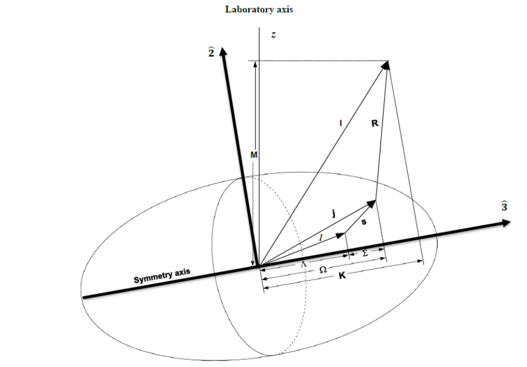

**Source:** PDF25 / 印14 · C006

**Original caption:** Figure 2.4: An illustration of angular momentum coupling in the Nilsson model. Adapted from Ref. [1].

**中文图注:** 图2.4：Nilsson模型中角动量耦合的示意。改编自文献[1]。

**Source:** PDF25 / 印14 · S061

**Original:** Due to the pairing interaction in the Nilsson model all the nucleons inside the core are paired up. If the nucleus is odd-even or even-odd, all nuclear spin I in the ground state is entirely due to the unpaired odd nucleon, that is I = j in a non-rotating nucleus. In the the case of an odd-odd nucleus, the singleparticle angular momentum is the vector sum of the unpaired nucleons singleparticle angular momenta⃗j =⃗jπ +⃗jν, with⃗jπ and⃗jν representing the proton and neutron single-particle angular momenta, respectively. Figures 2.5 and 2.6 shows the Nilsson diagrams for neutrons and protons, respectively for occupation numbers between 50 and 82 for both.

**中文:** 由于Nilsson模型中的配对相互作用，核芯内部所有核子都成对。对于奇偶核或偶奇核，基态的全部核自旋$I$完全来自未配对的奇核子，即非转动核有$I=j$。对于奇奇核，单粒子角动量为两个未配对核子单粒子角动量的矢量和，$\vec j=\vec j_\pi+\vec j_\nu$，其中$\vec j_\pi$和$\vec j_\nu$分别表示质子、中子的单粒子角动量。图2.5与图2.6分别给出了中子和质子的Nilsson图，两者的占据数均在50与82之间。

**页锚：PDF28 / 印17**

### 2.4 核集体性

**Source:** PDF28 / 印17 · S062

**Original:** 2.4 Nuclear Collectivity

**中文:** 2.4 核集体性

**Source:** PDF28 / 印17 · S063

**Original:** When a nucleus absorbs energy it can exhibit two extreme types of behaviour; (i) single-particle excitations of the individual valence nucleon to a different singleparticle state and (ii) collective mode of excitation, which is characterised by a coherent movement of a large number of nucleons. Single-particle excitations change the internal configurations of the nucleus. The spectra of the single-particle excitations consist of irregular sequences of states that are connected by gammaray transitions of different multipolarities. Collective modes of excitations such as vibrations and rotational motion, leave the internal single-particle configuration of the nucleus unchanged. Nuclear vibrations, while straightforward to treat [15], are not very important to the understanding of the current work, consequently no further attention will be paid to them, and only nuclear rotations will be discussed. The interplay between single-particle and collective degrees of freedom underpins a diverse range of phenomena in nuclear structure.

**中文:** 原子核吸收能量后可以表现出两种极端行为：一是单个价核子被激发至另一单粒子态；二是以大量核子相干运动为特征的集体激发。单粒子激发改变核的内部组态，其能谱为不规则态序列，由多极性不同的γ跃迁连接。振动和转动等集体激发则保持核内部单粒子组态不变。核振动虽然处理起来直接[15]，但对理解当前工作并不十分重要，因此不再详细讨论，下面只讨论核转动。单粒子与集体自由度的相互作用，是多种核结构现象的基础。

#### 2.4.1 核转动

**Source:** PDF28 / 印17 · S064

**Original:** 2.4.1 Nuclear Rotations

**中文:** 2.4.1 核转动

**Source:** PDF28 / 印17 · S065

**Original:** Due to spherical symmetry the rotation of spherical nuclear systems is forbidden by quantum mechanics as such rotational motion would only introduce a trivial phase factor to the wavefunction that is, there is absolutely no way to distinguish between a rotating spherical nucleus to one that is stationary. Only deformed nuclei can access the rotational mode of excitation [19]. Such rotational motion manifests as a regular sequence of states with increasing angular momentum. Rotational motion of the nucleus takes place around an axis that is orthogonal (the ˆ2-axis in the body fixed system) to the symmetry axis, see Figure 2.4.

**中文:** 由于球对称性，量子力学禁止球形核体系的转动，因为这种转动只给波函数引入一个平凡相位因子，也就是说，无法区分旋转的球形核与静止的球形核。只有形变核才能产生转动激发模式[19]，表现为角动量逐步增加的规则态序列。核绕垂直于对称轴的轴转动；在体固连坐标系中，此轴为2轴，见图2.4。

**Source:** PDF28 / 印17 · S066

**Original:** Classically, the energy of a rigid rotor as a function of the rotational angular momentum⃗R is given by [38]:

**中文:** 经典情况下，刚性转子的能量作为转动角动量$\vec R$的函数，由下式给出[38]：

**Source:** PDF28 / 印17 · E021 · 原式(2.21)

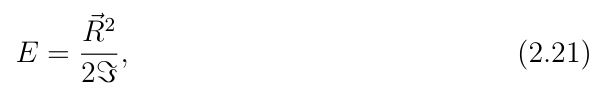

**中文说明:** 原式保留于上方裁图；译文不补写、改号或修正公式系数。

*原件裁图回退；未另作LaTeX转写，公式只显示一次。*

**Source:** PDF28 / 印17 · S067

**Original:** where Iis the moment of inertia of a rigid rotor. By quantizing equation 2.21, we get:

**中文:** 其中$ℑ$为刚性转子的转动惯量。将式2.21量子化得到：

**页锚：PDF29 / 印18**

**Source:** PDF29 / 印18 · E022 · 原式(2.22)

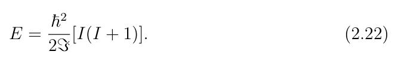

**中文说明:** 原式保留于上方裁图；译文不补写、改号或修正公式系数。

*原件裁图回退；未另作LaTeX转写，公式只显示一次。*

**Source:** PDF29 / 印18 · S068

**Original:** For even-even nuclei,⃗R =⃗I, with⃗I as the total nuclear spin. The eigenvalue of the operator ˆ⃗I2 is I(I + 1). In this case, the energy eigenvalues of equation 2.22 consist of positive-parity states with spin sequence I = 0, 2, 4, 6, 8, ... with I = 0 as the ground state, this sequence of states is linked by ∆I = 2 gamma-ray transitions forming what is known as the ground-state (g.s.) rotational band.

**中文:** 对偶偶核，$\vec R=\vec I$，其中$\vec I$为核总自旋。算符$\hat{\vec I}^{\,2}$的本征值为$I(I+1)$。此时式2.22的能量本征值对应自旋序列$I=0,2,4,6,8,\ldots$的正宇称态，以$I=0$为基态。这些态由$\Delta I=2$的γ跃迁连接，形成所谓基态（g.s.）转动带。

**Source:** PDF29 / 印18 · S069

**Original:** The set of rotational states is distinguishable from the global set of states in the gamma-ray spectra of the nucleus because they exhibit a regular relationship between the energy of the state which is proportional to the angular momentum I of the state, E ∝I(I + 1). The states are linked by stretched pure E2 transitions. Other rotational bands are possible, for example excited rotational bands can form when a pair of nucleons is broken and promoted to a different shell-model configuration. It is possible to have I = K as the lowest state in the rotational band, but also it is possible to have bands built on a I = j state.

**中文:** 转动态可以从核γ能谱的全部态中区分出来，因为态能量与角动量之间具有规则关系$E\propto I(I+1)$。这些态通过伸展纯E2跃迁连接。也可以存在其它转动带，例如破坏一对核子、将其提升到不同壳模型组态，就可能形成激发转动带。转动带的最低态可以有$I=K$，也可以建立在$I=j$态上。

**Source:** PDF29 / 印18 · S070

**Original:** In contrast to an axially deformed nuclei, a triaxially deformed nucleus can rotate around any one of its three principle nuclear axes as no axis of symmetry is present in the system.

**中文:** 与轴对称形变核不同，三轴形变核可以绕三个核主轴中的任意一个转动，因为体系中不存在对称轴。

#### 2.4.2 粒子–转子耦合

**Source:** PDF29 / 印18 · S071

**Original:** 2.4.2 Particle-Rotor Coupling

**中文:** 2.4.2 粒子–转子耦合

**Source:** PDF29 / 印18 · S072

**Original:** In an odd-A deformed nucleus, the single-particle and collective degrees of freedom are coupled together to describe the behavior of the nucleus. The total nuclear spin is given by:⃗

**中文:** 在奇质量形变核中，单粒子与集体自由度耦合，共同描述核的行为。核总自旋为：

**Source:** PDF29 / 印18 · E023 · 原式(2.23)

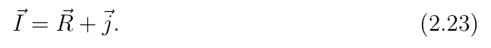

**中文说明:** 原式保留于上方裁图；译文不补写、改号或修正公式系数。

*原件裁图回退；未另作LaTeX转写，公式只显示一次。*

**Source:** PDF29 / 印18 · S073

**Original:** Thus, the rotational angular momentum is⃗R =⃗I −⃗j. In the description of axially deformed odd-A nuclei two extreme cases arise when single-particle angular momentum,⃗j is coupled to the rotational angular momentum,⃗R depending on the strength of the strength of Coriolis interaction and their relative orientation. They can either be oriented orthogonal to each other (strong coupling) or parallel to each other (rotational alignment).

**中文:** 因此，转动角动量为$\vec R=\vec I-\vec j$。在描述轴对称形变奇质量核时，依据Coriolis相互作用强度以及单粒子角动量$\vec j$与转动角动量$\vec R$的相对取向，会出现两种极限情况：二者彼此正交，即强耦合，或彼此平行，即转动对齐。

##### 图2.7 · 强耦合与转动对齐的角动量和带结构

**Placed near:** S073；原图/表来源PDF31 / 印20，裁图未改数字。

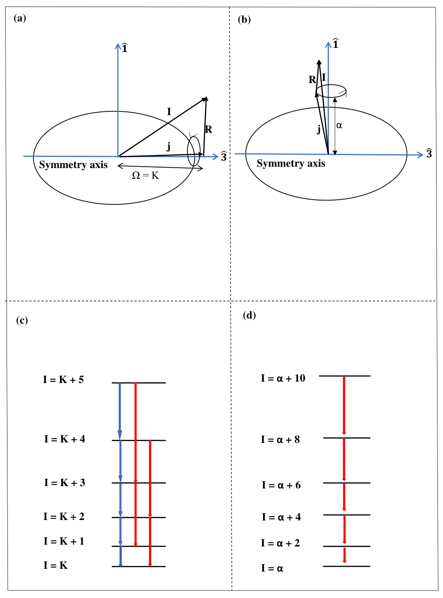

**Source:** PDF31 / 印20 · C007

**Original caption:** Figure 2.7: Particle-core angular momentum coupling (a) the strong coupling limit, (b) the rotational alignment limit. The observed band structures associated with them, in panel (c) the strong-coupling limit, and in panel (d) the rotational alignment limit. The transitions that link the states of the bands in panels (c) and (d) are shown with arrows. The blue arrows denote M1+E2 transitions, the red arrows correspond to pure E2 transitions.

**中文图注:** 图2.7：粒子–核芯角动量耦合：(a)强耦合极限，(b)转动对齐极限；相应观测带结构为(c)强耦合极限、(d)转动对齐极限。连接(c)、(d)各带态的跃迁以箭头表示：蓝色为M1+E2跃迁，红色为纯E2跃迁。

**页锚：PDF30 / 印19**

#### 2.4.2.1 强耦合极限

**Source:** PDF30 / 印19 · S074

**Original:** 2.4.2.1 Strong-coupling limit

**中文:** 2.4.2.1 强耦合极限

**Source:** PDF30 / 印19 · S075

**Original:** For an axially symmetric nucleus the properties of the low-lying states are determined by the valence nucleon. The total nuclear spin⃗I has a projection of K onto the nuclear symmetry axis. The rotational motion of the nucleus proceeds around an axis that is orthogonal to the nuclear symmetry axis. There is no collective rotation around the symmetry axis, the ˆ3-component of⃗R vanishes and the projection of⃗I onto the symmetry axis is entirely due to the projection Ωof the single-particle angular momentum⃗j. That is I3 = Ω= K. Therefor, both Ωand K are good quantum numbers of the system.

**中文:** 对轴对称核，低激发态性质由价核子决定。核总自旋$\vec I$在对称轴上的投影为$K$，核绕垂直于对称轴的轴转动。不存在绕对称轴的集体转动，$\vec R$的3轴分量为零，因此$\vec I$在对称轴上的投影完全来自单粒子角动量$\vec j$的投影$\Omega$，即$I_3=\Omega=K$。因此，$\Omega$和$K$都是体系的好量子数。

**Source:** PDF30 / 印19 · S076

**Original:** In this coupling scheme, the Hamiltonian of the whole system is additive and the corresponding total nuclear wavefunction is a simple product of the inert core wavefunction and the intrinsic single-particle wavefunction.

**中文:** 在这一耦合方案中，整个体系的Hamiltonian具有可加性，相应核总波函数是惰性核芯波函数与内禀单粒子波函数的简单乘积。

**Source:** PDF30 / 印19 · S077

**Original:** The Hamiltonian of the particle-core system can be written as:

**中文:** 粒子–核芯体系的Hamiltonian可写成：

**Source:** PDF30 / 印19 · E024 · 原式(2.24)

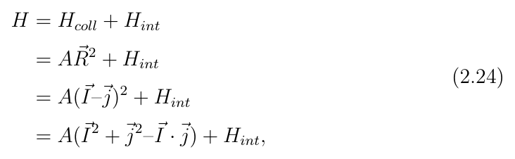

**中文说明:** 原式保留于上方裁图；译文不补写、改号或修正公式系数。

*原件裁图回退；未另作LaTeX转写，公式只显示一次。*

**Source:** PDF30 / 印19 · S078

**Original:** where Hcoll = AR2 is the collective rotational Hamiltonian with A = ħ2 2Iand⃗ R = (⃗I −⃗j). The term Hint corresponds to the deformed intrinsic single-particle Hamiltonian, (for instance the Nilsson model Hamiltonian). By noting that⃗j =⃗ j1 +⃗j2 +⃗j3, and quantizing along the ˆ3 axis as well as writing⃗j1 and⃗j2 in terms of the raising and lowering operators, equation 2.24 can be further simplified:

**中文:** 其中$H_{coll}=AR^2$为集体转动Hamiltonian，$A=\hbar^2/(2ℑ)$且$\vec R=\vec I-\vec j$；$H_{int}$对应形变内禀单粒子Hamiltonian，例如Nilsson模型Hamiltonian。注意到$\vec j=\vec j_1+\vec j_2+\vec j_3$，沿3轴量子化，并将$\vec j_1$、$\vec j_2$用升降算符表示，可以进一步简化式2.24：

**Source:** PDF30 / 印19 · E025 · 原式(2.25)

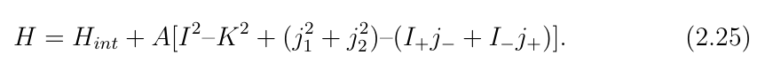

**中文说明:** 原式保留于上方裁图；译文不补写、改号或修正公式系数。

*原件裁图回退；未另作LaTeX转写，公式只显示一次。*

**页锚：PDF32 / 印21**

**Source:** PDF30 / 印19, PDF32 / 印21 · S079

**Original:** The last two terms correspond classically to the Coriolis and centrifugal forces. It gives the coupling between the motion of the valence nucleon in the deformed potential to that of the rotating core and causes mixing of states. In the strong coupling regime (adiabatic approximation), the influence of the rotating core on the single-particle motion is negligible (for small I). Only the diagonal matrix elements of the Coriolis term have any influence on the system. The selection rules for j+ and j−mean that these operators act only for Ω= ±1/2. The recoil term (j2 1 + j2 2) is influenced only by the single particle wavefunctions and is rather constant and small for a given rotational band and can be neglected.

**中文:** 最后两项经典地对应Coriolis力和离心力。它们给出形变势中价核子运动与旋转核芯运动之间的耦合，并造成态混合。在强耦合区域，即绝热近似下，对较小$I$，旋转核芯对单粒子运动的影响可忽略，只有Coriolis项的对角矩阵元影响体系。$j_+$与$j_-$的选择规则意味着这些算符只在$\Omega=\pm1/2$时起作用。反冲项$j_1^2+j_2^2$仅受单粒子波函数影响，对给定转动带近乎为常数、且较小，可以忽略。

**Source:** PDF32 / 印21 · S080

**Original:** From the Nilsson model, Hintψν = ενψν, where εν is the single-particle energy associated with the operator Hint, ψν is the corresponding eigenstate labelled by the Nilsson numbers; ψν = |NLJΩ⟩.

**中文:** Nilsson模型给出$H_{int}\psi_\nu=\varepsilon_\nu\psi_\nu$，其中$\varepsilon_\nu$为与算符$H_{int}$相关的单粒子能量；$\psi_\nu$为用Nilsson量子数标识的相应本征态，即$\psi_\nu=|NLJ\Omega\rangle$。

**Source:** PDF32 / 印21 · S081

**Original:** The energy of a state with given I and K is:

**中文:** 给定$I$和$K$时，态能量为：

**Source:** PDF32 / 印21 · E026 · 原式(2.26)

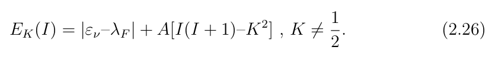

**中文说明:** 原式保留于上方裁图；译文不补写、改号或修正公式系数。

*原件裁图回退；未另作LaTeX转写，公式只显示一次。*

**Source:** PDF32 / 印21 · S082

**Original:** Energy is evaluated relative to the Fermi level λF. The bandhead in the yrast band (a rotational band formed with lowest energy states for a given I) has spin I = K. The states in the band will have an increasing spin, I = K, K +1, K +2, K +3, ..., (see panels (a) and (c) in Figure 2.7). The states are linked with both pure stretched E2 transitions (for states with ∆I = 2, shown in red in Figure 2.7) and mixed M1+E2 transitions (for states with ∆I = 1, shown in blue in Figure 2.7). Besides the yrast band it is possible to observe other rotational bands. These can be formed by the promotion of the odd nucleon to a higher Nilsson orbital and building a rotational band on this new configuration.

**中文:** 能量相对于费米面$\lambda_F$计算。yrast带，即对给定$I$由最低能量态组成的转动带，其带头自旋为$I=K$，带内各态的自旋按$I=K,K+1,K+2,K+3,\ldots$递增，见图2.7(a)、(c)。这些态既通过伸展纯E2跃迁相连，对应$\Delta I=2$、图2.7中的红色箭头，也通过M1+E2混合跃迁相连，对应$\Delta I=1$、蓝色箭头。除yrast带外，还可能观测其它转动带，例如将奇核子提升至较高Nilsson轨道，并在新组态上构建转动带。

**Source:** PDF32 / 印21 · S083

**Original:** For K = 1 2 the diagonal contributions of the matrix element of the (I+j−+ I−j+) operator are non-zero and in this case, the energy of the rotational band is calculated as:

**中文:** 对$K=1/2$，算符$I_+j_-+I_-j_+$的矩阵元的对角贡献不为零，此时转动带能量按下式计算：

**Source:** PDF32 / 印21 · E027 · 原式(2.27)

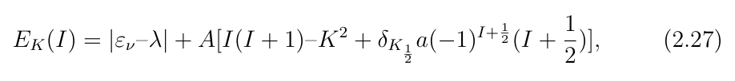

**中文说明:** 原式保留于上方裁图；译文不补写、改号或修正公式系数。

*原件裁图回退；未另作LaTeX转写，公式只显示一次。*

**Source:** PDF32 / 印21 · S084

**Original:** where a is called the decoupling parameter and has a fixed value for each K = 1 2 orbital. It is given by:

**中文:** 其中$a$称为退耦参数，对每个$K=1/2$轨道具有固定值，定义为：

**Source:** PDF32 / 印21 · E028 · 原式(2.28)

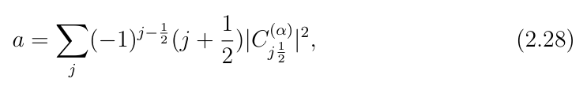

**中文说明:** 原式保留于上方裁图；译文不补写、改号或修正公式系数。

*原件裁图回退；未另作LaTeX转写，公式只显示一次。*

**页锚：PDF33 / 印22**

**Source:** PDF33 / 印22 · S085

**Original:** and it corresponds to the decoupling of the particle motion from the rotor. This decoupling profoundly affects the order of the states in a rotational band, depending on the value of $a$. If $a=0$, the ordering is identical to that predicted by relation 2.26. If $|a|=1$, the states occur in degenerate pairs. For $a=-1$, the $1/2$ and $3/2$ states are degenerate and have the following pairs of states $(5/2,7/2)$, $(9/2,11/2)$,... When $a=+1$, the degenerate pairs are: $(3/2,5/2)$, $(7/2,9/2)$, $(11/2,13/2)$... If $|a|>1$, the spin sequence in a rotational band is no longer monotonic. In general the Coriolis term has the effect of mixing two different rotational bands for which $\Delta K=\pm1$.

**中文:** 它对应粒子运动与转子的退耦，会根据$a$的取值显著影响转动带的态顺序。若$a=0$，顺序与式2.26相同；若$|a|=1$，态成对简并。当$a=-1$时，$1/2$与$3/2$简并，随后为$(5/2,7/2)$、$(9/2,11/2)$等；当$a=+1$时，简并对为$(3/2,5/2)$、$(7/2,9/2)$、$(11/2,13/2)$等。若$|a|>1$，转动带的自旋序列不再单调。一般来说，Coriolis项会使$\Delta K=\pm1$的两条不同转动带混合。

#### 2.4.2.2 转动对齐极限

**Source:** PDF33 / 印22 · S086

**Original:** 2.4.2.2 Rotational alignment limit

**中文:** 2.4.2.2 转动对齐极限

**Source:** PDF33 / 印22 · S087

**Original:** In this limiting case the angular momentum of the valence nucleon,⃗j is parallel to the rotational angular momentum of the core⃗R. In even-even nuclei a rotational band is built on the 0+ ground state. A sequence of pure E2 transitions link the states of this band. The spectrum of an odd-A nucleus whose single-particle angular momentum aligns itself with the core rotation, on the other hand, will have a rotational band that is built on the ground state with spin I = α, where α is the projection of⃗j on the rotational axis, see panel (b) of Figure 2.7. The states of the band have spin I = α, α + 2, α + 4, ... etc. and are linked with pure E2 transitions. That is, in the rotationally aligned case only one sequence of E2 transitions is observed, (see panels (b) and (d) in Figure 2.7). The band structures in the rotational alignment limit are similar to the ground state bands of the neighboring even-even nuclei.

**中文:** 在这一极限情况下，价核子角动量$\vec j$平行于核芯转动角动量$\vec R$。偶偶核的转动带建立在$0^+$基态上，由一系列纯E2跃迁连接各态。另一方面，若奇质量核的单粒子角动量沿核芯转动方向对齐，其转动带建立在自旋$I=\alpha$的基态上，其中$\alpha$为$\vec j$在转动轴上的投影，见图2.7(b)。带内态自旋为$I=\alpha,\alpha+2,\alpha+4,\ldots$，由纯E2跃迁连接。也就是说，转动对齐时只观测到一条E2跃迁序列，见图2.7(b)、(d)。转动对齐极限的带结构类似于相邻偶偶核的基态带。

**Source:** PDF33 / 印22 · S088

**Original:** In the rotational aligned case the energy of the rotational states is given by:

**中文:** 在转动对齐情况下，转动态能量为：

**Source:** PDF33 / 印22 · E029 · 原式(2.29)

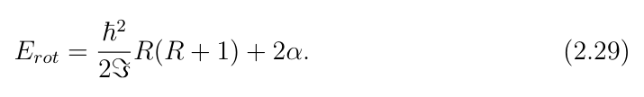

**中文说明:** 原式保留于上方裁图；译文不补写、改号或修正公式系数。

*原件裁图回退；未另作LaTeX转写，公式只显示一次。*

### 2.5 旋称劈裂

**Source:** PDF33 / 印22 · S089

**Original:** 2.5 Signature splitting

**中文:** 2.5 旋称劈裂

**页锚：PDF34 / 印23**

**Source:** PDF33 / 印22, PDF34 / 印23 · S090

**Original:** In the absence of rotation, parity (π) and and the projection of⃗j on the nuclear symmetry axis, Ωare good quantum numbers in the Nilsson model. Introduction of nuclear rotation breaks the time-reversal symmetry of the system as such, and Ωbecomes two-fold degenerate. Because of the loss of time-reversal symmetry, an additional quantum number called the signature (α) is required to labelled states in a rotational band. The signature quantum number, α describes invariance of the axially symmetric potential with respect to a rotation of 180◦perpendicular to the symmetry axis. The rotation operator [70] is given by:

**中文:** 没有转动时，宇称π和$\vec j$在核对称轴上的投影$\Omega$是Nilsson模型的好量子数。引入核转动会破坏体系的时间反演对称性，从而使$\Omega$变为二重简并。由于时间反演对称性丧失，需要额外的量子数，即旋称$\alpha$，标记转动带内的态。旋称量子数描述轴对称势在绕垂直于对称轴的轴转动180°时的不变性。旋转算符为[70]：

**Source:** PDF34 / 印23 · E030 · 原式(2.30)

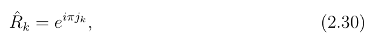

**中文说明:** 原式保留于上方裁图；译文不补写、改号或修正公式系数。

*原件裁图回退；未另作LaTeX转写，公式只显示一次。*

**Source:** PDF34 / 印23 · S091

**Original:** where k denotes the intrinsic (ˆ1, ˆ2, ˆ3) nuclear axes and jk the projection of the single-particle angular momentum onto the k axis. The signature quantum number, α is defined as:

**中文:** 其中$k$表示核内禀的1、2、3轴，$j_k$为单粒子角动量沿$k$轴的投影。旋称量子数$\alpha$定义为：

**Source:** PDF34 / 印23 · E031 · 原式(2.31)

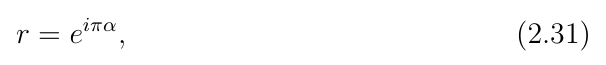

**中文说明:** 原式保留于上方裁图；译文不补写、改号或修正公式系数。

*原件裁图回退；未另作LaTeX转写，公式只显示一次。*

**Source:** PDF34 / 印23 · S092

**Original:** where r is the eigenvalue of the rotation operator, ˆR. The signature quantum number is related to the total angular momentum I by:

**中文:** 其中$r$为旋转算符$\hat R$的本征值。旋称量子数与总角动量$I$的关系为：

**Source:** PDF34 / 印23 · E032 · 原式(2.32)

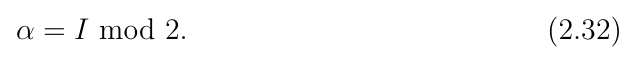

**中文说明:** 原式保留于上方裁图；译文不补写、改号或修正公式系数。

*原件裁图回退；未另作LaTeX转写，公式只显示一次。*

**Source:** PDF34 / 印23 · S093

**Original:** That is, for even-A nuclei the signature is related to the angular momentum as:

**中文:** 即对偶质量核，旋称与角动量的关系为：

**Source:** PDF34 / 印23 · E033 · 原式(2.33)

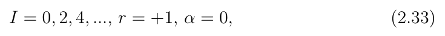

**中文说明:** 原式保留于上方裁图；译文不补写、改号或修正公式系数。

*原件裁图回退；未另作LaTeX转写，公式只显示一次。*

**Source:** PDF34 / 印23 · E034 · 原式(2.34)

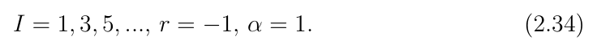

**中文说明:** 原式保留于上方裁图；译文不补写、改号或修正公式系数。

*原件裁图回退；未另作LaTeX转写，公式只显示一次。*

**Source:** PDF34 / 印23 · S094

**Original:** For odd-A nuclei:

**中文:** 对奇质量核：

**Source:** PDF34 / 印23 · E035 · 原式(2.35)

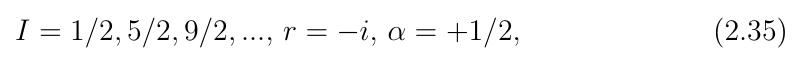

**中文说明:** 原式保留于上方裁图；译文不补写、改号或修正公式系数。

*原件裁图回退；未另作LaTeX转写，公式只显示一次。*

**Source:** PDF34 / 印23 · E036 · 原式(2.36)

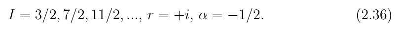

**中文说明:** 原式保留于上方裁图；译文不补写、改号或修正公式系数。

*原件裁图回退；未另作LaTeX转写，公式只显示一次。*

**页锚：PDF35 / 印24**

**Source:** PDF34 / 印23, PDF35 / 印24 · S095

**Original:** A rotational band built on a given intrinsic configuration (with K̸ = 0) splits into two families of ∆I = 2 sequences with different signature. These are known as signature partner bands and they differ from each other by 1ħ. In general signature partner bands may not be energetically equivalent. One lies lower in energy and is then called the ”favored” configuration, while the other is ”unfavored” and lies higher in energy. This results in signature splitting, which is strongly affected by the Coriolis interaction. Signature splitting is usually characterized by the parameter S(I) and defined as:

**中文:** 建立在给定内禀组态、$K\ne0$上的转动带，劈裂为两组具有不同旋称的$\Delta I=2$序列，称为旋称伙伴带，彼此相差$1\hbar$。一般而言，旋称伙伴带的能量不一定相同。能量较低者称为“有利”组态，能量较高者称为“不利”组态，由此产生旋称劈裂。Coriolis相互作用对它有很大影响。旋称劈裂通常用下列参数$S(I)$表征：

**Source:** PDF35 / 印24 · E037 · 原式(2.37)

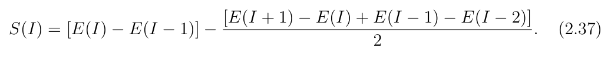

**中文说明:** 原式保留于上方裁图；译文不补写、改号或修正公式系数。

*原件裁图回退；未另作LaTeX转写，公式只显示一次。*

**Source:** PDF35 / 印24 · S096

**Original:** The S(I) values appear as a typical staggering curve when plotted as a function of nuclear spin, I (see Figure 2.8). In some cases the favored and unfavored signature partner bands can cross and interchange their roles, then the signature splitting changes its phase at a given spin. This phenomenon is known as signature inversion [10]. In a one-quasiparticle (1-qp) configuration in a high-j orbital, the favored signature configuration is obtained by:

**中文:** 将$S(I)$对核自旋$I$作图，会得到典型的交错曲线，见图2.8。在某些情况下，有利与不利旋称伙伴带会交叉并互换角色，使旋称劈裂在某一自旋处改变相位，这称为旋称反转[10]。对于高$j$轨道上的单准粒子组态，有利旋称由下式给出：

##### 图2.8 · 典型能量交错曲线

**Placed near:** S096；原图/表来源PDF35 / 印24，裁图未改数字。

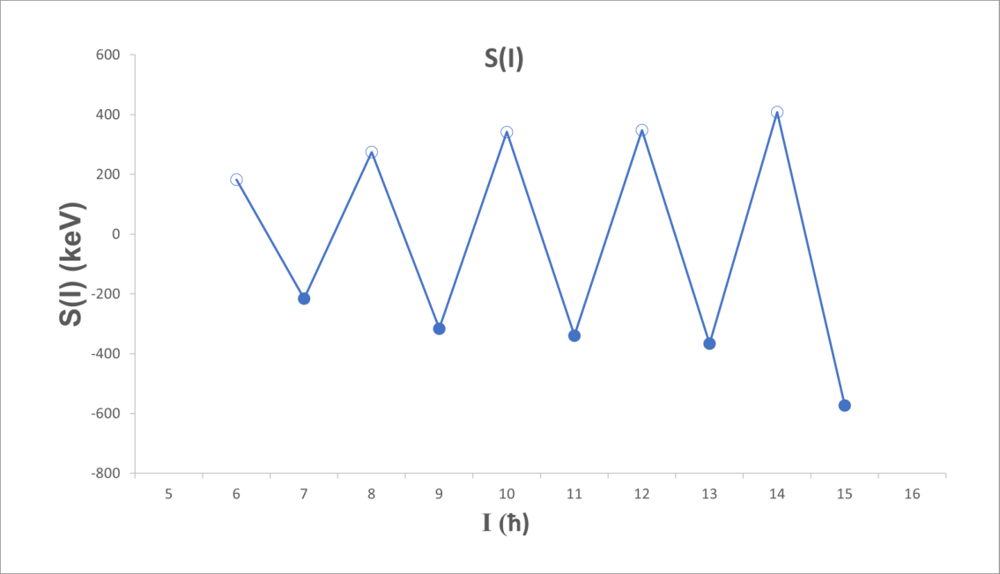

**Source:** PDF35 / 印24 · C008

**Original caption:** Figure 2.8: An illustration of a typical energy staggering curve. Filled circles denote the favored signature branch, while the open circles denote the unfavored signature branch.

**中文图注:** 图2.8：典型能量交错曲线示意。实心圆表示有利旋称支，空心圆表示不利旋称支。

**Source:** PDF35 / 印24 · E038 · 原式(2.38)

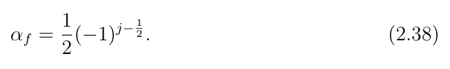

**中文说明:** 原式保留于上方裁图；译文不补写、改号或修正公式系数。

*原件裁图回退；未另作LaTeX转写，公式只显示一次。*

**页锚：PDF20 / 印9**；此页为已在首次讨论处插入的图表：[F002](#F002)。

**页锚：PDF26 / 印15**；此页为已在首次讨论处插入的图表：[F005](#F005)。

**页锚：PDF27 / 印16**；此页为已在首次讨论处插入的图表：[F006](#F006)。

**页锚：PDF31 / 印20**；此页为已在首次讨论处插入的图表：[F007](#F007)。

## 术语表

| Original term | 中文统一译法 | 使用说明 |
|---|---|---|
| single-particle / collective excitation | 单粒子 / 集体激发 | 作者的基础分类，不据规则谱线单独判机制 |
| quasiparticle-plus-triaxial rotor (QTR) | 准粒子加三轴转子 | 后续第3/6章模型入口 |
| magic number / shell closure | 幻数 / 壳层闭合 | 保留原文列数与适用语境 |
| mean-field / residual interaction | 平均场 / 剩余相互作用 | Hamiltonian分解中的不同层次 |
| infinite square well / harmonic oscillator | 无限深方势阱 / 谐振子 | 各模型条件分别记录 |
| Woods–Saxon (W–S) | Woods–Saxon势 | 不与修正H.O.势混用 |
| spin–orbit / Coriolis coupling | 自旋–轨道 / Coriolis耦合 | 来源与角动量对象不同 |
| quadrupole / octupole / hexadecapole | 四极 / 八极 / 十六极 | 保留β、ε的不同参数化 |
| prolate / oblate / triaxial | 长椭 / 扁椭 / 三轴 | Lund约定还含转轴语境 |
| Nilsson quantum numbers | Nilsson量子数 | N、nz、Λ、Σ、Ω按原定义 |
| strong coupling / rotational alignment | 强耦合 / 转动对齐 | 本文讨论的两个极限 |
| decoupling parameter a | 退耦参数a | 不能与实验取向参数或几何a混淆 |
| signature / parity | 旋称 / 宇称 | 原文α与r的约定矛盾另审计，不能混同 |
| favored / unfavored signature | 有利 / 不利旋称 | 按能量排序区分 |
| signature splitting / inversion | 旋称劈裂 / 旋称反转 | 采用原式2.37，不套其它S定义 |
| yrast band | yrast带 | 对给定自旋最低激发能 |

## 独立审计与使用边界

以下是独立阅读审计，不属于原文或正文翻译；只核对具体字面与内部一致性，不把它写成对整套核模型的最终裁决。

1. **式2.24交叉项字面。** PDF30/印19最后一行印$A(\vec I^{\,2}+\vec j^{\,2}-\vec I\cdot\vec j)+H_{int}$，前一行则为$A(\vec I-\vec j)^2+H_{int}$。裁图保留原样；普通可交换矢量展开应出现2倍交叉项，但是否涉及该处排版、算符/单位约定，应与相邻式2.25及actual推导逐项核对，不能直接改原式或据此宣布作者计算producer错误。
2. **式2.15的β/π系数。** PDF22/印11三行半径偏离式字面均为$(5/4)^{1/2}$乘余弦，未显β2，也未显π；前文却说该比值与β2联系。此处按原图保留，标为与式2.12–14及零形变极限待核的公式边界，不悄悄补入习见系数。
3. **旋称r与α的号约定。** PDF34/印23式2.31印$r=e^{i\pi\alpha}$；式2.35却把$\alpha=+1/2$配$r=-i$，式2.36把$\alpha=-1/2$配$r=+i$。在式2.31字面指数约定下，两者不能直接同时成立。式2.30的旋转算符也按原号保留；需先固定主动/被动旋转、指数号和态的定义，不能只改一个r号。
4. **α在相邻小节有不同角色。** §2.4.2.2把α定义为j沿转动轴的投影；§2.5把α定义为旋称。reader保留各处原定义，不将两者默认等同；特别是式2.29的$+2\alpha$应连同该节量纲/能量零点单独核，不自动拿来作数值producer。
5. **时间反演与简并句子忠实保留。** §2.5正文说引入转动破坏时间反演、使Ω二重简并；译文不按教科书直觉静默反转句意。这是需要对照原Hamiltonian及Kramers适用前提的概念核查点。
6. **核数与图注标签。** PDF14的第6章提纲将133Ce/131Ba称Z=75同中子素，原字面保留；它们实际为N=75。图2.6写“protons”却仍印$50\le N\le82$，也保留N而不静默换Z。
7. **基础模型陈述不作无条件推广。** 关于球形核“不能转动”、纯E2序列、强耦合下j±作用、轨道占据与简并等语句，是本章特定模型/极限中的作者表述。实际核的角动量激发、完整模型及多体混合应另核，不能把这些简写变成跨核普适排他门。
8. **第1章TiP结论为作者概述。** §1.1声称能谱及电磁量支持TiP，正文译文保留；第6章逐量分析仍揭示FA跨带δ更近、两模型BM1趋势不足及表图冲突，不能用引言概述替代后续证据。
9. **公式原件回退边界。** 38个原编号式全部有裁图。裁图解决排版与追溯问题，不等于所有系数、求和、量纲和符号已通过独立物理推导；特别是2.2/2.4的求和定义、2.7后量子数范围、2.29等只保留字面，不扩大裁决。

下一步应围绕这些原式做有边界的维数、零形变、耦合极限、旋转约定和S重算练习，再回到具体带的实验向量。章节或全文翻译完成都不代表长期深入学习已经完成。
