# 第4–5章逐段中英对照

来源为用户提供的Wakudyanaye 2022硕士论文。仅覆盖第4、5章PDF51–74（印刷40–63页）；不代表全论文翻译完成。Original保留原论断、引文及疑点；中文忠实翻译。独立审计集中在文末，不能当作原文结论。公式和表格采用原件裁图，图注逐条对照。

## 页码与章节索引

- [第4章：实验技术](#chapter4) · PDF51–59 / 印40–48
- [第5章：实验结果](#chapter5) · PDF60–74 / 印49–63
- [术语表](#glossary) · [独立审计与使用边界](#audit)

## 公式索引

- [E001 · 式(4.1)](#E001) · PDF52 / 印41：库仑势垒：保留原式
- [E002 · 式(4.2)](#E002) · PDF53 / 印42：多极阶数的角动量选择范围
- [E003 · 式(4.3)](#E003) · PDF58 / 印47：角分布的勒让德展开
- [E004 · 式(4.4)](#E004) · PDF58 / 印47：原文混合比定义
- [E005 · 式(4.5)](#E005) · PDF59 / 印48：DCO比：互换门与目标角度
- [E006 · 式(4.6)](#E006) · PDF59 / 印48：角分布比：全部探测器设门

页面导航：[PDF51](#page51) · [PDF52](#page52) · [PDF53](#page53) · [PDF54](#page54) · [PDF55](#page55) · [PDF56](#page56) · [PDF57](#page57) · [PDF58](#page58) · [PDF59](#page59) · [PDF60](#page60) · [PDF61](#page61) · [PDF62](#page62) · [PDF63](#page63) · [PDF64](#page64) · [PDF65](#page65) · [PDF66](#page66) · [PDF67](#page67) · [PDF68](#page68) · [PDF69](#page69) · [PDF70](#page70) · [PDF71](#page71) · [PDF72](#page72) · [PDF73](#page73) · [PDF74](#page74)

**页锚：PDF51 / 印40**

## 第4章 实验技术

**Source:** PDF51 / 印40 · S001

**Original:** Chapter 4 Experimental Techniques

**中文:** 第4章 实验技术

### 4.1 引言

**Source:** PDF51 / 印40 · S002

**Original:** 4.1 Introduction

**中文:** 4.1 引言

**Source:** PDF51 / 印40 · S003

**Original:** Spectroscopic investigations of γ-ray transitions emitted by excited nuclei are among the most important tools used to study nuclear structure. This chapter is devoted to the experimental techniques used in the production and spectroscopic studies of nuclei at high excitation energy and high angular momenta. In particular it discusses the production of nuclei through the heavy-ion fusion evaporation (HIFE) reactions, the emission of γ rays, the features of high-purity germanium (HPGe) detectors and the AFRican Omnipurpose Detector for Innovative Techniques (AFRODITE) array, and the experimental data analyses used to build a level scheme and assign spin and parity to the nuclear states.

**中文:** 对激发态原子核所发射γ跃迁开展谱学研究，是研究核结构最重要的手段之一。本章介绍产生处于高激发能、高角动量状态的原子核并对其进行谱学研究所用的实验技术。具体包括通过重离子融合蒸发（heavy-ion fusion evaporation，HIFE）反应产生原子核、γ射线发射、高纯锗（high-purity germanium，HPGe）探测器与AFRODITE（AFRican Omnipurpose Detector for Innovative Techniques）阵列的特点，以及用于构建能级纲图并指定核态自旋和宇称的实验数据分析。

### 4.2 重离子融合蒸发

**Source:** PDF51 / 印40 · S004

**Original:** 4.2 Heavy-Ion Fusion Evaporation

**中文:** 4.2 重离子融合蒸发

**页锚：PDF52 / 印41**

**Source:** PDF51 / 印40, PDF52 / 印41 · S005

**Original:** The heavy-ion fusion evaporation reaction mechanism involves the fusing of an incident projectile nucleus with a target nucleus, resulting in the formation of a compound system. The compound system can decay via several channels, for instance the compound nucleus can emit one or more particles such as protons (p), neutrons (n), and alpha (α) particles to produce a daughter nucleus in an excited state, which proceeds to decay via γ-ray emission. HIFE reactions provide the most efficient way of producing nuclei at high-spin states. Nuclear states with sufficient energy and cross section (reaction probability) can be reached with a greater degree of selectivity [59]. HIFE reactions can occur if the incident projectile nucleus possess sufficient kinetic energy to overcome the Coulomb barrier of the target nucleus VC, which can be approximated (in MeV) by [36];

**中文:** 重离子融合蒸发反应是入射的弹核与靶核融合、形成复合体系的过程。复合核可以通过若干反应道衰变，例如发射一个或多个质子（p）、中子（n）和α粒子，生成处于激发态的子核，后者继续通过发射γ射线退激。HIFE反应是产生高自旋核态最有效的途径。对于具有足够能量和反应截面（反应概率）的核态，可以获得较高的选择性[59]。如果入射弹核具有足够的动能来克服靶核的库仑势垒$V_C$，HIFE反应便可发生。该势垒可用下式近似，单位为MeV[36]：

**Source:** PDF52 / 印41 · E001 · 原式(4.1)

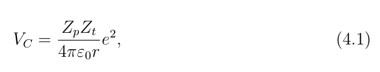

**中文说明:** 原文给出的库仑势垒近似式；请以裁图中的原式为准。

*原件裁图回退；未另作LaTeX转写，公式只显示一次。*

**Source:** PDF52 / 印41 · S006

**Original:** with $r=1.2(A_p^{1/3}+A_t^{1/3})$ fm. Here $Z_p$ and $A_p$ are the atomic number and the mass number of the incident projectile nucleus, and $Z_t$ and $A_t$ represent the atomic number and the mass number of the target nucleus.

**中文:** 其中$r=1.2(A_p^{1/3}+A_t^{1/3})$ fm。$Z_p$和$A_p$分别为入射弹核的原子序数与质量数，$Z_t$和$A_t$分别为靶核的原子序数与质量数。

**Source:** PDF52 / 印41 · S007

**Original:** A compound nucleus forms if the lifetime of the compound system is long enough (of the order of $\sim10^{-20}$ s). The probability of decay is solely dependent on the total energy imparted on the compound system, and is independent of the formation process [15]. Shortly after formation (of the order of $\sim10^{-19}$ s), the compound system resembles a hot, charged, rotating liquid drop and is highly unstable. It decays rapidly by evaporating particles away, which carry with them a large amount of energy, but very little angular momentum of ∼1ħ. Due to the Coulomb barrier, proton emission is hindered in the early stages of particle emissions from the compound system and neutron emission is the dominant decay path.

**中文:** 若复合体系的寿命足够长，达到约$10^{-20}$ s的量级，就会形成复合核。其衰变概率只取决于传递给复合体系的总能量，而与形成过程无关[15]。形成后不久，约$10^{-19}$ s量级，复合体系类似于一个高温、带电且旋转的液滴，极不稳定。它迅速通过蒸发粒子而衰变；这些粒子带走大量能量，但带走的角动量很少，约为$1\hbar$。由于库仑势垒的作用，在复合体系粒子发射的早期阶段，质子发射受到抑制，中子发射成为主要衰变途径。

**Source:** PDF52 / 印41 · S008

**Original:** When particle emission is no longer a favorable decay path, a compound nucleus decays via the emission of electromagnetic radiation (γ rays). The first set of γ rays that are emitted are statistical, their strengths are dictated by random overlaps between the initial and final states wavefunctions, typically states that lie close to each other in energy and spin. These statistical γ decays are predominantly non-collective electric dipole E1 transitions that carry large amounts of excitation energy, but very little angular momentum.

**中文:** 当粒子发射不再是有利的衰变途径时，复合核便通过发射电磁辐射，即γ射线而衰变。最先发射的一组γ射线具有统计性质，其强度取决于初末态波函数的随机重叠；这些核态的能量与自旋通常彼此接近。这些统计γ衰变主要是非集体的电偶极E1跃迁，带走大量激发能，但带走的角动量很少。

### 4.3 γ衰变

**Source:** PDF52 / 印41 · S009

**Original:** 4.3 Gamma Decay

**中文:** 4.3 γ衰变

**页锚：PDF53 / 印42**

**Source:** PDF52 / 印41, PDF53 / 印42 · S010

**Original:** A γ ray is a high energy photon that is emitted when a nucleus decays by electromagnetic radiation. The energy of the emitted γ ray contains information about the nucleus, for instance the energy of a γ ray, Eγ, is the energy difference between the initial nuclear state Ei and final nuclear state Ef; Eγ = Ei −Ef. The emission of a γ ray is dictated by conservation laws and quantum mechanical selection rules for angular momentum and parity [36]. The multipole order of the emitted γ ray is given by:

**中文:** γ射线是原子核通过电磁辐射衰变时发射的高能光子。所发射γ射线的能量包含核结构信息。例如，γ射线能量$E_\gamma$等于初始核态能量$E_i$与末态能量$E_f$之差，即$E_\gamma=E_i-E_f$。γ射线的发射受到角动量与宇称守恒定律以及相应量子力学选择定则的约束[36]。所发射γ射线的多极阶数由下式给出：

**Source:** PDF53 / 印42 · E002 · 原式(4.2)

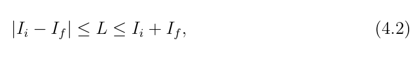

**中文说明:** 式中初态与末态自旋对多极阶数的约束，保留原式。

*原件裁图回退；未另作LaTeX转写，公式只显示一次。*

**Source:** PDF53 / 印42 · S011

**Original:** with Ii and If as the angular momenta of the initial and final state, respectively. L is the multipole order of the emitted γ ray. Stretched transitions have L = |Ii −If| and unstretched transitions have L > |Ii −If|. Electric and magnetic multipoles of the same order have opposite parity, such that π(EL) = (−1)L for electric transitions and π(ML) = (−1)(L+1) for magnetic transitions. Transitions between states of the same parity are of the even multipole order for electric transitions and of the odd multipole order for magnetic transitions (M1, E2, M3, E4, ...), while transitions that involve parity change are of the odd multipole order for the electric transitions and of the even multipole order for magnetic transitions (E1, M2, E3, M4, ...). This information is summarized in Table 4.1. Transitions between two states with I = 0, cannot proceed through γ decay as a photon should carry a minimum L = 1ħof angular momentum. Such a 0 →0 transition proceeds through emission of internal conversion electrons.

**中文:** 其中$I_i$与$I_f$分别为初态和末态的角动量，$L$为发射γ射线的多极阶数。伸展跃迁满足$L=|I_i-I_f|$，非伸展跃迁满足$L>|I_i-I_f|$。相同阶数的电多极与磁多极具有相反的宇称：电跃迁有$\pi(EL)=(-1)^L$，磁跃迁有$\pi(ML)=(-1)^{L+1}$。相同宇称核态之间的电跃迁具有偶数多极阶数，磁跃迁具有奇数多极阶数，即M1、E2、M3、E4等；改变宇称的电跃迁具有奇数多极阶数，磁跃迁具有偶数多极阶数，即E1、M2、E3、M4等。表4.1汇总了这些信息。两个$I=0$的核态之间不能通过γ衰变跃迁，因为光子应至少携带$L=1\hbar$的角动量。这种$0\to0$跃迁通过发射内转换电子进行。

##### 表4.1 · γ跃迁多极性与宇称

**Placed near:** S011；原图/表来源PDF53 / 印42，裁图未改数字。

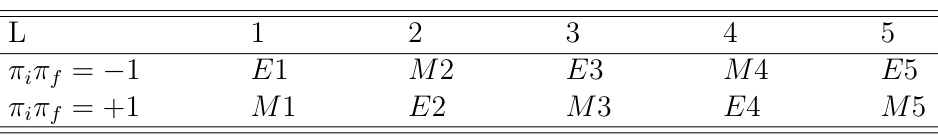

**Source:** PDF53 / 印42 · C001

**Original caption:** Table 4.1: Multipolarity of a γ ray transition with multipole order L, linking initial and final states with parities of πi and πf, respectively.

**中文图注:** 表4.1：多极阶数为$L$的γ跃迁的多极性；该跃迁连接宇称分别为$\pi_i$和$\pi_f$的初态与末态。

**表头对照：** L：多极阶数；πiπf：初末态宇称乘积；E/M：电/磁多极类型。

### 4.4 γ射线的探测

**Source:** PDF53 / 印42 · S012

**Original:** 4.4 Detection of Gamma Radiation

**中文:** 4.4 γ射线的探测

**Source:** PDF53 / 印42 · S013

**Original:** When a nucleus de-excites through γ decay, it is possible to measure the properties of the emitted γ ray when it interacts with the detector material. Germanium, which is a semiconductor, is the material of choice used by nuclear physicists to detect γ rays. Electron-hole pairs can form inside a semiconductor crystal when a γ ray with sufficient energy passes through the semiconductor material. If the crystal is placed between a pair of electrodes, it is possible to collect the created charge in the material. Germanium has an ionisation energy of ∼2.9 eV, which allows greater power to resolve the energy of the emitted γ rays.

**中文:** 当原子核通过γ衰变退激时，可以利用γ射线与探测器材料的相互作用测量其性质。锗是一种半导体，是核物理研究中探测γ射线的常用材料。当能量足够高的γ射线穿过半导体晶体时，晶体内可以产生电子–空穴对。如果将晶体置于一对电极之间，就能够收集材料中产生的电荷。锗的电离能约为2.9 eV，因此能以较高分辨能力测量所发射γ射线的能量。

**页锚：PDF54 / 印43**

### 4.5 AFRODITE探测阵列

**Source:** PDF54 / 印43 · S014

**Original:** 4.5 The AFRODITE Detector Array

**中文:** 4.5 AFRODITE探测阵列

**Source:** PDF54 / 印43 · S015

**Original:** The AFRODITE High Purity Germanium (HPGe) detector array at iThemba LABS is mounted on a rhombicuboctahedron frame with 16 detector positions [54]. The array consists of eight clover detectors, four positioned at 90◦and four at 135◦. The array also comprises of 7 low energy photon spectrometers (LEPS), two placed at 45◦, three at 90◦and two at 135◦. The clover detectors are similar to those of EUROBALL III [67]. Each clover consists of four 50 x 70 mm HPGe crystals and eight clovers subtend a solid angle of ∼9.8% of 4π. The detectors are suitable for measuring high-energy γ rays due to their large volume. The crystals are closely packed without any material between them which enables a good energy resolution for signals added from more than one crystal. The distance between the front face of the detector and the center of the AFRODITE array is 17.6 cm. Figure 4.1 shows the schematic diagram of the orientations of the clover detectors in the AFRODITE array. Recently the array was upgraded to comprise 17 clover detectors.

**中文:** iThemba LABS的AFRODITE高纯锗（HPGe）探测阵列安装在一个具有16个探测器位置的小斜方截半立方体框架上[54]。阵列由8个Clover探测器组成，其中4个置于90°、4个置于135°。阵列还包括7个低能光子谱仪（low energy photon spectrometers，LEPS）：45°方向2个、90°方向3个、135°方向2个。Clover探测器与EUROBALL III使用的探测器相似[67]。每个Clover由4块50×70 mm的HPGe晶体组成，8个Clover覆盖的立体角约为$4\pi$的9.8%。由于体积较大，这些探测器适于测量高能γ射线。晶体紧密排列，其间没有其它材料，因此将多块晶体的信号相加时仍可获得良好的能量分辨率。探测器前端面至AFRODITE阵列中心的距离为17.6 cm。图4.1给出了阵列中Clover探测器的方位示意。近期该阵列已升级为包含17个Clover探测器。

##### 图4.1 · AFRODITE探测器方位

**Placed near:** S015；原图/表来源PDF55 / 印44，裁图未改数字。

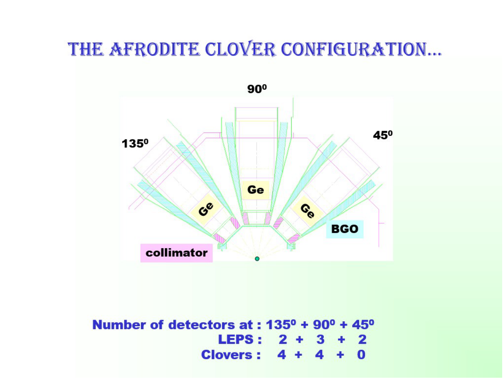

**Source:** PDF55 / 印44 · C002

**Original caption:** Figure 4.1: A schematic illustration of the detector orientation in the AFRODITE array. The corresponding number of LEPS and clover detectors placed at 45◦, 90◦, and 135◦is given at the bottom of the figure. Adapted from Ref. [41].

**中文图注:** 图4.1：AFRODITE阵列中探测器方位的示意图。图底部给出了45°、90°和135°处LEPS与Clover探测器的相应数量。改编自文献[41]。

### 4.6 数据分析

**Source:** PDF54 / 印43 · S016

**Original:** 4.6 Data Analysis

**中文:** 4.6 数据分析

**Source:** PDF54 / 印43 · S017

**Original:** Two experimental data sets are presented and discussed in this work. The first experiment was carried out at iThemba LABS (iTL), South Africa. The second one was performed at the Laborotori Nazionali di Legnaro (LNL), Italy. Both experimental data sets were analysed with the collaboration of Chinese, French and South African researchers and students [22]. The experimental data collected at LNL were analysed by the collaborators, but the theoretical calculations were performed as part of this work and presented in Chapter 6. Thus the experimental data on $^{131}$Ba is also presented in Chapter 5. The second experiment performed at iTL collected data on $^{133}$Ce. The preliminary analysis of these data, including calibrations and data sorting in matrices were carried out by our collaborators. However, the analysis of the γ-γ coincidence matrix and building and extending the level scheme of $^{133}$Ce, as well as the theoretical calculations, were performed in this work. In this section the γ-coincidence analysis used to build the $^{133}$Ce level scheme is discussed, while theoretical calculations are discussed in Chapter 6.

**中文:** 本工作给出并讨论了两组实验数据。第一个实验在南非iThemba LABS（iTL）完成，第二个在意大利Legnaro国家实验室（LNL）完成。两组实验数据由中国、法国和南非的研究人员及学生合作分析[22]。LNL采集的实验数据由合作人员分析，理论计算则是本工作的一部分，并在第6章给出。因此，第5章也给出了$^{131}$Ba的实验数据。在iTL开展的第二个实验采集了$^{133}$Ce数据；其初步分析，包括校准和矩阵分选，由合作人员完成。然而，γ–γ符合矩阵的分析、$^{133}$Ce能级纲图的构建与扩展，以及理论计算均在本工作中完成。本节讨论用于构建$^{133}$Ce能级纲图的γ符合分析，理论计算则在第6章讨论。

**页锚：PDF55 / 印44**

**Source:** PDF55 / 印44 · S018

**Original:** The AFRODITE detector array at iThemba LABS makes it possible to detect more than one γ ray simultaneously. By detecting γ rays simultaneously it is possible to construct a coincidence matrix, which represents the γ rays in coincidence. Figure 4.2 illustrates such a matrix. The γ rays of each event are arranged in pairs and each pair is counted in the coincidence matrix. For instance, γ rays a and b that were observed simultaneously and thus belong to one event are in coincidence and will be arranged as (a, b) and (b, a) pairs. Likewise, γ rays d and e are in coincidence and will be arranged as (d, e) and (e, d) pairs. The count numbers (the z axis in a coincidence matrix) will be increased by one at coordinated x = a and y = b when the pair (a, b) is counted, and similarly for all other pairs.

**中文:** iThemba LABS的AFRODITE探测阵列能够同时探测多条γ射线。通过同时探测γ射线，可以构建表示符合γ射线关系的符合矩阵，图4.2给出了这种矩阵的示意。将每个事件中的γ射线两两配对，并把每一对填入符合矩阵。例如，同时观测到、因而属于同一事件的γ射线a和b构成符合，将被组成(a,b)和(b,a)两对。同样，符合的γ射线d和e将被组成(d,e)和(e,d)两对。将(a,b)这一对计入矩阵时，在$x=a$、$y=b$坐标处的计数，即符合矩阵的z轴数值增加1；其它γ射线对也按同样方式处理。

##### 图4.2 · 对称γ–γ矩阵示意

**Placed near:** S018；原图/表来源PDF56 / 印45，裁图未改数字。

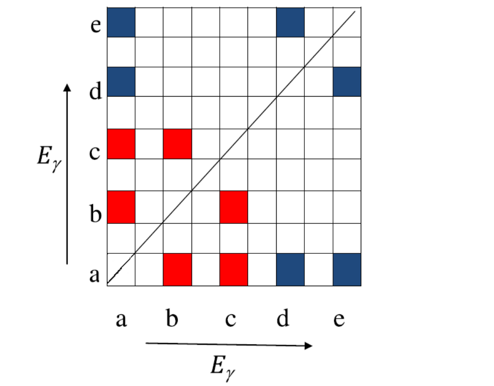

**Source:** PDF56 / 印45 · C003

**Original caption:** Figure 4.2: Schematic representation of a symmetric γ-γ matrix. γ ray a is in coincidence with all γ rays (b, c, d and e, shown by the red and blue squares). γ ray b is in coincidence only with γ rays a and c. Similarly, γ ray c is in coincident with a and b. γ ray d is coincident with a and e, etc...

**中文图注:** 图4.2：对称γ–γ矩阵示意。γ射线a与全部其它γ射线，即红色和蓝色方格表示的b、c、d、e符合。γ射线b仅与a和c符合。同样，γ射线c与a和b符合，γ射线d与a和e符合，等等。

**页锚：PDF56 / 印45**

**Source:** PDF55 / 印44, PDF56 / 印45 · S019

**Original:** The spectra of coincident γ rays can be produced by such an arrangement of events in a coincident matrix. By gating on a single γ ray energy, it will show only those γ rays that are in the decay path of the γ ray chosen as a gate. In such a way it becomes possible to construct this γ decay path. Gamma-ray emissions that proceed through the same path will be in coincidence, while those that do not belong to the same decay path will be anti-coincident to each other, that is, they will not ”see” each other when gated on. To make the point more clear, in Figure 4.2, γ rays c and d are anti-coincident so when gating on either one, it is not possible to see the other. In Figure 4.3 a representative level scheme and sample gated spectra are shown for the symmetric matrix presented in Figure 4.2. It is possible to use the apparent strength of the detected γ rays in the gated spectra as transitions that are close to each other on the decay path see each other more strongly.

**中文:** 通过这种将事件排列在符合矩阵中的方法，可以得到符合γ射线的能谱。在一条γ射线能量处设门后，谱中只显示与所选门γ处于同一衰变路径上的γ射线，由此可以构建该γ衰变路径。沿同一路径发生的γ发射彼此符合，不属于同一衰变路径的γ射线则彼此反符合，也就是在一条线上设门时不会“看到”另一条。更明确地说，图4.2中的γ射线c和d彼此反符合，因此在其中任意一条上设门都看不到另一条。图4.3给出了与图4.2对称矩阵对应的能级纲图示例及门谱。门谱中所探测γ射线的表观强度也可以使用，因为处于衰变路径中相近位置的跃迁会更强地“看到”彼此。

##### 图4.3 · 符合关系、纲图与门谱

**Placed near:** S019；原图/表来源PDF57 / 印46，裁图未改数字。

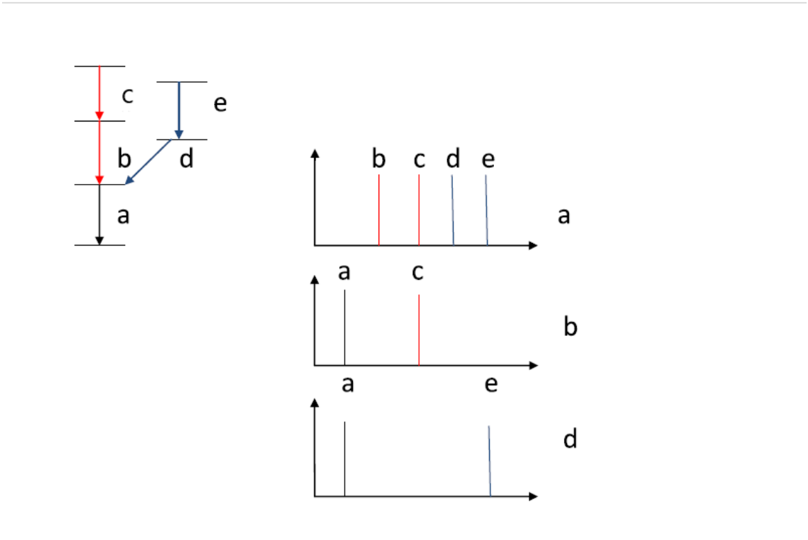

**Source:** PDF57 / 印46 · C004

**Original caption:** Figure 4.3: Schematic diagram showing coincidences between γ rays on the same decay path. The spectrum gated on transition a (top, right) shows all other transitions and indicates γ rays in coincidence with γ ray a. The spectrum gated on γ ray b (middle spectrum, right) shows only γ rays a and c as they are in coincident and belong to the same decay path. The spectrum gated on γ ray d shows only γ rays a and e as those are the transitions that are on the same decay path as d. The corresponding level scheme is drawn in the top left of the figure.

**中文图注:** 图4.3：同一衰变路径上γ射线符合关系的示意图。在跃迁a上设门所得的谱，位于右上，显示其余全部跃迁，并标出与γ射线a符合的γ射线。在γ射线b上设门所得的谱，位于右侧中间，仅显示γ射线a和c，因为它们与b符合并属于同一衰变路径。在γ射线d上设门所得的谱，仅显示γ射线a和e，因为它们位于d的同一衰变路径上。相应能级纲图绘于左上。

**页锚：PDF57 / 印46**

**Source:** PDF56 / 印45, PDF57 / 印46 · S020

**Original:** Coincident spectroscopy techniques such as γ-γ matrices, γ-γ-γ cubes, and so forth offer powerful tools to study the coincidence relationships of γ ray transitions, which in turn allow to build level schemes and give insight into the structure of the nucleus.

**中文:** γ–γ矩阵、γ–γ–γ立方体等符合谱学技术，是研究γ跃迁符合关系的有力工具，进而能够用于建立能级纲图并了解核结构。

### 4.7 γ跃迁的角关联

**Source:** PDF57 / 印46 · S021

**Original:** 4.7 Correlations of Gamma Ray Transitions

**中文:** 4.7 γ跃迁的角关联

#### 4.7.1 角分布

**Source:** PDF57 / 印46 · S022

**Original:** 4.7.1 Angular Distribution

**中文:** 4.7.1 角分布

**页锚：PDF58 / 印47**

**Source:** PDF57 / 印46, PDF58 / 印47 · S023

**Original:** Following HIFE reactions, the populated states are found to have their spins aligned perpendicular to the beam axis so that the emitted γ rays exhibit angular distributions depending upon their multipolarities and spins. Therefore, the measurement of angular distributions provides information on the γ ray multipolarities. The normalized empirical γ ray intensities at each angle are fitted to the Legendre expansion:

**中文:** HIFE反应后，被布居核态的自旋表现为垂直于束轴取向，因此所发射γ射线具有依赖于其多极性和自旋的角分布。所以，测量角分布可以提供γ射线多极性的信息。各角度处归一化的实验γ射线强度用下列勒让德展开进行拟合：

**Source:** PDF58 / 印47 · E003 · 原式(4.3)

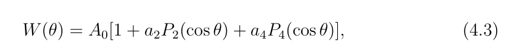

**中文说明:** 归一化实验强度所拟合的勒让德展开，保留原式。

*原件裁图回退；未另作LaTeX转写，公式只显示一次。*

**Source:** PDF58 / 印47 · S024

**Original:** where the Pi(cos θ) are the Legendre polynomials. The a2 and a4 coefficients are characteristic to the transitions and their mixing ratios δE2/M1:

**中文:** 其中$P_i(\cos\theta)$为勒让德多项式。系数$a_2$和$a_4$反映跃迁及其混合比$\delta_{E2/M1}$的特征：

**Source:** PDF58 / 印47 · E004 · 原式(4.4)

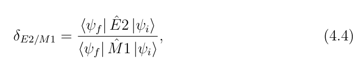

**中文说明:** 原文写出的E2/M1矩阵元比；未在译文中补入其它章节的能量或单位因子。

*原件裁图回退；未另作LaTeX转写，公式只显示一次。*

**Source:** PDF58 / 印47 · S025

**Original:** where |ψi⟩and ⟨ψf| are the initial and final states of the transitions, respectively. ˆE2 and ˆ M1 represent the electric quadruple and the magnetic dipole operators, respectively. The mixing ratios δE2/M1 represent the ratios of the relative matrix elements for E2 and M1 components for transitions with mixed M1+E2 multipolarity (see Chapter 3, equation 3.24).

**中文:** 其中$|\psi_i\rangle$和$\langle\psi_f|$分别表示跃迁的初态与末态。$\hat E2$和$\hat M1$分别表示电四极算符和磁偶极算符。对于M1+E2混合多极跃迁，混合比$\delta_{E2/M1}$表示E2和M1分量相对矩阵元的比值，参见第3章式3.24。

**Source:** PDF58 / 印47 · S026

**Original:** In practice in most fusion evaporation reaction experiments the nuclear spins are not fully aligned orthogonally with respect to the beam direction when the γ rays are emitted, which leads to some attenuation of the theoretical a2 and a4 coefficients. The attenuation is usually evaluated from the experimental data.

**中文:** 实际中，在大多数融合蒸发反应实验里，发射γ射线时的核自旋并未完全垂直于束流方向取向，因此理论$a_2$和$a_4$系数会受到一定衰减。这种衰减通常由实验数据评估。

#### 4.7.2 角关联

**Source:** PDF58 / 印47 · S027

**Original:** 4.7.2 Angular Correlations

**中文:** 4.7.2 角关联

**Source:** PDF58 / 印47 · S028

**Original:** Angular correlation measurements involve the determination of coincidence intensities for a cascade of two γ ray transitions detected in coincidence by two detectors at different angles. The multipolarity of an emitted γ ray can be obtained using the Directional Correlation from Oriented states (DCO) ratios (RDCO) [35, 37]. Such RDCO values can be extracted by sorting the data from all detectors into an asymmetric γ-γ matrix, constructed in such a way that coincidence events detected by the detectors mounted at one angle (say 90◦) are on one axis and those detected by a detector mounted at another angle (say 135◦) are on the other axis. The RDCO ratios are calculated using the γ ray intensities (Iγ) extracted from this matrix as:

**中文:** 角关联测量要确定由不同角度处的两台探测器符合探测到的两级γ级联的符合强度。可以利用取向态定向关联（Directional Correlation from Oriented states，DCO）比$R_{DCO}$确定所发射γ射线的多极性[35,37]。将全部探测器数据分选为非对称γ–γ矩阵，便可提取该比值：一个轴记录某角度探测器，例如90°，探测的符合事件，另一个轴记录另一角度探测器，例如135°，探测的事件。利用从该矩阵中提取的γ射线强度$I_\gamma$，按下式计算$R_{DCO}$：

**页锚：PDF59 / 印48**

**Source:** PDF59 / 印48 · E005 · 原式(4.5)

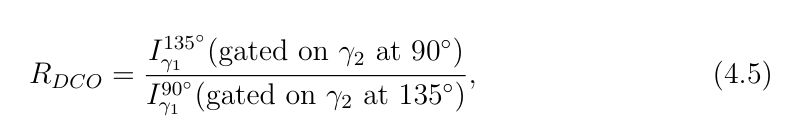

**中文说明:** DCO比的分子、分母具有互换的目标角与门角；保留原式。

*原件裁图回退；未另作LaTeX转写，公式只显示一次。*

**Source:** PDF59 / 印48 · S029

**Original:** where, I135◦ γ1 (gated on γ2 at 90◦) is the intensity of γ ray 1 at an angle of 135◦as seen from a gate set on γ ray 2 at an angle of 90◦, I90◦ γ1 (gated on γ2 at 135◦) is the intensity of γ ray 1 at an angle of 90◦as seen from a gate set on γ ray 2 at an angle of 135◦. For stretched quadrupole transitions, RDCO values of ≈1 are obtained and for stretched pure dipole transitions RDCO values are ≈0.5 when gating on stretched quadrupole transitions (that is γ2 is E2). When we gate on a stretched dipole transitions RDCO values of ≈1.0 are obtained for pure stretched dipoles while RDCO values of ≈2.0 are obtained for stretched quadrupole transitions.

**中文:** 其中，$I_{\gamma1}^{135^\circ}$（在90°探测的γ2上设门）是在90°的γ2上设门后得到的135°处γ1强度；$I_{\gamma1}^{90^\circ}$（在135°探测的γ2上设门）是在135°的γ2上设门后得到的90°处γ1强度。在伸展四极跃迁上设门，即γ2为E2时，伸展四极跃迁的$R_{DCO}\approx1$，伸展纯偶极跃迁的$R_{DCO}\approx0.5$。若在伸展偶极跃迁上设门，纯伸展偶极跃迁有$R_{DCO}\approx1.0$，伸展四极跃迁则有$R_{DCO}\approx2.0$。

**Source:** PDF59 / 印48 · S030

**Original:** The data on $^{133}$Ce, obtained with the AFRODITE array at iTL were analysed using angular distribution ratios,

**中文:** 使用角分布比分析iTL的AFRODITE阵列获得的$^{133}$Ce数据：

**Source:** PDF59 / 印48 · E006 · 原式(4.6)

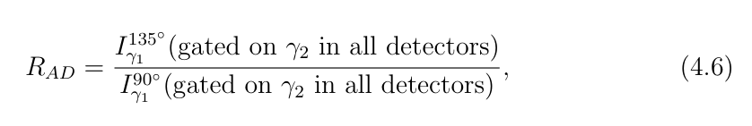

**中文说明:** 目标γ的两个角度强度相除，门γ在全部探测器中选取；保留原式。

*原件裁图回退；未另作LaTeX转写，公式只显示一次。*

**Source:** PDF59 / 印48 · S031

**Original:** where I135◦ γ1 is the intensity of γ ray 1 at an angle of 135◦, when a gate is set on γ ray 2, where this γ ray is detected in all detectors. Similarly, I90◦ γ1 corresponds to the intensity of γ ray 1 at an angle of 90◦, when a gate is set on γ ray 2, where this γ ray is detected in all detectors.

**中文:** 其中$I_{\gamma1}^{135^\circ}$是在γ2上设门后得到的135°处γ1强度，γ2由全部探测器探测。同样，$I_{\gamma1}^{90^\circ}$是在γ2上设门后得到的90°处γ1强度，门γ2也由全部探测器探测。

**Source:** PDF59 / 印48 · S032

**Original:** The RAD values do not depend on the multipolarity of the gated γ ray. For the AFRODITE array, the values obtained were RAD ∼1.3 for stretched quadrupole transitions and RAD ∼0.8 for stretched dipole transitions. The angular distribution analysis for $^{133}$Ce and the spin and parity assignments for the new levels were carried out by our Chinese collaborators. The experimental results for $^{133}$Ce and $^{131}$Ba are presented in Chapter 5.

**中文:** $R_{AD}$不依赖门γ射线的多极性。对AFRODITE阵列，伸展四极跃迁得到$R_{AD}\sim1.3$，伸展偶极跃迁得到$R_{AD}\sim0.8$。$^{133}$Ce的角分布分析以及新能级的自旋宇称指定由我们的中国合作人员完成。第5章给出$^{133}$Ce和$^{131}$Ba的实验结果。

**页锚：PDF60 / 印49**

## 第5章 实验结果

**Source:** PDF60 / 印49 · S033

**Original:** Chapter 5 Results

**中文:** 第5章 实验结果

### 5.1 引言

**Source:** PDF60 / 印49 · S034

**Original:** 5.1 Introduction

**中文:** 5.1 引言

**Source:** PDF60 / 印49 · S035

**Original:** Theoretical and experimental studies have shown that odd-N nuclei in the A ≈130 region present one of the richest regions across the nuclear chart to study exotic nuclear phenomena across extended spin ranges. Nuclear triaxiality is one such phenomenon, which results when there is unequal density distribution across the three intrinsic nuclear axes.

**中文:** 理论和实验研究表明，$A\approx130$区的奇中子数原子核，是整个核素图中在较大自旋范围研究奇特核现象最丰富的区域之一。核三轴性就是其中一种现象：沿原子核三个内禀主轴的密度分布不相等时，会出现三轴性。

**Source:** PDF60 / 印49 · S036

**Original:** This chapter presents the results obtained from two experiments. The first experiment was performed at the separated sector cyclotron of iThemba LABS in Cape Town, South Africa. The experiment populated high-spin states in $^{133}$Ce. In the second experiment excited states in $^{131}$Ba were populated via the fusion-evaporation $^{122}$Sn($^{13}$C, 4n)$^{131}$Ba reaction at the XTU Tandem accelerator of Laborotori Nazionali di Legnaro, Italy.

**中文:** 本章给出两个实验的结果。第一个实验在南非开普敦iThemba LABS的分离扇形回旋加速器上完成，布居了$^{133}$Ce的高自旋态。第二个实验在意大利Legnaro国家实验室的XTU串列加速器上，利用融合蒸发反应$^{122}$Sn($^{13}$C,4n)$^{131}$Ba布居了$^{131}$Ba的激发态。

**Source:** PDF60 / 印49 · S037

**Original:** The discussion of the results presented here is deferred to the next chapter.

**中文:** 本章所给结果的讨论留到下一章进行。

**页锚：PDF61 / 印50**

### 5.2 133Ce的结果

**Source:** PDF61 / 印50 · S038

**Original:** 5.2 $^{133}$Ce Results

**中文:** 5.2 133Ce的结果

#### 5.2.1 实验细节

**Source:** PDF61 / 印50 · S039

**Original:** 5.2.1 Experimental Details

**中文:** 5.2.1 实验细节

**Source:** PDF61 / 印50 · S040

**Original:** The experiment was performed at the separated sector cyclotron of iThemba LABS in Cape Town, South Africa. High-spin states in $^{133}$Ce were populated via the $^{125}$Te($^{12}$C, 4n) $^{133}$Ce at a beam energy of 57 MeV and an intensity of 5 pnA. The target was an isotopically enriched $^{125}$Te metallic foil with a thickness of 2 mg/cm² on an 8 mg/cm² gold backing. The γ rays emitted by the excited residual nuclei have been measured with the AFRODITE array [54, 68] which consists of thirteen Compton-suppressed clover detectors arranged in three rings at 45◦(one clover), 90◦(eight clovers) and 135◦(four clovers) with respect to the beam direction. A total of $2.8\times10^{10}$ doubleand $5.4\times10^9$ tripleand higher coincidence events were collected and sorted into twoand three-dimensional matrices for off-line analysis by our Chinese collaborators. However the data analysis is part of the present work, and it was carried out using the RADWARE software package [60].

**中文:** 实验在南非开普敦iThemba LABS的分离扇形回旋加速器上进行。利用$^{125}$Te($^{12}$C,4n)$^{133}$Ce反应，在57 MeV束流能量和5 pnA束流强度下布居$^{133}$Ce的高自旋态。靶为厚度2 mg/cm²、同位素富集的$^{125}$Te金属箔，置于8 mg/cm²的金背衬上。用AFRODITE阵列[54,68]测量激发剩余核发射的γ射线；该阵列由13个带康普顿抑制的Clover探测器组成，相对束流方向分为三个环：45°处1个、90°处8个、135°处4个。共采集$2.8\times10^{10}$个双重符合事件和$5.4\times10^9$个三重及更高重数符合事件，由我们的中国合作人员分选为二维与三维矩阵，供离线分析。数据分析属于本工作的一部分，并使用RADWARE软件包[60]完成。

#### 5.2.2 133Ce的实验结果

**Source:** PDF61 / 印50 · S041

**Original:** 5.2.2 $^{133}$Ce Experimental Results

**中文:** 5.2.2 133Ce的实验结果

**Source:** PDF61 / 印50 · S042

**Original:** In this work the γ-γ coincidence matrix for the $^{133}$Ce data were analysed. The deduced level scheme of $^{133}$Ce is shown in Figure 5.1. The ordering of transitions within the proposed level scheme is based on γ-ray coincidences and their relative intensities. A number of new transition were identified. The experimental results will be discussed in two sections, one for the negative-parity bands and the other for the positive-parity bands.

**中文:** 本工作分析了$^{133}$Ce数据的γ–γ符合矩阵。得到的$^{133}$Ce能级纲图如图5.1所示。拟定纲图中跃迁的先后次序依据γ射线符合关系和相对强度确定，并识别出若干新跃迁。实验结果分为负宇称带和正宇称带两部分讨论。

##### 图5.1 · 133Ce部分能级纲图

**Placed near:** S042；原图/表来源PDF65 / 印54，裁图未改数字。

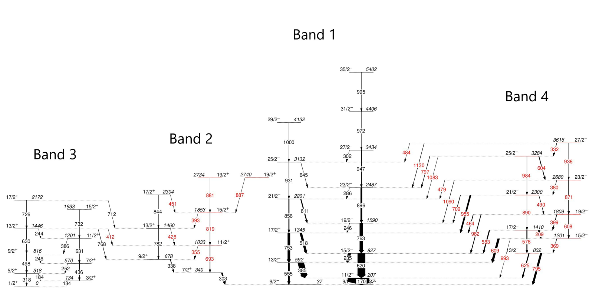

**Source:** PDF65 / 印54 · C005

**Original caption:** Figure 5.1: A partial level scheme deduced for $^{133}$Ce from this work. The width of the arrows is proportional to the relative intensity (normalized to the 170 keV transition). Energies are labelled in keV, new levels and new transitions are marked in red, while known transitions are shown in black.

**中文图注:** 图5.1：本工作得到的$^{133}$Ce部分能级纲图。箭头宽度与相对强度成正比，强度归一到170 keV跃迁。能量单位为keV。新能级与新跃迁以红色标出，已知跃迁以黑色标出。

#### 5.2.2.1 负宇称带

**Source:** PDF61 / 印50 · S043

**Original:** 5.2.2.1 The Negative-Parity Bands

**中文:** 5.2.2.1 负宇称带

##### Band 1

**Source:** PDF61 / 印50 · S044

**Original:** Band 1

**中文:** Band 1

**页锚：PDF62 / 印51**

**Source:** PDF61 / 印50, PDF62 / 印51 · S045

**Original:** This negative-parity band structure has been previously identified in Refs. [7, 47, 52]. It constitutes the yrast band, a sequence of rotational states with the least amount of excitation energy for a given spin. It is built on the $I^\pi=9/2^-$state and extends up to the $I^\pi=35/2^-$state. Band 1 is based on a neutron hole in the $\nu h_{11/2}$ sub-shell that is coupled to a rotating triaxial core. The γ-ray energies, relative intensities, spins and parities for the intraband transitions in Band 1 are listed in Table 5.1 and the corresponding level scheme is shown in Figure 5.1. No new transitions were found for Band 1.

**中文:** 该负宇称带结构已在文献[7,47,52]中识别。它构成yrast带，即对给定自旋具有最低激发能的一系列转动态。该带建立在$I^\pi=9/2^-$态上，延伸至$I^\pi=35/2^-$。Band 1以$\nu h_{11/2}$子壳层中的一个中子空穴为基础，该空穴与旋转的三轴核芯耦合。表5.1列出了Band 1带内跃迁的γ能量、相对强度、自旋和宇称，相应能级纲图见图5.1。本工作没有在Band 1中发现新跃迁。

##### 表5.1 · 133Ce yrast Band 1的跃迁

**Placed near:** S045；原图/表来源PDF66 / 印55，裁图未改数字。

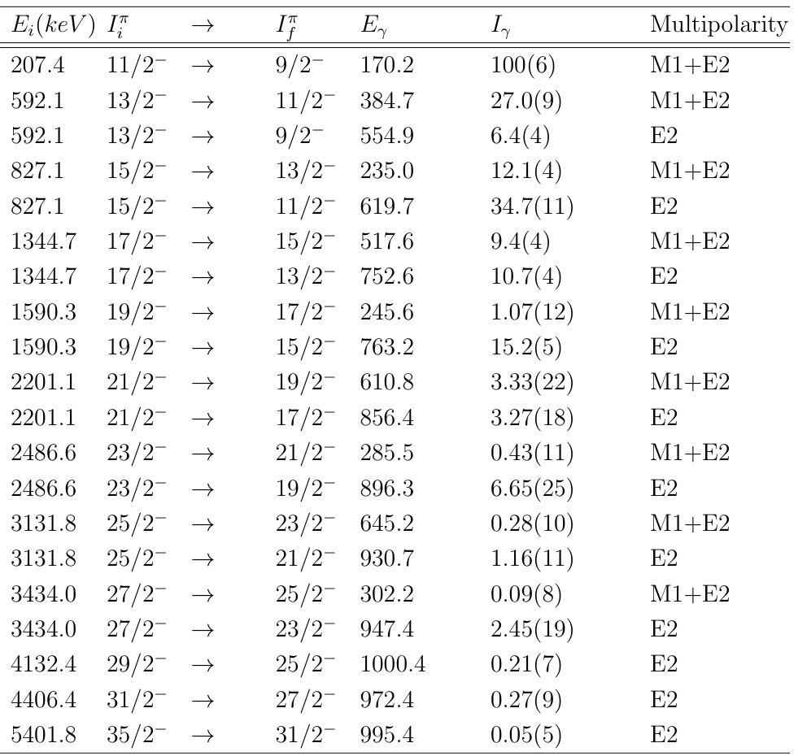

**Source:** PDF66 / 印55 · C006

**Original caption:** Table 5.1: Transitions in the yrast band (Band 1) of $^{133}$Ce. Gamma-ray energies, relative intensities, spins and parities for the intraband M1+E2 and the E2 transitions assigned to Band 1 are presented where the intensities are given relative to that of the 170- keV transition. The error on the transition energies is within 0.3 keV for transitions with Iγ ≥10 and up to 0.7 keV for transitions with Iγ < 10.

**中文图注:** 表5.1：$^{133}$Ce yrast带Band 1中的跃迁。表中列出归属于Band 1的带内M1+E2和E2跃迁的γ能量、相对强度、自旋与宇称，强度均相对于170 keV跃迁给出。对于$I_\gamma\ge10$的跃迁，跃迁能量误差在0.3 keV以内；对于$I_\gamma<10$的跃迁，能量误差最高为0.7 keV。

**表头对照：** Ei(keV)：初态能量；Iπi→Iπf：初末态自旋宇称；Eγ：γ能量；Iγ：相对γ强度；Multipolarity：多极性。原数值、空缺横线及误差均以裁图为准。

##### Band 4

**Source:** PDF62 / 印51 · S046

**Original:** Band 4

**中文:** Band 4

**Source:** PDF62 / 印51 · S047

**Original:** All intraband transitions of Band 4 are new and they constitute a new band, see Figure 5.1. The lowest observed state in the band is the $I^\pi=13/2^-$state and the band was extended up to $I^\pi=27/2^-$. The new transitions were observed in the AFRODITE data. Six intraband E2 transitions with energies of 578, 608, 890, 871, 984, and 936 keV and six new intraband M1+E2 transitions with energies of 369, 209, 399, 490, 380, 604 and 332 keV were observed in this work. In addition, seven new interband E2 transitions with energies of 795, 993, 982, 955, 1090, 1083, and 1130 keV and eight interband M1+E2 transitions with energies of 625, 609, 583, 464, 709, 479, 797 and 484 keV were observed to feed into the yrast band (Band 1). Experimental information about the transitions in this band are presented in Table. 5.2. In Figure 5.2, spectra gated on the 608-, 871-, 936- and 795- keV transitions are presented to illustrate the transitions of Band 4.

**中文:** Band 4的全部带内跃迁都是新发现的，并构成一条新带，见图5.1。该带观测到的最低态为$I^\pi=13/2^-$，向上延伸到$I^\pi=27/2^-$。这些新跃迁在AFRODITE数据中被观测到。本工作观测到了6条带内E2跃迁，能量为578、608、890、871、984和936 keV，以及6条新的带内M1+E2跃迁，所列能量为369、209、399、490、380、604和332 keV。此外，还观测到7条新的带间E2跃迁，能量为795、993、982、955、1090、1083和1130 keV，以及8条带间M1+E2跃迁，能量为625、609、583、464、709、479、797和484 keV；它们馈入yrast带Band 1。该带跃迁的实验信息见表5.2。图5.2给出了分别在608、871、936和795 keV跃迁上设门的能谱，以展示Band 4的跃迁。

##### 表5.2 · 133Ce Band 4的跃迁

**Placed near:** S047；原图/表来源PDF67 / 印56，裁图未改数字。

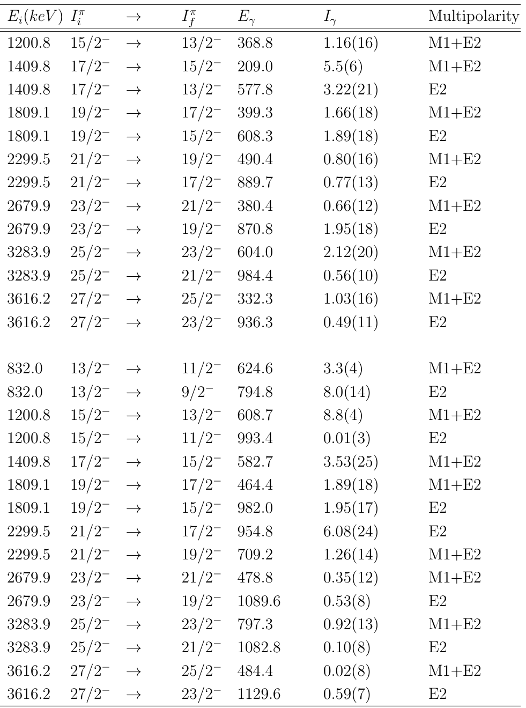

**Source:** PDF67 / 印56 · C007

**Original caption:** Table 5.2: Transitions in Band 4 of $^{133}$Ce. Gamma-ray energies, relative intensities, spins and parities for the transitions assigned to Band 4 (where the intensities are given relative to the 170- keV transition of Band 1). The error on the transition energies is within 0.3 keV for transitions with energies below 1000 keV and up to 0.5 keV for transitions with energies above 1000 keV.

**中文图注:** 表5.2：$^{133}$Ce Band 4中的跃迁。表中列出归属于Band 4的跃迁的γ能量、相对强度、自旋与宇称；强度相对于Band 1的170 keV跃迁给出。对能量低于1000 keV的跃迁，跃迁能量误差在0.3 keV以内；对能量高于1000 keV的跃迁，误差最高为0.5 keV。

**表头对照：** Ei(keV)：初态能量；Iπi→Iπf：初末态自旋宇称；Eγ：γ能量；Iγ：相对γ强度；Multipolarity：多极性。原数值、空缺横线及误差均以裁图为准。

##### 图5.2 · 133Ce Band 4的四组门谱

**Placed near:** S047；原图/表来源PDF68 / 印57，裁图未改数字。

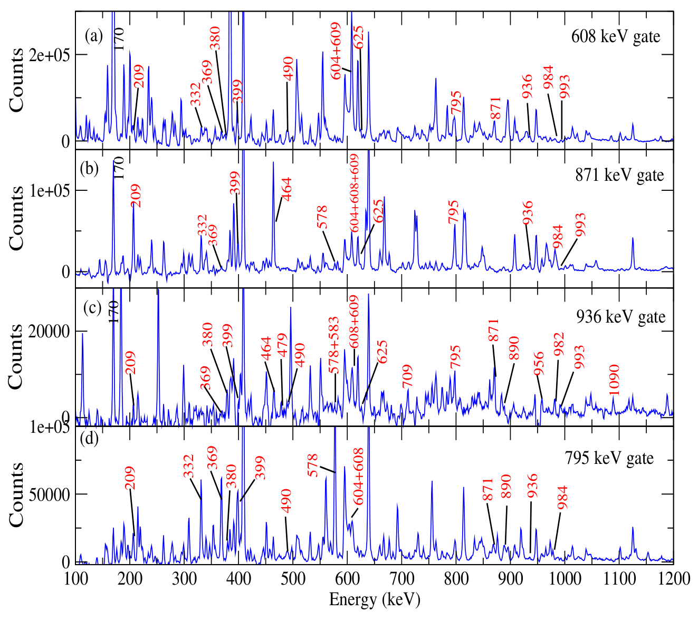

**Source:** PDF68 / 印57 · C008

**Original caption:** Figure 5.2: Spectra gated on (a) the 608- , (b) 870- , (c) 936- , and (d) 795- keV transitions of Band 4. New transitions and new levels are shown in red. Known transitions and levels are shown in black.

**中文图注:** 图5.2：分别在Band 4的(a)608、(b)870、(c)936和(d)795 keV跃迁上设门得到的能谱。新跃迁与新能级以红色标出，已知跃迁与能级以黑色标出。

**Source:** PDF62 / 印51 · S048

**Original:** See panel (b) of Figure 5.2, for instance when we gate on 871- keV we do not ’see’ the 490- and 380- keV transitions, but we ’see’ the 490- and 380- keV transitions if we gate on 936- keV they show, therefore, the 490- and 380- keV transitions are in coincidence with the 936- keV transition, but anti-coincidence with the 871- keV transition, so they are placed in parallel to the 871- keV transition.

**中文:** 例如看图5.2(b)，在871 keV上设门时看不到490和380 keV跃迁，但在936 keV上设门时可以看到它们。因此，490和380 keV跃迁与936 keV跃迁符合，与871 keV跃迁反符合，所以将它们放置在与871 keV跃迁平行的退激支路中。

**页锚：PDF63 / 印52**

**Source:** PDF62 / 印51, PDF63 / 印52 · S049

**Original:** Two transitions with very similar energies of 608 keV and 609 keV were placed in Band 4. When a gate is set on the 608 keV transition linking the 19/2−and the 15/2−states of Band 4, the resulting spectrum consists of all γ rays in coincidence with transitions in the energy range of 607 to 609 keV. Similarly, when a gate is set on the 609 keV transition linking the 15/2−state of Band 4 with the 13/2−state of Band 1, the resulting spectra consists of all γ rays in coincidence with transitions in the energy range of 608 to 610 keV. The pair (608, 609) is in coincident, that is they lie on the same decay path. Because the two transitions have an overlapping energy range when gated on such a pair is known as a ’doublet’ transition. Panel (a) of Figure 5.2 shows the spectrum when a gate is set on the 608- keV transition. The 608- keV γ ray ’sees’ the 609- keV transition. The 608 keV gate also ’sees’ the 209- and 399- keV transitions in the gated spectra, this may appear puzzling, because the 209- and 399- keV transitions are placed in a parallel decay branch with the 608- keV transition in Figure 5.1. This becomes easy to understand when one recalls that the 608- and 609- keV transitions are a doublet pair, thus the 209- and 399- keV transitions observed in this gate are in coincidence, not with the 608- keV transition, but rather the 609- keV transition.

**中文:** Band 4中放置了两条能量十分接近的跃迁，分别为608和609 keV。在连接Band 4中$19/2^-$与$15/2^-$态的608 keV跃迁上设门时，所得能谱包含与607–609 keV能区内跃迁符合的全部γ射线。同样，在连接Band 4中$15/2^-$态与Band 1中$13/2^-$态的609 keV跃迁上设门时，所得能谱包含与608–610 keV能区内跃迁符合的全部γ射线。608和609 keV这一对跃迁彼此符合，也就是位于同一衰变路径上。由于在它们上设门时所覆盖的能量区间相互重叠，这样的一对跃迁称为双峰跃迁（doublet）。图5.2(a)给出了在608 keV跃迁上设门的能谱。608 keV γ射线“看到”609 keV跃迁。608 keV门谱里还“看到”209和399 keV跃迁，这似乎令人困惑，因为图5.1中209和399 keV跃迁被放在与608 keV跃迁平行的衰变支路上。回想608和609 keV构成双峰就容易理解：这一门谱中观测到的209和399 keV跃迁实际上与609 keV跃迁符合，而不是与608 keV跃迁符合。

**Source:** PDF63 / 印52 · S050

**Original:** The gate set on the 936- keV transition shown in panel (c) of Figure 5.2 ’sees’, all intraband transitions except the 332-, 604 and 984- keV transitions because the three transitions are in parallel. The 936 keV gate also ’sees’ all linking interband transitions except for the 484-, 1130-, 797, and 1083 keV transitions, thus the gated spectra doesn’t contain them because all they are anti-coincident.

**中文:** 图5.2(c)中的936 keV门“看到”除332、604和984 keV之外的全部带内跃迁；这3条跃迁处于平行支路。936 keV门也“看到”除484、1130、797和1083 keV之外的所有带间连接跃迁；这些例外跃迁都与门跃迁反符合，因此门谱中不包含它们。

**Source:** PDF63 / 印52 · S051

**Original:** The gate set on the 795- keV transition shown in panel (d) of Figure 5.2 ’sees’ all intraband transitions as this transition is one of the two transitions (the other is the 625 keV transition) that depopulates the band head state of 13/2−which is linked to all the levels in Band 4. However, the spectra resulting from the 795 keV gate does not see any linking transitions between Band 4 and Band 1 because it is in parallel to all of them.

**中文:** 图5.2(d)中的795 keV门“看到”全部带内跃迁，因为该跃迁是使$13/2^-$带头态退激的两条跃迁之一，另一条为625 keV，而这一带头态与Band 4的全部能级相连。然而，795 keV门谱看不到Band 4与Band 1之间的任何连接跃迁，因为795 keV跃迁与这些连接跃迁均处于平行支路。

#### 5.2.2.2 正宇称带

**Source:** PDF63 / 印52 · S052

**Original:** 5.2.2.2 The Positive-Parity Bands

**中文:** 5.2.2.2 正宇称带

##### Band 2

**Source:** PDF63 / 印52 · S053

**Original:** Band 2

**中文:** Band 2

**Source:** PDF63 / 印52 · S054

**Original:** The 844- and 782 keV transitions that form the positive-signature branch ($\alpha=+1/2$) of Band 2 were previously identified (as band Q1 in Ref. [7]). This sequence was found to decay to the 340- keV level with, $I^\pi=7/2^+$, state via a dipole transition of 338 keV. In this work, this band structure is extended and a further four intraband E2 transitions with energies of 693, 819, 881 and 887 keV, forming the negative-signature branch ($\alpha=-1/2$) of Band 2, and four M1+E2 transitions with energies of 355, 426, 393, and 451 keV connecting the signature partners, were observed. In addition, an interband M1+E2 transition of 412 keV from Band 3 was also observed. Table 5.3 presents experimental details on the transitions of this band observed in this work.

**中文:** 构成Band 2正旋称支$\alpha=+1/2$的844和782 keV跃迁此前已被识别，在文献[7]中称为Q1带。该序列通过一条338 keV偶极跃迁退激到能量340 keV、$I^\pi=7/2^+$的能级。本工作扩展了该带结构，进一步观测到4条带内E2跃迁，能量为693、819、881和887 keV，构成Band 2的负旋称支$\alpha=-1/2$；还观测到4条连接旋称伙伴的M1+E2跃迁，能量为355、426、393和451 keV。此外，还观测到一条来自Band 3的412 keV带间M1+E2跃迁。表5.3给出了本工作观测到的该带跃迁的实验细节。

##### 表5.3 · 133Ce Band 2的跃迁

**Placed near:** S054；原图/表来源PDF69 / 印58，裁图未改数字。

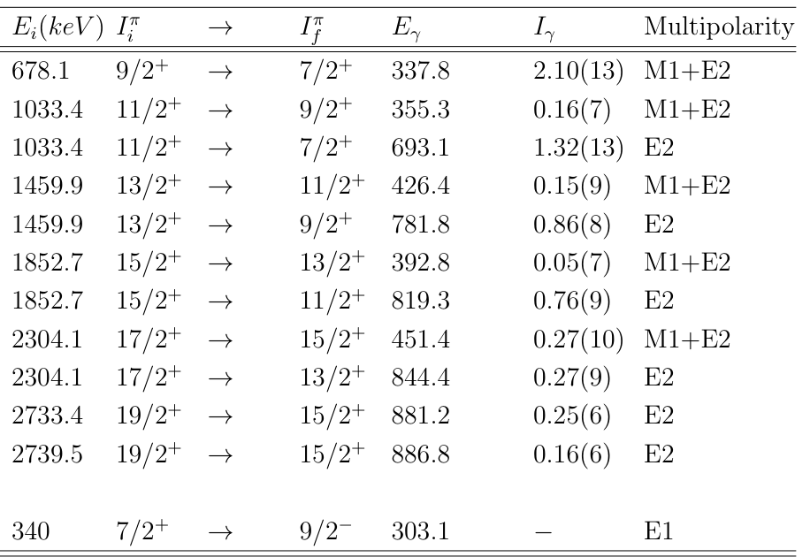

**Source:** PDF69 / 印58 · C009

**Original caption:** Table 5.3: Transitions in Band 2 of $^{133}$Ce. Gamma-ray energies, relative intensities, spins and parities for the transitions assigned to Band 2 (where the intensities are given relative to the 170- keV transition of Band 1). The error on the transition energies is within 0.3 keV for transitions with energies below 1000 keV and up to 0.5 keV for transitions with energies above 1000 keV.

**中文图注:** 表5.3：$^{133}$Ce Band 2中的跃迁。表中列出归属于Band 2的跃迁的γ能量、相对强度、自旋与宇称；强度相对于Band 1的170 keV跃迁给出。对能量低于1000 keV的跃迁，跃迁能量误差在0.3 keV以内；对能量高于1000 keV的跃迁，误差最高为0.5 keV。

**表头对照：** Ei(keV)：初态能量；Iπi→Iπf：初末态自旋宇称；Eγ：γ能量；Iγ：相对γ强度；Multipolarity：多极性。原数值、空缺横线及误差均以裁图为准。

**页锚：PDF64 / 印53**

**Source:** PDF63 / 印52, PDF64 / 印53 · S055

**Original:** In Figure 5.3, spectra gated on the 303-, 693-, 819- and 338- keV transitions are presented to illustrate the transitions of Band 2. The 303- keV transition is a known transition, and can be seen in panel (a) of Figure 5.3, it is in coincidence with all other γ-ray transitions in this band as it is the main channel to depopulate Band 2. The 693- keV transition is in coincident with the 303- keV transition, however it is anti-coincident with the 338- and 355- keV transitions (see panel (b) of Figure 5.3) and is therefore placed in a parallel branch to the 338- and 355- keV γ rays. Similarly, the 393- and 426- keV transitions are in parallel branch to the 819- keV transition as these transitions are absent in the spectra gated on the 819- keV transition (see panel (c) of Figure 5.3).

**中文:** 图5.3给出了分别在303、693、819和338 keV跃迁上设门的能谱，用于展示Band 2的跃迁。303 keV是已知跃迁，在图5.3(a)中可见；它是Band 2的主要退激通道，因此与该带其余全部γ跃迁符合。693 keV跃迁与303 keV跃迁符合，但与338和355 keV跃迁反符合，见图5.3(b)，因而被放在与338、355 keV γ跃迁平行的支路上。同样，在819 keV上设门的能谱中看不到393和426 keV跃迁，见图5.3(c)，因此将这两条跃迁放在与819 keV跃迁平行的支路上。

##### 图5.3 · 133Ce Band 2的四组门谱

**Placed near:** S055；原图/表来源PDF70 / 印59，裁图未改数字。

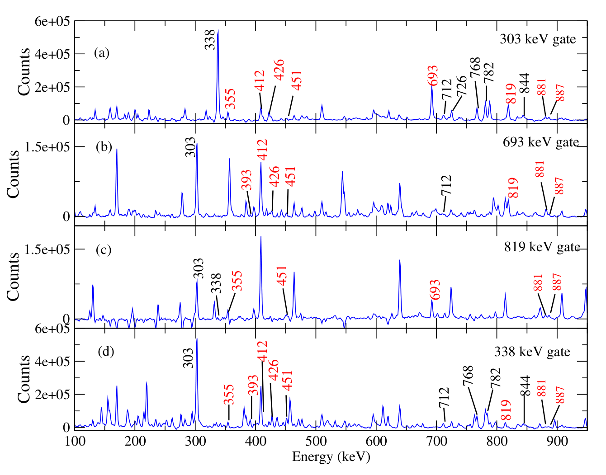

**Source:** PDF70 / 印59 · C010

**Original caption:** Figure 5.3: Spectra gated on (a) the 303-, (b) 693-, (c) 819-, and (d) 338- keV, illustrating the transitions of Band 2. New transitions and new levels are shown in red. Known transitions and levels are shown in black.

**中文图注:** 图5.3：分别在(a)303、(b)693、(c)819和(d)338 keV处设门得到的能谱，用以展示Band 2的跃迁。新跃迁与新能级以红色标出，已知跃迁与能级以黑色标出。

##### Band 3

**Source:** PDF64 / 印53 · S056

**Original:** Band 3

**中文:** Band 3

**Source:** PDF64 / 印53 · S057

**Original:** Band 3 is built on the $I^\pi=1/2^+$ ground state. It was first reported in Ref [47]. The 318-, 498-, 630- and 726- keV transitions make up the positive-signature branch of the band, while the 436-, 631-, and 732- keV transitions form the negativesignature branch of Band 3. These two branches are interlinked by the 134-, 184-, 252-, 246-, 386- and 244- keV transitions. Two interband E2 transitions with energies of 712 and 768 keV feed into Band 2 [7]. A new 412- keV M1+E2 transition link the $I^\pi=13/2^+$ state of Band 3 to the $I^\pi=11/2^+$ state of Band 2. Table 5.4 presents the transitions observed.

**中文:** Band 3建立在$I^\pi=1/2^+$基态上，最初发表于文献[47]。318、498、630和726 keV跃迁组成该带的正旋称支，436、631和732 keV跃迁组成负旋称支。两个旋称支由134、184、252、246、386和244 keV跃迁相互连接。两条能量为712和768 keV的带间E2跃迁馈入Band 2[7]。一条新的412 keV M1+E2跃迁把Band 3的$I^\pi=13/2^+$态连接到Band 2的$I^\pi=11/2^+$态。表5.4列出了观测到的跃迁。

##### 表5.4 · 133Ce Band 3的跃迁

**Placed near:** S057；原图/表来源PDF71 / 印60，裁图未改数字。

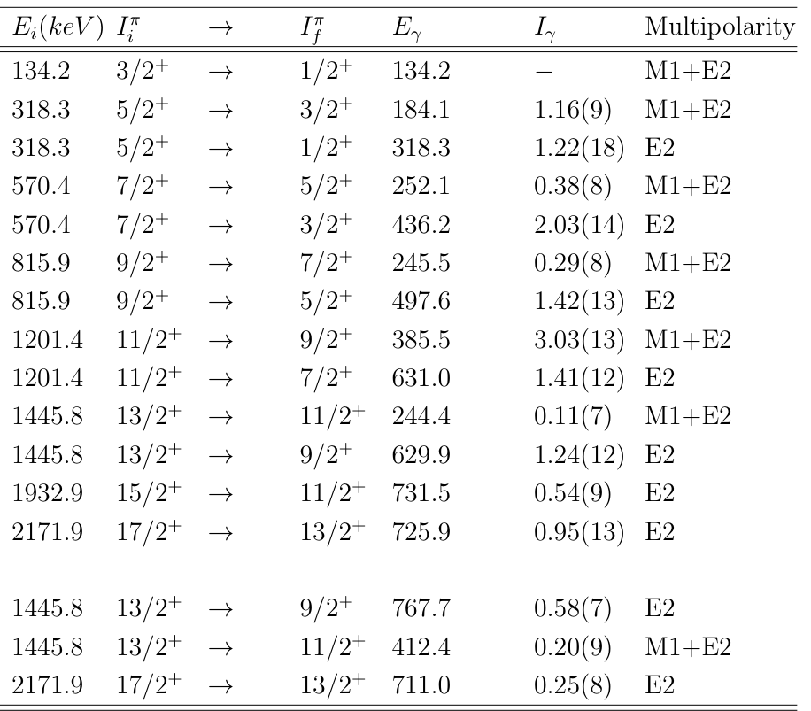

**Source:** PDF71 / 印60 · C011

**Original caption:** Table 5.4: Transitions in Band 3 of $^{133}$Ce. Gamma-ray energies, relative intensities, spins and parities for the transitions assigned to Band 3 (where the intensities are given relative to the 170- keV transition of Band 1). The error on transition energies is within 0.3 keV for transitions with energies below 1000 keV and up to 0.5 keV for transitions with energies above 1000 keV.

**中文图注:** 表5.4：$^{133}$Ce Band 3中的跃迁。表中列出归属于Band 3的跃迁的γ能量、相对强度、自旋与宇称；强度相对于Band 1的170 keV跃迁给出。对能量低于1000 keV的跃迁，跃迁能量误差在0.3 keV以内；对能量高于1000 keV的跃迁，误差最高为0.5 keV。

**表头对照：** Ei(keV)：初态能量；Iπi→Iπf：初末态自旋宇称；Eγ：γ能量；Iγ：相对γ强度；Multipolarity：多极性。原数值、空缺横线及误差均以裁图为准。

**页锚：PDF72 / 印61**

### 5.3 131Ba的结果

**Source:** PDF72 / 印61 · S058

**Original:** 5.3 $^{131}$Ba Results

**中文:** 5.3 131Ba的结果

#### 5.3.1 实验细节

**Source:** PDF72 / 印61 · S059

**Original:** 5.3.1 Experimental Details

**中文:** 5.3.1 实验细节

**Source:** PDF72 / 印61 · S060

**Original:** In this experiment excited states in $^{131}$Ba were populated via the fusion-evaporation $^{122}$Sn($^{13}$C, 4n)$^{131}$Ba reaction. A 65 MeV , $^{13}$C beam with an intensity of 5 pnA was provided by the XTU Tandem accelerator at the Laborotori Nazionali di Legnaro, Italy. The target was a stack of two self-supported $^{122}$Sn foils with a thickness of 0.5 mg/cm² each. The emitted γ-rays were detected with the GALILEO spectrometer, which consists of 25 Compton suppressed HPGe detectors, placed on four rings at 90◦(10 detectors), 119◦(5 detectors), 129◦(5 detectors), and 152◦(5 detectors). The EUCLIDES [8] silicon ball was used to detect charged particles, while neutrons were detected by the Neutron Wall array [43] in order to separate the different reaction channels.

**中文:** 本实验利用融合蒸发反应$^{122}$Sn($^{13}$C,4n)$^{131}$Ba布居$^{131}$Ba的激发态。意大利Legnaro国家实验室的XTU串列加速器提供能量65 MeV、强度5 pnA的$^{13}$C束流。靶由两层自支撑$^{122}$Sn箔叠成，每层厚度0.5 mg/cm²。所发射γ射线由GALILEO谱仪探测；该谱仪由25个带康普顿抑制的HPGe探测器组成，分布在4个角度环上：90°处10个，119°处5个，129°处5个，152°处5个。采用EUCLIDES硅球[8]探测带电粒子，采用Neutron Wall阵列[43]探测中子，以区分不同反应道。

**Source:** PDF72 / 印61 · S061

**Original:** Using the GALILEO data acquisition system [13], a total of $1.2\times10^9$ tripleor higher fold events were recorded. Doppler correction was performed on the γ spectra and the coincidence γγγ events were sorted into a three dimensional cube. The data analysis of this experiment was carried out using the RADWARE and GASPware software packages by our Chinese collaborators. The experimental results are presented in this section. The theoretical calculations that were used to interpret these results are part of the present work and they are presented in Chapter 6.

**中文:** 使用GALILEO数据获取系统[13]，共记录$1.2\times10^9$个三重及更高符合重数事件。对γ能谱进行多普勒校正，并将γγγ符合事件分选为三维立方体。本实验数据由我们的中国合作人员使用RADWARE与GASPware软件包分析。本节给出实验结果，用于解释这些结果的理论计算属于本工作的一部分，并在第6章给出。

#### 5.3.2 131Ba的实验结果

**Source:** PDF72 / 印61 · S062

**Original:** 5.3.2 $^{131}$Ba Experimental Results

**中文:** 5.3.2 131Ba的实验结果

**Source:** PDF72 / 印61 · S063

**Original:** The deduced partial level scheme for $^{131}$Ba is presented in Figure 5.4. The ordering of the transitions within the proposed level scheme is based on γ-ray coincidences. The arrow thickness represents the relative intensities of the γ rays. The experimental results will be discussed in two sections, one for the negative-parity yrast band (Band 1) and one for the two-positive parity bands (Band 2 and Band 3). A number of new transitions were identified and placed in the $^{131}$Ba level scheme.

**中文:** 得到的$^{131}$Ba部分能级纲图见图5.4。所提出能级纲图中跃迁的先后次序依据γ射线符合关系确定，箭头的粗细表示γ射线的相对强度。实验结果分两部分讨论：负宇称yrast带Band 1，以及两条正宇称带Band 2和Band 3。若干新跃迁被识别并放入$^{131}$Ba能级纲图。

##### 图5.4 · 131Ba部分能级纲图

**Placed near:** S063；原图/表来源PDF73 / 印62，裁图未改数字。

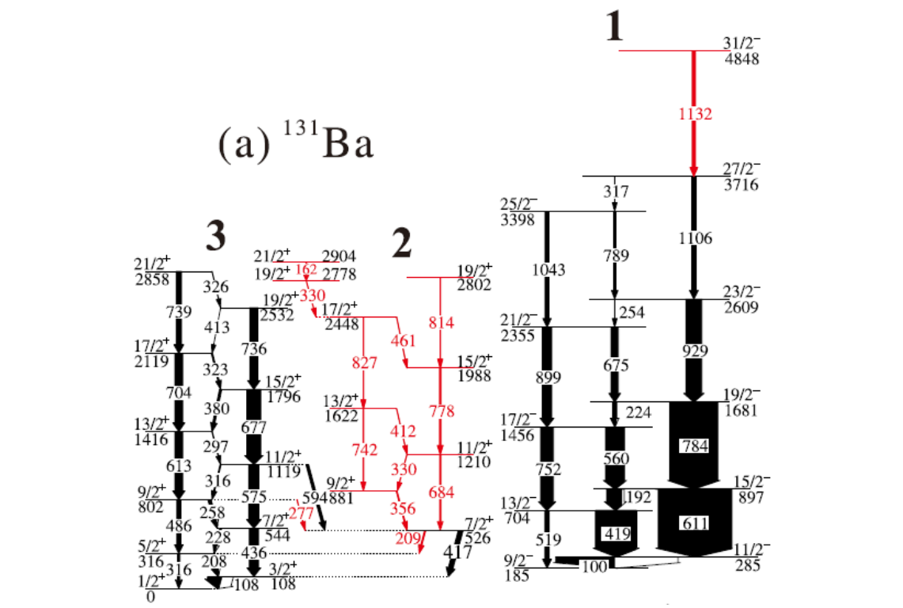

**Source:** PDF73 / 印62 · C012

**Original caption:** Figure 5.4: Partial level scheme of $^{131}$Ba. The arrows indicate relative intensities. New transitions are marked in red.

**中文图注:** 图5.4：$^{131}$Ba部分能级纲图。箭头表示相对强度，新跃迁以红色标出。

**页锚：PDF73 / 印62**

#### 5.3.2.1 负宇称带

**Source:** PDF73 / 印62 · S064

**Original:** 5.3.2.1 The Negative-Parity Band

**中文:** 5.3.2.1 负宇称带

##### Band 1

**Source:** PDF73 / 印62 · S065

**Original:** Band 1

**中文:** Band 1

**Source:** PDF73 / 印62 · S066

**Original:** This negative-parity band structure was observed in a prior work and is built on the $I^\pi=9/2^-$state [46]. States in this band were established up to the $I^\pi=27/2^-$ state. In this experiment a new quadrupole transition feeding into the $I^\pi=27/2^-$ with γ-ray energy of 1132 keV was found. The $\alpha=+1/2$ signature branch of this band consist of the 519-, 752-, 899- and 1043- keV quadrupole transitions. The 611-, 748-, 929-, 1106- and 1132-keV quadrupole transitions form the $\alpha=-1/2$ signature branch of the band. The 100-, 419-, 192-, 560-, 224-, 675-, 254-, 789- and 317- keV dipole transitions interlink the two signature branches of Band 1.

**中文:** 该负宇称带结构已在此前工作中观测到，建立在$I^\pi=9/2^-$态上[46]，该带核态此前已建立至$I^\pi=27/2^-$。本实验发现一条新的四极跃迁，γ能量为1132 keV，馈入$I^\pi=27/2^-$态。该带$\alpha=+1/2$旋称支由519、752、899和1043 keV四极跃迁构成。611、748、929、1106和1132 keV四极跃迁构成$\alpha=-1/2$旋称支。100、419、192、560、224、675、254、789和317 keV偶极跃迁连接Band 1的两个旋称支。

**页锚：PDF74 / 印63**

#### 5.3.2.2 正宇称带

**Source:** PDF74 / 印63 · S067

**Original:** 5.3.2.2 The Positive-Parity Bands

**中文:** 5.3.2.2 正宇称带

##### Band 2

**Source:** PDF74 / 印63 · S068

**Original:** Band 2

**中文:** Band 2

**Source:** PDF74 / 印63 · S069

**Original:** Band 2 is a new band, deduced in the experiment. The band is built on the $I^\pi=7/2^+$ state with an excitation energy of 526 keV and was established in prior works [46, 69]. This assignment was proposed based on the quadrupole character of the 417- keV transition to the $I^\pi=3/2^+$ state of the ground-state band (Band 3). This structure consists of seven levels, three quadrupole transitions with γ-ray energies of 684, 778, and 814 keV were found forming the $\alpha=-1/2$ signature branch. The $\alpha=+1/2$ signature branch of the band consists of the 742 and 827- keV transitions. The two signature branches are connected by the 356-, 330-, 412- and 461- keV dipole transitions. In addition, Band 2 is connected to a new structure, for which two new levels were deduced, the $I^\pi=21/2^+$ state at 2904 keV and the $I^\pi=19/2^+$ state at 2778 keV. The $I^\pi=19/2^+$ state decays towards Band 2 via a 330- keV dipole transition into the $I^\pi=17/2^+$ state.

**中文:** Band 2是本实验得到的一条新带。它建立在激发能526 keV、$I^\pi=7/2^+$的态上，该态已在此前工作[46,69]中建立。这个自旋宇称指定基于通往基态带Band 3中$I^\pi=3/2^+$态的417 keV跃迁所具有的四极性质。该结构包含7个能级；发现了3条γ能量为684、778和814 keV的四极跃迁，构成$\alpha=-1/2$旋称支。该带$\alpha=+1/2$旋称支由742和827 keV跃迁组成。两个旋称支由356、330、412和461 keV偶极跃迁相连。此外，Band 2还与一个新结构相连，其中得到两个新能级：2904 keV的$I^\pi=21/2^+$态和2778 keV的$I^\pi=19/2^+$态。该$I^\pi=19/2^+$态通过一条330 keV偶极跃迁退激到Band 2的$I^\pi=17/2^+$态。

##### Band 3

**Source:** PDF74 / 印63 · S070

**Original:** Band 3

**中文:** Band 3

**Source:** PDF74 / 印63 · S071

**Original:** Similar to Band 3 of $^{133}$Ce, this band is built on the $I^\pi=1/2^+$ ground state and extends up to the $I^\pi=21/2^+$ state. It has been previously observed in Refs. [46, 69]. A new 277-keV dipole transition from the $I^\pi=9/2^+$ state of Band 3 was observed to decay to the $I^\pi=7/2^+$ state of Band 2.

**中文:** 与$^{133}$Ce的Band 3相似，这条带建立在$I^\pi=1/2^+$基态上，并延伸到$I^\pi=21/2^+$态。该带此前已在文献[46,69]中观测到。新观测到一条277 keV偶极跃迁，从Band 3的$I^\pi=9/2^+$态退激到Band 2的$I^\pi=7/2^+$态。

**页锚：PDF65 / 印54**；此页为已在首次讨论处插入的图表：[F004](#F004)。

**页锚：PDF66 / 印55**；此页为已在首次讨论处插入的图表：[T002](#T002)。

**页锚：PDF67 / 印56**；此页为已在首次讨论处插入的图表：[T003](#T003)。

**页锚：PDF68 / 印57**；此页为已在首次讨论处插入的图表：[F005](#F005)。

**页锚：PDF69 / 印58**；此页为已在首次讨论处插入的图表：[T004](#T004)。

**页锚：PDF70 / 印59**；此页为已在首次讨论处插入的图表：[F006](#F006)。

**页锚：PDF71 / 印60**；此页为已在首次讨论处插入的图表：[T005](#T005)。

## 术语表

| Original term | 中文统一译法 | 使用说明 |
|---|---|---|
| heavy-ion fusion evaporation (HIFE) | 重离子融合蒸发 | 保留反应道与靶/束身份 |
| high-purity germanium (HPGe) | 高纯锗 | 探测器材料与技术 |
| clover detector | Clover探测器 | 不与单晶HPGe的探测器数混用 |
| low energy photon spectrometers (LEPS) | 低能光子谱仪 | 保留LEPS缩写 |
| gamma-gamma coincidence | γ–γ符合 | 正文γγγ对应三重符合 |
| anti-coincidence | 反符合 | 本章主要用于门谱/平行支路关系 |
| gate / gated spectrum | 门 / 门谱 | 保留门线及能区 |
| doublet transition | 双峰跃迁 | 本文指608/609 keV近邻线及重叠门区 |
| level scheme | 能级纲图 | 跃迁箭头须保留母末态 |
| yrast band | yrast带 | 对给定自旋激发能最低的一系列态 |
| signature branch / signature partner | 旋称支 / 旋称伙伴 | 旋称与宇称分别记录 |
| stretched / unstretched transition | 伸展 / 非伸展跃迁 | 角动量选择定则中的术语 |
| multipolarity / mixing ratio | 多极性 / 混合比 | 保留E2/M1顺序与δ约定 |
| angular distribution / angular correlation | 角分布 / 角关联 | AD与DCO门角色不同 |
| Directional Correlation from Oriented states (DCO) | 取向态定向关联 | 实际比值依赖门的多极性 |
| intraband / interband | 带内 / 带间 | 表格分组标题不能代替终态带身份 |
| fold | 符合重数 | event数不等于矩阵pair条目数 |
| Compton-suppressed | 带康普顿抑制的 | 装置run配置须逐项核实 |

## 独立审计与使用边界

以下为独立阅读审计，不属于原文或其中文翻译。

1. **原式4.1按原样保留。** 视觉核对显示$e^2$位于分式之外，不能因文本提取顺序误读为它在分母；本reader保留原图。
2. **装置配置按语境分开。** §4.5/PDF54介绍8个Clover及后续17个Clover；§5.2.1/PDF61明确本实验使用13个Clover。不能把一般装置介绍自动当作该run的响应几何。
3. **实验先后措辞保留。** §4.6先称iTL为第一个实验、LNL为第二个，又称iTL实验为“second experiment”；Original与中文保留此字面顺序，不据此推断真实时间。
4. **δ定义不能仅凭裸矩阵元比用于计算。** 式4.4写矩阵元比，而第3章式3.24另显能量/单位因子；应用到强度换算前须统一定义。
5. **Band 4计数文字有不一致。** §5.2.2.1/PDF62称“six new intraband M1+E2”，随后列369、209、399、490、380、604、332共7个能量。译文保留“6条”及全部7项，不自行删项或改计数。
6. **门能量标注保留差异。** Fig5.2 caption印(b)870 keV，而正文及图内门标签为871 keV；不静默统一。
7. **近邻峰会混合路径。** 608/609 keV门重叠的原文实例是实际分析的重要蓝本；单门见峰不能脱离重叠峰、门宽和符合网络证明唯一支路。
8. **$R_{DCO}$/$R_{AD}$数值为本章装置/门条件。** 约0.5、1、2或0.8、1.3不是跨阵列普适硬门。论文未在本章给出完整取向、效率、峰面积、偏振a/Q或Cov输入，不能补成用户现有数据的已验证响应。
9. **表格原值不修正。** Tables5.1–5.4均以原件裁图保留，包含相对归一、误差和空缺横线；例如Table5.3两行19/2+、881.2/886.8 keV的字面标签保留，不能从列表标题自行改spin。
10. **相对γ强度不等于绝对跃迁强度。** 本章纲图/表格可以建立带和母末态身份；没有寿命与完整BR/ICC、实际响应和Cov，就不能据此输出绝对B、真实CI或集体模式终局标签。

可迁移到用户数据的是校准→事件/反应道选择→符合矩阵/立方体→双峰与背景检查→纲图及母末态→同线角响应的工作顺序。用户实际数据本轮未读取；反应、探测器配置、参考线、参数和模式标签须另建manifest，不能直接搬用。
