# 133Ce学位论文：前置材料与第7章对照读本

来源：用户提供的 Ignasio Wakudyanaye，University of the Western Cape，2022年3月学位论文。

**范围声明：** PDF1–5（封面、声明、题记、摘要、关键词、致谢）及PDF116–118（第7章）逐段Original／中文；PDF6–11目录与图表清单保留原图；PDF119–130参考文献完整原文保留，不逐条翻译、未逐条独立验证。本文件不是130页中文全译完成声明。

## 页索引

- [PDF1](#page1)
- [PDF2](#page2)
- [PDF3](#page3)
- [PDF4](#page4)
- [PDF5](#page5)
- [PDF6](#page6)
- [PDF7](#page7)
- [PDF8](#page8)
- [PDF9](#page9)
- [PDF10](#page10)
- [PDF11](#page11)
- [PDF116](#page116)
- [PDF117](#page117)
- [PDF118](#page118)
- [PDF119](#page119)
- [PDF120](#page120)
- [PDF121](#page121)
- [PDF122](#page122)
- [PDF123](#page123)
- [PDF124](#page124)
- [PDF125](#page125)
- [PDF126](#page126)
- [PDF127](#page127)
- [PDF128](#page128)
- [PDF129](#page129)
- [PDF130](#page130)

## 术语表

| Original | 中文 | 边界 |
|---|---|---|
| signature splitting | 签名劈裂 | S(I)单独定义，不能等同声子能量 |
| energy staggering | 能量交错 | 保留作者与signature splitting的关系 |
| quasiparticle-plus-triaxial rotor (QTR) | 准粒子加三轴转子 | 模型解释而非新实验 |
| frozen alignment (FA) | 冻结排列 | 本论文特定截断近似，不赋予普适排除效力 |
| tilted precession | 倾斜进动 | 与作者wobbling判据分层 |
| yrast band | 晕带 | 给定自旋最低能序列 |
| potential energy surface (PES) | 势能面 | 合作者模型输入 |

## PDF1

[完整原页](visual-pages/pdf001.png)

**Source:** PDF1 · S001

**Original:** UNIVERSITY OF THE WESTERN CAPE

**中文:** 西开普大学

**Source:** PDF1 · S002

**Original:** Triaxiality and Rotational Bands in 133Ce

**中文:** $^{133}\mathrm{Ce}$ 中的三轴性与转动带

**Source:** PDF1 · S003

**Original:** by Ignasio Wakudyanaye

**中文:** 作者：Ignasio Wakudyanaye

**Source:** PDF1 · S004

**Original:** A thesis submitted in conformity with the requirements for the degree of Magister Scientiae

**中文:** 本论文按理学硕士（Magister Scientiae）学位要求提交。

**Source:** PDF1 · S005

**Original:** in the Faculty of Science Department of Physics and Astronomy

**中文:** 理学院　物理与天文学系

**Source:** PDF1 · S006

**Original:** Supervisor: Dr. Elena A. Lawrie (iThemba LABS)

**中文:** 导师：Elena A. Lawrie 博士（iThemba LABS）

**Source:** PDF1 · S007

**Original:** Co-Supervisor: Prof Jos´e N. Orce (UWC)

**中文:** 共同导师：José N. Orce 教授（UWC）

**Source:** PDF1 · S008

**Original:** March 2022

**中文:** 2022年3月

## PDF2

[完整原页](visual-pages/pdf002.png)

**Source:** PDF2 · S009

**Original:** Declaration

**中文:** 声明

**Source:** PDF2 · S010

**Original:** I, Ignasio Wakudyanaye, declare that this thesis “ Triaxiality and Rotational Bands in 133Ce” is my own work, that it has not been submitted before for any degree or assessment at any other university, and that all the sources I have used or quoted have been indicated and acknowledged by means of complete references.

**中文:** 本人 Ignasio Wakudyanaye 声明，本论文《$^{133}\mathrm{Ce}$ 中的三轴性与转动带》为本人独立完成，此前未曾向其他大学提交以申请任何学位或参加考核；本人使用或引用的全部来源均已通过完整参考文献注明并致谢。

**Source:** PDF2 · S011

**Original:** Signature: . . . . . . . . . . . . . . . . . . . . . . . . Date: . . . . . . . . . . . . . . . . . . . . . . . .

**中文:** 签名：…………　日期：…………

## PDF3

[完整原页](visual-pages/pdf003.png)

**Source:** PDF3 · S012

**Original:** “Physics is like sex: sure, it may give some practical results, but that’s not why we do it. ”

**中文:** “物理学就像性：当然，它也许会带来一些实际成果，但那并不是我们做这件事的原因。”

**Source:** PDF3 · S013

**Original:** Richard P. Feynman

**中文:** 理查德·P.费曼

## PDF4

[完整原页](visual-pages/pdf004.png)

**Source:** PDF4 · S014

**Original:** Abstract

**中文:** 摘要

**Source:** PDF4 · S015

**Original:** The neutron-deficient nuclei between the N = 50 and N = 82 shell closures provide rich information on the shape and structure of the nucleus. The isotones of 133Ce and 131Ba (N = 75) lie in this region of the nuclear chart. The properties of two recently discovered positive-parity rotational bands based on the g7/2 orbital were studied in this work. The rotational bands in both nuclei are based on the 7/2+ state. The quasiparticle+triaxial rotor (QTR) model was used to understand the dependence of the excitation energies and the signature splitting in these bands as a function of triaxiality. In addition to triaxiality, the effects of the Coriolis interaction on the excitation energies and the signature splitting was also investigated.

**中文:** 在 $N=50$ 与 $N=82$ 壳闭合之间的缺中子核，为理解核形状和结构提供了丰富信息。$^{133}\mathrm{Ce}$ 与 $^{131}\mathrm{Ba}$ 这对 $N=75$ 同中子素位于核素图的该区域。本研究考察了近期发现的两条基于 $g_{7/2}$ 轨道的正宇称转动带；两个核中的这些带均建立在 $7/2^+$ 态上。采用准粒子加三轴转子（QTR）模型，研究这些带的激发能及签名劈裂如何依赖三轴性。除三轴性外，还研究了 Coriolis 相互作用对激发能和签名劈裂的影响。

**Source:** PDF4 · S016

**Original:** A new negative-parity band was also identified in the 133Ce nuclei. It is built on the I = 13/2−state. Thirteen new intraband transitions and fifteen new interband transitions linking this exited band to the yrast band are identified in this work. A triaxial one-quasiparticle ν(h11/2)−1[514]9/2−configuration, with a triaxiality of ∼20◦is proposed for the structure. These new experimental results are compared with two sets of QTR model calculations, (i) with a configuration space of nine negative-parity orbitals close to the Fermi level, which corresponds to a description as a 3D tilted precession of the nucleus and (ii) with a configuration space of one negative-parity orbital (the frozen alignment approximation used previously to describe wobbling). The QTR with a configuration space of nine negativeparity orbitals close to the Fermi level describes the experimentally observed band properties better than the frozen alignment case.

**中文:** 本研究还在 $^{133}\mathrm{Ce}$ 中识别出一条新的负宇称带，建立在 $I=13/2^-$ 态上。发现了13条新的带内跃迁，以及把该激发带连接到晕带的15条新带间跃迁。为该结构提出三轴度约20°的三轴单准粒子 $\nu(h_{11/2})^{-1}[514]9/2^-$ 组态。将这些新实验结果与两组QTR模型计算比较：(i)组态空间包含费米面附近的9个负宇称轨道，对应原子核三维倾斜进动的描述；(ii)组态空间仅含1个负宇称轨道，即此前用于描述摆动的冻结排列近似。包含费米面附近9个负宇称轨道的QTR，对实验观测到的能带性质的描述优于冻结排列情况。

**Source:** PDF4 · S017

**Original:** Keywords

**中文:** 关键词

**Source:** PDF4 · S018

**Original:** Signature Splitting, wobbling, Nuclear Triaxiality, Tilted Precession, Rotational Bands

**中文:** 签名劈裂；摆动；原子核三轴性；倾斜进动；转动带

## PDF5

[完整原页](visual-pages/pdf005.png)

**Source:** PDF5 · S019

**Original:** Acknowledgements

**中文:** 致谢

**Source:** PDF5 · S020

**Original:** First and foremost, I thank myself, for coming so far!

**中文:** 首先，我要感谢自己一路走到这里！

**Source:** PDF5 · S021

**Original:** I would like to thank my family for giving me their unwavering support to further my education. Under their guidance and support, I had come so far up to this point. Further still, I have to go.

**中文:** 感谢家人坚定地支持我继续求学。在他们的引导和支持下，我走到了今天。前面还有很长的路要走。

**Source:** PDF5 · S022

**Original:** I would especially like to express my eternal gratitude to my supervisor Dr Elena Lawrie for her outstanding guidance, inspiration and motivation. Thank you for being so understanding and patient with me. I would also like to thank my cosupervisor Prof Jos´e Nicol´as Orce for his support and guidance during my studies.

**中文:** 我特别要向导师 Elena Lawrie 博士表达长久的谢意，感谢她出色的指导、启发和鼓励。谢谢您对我的理解与耐心。也感谢共同导师 José Nicolás Orce 教授在我求学期间的支持和指导。

**Source:** PDF5 · S023

**Original:** I would also like to thank my co-workers from the nuclear structure group at iThemba LABS and the Nuclear Warriors group from UWC. To the department of physics and astronomy at the University of the Western Cape, iThemba LABS, and the National Research Foundation (NRF) of South Africa, I extend my gratitude for providing financial assistance for my studies through the MANuS/MatSci program.

**中文:** 也要感谢 iThemba LABS 核结构组和 UWC Nuclear Warriors 团队的同事。感谢西开普大学物理与天文学系、iThemba LABS，以及南非国家研究基金会（NRF），通过 MANuS/MatSci 项目为我的学业提供经费支持。

**Source:** PDF5 · S024

**Original:** Indeed, the list of people that have helped me to this point is long, and I’m very lucky and grateful for that! To everyone else who has been part of my journey so far, THANK YOU SO MUCH! especially Prof Robert Lindsay.

**中文:** 一路帮助我的人很多，对此我深感幸运和感激！感谢所有曾参与这段旅程的人，衷心谢谢你们！尤其感谢 Robert Lindsay 教授。

## PDF6

[完整原页](visual-pages/pdf006.png)

**Source:** PDF6 · T001

**Original:** Contents

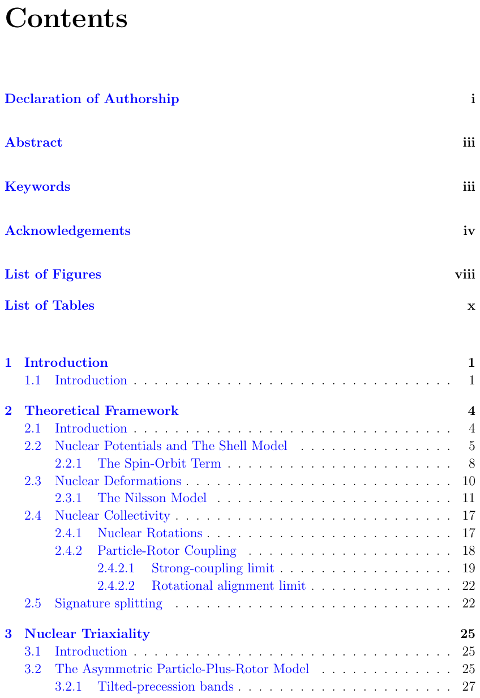

**中文说明：** 目录（原图保留，未逐行翻译）。此说明仅标识材料，不代表清单条目已翻译。

## PDF7

[完整原页](visual-pages/pdf007.png)

**Source:** PDF7 · T002

**Original:** Contents

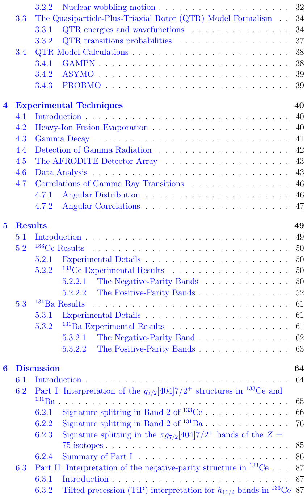

**中文说明：** 目录（原图保留，未逐行翻译）。此说明仅标识材料，不代表清单条目已翻译。

## PDF8

[完整原页](visual-pages/pdf008.png)

**Source:** PDF8 · T003

**Original:** Contents

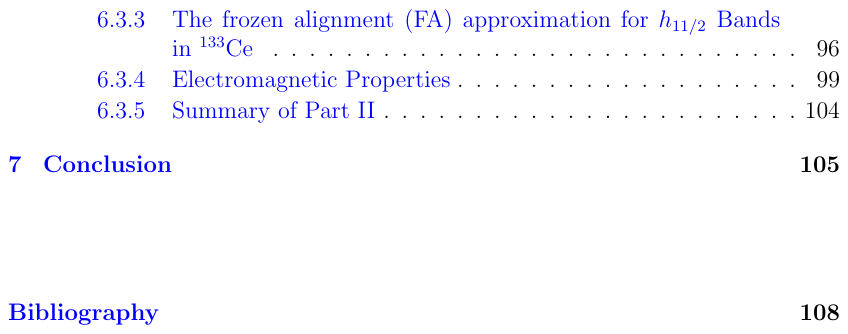

**中文说明：** 目录（原图保留，未逐行翻译）。此说明仅标识材料，不代表清单条目已翻译。

## PDF9

[完整原页](visual-pages/pdf009.png)

**Source:** PDF9 · T004

**Original:** List of Figures

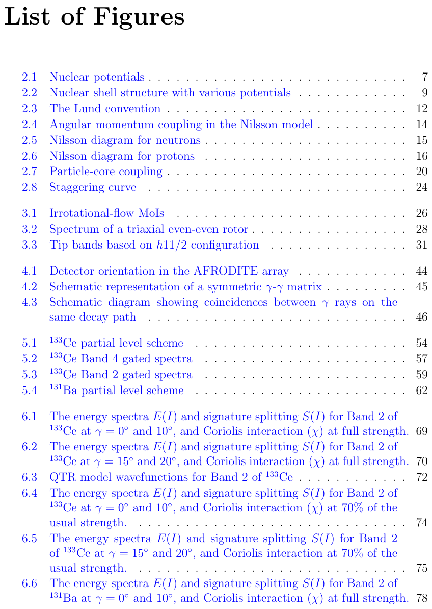

**中文说明：** 插图清单（原图保留，未逐项翻译）。此说明仅标识材料，不代表清单条目已翻译。

## PDF10

[完整原页](visual-pages/pdf010.png)

**Source:** PDF10 · T005

**Original:** List of Figures

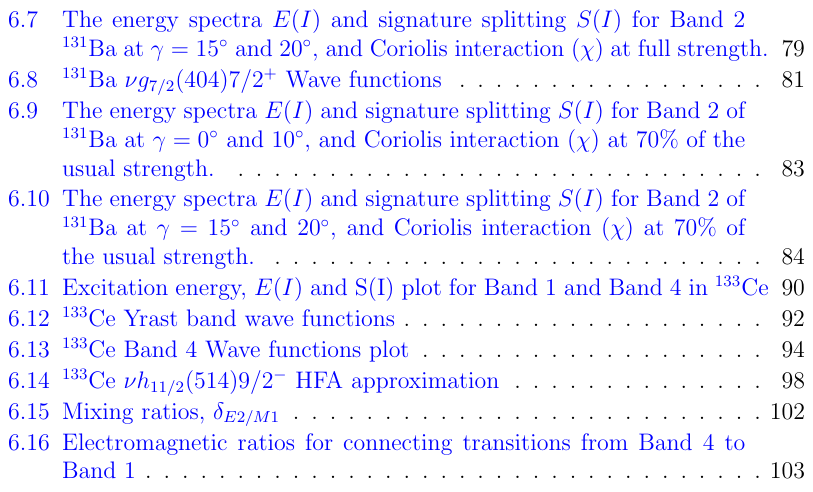

**中文说明：** 插图清单（原图保留，未逐项翻译）。此说明仅标识材料，不代表清单条目已翻译。

## PDF11

[完整原页](visual-pages/pdf011.png)

**Source:** PDF11 · T006

**Original:** List of Tables

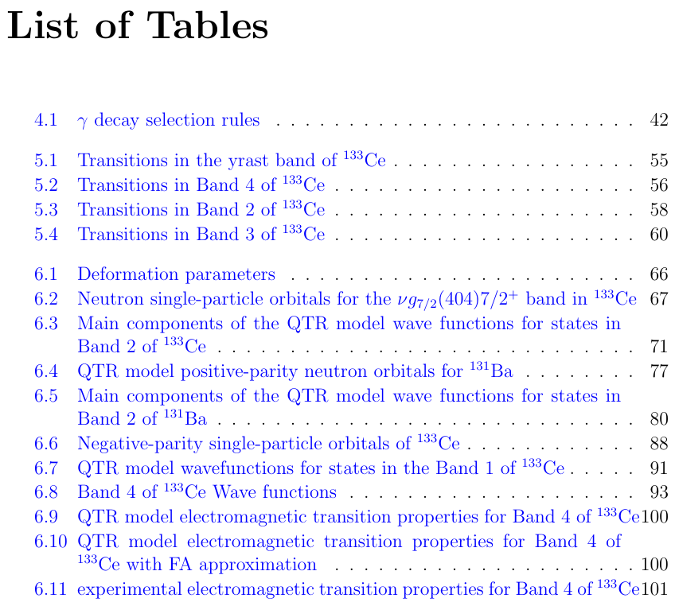

**中文说明：** 表格清单（原图保留，未逐项翻译）。此说明仅标识材料，不代表清单条目已翻译。

## PDF116／印刷页105

[完整原页](visual-pages/pdf116.png)

**Source:** PDF116 · S025

**Original:** Chapter 7 Conclusion

**中文:** 第7章　结论

**Source:** PDF116 · S026

**Original:** Detailed data sets were collected and analyzed in the N = 75 isotones of 133Ce and 131Ba within a collaboration consisting of researchers from South Africa, China and France. The 133Ce experiment was conducted at the separated sector cyclotron of iThemba LABS near Cape Town, South Africa, while the 131Ba experiment was carried out at the XTU Tandem accelerator of Laborotori Nazionali di Legnaro, Italy.

**中文:** 由南非、中国和法国研究人员组成的合作团队，针对 $N=75$ 同中子素 $^{133}\mathrm{Ce}$ 与 $^{131}\mathrm{Ba}$ 采集并分析了详细数据。$^{133}\mathrm{Ce}$ 实验在南非开普敦附近 iThemba LABS 的分离扇形回旋加速器上进行；$^{131}\mathrm{Ba}$ 实验则在意大利 Legnaro 国家实验室的 XTU 串列加速器上完成。

**Source:** PDF116 · S027

**Original:** The γ-decay spectroscopy on these experiments revealed a number of new results. One positive-parity band built on the Iπ = 7/2+ state was discovered in both 133Ce and 131Ba nuclei. As part of this work the γ-γ coincidence from the 133Ce data was studied. The performed γ-coincidence analysis revealed a new strongly coupled positive-parity band in 133Ce, consisting of nine new transitions and four new levels. The analysis of the 131Ba data was carried out by the collaborators. It revealed thirteen new transitions and eight new levels, in a similar strongly coupled positive-parity band built on the Iπ = 7/2+ state. Both bands show a considerable signature splitting.

**中文:** 这些实验的γ衰变谱学研究取得了多项新结果。在 $^{133}\mathrm{Ce}$ 与 $^{131}\mathrm{Ba}$ 中，各发现一条建立在 $I^\pi=7/2^+$ 态上的正宇称带。本论文的一部分工作是研究 $^{133}\mathrm{Ce}$ 数据中的γ–γ符合关系。符合分析在 $^{133}\mathrm{Ce}$ 中揭示出一条新的强耦合正宇称带，包含9条新跃迁和4个新能级。$^{131}\mathrm{Ba}$ 数据由合作者分析，在一条同样建立于 $I^\pi=7/2^+$ 态的类似强耦合正宇称带中发现13条新跃迁和8个新能级。两条带均表现出明显的签名劈裂。

**Source:** PDF116 · S028

**Original:** The collaborators provided potential energy surface (PES) calculations, which suggested a quadruple deformation of ε2 = 0.185 and a γ deformation of γ ∼10◦ for 133Ce and a quadruple deformation of ε2 = 0.170 and a γ deformation of γ ∼9◦ for 131Ba. The interpretation of the two bands was carried out as part of this work. It is based on quasiparticle-plus-triaxial rotor (QTR) calculations.

**中文:** 合作者提供了势能面（PES）计算：对 $^{133}\mathrm{Ce}$，建议四极形变 $\varepsilon_2=0.185$、$\gamma\sim10^\circ$；对 $^{131}\mathrm{Ba}$，建议 $\varepsilon_2=0.170$、$\gamma\sim9^\circ$。本论文对两条能带进行了解释，基础是准粒子加三轴转子（QTR）计算。

**Source:** PDF116 · S029

**Original:** A detailed QTR study of these positive-parity bands was carried out as part of this work. A space of ten QTR model orbitals close to the Fermi level was used

**中文:** 本论文对这些正宇称带进行了详细QTR研究，计算采用费米面附近10个QTR模型轨道构成的空间。〔原段续下页〕

## PDF117／印刷页106

[完整原页](visual-pages/pdf117.png)

**Source:** PDF117 · S030

**Original:** in the calculations. The bands are mainly based on QTR orbital $|\nu\rangle=|20\rangle$, with a projection of 7/2 on the long axis, which corresponds approximately to the $\nu g_{7/2}[404]7/2^+$ Nilsson orbital. The calculations for $^{133}\mathrm{Ce}$ were consistent with a triaxiality of $0^\circ\leq\gamma\leq15^\circ$, while for $^{131}\mathrm{Ba}$, a triaxiality of $\gamma\sim15^\circ$ was required to reproduce the observed excitation energies and energy staggering of the bands. In addition, it was found that the bands in both nuclei are strongly influenced by the Coriolis interaction which causes re-alignment of the angular momentum of the $\nu g_{7/2}$ neutron away from the long axis. Furthermore, the nearby $\nu s_{1/2}$ and $\nu d_{3/2}$ orbitals which have a significant $K=1/2$ component in their wave functions strongly mix with the dominant $\nu g_{7/2}$ configuration of the band. The theoretical results presented in this work were included in a paper that was just published in Physical Review C [22].

**中文:** 〔续上页原段〕这些带主要基于QTR轨道 $|\nu\rangle=|20\rangle$，其沿长轴的投影为7/2，近似对应 $\nu g_{7/2}[404]7/2^+$ Nilsson轨道。$^{133}\mathrm{Ce}$ 的计算与 $0^\circ\leq\gamma\leq15^\circ$ 的三轴度一致；对 $^{131}\mathrm{Ba}$，需要 $\gamma\sim15^\circ$ 才能再现实验激发能和能量交错。此外，两核能带均受到 Coriolis 相互作用的强烈影响，它使 $\nu g_{7/2}$ 中子的角动量重新排列、偏离长轴。附近的 $\nu s_{1/2}$ 与 $\nu d_{3/2}$ 轨道的波函数含显著 $K=1/2$ 成分，与带内占主导的 $\nu g_{7/2}$ 组态强烈混合。本论文提出的理论结果已收入一篇刚发表于 Physical Review C 的论文[22]。

**Source:** PDF117 · S031

**Original:** As part of this work, the analysis of the coincidence relationships in the 133Ce data was carried out. It revealed many new transitions that were placed in a new negative-parity band built above the Iπ = 13/2−state. Thirteen new intraband and fifteen interband transitions, and eight new levels were discovered. The spin and parity assignments of the new levels and the mixing ratios of the transitions were performed by our Chinese collaborators. The new band decays to a known negative-parity band with ν(h11/2)−1[514]9/2−configuration. The interpretation of the known yrast band and the new excited negative-parity bands was performed as part of this work. The measured mixing ratios for the transitions of these bands precludes an interpretation of these bands as possible wobbling bands.

**中文:** 本论文还分析了 $^{133}\mathrm{Ce}$ 数据中的符合关系，发现许多新跃迁，将其置于一条建立在 $I^\pi=13/2^-$ 态之上的新负宇称带。发现了13条新带内跃迁、15条带间跃迁和8个新能级。新能级的自旋、宇称及跃迁混合比由中国合作者确定。新带衰变到已知的 $\nu(h_{11/2})^{-1}[514]9/2^-$ 负宇称带。本论文解释了已知晕带和新的激发负宇称带。测得的这些能带跃迁混合比，排除了将它们解释为可能摆动带的方案。

**Source:** PDF117 · S032

**Original:** Detailed QTR model calculations were carried for these negative-parity bands in 133Ce. Nine QTR orbitals close to the Fermi level with negative-parity were used in the calculations. Six of the orbitals used were from the h11/2 sub-shell with projections on the long axis of 1/2 to 11/2. The yrast band is mainly built on the h11/2 orbital with a single-particle projection of 9/2 on the long axis. The excited band is built on a state with an extra 2ℏof rotational angular momentum along the long axis than the yrast band. The calculations revealed that in addition to the h11/2 orbital with projection of 9/2 on the long axis, the h11/2 orbitals with projections of 5/2, 7/2 and 11/2 also play a significant role in the states of both bands. The mixing of these components generates the observed large energy staggering in these bands.

**中文:** 针对 $^{133}\mathrm{Ce}$ 的这些负宇称带进行了详细QTR模型计算，采用费米面附近9个负宇称QTR轨道。其中6个来自 $h_{11/2}$ 子壳，长轴投影从1/2到11/2。晕带主要建立在长轴单粒子投影9/2的 $h_{11/2}$ 轨道上；激发带则建立在相对晕带沿长轴多出 $2\hbar$ 转动角动量的态上。计算表明，除长轴投影9/2的 $h_{11/2}$ 轨道外，投影5/2、7/2和11/2的 $h_{11/2}$ 轨道也对两条带的态具有显著作用。这些成分的混合产生了带内观测到的较大能量交错。

**Source:** PDF117 · S033

**Original:** The calculations were also performed with a frozen alignment (FA) approximation, where the angular momentum of the valence nucleon was firmly aligned with

**中文:** 还进行了冻结排列（FA）近似计算，将价核子的角动量牢固固定在……〔续下页〕

## PDF118／印刷页107

[完整原页](visual-pages/pdf118.png)

**Source:** PDF118 · S034

**Original:** the long axis. This set of calculations failed to describe the the experimentally observed signature splitting and the excitation energies of the states in both the yrast band and the excited band. It was found that when the angular momentum of the valence neutron is firmly aligned along the long axis, components of the wave functions that would otherwise be favorable to construct the rotational states are left out. This resulted in the rotational states predicted from the FA approximation to lie higher in energy than the rotational states calculated with a large configuration space. Furthermore, it was found that the energy staggering is generated by mixing with other orbitals therefore running QTR calculations with FA cannot in principle produce energy staggering.

**中文:** 〔续上页原段〕……长轴方向。这组计算未能描述晕带和激发带中实验观测到的签名劈裂及各态激发能。研究发现，当价中子的角动量固定沿长轴排列时，原本有利于构造转动态的某些波函数成分被排除；因此FA近似预言的转动态能量高于大组态空间计算的转动态。此外，研究发现能量交错来自与其他轨道的混合，因此采用FA运行QTR计算，原则上不能产生能量交错。

**Source:** PDF118 · S035

**Original:** A manuscript on the new results on the h11/2 bands in 133Ce and their interpretation based on the present QTR model calculations is in preparation for submission to Physical Review C.

**中文:** 一篇介绍 $^{133}\mathrm{Ce}$ 中 $h_{11/2}$ 带新结果及基于本论文QTR模型计算的解释的稿件，正在准备投稿至 Physical Review C。

## 参考文献完整原文（74项，未逐条独立验证）

跨页条目已连续拼接；原始页图和未归一文字保存在同目录。以下只保留作者列出的参考文献，不表明它们已逐篇阅读或元数据已获验证。

- [R001 · [1]](#R001) — PDF119
- [R002 · [2]](#R002) — PDF119
- [R003 · [3]](#R003) — PDF119
- [R004 · [4]](#R004) — PDF119
- [R005 · [5]](#R005) — PDF119
- [R006 · [6]](#R006) — PDF119
- [R007 · [7]](#R007) — PDF120
- [R008 · [8]](#R008) — PDF120
- [R009 · [9]](#R009) — PDF120
- [R010 · [10]](#R010) — PDF120
- [R011 · [11]](#R011) — PDF120
- [R012 · [12]](#R012) — PDF120
- [R013 · [13]](#R013) — PDF120
- [R014 · [14]](#R014) — PDF120,121
- [R015 · [15]](#R015) — PDF121
- [R016 · [16]](#R016) — PDF121
- [R017 · [17]](#R017) — PDF121
- [R018 · [18]](#R018) — PDF121
- [R019 · [19]](#R019) — PDF121
- [R020 · [20]](#R020) — PDF121
- [R021 · [21]](#R021) — PDF121
- [R022 · [22]](#R022) — PDF121,122
- [R023 · [23]](#R023) — PDF122
- [R024 · [24]](#R024) — PDF122
- [R025 · [25]](#R025) — PDF122
- [R026 · [26]](#R026) — PDF122
- [R027 · [27]](#R027) — PDF122
- [R028 · [28]](#R028) — PDF122,123
- [R029 · [29]](#R029) — PDF123
- [R030 · [30]](#R030) — PDF123
- [R031 · [31]](#R031) — PDF123
- [R032 · [32]](#R032) — PDF123
- [R033 · [33]](#R033) — PDF123
- [R034 · [34]](#R034) — PDF123,124
- [R035 · [35]](#R035) — PDF124
- [R036 · [36]](#R036) — PDF124
- [R037 · [37]](#R037) — PDF124
- [R038 · [38]](#R038) — PDF124
- [R039 · [39]](#R039) — PDF124
- [R040 · [40]](#R040) — PDF124
- [R041 · [41]](#R041) — PDF124
- [R042 · [42]](#R042) — PDF124
- [R043 · [43]](#R043) — PDF125
- [R044 · [44]](#R044) — PDF125
- [R045 · [45]](#R045) — PDF125
- [R046 · [46]](#R046) — PDF125
- [R047 · [47]](#R047) — PDF125
- [R048 · [48]](#R048) — PDF125,126
- [R049 · [49]](#R049) — PDF126
- [R050 · [50]](#R050) — PDF126
- [R051 · [51]](#R051) — PDF126
- [R052 · [52]](#R052) — PDF126
- [R053 · [53]](#R053) — PDF126
- [R054 · [54]](#R054) — PDF126
- [R055 · [55]](#R055) — PDF127
- [R056 · [56]](#R056) — PDF127
- [R057 · [57]](#R057) — PDF127
- [R058 · [58]](#R058) — PDF127
- [R059 · [59]](#R059) — PDF127
- [R060 · [60]](#R060) — PDF127,128
- [R061 · [61]](#R061) — PDF128
- [R062 · [62]](#R062) — PDF128
- [R063 · [63]](#R063) — PDF128
- [R064 · [64]](#R064) — PDF128
- [R065 · [65]](#R065) — PDF128
- [R066 · [66]](#R066) — PDF129
- [R067 · [67]](#R067) — PDF129
- [R068 · [68]](#R068) — PDF129
- [R069 · [69]](#R069) — PDF129
- [R070 · [70]](#R070) — PDF129
- [R071 · [71]](#R071) — PDF129
- [R072 · [72]](#R072) — PDF129
- [R073 · [73]](#R073) — PDF129,130
- [R074 · [74]](#R074) — PDF130

### 参考文献原页 PDF119／p.108

**Source:** PDF119 · BIBPAGE119

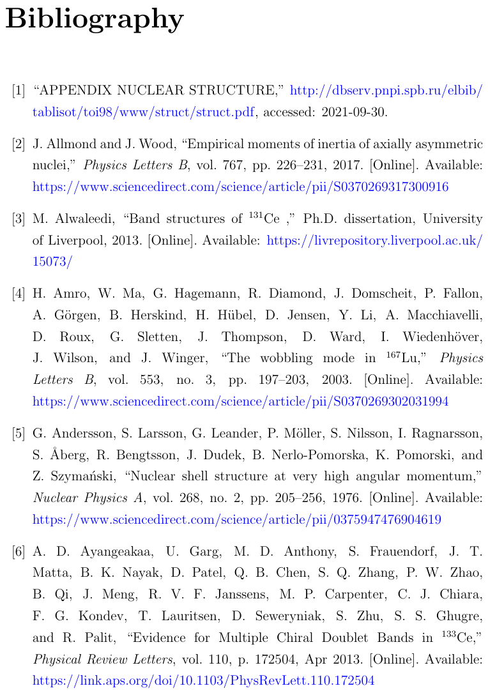

**Source:** PDF119 · R001

**Original reference:** [1] “APPENDIX NUCLEAR STRUCTURE,” http://dbserv.pnpi.spb.ru/elbib/ tablisot/toi98/www/struct/struct.pdf, accessed: 2021-09-30.

**状态：** 原文保留；未逐条翻译，未在本reader逐条独立验证。

**Source:** PDF119 · R002

**Original reference:** [2] J. Allmond and J. Wood, “Empirical moments of inertia of axially asymmetric nuclei,” Physics Letters B, vol. 767, pp. 226–231, 2017. [Online]. Available: https://www.sciencedirect.com/science/article/pii/S0370269317300916

**状态：** 原文保留；未逐条翻译，未在本reader逐条独立验证。

**Source:** PDF119 · R003

**Original reference:** [3] M. Alwaleedi, “Band structures of 131Ce ,” Ph.D. dissertation, University of Liverpool, 2013. [Online]. Available: https://livrepository.liverpool.ac.uk/ 15073/

**状态：** 原文保留；未逐条翻译，未在本reader逐条独立验证。

**Source:** PDF119 · R004

**Original reference:** [4] H. Amro, W. Ma, G. Hagemann, R. Diamond, J. Domscheit, P. Fallon, A. G¨orgen, B. Herskind, H. H¨ubel, D. Jensen, Y. Li, A. Macchiavelli, D. Roux, G. Sletten, J. Thompson, D. Ward, I. Wiedenh¨over, J. Wilson, and J. Winger, “The wobbling mode in 167Lu,” Physics Letters B, vol. 553, no. 3, pp. 197–203, 2003. [Online]. Available: https://www.sciencedirect.com/science/article/pii/S0370269302031994

**状态：** 原文保留；未逐条翻译，未在本reader逐条独立验证。

**Source:** PDF119 · R005

**Original reference:** [5] G. Andersson, S. Larsson, G. Leander, P. M¨oller, S. Nilsson, I. Ragnarsson, S. ˚Aberg, R. Bengtsson, J. Dudek, B. Nerlo-Pomorska, K. Pomorski, and Z. Szyma´nski, “Nuclear shell structure at very high angular momentum,” Nuclear Physics A, vol. 268, no. 2, pp. 205–256, 1976. [Online]. Available: https://www.sciencedirect.com/science/article/pii/0375947476904619

**状态：** 原文保留；未逐条翻译，未在本reader逐条独立验证。

**Source:** PDF119 · R006

**Original reference:** [6] A. D. Ayangeakaa, U. Garg, M. D. Anthony, S. Frauendorf, J. T. Matta, B. K. Nayak, D. Patel, Q. B. Chen, S. Q. Zhang, P. W. Zhao, B. Qi, J. Meng, R. V. F. Janssens, M. P. Carpenter, C. J. Chiara, F. G. Kondev, T. Lauritsen, D. Seweryniak, S. Zhu, S. S. Ghugre, and R. Palit, “Evidence for Multiple Chiral Doublet Bands in 133Ce,” Physical Review Letters, vol. 110, p. 172504, Apr 2013. [Online]. Available: https://link.aps.org/doi/10.1103/PhysRevLett.110.172504

**状态：** 原文保留；未逐条翻译，未在本reader逐条独立验证。

### 参考文献原页 PDF120／p.109

**Source:** PDF120 · BIBPAGE120

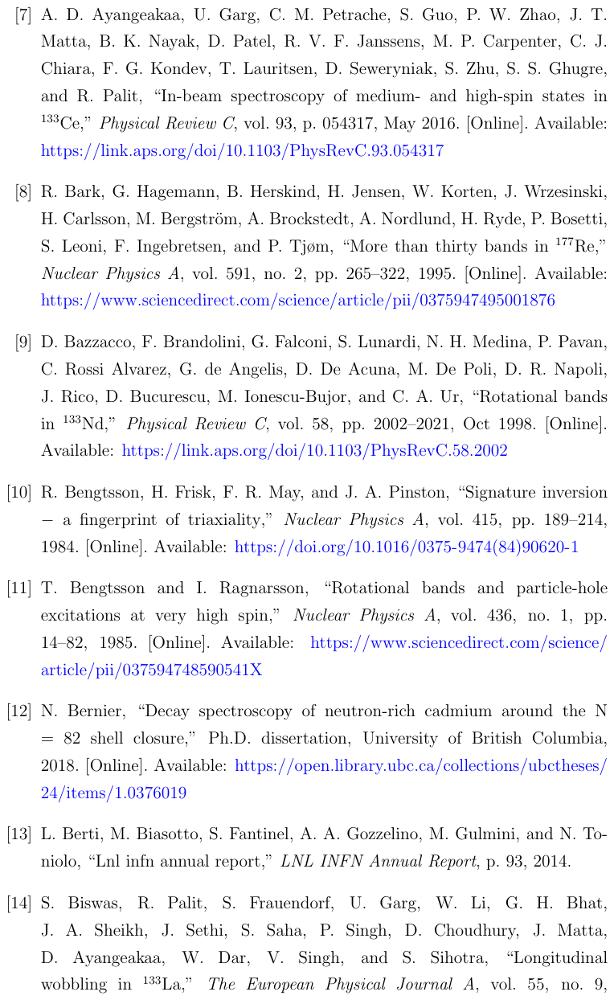

**Source:** PDF120 · R007

**Original reference:** [7] A. D. Ayangeakaa, U. Garg, C. M. Petrache, S. Guo, P. W. Zhao, J. T. Matta, B. K. Nayak, D. Patel, R. V. F. Janssens, M. P. Carpenter, C. J. Chiara, F. G. Kondev, T. Lauritsen, D. Seweryniak, S. Zhu, S. S. Ghugre, and R. Palit, “In-beam spectroscopy of medium- and high-spin states in 133Ce,” Physical Review C, vol. 93, p. 054317, May 2016. [Online]. Available: https://link.aps.org/doi/10.1103/PhysRevC.93.054317

**状态：** 原文保留；未逐条翻译，未在本reader逐条独立验证。

**Source:** PDF120 · R008

**Original reference:** [8] R. Bark, G. Hagemann, B. Herskind, H. Jensen, W. Korten, J. Wrzesinski, H. Carlsson, M. Bergstr¨om, A. Brockstedt, A. Nordlund, H. Ryde, P. Bosetti, S. Leoni, F. Ingebretsen, and P. Tjøm, “More than thirty bands in 177Re,” Nuclear Physics A, vol. 591, no. 2, pp. 265–322, 1995. [Online]. Available: https://www.sciencedirect.com/science/article/pii/0375947495001876

**状态：** 原文保留；未逐条翻译，未在本reader逐条独立验证。

**Source:** PDF120 · R009

**Original reference:** [9] D. Bazzacco, F. Brandolini, G. Falconi, S. Lunardi, N. H. Medina, P. Pavan, C. Rossi Alvarez, G. de Angelis, D. De Acuna, M. De Poli, D. R. Napoli, J. Rico, D. Bucurescu, M. Ionescu-Bujor, and C. A. Ur, “Rotational bands in 133Nd,” Physical Review C, vol. 58, pp. 2002–2021, Oct 1998. [Online]. Available: https://link.aps.org/doi/10.1103/PhysRevC.58.2002

**状态：** 原文保留；未逐条翻译，未在本reader逐条独立验证。

**Source:** PDF120 · R010

**Original reference:** [10] R. Bengtsson, H. Frisk, F. R. May, and J. A. Pinston, “Signature inversion −a fingerprint of triaxiality,” Nuclear Physics A, vol. 415, pp. 189–214, 1984. [Online]. Available: https://doi.org/10.1016/0375-9474(84)90620-1

**状态：** 原文保留；未逐条翻译，未在本reader逐条独立验证。

**Source:** PDF120 · R011

**Original reference:** [11] T. Bengtsson and I. Ragnarsson, “Rotational bands and particle-hole excitations at very high spin,” Nuclear Physics A, vol. 436, no. 1, pp. 14–82, 1985. [Online]. Available: https://www.sciencedirect.com/science/ article/pii/037594748590541X

**状态：** 原文保留；未逐条翻译，未在本reader逐条独立验证。

**Source:** PDF120 · R012

**Original reference:** [12] N. Bernier, “Decay spectroscopy of neutron-rich cadmium around the N = 82 shell closure,” Ph.D. dissertation, University of British Columbia, 2018. [Online]. Available: https://open.library.ubc.ca/collections/ubctheses/ 24/items/1.0376019

**状态：** 原文保留；未逐条翻译，未在本reader逐条独立验证。

**Source:** PDF120 · R013

**Original reference:** [13] L. Berti, M. Biasotto, S. Fantinel, A. A. Gozzelino, M. Gulmini, and N. Toniolo, “Lnl infn annual report,” LNL INFN Annual Report, p. 93, 2014.

**状态：** 原文保留；未逐条翻译，未在本reader逐条独立验证。

**Source:** PDF120,121 · R014

**Original reference:** [14] S. Biswas, R. Palit, S. Frauendorf, U. Garg, W. Li, G. H. Bhat, J. A. Sheikh, J. Sethi, S. Saha, P. Singh, D. Choudhury, J. Matta, D. Ayangeakaa, W. Dar, V. Singh, and S. Sihotra, “Longitudinal wobbling in 133La,” The European Physical Journal A, vol. 55, no. 9, 2019. [Online]. Available: https://epja.epj.org/articles/epja/abs/2019/09/ 10050 2019 Article 12856/10050 2019 Article 12856.html

**状态：** 原文保留；未逐条翻译，未在本reader逐条独立验证。

### 参考文献原页 PDF121／p.110

**Source:** PDF121 · BIBPAGE121

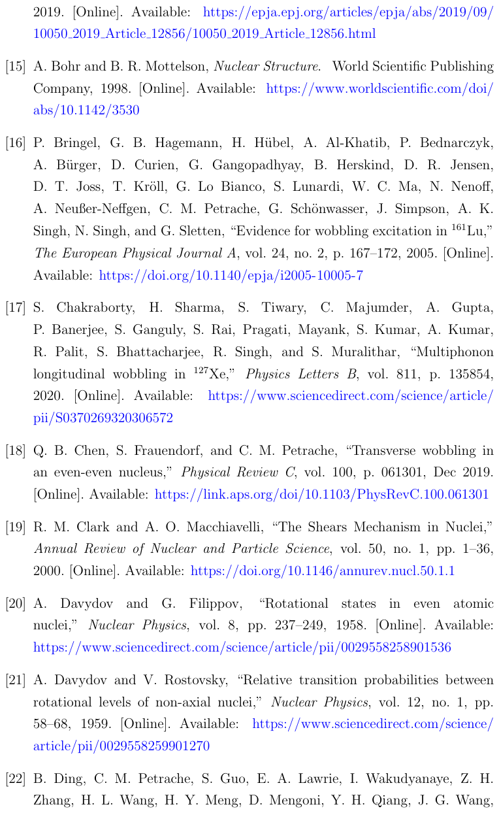

**Source:** PDF121 · R015

**Original reference:** [15] A. Bohr and B. R. Mottelson, Nuclear Structure. World Scientific Publishing Company, 1998. [Online]. Available: https://www.worldscientific.com/doi/ abs/10.1142/3530

**状态：** 原文保留；未逐条翻译，未在本reader逐条独立验证。

**Source:** PDF121 · R016

**Original reference:** [16] P. Bringel, G. B. Hagemann, H. H¨ubel, A. Al-Khatib, P. Bednarczyk, A. B¨urger, D. Curien, G. Gangopadhyay, B. Herskind, D. R. Jensen, D. T. Joss, T. Kr¨oll, G. Lo Bianco, S. Lunardi, W. C. Ma, N. Nenoff, A. Neußer-Neffgen, C. M. Petrache, G. Sch¨onwasser, J. Simpson, A. K. Singh, N. Singh, and G. Sletten, “Evidence for wobbling excitation in 161Lu,” The European Physical Journal A, vol. 24, no. 2, p. 167–172, 2005. [Online]. Available: https://doi.org/10.1140/epja/i2005-10005-7

**状态：** 原文保留；未逐条翻译，未在本reader逐条独立验证。

**Source:** PDF121 · R017

**Original reference:** [17] S. Chakraborty, H. Sharma, S. Tiwary, C. Majumder, A. Gupta, P. Banerjee, S. Ganguly, S. Rai, Pragati, Mayank, S. Kumar, A. Kumar, R. Palit, S. Bhattacharjee, R. Singh, and S. Muralithar, “Multiphonon longitudinal wobbling in 127Xe,” Physics Letters B, vol. 811, p. 135854, 2020. [Online]. Available: https://www.sciencedirect.com/science/article/ pii/S0370269320306572

**状态：** 原文保留；未逐条翻译，未在本reader逐条独立验证。

**Source:** PDF121 · R018

**Original reference:** [18] Q. B. Chen, S. Frauendorf, and C. M. Petrache, “Transverse wobbling in an even-even nucleus,” Physical Review C, vol. 100, p. 061301, Dec 2019. [Online]. Available: https://link.aps.org/doi/10.1103/PhysRevC.100.061301

**状态：** 原文保留；未逐条翻译，未在本reader逐条独立验证。

**Source:** PDF121 · R019

**Original reference:** [19] R. M. Clark and A. O. Macchiavelli, “The Shears Mechanism in Nuclei,” Annual Review of Nuclear and Particle Science, vol. 50, no. 1, pp. 1–36, 2000. [Online]. Available: https://doi.org/10.1146/annurev.nucl.50.1.1

**状态：** 原文保留；未逐条翻译，未在本reader逐条独立验证。

**Source:** PDF121 · R020

**Original reference:** [20] A. Davydov and G. Filippov, “Rotational states in even atomic nuclei,” Nuclear Physics, vol. 8, pp. 237–249, 1958. [Online]. Available: https://www.sciencedirect.com/science/article/pii/0029558258901536

**状态：** 原文保留；未逐条翻译，未在本reader逐条独立验证。

**Source:** PDF121 · R021

**Original reference:** [21] A. Davydov and V. Rostovsky, “Relative transition probabilities between rotational levels of non-axial nuclei,” Nuclear Physics, vol. 12, no. 1, pp. 58–68, 1959. [Online]. Available: https://www.sciencedirect.com/science/ article/pii/0029558259901270

**状态：** 原文保留；未逐条翻译，未在本reader逐条独立验证。

**Source:** PDF121,122 · R022

**Original reference:** [22] B. Ding, C. M. Petrache, S. Guo, E. A. Lawrie, I. Wakudyanaye, Z. H. Zhang, H. L. Wang, H. Y. Meng, D. Mengoni, Y. H. Qiang, J. G. Wang, C. Andreoiu, A. Astier, A. Avaa, T. B¨ack, R. A. Bark, D. Bazzacco, A. Boso, T. D. Bucher, B. Cederwall, M. V. Chisapi, H. L. Fan, F. Galtarossa, F. H. Garcia, A. Goasduff, G. Jaworski, P. Jones, I. Kuti, J. J. Lawrie, G. S. Li, R. Li, M. L. Liu, Z. Liu, B. Lomberg, B. F. Lv, T. Marchlewski, L. Mdletshe, L. Msebi, S. H. Mthembu, D. R. Napoli, A. Netshiya, M. F. Nkalanga, J. N. Orce, K. Ortner, F. Recchia, S. Riccetto, A. Rohilla, T. W. Seakamela, M. Siciliano, M. A. Sithole, D. Sohler, J. Srebrny, D. Testov, A. Tucholski, J. J. Valiente-Dob´on, F. Wentzel, K. Whitmore, Y. H. Zhang, K. K. Zheng, X. H. Zhou, and B. R. Zikhali, “Signature splitting of the g7/2[404]7/2+ bands in 131Ba and 133Ce,” Physical Review C, vol. 104, p. 064304, Dec 2021. [Online]. Available: https://link.aps.org/doi/10.1103/PhysRevC.104.064304

**状态：** 原文保留；未逐条翻译，未在本reader逐条独立验证。

### 参考文献原页 PDF122／p.111

**Source:** PDF122 · BIBPAGE122

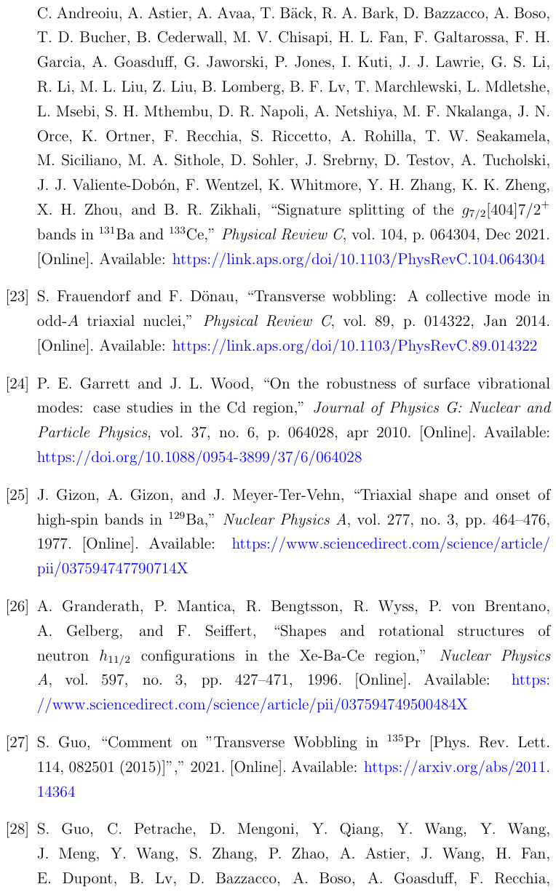

**Source:** PDF122 · R023

**Original reference:** [23] S. Frauendorf and F. D¨onau, “Transverse wobbling: A collective mode in odd-A triaxial nuclei,” Physical Review C, vol. 89, p. 014322, Jan 2014. [Online]. Available: https://link.aps.org/doi/10.1103/PhysRevC.89.014322

**状态：** 原文保留；未逐条翻译，未在本reader逐条独立验证。

**Source:** PDF122 · R024

**Original reference:** [24] P. E. Garrett and J. L. Wood, “On the robustness of surface vibrational modes: case studies in the Cd region,” Journal of Physics G: Nuclear and Particle Physics, vol. 37, no. 6, p. 064028, apr 2010. [Online]. Available: https://doi.org/10.1088/0954-3899/37/6/064028

**状态：** 原文保留；未逐条翻译，未在本reader逐条独立验证。

**Source:** PDF122 · R025

**Original reference:** [25] J. Gizon, A. Gizon, and J. Meyer-Ter-Vehn, “Triaxial shape and onset of high-spin bands in 129Ba,” Nuclear Physics A, vol. 277, no. 3, pp. 464–476, 1977. [Online]. Available: https://www.sciencedirect.com/science/article/ pii/037594747790714X

**状态：** 原文保留；未逐条翻译，未在本reader逐条独立验证。

**Source:** PDF122 · R026

**Original reference:** [26] A. Granderath, P. Mantica, R. Bengtsson, R. Wyss, P. von Brentano, A. Gelberg, and F. Seiffert, “Shapes and rotational structures of neutron h11/2 configurations in the Xe-Ba-Ce region,” Nuclear Physics A, vol. 597, no. 3, pp. 427–471, 1996. [Online]. Available: https: //www.sciencedirect.com/science/article/pii/037594749500484X

**状态：** 原文保留；未逐条翻译，未在本reader逐条独立验证。

**Source:** PDF122 · R027

**Original reference:** [27] S. Guo, “Comment on ”Transverse Wobbling in 135Pr [Phys. Rev. Lett. 114, 082501 (2015)]”,” 2021. [Online]. Available: https://arxiv.org/abs/2011. 14364

**状态：** 原文保留；未逐条翻译，未在本reader逐条独立验证。

**Source:** PDF122,123 · R028

**Original reference:** [28] S. Guo, C. Petrache, D. Mengoni, Y. Qiang, Y. Wang, Y. Wang, J. Meng, Y. Wang, S. Zhang, P. Zhao, A. Astier, J. Wang, H. Fan, E. Dupont, B. Lv, D. Bazzacco, A. Boso, A. Goasduff, F. Recchia, D. Testov, F. Galtarossa, G. Jaworski, D. Napoli, S. Riccetto, M. Siciliano, J. Valiente-Dobon, M. Liu, G. Li, X. Zhou, Y. Zhang, C. Andreoiu, F. Garcia, K. Ortner, K. Whitmore, A. Ata¸c-Nyberg, T. B¨ack, B. Cederwall, E. Lawrie, I. Kuti, D. Sohler, T. Marchlewski, J. Srebrny, and A. Tucholski, “Evidence for pseudospin-chiral quartet bands in the presence of octupole correlations,” Physics Letters B, vol. 807, p. 135572, 2020. [Online]. Available: https://www.sciencedirect.com/science/article/pii/S0370269320303762

**状态：** 原文保留；未逐条翻译，未在本reader逐条独立验证。

### 参考文献原页 PDF123／p.112

**Source:** PDF123 · BIBPAGE123

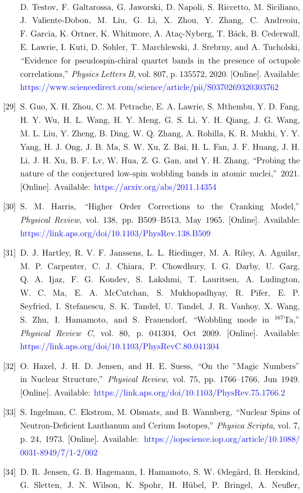

**Source:** PDF123 · R029

**Original reference:** [29] S. Guo, X. H. Zhou, C. M. Petrache, E. A. Lawrie, S. Mthembu, Y. D. Fang, H. Y. Wu, H. L. Wang, H. Y. Meng, G. S. Li, Y. H. Qiang, J. G. Wang, M. L. Liu, Y. Zheng, B. Ding, W. Q. Zhang, A. Rohilla, K. R. Mukhi, Y. Y. Yang, H. J. Ong, J. B. Ma, S. W. Xu, Z. Bai, H. L. Fan, J. F. Huang, J. H. Li, J. H. Xu, B. F. Lv, W. Hua, Z. G. Gan, and Y. H. Zhang, “Probing the nature of the conjectured low-spin wobbling bands in atomic nuclei,” 2021. [Online]. Available: https://arxiv.org/abs/2011.14354

**状态：** 原文保留；未逐条翻译，未在本reader逐条独立验证。

**Source:** PDF123 · R030

**Original reference:** [30] S. M. Harris, “Higher Order Corrections to the Cranking Model,” Physical Review, vol. 138, pp. B509–B513, May 1965. [Online]. Available: https://link.aps.org/doi/10.1103/PhysRev.138.B509

**状态：** 原文保留；未逐条翻译，未在本reader逐条独立验证。

**Source:** PDF123 · R031

**Original reference:** [31] D. J. Hartley, R. V. F. Janssens, L. L. Riedinger, M. A. Riley, A. Aguilar, M. P. Carpenter, C. J. Chiara, P. Chowdhury, I. G. Darby, U. Garg, Q. A. Ijaz, F. G. Kondev, S. Lakshmi, T. Lauritsen, A. Ludington, W. C. Ma, E. A. McCutchan, S. Mukhopadhyay, R. Pifer, E. P. Seyfried, I. Stefanescu, S. K. Tandel, U. Tandel, J. R. Vanhoy, X. Wang, S. Zhu, I. Hamamoto, and S. Frauendorf, “Wobbling mode in 167Ta,” Physical Review C, vol. 80, p. 041304, Oct 2009. [Online]. Available: https://link.aps.org/doi/10.1103/PhysRevC.80.041304

**状态：** 原文保留；未逐条翻译，未在本reader逐条独立验证。

**Source:** PDF123 · R032

**Original reference:** [32] O. Haxel, J. H. D. Jensen, and H. E. Suess, “On the ”Magic Numbers” in Nuclear Structure,” Physical Review, vol. 75, pp. 1766–1766, Jun 1949. [Online]. Available: https://link.aps.org/doi/10.1103/PhysRev.75.1766.2

**状态：** 原文保留；未逐条翻译，未在本reader逐条独立验证。

**Source:** PDF123 · R033

**Original reference:** [33] S. Ingelman, C. Ekstrom, M. Olsmats, and B. Wannberg, “Nuclear Spins of Neutron-Deficient Lanthanum and Cerium Isotopes,” Physica Scripta, vol. 7, p. 24, 1973. [Online]. Available: https://iopscience.iop.org/article/10.1088/ 0031-8949/7/1-2/002

**状态：** 原文保留；未逐条翻译，未在本reader逐条独立验证。

**Source:** PDF123,124 · R034

**Original reference:** [34] D. R. Jensen, G. B. Hagemann, I. Hamamoto, S. W. Ødeg˚ard, B. Herskind, G. Sletten, J. N. Wilson, K. Spohr, H. H¨ubel, P. Bringel, A. Neußer, G. Sch¨onwaßer, A. K. Singh, W. C. Ma, H. Amro, A. Bracco, S. Leoni, G. Benzoni, A. Maj, C. M. Petrache, G. L. Bianco, P. Bednarczyk, and D. Curien, “Evidence for Second-Phonon Nuclear Wobbling,” Physical Review Letters, vol. 89, p. 142503, Sep 2002. [Online]. Available: https://link.aps.org/doi/10.1103/PhysRevLett.89.142503

**状态：** 原文保留；未逐条翻译，未在本reader逐条独立验证。

### 参考文献原页 PDF124／p.113

**Source:** PDF124 · BIBPAGE124

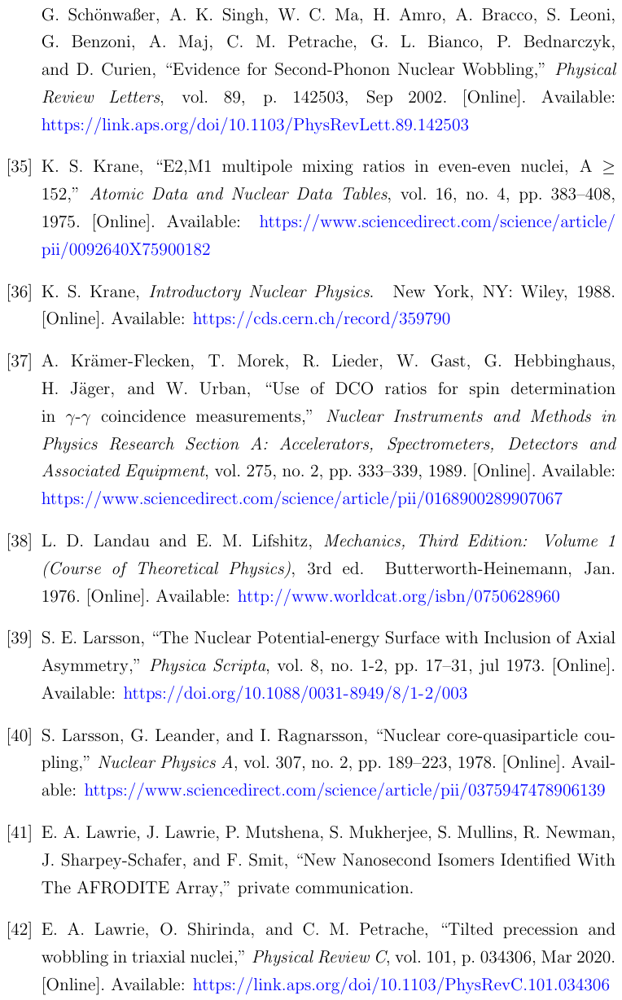

**Source:** PDF124 · R035

**Original reference:** [35] K. S. Krane, “E2,M1 multipole mixing ratios in even-even nuclei, A ≥ 152,” Atomic Data and Nuclear Data Tables, vol. 16, no. 4, pp. 383–408, 1975. [Online]. Available: https://www.sciencedirect.com/science/article/ pii/0092640X75900182

**状态：** 原文保留；未逐条翻译，未在本reader逐条独立验证。

**Source:** PDF124 · R036

**Original reference:** [36] K. S. Krane, Introductory Nuclear Physics. New York, NY: Wiley, 1988. [Online]. Available: https://cds.cern.ch/record/359790

**状态：** 原文保留；未逐条翻译，未在本reader逐条独立验证。

**Source:** PDF124 · R037

**Original reference:** [37] A. Kr¨amer-Flecken, T. Morek, R. Lieder, W. Gast, G. Hebbinghaus, H. J¨ager, and W. Urban, “Use of DCO ratios for spin determination in γ-γ coincidence measurements,” Nuclear Instruments and Methods in Physics Research Section A: Accelerators, Spectrometers, Detectors and Associated Equipment, vol. 275, no. 2, pp. 333–339, 1989. [Online]. Available: https://www.sciencedirect.com/science/article/pii/0168900289907067

**状态：** 原文保留；未逐条翻译，未在本reader逐条独立验证。

**Source:** PDF124 · R038

**Original reference:** [38] L. D. Landau and E. M. Lifshitz, Mechanics, Third Edition: Volume 1 (Course of Theoretical Physics), 3rd ed. Butterworth-Heinemann, Jan. 1976. [Online]. Available: http://www.worldcat.org/isbn/0750628960

**状态：** 原文保留；未逐条翻译，未在本reader逐条独立验证。

**Source:** PDF124 · R039

**Original reference:** [39] S. E. Larsson, “The Nuclear Potential-energy Surface with Inclusion of Axial Asymmetry,” Physica Scripta, vol. 8, no. 1-2, pp. 17–31, jul 1973. [Online]. Available: https://doi.org/10.1088/0031-8949/8/1-2/003

**状态：** 原文保留；未逐条翻译，未在本reader逐条独立验证。

**Source:** PDF124 · R040

**Original reference:** [40] S. Larsson, G. Leander, and I. Ragnarsson, “Nuclear core-quasiparticle coupling,” Nuclear Physics A, vol. 307, no. 2, pp. 189–223, 1978. [Online]. Available: https://www.sciencedirect.com/science/article/pii/0375947478906139

**状态：** 原文保留；未逐条翻译，未在本reader逐条独立验证。

**Source:** PDF124 · R041

**Original reference:** [41] E. A. Lawrie, J. Lawrie, P. Mutshena, S. Mukherjee, S. Mullins, R. Newman, J. Sharpey-Schafer, and F. Smit, “New Nanosecond Isomers Identified With The AFRODITE Array,” private communication.

**状态：** 原文保留；未逐条翻译，未在本reader逐条独立验证。

**Source:** PDF124 · R042

**Original reference:** [42] E. A. Lawrie, O. Shirinda, and C. M. Petrache, “Tilted precession and wobbling in triaxial nuclei,” Physical Review C, vol. 101, p. 034306, Mar 2020. [Online]. Available: https://link.aps.org/doi/10.1103/PhysRevC.101.034306

**状态：** 原文保留；未逐条翻译，未在本reader逐条独立验证。

### 参考文献原页 PDF125／p.114

**Source:** PDF125 · BIBPAGE125

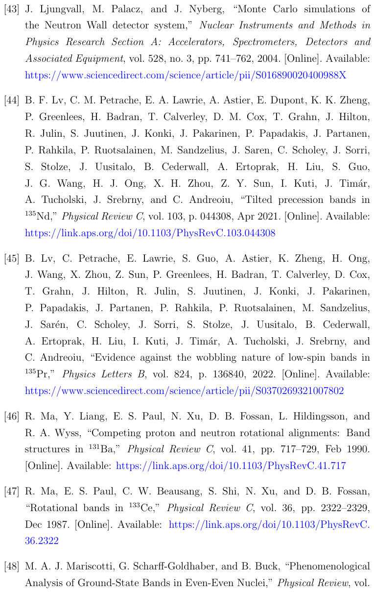

**Source:** PDF125 · R043

**Original reference:** [43] J. Ljungvall, M. Palacz, and J. Nyberg, “Monte Carlo simulations of the Neutron Wall detector system,” Nuclear Instruments and Methods in Physics Research Section A: Accelerators, Spectrometers, Detectors and Associated Equipment, vol. 528, no. 3, pp. 741–762, 2004. [Online]. Available: https://www.sciencedirect.com/science/article/pii/S016890020400988X

**状态：** 原文保留；未逐条翻译，未在本reader逐条独立验证。

**Source:** PDF125 · R044

**Original reference:** [44] B. F. Lv, C. M. Petrache, E. A. Lawrie, A. Astier, E. Dupont, K. K. Zheng, P. Greenlees, H. Badran, T. Calverley, D. M. Cox, T. Grahn, J. Hilton, R. Julin, S. Juutinen, J. Konki, J. Pakarinen, P. Papadakis, J. Partanen, P. Rahkila, P. Ruotsalainen, M. Sandzelius, J. Saren, C. Scholey, J. Sorri, S. Stolze, J. Uusitalo, B. Cederwall, A. Ertoprak, H. Liu, S. Guo, J. G. Wang, H. J. Ong, X. H. Zhou, Z. Y. Sun, I. Kuti, J. Tim´ar, A. Tucholski, J. Srebrny, and C. Andreoiu, “Tilted precession bands in 135Nd,” Physical Review C, vol. 103, p. 044308, Apr 2021. [Online]. Available: https://link.aps.org/doi/10.1103/PhysRevC.103.044308

**状态：** 原文保留；未逐条翻译，未在本reader逐条独立验证。

**Source:** PDF125 · R045

**Original reference:** [45] B. Lv, C. Petrache, E. Lawrie, S. Guo, A. Astier, K. Zheng, H. Ong, J. Wang, X. Zhou, Z. Sun, P. Greenlees, H. Badran, T. Calverley, D. Cox, T. Grahn, J. Hilton, R. Julin, S. Juutinen, J. Konki, J. Pakarinen, P. Papadakis, J. Partanen, P. Rahkila, P. Ruotsalainen, M. Sandzelius, J. Sar´en, C. Scholey, J. Sorri, S. Stolze, J. Uusitalo, B. Cederwall, A. Ertoprak, H. Liu, I. Kuti, J. Tim´ar, A. Tucholski, J. Srebrny, and C. Andreoiu, “Evidence against the wobbling nature of low-spin bands in 135Pr,” Physics Letters B, vol. 824, p. 136840, 2022. [Online]. Available: https://www.sciencedirect.com/science/article/pii/S0370269321007802

**状态：** 原文保留；未逐条翻译，未在本reader逐条独立验证。

**Source:** PDF125 · R046

**Original reference:** [46] R. Ma, Y. Liang, E. S. Paul, N. Xu, D. B. Fossan, L. Hildingsson, and R. A. Wyss, “Competing proton and neutron rotational alignments: Band structures in 131Ba,” Physical Review C, vol. 41, pp. 717–729, Feb 1990. [Online]. Available: https://link.aps.org/doi/10.1103/PhysRevC.41.717

**状态：** 原文保留；未逐条翻译，未在本reader逐条独立验证。

**Source:** PDF125 · R047

**Original reference:** [47] R. Ma, E. S. Paul, C. W. Beausang, S. Shi, N. Xu, and D. B. Fossan, “Rotational bands in 133Ce,” Physical Review C, vol. 36, pp. 2322–2329, Dec 1987. [Online]. Available: https://link.aps.org/doi/10.1103/PhysRevC. 36.2322

**状态：** 原文保留；未逐条翻译，未在本reader逐条独立验证。

**Source:** PDF125,126 · R048

**Original reference:** [48] M. A. J. Mariscotti, G. Scharff-Goldhaber, and B. Buck, “Phenomenological Analysis of Ground-State Bands in Even-Even Nuclei,” Physical Review, vol. 178, pp. 1864–1886, Feb 1969. [Online]. Available: https://link.aps.org/doi/ 10.1103/PhysRev.178.1864

**状态：** 原文保留；未逐条翻译，未在本reader逐条独立验证。

### 参考文献原页 PDF126／p.115

**Source:** PDF126 · BIBPAGE126

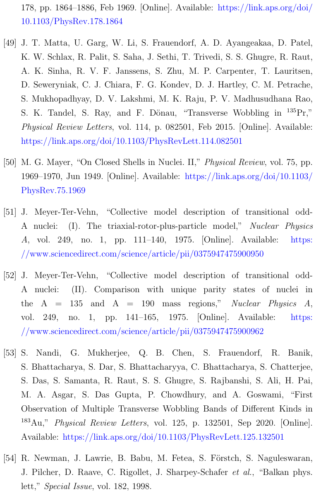

**Source:** PDF126 · R049

**Original reference:** [49] J. T. Matta, U. Garg, W. Li, S. Frauendorf, A. D. Ayangeakaa, D. Patel, K. W. Schlax, R. Palit, S. Saha, J. Sethi, T. Trivedi, S. S. Ghugre, R. Raut, A. K. Sinha, R. V. F. Janssens, S. Zhu, M. P. Carpenter, T. Lauritsen, D. Seweryniak, C. J. Chiara, F. G. Kondev, D. J. Hartley, C. M. Petrache, S. Mukhopadhyay, D. V. Lakshmi, M. K. Raju, P. V. Madhusudhana Rao, S. K. Tandel, S. Ray, and F. D¨onau, “Transverse Wobbling in 135Pr,” Physical Review Letters, vol. 114, p. 082501, Feb 2015. [Online]. Available: https://link.aps.org/doi/10.1103/PhysRevLett.114.082501

**状态：** 原文保留；未逐条翻译，未在本reader逐条独立验证。

**Source:** PDF126 · R050

**Original reference:** [50] M. G. Mayer, “On Closed Shells in Nuclei. II,” Physical Review, vol. 75, pp. 1969–1970, Jun 1949. [Online]. Available: https://link.aps.org/doi/10.1103/ PhysRev.75.1969

**状态：** 原文保留；未逐条翻译，未在本reader逐条独立验证。

**Source:** PDF126 · R051

**Original reference:** [51] J. Meyer-Ter-Vehn, “Collective model description of transitional oddA nuclei: (I). The triaxial-rotor-plus-particle model,” Nuclear Physics A, vol. 249, no. 1, pp. 111–140, 1975. [Online]. Available: https: //www.sciencedirect.com/science/article/pii/0375947475900950

**状态：** 原文保留；未逐条翻译，未在本reader逐条独立验证。

**Source:** PDF126 · R052

**Original reference:** [52] J. Meyer-Ter-Vehn, “Collective model description of transitional oddA nuclei: (II). Comparison with unique parity states of nuclei in the A = 135 and A = 190 mass regions,” Nuclear Physics A, vol. 249, no. 1, pp. 141–165, 1975. [Online]. Available: https: //www.sciencedirect.com/science/article/pii/0375947475900962

**状态：** 原文保留；未逐条翻译，未在本reader逐条独立验证。

**Source:** PDF126 · R053

**Original reference:** [53] S. Nandi, G. Mukherjee, Q. B. Chen, S. Frauendorf, R. Banik, S. Bhattacharya, S. Dar, S. Bhattacharyya, C. Bhattacharya, S. Chatterjee, S. Das, S. Samanta, R. Raut, S. S. Ghugre, S. Rajbanshi, S. Ali, H. Pai, M. A. Asgar, S. Das Gupta, P. Chowdhury, and A. Goswami, “First Observation of Multiple Transverse Wobbling Bands of Different Kinds in 183Au,” Physical Review Letters, vol. 125, p. 132501, Sep 2020. [Online]. Available: https://link.aps.org/doi/10.1103/PhysRevLett.125.132501

**状态：** 原文保留；未逐条翻译，未在本reader逐条独立验证。

**Source:** PDF126 · R054

**Original reference:** [54] R. Newman, J. Lawrie, B. Babu, M. Fetea, S. F¨orstch, S. Naguleswaran, J. Pilcher, D. Raave, C. Rigollet, J. Sharpey-Schafer et al., “Balkan phys. lett,” Special Issue, vol. 182, 1998.

**状态：** 原文保留；未逐条翻译，未在本reader逐条独立验证。

### 参考文献原页 PDF127／p.116

**Source:** PDF127 · BIBPAGE127

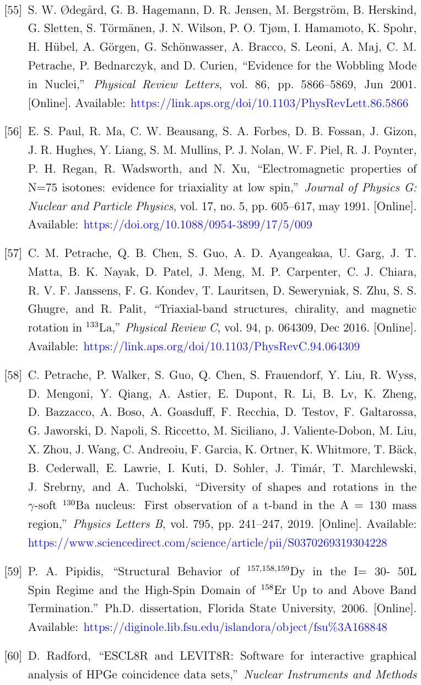

**Source:** PDF127 · R055

**Original reference:** [55] S. W. Ødeg˚ard, G. B. Hagemann, D. R. Jensen, M. Bergstr¨om, B. Herskind, G. Sletten, S. T¨orm¨anen, J. N. Wilson, P. O. Tjøm, I. Hamamoto, K. Spohr, H. H¨ubel, A. G¨orgen, G. Sch¨onwasser, A. Bracco, S. Leoni, A. Maj, C. M. Petrache, P. Bednarczyk, and D. Curien, “Evidence for the Wobbling Mode in Nuclei,” Physical Review Letters, vol. 86, pp. 5866–5869, Jun 2001. [Online]. Available: https://link.aps.org/doi/10.1103/PhysRevLett.86.5866

**状态：** 原文保留；未逐条翻译，未在本reader逐条独立验证。

**Source:** PDF127 · R056

**Original reference:** [56] E. S. Paul, R. Ma, C. W. Beausang, S. A. Forbes, D. B. Fossan, J. Gizon, J. R. Hughes, Y. Liang, S. M. Mullins, P. J. Nolan, W. F. Piel, R. J. Poynter, P. H. Regan, R. Wadsworth, and N. Xu, “Electromagnetic properties of N=75 isotones: evidence for triaxiality at low spin,” Journal of Physics G: Nuclear and Particle Physics, vol. 17, no. 5, pp. 605–617, may 1991. [Online]. Available: https://doi.org/10.1088/0954-3899/17/5/009

**状态：** 原文保留；未逐条翻译，未在本reader逐条独立验证。

**Source:** PDF127 · R057

**Original reference:** [57] C. M. Petrache, Q. B. Chen, S. Guo, A. D. Ayangeakaa, U. Garg, J. T. Matta, B. K. Nayak, D. Patel, J. Meng, M. P. Carpenter, C. J. Chiara, R. V. F. Janssens, F. G. Kondev, T. Lauritsen, D. Seweryniak, S. Zhu, S. S. Ghugre, and R. Palit, “Triaxial-band structures, chirality, and magnetic rotation in 133La,” Physical Review C, vol. 94, p. 064309, Dec 2016. [Online]. Available: https://link.aps.org/doi/10.1103/PhysRevC.94.064309

**状态：** 原文保留；未逐条翻译，未在本reader逐条独立验证。

**Source:** PDF127 · R058

**Original reference:** [58] C. Petrache, P. Walker, S. Guo, Q. Chen, S. Frauendorf, Y. Liu, R. Wyss, D. Mengoni, Y. Qiang, A. Astier, E. Dupont, R. Li, B. Lv, K. Zheng, D. Bazzacco, A. Boso, A. Goasduff, F. Recchia, D. Testov, F. Galtarossa, G. Jaworski, D. Napoli, S. Riccetto, M. Siciliano, J. Valiente-Dobon, M. Liu, X. Zhou, J. Wang, C. Andreoiu, F. Garcia, K. Ortner, K. Whitmore, T. B¨ack, B. Cederwall, E. Lawrie, I. Kuti, D. Sohler, J. Tim´ar, T. Marchlewski, J. Srebrny, and A. Tucholski, “Diversity of shapes and rotations in the γ-soft 130Ba nucleus: First observation of a t-band in the A = 130 mass region,” Physics Letters B, vol. 795, pp. 241–247, 2019. [Online]. Available: https://www.sciencedirect.com/science/article/pii/S0370269319304228

**状态：** 原文保留；未逐条翻译，未在本reader逐条独立验证。

**Source:** PDF127 · R059

**Original reference:** [59] P. A. Pipidis, “Structural Behavior of 157,158,159Dy in the I= 30- 50L Spin Regime and the High-Spin Domain of 158Er Up to and Above Band Termination.” Ph.D. dissertation, Florida State University, 2006. [Online]. Available: https://diginole.lib.fsu.edu/islandora/object/fsu%3A168848

**状态：** 原文保留；未逐条翻译，未在本reader逐条独立验证。

**Source:** PDF127,128 · R060

**Original reference:** [60] D. Radford, “ESCL8R and LEVIT8R: Software for interactive graphical analysis of HPGe coincidence data sets,” Nuclear Instruments and Methods in Physics Research Section A: Accelerators, Spectrometers, Detectors and Associated Equipment, vol. 361, no. 1, pp. 297–305, 1995. [Online]. Available: https://www.sciencedirect.com/science/article/pii/0168900295001832

**状态：** 原文保留；未逐条翻译，未在本reader逐条独立验证。

### 参考文献原页 PDF128／p.117

**Source:** PDF128 · BIBPAGE128

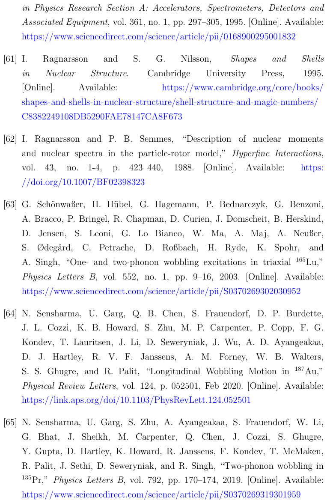

**Source:** PDF128 · R061

**Original reference:** [61] I. Ragnarsson and S. G. Nilsson, Shapes and Shells in Nuclear Structure. Cambridge University Press, 1995. [Online]. Available: https://www.cambridge.org/core/books/ shapes-and-shells-in-nuclear-structure/shell-structure-and-magic-numbers/ C8382249108DB5290FAE78147CA8F673

**状态：** 原文保留；未逐条翻译，未在本reader逐条独立验证。

**Source:** PDF128 · R062

**Original reference:** [62] I. Ragnarsson and P. B. Semmes, “Description of nuclear moments and nuclear spectra in the particle-rotor model,” Hyperfine Interactions, vol. 43, no. 1-4, p. 423–440, 1988. [Online]. Available: https: //doi.org/10.1007/BF02398323

**状态：** 原文保留；未逐条翻译，未在本reader逐条独立验证。

**Source:** PDF128 · R063

**Original reference:** [63] G. Sch¨onwaßer, H. H¨ubel, G. Hagemann, P. Bednarczyk, G. Benzoni, A. Bracco, P. Bringel, R. Chapman, D. Curien, J. Domscheit, B. Herskind, D. Jensen, S. Leoni, G. Lo Bianco, W. Ma, A. Maj, A. Neußer, S. Ødeg˚ard, C. Petrache, D. Roßbach, H. Ryde, K. Spohr, and A. Singh, “One- and two-phonon wobbling excitations in triaxial 165Lu,” Physics Letters B, vol. 552, no. 1, pp. 9–16, 2003. [Online]. Available: https://www.sciencedirect.com/science/article/pii/S0370269302030952

**状态：** 原文保留；未逐条翻译，未在本reader逐条独立验证。

**Source:** PDF128 · R064

**Original reference:** [64] N. Sensharma, U. Garg, Q. B. Chen, S. Frauendorf, D. P. Burdette, J. L. Cozzi, K. B. Howard, S. Zhu, M. P. Carpenter, P. Copp, F. G. Kondev, T. Lauritsen, J. Li, D. Seweryniak, J. Wu, A. D. Ayangeakaa, D. J. Hartley, R. V. F. Janssens, A. M. Forney, W. B. Walters, S. S. Ghugre, and R. Palit, “Longitudinal Wobbling Motion in 187Au,” Physical Review Letters, vol. 124, p. 052501, Feb 2020. [Online]. Available: https://link.aps.org/doi/10.1103/PhysRevLett.124.052501

**状态：** 原文保留；未逐条翻译，未在本reader逐条独立验证。

**Source:** PDF128 · R065

**Original reference:** [65] N. Sensharma, U. Garg, S. Zhu, A. Ayangeakaa, S. Frauendorf, W. Li, G. Bhat, J. Sheikh, M. Carpenter, Q. Chen, J. Cozzi, S. Ghugre, Y. Gupta, D. Hartley, K. Howard, R. Janssens, F. Kondev, T. McMaken, R. Palit, J. Sethi, D. Seweryniak, and R. Singh, “Two-phonon wobbling in 135Pr,” Physics Letters B, vol. 792, pp. 170–174, 2019. [Online]. Available: https://www.sciencedirect.com/science/article/pii/S0370269319301959

**状态：** 原文保留；未逐条翻译，未在本reader逐条独立验证。

### 参考文献原页 PDF129／p.118

**Source:** PDF129 · BIBPAGE129

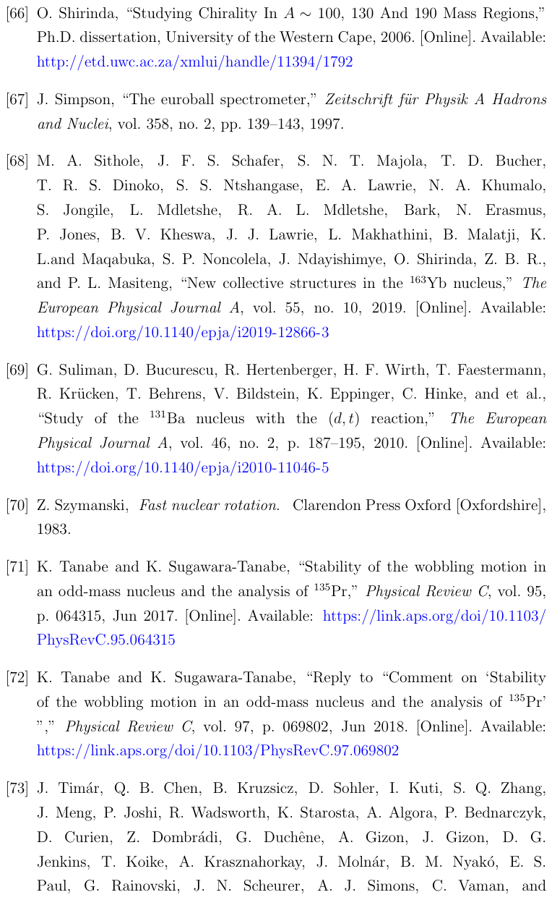

**Source:** PDF129 · R066

**Original reference:** [66] O. Shirinda, “Studying Chirality In A ∼100, 130 And 190 Mass Regions,” Ph.D. dissertation, University of the Western Cape, 2006. [Online]. Available: http://etd.uwc.ac.za/xmlui/handle/11394/1792

**状态：** 原文保留；未逐条翻译，未在本reader逐条独立验证。

**Source:** PDF129 · R067

**Original reference:** [67] J. Simpson, “The euroball spectrometer,” Zeitschrift f¨ur Physik A Hadrons and Nuclei, vol. 358, no. 2, pp. 139–143, 1997.

**状态：** 原文保留；未逐条翻译，未在本reader逐条独立验证。

**Source:** PDF129 · R068

**Original reference:** [68] M. A. Sithole, J. F. S. Schafer, S. N. T. Majola, T. D. Bucher, T. R. S. Dinoko, S. S. Ntshangase, E. A. Lawrie, N. A. Khumalo, S. Jongile, L. Mdletshe, R. A. L. Mdletshe, Bark, N. Erasmus, P. Jones, B. V. Kheswa, J. J. Lawrie, L. Makhathini, B. Malatji, K. L.and Maqabuka, S. P. Noncolela, J. Ndayishimye, O. Shirinda, Z. B. R., and P. L. Masiteng, “New collective structures in the 163Yb nucleus,” The European Physical Journal A, vol. 55, no. 10, 2019. [Online]. Available: https://doi.org/10.1140/epja/i2019-12866-3

**状态：** 原文保留；未逐条翻译，未在本reader逐条独立验证。

**Source:** PDF129 · R069

**Original reference:** [69] G. Suliman, D. Bucurescu, R. Hertenberger, H. F. Wirth, T. Faestermann, R. Kr¨ucken, T. Behrens, V. Bildstein, K. Eppinger, C. Hinke, and et al., “Study of the 131Ba nucleus with the (d, t) reaction,” The European Physical Journal A, vol. 46, no. 2, p. 187–195, 2010. [Online]. Available: https://doi.org/10.1140/epja/i2010-11046-5

**状态：** 原文保留；未逐条翻译，未在本reader逐条独立验证。

**Source:** PDF129 · R070

**Original reference:** [70] Z. Szymanski, Fast nuclear rotation. Clarendon Press Oxford [Oxfordshire], 1983.

**状态：** 原文保留；未逐条翻译，未在本reader逐条独立验证。

**Source:** PDF129 · R071

**Original reference:** [71] K. Tanabe and K. Sugawara-Tanabe, “Stability of the wobbling motion in an odd-mass nucleus and the analysis of 135Pr,” Physical Review C, vol. 95, p. 064315, Jun 2017. [Online]. Available: https://link.aps.org/doi/10.1103/ PhysRevC.95.064315

**状态：** 原文保留；未逐条翻译，未在本reader逐条独立验证。

**Source:** PDF129 · R072

**Original reference:** [72] K. Tanabe and K. Sugawara-Tanabe, “Reply to “Comment on ‘Stability of the wobbling motion in an odd-mass nucleus and the analysis of 135Pr’ ”,” Physical Review C, vol. 97, p. 069802, Jun 2018. [Online]. Available: https://link.aps.org/doi/10.1103/PhysRevC.97.069802

**状态：** 原文保留；未逐条翻译，未在本reader逐条独立验证。

**Source:** PDF129,130 · R073

**Original reference:** [73] J. Tim´ar, Q. B. Chen, B. Kruzsicz, D. Sohler, I. Kuti, S. Q. Zhang, J. Meng, P. Joshi, R. Wadsworth, K. Starosta, A. Algora, P. Bednarczyk, D. Curien, Z. Dombr´adi, G. Duchˆene, A. Gizon, J. Gizon, D. G. Jenkins, T. Koike, A. Krasznahorkay, J. Moln´ar, B. M. Nyak´o, E. S. Paul, G. Rainovski, J. N. Scheurer, A. J. Simons, C. Vaman, and L. Zolnai, “Experimental Evidence for Transverse Wobbling in 105Pd,” Physical Review Letters, vol. 122, p. 062501, Feb 2019. [Online]. Available: https://link.aps.org/doi/10.1103/PhysRevLett.122.062501

**状态：** 原文保留；未逐条翻译，未在本reader逐条独立验证。

### 参考文献原页 PDF130／p.119

**Source:** PDF130 · BIBPAGE130

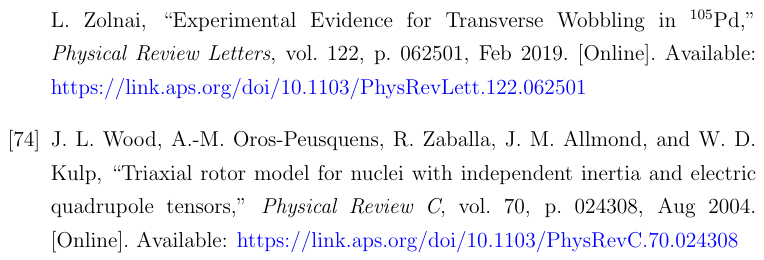

**Source:** PDF130 · R074

**Original reference:** [74] J. L. Wood, A.-M. Oros-Peusquens, R. Zaballa, J. M. Allmond, and W. D. Kulp, “Triaxial rotor model for nuclei with independent inertia and electric quadrupole tensors,” Physical Review C, vol. 70, p. 024308, Aug 2004. [Online]. Available: https://link.aps.org/doi/10.1103/PhysRevC.70.024308

**状态：** 原文保留；未逐条翻译，未在本reader逐条独立验证。

## 阅读与覆盖边界

[translation_notes.md](translation_notes.md)区分作者结论与本任务审计；[coverage.json](coverage.json)明确哪些内容已译、哪些保持原文。没有把书目保留当成文献证据审查完成。
