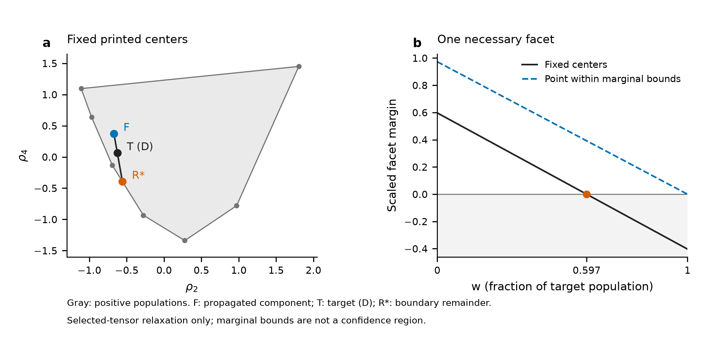

# 167Tm：角张量的条件馈入界与误差边界

**图示结论：固定印刷中心值的几何界，不是实验置信上限。** 本例只取Ionescu1981 Table1中已由Fig5确认相接的271.12-keV（17/2→13/2）与184.33-keV（13/2→9/2）两条线；后者保留D复合峰标记。本图只使用这两组张量；其余Table1状态、已见218.90馈入及强度条件暂未加入，仍对完整纲图有约束，原记录完整保留。本图未增加独立实验或重复样本。

(a) 对目标J=13/2，灰域为任意非负、归一磁子态布居所能产生的(ρ2,ρ4)凸包。F为经已核Yamazaki U传播的单支条件tensor，T为原表中心值，R*为最大w时的余下分量。这里w是目标总布居中来自已知分量的份额，**不是parent的decay branching ratio**。在固定spin、pureE2、未观测precedingγ及源tensor定义下，仅要求其余分量为任意正population，得w≤0.596940；边界余下分量由|m|=5/2、7/2支撑。这个界只在所声明的放宽问题中可达到，不证明实际未知feeding路径能实现该分布。

(b) 绘制(a)处激活facet的必要条件N−wD，按中心值的D缩放。黑线对应固定中心值；蓝虚线对应各张量都位于原报一个括号误差半宽内、且正population可行的一组构造输入，在所选tensor放宽中w=1可行；这并不是对包括218.90等已见馈入的完整纲图/强度拟合。它不是误差带、joint confidence region或χ²扫描。四个marginal quoted errors没有给出完整Cov或统一覆盖概率，D复合峰的分量响应亦未恢复，故不能把0.596940写成实测上限或由本图重拟σ/δ。

来源：IO81 printed p.21 Table1、p.25 Fig5和Eq11；YA67 p.18/19 TableIIb与p.3 Eq12。所有数据、假设与可复算推导写回canonical知识；[输入](tm167-feeding-fraction-input.json)、[16项与精度核查](tm167-feeding-fraction-audit.json)、[图源数据](tm167-feeding-fraction-figure-source.json)、[图QA](tm167-feeding-fraction-figure-qa.json)。采用Python/matplotlib，SVG/PDF可编辑，PNG为300dpi预览；PDF最小字形5.95pt，alignment通过，collision0fail/0warn。三个source-preflight默认告警已按实际PDF与非投稿用途逐项核对。
