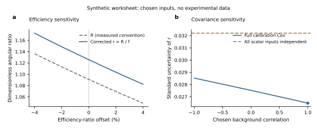
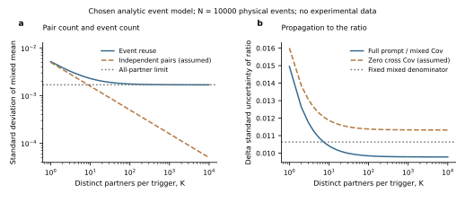
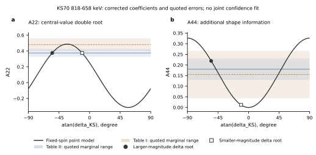

# Day15：ADO、角分布系数与几何修正

## Run state

- run_id: 2026-10-16-day-15-01
- run_date: 2026-10-16
- day_index: 15
- phase: angular-correlation-polarization-and-mixing-ratio
- schedule_id: wiki-daily-learning
- timezone: Asia/Shanghai
- session_id: 01a14510-aec7-7e00-aa23-f7c77a5124bc
- resume_command: `codex resume 01a14510-aec7-7e00-aa23-f7c77a5124bc -C /workspace/wiki -s danger-full-access -a never`
- hard_deadline: 2026-10-17T15:00:00+08:00
- status: in-progress
- completed_day_indices: [15]
- partial_day_indices: [16]
- Day 15 card audit: complete

本次是独立session；Day15正式卡已通过本session科学交付、检查与首批实际发布，课程将按回执一次对账至next16/count15。整段run仍active；Day16只作无学分预习。本页是持续学习检查点，不表示整个时段完成。15:00前仍有高价值当前问题时继续；最多预习恰好Day16并只记partial16，不开Day17。receipt见[run.json](20261016-DAY15-ado-angular-distribution-geometry-run-01/run.json)。

### 本session主动回忆

[冻结原答](20261016-DAY15-ado-angular-distribution-geometry-run-01/active-recall-frozen.md)于2026-10-16T22:17:56.981021+08:00、打开科学source/raw和Day14详细报告前保存。已暴露本prompt预习摘要、index和active handoff，明确为primed recall。SHA-256 `91eee8abb4bce71d0447617b1d5cb0d64240259115b9522a012963872cb25c67`；文件不回写。

原答正确指出A2/A4、核alpha、reference及几何不同层，且仅两角计数不足识别f；但对f的乘除方向不确定。来源后纠正为Zheng Eq3的`R=r f`，从符合比恢复本征r要除f。原件还明确组效率和self-exclusion所用的台数，不能以单台效率再除一次。没有把Day14的19/24、21/24或旧28-check当本日成绩。

## Candidate pool and selection

启动按顺序读README、index、profile/memory/active handoff、PLAN和三份课程/论文轨道计划；矩阵[Day15卡](../plans/2026-09-22-one-month-daily-task-matrix.md#day-15--ado角分布系数与几何修正)存在。最近学习记录和source fingerprints表明，Zheng定义、toy joint response、Gaussian/feeding与系数约定已有大量预习，需正式核原件并产生本session交付。[候选检查点](20261016-DAY15-ado-angular-distribution-geometry-run-01/research-checkpoint.json)记录选择与排除。

| 槽位/候选 | 问题与预期信息增益 | 本次处理 |
| --- | --- | --- |
| continuity | 两条独立额外输入路线如何识别f？共享背景/效率校准Cov怎样影响r误差？ | 完成新输入、解析传播、独立pair核算及MC；均为自设L2 |
| novelty | 独立GRIFFIN方法怎样验证event mixing与finite geometry，什么不能迁移到in-beam ADO？ | 已冻结primed回忆，读完28页arXiv1807.07570v1及相关图表；响应/Cov/版本边界已canonical |
| anchor内审计 | Zheng Fig1(a)与正文偶极门3.2%是否一致？ | 放大图/原文保留不一致边界；不补造精确图值 |
| 既有Zobel/Ionescu/193Bi等 | 避免重复旧练习；真实event/response/Σ缺口未补 | 必要时调取明确locator；不重算加分 |
| Day16 | 尚未开展；当前Day15路线仍有信息增益 | 不授学分，不越过下一卡 |

## Sources and evidence

### Zheng2002原件完整主线

[source页](../../knowledge/sources/zheng-2002-ado-coincidence-angular-anisotropy.md#day15正式复核原式方向与图文边界)保留原有review flags，新增Z02-10为`needs_review: true`。本次raw SHA-256与既有记录一致：`03044180a59fa5be55bcb6c517e9b87285c0991855afe5e1104e9dd03e9a7f23`；5页均无文本层，实际逐页视觉读完。

| 原件locator | 本次实际核读 | 证据层及限制 |
| --- | --- | --- |
| PDF1 / printed909 | 摘要、熔合蒸发取向、DCO/ADO动机及145Tb/Ref3入口 | 物理背景、作者方法动机 |
| PDF2 / printed910，Eq1–5 | 两矩阵x/y轴、target/gate、R分母效率比、R=r f、组效率与1/N | Z02-1/6直接定义；Eq2分离模型不代full joint（Z02-9） |
| PDF3 / printed911，Fig1/正文 | 12台、32/58/90°三组、Eu/Ba校准、组效率之和、energy scan及偏离定义 | 仪器事实与方法计算；缺原效率/ω2数值不能精确重放Fig1 |
| PDF4 / printed912，Fig2/总结/Refs | 已知跃迁局部约.75/1.25、作者优势解释、38/16组合数 | Fig2为局部实验验证；组合数不是独立样本或误差缩放率 |
| PDF5 / printed913 | 英文题名、作者与摘要 | 身份和主结论对照；不替代数据 |

**新边界（Z02-10）**：Fig1(a)可见点均在0和3.0刻度之间，最大仅略高于1.5；同页正文却给偶极门最大偏离约3.2%。仍按“正文报告”保存3.2%，不把它当图中可复算最大值或本计算单的误差；不由视觉读图发布替代精确数。四极门约5.2%的量级与Fig1(b)相容。这是原件内部一致性审计，不是新实验反证。

本session Crossref匹配Ref3 *In-beam study of 145Tb*, EPJ A12(3),253–255(2001)，DOI[10.1007/s100500170001](https://doi.org/10.1007/s100500170001)；只核metadata，未获其primary正文。方法文Fig2与其复用实验按依赖谱系，不计独立采集。[公开检索记录](20261016-DAY15-ado-angular-distribution-geometry-run-01/network-discovery-001.json)中的snippet只用于发现。

### 独立GRIFFIN来源与反证

[GRIFFIN source](../../knowledge/sources/smith-2019-griffin-angular-correlation-analysis.md)实际读取[arXiv1807.07570v1](https://arxiv.org/abs/1807.07570v1)的28页主文/附录/参考，关键公式与图2/3、表5/8/A.10已核，附录图/level-scheme以整页和联系表检查。原件SHA-256 `0390bdbb6b78f035d1d49abd4ecf863a684f3a8eb3ba6c537cfbd8fb6e352f33`；[采集manifest](../literature-acquisition/20261016-day15-smith-griffin.json)保存逐文件新raw gate和版本。来源前[primed回忆](20261016-DAY15-ado-angular-distribution-geometry-run-01/griffin-before-source-frozen.md)未回写。

Crossref/官方arXiv history核到2019NIM A922,47–63，DOI[10.1016/j.nima.2018.10.097](https://doi.org/10.1016/j.nima.2018.10.097)及仅v1历史；官方Elsevier全文入口一次ConnectionError，未获VoR。以下数字均限定v1，不将内部歧义归为已确认期刊错误。

| 原子入口 | 实际证据及作用 |
| --- | --- |
| SG19-3，PDF4–5 Eq6–14 | 匹配same-energy/time/pair响应的event-mixed比仍是W的角接受加权平均，不等于自动去卷积 |
| SG19-4，PDF6–7 Sec3.2 | mixed2–200μs、prompt<300ns，寿命/效率变化尺度条件及event-reuse Cov缺口 |
| SG19-5，PDF6 Fig2 | 同一60Ni数据与模拟的χ²/NDF：pair数7.96、再single效率2.34、event mixing1.02；非三次独立实验 |
| SG19-6，PDF7 Fig3 | 已知66Zn0→2→0纯E2在event mixing后仍有finite-response衰减，full模板对实验1.01 |
| SG19-7/8，PDF8–11 Eq15–27 | 正Z基函数线性组合允许负权，代数beta/gamma与核alpha/ADO f不同；Cov假设需明示 |
| SG19-9/10，PDF10 Table4、PDF14 Table8 | 部分cascade保留多Ji/δ；四种方法共享数据，Method1 a2/a4是δ派生 |
| SG19-12，PDF17 Summary | trigger/initial alignment/addback/分组改变须重验；不能把random-source校准自动移到in-beam |
| SG19-13/14/15 | v1 beta括号精度、Gd表/图及简化Q范围有局部不一致，保留版本边界，不补原Cov |

这是一项独立装置的方法反证，与Zheng/145Tb并非同采集；其四种分析不是四次独立采集。新可复用内容已写回[角关联方法](../../knowledge/methods/angular-correlation.md#事件混合效率归一之后仍有有限响应)。下一项当前问题是复用mixed partners的event-level Cov，不以增加pair条目数默认降低所有误差。


### Day16无学分预习：Droste1996完整主线

[Droste1996 source](../../knowledge/sources/droste-1996-pdco-formalism.md#2026-10-17原件复核完整主线模式与相位坐标)的8页（printed518–525）本session已完整读，视觉核Eq1–21、geometry/U/Gaussian/Fig4–7；raw SHA-256 `dbfd6796aafc53693b446533c89094a14427e25624321bc16a6edae1b5d84247`匹配。Crossref exact title/作者/年匹配DOI `10.1016/0168-9002(96)00426-3`。来源前[Day16 primed回忆](20261016-DAY15-ado-angular-distribution-geometry-run-01/day16-preview-recall-frozen.md)先冻结；旧DR96-1/2/3 flags不改，新DR96-4–7均true。

- DR96-4，printed520 Eq12/printed521 Eq13–16：完整积分下游gamma2返回gamma1 singles；不观测上游gamma1则给带U传播的daughter取向，不把二者合成“任何门都能消掉”。
- DR96-5，printed519 Eq3–6/520 Eq7：a(TL)与广义F的CG/9j/phase/初末态顺序必须作为整体约定；pure-reference通过不等于mixed interference实现也对。
- DR96-6，printed523–524/Fig7：5→4→2、sigma/I0=.3、DCO0/90、PDCO90/90/phi0；原文是作者计算的近似R/P例，没有实测counts/Cov。
- DR96-7，printed521–522：作者说FORTRAN可向作者取得，本session没有取得/运行它。独立推导与paper code replay分开。

Krane–Steffen1970的raw身份（11页）也核过，现阶段只读已有source摘要，原件主线和跨文献phase转换仍未完成；不计Day16正式学分。所有新增source/模型内容都在本Day15 run的partial16知识预习内，不打开17。

### Day16预习：135Pr主线与标定原件

本段另先[冻结primed回忆](20261016-DAY15-ado-angular-distribution-geometry-run-01/day16-pr135-branch-before-source-frozen.md)，再核原始hash并读Matta2015的6页文章（raw另有1页版权附页）、Lv2022主文6页/SI7页的实验—分析—反证—QTR主线。视觉检查Matta Fig1/2/TableI/Fig3、Lv Fig2/Table1、SI Eq1/2/Table1/Fig3–5；Herzan2015只定向核PDF7/10的a/Q原式与图，不称新通读20页。两DOI的Crossref身份另核，但metadata不作science evidence。

[Matta source](../../knowledge/sources/matta-2015-transverse-wobbling-135pr.md) M15-16和[Lv source](../../knowledge/sources/lv-2022-evidence-against-wobbling-135pr.md) L22-16–19新增为self-audit，旧各1–15行及human-reviewed范围保留。[HE15-10](../../knowledge/sources/herzan-2015-193bi-spectroscopy.md)是Lv明示采用的Q校准，不是一场新的135Pr采集。完整QTR作者解释/反方仍见原project，本段不更新模式排序。

### 后续支持方v2与2021方法章

先[冻结SH26定向primed回忆](20261016-DAY15-ado-angular-distribution-geometry-run-01/day16-sh26-branch-before-source-frozen.md)，再核arXivv2原PDF、定向读PDF2–5/14–15/17并视觉核Fig12/TableI。正式DOI10.1103/3g4p-ncjn由Crossref重核；publisher页面403，未得VoR/DAS，本段只代表实际核过的v2。SH26-12–16保留fixedsigma/I=.2、log10chi²和TableI三条delta；这些是作者的conditional branch preference，不是本任务已重算fullprofile。

官方v2 TeX Source归档实际取得5825886bytes，SHA cdda3eceff0876c3774b253d91e1e41441941a3a2dbd9d358f64f2b785312278；完整29项为26PDF/TeX/Bib/README，26PDF零embedded附件，未发现events、原始角度/效率表、Cov或fitcode。只定向读源TeX/图，不执行、不stage raw；文件名V3不改变官方v2身份。[archive audit](20261016-DAY15-ado-angular-distribution-geometry-run-01/day16-sh26-source-archive-audit.json)与SH26-14记录边界，正文combined data和Fig12旧refs仍缺逐图event ledger。

随后[冻结方法引用回忆](20261016-DAY15-ado-angular-distribution-geometry-run-01/day16-branch-method-reference-before-source-frozen.md)，发现本地SE21论文原件。只读相关方法/校准/table与refs，不新称205页通读，不认证Springer2022页码。SE21-9–15新增自审：Gaussian Eq2.51、half-integer reference、854.3校准/gate/MCMC/七角及method-primary线索。旧SE21-1–8、SH26-1–11 flags保留；新条目true，无human-review升级。

### 1974两原件与获取边界

[MS74回忆](20261016-DAY15-ado-angular-distribution-geometry-run-01/day16-ms74-before-source-frozen.md)先冻结并显式primed；随后核两raw hash，读391–394 attenuation正文/用法、407–411 mixed-coefficient正文/例题/限制，视觉核printed400的J23/2 .2行、405的23/2→19/2 reference、409–410的Fig1/2/negative-column例题。没有把16/56页dense tables全部重新逐值认证。DOI90007-2与90008-4是相邻的不同work，均依Yamazaki理论，不计独立实验。

DA74-5的half-width以明确2sigma²指数为准；J23/2 .2原表.894266/.689096、complete reference .40373/−.16149确认本run matched定义。DMS74-5例题的.5是配合negative column使用，不能未标记地当signed+.5；Q是该DQ组分fraction，不是Q(E)或Qk。DA74-8保留Crossref issue4与原件No5的字段冲突，身份仍由title/authors/PII/pages唯一核对。旧DA1–3/DMS1–4保持，新条目true。

Cieplicka2012目前只有meta，publisherPDF/acceptedAM403，OSTIAPI/record ConnectionError；MCP下载器拒绝绝对Wiki保存目录后未绕过其限制。Matta2017 public discovery restricted，未核body/entitlement；不以这些记录宣称所有合法渠道都不存在。未读primary的producer operation不由本任务猜补，仍见SE21-15和canonical open questions。

### Day16预习续段：Starosta1999真实PDCO实验

先保存[primed回忆](20261016-DAY15-ado-angular-distribution-geometry-run-01/day16-st99-before-source-frozen.md)及冻结hash，再完整读11页原件（printed16–26）；主线覆盖setup→NORDBALL标定→DCO/取向→integrated P→四组PDCO→两条实际线→companion，视觉核Fig1–7、Eq1–7、Table1–4及脚注。原件SHA-256为`883fdd7b08831efefe25f5df610e84b95bb1acbcd7b8e7f684b1a1b31bf8030b`，身份/覆盖在本run记录。精确canonical入口为[ST99 source](../../knowledge/sources/starosta-1999-pdco-experimental-test.md) ST99-5–13。

- ST99-5（printed17 Sec2、printed18–19 Table1）纠正旧Wiki身份：主采集为138Ba(30Si,4n)164Yb、150/155MeV；标定为114Cd(16O,4n)126Ba、83MeV及44MeV16O Coulomb excitation的114Cd/118Sn。旧review/claims不扩张。
- ST99-6（printed19 Eq5/6）纠正旧Q拟合指数：`7(2)×10^-5 E_keV`，不是10^-4；490keV近似Q=.24与印式central Q=.234314的精度分开。
- ST99-7/13（printed18/21/22/25）核NORDBALL79°单CLOVER向EUROGAM所选18/24 polarimeters的迁移近似、a修正、四组gate/pair及integrated定性边界；D96和旧能级/assignment文章不是多场独立采集。
- ST99-8（printed17 footnote1）公开更正D96 Eq4的磁项相位：应为Tprime而非T。原D96 printed519 Eq4已视觉对照；作者说代码无误，本run未得代码。新增DR96-8与owner注记，和实现坐标换号分开。
- ST99-9/11（printed20 Fig4、printed23 Eq7、printed24 Table3 footnote、printed25 Table4）核五点NDF和依赖：647的同一RDCO参与sigma/I=.26(5)校准，不能独立prior双算；Table4选择共同|ΔI|=1 E1类别仍有11−/9−，不是PDCO唯一spin指认。
- ST99-12（printed20–21 Sec4、printed26结论）保留alpha_κ=.012/.033为两候选理论预测，未补total/K-shell定义或伪作测量；≥4ns是strength/Weisskopf估算，Doppler/flight反证不是直接寿命结果。

## Theory/analysis exercise

### 新ADO计算单

完整可复用输入、推导和边界在[ADO协方差方法页](../../knowledge/methods/ado-covariance-calibration.md#两路f校验与共享校准协方差)。[输入JSON](20261016-DAY15-ado-angular-distribution-geometry-run-01/ado-worksheet-input.json)身份为`DAY15-20261016-SYNTHETIC-ADO-COV-01`，SHA-256 `e8e31f0691862296b62adffb34e6e5395d22ba6cdc59f629a00c71a89eeadf04`；所有数为本run自设，未取得真实145Tb counts/逐台效率/Σ。

target x760keV、gate g420keV；32/58/90degree各4台，target组效率.044/.052/.040，gate组效率.036/.048/.032。gross峰8400/7200、共用sideband1500与固定kS=kL=.8，给净峰7200/6000；target效率比1.10。因此先由两角输入求`R=1.090909091`。

再额外给gate归一角分布`W=1+.28P2+.06P4`，在Zheng Eq4/5的分离响应内得`f_geo=.969076258`，所以`r_geo=R/f=1.125720584`。另给独立自设本征参考`r0=1.12±.024`，得`f_emp=R/r0=.974025974`。没有r0或gate响应时，等价(r,f)族说明不可识别；没有以同一R倒定义r后声称f=1。

### 误差传播和输入敏感性图

primitive P_S/P_L/B独立Poisson的chosen模型给净计数Cov `[[9360,960],[960,8160]]`。log-efficiency用共同归一、组几何和能量残差latent构造PSD Cov，并加gate A2/A4的相关及独立r0误差。所有矩阵与Jacobian保存在[完整计算结果](20261016-DAY15-ado-angular-distribution-geometry-run-01/ado-covariance-worksheet.json)。

| 输出 | chosen完整Cov sigma | 同边际误差全标量独立反事实sigma |
| --- | ---: | ---: |
| R | .025879569 | .030994534 |
| f_geo | .003211837 | .003216838 |
| r_geo | .026479979 | .032201143 |
| f_emp | .031137791 | .034662270 |

`f_emp−f_geo=.004949716±.030993214`已经包含两路f的cross covariance；自设输入内部闭合不等于真实response得到验证。共享events、背景fit、拟合k、参考/效率共用的数据在实际分析中都可能改变Σ，本例只验证一种明示模型。



a展示效率比偏移对R与修正r中心值的影响；b展示固定各背景边际误差时，chosen背景相关改变r的传播标准不确定度，并与全标量独立反事实比较。图不包含实验点。200000次MC、seed20261016、零丢弃，标准差/线性sigma的四个比为1.000158/1.001354/1.000121/1.000279；验证chosen采样模型，未声称无偏性或实验CI。

### Convention注记

| 对象 | 本次固定的约定/边界 |
| --- | --- |
| target/gate | γ1=x为两矩阵y轴待测线；γ2=g为x轴开门线 |
| 分子/分母 | 小角S比大角L；效率比εtS/εtL在分母 |
| 修正方向 | 原Eq3为R=r f，所以r=R/f；f不是efficiency ratio本身 |
| 组/单台效率 | 输入ε是组内之和；每台为本例均匀组效率/4，不能重复归一 |
| self-exclusion | Eq2删除同一detector自符合，1/N是该分离近似的组项 |
| 共同scale | 同时乘所有效率的mode在本例严格抵消，独立化会破坏Cov中的抵消 |
| A2/A4 | 归一single-γ Legendre系数；不是核alpha或reference maximum |
| alpha/reference | [角分布系数页](../../knowledge/observables/angular-distribution-coefficient.md#拟合系数核取向与最大辐射系数的层级)保留Aexp=alpha Amax、参考spin/δ/布居及c=0限制 |
| sigma | 本计算单sigma是standard uncertainty；未拟合磁子态Gaussian宽度σ或σ/J |
| 角度/单位 | JSON用degree，数值函数转radian；比和效率无量纲，能量keV |
| 数据身份 | 全部自设；原Fig1 deviation不是计数/背景/效率/总sigma |
| joint response | single-γ校准、gate marginal与full γγ pair kernel分别保存，Z02-9限制跨cascade迁移 |


### Mixed-partner复用：精确矩、比值Cov与退化控制

本段[计算前预测](20261016-DAY15-ado-angular-distribution-geometry-run-01/mixed-event-before-analysis-frozen.md)先于推导冻结。新的[输入JSON](20261016-DAY15-ado-angular-distribution-geometry-run-01/mixed-event-input.json)身份`DAY15-20261016-SYNTHETIC-MIXED-EVENT-01`，SHA-256 `b0a0bb6503d01e8dc432e1a866960872b4fbc1bebd89a1737ca766eab9bab72c`。不同physical events独立、固定N，二元tag的p=.35/q=.60/Cov=.02；prompt同event配对，mixed每trigger从其余events无放回选K个partners、不同行选择条件独立。全部自设，非GRIFFIN实际angular kernel、DAQ或事件数据。

[canonical统计方法](../../knowledge/methods/event-mixing-statistics.md#复用事件的精确方差与退化控制)保存完整证明：全配对mixed是二阶U统计量，`Var(M)=V1/N+V2/[N(N−1)]`、`Cov(P,M)=C/N`；本例V1=.0283、V2=.22、C=.0331。有限K再加`q(1−q)(N−1−K)/[N(N−1)K]`的配对随机性。增加partners只消去后一项；balanced p=q=.5,c=0控制则V1=0，防止把非零1/N floor说成通则。

N=10000、K=9999给mixed sigma=.001682914，独立pair反事实=.000049912；ratio完整delta sigma=.009782928，删cross Cov=.011323625，固定mixed分母=.010636170。K=1时完整sigma=.014953905，因此忽略mixed误差在同模型中也可随K低估或高估。small-N有理枚举独立验证矩；N=2有P(M=0)=.2801，不能声称线性传播给精确弱分母CI。

独立MC按N=400/20000重复、seed2026101602实际hypergeometric选择partners，variance/Cov最大|z|=1.2080，ratio MC/delta sigma四值为1.009452/1.005228/.999728/.999587，未丢弃样本。[完整结果](20261016-DAY15-ado-angular-distribution-geometry-run-01/mixed-event-covariance.json)含公式系数、枚举、MC和两套N的清晰身份。SG19-2 Table1的48-pair/64-crystal数另给uniform independent photon-tags条件下的degree离散界；不是实际GRIFFIN Σ。



图a画event reuse与独立pairs反事实，图b画ratio cross Cov；均为N=10000的解析曲线，没有把N=400 MC当实验点。panel alignment/source/glyph/collision最终通过，minimum glyph5.25pt；首轮legend被curve穿过已用数据导出的留白修复，记录[QA](20261016-DAY15-ado-angular-distribution-geometry-run-01/mixed-figure-qa.json)。四项source warnings的报告预览/自设/解析sigma解释与首图一致。

### 固定软件原件的readiness边界

paper Ref21/22的两个2017 Zenodo公开zip已核byte/MD5/SHA，仅新增到Wiki raw/gpt、不纳Git；[软件manifest](../literature-acquisition/20261016-day15-griffin-software.json)保存版本与有限静态阅读范围。[SG19-16/17](../../knowledge/sources/smith-2019-griffin-angular-correlation-analysis.md#day15固定软件对象公开归档与完整重放的边界)明确：angular extension v1.0不等于detectorSimulations v1.0.0，更不等于已运行论文response；后者README L4/L18/L34说明NDA/第三方IP源码省略、需另取，src/DetectionSystemGriffin.cc L40–44还说明constructor/geometry在local NDA文件。本次未执行build/private-access脚本、未补private几何或实际events/Cov。这个具体缺口阻止当前full-response重放，不阻止上述可独立验证的L2统计问题。


### Day16无学分点响应双解与相位坐标核对

[规范计算单](../../knowledge/methods/dco-pdco-ambiguity-worksheet.md)保存完整模型、两个δ坐标、精确/近似点的身份、U/trace/symmetry控制及缺失的实际response。冻结输入身份`DAY16-PREVIEW-D96-5-4-2-POINT-MODEL-01`、SHA-256 `9cf693c7416634e007601cfeeb13b632f086681a17e7c12ba134494e526efa7d`；spins5/4/2、sigma1.5、gamma2 pureE2和point geometry来自明确source模型，初始Gauss之外没有重设daughter Gauss。

首scratch缺SymPy未产生数值，改同Condon–Shortley约定的有理Racah CG；首次数值probe的pureE1/M1基准通过，但mixed项与source不符，原输出保留。[独立F核对](20261016-DAY15-ado-angular-distribution-geometry-run-01/day16-d96-derived-phase-map.json)由Eq3/7、六CG重耦合的9j求F，再与direct photon kernel的Legendre投影比较，推得`delta_probe=−d_source`。这不是直接翻符号匹配图，也不是KS70/Rose–Brink/D96的全局转换；完整跨文献映射仍待后续原件。

固定本计算单自己声明的R*分子/分母后，以模型pure dipole的R*=.406200548构造逆问题witness，M1/E2两根d=0与−3.195214698（atan−72.621549°）；pureE1亦有同directional R。没有把这个主动构造值冒充实测RDCO。主要预测为：

| 候选/模型点 | R* | P1 singles | P1 POL-DIR | P2 DIR-POL |
| --- | ---: | ---: | ---: | ---: |
| pureE1 | .406200548 | .343429 | .560408 | .560408 |
| pureM1/d=0 | .406200548 | −.343429 | −.560408 | .560408 |
| 精确同R的mixed根 | .406200548 | .269006 | .384949 | .208821 |
| source −70°近似说明点 | .362034032 | .273255 | .437181 | .173583 |

最后一行与原文印刷P约.27/.44/.17吻合；R约.4的文字没有统计误差，不能将近似说明点的P移到精确同R根，也不能据此算实际CI。对只剩E1/mixed的候选，测gamma2的条件P有更大物理分离；若pureM1尚未排除，P2相同，所以仍需要gamma1 P或别的matched companion。实际Q/counts/background/Σ未得，未声称可测significance或唯一Jpi。

[完整结果](20261016-DAY15-ado-angular-distribution-geometry-run-01/day16-pdco-ambiguity-preview.json)中source F/direct-kernel坐标转换最大差6.7e−16，channel quadrature最大误差6.8e−15；isotropic R*=1/singlesP0、linear analyzer completeness、phi0/180以及unobserved feeding tensor B×U控制通过。phi90的isotropic条件P可非零，防止把单γ极限误套joint response。原Ref1的RDCO分子/分母和KS70算符转换尚未核完；partial16保持。


### Day16预习续段：KS70实际系数、两篇原式的桥与Ref1更正

KS70原件11页（printed724–734）已完整读，放大Eq3–19与TableI–III/abstract，查实验/纲图/Compton图；raw hash保持匹配。Parent是110mAg，253day仅作其历史source身份；818.0keV path是2+(1475.7)→2+(657.7)→0+，658门为已知pureE2。本文初态无取向，所测是opening-angle correlation，**不是beam-oriented RDCO swapped ratio**。

[KS70 source补充](../../knowledge/sources/krane-steffen-1970-cd110-mixing-ratios.md#2026-10-17原件复核发射约定实际数据与精度边界)保存：Eq4b magnetic负号与i幂、Eq9 natural k/BM moment单位、Eq10/11 first/second角色不同的干涉项、Eq12的Biedenharn–Rose与Eq5的Rose–Brink是不同来源，以及Qbar/background/shared-data边界。局部原687扫描歧义已读为delta=−1.1^(+.8/−.4)，旧review flags不清除。原δKS/BM公式已有Wiki记录，本次属于primary-source核准；新的D96桥是`a_D96=sqrt(8pi k/(2Ii+1))*t_KS`，同gamma ratio相同，不把probe/source负号误说成两文delta相反。

实际TableII `(A22,A44)=(.375±.050,.180±.050)`与TableI658门 `(.481±.082,.155±.112)`分开输入，来源/hash先冻结。[反演结果](20261016-DAY15-ado-angular-distribution-geometry-run-01/day16-ks70-convention-inversion.json)及[canonical worksheet实际数据段](../../knowledge/methods/dco-pdco-ambiguity-worksheet.md#ks70已校正818658点的受限双根)给central A22的两根−1.426985941/−.194000621，预测A44=.218987942/.011843635。A44增加形状约束但共享同fit/背景/几何，不当独立重复实验；quoted-range rectangle preimages不称置信区间。TableIII最终delta−1.20±.15是共同network summary，不再叠作独立约束。



单位列按8个finite mixed rows核，7个pureE2限值保留∞。central moment列与Fig5的M1百分比一致；但将尾零全视significant的严格diagnostic在620.2keV `.50→.95`误差字段不闭合。数据/容差未改，保留[首轮失败与精度诊断](20261016-DAY15-ado-angular-distribution-geometry-run-01/day16-ks70-first-unit-audit.json)，不宣称全部误差数字精确重现。另一次NumPy bool JSON序列化失败已用显式类型修正，最终脚本exit0；图source/alignment/glyph/collision exit0，minimum7pt，PNG300dpi/TIFF两项report-preview warning保留。

Ref1 Kramer-Flecken1989的7页主线text也已重读，printed334原件清楚给门gamma1、待测gamma2：`W(theta1,theta2)=I_gamma2@theta2(Gate_gamma1@theta1)`，所以实验分式的分子是`I_gamma2@theta1(Gate_gamma1@theta2)`。**旧Wiki源页和DCO方法页将该实验式写成了倒数，原论文两个公式一致。** [KF89-9](../../knowledge/sources/kramer-flecken-1989-use-dco-ratios.md#2026-10-17使用更正实验dco分式)作current-use更正；源页原human-review状态/原1–8行保留历史，新9–14仅self-audit true。[DCO方法操作定义](../../knowledge/methods/dco-ratio.md#原件复核后的强度比与标签)已替换错误分式。物理发射先后、gate/observed与detector labels要逐项映射，R*的四种标签映射保存在source/worksheet，不只凭约.4认证源图标签。

KF Table1还直接限制“sameL则R1”：nonstretched L2/L2可为.66/.57；其width半宽词未给指数，不自动等同D96 std。182-keV generic ratio可能是M2/E1，不把任意delta平方称E2fraction。178W I14是作者结合DCO/decay intensities在alignment假设下的采用值，非DCO直接唯一测量，source未见weakbranch不被本任务升级为敏感的排除。

### Day16定向原件补核：RB67归一化与KS70符号桥

[来源前primed回忆](20261016-DAY15-ado-angular-distribution-geometry-run-01/day16-rb67-before-source-frozen.md)于01:41冻结，之后核两原件hash并定向读RB67 PDF10/11/13/14/21、KS70 PDF4；原图实际检查KS Eq5及RB Eq3.39，不称新通读42页。RB67-6现有定义与observable原有E2/M1符号链为verified no-op；新增的是[canonical计算单的逐振幅推导/六坐标表](../../knowledge/methods/dco-pdco-ambiguity-worksheet.md#rosebrink归一化坐标的闭合)与KS70-13，明确同transition逐L的sqrt(2L+1)抵消后只余(-1)^(Lprime−L)。

故相邻E2/M1的D96 d=KS delta=−RB delta；此前probe的负号是实现基底，对BR1953还须分别标第一/第二gamma。原系数两根在RB坐标只换成正号，A22线性项同时变号，A44/width不变；不能把符号改写当新分支或独立证据。不另造一组toy或把此核验计为正式Day16。

### Day16实际摘要复算：A/P身份和共享校准

[冻结输入](20261016-DAY15-ado-angular-distribution-geometry-run-01/day16-pr135-branch-calibration-input.json)身份DAY16-PREVIEW-PR135-PUBLISHED-OBSERVABLES-01，hash 1d8f5fedd1c6044c788b6a21274a058163abfa15d6150af7a30269350fc36861；[复算脚本](../../system/scripts/day16_pr135_branch_calibration.py)使用原表舍入数据与明示采用的Q，未创造raw counts或半整数响应。INGA/Matta表列A不等于JUROGAM/Lv主文P；Lv的SI Ap和主文P又是同一数据，不能两次计证据。

由Herzan的Qpoint及Fig4的p0=.42、p1=−1.9e−4/keV，在747.3/813.2/450.2keV得到Q=.148787/.134271/.236763；SI Ap除Q后P=.040326/−.029791/−.071802，与主文.04/−.03/−.07及上下误差的印刷精度均闭合。只采用Q，a用Lv自己的.9844+2e−5 E，不复制Herzan的a。这是独立原件的归一化核对，未认证完整误差预算。

取原四个calibration边际误差尺度作std的chosen sensitivity模型，截距/斜率相关各取−1/0/+1、a与Q cross block设零、计数比/能量固定。747/813/450的条件sigmaP在不相关模型为.027795/.032214/.015198；九点相关网格范围分别.018155–.034864、.022527–.039599、.005420–.020798。它们不是实验总误差/CI，真实count/background/P–Rac及calibration Cov仍缺。有限差分gradient与PSD传播通过；首轮仅NumPy bool的JSON序列化exit1，修为builtin bool后exit0，输入/科学容差未改，[执行记录](20261016-DAY15-ado-angular-distribution-geometry-run-01/day16-pr135-execution-history.json)保留失败。

两篇已选delta的E2份额及字面误差端点像也分开保存：747为Matta [.5520,.6524]、Lv [.1262,.3225]；813为Matta [.6777,.7265]、Lv [.0679,.2064]。这些不是共同置信区间或显著性，说明已报告分支的模不同，换号不能消除；不推出absolute B(E2)。Lv Fig2旧小模再分析−.64/−.5与新数据−.47/−.37另标身份。完整表、公式和反证在[canonical合同](../../knowledge/research-notes/135pr-mixing-branch-input-contract.md)，而非只留outputs。

### 新实际校准行：共同核张量的条件正性检查

[冻结输入](20261016-DAY15-ado-angular-distribution-geometry-run-01/day16-se21-alignment-input.json)身份DAY16-PREVIEW-SE21-PR135-854-CALIBRATION-01、hash7c58acdd67fae485eb7aef90107b332fb94780501f3ad21c99ae814ce304c13e；原图Table4.1确为alpha2=.92(5)/alpha4=.30(1)、sigma/J=.2，Table4.3绑定854.3keV的23/2→19/2。新source-informed假设/输入先冻结，再复用通用exactCG/Stevens helper做新J=23/2行，不重跑旧67Ga脚本或沿用旧检查分数。

按SE21自定义alpha=rho/B、half-integer参考absM=.5，任意positiveP必须满足7−10alpha2+3alpha4≥0。该字面mean为−1.3，quoted-margin box最大仍−.77；有理顶点证书与独立LP一致。SourceGaussian .2另给(.894266,.689096)，分别单独匹配两alpha的width为.175284/.350794。**结论是“把这行alpha_exp直接当同一nuclear rho/B”的条件未闭合**，不是实验显著性、原数据错误或delta重提取；换成非Gaussian positiveP本身不修复同定义证书，actualresponse/normalization/reference仍须核。

独立doubled-spin pureE2参考给Amax=(65/161,−26/161)，完整CG Gaussian系数(.361039,−.111283)与alpha*Amax闭合。若Table4.3的(.352,−.212)按此pure-point约定直接相除，得到(.871877,1.312769)，也不同于Table4.1。未计算真实E2/M3 interference或joint geometry，不将整数专用mixed kernel默用于半整数。定义、证明、表和下一观测已写[canonical calibration note](../../knowledge/research-notes/se21-alignment-calibration-consistency.md)，[结果](20261016-DAY15-ado-angular-distribution-geometry-run-01/day16-se21-alignment-audit.json)保存全部量。

[条件域SVG](20261016-DAY15-ado-angular-distribution-geometry-run-01/day16-se21-alignment-region.svg)把source margins与positive-P hull/Gaussian分开，非jointCI。最终图source/glyph/collision均exit0，minimum7pt、真实89×88mm、collision0fail/0warn，single-panel alignment为not-applicable。首次collision1来自off-viewport polygon stroke，显式裁切显示几何后通过、原数值未变；source3项warning由实测glyph/physicalwidth及PNG600preview合同解释，[图QA](20261016-DAY15-ado-angular-distribution-geometry-run-01/day16-se21-figure-qa.json)保留全过程。

### Primary控制与有界参考M3反证

[原表冻结输入](20261016-DAY15-ado-angular-distribution-geometry-run-01/day16-ms74-primary-table-input.json)与[primary脚本](../../system/scripts/day16_ms74_primary_controls.py)复现J23/2 .2及complete reference到原末位。作者假设的J6→5、sigma/J=.4、negative delta−.5给maxA=(−1.09423454,.12467532)、alpha=(.61070321,.22547021)、partialA=(−.66825254,.02811057)；反号只改A2到+.34941788，A4相同。它是作者理论例题，不是新采集；8/12-node差2.3e−15，不沿用旧脚本分数。

针对source报出的854.3 E2/M3，另先[冻结有界模型合同](20261016-DAY15-ado-angular-distribution-geometry-run-01/day16-se21-m3-reference-input.json)（hash81a0ade43366d1100943fec2b30342d96a9ac14c4862b141ceb62e2b82022e3b），再建立独立source-F与RB single-gamma振幅路线。Nuclear CG/Racah用doubled integers；先过primary pureE2/DQ、pureM3/uniform/rate/theta symmetry和coordinate invariance，才分析halfspin reference。两路/12vs16 quadrature最大差约1.1e−14，[脚本](../../system/scripts/day16_se21_m3_reference.py)实际exit0，[回执](20261016-DAY15-ado-angular-distribution-geometry-run-01/day16-se21-m3-model-receipt.json)记录版本/依赖，不声称integer-only joint kernel已变成实际135Pr响应。

固定sourceGaussian sigma/J=.2、point geometry，gated delta−.04给(A2,A4,A6)=(.313673,−.147476,.00026676)，singles−.06给(.289881,−.165429,.00059901)。M3 radiative fractions仅.1597%/.3587%，A4仍显著受linear interference。原文字面delta spans的A4像分别[−.156469,−.138456]/[−.174351,−.156469]，不是CI；当前point模型没有到Table4.3的−.212。七角average points的**chosen equal-weight** free-scale/P2/P4 projection遗漏P6，仅移A4约−2.28e−5/−5.13e−5，不是actualweights或系统误差上限。未对sigma/delta优化。

计算后在已经检查的**opposite physical phase** delta=+.04控制上，用错误pureE2除数反演出apparentalpha=(1.009932,.464384)，必要式为−1.706165；真实nuclearalpha仍(.894266,.689096)、必要式+.124626且发射physical。它是标明的scope反例，不是源报告delta或只改KS/RB坐标；coordinate rewrite须同步变系数且observable保持。因而不能由alpha_exp正性失配直接叫原数据不物理。源negative配置及actualproducer层仍未闭合；按预设停止freeparameter调参，模型不作具体归因。

完整公式/分层/全部数字写在[canonical calibration note](../../knowledge/research-notes/se21-alignment-calibration-consistency.md)，[model JSON](20261016-DAY15-ado-angular-distribution-geometry-run-01/day16-se21-m3-reference-model.json)不是唯一知识副本；source SE21-16/17为our-inference/newtrue，oldflags与模式排序不改。

### Starosta原表的校准与五点式7核算

正式输入为[冻结v2](20261016-DAY15-ado-angular-distribution-geometry-run-01/day16-st99-calibration-table-input-v2.json)，SHA-256 `651c05306a16d12d6121d4e7d097e6906d8d541d2f26d1232eb3aba9b1f4fe6a`；[脚本](../../system/scripts/day16_st99_table_replay.py)执行exit0，[完整结果](20261016-DAY15-ado-angular-distribution-geometry-run-01/day16-st99-calibration-table-replay.json)核input/script/raw hash。首版agent误填原文未报告的647 integrated A，已在生成任何numeric result前移除；[纠正记录](20261016-DAY15-ado-angular-distribution-geometry-run-01/day16-st99-input-correction.json)保留首版和身份，不作source输入。

本轮不是再优化delta/sigma。用Table1核A/P；490的源approx Q=.24给P=.50、仅A的sigma=.05，印式central曲线给Q=.234314、P=.512133。错误指数负控制会给P=.270026，说明转录错误可实质改变比较。Q拟合参数Cov未知，不另造置信带，也不把校准方差叠加到预算未知的原P误差。

按向量(P_A,P_B,P_C,P_D,R_DCO)重算全部13行及原NDF；完整table/推导写入[canonical笔记](../../knowledge/research-notes/st99-pdco-calibration-table-replay.md#五点式7与ndf)。Table2 15+→14+字面score=108.911451，原表79.5；即使每个两位小数的mean/theory/sigma末位独立±.005，rowwise包络92.243024–132.757156仍不含79.5±.05。保留原值及复现缺口，未得unrounded producer output/code，不能判作者计算错误；其余12行区间相交也不等于原程序复现。

另声明chosen四P等相关、RDCO独立的Sigma，rho=−.2/0/.2/.5/.8，保持printed marginal errors、全部正定，矩阵逆与common/contrast解析分解一致。Table3两保留候选在rho0时1.406481/.786767，rho.8时3.004560/3.920744，排序可翻转；这是未知off-diagonal可能重要的设计反例，非actualSigma、置信检验或新拟合。integrated P不加作第六独立点，alpha_κ的独立匹配转换观测优先于继续改写同数据ratio。

### Thematic REFLECT：响应、约定、候选与证据依赖

[canonical worksheet反思矩阵](../../knowledge/methods/dco-pdco-ambiguity-worksheet.md#thematic-reflect比值响应与参数的使用门)综合Zheng/Gri/D96/KS70/KF：两角信息不足、efficiency与fullresponse分层、pure/reference对mixedphase的盲区、sameR/近似point的身份以及derived列与实际独立数据分开。它修正方法合同，不给新A130模式结论。下一原件核验仍可检查Rose–Brink literal definition/原dataset Cov边界，只有partial16，不打开17。

## Counter-evidence and missing companion observables

同一自设几何只把gate系数换为A2=−.30、A4=0，f从.969076变为1.016554；在相同本征r0=1.12下预计R从1.085365变为1.138540。这说明阈值需要门条件；数值不是实测换门效应。真实换门还可能改变feeding和条件density，因此要用同一target/gate身份的逐pair观测区别几何与布居效应。

20°均匀半锥只对gate single-γ角矩作平均时f=.970646822；未指定target W或joint response，不能称完整有限几何修正。[角关联方法](../../knowledge/methods/angular-correlation.md#条件γγ响应各向同性marginal仍可有角关联)已保留相同single marginals而joint不同的反例；本run不重复旧toy加检查数。

最有区分力的下一观测是同cuts的已知cascade逐detector-pair净峰/背景及换门后修正r的联合闭合，而非多测一条不明多极性的ADO。若问题是E/M性质，还需同一跃迁的线偏振或独立ICC。缺真实events、response、alignment/feeding和Σ时保持experimental L4 not-ready。

## Knowledge Impact and Learning Decision

- `supports`：原件核实R=r f及组效率/self-exclusion；两条额外输入路线可以分别检验。
- `limits`：计数比本身不识别f；独立假设、point组式和single-γ校准都不能替代真实joint输入。
- `revises`：新增Fig1(a)/正文3.2%一致性边界；百分数继续按正文引述，不能冒充精确图中重算或总误差。
- `no material change`：没有新核素Jpi、δ、B值或集体模式赋值；不改原有human-review范围。

## Durable knowledge delta

已实际新增[ADO两路校验与共享校准Cov](../../knowledge/methods/ado-covariance-calibration.md)，保存完整chosen输入、等价族、解析Jacobian、共享sideband矩阵、效率latent模型、数值、换门/finite-cone边界与复算入口；来源原子入口为Z02-6/9。Zheng source新增Z02-10并保持旧flags；[角分布方法页](../../knowledge/methods/angular-distribution.md#误差传播与可识别性)和index已给反向入口。新增[event-mixing统计方法](../../knowledge/methods/event-mixing-statistics.md)保存完整证明、概率、数值和退化/弱分母边界；source软件补充给SG19-16/17的版本/hash/NDA缺口。可复用内容的唯一副本不在outputs。

```knowledge-writeback
{
  "status": "updated",
  "items": [
    {
      "knowledge": "knowledge/methods/ado-covariance-calibration.md",
      "summary": "新增独立本征参考/gate几何两路f、共享背景和效率latent Cov、解析传播及chosen数值和反证输入。",
      "anchor": "两路f校验与共享校准协方差",
      "sources": [
        {
          "path": "knowledge/sources/zheng-2002-ado-coincidence-angular-anisotropy.md",
          "locator": "Z02-6"
        },
        {
          "path": "knowledge/sources/zheng-2002-ado-coincidence-angular-anisotropy.md",
          "locator": "Z02-9"
        }
      ]
    },
    {
      "knowledge": "knowledge/sources/zheng-2002-ado-coincidence-angular-anisotropy.md",
      "summary": "本session逐页复核5页原件，保留原式方向/组效率，并新增Fig1(a)与正文偶极门3.2%的图文一致性边界。",
      "anchor": "Day15正式复核：原式方向与图文边界",
      "sources": [
        {
          "path": "knowledge/sources/zheng-2002-ado-coincidence-angular-anisotropy.md",
          "locator": "Z02-10"
        }
      ]
    },
    {
      "knowledge": "knowledge/methods/angular-distribution.md",
      "summary": "新增正式Day15自设计算与相关传播的canonical入口，区分旧预习数字和本次图文边界。；追加135Pr854.3核alignment参数层/正性合同、七角折叠和gate/MCMC边界。；补有界E2/M3单gamma模型和错误pure-reference反演的scope反例，不拟合实际delta/sigma或归因。",
      "anchor": "Day15正式运行另建",
      "sources": [
        {
          "path": "knowledge/sources/zheng-2002-ado-coincidence-angular-anisotropy.md",
          "locator": "Z02-6"
        },
        {
          "path": "knowledge/sources/zheng-2002-ado-coincidence-angular-anisotropy.md",
          "locator": "Z02-10"
        },
        {
          "path": "knowledge/sources/sensharma-2021-wobbling-motion-135pr-187au.md",
          "locator": "SE21-9"
        },
        {
          "path": "knowledge/sources/sensharma-2021-wobbling-motion-135pr-187au.md",
          "locator": "SE21-10"
        },
        {
          "path": "knowledge/sources/sensharma-2021-wobbling-motion-135pr-187au.md",
          "locator": "SE21-11"
        },
        {
          "path": "knowledge/sources/sensharma-2021-wobbling-motion-135pr-187au.md",
          "locator": "SE21-12"
        },
        {
          "path": "knowledge/sources/sensharma-2021-wobbling-motion-135pr-187au.md",
          "locator": "SE21-13"
        },
        {
          "path": "knowledge/sources/sensharma-2021-wobbling-motion-135pr-187au.md",
          "locator": "SE21-14"
        },
        {
          "path": "knowledge/sources/sensharma-2021-wobbling-motion-135pr-187au.md",
          "locator": "SE21-16"
        },
        {
          "path": "knowledge/sources/sensharma-2021-wobbling-motion-135pr-187au.md",
          "locator": "SE21-17"
        }
      ]
    },
    {
      "knowledge": "knowledge/sources/smith-2019-griffin-angular-correlation-analysis.md",
      "summary": "完整读2018v1主线/附录，保存独立装置效率/finite-response验证、多spin与版本/Cov边界，2019VoR未得。 本run进一步核固定公开软件归档/README，保存NDA输入缺口，不冒称已build或full-response重放。",
      "anchor": "事件混合只先消去匹配的效率权重",
      "sources": [
        {
          "path": "knowledge/sources/smith-2019-griffin-angular-correlation-analysis.md",
          "locator": "SG19-3"
        },
        {
          "path": "knowledge/sources/smith-2019-griffin-angular-correlation-analysis.md",
          "locator": "SG19-6"
        },
        {
          "path": "knowledge/sources/smith-2019-griffin-angular-correlation-analysis.md",
          "locator": "SG19-16"
        },
        {
          "path": "knowledge/sources/smith-2019-griffin-angular-correlation-analysis.md",
          "locator": "SG19-17"
        }
      ]
    },
    {
      "knowledge": "knowledge/methods/angular-correlation.md",
      "summary": "新增GRIFFIN同数据归一校验、finite-response卷积与event reuse/initial alignment迁移边界。 追加event-reuse精确统计/退化控制入口与软件输入边界。 另接D96双解/PDCO模式选择与relative-basis相位控制。",
      "anchor": "事件混合：效率归一之后仍有有限响应",
      "sources": [
        {
          "path": "knowledge/sources/smith-2019-griffin-angular-correlation-analysis.md",
          "locator": "SG19-3"
        },
        {
          "path": "knowledge/sources/smith-2019-griffin-angular-correlation-analysis.md",
          "locator": "SG19-5"
        },
        {
          "path": "knowledge/sources/smith-2019-griffin-angular-correlation-analysis.md",
          "locator": "SG19-12"
        },
        {
          "path": "knowledge/sources/smith-2019-griffin-angular-correlation-analysis.md",
          "locator": "SG19-4"
        },
        {
          "path": "knowledge/sources/droste-1996-pdco-formalism.md",
          "locator": "DR96-6"
        },
        {
          "path": "knowledge/sources/kramer-flecken-1989-use-dco-ratios.md",
          "locator": "KF89-9"
        }
      ]
    },
    {
      "knowledge": "knowledge/index.md",
      "summary": "为正式Day15新ADO协方差方法及独立GRIFFIN source建立可检索入口。 新增event-mixing-statistics方法入口。 新增DCO/PDCO双解worksheet检索入口。；新增135Pr观测量/标定合同入口。；新增ST99原表/校准实验笔记入口。",
      "anchor": "GRIFFIN的event-mixing/finite-response实验校验",
      "sources": [
        {
          "path": "knowledge/sources/smith-2019-griffin-angular-correlation-analysis.md",
          "locator": "SG19-5"
        },
        {
          "path": "knowledge/sources/droste-1996-pdco-formalism.md",
          "locator": "DR96-6"
        },
        {
          "path": "knowledge/sources/starosta-1999-pdco-experimental-test.md",
          "locator": "ST99-6"
        },
        {
          "path": "knowledge/sources/starosta-1999-pdco-experimental-test.md",
          "locator": "ST99-10"
        }
      ]
    },
    {
      "knowledge": "knowledge/methods/event-mixing-statistics.md",
      "summary": "新增chosen配对算法的精确U统计量方差、finite-K噪声、prompt/mixed Cov、退化/弱分母反例及独立枚举/MC；source Table1只作条件界离散输入。",
      "anchor": "复用事件的精确方差与退化控制",
      "sources": [
        {
          "path": "knowledge/sources/smith-2019-griffin-angular-correlation-analysis.md",
          "locator": "SG19-4"
        },
        {
          "path": "knowledge/sources/smith-2019-griffin-angular-correlation-analysis.md",
          "locator": "SG19-2"
        }
      ]
    },
    {
      "knowledge": "knowledge/sources/droste-1996-pdco-formalism.md",
      "summary": "完整重读8页，补注册DOI及4π/上游U传播、a/F相位输入、Fig7作者模型/无实际Cov与FORTRAN未取得边界，保留旧flags。；新增DR96-8及Starosta脚注的Eq4磁项相位勘误，与实现基底映射分开。",
      "anchor": "2026-10-17原件复核：完整主线、模式与相位坐标",
      "sources": [
        {
          "path": "knowledge/sources/droste-1996-pdco-formalism.md",
          "locator": "DR96-4"
        },
        {
          "path": "knowledge/sources/droste-1996-pdco-formalism.md",
          "locator": "DR96-5"
        },
        {
          "path": "knowledge/sources/droste-1996-pdco-formalism.md",
          "locator": "DR96-6"
        },
        {
          "path": "knowledge/sources/droste-1996-pdco-formalism.md",
          "locator": "DR96-8"
        },
        {
          "path": "knowledge/sources/starosta-1999-pdco-experimental-test.md",
          "locator": "ST99-8"
        }
      ]
    },
    {
      "knowledge": "knowledge/methods/dco-pdco-ambiguity-worksheet.md",
      "summary": "新增D96整数点模型的exact同R双根、source近似点交叉表与probe/source F坐标核验；无实测RDCO、全局文献转换或Day16学分。 追加KS70 actualcorrected数据双根/矩形preimage/单位依赖、两原式BM桥、KF比值标签及跨source反思矩阵。；补核RB Eq3.39逐振幅归一及KS Eq5的初态spin因子，闭合绝对width和相邻ratio符号。；联结真实164Yb五点/标定/残余分支，并分开已发表Eq4勘误与内部坐标映射。",
      "anchor": "精确同R双根与近似source点分开",
      "sources": [
        {
          "path": "knowledge/sources/droste-1996-pdco-formalism.md",
          "locator": "DR96-5"
        },
        {
          "path": "knowledge/sources/droste-1996-pdco-formalism.md",
          "locator": "DR96-6"
        },
        {
          "path": "knowledge/sources/droste-1996-pdco-formalism.md",
          "locator": "DR96-4"
        },
        {
          "path": "knowledge/sources/krane-steffen-1970-cd110-mixing-ratios.md",
          "locator": "KS70-5"
        },
        {
          "path": "knowledge/sources/krane-steffen-1970-cd110-mixing-ratios.md",
          "locator": "KS70-10"
        },
        {
          "path": "knowledge/sources/kramer-flecken-1989-use-dco-ratios.md",
          "locator": "KF89-9"
        },
        {
          "path": "knowledge/sources/zheng-2002-ado-coincidence-angular-anisotropy.md",
          "locator": "Z02-6"
        },
        {
          "path": "knowledge/sources/smith-2019-griffin-angular-correlation-analysis.md",
          "locator": "SG19-6"
        },
        {
          "path": "knowledge/sources/smith-2019-griffin-angular-correlation-analysis.md",
          "locator": "SG19-10"
        },
        {
          "path": "knowledge/sources/krane-steffen-1970-cd110-mixing-ratios.md",
          "locator": "KS70-13"
        },
        {
          "path": "knowledge/sources/rose-brink-1967-phase-defined-angular-distributions.md",
          "locator": "RB67-6"
        },
        {
          "path": "knowledge/sources/starosta-1999-pdco-experimental-test.md",
          "locator": "ST99-8"
        },
        {
          "path": "knowledge/sources/starosta-1999-pdco-experimental-test.md",
          "locator": "ST99-9"
        }
      ]
    },
    {
      "knowledge": "knowledge/sources/krane-steffen-1970-cd110-mixing-ratios.md",
      "summary": "完整核11页，补发射/BM单位与gamma-role约定、BR/RB来源区别、actual818系数/共享network与687不对称误差及precision边界；旧flags保留。；补核RB Eq3.39逐振幅归一及KS Eq5的初态spin因子，闭合绝对width和相邻ratio符号。",
      "anchor": "2026-10-17原件复核：发射约定、实际数据与精度边界",
      "sources": [
        {
          "path": "knowledge/sources/krane-steffen-1970-cd110-mixing-ratios.md",
          "locator": "KS70-5"
        },
        {
          "path": "knowledge/sources/krane-steffen-1970-cd110-mixing-ratios.md",
          "locator": "KS70-7"
        },
        {
          "path": "knowledge/sources/krane-steffen-1970-cd110-mixing-ratios.md",
          "locator": "KS70-10"
        },
        {
          "path": "knowledge/sources/krane-steffen-1970-cd110-mixing-ratios.md",
          "locator": "KS70-11"
        },
        {
          "path": "knowledge/sources/krane-steffen-1970-cd110-mixing-ratios.md",
          "locator": "KS70-13"
        },
        {
          "path": "knowledge/sources/rose-brink-1967-phase-defined-angular-distributions.md",
          "locator": "RB67-6"
        }
      ]
    },
    {
      "knowledge": "knowledge/sources/kramer-flecken-1989-use-dco-ratios.md",
      "summary": "原件证实旧实验分式倒置，新增current-use更正与标签/同L/width/mixedpair/assignment边界；旧human-review记录与flags不扩新更正。",
      "anchor": "2026-10-17使用更正：实验DCO分式",
      "sources": [
        {
          "path": "knowledge/sources/kramer-flecken-1989-use-dco-ratios.md",
          "locator": "KF89-9"
        },
        {
          "path": "knowledge/sources/kramer-flecken-1989-use-dco-ratios.md",
          "locator": "KF89-10"
        },
        {
          "path": "knowledge/sources/kramer-flecken-1989-use-dco-ratios.md",
          "locator": "KF89-11"
        }
      ]
    },
    {
      "knowledge": "knowledge/methods/dco-ratio.md",
      "summary": "操作定义按KF原件修正实验强度比，明确gate/observed/detector及发射先后不同标签、matched互反与非普适标定。",
      "anchor": "原件复核后的强度比与标签",
      "sources": [
        {
          "path": "knowledge/sources/kramer-flecken-1989-use-dco-ratios.md",
          "locator": "KF89-9"
        },
        {
          "path": "knowledge/sources/kramer-flecken-1989-use-dco-ratios.md",
          "locator": "KF89-11"
        }
      ]
    },
    {
      "knowledge": "knowledge/observables/multipole-mixing-ratio.md",
      "summary": "以原始KS70/D96算符补充现有约定链，区分magneticminus/共同归一、gamma-role与不同BR/RB、坐标改写和真实双根，链接新worksheet/原件更正。；补核RB Eq3.39逐振幅归一及KS Eq5的初态spin因子，闭合绝对width和相邻ratio符号。；补有界E2/M3单gamma模型和错误pure-reference反演的scope反例，不拟合实际delta/sigma或归因。",
      "anchor": "2026-10-17原始振幅定义复核补充",
      "sources": [
        {
          "path": "knowledge/sources/krane-steffen-1970-cd110-mixing-ratios.md",
          "locator": "KS70-5"
        },
        {
          "path": "knowledge/sources/krane-steffen-1970-cd110-mixing-ratios.md",
          "locator": "KS70-7"
        },
        {
          "path": "knowledge/sources/droste-1996-pdco-formalism.md",
          "locator": "DR96-5"
        },
        {
          "path": "knowledge/sources/krane-steffen-1970-cd110-mixing-ratios.md",
          "locator": "KS70-13"
        },
        {
          "path": "knowledge/sources/rose-brink-1967-phase-defined-angular-distributions.md",
          "locator": "RB67-6"
        },
        {
          "path": "knowledge/sources/sensharma-2021-wobbling-motion-135pr-187au.md",
          "locator": "SE21-16"
        },
        {
          "path": "knowledge/sources/sensharma-2021-wobbling-motion-135pr-187au.md",
          "locator": "SE21-17"
        }
      ]
    },
    {
      "knowledge": "knowledge/research-notes/135pr-mixing-branch-input-contract.md",
      "summary": "逐线A/P/Rac/delta数据身份、Q采用链、共享校准条件Cov与辐射份额端点；不作actual refit/CI或模式裁决。；保存Matta后续全文的注册候选及实际访问边界，不以metadata代正文。；补2026三方分支身份、固定slice/profile及public-package readiness和2021校准迁移边界。",
      "anchor": "独立标定闭合了 Ap 与 P 的中央值",
      "sources": [
        {
          "path": "knowledge/sources/matta-2015-transverse-wobbling-135pr.md",
          "locator": "M15-16"
        },
        {
          "path": "knowledge/sources/lv-2022-evidence-against-wobbling-135pr.md",
          "locator": "L22-16"
        },
        {
          "path": "knowledge/sources/lv-2022-evidence-against-wobbling-135pr.md",
          "locator": "L22-17"
        },
        {
          "path": "knowledge/sources/lv-2022-evidence-against-wobbling-135pr.md",
          "locator": "L22-18"
        },
        {
          "path": "knowledge/sources/lv-2022-evidence-against-wobbling-135pr.md",
          "locator": "L22-19"
        },
        {
          "path": "knowledge/sources/herzan-2015-193bi-spectroscopy.md",
          "locator": "HE15-10"
        },
        {
          "path": "knowledge/sources/matta-2015-transverse-wobbling-135pr.md",
          "locator": "M15-17"
        },
        {
          "path": "knowledge/sources/sensharma-2026-evolution-chirality-transverse-wobbling-135pr.md",
          "locator": "SH26-12"
        },
        {
          "path": "knowledge/sources/sensharma-2026-evolution-chirality-transverse-wobbling-135pr.md",
          "locator": "SH26-13"
        },
        {
          "path": "knowledge/sources/sensharma-2026-evolution-chirality-transverse-wobbling-135pr.md",
          "locator": "SH26-14"
        },
        {
          "path": "knowledge/sources/sensharma-2026-evolution-chirality-transverse-wobbling-135pr.md",
          "locator": "SH26-15"
        },
        {
          "path": "knowledge/sources/sensharma-2026-evolution-chirality-transverse-wobbling-135pr.md",
          "locator": "SH26-16"
        },
        {
          "path": "knowledge/sources/sensharma-2021-wobbling-motion-135pr-187au.md",
          "locator": "SE21-9"
        },
        {
          "path": "knowledge/sources/sensharma-2021-wobbling-motion-135pr-187au.md",
          "locator": "SE21-11"
        },
        {
          "path": "knowledge/sources/sensharma-2021-wobbling-motion-135pr-187au.md",
          "locator": "SE21-15"
        }
      ]
    },
    {
      "knowledge": "knowledge/sources/matta-2015-transverse-wobbling-135pr.md",
      "summary": "添加A而非P的observable身份及双campaign/缺输入边界；旧1–15行/人审范围保持。；保存Matta后续全文的注册候选及实际访问边界，不以metadata代正文。",
      "anchor": "2026-10-17定向复核：A与P的数据身份",
      "sources": [
        {
          "path": "knowledge/sources/matta-2015-transverse-wobbling-135pr.md",
          "locator": "M15-16"
        },
        {
          "path": "knowledge/sources/matta-2015-transverse-wobbling-135pr.md",
          "locator": "M15-17"
        }
      ]
    },
    {
      "knowledge": "knowledge/sources/lv-2022-evidence-against-wobbling-135pr.md",
      "summary": "补主文P与SI Ap、角组/gate和Q/a采用关系、sigma字面与Cov边界、旧曲线再分析；旧1–15保持。",
      "anchor": "2026-10-17定向复核：标定谱系与逐量对齐",
      "sources": [
        {
          "path": "knowledge/sources/lv-2022-evidence-against-wobbling-135pr.md",
          "locator": "L22-16"
        },
        {
          "path": "knowledge/sources/lv-2022-evidence-against-wobbling-135pr.md",
          "locator": "L22-17"
        },
        {
          "path": "knowledge/sources/lv-2022-evidence-against-wobbling-135pr.md",
          "locator": "L22-18"
        },
        {
          "path": "knowledge/sources/lv-2022-evidence-against-wobbling-135pr.md",
          "locator": "L22-19"
        }
      ]
    },
    {
      "knowledge": "knowledge/methods/two-point-angular-correlation-ratio.md",
      "summary": "以135Pr原式区分all-angle gated Rac与交换角DCO，保留门/finite joint迁移条件。",
      "anchor": "135Pr原式与门条件边界",
      "sources": [
        {
          "path": "knowledge/sources/lv-2022-evidence-against-wobbling-135pr.md",
          "locator": "L22-17"
        },
        {
          "path": "knowledge/sources/zheng-2002-ado-coincidence-angular-anisotropy.md",
          "locator": "Z02-9"
        }
      ]
    },
    {
      "knowledge": "knowledge/methods/linear-polarization-asymmetry.md",
      "summary": "A/P跨表闭合、Q采用不连带a、共享校准/事件与只用符号的限制。",
      "anchor": "135Pr的A与P跨表闭合",
      "sources": [
        {
          "path": "knowledge/sources/matta-2015-transverse-wobbling-135pr.md",
          "locator": "M15-16"
        },
        {
          "path": "knowledge/sources/lv-2022-evidence-against-wobbling-135pr.md",
          "locator": "L22-16"
        },
        {
          "path": "knowledge/sources/lv-2022-evidence-against-wobbling-135pr.md",
          "locator": "L22-17"
        },
        {
          "path": "knowledge/sources/herzan-2015-193bi-spectroscopy.md",
          "locator": "HE15-10"
        }
      ]
    },
    {
      "knowledge": "knowledge/projects/135pr-wobbling-controversy.md",
      "summary": "追加新input/calibration合同回链，原人审与模式分歧保留，下一目标为完整原始分析。；保留2026固定sigma切片与2021校准条件诊断，不更新模式排序。；补有界E2/M3单gamma模型和错误pure-reference反演的scope反例，不拟合实际delta/sigma或归因。",
      "anchor": "2026-10-17输入身份与标定补核",
      "sources": [
        {
          "path": "knowledge/sources/matta-2015-transverse-wobbling-135pr.md",
          "locator": "M15-16"
        },
        {
          "path": "knowledge/sources/lv-2022-evidence-against-wobbling-135pr.md",
          "locator": "L22-16"
        },
        {
          "path": "knowledge/sources/lv-2022-evidence-against-wobbling-135pr.md",
          "locator": "L22-19"
        },
        {
          "path": "knowledge/sources/herzan-2015-193bi-spectroscopy.md",
          "locator": "HE15-10"
        },
        {
          "path": "knowledge/sources/sensharma-2026-evolution-chirality-transverse-wobbling-135pr.md",
          "locator": "SH26-13"
        },
        {
          "path": "knowledge/sources/sensharma-2026-evolution-chirality-transverse-wobbling-135pr.md",
          "locator": "SH26-14"
        },
        {
          "path": "knowledge/sources/sensharma-2026-evolution-chirality-transverse-wobbling-135pr.md",
          "locator": "SH26-15"
        },
        {
          "path": "knowledge/sources/sensharma-2021-wobbling-motion-135pr-187au.md",
          "locator": "SE21-11"
        },
        {
          "path": "knowledge/sources/sensharma-2021-wobbling-motion-135pr-187au.md",
          "locator": "SE21-16"
        },
        {
          "path": "knowledge/sources/sensharma-2021-wobbling-motion-135pr-187au.md",
          "locator": "SE21-17"
        }
      ]
    },
    {
      "knowledge": "knowledge/sources/sensharma-2026-evolution-chirality-transverse-wobbling-135pr.md",
      "summary": "新增v2TableI三条旧link的delta、fixedsigma/logchi²、publicarchive inventory和逐图event overlap边界；原1–11保留。",
      "anchor": "2026-10-17固定取向、输入身份与公开源码审计",
      "sources": [
        {
          "path": "knowledge/sources/sensharma-2026-evolution-chirality-transverse-wobbling-135pr.md",
          "locator": "SH26-12"
        },
        {
          "path": "knowledge/sources/sensharma-2026-evolution-chirality-transverse-wobbling-135pr.md",
          "locator": "SH26-13"
        },
        {
          "path": "knowledge/sources/sensharma-2026-evolution-chirality-transverse-wobbling-135pr.md",
          "locator": "SH26-14"
        },
        {
          "path": "knowledge/sources/sensharma-2026-evolution-chirality-transverse-wobbling-135pr.md",
          "locator": "SH26-15"
        },
        {
          "path": "knowledge/sources/sensharma-2026-evolution-chirality-transverse-wobbling-135pr.md",
          "locator": "SH26-16"
        }
      ]
    },
    {
      "knowledge": "knowledge/sources/sensharma-2021-wobbling-motion-135pr-187au.md",
      "summary": "新增tensor/Gaussian定义、实际854校准、gate controls、七角/MCMC及Ref26/56/57身份；新条件证书不判原数据错误。；补有界E2/M3单gamma模型和错误pure-reference反演的scope反例，不拟合实际delta/sigma或归因。",
      "anchor": "2026-10-17方法章定向回核与校准边界",
      "sources": [
        {
          "path": "knowledge/sources/sensharma-2021-wobbling-motion-135pr-187au.md",
          "locator": "SE21-9"
        },
        {
          "path": "knowledge/sources/sensharma-2021-wobbling-motion-135pr-187au.md",
          "locator": "SE21-10"
        },
        {
          "path": "knowledge/sources/sensharma-2021-wobbling-motion-135pr-187au.md",
          "locator": "SE21-11"
        },
        {
          "path": "knowledge/sources/sensharma-2021-wobbling-motion-135pr-187au.md",
          "locator": "SE21-12"
        },
        {
          "path": "knowledge/sources/sensharma-2021-wobbling-motion-135pr-187au.md",
          "locator": "SE21-13"
        },
        {
          "path": "knowledge/sources/sensharma-2021-wobbling-motion-135pr-187au.md",
          "locator": "SE21-14"
        },
        {
          "path": "knowledge/sources/sensharma-2021-wobbling-motion-135pr-187au.md",
          "locator": "SE21-15"
        },
        {
          "path": "knowledge/sources/sensharma-2021-wobbling-motion-135pr-187au.md",
          "locator": "SE21-16"
        },
        {
          "path": "knowledge/sources/sensharma-2021-wobbling-motion-135pr-187au.md",
          "locator": "SE21-17"
        }
      ]
    },
    {
      "knowledge": "knowledge/research-notes/se21-alignment-calibration-consistency.md",
      "summary": "J23/2新source行的positive-P证书与独立LP/CG、adoptedGaussian、pureE2参考两表转换和图；实际response/归一仍未闭合。；补有界E2/M3单gamma模型和错误pure-reference反演的scope反例，不拟合实际delta/sigma或归因。",
      "anchor": "按相同 rho/B 定义的精确正布居检查",
      "sources": [
        {
          "path": "knowledge/sources/sensharma-2021-wobbling-motion-135pr-187au.md",
          "locator": "SE21-9"
        },
        {
          "path": "knowledge/sources/sensharma-2021-wobbling-motion-135pr-187au.md",
          "locator": "SE21-10"
        },
        {
          "path": "knowledge/sources/sensharma-2021-wobbling-motion-135pr-187au.md",
          "locator": "SE21-11"
        },
        {
          "path": "knowledge/sources/sensharma-2021-wobbling-motion-135pr-187au.md",
          "locator": "SE21-12"
        },
        {
          "path": "knowledge/sources/sensharma-2021-wobbling-motion-135pr-187au.md",
          "locator": "SE21-15"
        },
        {
          "path": "knowledge/sources/yamazaki-1967-aligned-angular-coefficients.md",
          "locator": "YA67-13"
        },
        {
          "path": "knowledge/sources/rose-brink-1967-phase-defined-angular-distributions.md",
          "locator": "RB67-11"
        },
        {
          "path": "knowledge/sources/sensharma-2021-wobbling-motion-135pr-187au.md",
          "locator": "SE21-16"
        },
        {
          "path": "knowledge/sources/sensharma-2021-wobbling-motion-135pr-187au.md",
          "locator": "SE21-17"
        },
        {
          "path": "knowledge/sources/der-mateosian-sunyar-1974-attenuation-coefficients.md",
          "locator": "DA74-5"
        },
        {
          "path": "knowledge/sources/der-mateosian-sunyar-1974-attenuation-coefficients.md",
          "locator": "DA74-6"
        },
        {
          "path": "knowledge/sources/der-mateosian-sunyar-1974-attenuation-coefficients.md",
          "locator": "DA74-7"
        },
        {
          "path": "knowledge/sources/der-mateosian-sunyar-1974-angular-coefficients.md",
          "locator": "DMS74-5"
        },
        {
          "path": "knowledge/sources/der-mateosian-sunyar-1974-angular-coefficients.md",
          "locator": "DMS74-6"
        },
        {
          "path": "knowledge/sources/krane-steffen-1970-cd110-mixing-ratios.md",
          "locator": "KS70-13"
        }
      ]
    },
    {
      "knowledge": "knowledge/observables/spin-alignment-attenuation-factor.md",
      "summary": "追加新的source-local alpha_exp向nuclear rho/B迁移条件；原human-reviewed范围保留，不推广新case为人审。；补有界E2/M3单gamma模型和错误pure-reference反演的scope反例，不拟合实际delta/sigma或归因。",
      "anchor": "2026-10-17条件校准检查：先核实验alpha的参数层",
      "sources": [
        {
          "path": "knowledge/sources/sensharma-2021-wobbling-motion-135pr-187au.md",
          "locator": "SE21-9"
        },
        {
          "path": "knowledge/sources/sensharma-2021-wobbling-motion-135pr-187au.md",
          "locator": "SE21-10"
        },
        {
          "path": "knowledge/sources/sensharma-2021-wobbling-motion-135pr-187au.md",
          "locator": "SE21-11"
        },
        {
          "path": "knowledge/sources/sensharma-2021-wobbling-motion-135pr-187au.md",
          "locator": "SE21-16"
        },
        {
          "path": "knowledge/sources/sensharma-2021-wobbling-motion-135pr-187au.md",
          "locator": "SE21-17"
        }
      ]
    },
    {
      "knowledge": "knowledge/sources/der-mateosian-sunyar-1974-attenuation-coefficients.md",
      "summary": "分清DOI90007-2/90008-4，核rho/B/half-width指数、J23/2 .2原表与pureE2 reference、保留issue字段冲突及oldflags。",
      "anchor": "2026-10-17原件回核：核attenuation、reference与实际校准分层",
      "sources": [
        {
          "path": "knowledge/sources/der-mateosian-sunyar-1974-attenuation-coefficients.md",
          "locator": "DA74-4"
        },
        {
          "path": "knowledge/sources/der-mateosian-sunyar-1974-attenuation-coefficients.md",
          "locator": "DA74-5"
        },
        {
          "path": "knowledge/sources/der-mateosian-sunyar-1974-attenuation-coefficients.md",
          "locator": "DA74-6"
        },
        {
          "path": "knowledge/sources/der-mateosian-sunyar-1974-attenuation-coefficients.md",
          "locator": "DA74-7"
        },
        {
          "path": "knowledge/sources/der-mateosian-sunyar-1974-attenuation-coefficients.md",
          "locator": "DA74-8"
        }
      ]
    },
    {
      "knowledge": "knowledge/sources/der-mateosian-sunyar-1974-angular-coefficients.md",
      "summary": "核negative-column作者例题及Q/maximum/attenuated层，复现source-native局部signed控制，保留旧flags与globaluniqueness边界。",
      "anchor": "2026-10-17原件回核：negative-column例题与两个参数层",
      "sources": [
        {
          "path": "knowledge/sources/der-mateosian-sunyar-1974-angular-coefficients.md",
          "locator": "DMS74-5"
        },
        {
          "path": "knowledge/sources/der-mateosian-sunyar-1974-angular-coefficients.md",
          "locator": "DMS74-6"
        },
        {
          "path": "knowledge/sources/der-mateosian-sunyar-1974-angular-coefficients.md",
          "locator": "DMS74-7"
        }
      ]
    },
    {
      "knowledge": "knowledge/sources/starosta-1999-pdco-experimental-test.md",
      "summary": "完整重核11页，纠正核素/反应/Q指数和sigma/chi符号，新增D96公开勘误、五点NDF/非闭合表行、647类别/自旋及companion边界。",
      "anchor": "2026-10-17原件复核：校准、勘误与五点重放边界",
      "sources": [
        {
          "path": "knowledge/sources/starosta-1999-pdco-experimental-test.md",
          "locator": "ST99-5"
        },
        {
          "path": "knowledge/sources/starosta-1999-pdco-experimental-test.md",
          "locator": "ST99-6"
        },
        {
          "path": "knowledge/sources/starosta-1999-pdco-experimental-test.md",
          "locator": "ST99-8"
        },
        {
          "path": "knowledge/sources/starosta-1999-pdco-experimental-test.md",
          "locator": "ST99-10"
        },
        {
          "path": "knowledge/sources/starosta-1999-pdco-experimental-test.md",
          "locator": "ST99-11"
        },
        {
          "path": "knowledge/sources/starosta-1999-pdco-experimental-test.md",
          "locator": "ST99-12"
        }
      ]
    },
    {
      "knowledge": "knowledge/research-notes/st99-pdco-calibration-table-replay.md",
      "summary": "保存Q/A/P逐量定义、全部13行式7重算/舍入包络、chosenCov排序反例及同数据/独立companion输入边界。",
      "anchor": "五点式7与NDF",
      "sources": [
        {
          "path": "knowledge/sources/starosta-1999-pdco-experimental-test.md",
          "locator": "ST99-6"
        },
        {
          "path": "knowledge/sources/starosta-1999-pdco-experimental-test.md",
          "locator": "ST99-7"
        },
        {
          "path": "knowledge/sources/starosta-1999-pdco-experimental-test.md",
          "locator": "ST99-9"
        },
        {
          "path": "knowledge/sources/starosta-1999-pdco-experimental-test.md",
          "locator": "ST99-10"
        },
        {
          "path": "knowledge/sources/starosta-1999-pdco-experimental-test.md",
          "locator": "ST99-11"
        },
        {
          "path": "knowledge/sources/starosta-1999-pdco-experimental-test.md",
          "locator": "ST99-12"
        },
        {
          "path": "knowledge/sources/starosta-1999-pdco-experimental-test.md",
          "locator": "ST99-13"
        }
      ]
    },
    {
      "knowledge": "knowledge/methods/compton-polarimetry.md",
      "summary": "加入正确Q指数与原NORDBALL→18polarimeter移用限制，联结五点重放/实际Sigma与647自旋边界。",
      "anchor": "2026-10-17原件补核",
      "sources": [
        {
          "path": "knowledge/sources/starosta-1999-pdco-experimental-test.md",
          "locator": "ST99-6"
        },
        {
          "path": "knowledge/sources/starosta-1999-pdco-experimental-test.md",
          "locator": "ST99-7"
        },
        {
          "path": "knowledge/sources/starosta-1999-pdco-experimental-test.md",
          "locator": "ST99-11"
        }
      ]
    }
  ]
}
```

## Open questions and belief revision

1. 原Fig1(a)和正文3.2%的差异能否由作者计算表/更清楚版本解释？没有这类输入时保留Z02-10，不自行裁决。
2. 实际阵列的target/gate两能量校准是否共享同一geometry/normalization mode，sideband和参考比的cross covariance是什么？只有两角error不能恢复它们。
3. mixed-partner的chosen row-wise模型现已有精确矩与退化控制；真实mixer是否满足这些采样/时间/权重条件？SG19没有actual event ledger/Σ；固定软件公开包另缺NDA构造/参数。需真实recipe/response后才能判断何种Cov模型适用。

## L0–L4 state

L0完成Zheng主线；L1把source/方法/observable连通；L2完成有输入/hash/Cov/失败控制的本session计算；L3以joint-response可迁移性、GRIFFIN独立方法对照、mixed-event统计/退化控制和真实companion设计继续。全部合成计算保持L2身份，未包装为新experimental L4。真实数据研究缺events、可重放sorter、逐pair响应及实际Σ，readiness为not-ready；这不阻止继续有价值的方法阅读。

## Verification and continuation

首次写入前boundary exit0、0errors/0warnings；EOL cleanup exit0且0restored；preflight exit0、protected Bib matched。[入口基线](20261016-DAY15-ado-angular-distribution-geometry-run-01/baseline-before-write.json)记录368行继承状态和607份knowledge哈希，index原为空。

计算脚本实际exit0；PSD、解析/数值梯度、独立ordered-pair、共同scale抵消、不可识别族和200000次MC均通过。图的panel alignment、glyph（minimum7pt）和collision（0fail/0warn）通过；source validator最终exit0、0fail，保留4项warning：仅交付PNG预览而非TIFF投稿栅格、300非600dpi、通用demo警告和MC/uncertainty模式误报。前两项符合本日报SVG/PDF+预览合同；后两项由显著自设标识及直接画sigma解释，不虚报实验。首次source audit的export/DPI失败及修正保留于[figure QA](20261016-DAY15-ado-angular-distribution-geometry-run-01/figure-qa.json)。

首轮仓库lint实际exit1（本次新method缺5个固定英文schema标题，且inline数组被当wikilink），已修复并重跑exit0、0error/145warning（3reaction parser、114citation key、28既有raw slots）；全局diff exit0。新增GRIFFIN source后fresh lint实际exit0、0error/146warning（3reaction parser、115citation key、28既有raw slots）；boundary/diff/preflight exit0。EOL exit1按治理规则分类为4份本次substantive知识改动、0unsafe/mixed，均保留。实际runner report/writeback/partial curriculum校验通过，[检查回执](20261016-DAY15-ado-angular-distribution-geometry-run-01/prepublication-checks-002.json)和[同session续接](20261016-DAY15-ado-angular-distribution-geometry-run-01/continuation.md)已保存。检查点稳定指针：main / `Establish DAY15 ADO covariance and independent response evidence`，H3/push结果只写run receipt。首批44-path检查点的H3 fresh fetch/ancestry/dry-run/non-force push均exit0，实际结果见[发布回执](20261016-DAY15-ado-angular-distribution-geometry-run-01/publication-001.json)。新增统计与软件补充的fresh boundary/lint/diff均exit0、lint0error/146warning，截至检查点002的七页writeback实际runner验收通过；当前二十八项writeback已由run入口snapshot验证（verification-checkpoint-003-expanded.json），覆盖十三份canonical页；检查点002稳定指针：main / `Extend DAY15 event-mixing statistics and audit formal card completion`，actual H3/push只看publication002。原15:00研究截止不变，formal15完成与window仍active分开。

### Day 15 card completion audit

| 本卡交付 | 本session证据与artifact | 状态 |
| --- | --- | --- |
| 主动回忆 | [冻结原答](20261016-DAY15-ado-angular-distribution-geometry-run-01/active-recall-frozen.md)与[freeze receipt](20261016-DAY15-ado-angular-distribution-geometry-run-01/active-recall-freeze-receipt.json)：本session时间/hash，primed身份 | complete |
| 主线阅读 | [Zheng source](../../knowledge/sources/zheng-2002-ado-coincidence-angular-anisotropy.md) Z02-6/9/10：PDF2 Eq1–5、PDF3 Fig1、PDF4 Fig2；5页raw hash匹配，方法/系数页已核 | complete |
| ADO计算单 | [输入/hash](20261016-DAY15-ado-angular-distribution-geometry-run-01/ado-worksheet-input.json)、[计算及完整矩阵](20261016-DAY15-ado-angular-distribution-geometry-run-01/ado-covariance-worksheet.json)，Z02-6：R/两路f及无额外输入的rank1退化 | complete |
| 不确定度与图 | [敏感性SVG](20261016-DAY15-ado-angular-distribution-geometry-run-01/ado-covariance-sensitivity.svg)、[figure QA](20261016-DAY15-ado-angular-distribution-geometry-run-01/figure-qa.json)，解析/MC与chosen Cov见计算JSON；原Fig1不作实验sigma | complete |
| convention注记 | 本日报逐项表，source Z02-6/9/10及canonical方法页 | complete |
| 反证与必要观测 | [换门/有限几何控制](../../knowledge/methods/ado-covariance-calibration.md#换门与有限几何的失败控制)；[SG19-6](../../knowledge/sources/smith-2019-griffin-angular-correlation-analysis.md#key-results) PDF7 Fig3的已知pure-E2反证及逐pair/E-M companion | complete |
| 知识/检查/续接/receipt/发布 | 唯一writeback（截至检查点002七项，当前二十八项）、[fresh checks](20261016-DAY15-ado-angular-distribution-geometry-run-01/verification-checkpoint-002-extended.json)、[continuation](20261016-DAY15-ado-angular-distribution-geometry-run-01/continuation.md)、[run receipt](20261016-DAY15-ado-angular-distribution-geometry-run-01/run.json)、[首批实际H3/push](20261016-DAY15-ado-angular-distribution-geometry-run-01/publication-001.json)；[次日独立入口](prompts/20261017-DAY16-dco-rdco-mixing-ratio-convention.md) | complete |

本表七行均已complete；依据本session实际交付与首批H3发布计Day15，Day14的partial15/成绩/脚本不授本日学分。新增扩展研究继续按其实际检查/发布执行，不将本卡完成当整个研究时段结束。


### 时间门与下一卡无学分预习

2026-10-16T23:29:24+08调用current-time并刷新候选池，距原2026-10-17 15:00硬截止约930.6分钟。[候选刷新](20261016-DAY15-ado-angular-distribution-geometry-run-01/candidate-refresh-002.json)确认当前chosen统计问题已解、真实full response受实际输入限制；旧event-mixing参考只核metadata，CERN150008仍是有界访问候选，不称已读。已检查矩阵Day16，选择恰好这张下一卡作高信息预习；当前day_index仍15，不计16，不打开17。

[Day16预习回忆](20261016-DAY15-ado-angular-distribution-geometry-run-01/day16-preview-recall-frozen.md)在打开两张指定source/raw前冻结并显式primed。目前Droste、Krane–Steffen和Kramer–Flecken主线已核，条件点模型双解、KS70实际系数受限双根及同BM定义下phase桥已保存；Ref1的旧Wiki实验分式倒置已由KF89-9更正；次日正式run仍须独立冻结回忆、执行卡并过发布门。准备下一日prompt不会启动新session或授卡。

CERN150008后续有界访问实际返回bot-verification页面，未取得正文；[访问回执](20261016-DAY15-ado-angular-distribution-geometry-run-01/drijard1984-cern-discovery.json)明确body=false/不原样重试。两个旧参考仍只作metadata，不以此中止其它高价值路线。

00:01:15上海时间再次调用clock，原run_date仍2026-10-16，距同一2026-10-17 15:00截止898.7分钟；环境日期变化不重置run或deadline。继续partial16，不因card15/两批push完成而收束。

01:36:31再次调用clock，距原硬截止约803.5分钟。课程文件已在实际publication002后对账next16/count15，第二次应用不重复增计；本run仍running。检查点003包含本次partial16实质增量，十三项writeback、旧审核范围与受保护文件重新核验；最新实际退出码与警告分类见[prepublication003](20261016-DAY15-ado-angular-distribution-geometry-run-01/verification-prepublication-003.json)。本批已提交，稳定指针为main / `Verify Day16 mixing-ratio phases and correct DCO ratio transcription`；其实际H3/push结果只由publication003回执确认。后续Rose–Brink normalized振幅约定已按上文定向原件闭合；下一步重建候选池并选A≈130的实际分支判别问题。

检查点003最新实测：boundary/preflight/lint/diff均exit0，lint0error/146warnings（115citation key、28raw占位、3reaction parser）；EOL exit1为7项本批substantive、0unsafe/mixed且全部保留。脚本AST与结果中的script hash吻合，KS1–4/DR1–3/KF1–8及page review逐行不变，受保护文件hash不变。

01:58:20时间核对，距原硬截止约781.7分钟，window仍active，state16/count15不变。publication003实际H3/非force push均exit0且remote HEAD吻合；本段新增源/标定合同后继续知识写回与fresh核验，Day16只partial、不授卡。Google Scholar thesis检索一次超时，Figshare API403、CurateND目录202空body，均不称取得论文或原样重试；下一有界路线为DOI注册/机构元数据，未用重复toy填时段。

针对Matta后续全文的精炼DataCite检索找到候选DOI10.7274/sj13902283h；题名/creator/year符合线索，但registry资源型仅Text、无contentURL，机构正文未取得。该线索和失败边界已写M15-17及canonical合同Open Questions；不能把登记文本直接宣称为已读PhD。完整记录见[discovery summary](20261016-DAY15-ado-angular-distribution-geometry-run-01/day16-matta-discovery-summary.json)。十九项writeback实际检查21条knowledge/source路径，19页相对入口有改动；首轮机器验收因三个缺失direct source链接失败，补足真实回链后通过，未放宽验收或改变科学输入。

检查点004 fresh核验实际通过：[verification-prepublication-004](20261016-DAY15-ado-angular-distribution-geometry-run-01/verification-prepublication-004.json)。boundary/preflight/lint/diff均exit0，lint0error/146warnings（115citation key、28raw占位、3reaction parser）；EOL exit1为9项own substantive/0unsafe保留。19项writeback/21checkedpaths/19changed、report/card/旧review/protected和script/input hash均通过。本批已提交，稳定指针：main / `Audit 135Pr observable identities and shared calibration response`；实际H3/push只看publication004，goal/window持续active。

02:39:10刷新clock，距原15:00硬截止约740.8分钟，goal/window仍active；publication004实际42文件H3/push及remoteHEAD匹配。新增SH26/SE21及校准合同尚待本批fresh核验/发布。最高信息下一路线已由SE21Ref26/56/57明确：Cieplicka2012 attenuation提取、DerMateosian/Sunyar1974 tables、Matta2017 Springer方法书；只核当前参数/响应合同，不开Day17或授16学分。

检查点005 fresh核验实际通过：[verification-prepublication-005](20261016-DAY15-ado-angular-distribution-geometry-run-01/verification-prepublication-005.json)。boundary/preflight/lint/diff均exit0；lint0error/146warnings（115citation key、28raw占位、3reaction parser）；EOL exit1为7项own substantive/0unsafe保留。23项唯一writeback验证26路径、23页相对入口有改动；七组旧source claims/页review、原spinobservable全文、PLAN/Bib/daemon及script/input/archive hash均保留/通过。图0fail、minimum7pt，无新增人审或actualL4。本批已提交，稳定指针：main / `Audit 135Pr alignment calibration and conditional branch profiles`，actual H3/push仅publication005；下一1974方法原件路线仍有高信息价值，window/goal active。

检查点006 fresh核验通过：[verification-prepublication-006](20261016-DAY15-ado-angular-distribution-geometry-run-01/verification-prepublication-006.json)。boundary/preflight/lint/diff均exit0，lint0error/146warning（115citation key、28raw slots、3reaction parser）；EOL exit1为8项own substantive/0unsafe保留。25项writeback/28mappedpaths/25changed、14mapped来源main raw hash、三组script/input/output hash、九组旧source rows/页review、原spinobservable/project人审正文、PLAN/Bib/daemon均通过。已通过图文件未变，沿用带hash的QA，不重新渲染充数。本批已提交，稳定指针：main / `Validate primary angular tables and reference-multipole boundaries`；actual H3/push仅publication006，studywindow仍active，下一Starosta1999原始实验路线不计新卡。

检查点007 fresh验证实际通过：[verification-prepublication-007](20261016-DAY15-ado-angular-distribution-geometry-run-01/verification-prepublication-007.json)。boundary/preflight/lint/diff均exit0，lint0error/146warnings（115citationkey、28rawslots、3reactionparser）；EOL exit1为5项ownsubstantive/0unsafe保留。唯一writeback28项/31mappedpaths/28changed、15来源rawhash、4组script/input/outputhash及10组旧source rows/review/原人审正文/PLAN/Bib/daemon通过。首轮lint exit1因新note缺7个固定schema标题，补充实际Assumptions/Transfer/Failure/Reverse/Review/History等后重跑exit0，失败回执保留。本批已提交，稳定指针main / `Correct PDCO calibration transcriptions and audit printed fit tables`；actualH3/push只看publication007。04:31:51clock距原截止628.15min，研究window/goal仍active，无formal16/17。
