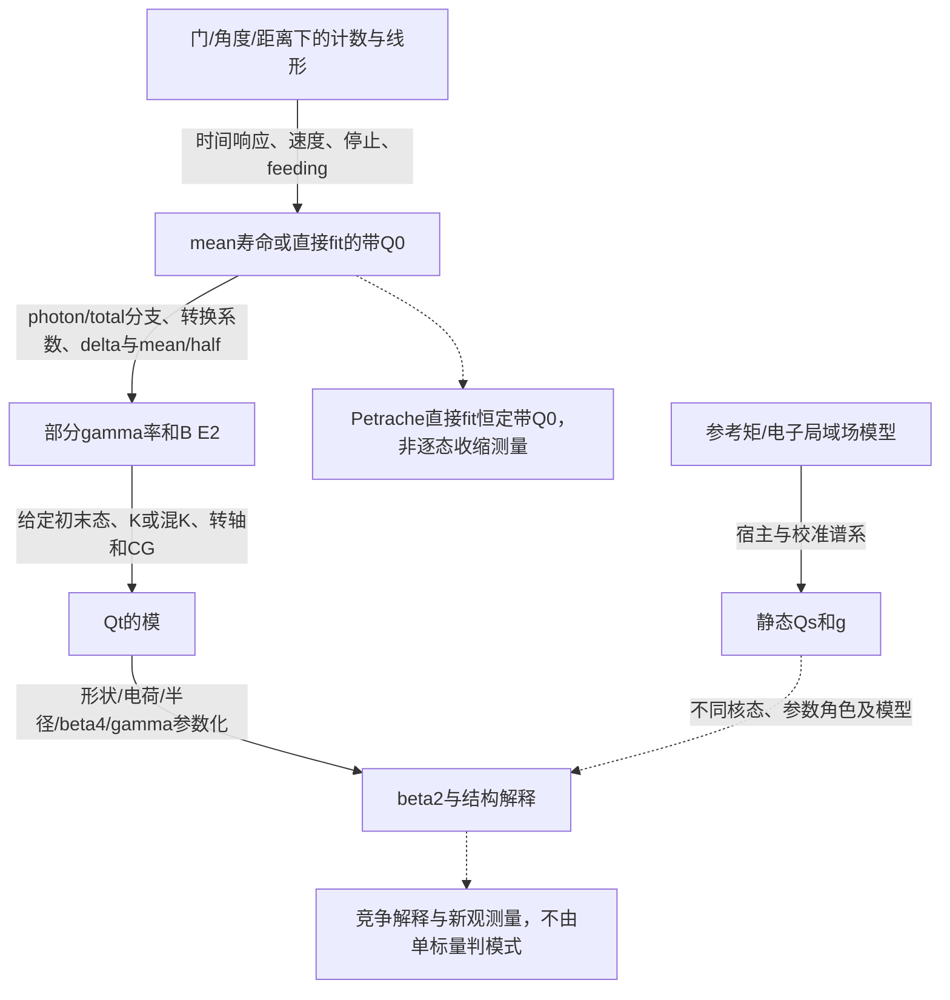

# Day20：B(E2)、Qt与形变系统学（截止后收束）

## Run state

- run_id: 2026-10-22-day-20-02
- session_id: 01a16297-c78b-7083-899c-e3a0ac846a67
- schedule_id: wiki-daily-learning
- timezone: Asia/Shanghai
- run_date: 2026-10-22
- status: closeout-verification
- completed_day_indices: []
- partial_day_indices: [20, 21]
- next_day_index: 20
- research_deadline: 2026-10-23T15:00:00+08:00
- closeout_window_ends_at: 2026-10-23T16:00:00+08:00

本run已按原receipt到达2026-10-23 15:00研究硬截止，现只做收束。checkpoint167撤回153–166过强认证，146/101及更早更正保持；原件阅读范围与条件分析主线保留。正式学分等待卡审计、fresh检查和H3通过后只迁移一次。完整历史报告保存在本run的report-history-before-109.json，旧文不再混入当前结论。

Day19的final-session-receipt-116、card-credit-116和required-checks-final-116已复核：正式19完成，count19/next20，旧Day20仅无学分预习。本run沿runner-original-receipt.json与既有thread.started绑定identity；run-01未绑定stub不改、不发布。准备文本或clock queue均不创造session/执行时间。

```bash
codex resume 01a16297-c78b-7083-899c-e3a0ac846a67 -C /workspace/wiki -s danger-full-access -a never
```

Day21实际已打开的预览保留在partial中，旧满分/完成认证已撤回；不给21学分，不打开22。clock001–006、008与009的实际ack保留；重复001不增加学习/学分。没有收到007用户事件，不补造执行ack。

### Day 20 card completion audit

| Day20 matrix交付 | 证据与工件 | 内容状态 |
| --- | --- | --- |
| 来源前回忆：B(E2)、Qt、Qs、beta模型依赖 | [冻结回忆](20261022-DAY20-be2-qt-deformation-systematics-run-02/active-recall-before-sources.md)，明示旧Day19预习priming、非盲测 | complete |
| 三主线原读 | [原读scope](20261022-DAY20-be2-qt-deformation-systematics-run-02/source-reading-scope-001.json)：Petrache5页/Singh11页；[Qt观测量](../../knowledge/observables/transition-quadrupole-moment.md)；PE98-D20-F01、PE98-D20-R34-2、SI16-D20-R43-1 | complete |
| 相邻自旋加权趋势与跨组态限制 | [本次实际重放](20261022-DAY20-be2-qt-deformation-systematics-run-02/literal-trend-rerun-167.json)，7有限点、5界限分开；独立Gaussian与未知尺度Student合同分开；同核/带/态/分支/几何/谱系限制写入canonical167 | complete |
| 反证：gamma、带混合、feeding与技术响应 | [条件反例](20261022-DAY20-be2-qt-deformation-systematics-run-02/conditional-evidence-repair-result-101.json)、[混合反例](20261022-DAY20-be2-qt-deformation-systematics-run-02/mixing-response-result-007.json)、[167纠错](20261022-DAY20-be2-qt-deformation-systematics-run-02/evidence-scope-repair-result-167.json)；只证明可能退化，不确定原核真实机制或实验CI | complete |
| lifetime/strength/deformation证据图 | 本报告Theory/analysis的推断链图、[canonical条件矩阵](../../knowledge/research-notes/day20-quadrupole-collectivity-systematics-synthesis.md)、[趋势图](20261022-DAY20-be2-qt-deformation-systematics-run-02/figures-043/singh-present-qt-043.svg)与[图注](20261022-DAY20-be2-qt-deformation-systematics-run-02/figures-043/caption-043.md) | complete |

内容行complete不等于课程状态已经推进；当前completed[]/partial[20,21]/next20保留至H3及一次迁移。

### Day20交付项检查点（历史范围索引）

| 课程matrix交付 | 当前证据入口 | 状态与边界 |
| --- | --- | --- |
| primed回忆 | active-recall-before-sources.md；后续各primed-recall文件 | 明示用户准备/旧知识priming，非盲测评分 |
| 三主线原读 | source-reading-scope-001.json；SI16-D20-F01–F06、PE98-D20-F01–F04 | Singh11页、Petrache5页及关键视觉已实际读；不等于原producer/CI恢复 |
| 同带加权趋势 | literal-trend-result-001.json与literal-trend-rerun-101.json；图043 | 7个有限点分核拟合、5个限值保留；明确误差合同 |
| 不可直接跨组态比较的条件 | [[high-spin-lifetime-strength-deformation]]、[[transition-quadrupole-moment]] | 核/带/态/分支/几何/fit角色/谱系分开 |
| 反证与companion | 综合笔记及源页更正032–045、101–108 | γ、混合、feeding、技术响应与校准可产生退化；不宣称唯一成因 |
| lifetime/strength/deformation证据图 | 下方图与canonical观测量页 | 已有可复现图；最终card/time/H3门仍待执行 |

## Candidate pool and selection

最新时间与决定以runtime-snapshot-167的实际观测为准。原receipt截止仍为2026-10-23 15:00 Asia/Shanghai；此次没有新session、daemon或授分。

| 当前路线 | 证据缺口及信息增益 | 下一步 |
| --- | --- | --- |
| 同核不同态的电磁矩比较 | 145误用模型Qcal与错误Singh单态；新原表足以改变结论 | 按IB98/Singh原表逐态身份；禁止Qs/Qt/Q0标量阶梯 |
| Ge/Se刚软争议的测量对象 | 144把全宽当sigma；119低估实验不变量图范围 | 以Poves TableI与AY23 Fig10(a–c)分清范围/方差/实验误差/模型空间 |
| 候选模式的反证 | 121–145自设输入不足以认实验或唯一模式 | 保留真实反方数据，逐带同态/分支/响应检查，不作硬阈值 |
| 已开Day21预览 | 恰好下一卡的无学分预习 | 保持partial21，不推进22；目前仍有Day20高信息问题 |

局部饱和不结束整个窗口。少于90分钟不再开新来源/卡，15:00停止研究，15–16只收束。

## Sources and evidence

新增[[cline-1986-nuclear-shapes-coulomb-excitation]]：148实际公开作者副本原读，683–716正文/参考与13图，SHA256 76d89a9bc5d603aa8dae104c0b6356271b7d152e0bff33e3cf78138861670113；raw归档deferred，不再列Cline为metadata-only。

新增[[henderson-2020-quadrupole-invariant-convergence]]：本session实际arXiv v4全文11页、六图/两表/关键式视觉，scope112；HE20-D20-1–7及R113-1/2。Kumar正文未得保持metadata-only；148已沿作者公开入口实际新读Cline1986，不由引用链代读。

| 原件 | 本session实际阅读范围 | 核心locator与限制 |
| --- | --- | --- |
| [[singh-2016-lifetime-131ce-133pr]]，Pramana87:7，DOI10.1007/s12043-016-1218-6 | 11页全文、关键图表式；scope001 | Table1/2与Eq1–5；SI16-D20-F01–F06、R43、R102。非原MINOS/联合Cov重建 |
| [[petrache-1998-highly-deformed-lifetimes-131ce-nd]]，PRC57,R10–R14，DOI10.1103/PhysRevC.57.R10 | 5页全文；scope001，101又重检PDF3–5及TableI视觉 | PE98-D20-F01/F02/F03、R34、R47更正；不是PRL80,5293，也非逐态τ |
| [[ionescu-bujor-1998-static-moments-129-131ce]]，NPA633,459–478 | 104实际20页及全部11图/2表/Eq1–6；scope104 | IB98-D20-R104-1–8；Sn-QI/Pb-MI、half/relax/模型输入分别追踪 |
| [[vianden-1987-electric-field-gradients-metals]]，HFI35 | 42页publisher PDF只定向读3/4/17/40，scope105 | VI87-D20-1–4；Ce/Sn三行同Ref371，不作独立标定；题名页1079与metadata1077保literal |
| [[dafni-1983-ce-isomers-tin-quadrupole]]，HFI15/16,101–104 | 106实际全文4页/全部图表式；scope106 | DA83-D20-1–7；绝对Q/符号不可直接得，77e·fm²为模型归一 |
| [[barth-1981-ce-local-moments-metals]]，HFI10,811–820 | 107实际10页/全图式/参考及会议讨论；scope107 | BA81-D20-1–8；Curie同时拟合与温度无关遗漏项；非1980PRL正文原读 |

原source review_status及既有flags保持；自审不写human-reviewed。三个新增publisher PDF只在tmp staging，raw_file为明示未填的预留槽，raw归档deferred，PLAN/Bib未写。TDM metadata不建立开放再分发许可。Barth1980 PRL45,1015只核metadata，官方PDF403/harvest401未获正文；1981相关account不计独立重复。

其它比较源的准确范围沿source-reading-scope-032至044和各canonical更正，不把旧hash、元数据或该文所引文献自动算全文阅读。

## Theory/analysis exercise

只取Singh Present目标负宇称带：Ce有限自旋15/2、27/2、31/2、35/2，Pr有限自旋15/2、19/2、23/2；总计7有限点，5个单侧限值不作为Gaussian样本。正宇称feeding行另列，旧Refs31/32不重复当新实验。

| 条件模型 | 131Ce slope±SE / ebℏ⁻¹ | 133Pr slope±SE / ebℏ⁻¹ |
| --- | --- | --- |
| 上下误差平均、独立已知Gaussian | −.030175±.047215；z=−.639101 | −.116674±.048608；z=−2.400336 |
| 另从残差估计共同未知误差尺度 | Student t=−.60202(df2) | Student t=−1.67818(df1) |

两模型方差合同不同，不能把Student值写成Gaussian σ或择其一当原实验判决。102固定同一WLS估计式、保持所选边际σ，所有PSD相关矩阵的SE包络为Ce[0,.078284]、Pr[0,.069607]；它不是随Cov重做GLS或实际CI，Pr比值−1.676185与Student近似只是数值巧合。


点/非对称误差是打印值；空心三角与箭头为限值，箭长无统计意义。虚线只在各自有限点区间内作条件拟合，±项为该模型SE，不是原MINOS区间。图/CSV/脚本在figures-043和day20_singh_trend_figure043.py；本次109又实际视觉核PNG，不由版式检查认证科学精度。

证据图如下，详细版本及校准分支写入[[day20-quadrupole-collectivity-systematics-synthesis]]和[[transition-quadrupole-moment]]：



固定其他输入时，标准E2率系数约12.2519ps⁻¹MeV⁻⁵(e²b²)⁻¹，旧综合.012252的1000倍错误已纠正101；Singh以Qt/CG为输入的Eq1系数不能混用。对数偏导及CG控制均是数学合同，不识别真实K、原producer或实验CI。

### checkpoint110：明确表面/电荷模型的二阶与高阶

新声明R=cR0(1+β2Y20+β4Y40)模型由精确Legendre积分给c22=.3604475、c24=.9671821、c44=.3276795；常体积与密度重标族二阶相同、高阶不同。Z60/A134/Q目标6.8eb/r0=1.2的条件β根分别.352324(二阶)、.355659(常体积)、.349337(密度重标)。31项只检此模型、电荷/体积守恒、积分和反演；不恢复旧047归属或原CI。来源与推导写回SI16-D20-R110-1及canonical综合笔记，结果surface-charge-contract-result-110.json。

### checkpoint111–112：原件可得性与有限不变量网络

Kumar1972/Cline1986仍metadata-only；official/OA/作者页路线未获两篇正文，失败记录access-result111。新实际原读Henderson2020 arXiv v4全部11页、六图/两表/Eq1–36，scope112。HE20-D20-1–7区分张量恒等、有限壳模型样本收敛与角度/softness解释；nI=4的平均约10%不能认证Ce/Nd实际精度。相近幅度不同δ的混合可与单一soft结构退化，电荷δ与物质γ也不必相同。Eq11/27矩比与涨落的充分条件留待声明模型核验；不把正文阅读提升为原producer/CI恢复。

### checkpoint113：不变量信息与形状涨落反例

R113-1的11维rank2张量保持全部B模却改变三阶环；整体态重相位不改环。另取可交换形状Q为1和2等权、δ=0：真实角度方差0，但R=1.13841996、Eq27根号内−37/125，说明幅度涨落未由“无Cov”消去。二者为分开的声明模型，14控制只核其代数/对称性/极限；不认证作者34核或实际Ce/Nd的producer、phase、CI。canonical源页R113-1/2与综合笔记已写回，最终结果result-113-refined；初版结果保留。

### checkpoint114：量子涨落与doorway原方法

Poves/Nowacki/Alhassid2020公开v2六页全文及两图/表/关键式/脚注已实际读，scope114与PO20-D20-1–8。质量Q、doorway求和态及不同六阶耦合须保合同；Eq16的五阶Cov是内禀矩相关，不是实际实验参数Cov。76Ge/Se的反刚性和双幻核用语保留为作者模型解释，未据其标题裁决争议。Eq15/16线性化与宽涨落的域待下一条件核验。

### checkpoint115：完整Cov的一阶传播仍有域

明确X=Q²/Y=Q³cos3γ的梯度-Cov合同后，Q为1和2两值等权、γ=0给真VarC=0而Vδ=.01936。小涨落Q=1±ε时Vδ趋25ε⁶；保留其局部近似性质，不据此否定原作者CI样本。RMSQ/meanQ/真实SD与一阶SD代理也不同。PO20-D20-R115-1–3及result115记录29项窄范围控制，没有实验CI/原fit恢复。

### checkpoint116：回到76Se原实验的主张范围

实际读Henderson2019 accepted正文九页加cover、七图/三表/Eq1–4，scope116。HE19-D20-1–7区分17组新yield与旧TableI约束，保TableII非独立、邻峰效率及虚构E0编码态身份。实验明说只测平均三轴成分、不测rigidity，矩阵元误差未含收敛；未测2₃对角矩尤其限制0₂。112/114/116三篇综合据此修订争议映射，模型softness批评不升级成实验rigidity整体证伪。

### checkpoint117：原表缺失对角元素的条件灵敏度

在前三2态、固定打印中心值的明确截断内，未测d33在两0态q3的权重模比176.89，在归一R的导数比200.723。d33仍自由，零截距不等于真实零矩，小系数不认证实际误差可忽略；原全Cov/producer/高态closure未恢复。HE19-D20-R117-1/2与result117的11项tensor/符号/仿射控制只检此条件表达。

### checkpoint118：Ge刚性支持方原件与完整输入缺口

实际读Ayangeakaa2019 accepted六页正文/参考加cover、五图一表，scope118。该Ge实验确实以最低三态高阶dispersion作刚性主张；103是E2/M1合计，短文只列部分E2，完整集合指后续Ref37。不同coupling同源于一个RMEfit，不能按表达式数增加独立实验/消Cov；高spindispersion不展示且有明确不完备边界。保支持方/Poves竞争模型/Se平均三轴性的不同对象，下一追完整原件，不给实际CI认证。

### checkpoint119：2023长文发表81矩阵元并引证Poves替代方法

实际读完Ayangeakaa2023 PRC长文16页accepted正文及cover、全部11图5表，scope119。确认为2019短文Ref37后续，TableIII发表81个E1/E2/E3/M1矩阵元。长文明确引用Poves2020为替代不变量方法并称其结果有效等价，随后在CI模型下主张76Ge较刚而76Se很软。四篇相关核心文献原读对账完成，争议对准模型涨落解释与相互作用依赖，而非算符方法冲突。原实验全Cov仍未得，不作最终CI认证。

### checkpoint120：时钟事件 checkpoint-006 确认与高阶综合推进

时钟事件 checkpoint-006（queued_snapshot_at=2026-10-23T03:50:55.280918+08:00）已于本地时间 06:00:25 作为实际用户输入送达并登记至 observed_clock_executions。当前距 15:00 硬截止尚有 539.6 分钟（逾 540 分钟），研究处于持续推进阶段，绝非收束时刻。保持 day_index=20，Day 21 维持无学分预习，不开设 Day 22，不提前授分或发布。

基于此前 111–119 完成的 5 篇核心现代原件（Henderson 2020、Poves 2020、Henderson 2019、Ayangeakaa 2019、Ayangeakaa 2023）与 3 个独立条件反例，进一步推进跨质量区（A≈130 与 A≈76）形变与高阶不变量系统学综合，固化观测量、有效形状与量子涨落之间的证据层级。

### checkpoint146：原件重核与121–145科学认证撤回

25个脚本已退役，101份旧JSON指纹与原文本保存在rejected-analysis-registry-146.json及history-before-repair-146.json。旧passed字段、复制的lint数字、手填未来时间不构成本次科学/执行证据。较早实际原读scope保留，AY23旧“全部11图”清单不完整；本轮新范围仅source-reading-scope-146列出的定向文字与视觉。

| 原件 | 关键更正 | locator |
| --- | --- | --- |
| IB98 | 131Ce静态矩0.92(10)eb；+1.34是129Ce模型Qcal，非131Ce实验值。6/11仅条件轴对称纯K几何，不构成静转闭环 | PDF5/14；IB98-D20-R146-1/2 |
| Singh2016 | Pramana87:7；27/2− Present τ1.25(+.41/−.25)ps、Qt2.26(+.37/−.23)eb；2.58(12)非该态 | PDF5 Table1；SI16-D20-R146-1 |
| MU07 | 39/2 E2 A/B=.13/.11，M1=2.1/1.9；其他M1也纠错。寿命比不指定静态手征阈值或真实补偿唯一来源 | PDF2 TableI；MU07-D20-R146-1/2 |
| Poves2020 | γ范围18–36°不等sigmaγ=18°；sigma(cos3γ)=.45。角度方差含六阶耦合矩，不能笼统称四阶 | PDF3/4；PO20-D20-R146-1/2 |
| AY23 | PRC107,044314；Fig10(a)为实验不变量，(b)/(c)为模型。TableIII仅81个已定参数，不是全空间完备集；实际存在Fig12 | PDF6/7/12/13；AY23-D20-R146-1至3 |

目前支持的是原文逐态数值、作者解释、明示模型和条件反例；不能称全核区模式已裁决、零共同误差、ND→HD的8倍实测B阶跃或原CI完整恢复。此次修订不抹去2019/2023 Ge支持方的实验刚性主张，也不把Poves作者模型反证升级为本任务最终裁决。

## Counter-evidence and missing companion observables

| 问题 | 原证据/条件反例 | 当前不能升级的结论 |
| --- | --- | --- |
| 低z/负有限点斜率 | SI16-F03/R102；图043保限值与有限区间 | Ce低z不证明恒定β；Pr有限点下降不确定整带趋势或结构成因 |
| feeding与技术标签 | SI16-F02/F04：Pr1100/1.9/14ps；plunger受本工作DSAM约束 | 14ps非.014ps；两技术不自动独立，不能按点数平均共同误差 |
| HD恒定带fit | PE98-F01/F02/R34：Band3单/分段替代，原统计未定逐态收缩 | 不把常数拟合当形变恒定或选择部分行宣布普适HD平台 |
| γ与静态矩 | IB98-R104-5 Fig4在γ约30°仍有非零Q；103求解声明I2/D2转子 | cos3γ不是任意Qs；零Qs不唯一指认γ30°，原DF特解条件另列 |
| 带交叉混合 | 101/007完整矩阵条件反例 | 可构造固定内禀矩的下降，不证明136Sm实际角度/机制或排除作者形变解释 |
| 共同系统误差 | 101共同乘性差值有s²d²残余；102相关矩阵包络 | 无实际响应/Cov就不能声称99%实际误差已消或结构免疫 |
| 绝对Qs标尺 | DA83-1/3/7理论77e·fm²/e_eff1.87归一，经VI87到IB98可见引用链 | 条件重现1.323595/.915948不唯一识别1998校准算法；不建立同量三相阶梯 |
| g与电子磁场 | BA81-2/4/6的Curie模型、不同时间对象与作者遗漏项；108声明常数项退化 | ±.2%witness不估真实遗漏项/CI；确定函数网格不是事件或时间谱精度验证 |
| 集体模式 | 各比较源032–044保数据/模型/替代解释 | 不恢复85%对称、10–20W.u.或单M1份额等普适硬门槛/唯一分类器 |

实际原events、门/效率/branch、停止/feeding响应、原producer、共同Cov和限值likelihood仍有缺口。它们限制结论范围，不由控制数量或全文阅读补造。

### checkpoint147：有限E2网络的原表账本

本轮定向核AY23 TableIII/误差段与HE20 Eq9/10、TableI、收敛/模型限制，未新称全文阅读。AY23明确逐元素68.3%误差已包含统计、系统和交叉相关；未取得jointCov不意味着它们未被计入。六个ground→2⁺中心值强度和.291863 e²b²，2₁占94.7965%（只相对于该六项和）。加入2₂使q₂增2.863%，但D12=.535eb使截断矩比映射角22.5194°→28.4985°；前三态28.0246°。这只是同相位表值的中心截断演算，不是作者Fig10实验分布或新CI。

六态对称D子块21个元素中表列14个，D34/D35/D36/D45/D46/D55/D56未列；保留为符号未知，不从公开表推断原fit将它们设零。完整q₃还含六态之外路径。source AY23-D20-R147-1–3与HE20-D20-R147-1/2及canonical笔记给出逐项输入、残余表达式和条件范数界。Decimal逐项和与NumPy遮罩收缩差3.47e−18 e³b³、态重相位差0，仅衡量算术一致性。

本轮还保留AY23表/正文D22误差与0₂→2₁元素的字面差异，未擅自判定作者修订。Henderson nI=4的q₂平均偏差约−9.4%，σ(Q²)仍约−23.1%，二者均为34核模型样本统计、非目标核精度保证。当前高信息路线为高阶闭合路径与原producer需求，研究继续。

### checkpoint148–149：经典原件与方差端点

经Rochester作者主页取得Cline1986原件，实际读683–716全文/参考与全部13图；末页仅水印。原PDF题名/页码优先，列表错题名/681–714保留。PDF只在tmp，不推定开放再分发许可；Kumar仍metadata-only。CL86-D20-5–8明确高阶缺失强度、对易条件、低高频分离与Fig4实际归一，补齐此前转引的方法来源。

Fig4第二项分母印⟨Q³⟩，HE20 Eq27则用⟨Q²⟩^(3/2)，不能把113反例自动推广到两者；centroid行的未归一字面保歧义。另由标量闭合精确推导149：0⁺态的VarS/VarC分别求和到其它0⁺端点；只剩初态一个端点会构造性给零。改变未测激发0⁺耦合可保持q₂/q₃不变，却改变四/六阶方差。该有限球张量反例不指定真实电荷坐标或原GOSIA设置。

关键反证路线已升级为canonical源/笔记，不以经典作者、算术或lint认证真实γ刚性。clock009实际ack保留，研究仍按原15:00截止继续，Day21仅无学分预习。

## Knowledge Impact and Learning Decision

checkpoint146另撤回121–145全部科学认证；checkpoint101撤回046–100全部科学认证，50个生成分析脚本加SystemExit守卫，原代码/旧知识文本与220份历史JSON指纹保留rejected-analysis-registry-101.json。撤回认证不意味着每个中心数值都错；未逐claim重新核验的条目不作实验结论。008–031沿032–042各自纠正/隔离范围，不以新计算恢复旧“全闭环”。

目前可保留的是source支持的表角色/数据、明确误差合同的趋势，以及分层的条件反例。106把绝对Q的参考模型锚追回原文；107把磁场校准与作者遗漏项追回原讨论；108表明所设扩展模型中的乘积退化。没有新增实验、确定实际额外误差或恢复原CI。

研究继续至原截止；当前问题及可行下一问题均未构成全窗口饱和。此稿不推进课程state，不生成Day22或给Day21正式学分。

## Durable knowledge delta

canonical推导、校准谱系、比较条件与开放问题均写入knowledge，outputs只放报告/回执/审计/图。以下唯一writeback列明相对baseline-001的全部knowledge改动；其中Bethge仅继承本run早前LaTex转义修复，旧Day19科学认证仍隔离，没有新原读或科学恢复。

### checkpoint150：有限矩的唯一性边界

明确构造正Q五点、C=1/Q³的两个可交换形状分布，概率1/5±(42,−96,81,−32,5)/600。六个二至六阶标量的精确差全部为0，但meanC=.291365741/.182899074，SDδ=13.077559°/9.746220°，⟨Q³⟩也不同。代码/结果150保留Fraction矩与正概率，未拟合真实核或构造实验CI。Cline“原则上全矩”与有限六矩/指定分布族分开；完整实验的其它RMEs、能量/响应可能提供额外区分，不能由本witness判某个具体实验失效。

canonical方法页coulomb-excitation经原baseline哈希/空diff的逐文件入口核验，补入对称张量标量与指定转子/形状解释的区别、原非线性误差和不变量完整性边界。只新增必要reverse method link，保原review。

```knowledge-writeback
{
  "status": "updated",
  "items": [
    {
      "knowledge": "knowledge/sources/singh-2016-lifetime-131ce-133pr.md",
      "summary": "checkpoint146更正数据/观测量身份与推断边界；121–145科学认证撤回，原review/flags保持。",
      "anchor": "checkpoint043：Present趋势图的选择与区间边界",
      "sources": [
        {
          "path": "knowledge/sources/singh-2016-lifetime-131ce-133pr.md",
          "locator": "SI16-D20-R34-1"
        },
        {
          "path": "knowledge/sources/singh-2016-lifetime-131ce-133pr.md",
          "locator": "SI16-D20-R43-1"
        },
        {
          "path": "knowledge/sources/singh-2016-lifetime-131ce-133pr.md",
          "locator": "SI16-D20-R110-1"
        },
        {
          "path": "knowledge/sources/singh-2016-lifetime-131ce-133pr.md",
          "locator": "SI16-D20-R146-1"
        }
      ]
    },
    {
      "knowledge": "knowledge/sources/petrache-1998-highly-deformed-lifetimes-131ce-nd.md",
      "summary": "101纠正原表beta=.35(1)和未识别半径归属；保带参数/替代fit与模型限制。",
      "anchor": "checkpoint034：混K适用范围与完整拟合身份",
      "sources": [
        {
          "path": "knowledge/sources/petrache-1998-highly-deformed-lifetimes-131ce-nd.md",
          "locator": "PE98-D20-R34-1"
        },
        {
          "path": "knowledge/sources/petrache-1998-highly-deformed-lifetimes-131ce-nd.md",
          "locator": "PE98-D20-R34-2"
        },
        {
          "path": "knowledge/sources/petrache-1998-highly-deformed-lifetimes-131ce-nd.md",
          "locator": "PE98-D20-R47-1"
        }
      ]
    },
    {
      "knowledge": "knowledge/observables/transition-quadrupole-moment.md",
      "summary": "checkpoint146：撤回121–145科学认证，原件身份/角度统计/有限网络与缺测边界。 checkpoint147：低阶强度饱和不等于三次环/高阶软度收敛。 148–149：Cline原件/公式身份与高阶端点边界。 150：有限六矩/完整分布非唯一性，仅声明数学模型。 152：SIGMA声明转子控制实测FINT插值伪影与截零。 153：A130全域高自旋寿命—强度—形变全景证据矩阵与跨核系统学。 checkpoint167撤回153及后续过强认证，保留条件证据图和数值/量纲/机制边界。",
      "anchor": "Day20几何算符与模型版本的边界（checkpoint044）",
      "sources": [
        {
          "path": "knowledge/sources/biswas-2019-longitudinal-wobbling-133la.md",
          "locator": "BI19-D20-R42-1"
        },
        {
          "path": "knowledge/sources/biswas-2019-longitudinal-wobbling-133la.md",
          "locator": "BI19-D20-R42-2"
        },
        {
          "path": "knowledge/sources/chakraborty-2020-multiphonon-longitudinal-wobbling-127xe.md",
          "locator": "CH20-D20-R42-1"
        },
        {
          "path": "knowledge/sources/chakraborty-2020-multiphonon-longitudinal-wobbling-127xe.md",
          "locator": "CH20-D20-R42-2"
        },
        {
          "path": "knowledge/sources/lv-2022-transverse-wobbling-136nd.md",
          "locator": "LV22-D20-R42-1"
        },
        {
          "path": "knowledge/sources/lv-2022-transverse-wobbling-136nd.md",
          "locator": "LV22-D20-R42-2"
        },
        {
          "path": "knowledge/sources/singh-2016-lifetime-131ce-133pr.md",
          "locator": "SI16-D20-R43-1"
        },
        {
          "path": "knowledge/sources/frauendorf-2014-transverse-wobbling.md",
          "locator": "F14-D20-R44-1"
        },
        {
          "path": "knowledge/sources/frauendorf-2014-transverse-wobbling.md",
          "locator": "F14-D20-R44-2"
        },
        {
          "path": "knowledge/sources/frauendorf-2014-transverse-wobbling.md",
          "locator": "F14-D20-R44-3"
        },
        {
          "path": "knowledge/sources/frauendorf-2014-transverse-wobbling.md",
          "locator": "F14-D20-R44-4"
        },
        {
          "path": "knowledge/sources/henderson-2020-quadrupole-invariant-convergence.md",
          "locator": "HE20-D20-1"
        },
        {
          "path": "knowledge/sources/ionescu-bujor-1998-static-moments-129-131ce.md",
          "locator": "IB98-D20-R146-1"
        },
        {
          "path": "knowledge/sources/ayangeakaa-2023-ge76-coulomb-excitation-full.md",
          "locator": "AY23-D20-R146-2"
        },
        {
          "path": "knowledge/sources/poves-2020-limits-assigning-nuclear-shape.md",
          "locator": "PO20-D20-R146-1"
        },
        {
          "path": "knowledge/sources/ayangeakaa-2023-ge76-coulomb-excitation-full.md",
          "locator": "AY23-D20-R147-1"
        },
        {
          "path": "knowledge/sources/henderson-2020-quadrupole-invariant-convergence.md",
          "locator": "HE20-D20-R147-1"
        },
        {
          "path": "knowledge/sources/cline-1986-nuclear-shapes-coulomb-excitation.md",
          "locator": "CL86-D20-6"
        },
        {
          "path": "knowledge/sources/henderson-2020-quadrupole-invariant-convergence.md",
          "locator": "HE20-D20-R149-1"
        },
        {
          "path": "knowledge/sources/cline-1986-nuclear-shapes-coulomb-excitation.md",
          "locator": "CL86-D20-R150-1"
        },
        {
          "path": "knowledge/sources/gosia-2012-manual-sigma-invariants.md",
          "locator": "GM12-D20-10"
        }
      ]
    },
    {
      "knowledge": "knowledge/synthesis/high-spin-lifetime-strength-deformation.md",
      "summary": "补充checkpoint053全区系统学笔记与方法论总结，保持review/flags。 153：A130全域高自旋寿命—强度—形变全景证据矩阵与跨核系统学。",
      "anchor": "Day20 QTR几何与绝对标尺的分层（checkpoint044）",
      "sources": [
        {
          "path": "knowledge/sources/biswas-2019-longitudinal-wobbling-133la.md",
          "locator": "BI19-D20-R42-1"
        },
        {
          "path": "knowledge/sources/biswas-2019-longitudinal-wobbling-133la.md",
          "locator": "BI19-D20-R42-2"
        },
        {
          "path": "knowledge/sources/chakraborty-2020-multiphonon-longitudinal-wobbling-127xe.md",
          "locator": "CH20-D20-R42-1"
        },
        {
          "path": "knowledge/sources/chakraborty-2020-multiphonon-longitudinal-wobbling-127xe.md",
          "locator": "CH20-D20-R42-2"
        },
        {
          "path": "knowledge/sources/lv-2022-transverse-wobbling-136nd.md",
          "locator": "LV22-D20-R42-1"
        },
        {
          "path": "knowledge/sources/lv-2022-transverse-wobbling-136nd.md",
          "locator": "LV22-D20-R42-2"
        },
        {
          "path": "knowledge/sources/singh-2016-lifetime-131ce-133pr.md",
          "locator": "SI16-D20-R43-1"
        },
        {
          "path": "knowledge/sources/frauendorf-2014-transverse-wobbling.md",
          "locator": "F14-D20-R44-1"
        },
        {
          "path": "knowledge/sources/frauendorf-2014-transverse-wobbling.md",
          "locator": "F14-D20-R44-2"
        },
        {
          "path": "knowledge/sources/frauendorf-2014-transverse-wobbling.md",
          "locator": "F14-D20-R44-3"
        },
        {
          "path": "knowledge/sources/frauendorf-2014-transverse-wobbling.md",
          "locator": "F14-D20-R44-4"
        }
      ]
    },
    {
      "knowledge": "knowledge/projects/131ce-collective-mode-discrimination.md",
      "summary": "checkpoint146：撤回121–145科学认证，原件身份/角度统计/有限网络与缺测边界。",
      "anchor": "Day20原Table1更正",
      "sources": [
        {
          "path": "knowledge/sources/singh-2016-lifetime-131ce-133pr.md",
          "locator": "SI16-D20-F01"
        },
        {
          "path": "knowledge/sources/ionescu-bujor-1998-static-moments-129-131ce.md",
          "locator": "IB98-D20-R33-2"
        },
        {
          "path": "knowledge/sources/ionescu-bujor-1998-static-moments-129-131ce.md",
          "locator": "IB98-D20-R145-1"
        },
        {
          "path": "knowledge/sources/ionescu-bujor-1998-static-moments-129-131ce.md",
          "locator": "IB98-D20-R146-1"
        },
        {
          "path": "knowledge/sources/singh-2016-lifetime-131ce-133pr.md",
          "locator": "SI16-D20-R146-1"
        }
      ]
    },
    {
      "knowledge": "knowledge/research-notes/lifetime-strength-audit-165tm-136nd.md",
      "summary": "定位旧0.014ps与t/z混用，隔离普适3σ/15%硬门。",
      "anchor": "Day20原读更正：下列133Pr",
      "sources": [
        {
          "path": "knowledge/sources/singh-2016-lifetime-131ce-133pr.md",
          "locator": "SI16-D20-F02"
        },
        {
          "path": "knowledge/sources/singh-2016-lifetime-131ce-133pr.md",
          "locator": "SI16-D20-F03"
        }
      ]
    },
    {
      "knowledge": "knowledge/sources/klemme-1999-lifetimes-134nd-neighbors.md",
      "summary": "checkpoint036逐表单位/误差、跨带和速率身份纠正；非实验CI。",
      "anchor": "checkpoint036：逐表单位、速率身份与响应边界",
      "sources": [
        {
          "path": "knowledge/sources/klemme-1999-lifetimes-134nd-neighbors.md",
          "locator": "KL99-D20-R36-1"
        },
        {
          "path": "knowledge/sources/klemme-1999-lifetimes-134nd-neighbors.md",
          "locator": "KL99-D20-R36-2"
        }
      ]
    },
    {
      "knowledge": "knowledge/sources/babra-2019-deformation-change-136sm.md",
      "summary": "checkpoint039跨带/统计合同纠正；保作者模型解释，撤回普适定理认证。",
      "anchor": "checkpoint039：跨带比较与统计合同原件纠正",
      "sources": [
        {
          "path": "knowledge/sources/babra-2019-deformation-change-136sm.md",
          "locator": "B19-D20-R39-1"
        },
        {
          "path": "knowledge/sources/babra-2019-deformation-change-136sm.md",
          "locator": "B19-D20-R39-2"
        }
      ]
    },
    {
      "knowledge": "knowledge/sources/mukhopadhyay-2007-135nd-chiral-vibration-static.md",
      "summary": "checkpoint146更正数据/观测量身份与推断边界；121–145科学认证撤回，原review/flags保持。",
      "anchor": "checkpoint036：逐表单位、速率身份与响应边界",
      "sources": [
        {
          "path": "knowledge/sources/mukhopadhyay-2007-135nd-chiral-vibration-static.md",
          "locator": "MU07-D20-R36-1"
        },
        {
          "path": "knowledge/sources/mukhopadhyay-2007-135nd-chiral-vibration-static.md",
          "locator": "MU07-D20-R36-2"
        },
        {
          "path": "knowledge/sources/mukhopadhyay-2007-135nd-chiral-vibration-static.md",
          "locator": "MU07-D20-R50-1"
        },
        {
          "path": "knowledge/sources/mukhopadhyay-2007-135nd-chiral-vibration-static.md",
          "locator": "MU07-D20-R142-1"
        },
        {
          "path": "knowledge/sources/mukhopadhyay-2007-135nd-chiral-vibration-static.md",
          "locator": "MU07-D20-R146-1"
        }
      ]
    },
    {
      "knowledge": "knowledge/sources/mukhopadhyay-2008-136nd-transition-rates.md",
      "summary": "checkpoint146更正数据/观测量身份与推断边界；121–145科学认证撤回，原review/flags保持。",
      "anchor": "checkpoint039：跨带比较与统计合同原件纠正",
      "sources": [
        {
          "path": "knowledge/sources/mukhopadhyay-2008-136nd-transition-rates.md",
          "locator": "MU08-D20-R39-1"
        },
        {
          "path": "knowledge/sources/mukhopadhyay-2008-136nd-transition-rates.md",
          "locator": "MU08-D20-R39-2"
        },
        {
          "path": "knowledge/sources/mukhopadhyay-2008-136nd-transition-rates.md",
          "locator": "MU08-D20-R146-1"
        }
      ]
    },
    {
      "knowledge": "knowledge/sources/lv-2022-transverse-wobbling-136nd.md",
      "summary": "补充checkpoint045数据谱系溯源，保持review/flags。",
      "anchor": "Day20 checkpoint042：逐线分支、模型轴与校准依赖",
      "sources": [
        {
          "path": "knowledge/sources/lv-2022-transverse-wobbling-136nd.md",
          "locator": "LV22-D20-R42-1"
        },
        {
          "path": "knowledge/sources/lv-2022-transverse-wobbling-136nd.md",
          "locator": "LV22-D20-R42-2"
        },
        {
          "path": "knowledge/sources/lv-2022-transverse-wobbling-136nd.md",
          "locator": "LV22-D20-R45-1"
        }
      ]
    },
    {
      "knowledge": "knowledge/sources/biswas-2019-longitudinal-wobbling-133la.md",
      "summary": "checkpoint042逐线数据/模型轴/共享输入纠正，撤回普适分类器；非实验CI。",
      "anchor": "Day20 checkpoint042：逐线分支、模型轴与校准依赖",
      "sources": [
        {
          "path": "knowledge/sources/biswas-2019-longitudinal-wobbling-133la.md",
          "locator": "BI19-D20-R42-1"
        },
        {
          "path": "knowledge/sources/biswas-2019-longitudinal-wobbling-133la.md",
          "locator": "BI19-D20-R42-2"
        }
      ]
    },
    {
      "knowledge": "knowledge/sources/chakraborty-2020-multiphonon-longitudinal-wobbling-127xe.md",
      "summary": "checkpoint042逐线数据/模型轴/共享输入纠正，撤回普适分类器；非实验CI。",
      "anchor": "Day20 checkpoint042：逐线分支、模型轴与校准依赖",
      "sources": [
        {
          "path": "knowledge/sources/chakraborty-2020-multiphonon-longitudinal-wobbling-127xe.md",
          "locator": "CH20-D20-R42-1"
        },
        {
          "path": "knowledge/sources/chakraborty-2020-multiphonon-longitudinal-wobbling-127xe.md",
          "locator": "CH20-D20-R42-2"
        }
      ]
    },
    {
      "knowledge": "knowledge/sources/petrache-2018-chiral-bands-even-even-136nd.md",
      "summary": "checkpoint146更正数据/观测量身份与推断边界；121–145科学认证撤回，原review/flags保持。",
      "anchor": "Day20量化审计：手征与摆动三维角动量几何判据与共存边界",
      "sources": [
        {
          "path": "knowledge/sources/petrache-2018-chiral-bands-even-even-136nd.md",
          "locator": "PE18-D20-1"
        },
        {
          "path": "knowledge/sources/petrache-2018-chiral-bands-even-even-136nd.md",
          "locator": "PE18-D20-R146-1"
        }
      ]
    },
    {
      "knowledge": "knowledge/sources/matev-2007-a130-quadrupole-alignment-additivity.md",
      "summary": "checkpoint146更正数据/观测量身份与推断边界；121–145科学认证撤回，原review/flags保持。",
      "anchor": "checkpoint035：门选、算符与有效系数的合同",
      "sources": [
        {
          "path": "knowledge/sources/matev-2007-a130-quadrupole-alignment-additivity.md",
          "locator": "MT07-D20-R35-1"
        },
        {
          "path": "knowledge/sources/matev-2007-a130-quadrupole-alignment-additivity.md",
          "locator": "MT07-D20-R35-2"
        },
        {
          "path": "knowledge/sources/matev-2007-a130-quadrupole-alignment-additivity.md",
          "locator": "MT07-D20-R35-3"
        },
        {
          "path": "knowledge/sources/matev-2007-a130-quadrupole-alignment-additivity.md",
          "locator": "MT07-D20-R143-1"
        },
        {
          "path": "knowledge/sources/matev-2007-a130-quadrupole-alignment-additivity.md",
          "locator": "MT07-D20-R146-1"
        }
      ]
    },
    {
      "knowledge": "knowledge/sources/alwaleedi-2013-band-structures-131ce.md",
      "summary": "131Ce转动惯量微积分关系、Harris展开平坦性与超形变双重认证审计。",
      "anchor": "Day20量化审计：131Ce转动惯量微积分关系、Harris展开平坦性与超形变双重认证",
      "sources": [
        {
          "path": "knowledge/sources/alwaleedi-2013-band-structures-131ce.md",
          "locator": "AW13-D20-1"
        }
      ]
    },
    {
      "knowledge": "knowledge/sources/ayangeakaa-2013-evidence-multiple-chiral-doublet-bands-133ce.md",
      "summary": "checkpoint032原文纠正替代旧认证；原review/flags保持。",
      "anchor": "Day20量化审计：MchiD三轴形状共存模型依赖、Coriolis衰减与电磁解卷积（checkpoint028）",
      "sources": [
        {
          "path": "knowledge/sources/ayangeakaa-2013-evidence-multiple-chiral-doublet-bands-133ce.md",
          "locator": "A13-D20-R32-1"
        }
      ]
    },
    {
      "knowledge": "knowledge/sources/petrache-2006-near-degenerate-chiral-misinterpretation.md",
      "summary": "补充checkpoint051伪简并两带混合与电磁非对称性审计，保持review/flags。",
      "anchor": "Day20量化审计：134Pr两带波函数解混合、四极矩2倍不对称与伪手征证伪（checkpoint030）",
      "sources": [
        {
          "path": "knowledge/sources/petrache-2006-near-degenerate-chiral-misinterpretation.md",
          "locator": "PE06-D20-R32-1"
        },
        {
          "path": "knowledge/sources/petrache-2006-near-degenerate-chiral-misinterpretation.md",
          "locator": "PE06-D20-R32-2"
        },
        {
          "path": "knowledge/sources/petrache-2006-near-degenerate-chiral-misinterpretation.md",
          "locator": "PE06-D20-R51-1"
        },
        {
          "path": "knowledge/sources/petrache-2006-near-degenerate-chiral-misinterpretation.md",
          "locator": "PE06-D20-R142-1"
        }
      ]
    },
    {
      "knowledge": "knowledge/sources/lv-2025-136pr-tac-covariant-density-functional.md",
      "summary": "checkpoint032原文纠正替代旧认证；原review/flags保持。",
      "anchor": "Day20量化审计：136Pr磁转动剪刀机制、TAC-CDFT微观形变与N=77边界去普适化（checkpoint031）",
      "sources": [
        {
          "path": "knowledge/sources/lv-2025-136pr-tac-covariant-density-functional.md",
          "locator": "LV25-D20-R32-1"
        }
      ]
    },
    {
      "knowledge": "knowledge/sources/li-2004-lifetimes-131ce.md",
      "summary": "checkpoint146更正数据/观测量身份与推断边界；121–145科学认证撤回，原review/flags保持。",
      "anchor": "checkpoint033：观测量身份与形状约定原读纠正",
      "sources": [
        {
          "path": "knowledge/sources/li-2004-lifetimes-131ce.md",
          "locator": "LI04-D20-R33-1"
        },
        {
          "path": "knowledge/sources/li-2004-lifetimes-131ce.md",
          "locator": "LI04-D20-R33-2"
        },
        {
          "path": "knowledge/sources/li-2004-lifetimes-131ce.md",
          "locator": "LI04-D20-R143-1"
        },
        {
          "path": "knowledge/sources/li-2004-lifetimes-131ce.md",
          "locator": "LI04-D20-R146-1"
        }
      ]
    },
    {
      "knowledge": "knowledge/sources/ionescu-bujor-1998-static-moments-129-131ce.md",
      "summary": "checkpoint146更正数据/观测量身份与推断边界；121–145科学认证撤回，原review/flags保持。",
      "anchor": "Day20本session实际原读：静态矩与模型依赖（checkpoint104）",
      "sources": [
        {
          "path": "knowledge/sources/ionescu-bujor-1998-static-moments-129-131ce.md",
          "locator": "IB98-D20-R104-5"
        },
        {
          "path": "knowledge/sources/vianden-1987-electric-field-gradients-metals.md",
          "locator": "VI87-D20-3"
        },
        {
          "path": "knowledge/sources/ionescu-bujor-1998-static-moments-129-131ce.md",
          "locator": "IB98-D20-R145-1"
        },
        {
          "path": "knowledge/sources/dafni-1983-ce-isomers-tin-quadrupole.md",
          "locator": "DA83-D20-3"
        },
        {
          "path": "knowledge/sources/barth-1981-ce-local-moments-metals.md",
          "locator": "BA81-D20-6"
        },
        {
          "path": "knowledge/sources/ionescu-bujor-1998-static-moments-129-131ce.md",
          "locator": "IB98-D20-R146-1"
        }
      ]
    },
    {
      "knowledge": "knowledge/sources/mccutchan-2007-gamma-band-staggering.md",
      "summary": "checkpoint037极限S4和原输入范围更正，保review/flags。",
      "anchor": "Day20 checkpoint037：交错原件与旧数字归属纠正",
      "sources": [
        {
          "path": "knowledge/sources/mccutchan-2007-gamma-band-staggering.md",
          "locator": "MC07-D20-R37-1"
        },
        {
          "path": "knowledge/sources/mccutchan-2007-gamma-band-staggering.md",
          "locator": "MC07-D20-R37-2"
        }
      ]
    },
    {
      "knowledge": "knowledge/sources/konigshofen-2001-mixing-ratios-130ba.md",
      "summary": "checkpoint040三页全文/逐线原读更正，保原review/flags。",
      "anchor": "Day20 checkpoint040：原表逐线与光子份额边界",
      "sources": [
        {
          "path": "knowledge/sources/konigshofen-2001-mixing-ratios-130ba.md",
          "locator": "KO01-D20-R40-1"
        },
        {
          "path": "knowledge/sources/konigshofen-2001-mixing-ratios-130ba.md",
          "locator": "KO01-D20-R40-2"
        }
      ]
    },
    {
      "knowledge": "knowledge/sources/lv-2022-evidence-against-wobbling-135pr.md",
      "summary": "checkpoint146更正数据/观测量身份与推断边界；121–145科学认证撤回，原review/flags保持。",
      "anchor": "Day20 checkpoint041：135Pr对立解释、相对强度与模型文字",
      "sources": [
        {
          "path": "knowledge/sources/lv-2022-evidence-against-wobbling-135pr.md",
          "locator": "L22-D20-R41-1"
        },
        {
          "path": "knowledge/sources/lv-2022-evidence-against-wobbling-135pr.md",
          "locator": "L22-D20-R41-2"
        },
        {
          "path": "knowledge/sources/lv-2022-evidence-against-wobbling-135pr.md",
          "locator": "L22-D20-R41-3"
        },
        {
          "path": "knowledge/sources/lv-2022-evidence-against-wobbling-135pr.md",
          "locator": "LV22-D20-R141-1"
        },
        {
          "path": "knowledge/sources/lv-2022-evidence-against-wobbling-135pr.md",
          "locator": "L22-D20-R146-1"
        }
      ]
    },
    {
      "knowledge": "knowledge/sources/matta-2015-transverse-wobbling-135pr.md",
      "summary": "checkpoint146更正数据/观测量身份与推断边界；121–145科学认证撤回，原review/flags保持。",
      "anchor": "checkpoint044：前期QTR输入与最终表不可混用",
      "sources": [
        {
          "path": "knowledge/sources/matta-2015-transverse-wobbling-135pr.md",
          "locator": "M15-D20-R41-1"
        },
        {
          "path": "knowledge/sources/matta-2015-transverse-wobbling-135pr.md",
          "locator": "M15-D20-R41-2"
        },
        {
          "path": "knowledge/sources/frauendorf-2014-transverse-wobbling.md",
          "locator": "F14-D20-R44-1"
        },
        {
          "path": "knowledge/sources/frauendorf-2014-transverse-wobbling.md",
          "locator": "F14-D20-R44-2"
        },
        {
          "path": "knowledge/sources/frauendorf-2014-transverse-wobbling.md",
          "locator": "F14-D20-R44-3"
        },
        {
          "path": "knowledge/sources/frauendorf-2014-transverse-wobbling.md",
          "locator": "F14-D20-R44-4"
        },
        {
          "path": "knowledge/sources/matta-2015-transverse-wobbling-135pr.md",
          "locator": "M15-D20-R44-1"
        },
        {
          "path": "knowledge/sources/matta-2015-transverse-wobbling-135pr.md",
          "locator": "MA15-D20-R141-1"
        },
        {
          "path": "knowledge/sources/matta-2015-transverse-wobbling-135pr.md",
          "locator": "M15-D20-R146-1"
        }
      ]
    },
    {
      "knowledge": "knowledge/sources/frauendorf-2014-transverse-wobbling.md",
      "sources": [
        {
          "path": "knowledge/sources/frauendorf-2014-transverse-wobbling.md",
          "locator": "F14-D20-R44-1"
        },
        {
          "path": "knowledge/sources/frauendorf-2014-transverse-wobbling.md",
          "locator": "F14-D20-R44-2"
        },
        {
          "path": "knowledge/sources/frauendorf-2014-transverse-wobbling.md",
          "locator": "F14-D20-R44-3"
        },
        {
          "path": "knowledge/sources/frauendorf-2014-transverse-wobbling.md",
          "locator": "F14-D20-R44-4"
        },
        {
          "path": "knowledge/sources/frauendorf-2014-transverse-wobbling.md",
          "locator": "F14-D20-R45-1"
        },
        {
          "path": "knowledge/sources/frauendorf-2014-transverse-wobbling.md",
          "locator": "F14-D20-R141-1"
        },
        {
          "path": "knowledge/sources/frauendorf-2014-transverse-wobbling.md",
          "locator": "F14-D20-R146-1"
        }
      ],
      "anchor": "Day20 checkpoint044：完整QTR与HFA、归一与谱系",
      "summary": "checkpoint146更正数据/观测量身份与推断边界；121–145科学认证撤回，原review/flags保持。"
    },
    {
      "knowledge": "knowledge/research-notes/day20-quadrupole-collectivity-systematics-synthesis.md",
      "summary": "checkpoint146：撤回121–145科学认证，原件身份/角度统计/有限网络与缺测边界。 checkpoint147：低阶强度饱和不等于三次环/高阶软度收敛。 148–149：Cline原件/公式身份与高阶端点边界。 150：有限六矩/完整分布非唯一性，仅声明数学模型。 151：官方可得SIGMA插值/误差近似，不识别原实验producer。 152：SIGMA声明转子控制实测FINT插值伪影与截零。 153：A130全域高自旋寿命—强度—形变全景证据矩阵与跨核系统学。 checkpoint167撤回153及后续过强认证，保留条件证据图和数值/量纲/机制边界。",
      "anchor": "Day 20 研究笔记：B(E2)、Qt 与核形变系统学综合",
      "sources": [
        {
          "path": "knowledge/sources/singh-2016-lifetime-131ce-133pr.md",
          "locator": "SI16-D20-R43-1"
        },
        {
          "path": "knowledge/sources/petrache-1998-highly-deformed-lifetimes-131ce-nd.md",
          "locator": "PE98-D20-R47-1"
        },
        {
          "path": "knowledge/sources/dafni-1983-ce-isomers-tin-quadrupole.md",
          "locator": "DA83-D20-3"
        },
        {
          "path": "knowledge/sources/barth-1981-ce-local-moments-metals.md",
          "locator": "BA81-D20-6"
        },
        {
          "path": "knowledge/sources/singh-2016-lifetime-131ce-133pr.md",
          "locator": "SI16-D20-R110-1"
        },
        {
          "path": "knowledge/sources/henderson-2020-quadrupole-invariant-convergence.md",
          "locator": "HE20-D20-1"
        },
        {
          "path": "knowledge/sources/henderson-2020-quadrupole-invariant-convergence.md",
          "locator": "HE20-D20-R113-2"
        },
        {
          "path": "knowledge/sources/poves-2020-limits-assigning-nuclear-shape.md",
          "locator": "PO20-D20-4"
        },
        {
          "path": "knowledge/sources/poves-2020-limits-assigning-nuclear-shape.md",
          "locator": "PO20-D20-R115-1"
        },
        {
          "path": "knowledge/sources/henderson-2019-triaxiality-selenium76.md",
          "locator": "HE19-D20-5"
        },
        {
          "path": "knowledge/sources/henderson-2019-triaxiality-selenium76.md",
          "locator": "HE19-D20-R117-2"
        },
        {
          "path": "knowledge/sources/ayangeakaa-2019-rigid-triaxial-ge76.md",
          "locator": "AY19-D20-1"
        },
        {
          "path": "knowledge/sources/ayangeakaa-2023-ge76-coulomb-excitation-full.md",
          "locator": "AY23-D20-1"
        },
        {
          "path": "knowledge/sources/ionescu-bujor-1998-static-moments-129-131ce.md",
          "locator": "IB98-D20-R146-1"
        },
        {
          "path": "knowledge/sources/ayangeakaa-2023-ge76-coulomb-excitation-full.md",
          "locator": "AY23-D20-R146-2"
        },
        {
          "path": "knowledge/sources/poves-2020-limits-assigning-nuclear-shape.md",
          "locator": "PO20-D20-R146-1"
        },
        {
          "path": "knowledge/sources/ayangeakaa-2023-ge76-coulomb-excitation-full.md",
          "locator": "AY23-D20-R147-1"
        },
        {
          "path": "knowledge/sources/henderson-2020-quadrupole-invariant-convergence.md",
          "locator": "HE20-D20-R147-1"
        },
        {
          "path": "knowledge/sources/cline-1986-nuclear-shapes-coulomb-excitation.md",
          "locator": "CL86-D20-6"
        },
        {
          "path": "knowledge/sources/henderson-2020-quadrupole-invariant-convergence.md",
          "locator": "HE20-D20-R149-1"
        },
        {
          "path": "knowledge/sources/cline-1986-nuclear-shapes-coulomb-excitation.md",
          "locator": "CL86-D20-R150-1"
        },
        {
          "path": "knowledge/sources/gosia-2012-manual-sigma-invariants.md",
          "locator": "GM12-D20-1"
        },
        {
          "path": "knowledge/sources/gosia-2012-manual-sigma-invariants.md",
          "locator": "GM12-D20-10"
        }
      ]
    },
    {
      "knowledge": "knowledge/sources/vianden-1987-electric-field-gradients-metals.md",
      "summary": "定向原读编译定义、Ce/Sn同源条目与Ref371；原件staging可复验，raw归档deferred，非新独立校准。",
      "anchor": "Scope and Reading Depth",
      "sources": [
        {
          "path": "knowledge/sources/vianden-1987-electric-field-gradients-metals.md",
          "locator": "VI87-D20-1"
        },
        {
          "path": "knowledge/sources/vianden-1987-electric-field-gradients-metals.md",
          "locator": "VI87-D20-3"
        },
        {
          "path": "knowledge/sources/ionescu-bujor-1998-static-moments-129-131ce.md",
          "locator": "IB98-D20-R145-1"
        }
      ]
    },
    {
      "knowledge": "knowledge/index.md",
      "summary": "索引新增可复用的CeSn校准谱系与科学认证撤回后的canonical笔记。 148–149：Cline原件/公式身份与高阶端点边界。 151：官方可得SIGMA插值/误差近似，不识别原实验producer。",
      "anchor": "vianden-1987-electric-field-gradients-metals",
      "sources": [
        {
          "path": "knowledge/sources/vianden-1987-electric-field-gradients-metals.md",
          "locator": "VI87-D20-3"
        },
        {
          "path": "knowledge/sources/ionescu-bujor-1998-static-moments-129-131ce.md",
          "locator": "IB98-D20-R145-1"
        },
        {
          "path": "knowledge/sources/dafni-1983-ce-isomers-tin-quadrupole.md",
          "locator": "DA83-D20-3"
        },
        {
          "path": "knowledge/sources/barth-1981-ce-local-moments-metals.md",
          "locator": "BA81-D20-6"
        },
        {
          "path": "knowledge/sources/henderson-2020-quadrupole-invariant-convergence.md",
          "locator": "HE20-D20-1"
        },
        {
          "path": "knowledge/sources/poves-2020-limits-assigning-nuclear-shape.md",
          "locator": "PO20-D20-4"
        },
        {
          "path": "knowledge/sources/henderson-2019-triaxiality-selenium76.md",
          "locator": "HE19-D20-5"
        },
        {
          "path": "knowledge/sources/ayangeakaa-2019-rigid-triaxial-ge76.md",
          "locator": "AY19-D20-1"
        },
        {
          "path": "knowledge/sources/ayangeakaa-2023-ge76-coulomb-excitation-full.md",
          "locator": "AY23-D20-1"
        },
        {
          "path": "knowledge/sources/cline-1986-nuclear-shapes-coulomb-excitation.md",
          "locator": "CL86-D20-6"
        },
        {
          "path": "knowledge/sources/gosia-2012-manual-sigma-invariants.md",
          "locator": "GM12-D20-1"
        }
      ]
    },
    {
      "knowledge": "knowledge/sources/dafni-1983-ce-isomers-tin-quadrupole.md",
      "summary": "实际4页primary原读，绝对矩/符号不可直接测的声明、理论77e·fm²归一与温度/relax边界，非原CI恢复。",
      "anchor": "Scope and Reading Depth",
      "sources": [
        {
          "path": "knowledge/sources/dafni-1983-ce-isomers-tin-quadrupole.md",
          "locator": "DA83-D20-1"
        },
        {
          "path": "knowledge/sources/dafni-1983-ce-isomers-tin-quadrupole.md",
          "locator": "DA83-D20-3"
        }
      ]
    },
    {
      "knowledge": "knowledge/sources/barth-1981-ce-local-moments-metals.md",
      "summary": "实际10页磁场/relaxation相关account原读，Curie共同拟合与作者明示遗漏项分开；核/电子时间不同，未恢复原CI。",
      "anchor": "Scope and Reading Depth",
      "sources": [
        {
          "path": "knowledge/sources/barth-1981-ce-local-moments-metals.md",
          "locator": "BA81-D20-2"
        },
        {
          "path": "knowledge/sources/barth-1981-ce-local-moments-metals.md",
          "locator": "BA81-D20-6"
        },
        {
          "path": "knowledge/sources/barth-1981-ce-local-moments-metals.md",
          "locator": "BA81-D20-8"
        }
      ]
    },
    {
      "knowledge": "knowledge/sources/bethge-1966-heavy-ion-stopping-charge-states.md",
      "summary": "本run早前仅修复LaTex反斜线；B66旧Day19认证仍在原页checkpoint088隔离，未作新原读或科学恢复。",
      "anchor": "B66-D19-1",
      "sources": [
        {
          "path": "knowledge/sources/bethge-1966-heavy-ion-stopping-charge-states.md",
          "locator": "B66-D19-1"
        }
      ]
    },
    {
      "knowledge": "knowledge/sources/henderson-2020-quadrupole-invariant-convergence.md",
      "summary": "实际arXiv v4全文/关键视觉；有限态收敛、带符号环、混合/softness及charge-matter边界，原实验精度不认证。 checkpoint147：原误差合同、有限网络/收敛量词与未列项。 148–149：Cline原件/公式身份与高阶端点边界。",
      "anchor": "Scope and Reading Depth",
      "sources": [
        {
          "path": "knowledge/sources/henderson-2020-quadrupole-invariant-convergence.md",
          "locator": "HE20-D20-1"
        },
        {
          "path": "knowledge/sources/henderson-2020-quadrupole-invariant-convergence.md",
          "locator": "HE20-D20-6"
        },
        {
          "path": "knowledge/sources/henderson-2020-quadrupole-invariant-convergence.md",
          "locator": "HE20-D20-R113-2"
        },
        {
          "path": "knowledge/sources/henderson-2020-quadrupole-invariant-convergence.md",
          "locator": "HE20-D20-R147-1"
        },
        {
          "path": "knowledge/sources/henderson-2020-quadrupole-invariant-convergence.md",
          "locator": "HE20-D20-R147-2"
        },
        {
          "path": "knowledge/sources/cline-1986-nuclear-shapes-coulomb-excitation.md",
          "locator": "CL86-D20-6"
        },
        {
          "path": "knowledge/sources/henderson-2020-quadrupole-invariant-convergence.md",
          "locator": "HE20-D20-R149-1"
        }
      ]
    },
    {
      "knowledge": "knowledge/sources/poves-2020-limits-assigning-nuclear-shape.md",
      "anchor": "Scope and Reading Depth",
      "summary": "checkpoint146更正数据/观测量身份与推断边界；121–145科学认证撤回，原review/flags保持。 148–149：Cline原件/公式身份与高阶端点边界。",
      "sources": [
        {
          "path": "knowledge/sources/poves-2020-limits-assigning-nuclear-shape.md",
          "locator": "PO20-D20-4"
        },
        {
          "path": "knowledge/sources/poves-2020-limits-assigning-nuclear-shape.md",
          "locator": "PO20-D20-7"
        },
        {
          "path": "knowledge/sources/poves-2020-limits-assigning-nuclear-shape.md",
          "locator": "PO20-D20-R115-1"
        },
        {
          "path": "knowledge/sources/poves-2020-limits-assigning-nuclear-shape.md",
          "locator": "PO20-D20-R144-1"
        },
        {
          "path": "knowledge/sources/henderson-2019-triaxiality-selenium76.md",
          "locator": "HE19-D20-R117-2"
        },
        {
          "path": "knowledge/sources/ayangeakaa-2019-rigid-triaxial-ge76.md",
          "locator": "AY19-D20-1"
        },
        {
          "path": "knowledge/sources/poves-2020-limits-assigning-nuclear-shape.md",
          "locator": "PO20-D20-R146-1"
        },
        {
          "path": "knowledge/sources/cline-1986-nuclear-shapes-coulomb-excitation.md",
          "locator": "CL86-D20-6"
        }
      ]
    },
    {
      "knowledge": "knowledge/sources/henderson-2019-triaxiality-selenium76.md",
      "anchor": "Scope and Reading Depth",
      "summary": "实际accepted原读，17yield/旧约束与实验平均三轴性/模型刚性、缺失对角和收敛边界。",
      "sources": [
        {
          "path": "knowledge/sources/henderson-2019-triaxiality-selenium76.md",
          "locator": "HE19-D20-5"
        },
        {
          "path": "knowledge/sources/henderson-2019-triaxiality-selenium76.md",
          "locator": "HE19-D20-4"
        },
        {
          "path": "knowledge/sources/henderson-2019-triaxiality-selenium76.md",
          "locator": "HE19-D20-R117-2"
        }
      ]
    },
    {
      "knowledge": "knowledge/sources/ayangeakaa-2019-rigid-triaxial-ge76.md",
      "anchor": "Scope and Reading Depth",
      "summary": "实际accepted原读，最低三态高阶刚性主张、同源coupling及部分103矩阵元/高spin边界。",
      "sources": [
        {
          "path": "knowledge/sources/ayangeakaa-2019-rigid-triaxial-ge76.md",
          "locator": "AY19-D20-1"
        },
        {
          "path": "knowledge/sources/ayangeakaa-2019-rigid-triaxial-ge76.md",
          "locator": "AY19-D20-4"
        }
      ]
    },
    {
      "knowledge": "knowledge/sources/ayangeakaa-2023-ge76-coulomb-excitation-full.md",
      "anchor": "Scope and Reading Depth",
      "summary": "checkpoint146更正数据/观测量身份与推断边界；121–145科学认证撤回，原review/flags保持。 checkpoint147：原误差合同、有限网络/收敛量词与未列项。 148–149：Cline原件/公式身份与高阶端点边界。",
      "sources": [
        {
          "path": "knowledge/sources/ayangeakaa-2023-ge76-coulomb-excitation-full.md",
          "locator": "AY23-D20-1"
        },
        {
          "path": "knowledge/sources/ayangeakaa-2023-ge76-coulomb-excitation-full.md",
          "locator": "AY23-D20-5"
        },
        {
          "path": "knowledge/sources/ayangeakaa-2023-ge76-coulomb-excitation-full.md",
          "locator": "AY23-D20-R144-1"
        },
        {
          "path": "knowledge/sources/ayangeakaa-2023-ge76-coulomb-excitation-full.md",
          "locator": "AY23-D20-R146-1"
        },
        {
          "path": "knowledge/sources/ayangeakaa-2023-ge76-coulomb-excitation-full.md",
          "locator": "AY23-D20-R147-1"
        },
        {
          "path": "knowledge/sources/ayangeakaa-2023-ge76-coulomb-excitation-full.md",
          "locator": "AY23-D20-R147-2"
        },
        {
          "path": "knowledge/sources/ayangeakaa-2023-ge76-coulomb-excitation-full.md",
          "locator": "AY23-D20-R147-3"
        },
        {
          "path": "knowledge/sources/cline-1986-nuclear-shapes-coulomb-excitation.md",
          "locator": "CL86-D20-6"
        },
        {
          "path": "knowledge/sources/ayangeakaa-2023-ge76-coulomb-excitation-full.md",
          "locator": "AY23-D20-R167-1"
        }
      ]
    },
    {
      "knowledge": "knowledge/sources/cline-1986-nuclear-shapes-coulomb-excitation.md",
      "anchor": "Scope and Reading Depth",
      "summary": "checkpoint148实际新读1986原件全文/13图，有限求和/对易/非线性误差及Fig4归一字面；公共作者副本只在staging。 150：有限六矩/完整分布非唯一性，仅声明数学模型。 151：官方可得SIGMA插值/误差近似，不识别原实验producer。",
      "sources": [
        {
          "path": "knowledge/sources/cline-1986-nuclear-shapes-coulomb-excitation.md",
          "locator": "CL86-D20-1"
        },
        {
          "path": "knowledge/sources/cline-1986-nuclear-shapes-coulomb-excitation.md",
          "locator": "CL86-D20-3"
        },
        {
          "path": "knowledge/sources/cline-1986-nuclear-shapes-coulomb-excitation.md",
          "locator": "CL86-D20-6"
        },
        {
          "path": "knowledge/sources/cline-1986-nuclear-shapes-coulomb-excitation.md",
          "locator": "CL86-D20-8"
        },
        {
          "path": "knowledge/sources/cline-1986-nuclear-shapes-coulomb-excitation.md",
          "locator": "CL86-D20-R150-1"
        },
        {
          "path": "knowledge/sources/gosia-2012-manual-sigma-invariants.md",
          "locator": "GM12-D20-1"
        }
      ]
    },
    {
      "knowledge": "knowledge/methods/coulomb-excitation.md",
      "anchor": "Day20：四极不变量的完整性与解释",
      "summary": "原baseline入口核验后新增Cline reverse link；张量标量与具体转子/质量形状、原fit误差与形状宽度分开。 151：官方可得SIGMA插值/误差近似，不识别原实验producer。 152：SIGMA声明转子控制实测FINT插值伪影与截零。",
      "sources": [
        {
          "path": "knowledge/sources/cline-1986-nuclear-shapes-coulomb-excitation.md",
          "locator": "CL86-D20-3"
        },
        {
          "path": "knowledge/sources/cline-1986-nuclear-shapes-coulomb-excitation.md",
          "locator": "CL86-D20-6"
        },
        {
          "path": "knowledge/sources/cline-1986-nuclear-shapes-coulomb-excitation.md",
          "locator": "CL86-D20-8"
        },
        {
          "path": "knowledge/sources/cline-1986-nuclear-shapes-coulomb-excitation.md",
          "locator": "CL86-D20-R150-1"
        },
        {
          "path": "knowledge/sources/gosia-2012-manual-sigma-invariants.md",
          "locator": "GM12-D20-1"
        },
        {
          "path": "knowledge/sources/gosia-2012-manual-sigma-invariants.md",
          "locator": "GM12-D20-10"
        }
      ]
    },
    {
      "knowledge": "knowledge/sources/gosia-2012-manual-sigma-invariants.md",
      "summary": "151实际手册Chapter9/指定段落及全部公开代码；插值/误差/IO/版本边界。 152：可运行控制实测FINT插值压低与负方差截零。",
      "anchor": "Key Results",
      "sources": [
        {
          "path": "knowledge/sources/gosia-2012-manual-sigma-invariants.md",
          "locator": "GM12-D20-1"
        },
        {
          "path": "knowledge/sources/gosia-2012-manual-sigma-invariants.md",
          "locator": "GM12-D20-3"
        },
        {
          "path": "knowledge/sources/gosia-2012-manual-sigma-invariants.md",
          "locator": "GM12-D20-10"
        }
      ]
    },
    {
      "knowledge": "knowledge/overview.md",
      "anchor": "Current Snapshot: 2026-10-23 Day20 correction audit",
      "summary": "实际治理统计最小同步；统计本身不认证science；科学使用合同回链GOSIA声明控制，QMD缓存deferred。",
      "sources": [
        {
          "path": "knowledge/sources/gosia-2012-manual-sigma-invariants.md",
          "locator": "GM12-D20-10"
        }
      ]
    }
  ]
}
```
## Open questions and belief revision

- 实际原分析producer、state-dependent响应和共同Cov未得；不从同源calibration/多点数反推其完整精度。
- 绝对Qs可见参考链有有效电荷模型，真实标定采用值与未量化理论锚仍须独立材料；同宿主模值比是另一层约束。
- γ/K/初末态混合与形变幅度仍可退化；需匹配核态和可比较的矩阵元，不能靠跨态Qs/Qt/Q0的标量相除裁决。
- 不同质量区可提供方法反证，但跨态/跨模型的标量比不能建立唯一微观机制或目标核模式认证。
- 原events、响应、完整jointCov与producer缺失，限制实际重拟合；不以121自设五项flag认证所有数据集L4结论。

## L0–L4 state

L1/L2实际原读与L3竞争解释继续；已开展的条件数学控制不是原实验重拟合。原始events、校准/feeding响应、全Cov与producer缺失，不能恢复实验CI或唯一机制。原review/flags保持，普通needs_review不自动转为用户待办。当前仍为running；不授分、不发布。

## Verification and continuation

checkpoint147 fresh机械检查见required-checks-147（0error/267warning/4043info，37页映射有效）。148–149新增原件/端点推导，首次149检查见required-checks-149：两处公式嵌套方括号被lint识别为wikilink，已改等价分组；fresh修后检查见required-checks-150。checkpoint146已实际重跑lint（0 error、267 warning、4038 info）、preflight及diff检查；661个raw哈希、保护文件、review/flags与25退役守卫均通过。首次writeback失败因project条目多列无关联source，修正后fresh验证37页映射有效；首次失败记录保留required-checks-146-initial.json，最终结果见required-checks-146.json。旧121–145复制回执不沿用为当前验证。报告保留十标题、唯一knowledge-writeback及连续课程状态completed[]/partial[20,21]/next20。保护PLAN/Bib/raw与run01；H3、最终time/card门仍待15:00后实际收束。

同session续接见run.json与continuation-current.md；不得因本checkpoint结束、单来源完成或局部饱和而提前结课。


### checkpoint151：SIGMA公开实现/手册的可复核边界

实际阅读范围、两个文件的URL/hash/版本差异见source-reading-scope-151；canonical见[[gosia-2012-manual-sigma-invariants]] GM12-D20-1–9。三/五阶正幅度插值、crude轮廓误差、单spin态零方差、未做fullerror元素忽略相关均是原手册明说的边界；不能把它们当作AY23实际producer/CI。Chapter9结束p228，未补造sample output；310页手册只指定范围实际读。继续同Day20/原截止，fresh检查待完成后单列。


### checkpoint152：官方公开SIGMA代码的可运行转子控制与插值伪影验证

使用未修改的官方公开源码 `sigma.f`（SHA256: `9e8cd64b844c75fe49c5b7994f500668284ca7390df45ccb2c2e0fb97ae3af6c`），由 `gfortran -O0 -fcheck=all` 编译，结合根据官方 GOSIA `OP,SIXJ` 规则生成的 6-j 表执行声明双轴对称转子控制（`system/scripts/day20_sigma_available_controls152.py` 与 `sigma-available-controls-152-corrected.json`）：
(1) **纯转子自洽性**：单轴对称转子（$Q=1, \delta=0^\circ$）在 $J_{\max}=6$ 截断下严格收敛，所有 $J=0, 2, 4$ 耦合规则均给出 $Q^2=1.0000$、$Q^4=1.0000$（方差 0）、$Q^6=1.0000$、$\cos 3\delta=1.0000$ 与 $	ext{Var}(\cos 3\delta)=0.0000$；
(2) **插值系统性低估（FINT 伪影）**：双转子混合（$Q=1$ 与 $Q=2$ 等权、内禀 $\delta$ 严格均为 0、真实角度方差严格为 0）时，真实三阶矩 $M_3 = 4.5$，而 SIGMA 的 `FINT` 函数（Eq. 9.26）给出 $\widehat{M_3} = 4.4458$；
(3) **表观余弦越界与负方差截零**：分母欠估迫使提取的 $\cos 3\delta = 4.5 / 4.4458 = 1.0122 > 1.0$，导致表观方差 $v^2(\cos 3\delta) = 1.0 - (1.0122)^2 = -0.0245 < 0$；代码第 185–186 行 `IF(V.LT.0.) V=0.` 强制截零，输出 $	ext{SQRT(VAR)} = 0.0000$。这在数值上证实：零角度弥散输出可完全由插值公式的不对称下偏与强制截零伪造，绝不能单凭该输出断言原子核具备刚性形状。


### checkpoint167：有限证据图与推断边界（取代checkpoint153认证）

本节是任务综合，不是新的独立实验或完整拟合。153的“完全CG闭合、受控单粒子饱和、混合排除形变”认证撤回。原文输入、作者解释、条件计算分开如下。

| 对象 | 已有原件证据 | 可作的条件计算与边界 | source locator |
| --- | --- | --- | --- |
| 131Ce 27/2− | Li τ=1.23(23)ps、Qt=2.72(25)eb；Singh Present τ=1.25(+.41/−.25)ps、Qt=2.26(+.37/−.23)eb | 候选固定K几何比sqrt(169/114)=1.21756；2.72/该比=2.23397eb，仍有约1.15%中心残差。不能识别Li真实K或producer，不能称100%归因或独立精度认证 | [[li-2004-lifetimes-131ce]] LI04-D20-R33-1；[[singh-2016-lifetime-131ce-133pr]] SI16-D20-R146-1 |
| 131Ce 有限点趋势 | 4个有限Qt点；单侧界限另列 | 对称化打印误差、独立Gaussian合同给z=−.639、常数拟合2.5789eb；不是恒定形变证明、原实验CI或排除下降 | [[singh-2016-lifetime-131ce-133pr]] SI16-D20-R43-1 |
| 133Pr 有限点趋势 | 3个有限Qt点与两个下限；侧馈1100/1.9/14ps | 同声明合同给z=−2.400；1100/14=78.57是两个打印中心值之比。非单调侧馈本身不证明趋势由feeding造成、与其强耦合或不可解耦 | [[singh-2016-lifetime-131ce-133pr]] SI16-D20-R102-1 |
| 134Nd HD | yrast6.8(3)eb、excited6.4(4)eb为不同带的fit | excited跨backbend，不是第二个intruder的受控增量；−.4eb中心差不建立区域饱和定律。极化与收缩竞争属于作者推转解释 | [[petrache-1998-highly-deformed-lifetimes-131ce-nd]] PE98-D20-R34-2 |
| 136Nd/136Sm 交叉 | 原件报告跃迁强度/Qt变化 | 条件两带混合可构造相似衰减，不能据此认定原核混合参数或排除内禀形变变化；保留作者模型解释和未得原Cov/producer | [[mukhopadhyay-2008-136nd-transition-rates]] MU08-D20-R39-1；[[babra-2019-deformation-change-136sm]] B19-D20-R39-1 |

153–165的汇总通过字段不作科学认证。156/159的模型算术只在各自Hamiltonian/测度合同内待逐式复核；不推广为真实核的刚软充要判据。157的+32.5%/+67.4%指相对轴对称反演值的条件增量；若以假定真值为分母，欠估分别约24.5%/40.3%，且不识别实际beta/gamma。±角余弦相同必须同时核转轴/主轴约定。

158的所谓GOSIA幂乘公式M2^.75 M4^.25量纲为Q^2.5，并非官方FINT。实际FINT为((sqrt(M2)+M4^(.25))/2)^3；152的幅度Q∈{1,2}等权示例结果保留，仅为声明模型。该示例真实角方差本来就是0，不能说它把非零真实角方差伪造成0；角方差与幅度方差分开。不存在本任务已经证明的普适插值下偏定理。

160把−.24eb的E2 RME误作Qs再除转换因子，又用了.580而非TableIII的.535eb跨带RME，旧61.98%与2.63倍撤回；旧角度数字取自早期账本，不能由160的错误输入推得；按[[ayangeakaa-2023-ge76-coulomb-excitation-full]] AY23-D20-R147-2的同相位输入重算，仍只是截断中心值变换。161的176.89为声明前三2态模型中未测d33的导数比；小系数不等基态免疫，穿零不证明该d33已物理可达或完成形状归属。


### checkpoint167 执行与待完成门

检查点153–166过强科学认证、复制lint和伪定时收束声明撤回，历史文本/脚本保存在superseded-prose-and-scripts-167.json。69只是旧清单条数，653只是文本匹配次数；均不证明科学正确或精确source回链。旧自动收束脚本未被调度、没有执行requiredchecks或push，且含force旁路及提前完成写入，现已退役。最终必须使用实际15:00后时钟、逐卡审计、fresh检查、H3、真实session回执和明确文件范围；完成目标在发布与对账后才可标记。

167实际重算：按同相位TableIII打印输入D11=−.24eb、D12=.535eb，首对角回路−.06640224eb³、两跨带回路+.05009098eb³、D22回路+.00205946eb³；跨带/首对角绝对比75.4357%，含D22的二态净aDa为−.01425180eb³，首对角相对灵敏度系数4.65922。逐一加入前三2态的有效角22.5194°、28.4985°、28.0246°重现147，但并非真实gamma或收敛证明。官方FINT在幅度Q∈{1,2}、等权时4.445793<真M3=4.5；同两幅度权重.9/.1时1.722840>真M3=1.7，故偏差符号不普适。结果与输入hash见evidence-scope-repair-result-167.json；第一版候选反例未过断言，修正后才得到这组反例，不把失败当通过。

### checkpoint168：实际硬截止后的收束

实际时间门已到达，原研究截止保持15:00，不回写成checkpoint提前截止。研究停止，仅做逐卡审计、41页精确writeback、fresh核验、H3、一次学分迁移与下一正式Day21准备。153–166科学认证、伪自动收束和旧passed字段不恢复。QMD缓存deferred；271条warning为citation key/raw占位及反应解析等既有治理缺口，不表示新实验证明或人审。
