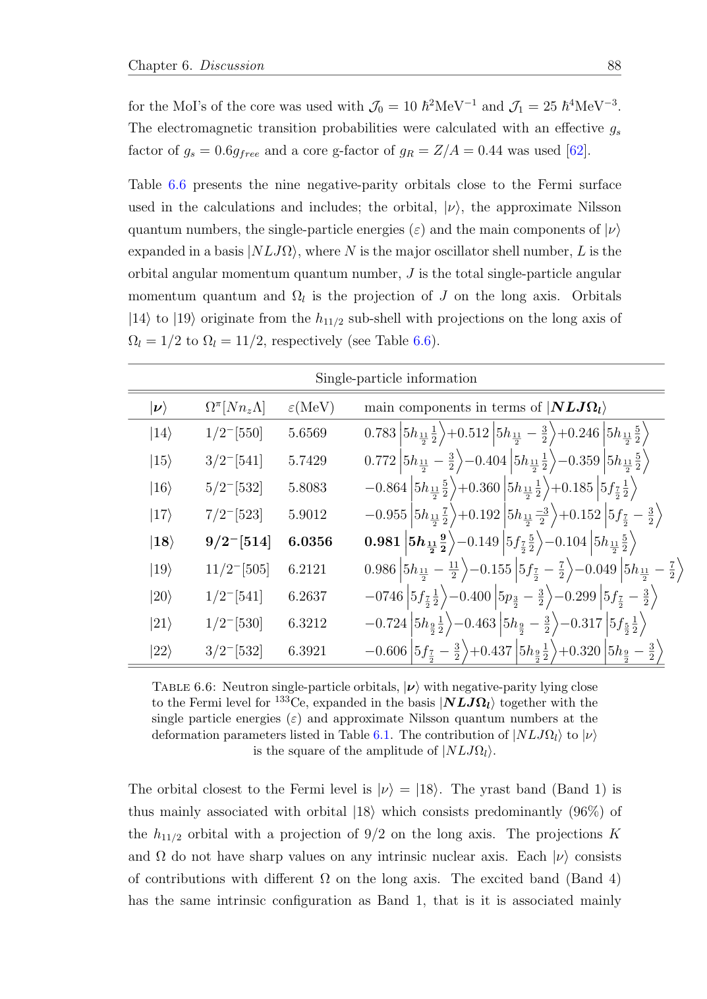

# 固定轨道、Kramers对子与横向涨落：一个有界解析控制

结论：给定的 $31/4$ 正确。对单 $j=11/2$、只保留 $m=\pm9/2$ 的子空间，$Pj_xP=Pj_yP=0$，但 $Pj_x^2P=Pj_y^2P=(31/4)\mathbf1_2$。这说明“限制内禀空间”不等于“原量子角动量成为严格经典矢量、横向二阶矩为零”。它不证明133Ce实际FA怎样实现，也不否证任何wobbling解释。

以下所有角动量均以ħ为单位；数值算符取ħ=1。源动机与不能越过的边界先写于[contract.md](contract.md)。

## 1. 源件动机与控制空间

133Ce论文Eq3.14（PDF45/印34）用

$$H_{\rm coll}=\sum_k\frac{(I_k-j_k)^2}{2\mathcal J_k}.$$

Eq3.22（PDF48/印37）用$\Gamma(M1)=g_RR+\sum(g_ll+g_ss)$。Table6.6（PDF99/印88）的轨道$|18\rangle$近似Nilsson标签为$9/2^-[514]$，单粒子能6.0356MeV，打印三个主成分为

$$0.981\,|5h_{11/2},9/2\rangle-0.149\,|5f_{7/2},5/2\rangle-0.104\,|5h_{11/2},5/2\rangle.$$

源文紧接着说各轨道含不同$\Omega$，并非各轴投影锐定。Ch6.3.3（PDF107–108/印96–97）把其FA实现描述为限制到轨道$|18\rangle$，再比较能谱/S与完整九轨道计算。**本练习没有完整轨道展开、BCS参数/相位、body-fixed算符及producer，所以不把打印top3归一化成“真实$|18\rangle$”；更不把这里的子空间自动等同作者FA。**

控制仅取实验室固定轴单一不可约$j=11/2$空间

$$\mathcal H_j=\operatorname{span}\{|j,m\rangle:m=-11/2,-9/2,\ldots,11/2\},$$

并按顺序选取

$$P=|+9/2\rangle\langle+9/2|+|-9/2\rangle\langle-9/2|,\qquad Q=1-P.$$

这里z是控制的量子化轴；不把这个lab单j模型当成论文的全部内禀轴映射或耦合总I空间。

## 2. 独立ladder与解析二阶矩

标准有限矩阵满足

$$j_\pm|j,m\rangle=\sqrt{(j\mp m)(j\pm m+1)}\,|j,m\pm1\rangle,$$

$$j_x=\frac{j_++j_-}{2},\qquad j_y=\frac{j_+-j_-}{2i}.$$

对$m=9/2$，升、降一步的振幅平方分别为11与20。因此

$$j_x|9/2\rangle=\frac{\sqrt{11}}2|11/2\rangle+\frac{\sqrt{20}}2|7/2\rangle,$$

$$\langle j_x^2\rangle=\frac{11+20}{4}=\frac{31}{4}.$$

$j_y$只改变这两项的相位，因此二阶矩相同；负m伙伴由时间反演得到同值。另一条独立解析路线是

$$\langle j_x^2\rangle=\langle j_y^2\rangle=\frac{j(j+1)-m^2}{2}
=\frac{143/4-81/4}{2}=\frac{31}{4}.$$

$j_x,j_y$只能改m一单位，所选两态相差9单位，所以所有P内横向矩阵元为零；二阶算符最多改m两单位，亦无两伙伴间的off-diagonal项。于是

$$Pj_xP=Pj_yP=0,\qquad Pj_zP=\begin{pmatrix}9/2&0\\0&-9/2\end{pmatrix},$$

$$Pj_x^2P=Pj_y^2P=\frac{31}{4}\mathbf1_2,\qquad Pj_z^2P=\frac{81}{4}\mathbf1_2.$$

这些是完整j算符的压缩。把P空间视作新的有效模型后，若只定义$j_{x,\rm eff}=Pj_xP=0$，再把它平方得到零，就已把“有效二阶observable”偷偷替换为“一阶有效observable的平方”。两者不是同一操作。

## 3. 漏出项的正半定恒等式

插入$1=P+Q$，对任一Hermitian $j_k$有

$$Pj_k^2P=(Pj_kP)^2+Pj_kQj_kP.$$

后一项等于$(Qj_kP)^\dagger(Qj_kP)$，故对P内任一向量非负。在本例

$$Pj_xQj_xP=Pj_yQj_yP=\frac{31}{4}\mathbf1_2,\qquad Pj_zQj_zP=0.$$

“漏出”表示一次作用把态送到被删的空间，再由二次作用返回；它是算符代数的空间截断效应，不是实验缺计数或概率不守恒。

完整Casimir压缩为$P\mathbf j^2P=143/4$，而压缩一阶算符平方之和仅为81/4；差额31/2恰等于两个横向漏出项之和。压缩后的三个一阶算符也不再满足原su(2)代数：

$$[Pj_xP,Pj_yP]=0\ne iPj_zP.$$

完整对易关系由Q空间交叉项补回：

$$P[j_x,j_y]P=[Pj_xP,Pj_yP]+Pj_xQj_yP-Pj_yQj_xP=iPj_zP.$$

脚本以精确根式矩阵核了这条恒等式，避免把投影空间误当成完整spin-1/2角动量表示。

## 4. 时间反演、Kramers与最高权重极限

采用

$$T|j,m\rangle=(-1)^{j-m}|j,-m\rangle,\qquad T=UK.$$

在选定顺序$(|+9/2\rangle,|-9/2\rangle)$中，

$$U_P=\begin{pmatrix}0&1\\-1&0\end{pmatrix},\qquad T^2=U_PU_P^*=-\mathbf1_2.$$

即$T|+9/2\rangle=-|-9/2\rangle$，$T|-9/2\rangle=|+9/2\rangle$。P保持时间反演，j为T-odd，二阶矩与漏出项T-even。只留单独$|+9/2\rangle$的rank-1投影不保持T；不能把单取向态与完整Kramers对子混为一谈。

对二维完整Kramers对子，任意Hermitian算符可写$a_0\mathbf1+\mathbf a\cdot\boldsymbol\sigma$。时间反演使三个Pauli项变号，所以T-even的Hermitian算符在这个对子内必须是标量。这里二阶矩及漏出项确为常数乘单位阵，与此一致。这个结论需要“恰为一个完整、T保持的二维Kramers对子”，不推广到任意多轨道空间。

对$|j,m=+9/2\rangle$，$\langle\mathbf j\rangle=(0,0,9/2)$，横向方差均31/4，纵向方差零。任意P内叠加态的横向均值仍零、二阶矩仍31/4；纵向方差则随两伙伴的叠加而变，不能称“所有P内态都沿z完全取向”。

即使取最高权重$m=j=11/2$，也有

$$\langle j_x^2\rangle=\langle j_y^2\rangle=\frac j2=\frac{11}{4}>0.$$

最高权重态满足横向Robertson不等式的等号：$\Delta j_x\Delta j_y=j/2=|\langle j_z\rangle|/2$。$m=9/2$控制的乘积为31/4，下界为9/4，未饱和。横向涨落不是经典矢量长度改个符号就会消失的量。相对涨落仅在$j\to\infty$的适当coherent-state极限按$1/\sqrt{j}$降低；有限j不等于该极限。

反例控制：若改P为$m=\pm1/2$对子，$Pj_xP$非零，off-diagonal为3，漏出二阶矩为35/4。故“横向一阶矩阵必为零”是本次高m选择的性质，不是所有Kramers对子/单轨道FA的定理。

## 5. 投影Hamiltonian保留什么

只为检验compression identity，取一个独立整数spin-L=2空间上的Hermitian算符$X_k$，令

$$H=\sum_k A_k\bigl(X_k\otimes1-1\otimes j_k\bigr)^2.$$

这是外部有限矩阵张量控制，**X不是论文body-fixed总I的已验证实现，H不是新的133Ce QTR producer或核能谱。** 对这个模型P只作用于内禀因子，因此与X交换。精确压缩为

$$PHP=\sum_k A_k\left[X_k^2\otimes\mathbf1-2X_k\otimes(Pj_kP)+\mathbf1\otimes(Pj_k^2P)\right].$$

若先用一阶压缩算符替换j再平方，得到

$$H_{\rm square}=\sum_k A_k\bigl(X_k\otimes\mathbf1-\mathbf1\otimes(Pj_kP)\bigr)^2.$$

两者差

$$PHP-H_{\rm square}=\sum_k A_k\,\mathbf1\otimes Pj_kQj_kP
=\frac{31}{4}(A_x+A_y)\,\mathbf1.$$

本控制采用人为有理数$A_x=1/3,A_y=2/5,A_z=1/2$，单位是自洽的任意能量单位；没有采用133Ce的惯量、g或Harris参数。差为

$$\frac{341}{60}\,\mathbf1\simeq5.6833333\,\mathbf1.$$

NumPy完整张量矩阵压缩与该解析式的最大残差为3.55×10^−15（舍入误差），时间反演残差同量级。

**关键边界：此例固定A、固定P时recoil差只是同一空间内共同能量平移，不能声称它必然改变能级劈裂或同空间excitation gaps。** 若惯量随I变化、比较不同I block、增加更大内禀空间或更换P，是否还是同一共同平移须重核，不能把此处常数统一减去后当整条物理能带的零点。实际FA程序可能保留、重写或通过能量零点消去某些项，当前无输入/代码，不能判其漏项。

若用经典固定矢量$\mathbf j_{\rm cl}=(0,0,+9/2)$，相当于保留本P的正取向sector、横向数值设零。它与量子$|+9/2\rangle$压缩的差正是上式recoil。选$|\mathbf j_{\rm cl}|=j=11/2$而不是均值长度9/2，会进一步改变纵向cross term；这也是新的模型假设，不是同一个控制的等价记号。

投影磁算符同样需要逐个observable压缩。PjxP=0只说这个有效一阶横向通道在selected control里为零；不能据此推断其它波函数、带间、跨I或相对磁矩项的全部M1为零。还不能从j单独恢复l、s、gs/gl、BCS或QTR态间矩阵元。本例没有计算实验B(M1)、δ、寿命或任何新g。

## 6. Rayleigh–Ritz仅管同H与同零点

在上述同一Hermitian H上选三个嵌套空间：

1. $\{\pm9/2\}$对子×外部L=2，共10维；
2. 再加$\{\pm7/2\}$，共20维；
3. 完整j空间，共60维。

对同一能量零点下的有序本征值，min–max原理给$\lambda_k^{\rm full}\le\lambda_k^{20}\le\lambda_k^{10}$（k在相应维数内）。本控制逐项满足；相邻嵌套比较的最小上界余量分别约1.1261553与0.9897804，浮点容差10^−11。

|空间|最低两组Kramers能量（任意能量单位，约数）|
|---|---|
|10维|9.5408793，13.6405557|
|20维|8.4147240，9.5097893|
|60维|7.4249436，7.5823321|

每个能量均有Kramers伙伴；控制H为T-even、总T²=−1，所有对子劈裂仅为浮点残差。没有把这几组数叫133Ce模型预测。

但不能对各空间先减各自ground energy后仍套相同不等式。下面每一行分别保持同一个H，限制空间均由后两个basis态张成，并且两项有序绝对本征值都满足Rayleigh–Ritz上界：

|同H对角元|完整空间第一gap|受限绝对本征值|受限空间第一gap|变化|
|---|---:|---|---:|---|
|$(0,1,100)$|1|$(1,100)$|99|增大|
|$(0,99,100)$|99|$(99,100)$|1|减小|

两例分别用精确有理数比较有序绝对上界、检查gap变化方向，再独立用NumPy对同H的实际子空间压缩求本征值验证。它们共同说明：各ordinal绝对本征值的上界不能推出各自减去ground energy后的excitation gap单调增大或单调减小。这里没有比较两种不同H之间的变分序关系；每个反例都单独使用其自身固定H。

更不能把Rayleigh–Ritz用于不同g/Q/惯量、不同BCS/blocking、不同模型零点、不同I block或重新定标后的能量，或用来追踪混合/交叉后被重新命名为Band1/4的对应态。**论文九轨道与单轨道计算的“限制空间提高能量”可以作为其解释，但当前没有实际同H/参数/零点/basis嵌套的完整ledger，因此本控制不独立认证作者每一个模型点的变分关系。**

## 7. 实现、验证和失败记录

[projection_control.py](projection_control.py)只依赖Python标准库与NumPy。预检发现SymPy未安装；未联网安装，改用Fraction及平方自由根式的精确复数代数。该实现保留sqrt11、sqrt20等精确系数，用矩阵乘法验证压缩恒等式；独立ladder-action函数按解析destination及振幅平方算二阶矩；NumPy另建矩阵交叉核。

实际执行：

```bash
python3 tmp/day23-theses/ce133-projection-control/projection_control.py
```

[results.json](results.json)保存全部精确2×2矩阵、T相位、ladder分支、波动量、外部H nested spectra及每项检查。当前68项检查全部通过，包含Hermiticity、P/Q投影、su(2)/Casimir、T²/P保持、正半定漏出、最高权重、m=±1/2反例、Hamiltonian压缩/时间反演/Kramers和Rayleigh–Ritz。

这是分析恒等式和有限矩阵控制，没有网格/时间积分，不需要网格收敛或CFL测试。误差来源：精确路径无舍入；NumPy矩阵/本征值有双精度舍入；模型边界比数值误差更大。未读取真实event、未重新拟合原数据、未改canonical/raw/Git、未运行任何Day22 producer。

来源定位元数据见[source-locators.json](source-locators.json)，Table6.6的原页已新渲染并实际视觉核对：


