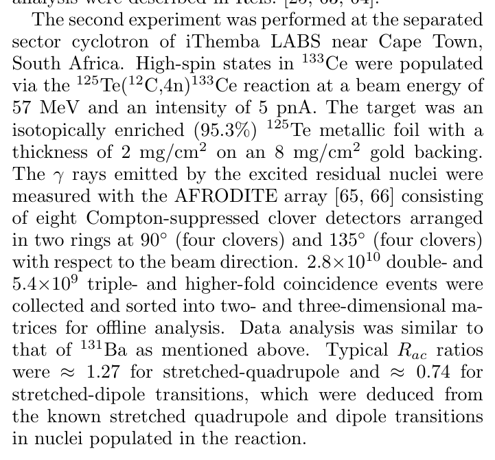
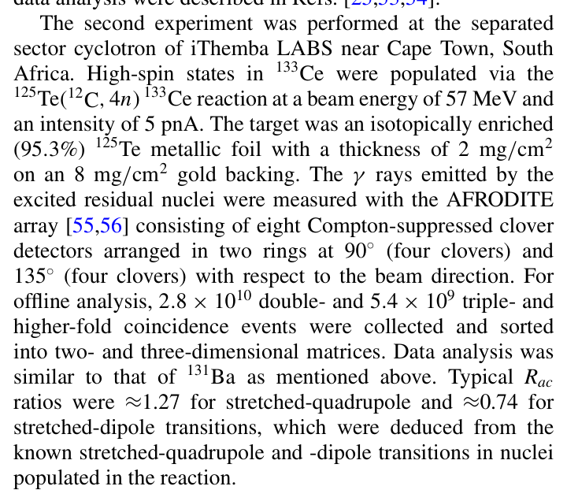
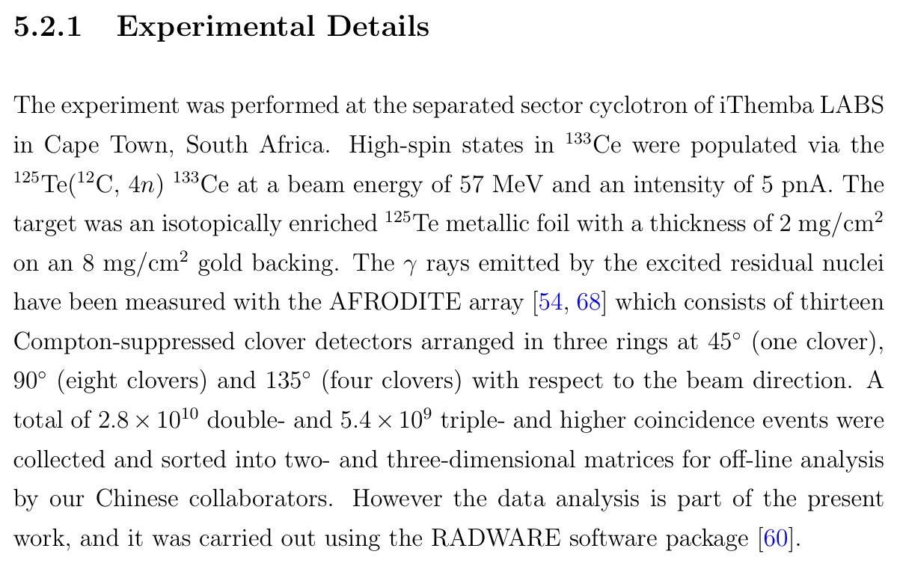
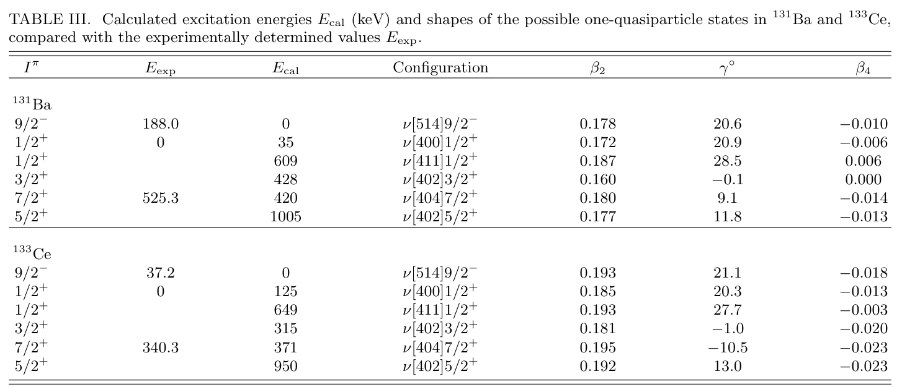
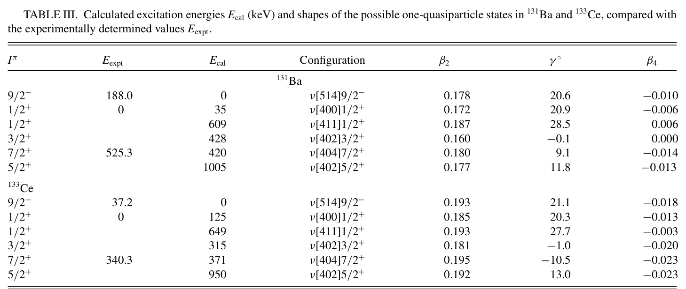
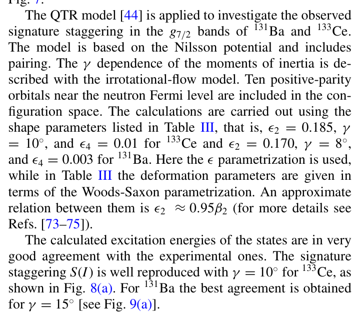
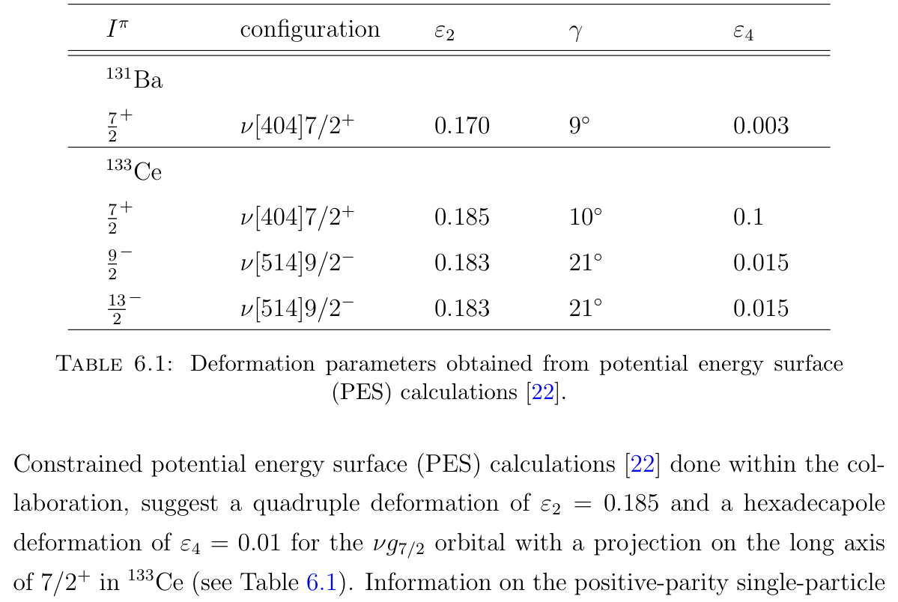
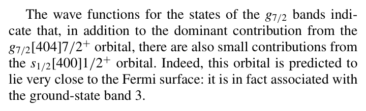
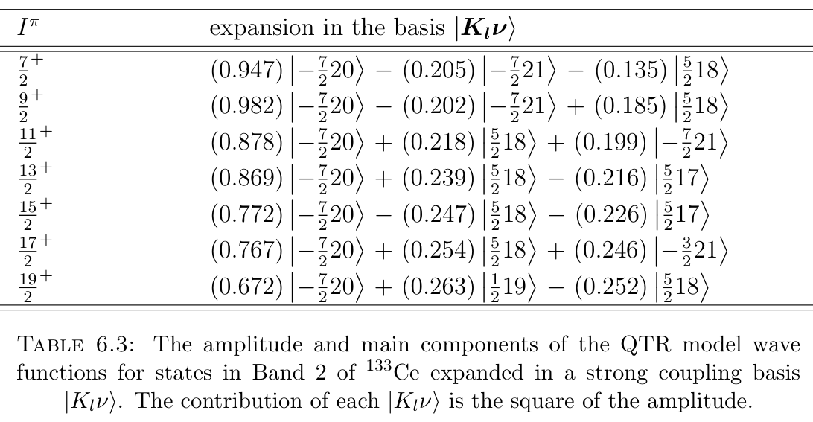

# Ding 2021两本地版本与133Ce thesis的定向交叉核查

范围仅为Day23现有source比较：探测器/反应/靶/束流/事件数，PES与QTR形变参数，以及正宇称波函数能否解决thesis的0.982归一问题。没有新来源、课程卡、canonical修改、review升级、Git或联网；没有恢复作者actual event/model producer。

## 原件身份和版本定位

| 标签 | 实际文件与身份 | SHA-256 | 实际页数 |
|---|---|---|---|
| D-manuscript | `raw/papers/2021_Ding et al_Signature splitting of the g 7 - 2 [ 404 ] 7 - 2 + bands in Ba 131 and Ce 133.pdf`；首页题名相同、Dated November9,2021；本地稿本排版，无正式064304-n页码。不能仅由文件名推为正式版 | `752d3c5da690c20ec7e188dcc043f9da2a7f062deefc371dd8a497a190b66c37` | **16** |
| D-published | `raw/papers/gpt/high-spin-20260920/旋称/2021_Ding et al_Signature splitting of the g 7 - 2 [ 404 ] 7 - 2 + bands in Ba 131 and Ce 2.pdf`；页眉PRC104,064304(2021)，PDF metadata DOI10.1103/PhysRevC.104.064304；页脚064304-n | `47451ae95676399c72b907b0efa10bdeb07e82c794a1ed480759ee20bae0c652` | **15** |
| W-thesis | `raw/papers/degree dissertation/Triaxiality and Rotational bands in 133Ce.pdf`；Wakudyanaye, Magister Scientiae, March2022 | `48556dbfe5284efebdb901cd949f534ac5552c6504e2c744603afca386660080` | 130 |

`identity.json`记录前两文件实测哈希、页数和PDF元数据。稿本与正式版的相关section内容对应，但布局/页码/参考文献编号不同；不得把一版的页码或Ref编号直接套入另一版。此次未改旧source页中任何已有阅读深度、人审或flags。

## 实验输入逐项矩阵

| 量 | D-manuscript locator / 字面值 | D-published locator / 字面值 | W-thesis locator / 字面值 | 可支持判断 |
|---|---|---|---|---|
| 133Ce反应和地点 | §II.A，PDF2右栏第2实验段：iThemba separated sector cyclotron；125Te(12C,4n)133Ce | §II.A，PDF2/064304-2右栏同段，相同 | §5.2.1印50/PDF61，相同 | 反应/实验室字段对应；不凭此定义全部run/event身份 |
| 束流能量/强度 | 同段57MeV，5pnA | 同段57MeV，5pnA | PDF61相同 | 数字对应 |
| 靶/背衬 | 同段95.3%富集125Te金属箔2mg/cm²，Au8mg/cm² | 同段相同 | PDF61 125Te2mg/cm²、Au8mg/cm²；未在该段给95.3%数值 | 主要靶字段对应；thesis未写的富集率不补成其直接报告 |
| **133Ce阵列** | §II.A/PDF2：**8 Compton-suppressed clovers，2 rings，4@90°+4@135°**；AFRODITE refs65/66 | §II.A/PDF2/064304-2：**8，4@90°+4@135°**；AFRODITE refs55/56 | §5.2.1/PDF61：**13，1@45°+8@90°+4@135°** | 两Ding版本在相关字段一致，但与thesis具体实验段冲突。仅确认字面不一致，**不裁定actual8或13** |
| 一般装置介绍 | 不用此段替实际run | 不用此段替实际run | §4.5印43/PDF54：8 clovers=4@90°+4@135°，7LEPS；另述近期升级17 | thesis本身含一般8/升级17和实际段13；一般介绍不是实际run响应证明 |
| 事件计数 | PDF2：2.8×10¹⁰ double、5.4×10⁹ triple/higher | PDF2：同值 | PDF61：同值 | 强同源候选线索，不是独立两次实验；精确events/run ledger仍缺 |
| sorting | PDF2：2D/3D矩阵，offline；分析类似131Ba | PDF2同义 | PDF61：2D/3D矩阵，中国合作者sorting，RADWARE分析 | 流程对应，未提供选择/版本/实际payload |
| 133Ce角比校准 | PDF2：Rac约1.27四极/0.74偶极，由本反应已知线确定 | PDF2相同 | §4.7/PDF59：RAD约1.3/0.8，一般all-detector gate定义 | 阵列/角组/门/取向和分母不齐，不把近似值当同一个response认证 |
| 131Ba反应/束流 | §II.A/PDF2右栏第1实验段：122Sn(13C,4n)，65MeV，5pnA，LNL XTU | §II.A/PDF2从左栏底续至右栏上部，相同 | §5.3.1印61/PDF72，相同 | 相关字段对应 |
| 131Ba靶 | PDF2：2层自支撑122Sn，每层0.5mg/cm² | PDF2同值 | PDF72同值 | 数字对应 |
| 131Ba阵列及道选择 | PDF2：GALILEO25HPGe：10@90°、5@119°、5@129°、5@152°；EUCLIDES+NeutronWall | PDF2同值 | PDF72同值 | 各值对应；未直接验证actual电子学/acceptance |
| 131Ba事件/分析 | PDF2：1.2×10⁹ ≥triple，Doppler，γγγ cube，RADWARE/GASPware；Rac用90°/152°，1.54/0.77 | PDF2同值；软件排版GASPWARE | PDF72：1.2×10⁹ ≥triple、Doppler/cube、软件同名；本段未给这些Rac数 | 对应但不重复计独立events |

实际可复制的裁图由`crop_manifest.json`绑定source SHA、PDF页及PDF-points矩形。相关图像见下方；完整字面抽取在两份`Ding-*.txt`中。

## PES参数与QTR输入：不能把β4和ε4混为同一量

两Ding版本TableIII的相关行已实际视觉核对：D-manuscript PDF13、D-published PDF8/064304-8，表头明确为Woods–Saxon参数β2、γ、β4。

| 核与组态 | 两版TableIII共同值：β2，γ，β4 | 两版QTR正文共同值：ε2，γ，ε4 | Thesis Table6.1/PDF77 | Thesis正宇称正文 |
|---|---|---|---|---|
| 131Ba ν[404]7/2+ | .180，9.1°，−.014 | .170，8°，+.003 | .170，9°，+.003 | γ扫描0/10/15/20；best约15°；PDF87–95 |
| 133Ce ν[404]7/2+ | .195，−10.5°，−.023 | .185，+10°，+.01 | .185，+10°，**+.1** | 同页PDF77紧接正文写**+.01**；γ扫描及0–15°适用描述，PDF79–86 |
| 133Ce ν[514]9/2− | .193，21.1°，−.018 | 两Ding论文的正宇称研究未给该负宇称TiP计算输入 | .183，21°，+.015；13/2−行相同 | 负宇称组态不由Ding正宇称参数修复 |

QTR正文locator：D-manuscript §III.C/PDF11左栏；D-published §III.C/PDF10/064304-10左栏。两版均明确：Nilsson potential、pairing、irrotational-flow MoI、10个近中子费米面的正宇称轨道；正文说ε参数化，而TableIII为W–S参数化。两版均只给近似关系 **ε2≈0.95β2**，没有在此给β4→ε4的变换或完整轴/张量映射。

因此：

- **可以确认**正式论文及本地稿本的QTR描述均印Ce ε4=.01，形成thesis正文.01的直接相关模型描述谱系。
- **不能据此确认**thesis实际producer也用了.01，更不能把thesis表内.1删去或将其标成已经由人审修正。需要原输入卡、版本、计算输出及参数转换/轴约定。
- β4=−.023和ε4=+.01使用不同参数化；不能把ε2≈.95β2套到四阶系数，也不能因符号不同直接宣布一个错误。
- PES的Ce γ=−10.5°与QTR +10°、Ba PES9.1°/QTR8°/thesis9°分别保留；在共同坐标/参数合同缺失时，不把它们逐数值合并为实验测得γ。
- 论文QTR best Ceγ10°、Baγ15°，与thesis的扫描/同区间描述有关，但不是逐态数值producer完全一致的证明。

## 正宇称波函数不能提供0.982归一的替代数值

直接阅读D-manuscript PDF11–12及D-published PDF10–11的QTR段，并对两份完整文本执行`.982/0.982/982`和wave-function相关检查。两文都有定性描述：$g_{7/2}[404]7/2^+$占主导，附近$s_{1/2}[400]1/2^+$有小分量、Coriolis混合能产生signature staggering；但**没有提供与thesis Table6.3逐态相同的完整振幅表或一个可替换的9/2+数值**。Figs8/9展示$S(I)$与γ/χ的比较，不是波函数振幅图。

Thesis PDF82/印71 Table6.3的9/2+行字面为.982、−.202、+.185；caption明确贡献为振幅平方。在该表所述正交basis及归一态假设下，三项平方和1.039353>1。Ding的定性主导/小混合结论，不能决定哪一个打印振幅应改、不能证明遗漏分量的数值，也不能授权重归一。

需要特别区分：

- Thesis Table6.2/PDF78中的单粒子轨道20在$|NLJ\Omega\rangle$基底内的展开，与Table6.3的**QTR总态**在$|K_l\nu\rangle$基底内展开，是不同层级。
- 同一个轨道编号20、同一个核或近似相同形变，不自动产生相同态振幅；更不能用131Ba Table6.5的系数替代133Ce Table6.3。
- Ding的Ce展示采用γ10°；thesis对应章节还展开γ15°等扫描。没有逐态共同输入与实际输出，不能假定两处正宇称波函数数值完全相同。Ding Fig4讨论alignment时给出的Harris参考参数J0=13.4、J1=33.2（稿本PDF6续9/正式PDF5），与thesis QTR核芯的10.4、35.7不是可直接互换的同一用途参数。
- 目前没有Ding的actual eigenvector/output或basis normalization文件；0.982问题保持开放，原字面值不改。

## 同源与响应输入的实际下一步

两Ding版本是同一论文的两个本地排版版本，不是两次独立测量。与thesis相比，相同反应、束流、靶厚、事件计数、合作关系，以及thesis明示正宇称理论结果纳入Ref22，均构成很强的来源依赖/共同campaign候选。**这些字段不能替代run/event ledger，也不能凭它们独裁actual8/13。**

要关闭阵列冲突，优先核现有campaign记录中的run dates/IDs、detector ID与角度表、active/disabled detectors、45°数据是否存在、事件累计/子集选择、sorting geometry版本、目标线角组及计数。要关闭模型冲突，优先核QTR实际输入卡、Nilsson与W–S参数转换/轴约定、输出表所用run及完整归一eigenvector。此处只列缺口，不生成实际detector response、δ或CI，不将期刊与thesis重复计两票。

## 实际读取与验证范围

两份Ding全PDF均按文字层抽取作版本/词项定位；定向实际读D-manuscript首页、§II.A/PDF2、§III.C/PDF11–12、TableIII/PDF13，以及D-published首页、§II.A/PDF2、TableIII/PDF8、§III.C/PDF10–11和summary/PDF12；16个新裁图绑定精确source身份。不是本轮新增一篇全文摄入声明。

验证由`validation_receipt.json`记录：三原件前后SHA、段落关键字段、页数、裁图路径及0.982检索范围。仅为当前交叉核查，不提升旧humanreview/needs_review状态。
