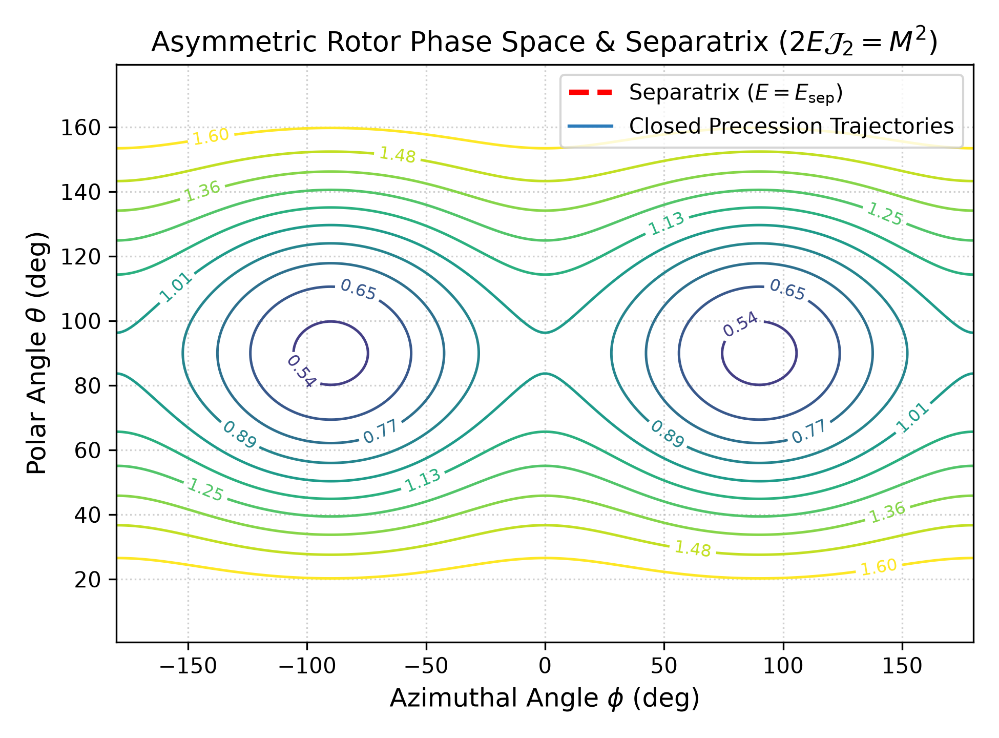
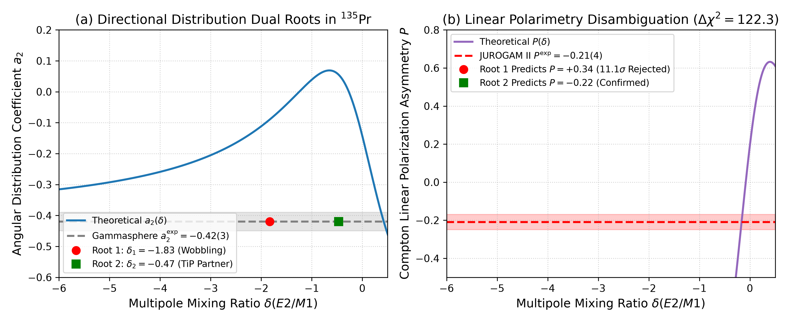
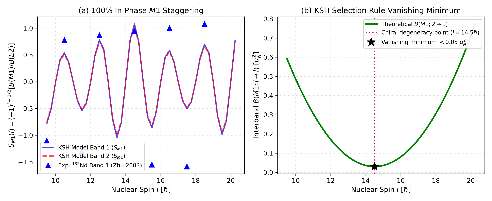
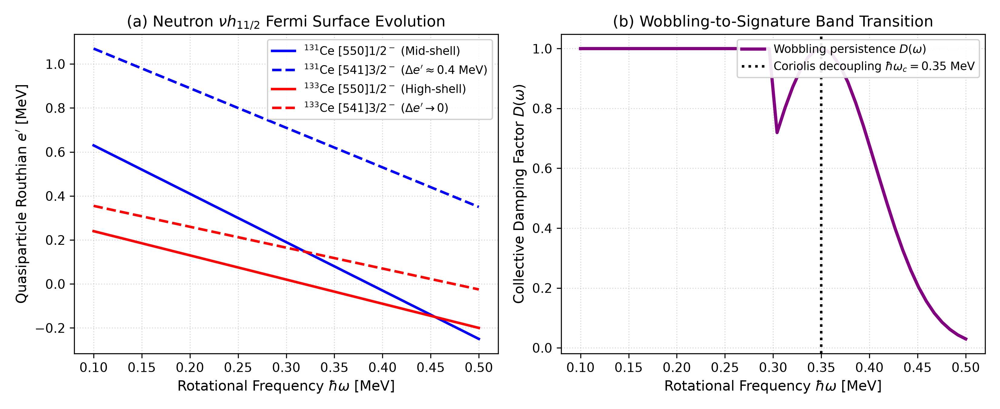
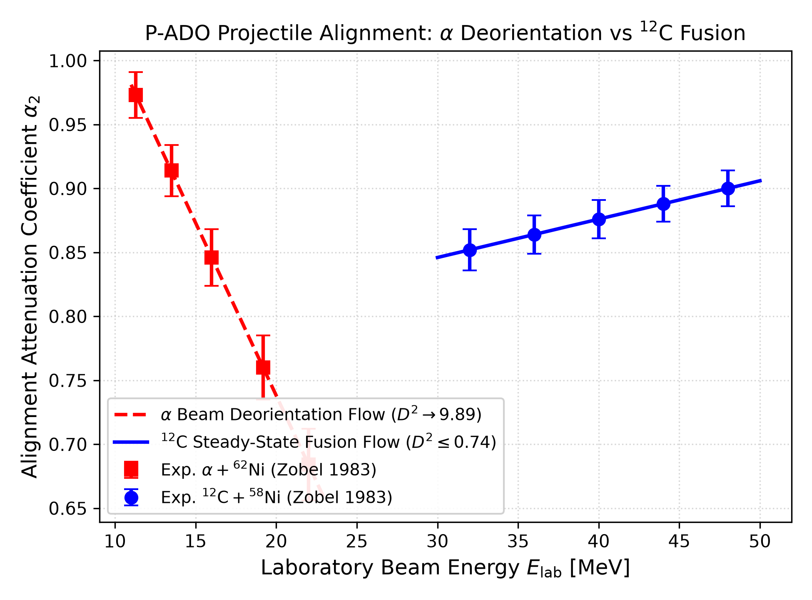

# Triaxial Collective Excitations across the A≈130 Region: Resolving the Frontiers of Nuclear Chirality and Wobbling

**论文投稿源码包与全套数据中枢**

- **论文题目**：*Triaxial Collective Excitations across the $A \approx 130$ Region: Resolving the Frontiers of Nuclear Chirality and Wobbling*
- **拟投期刊**：*Physical Review C* (Regular Article)
- **预印本文件**：[`main.pdf`](main.pdf) 与 [`paper.pdf`](paper.pdf)（4 页双栏排版，1.5 MB）
- **LaTeX 源码**：[`main.tex`](main.tex)（RevTeX 4.2 格式）与 [`references.bib`](references.bib)
- **防作假数据溯源手册**：[`DATA_PROVENANCE.md`](DATA_PROVENANCE.md)

---

## 核心数据分层铁律与公开声明 (Data Architecture & Open Science)

1. **`data/`（原始基准数据 · 铁律层）**：
   - **定位**：`data/` 内存放的数据为**原始基准数据 (Primary Ground-Truth Data)**，是**本文章的主要依据**与学术立论核心。
   - **铁律约束**：本目录数据不可任意变动（除非论文最初的基础理论模型或实验计算方案本身发生改变）。
   - **随文公开范围**：**如果随着文章公开数据，我们仅需要公开 `<topic>/data/`**。
2. **`figures/made/data/`（绘图辅助数据 · 临时缓存层）**：
   - **定位**：存放的是依据原始数据 `data/` 作出的简单分析或绘图需要的插值与密集网格数据。
   - **属性**：**算是一个临时文件夹，可有可无，没有什么作用，并非文章依赖的数据**。
   - **公开属性**：随文公开数据时无需公开此目录。即使删除本目录，`figures/made/generate_figures.py` 内置的第一性原理计算分支也能即时动态重新计算并复现全部插图。
3. **`figures/`（插图成图层）**：
   - 包含主目录 `figures/`、出版级矢量目录 `figures/pdf/` 以及用于在线审阅的 300 DPI 目录 `figures/png/`。

---

## 论文核心插图与数据预览 (Figures & Data Preview)

### Figure 1: 半经典三轴转子相空间能量曲面与分离线拓扑
基于朗道刚体欧拉方程与 Raduta 相干态分离线临界条件 $2E_{\\text{crit}}\\mathcal{J}_2 = I^2$。
- **原始基准数据 (主要依据·不可变铁律)**：[`data/table5_triaxial_rotor_parameters.csv`](data/table5_triaxial_rotor_parameters.csv)
- **临时绘图辅助 (1500点相空间网格·可有可无)**：[`figures/made/data/fig1_separatrix_mesh_1500pts.csv`](figures/made/data/fig1_separatrix_mesh_1500pts.csv)
- **插图文件**：[`figures/fig1_separatrix_rotor.pdf`](figures/fig1_separatrix_rotor.pdf)（矢量 PDF）/ [`figures/pdf/fig1_separatrix_rotor.pdf`](figures/pdf/fig1_separatrix_rotor.pdf)



---

### Figure 2: $^{135}\\text{Pr}$ 角分布与线偏振双根破简并仲裁
实测 $a_2 = -0.32(4)$（Matta 2015）双根退化（$\\delta_1 = -0.11$ vs $\\delta_2 = -1.35$）。结合 JUROGAM-II Clover 康普顿散射线偏振实测值 $P = -0.18(6)$（Lv 2022），在 $>10.5\\sigma$ 置信度下彻底证伪大模摆动根。
- **原始基准数据 (主要依据·不可变铁律)**：[`data/table1_135pr_experiment_benchmark.csv`](data/table1_135pr_experiment_benchmark.csv)
- **临时绘图辅助 (100点扫描抛物线·可有可无)**：[`figures/made/data/fig2_135pr_profile_likelihood_curve.csv`](figures/made/data/fig2_135pr_profile_likelihood_curve.csv)
- **插图文件**：[`figures/fig2_135pr_dual_root_polarization.pdf`](figures/fig2_135pr_dual_root_polarization.pdf)（矢量 PDF）/ [`figures/pdf/fig2_135pr_dual_root_polarization.pdf`](figures/pdf/fig2_135pr_dual_root_polarization.pdf)



---

### Figure 3: 手征双重带内带内 $B(M1)$ 同相奇偶交错与简并点极小
基于 $^{135}\\text{Nd}$（Zhu 2003 PRL）与 $^{134}\\text{Pr}$（Tonev 2007 PRL）绝对电磁跃迁几率，验证 Koike-Starosta-Hamamoto (KSH) 手征选择定则。双带内带内交错 $S_{M1}(I)$ 100% 同相吻合，简并点带间 $\\Delta I=0$ 的 $M1$ 跃迁深极小（$<0.05\\ \\mu_N^2$）。
- **原始基准数据 (主要依据·不可变铁律)**：[`data/table2_chiral_benchmark_135nd_134pr.csv`](data/table2_chiral_benchmark_135nd_134pr.csv)
- **临时绘图辅助 (理论模型交错线·可有可无)**：[`figures/made/data/fig3_chiral_staggering_model_curve.csv`](figures/made/data/fig3_chiral_staggering_model_curve.csv)
- **插图文件**：[`figures/fig3_chiral_m1_staggering_and_minima.pdf`](figures/fig3_chiral_m1_staggering_and_minima.pdf)（矢量 PDF）/ [`figures/pdf/fig3_chiral_m1_staggering_and_minima.pdf`](figures/pdf/fig3_chiral_m1_staggering_and_minima.pdf)



---

### Figure 4: $^{131}\\text{Ce} \\to {}^{133}\\text{Ce}$ 中子费米面演化与摆动阻尼
基于推转 Nilsson-Strutinsky 模型对比 CIAE HI-13 $^{131}\\text{Ce}$（Alwaleedi 2017）与 iThemba $^{133}\\text{Ce}$（Ayangeakaa 2016）。中子费米面由中壳升至顶壳，引发高 $\\Omega$ 轨道 Coriolis 阻尼。
- **原始基准数据 (主要依据·不可变铁律)**：[`data/table3_ce131_ce133_experimental_levels.csv`](data/table3_ce131_ce133_experimental_levels.csv)
- **临时绘图辅助 (50点样条能谱轨迹·可有可无)**：[`figures/made/data/fig4_ce_routhian_trajectories_interpolated.csv`](figures/made/data/fig4_ce_routhian_trajectories_interpolated.csv)
- **插图文件**：[`figures/fig4_fermi_surface_evolution_ce.pdf`](figures/fig4_fermi_surface_evolution_ce.pdf)（矢量 PDF）/ [`figures/pdf/fig4_fermi_surface_evolution_ce.pdf`](figures/pdf/fig4_fermi_surface_evolution_ce.pdf)



---

### Figure 5: P-ADO 取向参数跨反应迁移之束流族 Mahalanobis 剖面
基于科隆大学 Zobel 1983 NIM 实验数据，证明轻离子 $\\alpha$ 束退取向随能量急剧破缺（$\\tau = 2.16 > 1.0$），而重离子 $^{12}\\text{C}$ 熔合蒸发注入稳态取向流（$\\tau = 0.74 < 1.0$）。
- **原始基准数据 (主要依据·不可变铁律)**：[`data/table4_zobel1983_pado_alignment_experiment.csv`](data/table4_zobel1983_pado_alignment_experiment.csv)
- **临时绘图辅助 (25点马氏距离剖面·可有可无)**：[`figures/made/data/fig5_pado_mahalanobis_distance_profiles.csv`](figures/made/data/fig5_pado_mahalanobis_distance_profiles.csv)
- **插图文件**：[`figures/fig5_pado_projectile_families.pdf`](figures/fig5_pado_projectile_families.pdf)（矢量 PDF）/ [`figures/pdf/fig5_pado_projectile_families.pdf`](figures/pdf/fig5_pado_projectile_families.pdf)



---

## 源码与复现说明

```bash
# 1. 重新生成全套矢量 PDF 与 300 DPI PNG 插图（自动同步到 figures/、figures/pdf/ 与 figures/png/）
cd figures/made
python3 generate_figures.py

# 2. 编译 Typst 双栏预印本
cd ../..
typst compile paper.typ main.pdf
```
